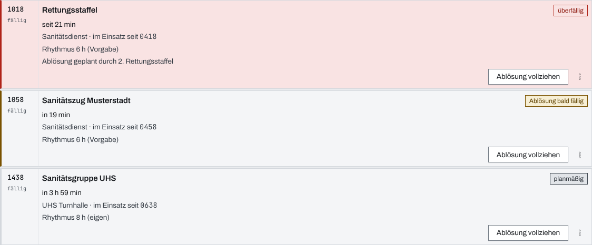

## Überblick

Das Modul **Ablösung** führt je Einheit eine **Schicht**: seit wann sie im Einsatz ist, in welchem
Rhythmus sie abgelöst werden soll und wann die Ablösung damit fällig ist. Die Seite zeigt die
laufenden Schichten nach Fälligkeit, warnt vorher (ohne anderes Schichtmodell 30 Minuten) und
meldet, wenn eine Ablösung überfällig ist.

Die Führung plant hier, welche Einheit welche ablöst, und hält den Vollzug fest. Wer das Modul
sieht, erfährt ohne Blick auf die Seite, wenn die geplante ablösende Einheit alarmiert ist,
eintrifft oder abgerufen wird und wenn kurz vor der Fälligkeit noch keine geplant ist. Schichten
beginnen, ändern und vollziehen dürfen Einsatzleitung und Führungspersonal.

## Abläufe

### Fällige Ablösungen im Blick behalten

1. Unter „Kräfte & Mittel“ „Ablösung“ öffnen. Unter „Laufend“ stehen die Schichten, die nächste
   Fälligkeit oben.
2. Je Karte links die Uhrzeit der Fälligkeit lesen, rechts die Einstufung: „planmäßig“, „Ablösung
   bald fällig“ (ab der Vorwarnzeit, ohne anderes Schichtmodell 30 Minuten vorher) oder
   „überfällig“. Darunter stehen „in …“ bzw. „seit …“, Abschnitt, „im Einsatz seit“, der Rhythmus
   als Dauer mit seiner Quelle („Vorgabe“ des Abschnitts, „Vorgabe Einsatz“ oder „eigen“) und eine
   geplante ablösende Einheit.

   

3. Unter „Abgelöst“ die vollzogenen Ablösungen nachlesen.

### Eine Schicht beginnen

Für Einsatzleitung und Führungspersonal:

1. „Schicht beginnen“ wählen.
2. Unter „Einheit“ eine Einheit ohne laufende Schicht wählen.
3. „Im Einsatz seit“ leer lassen oder einen Zeitpunkt wählen. Leer gilt das Eintreffen aus der
   Kräfte-Zeitachse, sonst jetzt; das Feld zeigt, was gilt.
4. Unter „Rhythmus“ den Rhythmus als Dauer eintragen, etwa „8 h“, „7:30“ oder „90 min“. Hat der
   Abschnitt der Einheit oder der Einsatz eine Vorgabe, steht sie im Feld, etwa „12 h (Vorgabe
   Einsatz)“, und das Feld darf leer bleiben.

   

5. „Schicht beginnen“ wählen.

### Eine Ablösung vollziehen

Für Einsatzleitung und Führungspersonal:

1. Auf der Karte „Ablösung vollziehen“ wählen.
2. Unter „Ablösende Einheit“ die Einheit wählen, die übernimmt; eine geplante steht schon dort. Ohne
   ablösende Einheit bleibt das Feld leer.
3. „Zeitpunkt“ leer lassen für jetzt oder den Zeitpunkt der Übergabe wählen.

   

4. „Vollziehen“ wählen. Die abgelöste Schicht wandert nach „Abgelöst“; die ablösende Einheit beginnt
   eine Folgeschicht mit demselben Rhythmus.
5. War es die falsche Karte, in der Meldung „Rückgängig“ wählen. Später geht das unter „Abgelöst“
   mit „Vollzug zurücknehmen“, solange die Folgeschicht unberührt ist.

### Ablösende Einheit planen und Rhythmus ändern

Für Einsatzleitung und Führungspersonal:

1. Auf der Karte das Menü „Aktionen zu …“ (drei Punkte) öffnen.
2. „Ablösende Einheit planen“ wählen, die Einheit wählen und „Speichern“ wählen. Ist die Einheit
   schon für eine andere Schicht geplant oder steht sie selbst im Einsatz, nennt eine Meldung das,
   etwa „2. Rettungsstaffel schon für Schicht Florian 1 geplant“ oder „… steht selbst im Einsatz
   seit 1340“. Die Planung gilt trotzdem.
3. Für einen anderen Rhythmus „Rhythmus ändern“ wählen, den Wert als Dauer eintragen und
   „Speichern“ wählen. Hat der Abschnitt oder der Einsatz eine Vorgabe, lässt ein leeres Feld die
   Schicht wieder ihr folgen.

### Den Rhythmus je Abschnitt vorgeben

Für Einsatzleitung und Führungspersonal:

1. Im Paneel „Rhythmus je Abschnitt“ beim Abschnitt den Stift wählen.

   

2. Den Rhythmus als Dauer eintragen, leer für keine Vorgabe.
3. „Speichern“ wählen. Alle laufenden Schichten des Abschnitts, die der Vorgabe folgen, bekommen den
   neuen Rhythmus und eine neue Fälligkeit; Schichten mit eigenem Rhythmus bleiben.

### Die Vorgabe des Einsatzes nachsehen

1. Unter den Abschnitten steht das Paneel „Vorgabe des Einsatzes“: Bezeichnung des
   Schichtmodells, Rhythmus oder Wechselzeiten, Vorwarnung und die Zahl der laufenden Schichten,
   die ihr folgen. Ohne Vorgabe steht dort „keine Vorgabe“.

   

2. Für Einsatzleitung und Führungspersonal: zum Ändern den Stift wählen. Die Einstellungen des
   Einsatzes öffnen sich im Reiter „Ablösung“ (Kapitel
   [Einstellungen des Einsatzes und Module](einsatz-einstellungen.md)).

## Hintergrund

### Fälligkeit und Hinweise

Fällig ist eine Schicht bei Beginn plus Rhythmus. Der Rhythmus liegt zwischen einer halben Stunde
und 168 Stunden und erscheint als Dauer, etwa „8 h“ oder „7:30 h“. Vor der Fälligkeit erscheint der Hinweis „Ablösung steht an“, 30 Minuten vorher,
wenn das Schichtmodell des Einsatzes nichts anderes vorgibt, bei
Fälligkeit der Alarm „Ablösung fällig“, jeweils mit Einheit und Uhrzeit der Fälligkeit, etwa
„Florian 1, 15:30“, und „Öffnen“ zur Seite Ablösung. Die Zahl am Modul in der Seitenleiste zählt
die Schichten, die bald fällig oder überfällig sind; der Überblick führt die Fälligkeiten als
Marken.

Ist zwei Stunden vor der Fälligkeit noch keine ablösende Einheit geplant, kommt der Hinweis
„Keine ablösende Einheit geplant“, ebenfalls mit Einheit und Uhrzeit der Fälligkeit. Wie lange
vorher, legt der Planungsvorlauf des Schichtmodells fest. Er kommt einmal; ändert sich die
Fälligkeit, kommt er zur neuen Zeit. Ist eine Einheit geplant, kommt er nicht; wird die Planung
aufgehoben oder entfällt sie, steht er wieder an, solange seine Zeit noch nicht vorbei ist. Er
ändert die Einstufung der Karte nicht.

Alle drei bekommen alle, die das Modul Ablösung sehen, je Fälligkeit einmal. Die Hinweise kann
jede Person unter „Benachrichtigungen“ abschalten, den Alarm „Ablösung fällig“ nicht (Kapitel
[Einsatz auswählen und Oberfläche](einsatz-oberflaeche.md)). In den Erinnerungen steht die
Ablösung zwar, meldet sich aber nicht noch einmal als „Erinnerung fällig“.

### Hinweise zur ablösenden Einheit

Ist für eine Schicht eine ablösende Einheit geplant, bekommen alle, die das Modul Ablösung sehen,
einen Hinweis mit dezentem Ton, wenn diese Einheit

- alarmiert wird („Ablösende Einheit alarmiert“),
- eintrifft („Ablösende Einheit eingetroffen“),
- am Bereitstellungsraum eingebucht wird („Ablösende Einheit im Bereitstellungsraum
  eingetroffen“) oder
- dort abgerufen wird („Ablösende Einheit abgerufen“).

Die Zeile darunter nennt beide Einheiten, etwa „Ablösung für Rettungsstaffel: 2. Rettungsstaffel“;
„Öffnen“ führt zur Seite Ablösung. Wer das Ereignis selbst ausgelöst hat, bekommt keinen Hinweis.
Alarmiert und eingetroffen zählen nur am Anfang ihres Einsatzabschnitts in der
Kräfte-Zeitachse, ein Nachtrag in einen abgeschlossenen Abschnitt meldet nichts. Bei einem
Verband zählt nur die geplante Einheit, nicht ihre Untereinheiten.

Wird die geplante Einheit aufgelöst oder entlassen, entfällt die Planung: die Karte zeigt keine
geplante Ablösung mehr, das Einsatztagebuch hält „Planung der ablösenden Einheit entfallen“ fest,
und die Leser bekommen den Hinweis „Planung der ablösenden Einheit entfallen“. Danach steht der
Hinweis „Keine ablösende Einheit geplant“ wieder an.

### Vorgabe des Einsatzes und Schichtmodelle

Woher der Rhythmus einer Schicht kommt, folgt einer festen Reihenfolge: ein eigener Wert der
Schicht, sonst die Vorgabe des Abschnitts, sonst die Vorgabe des Einsatzes. Die Vorgabe des
Einsatzes ist die Kopie eines Schichtmodells. Ein neuer Einsatz bekommt das Schichtmodell, das die
Organisation als Vorgabe führt; hat sie keines, hat auch der Einsatz keine Vorgabe.

Ein Schichtmodell gibt einen festen Rhythmus vor oder feste Wechselzeiten, etwa 06:00 und 18:00
mit vier Stunden Mindestdauer. Bei Wechselzeiten ist die Schicht zum ersten Wechsel fällig, zu dem
die Einheit mindestens die Mindestdauer im Einsatz ist, gerechnet in der Zeitzone des Einsatzes,
sonst der Organisation: wer um 13:42 beginnt, ist um 18:00 fällig, wer um 15:00 beginnt, um 06:00
am Folgetag. Das Schichtmodell legt auch fest, wie lange vorher der Hinweis kommt.

Gesetzt wird die Vorgabe des Einsatzes in den Einstellungen des Einsatzes, Reiter „Ablösung“; die
Schichtmodelle der Organisation pflegt die Verwaltung (Kapitel [Stammdaten](stammdaten.md)).
Ändert sich die Vorgabe des Einsatzes, rechnen die Schichten neu, die ihr folgen; Schichten mit
eigenem Rhythmus oder nach der Vorgabe ihres Abschnitts bleiben. Ändert jemand das Schichtmodell in
den Stammdaten oder löscht es, bleibt der laufende Einsatz unberührt.

Auf schmalen Bildschirmen im Handschuh-Betrieb kürzt die Karte das Wort „Vorgabe Einsatz“ mit „…“,
wenn der Platz nicht reicht; der Wert des Rhythmus bleibt ganz stehen.

### Eine Schicht je Einheit

Je Einheit läuft höchstens eine Schicht. „Schicht beginnen“ bietet deshalb nur Einheiten ohne
laufende Schicht an. Hat die ablösende Einheit schon eine laufende Schicht, scheitert der Vollzug,
und nichts ändert sich.

### Schicht beginnt mit dem Eintreffen

Hat der Einsatz oder der Abschnitt einer Einheit eine Vorgabe, beginnt ihre Schicht von selbst,
sobald die Einheit eintrifft: über einen Status mit der Marke „Eintreffen“, ein nachgetragenes
Eintreffen in der Kräfte-Zeitachse oder das Eintreffen am Bereitstellungsraum. „Im Einsatz seit“
ist dann der Zeitpunkt des Eintreffens, der Rhythmus kommt aus der Vorgabe (die des Abschnitts vor
der des Einsatzes). Das Einsatztagebuch nennt das mit „mit dem Eintreffen begonnen“. Ohne Vorgabe
beginnt keine Schicht von selbst; dann bleibt „Schicht beginnen“ von Hand. Ist die Einheit schon
als ablösende Einheit geplant, beginnt ihre Schicht erst mit dem Vollzug der Ablösung.

Gehört eine Einheit zu einem Verband, dessen Einheit schon eine laufende Schicht hat, bekommt sie
mit ihrem Eintreffen keine eigene: sie läuft in der Schicht des Verbands mit. Wer für sie trotzdem
eine eigene Schicht braucht, beginnt sie von Hand.

### Schicht endet mit der Entlassung

Wird eine Einheit entlassen (Status mit der Marke „Entlassung“ oder nachgetragen), endet ihre
laufende Schicht ohne Ablösung, und ihre Erinnerungen fallen weg: eine entlassene Einheit meldet
nie „Ablösung fällig“. Wird diese Entlassung in der Kräfte-Zeitachse wieder gestrichen, läuft die
Schicht weiter wie zuvor. Wird eine Einheit aufgelöst, endet ihre Schicht ebenso; sie bleibt als
Nachweis erhalten.

### Zusammenhang mit der Kräfte-Zeitachse

Der Vollzug schreibt an der abgelösten Einheit das Ereignis „Ablösung“ in die Kräfte-Zeitachse, mit
dem ihr Einsatzabschnitt endet; die Rücknahme streicht es wieder. Dieses Ereignis lässt sich nicht
von Hand streichen (Kapitel [Meldebild und Kräfte-Zeitachse](meldebild.md)). Umgekehrt beginnt das
Eintreffen einer Einheit ihre Schicht, und ihre Entlassung beendet sie (siehe oben).

### Einsatztagebuch

Das Einsatztagebuch hält den Beginn einer Schicht (auch mit dem Eintreffen), Änderungen an Rhythmus
und Planung, eine entfallene Planung, jeden Vollzug mit Einheit, ablösender Einheit und
Zeitpunkt, jede Rücknahme und das Ende mit der Entlassung fest. Eine Änderung der Vorgabe eines Abschnitts oder des Einsatzes steht
dort als Entscheidung.

### Rechte und ohne Netz

Lesen darf, wer das Modul Ablösung sieht. Schichten beginnen, ändern, vollziehen und zurücknehmen
und Vorgaben setzen dürfen Einsatzleitung und Führungspersonal, solange der Einsatz läuft (Kapitel
[Rechte im Einsatz](rechte-im-einsatz.md)). Ohne Schreibrecht ist „Schicht beginnen“ gesperrt, und
die Karten zeigen keine Aktionen. Die Ablösung gehört nicht zu dem, was die App für die Arbeit ohne
Netz vorhält (Kapitel [Ohne Netz](ohne-netz.md)).
