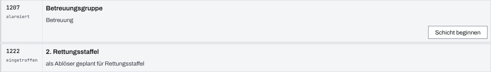
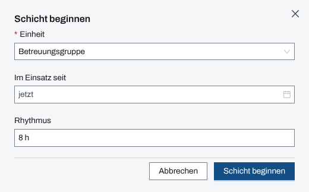
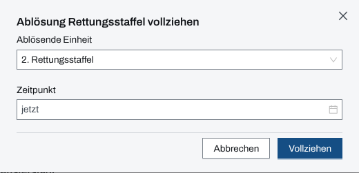
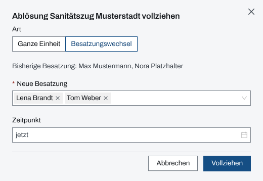
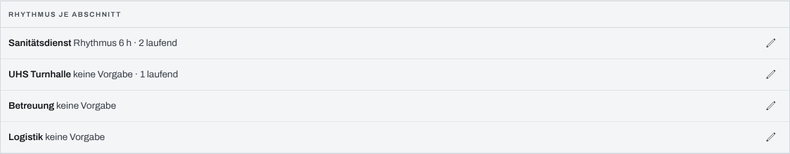
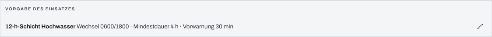

## Überblick

Das Modul **Ablösung** führt je Einheit eine **Schicht**: seit wann sie im Einsatz ist, in welchem
Rhythmus sie abgelöst werden soll und wann die Ablösung damit fällig ist. Die Seite zeigt die
laufenden Schichten nach Fälligkeit, warnt vorher (ohne anderes Schichtmodell 30 Minuten) und
meldet, wenn eine Ablösung überfällig ist.

Die Führung sieht hier auch, welche Einheiten im Einsatz noch keine Schicht haben, plant, welche
Einheit welche ablöst, und hält den Vollzug fest. Wer das Modul sieht, erfährt ohne Blick auf die
Seite, wenn die geplante ablösende Einheit alarmiert ist, eintrifft oder abgerufen wird und wenn
kurz vor der Fälligkeit noch keine geplant ist. Schichten beginnen, ändern und vollziehen dürfen
Einsatzleitung und Führungspersonal.

## Abläufe

### Fällige Ablösungen im Blick behalten

1. Unter „Kräfte & Mittel“ „Ablösung“ öffnen. Unter „Laufend“ stehen die Schichten, die nächste
   Fälligkeit oben.
2. Je Karte links die Uhrzeit der Fälligkeit lesen, rechts die Einstufung: „planmäßig“, „Ablösung
   bald fällig“ (ab der Vorwarnzeit, ohne anderes Schichtmodell 30 Minuten vorher) oder
   „überfällig“. Darunter stehen „in …“ bzw. „seit …“, Abschnitt, „im Einsatz seit“, der Rhythmus
   als Dauer mit seiner Quelle („Vorgabe“ des Abschnitts, „Vorgabe Einsatz“ oder „eigen“), unter
   „gilt auch für:“ die Untereinheiten, die in dieser Schicht mitlaufen, und die geplanten
   ablösenden Einheiten („Ablösung geplant durch …“). Ist eine von ihnen alarmiert oder
   eingetroffen, steht dort ihr Stand, etwa „Ablösung: 2. Rettungsstaffel · alarmiert 1340 ·
   eingetroffen 1412 (BR Sportplatz)“. Ist eine geplante Einheit schon für eine andere Schicht
   geplant oder steht sie selbst im Einsatz, nennt die Zeile darunter das, etwa „Sanitätsgruppe UHS
   steht selbst im Einsatz seit 0820“.

   

3. Unter „Vergangen“ mit „Abgelöst“ die vollzogenen Ablösungen nachlesen: „Abgelöst durch …“
   nennt alle ablösenden Einheiten, eine übernommene Schicht mit „(Schicht übernommen)“, und
   „Abschnitt … übergeben“ den Abschnitt, der mitging. Mit „Beendet“ stehen dort die
   Schichten, die ohne Ablösung endeten: „beendet · entlassen“ mit der Uhrzeit der Entlassung oder
   „beendet · aufgelöst“.

### Einheiten ohne Schicht finden

1. „Ohne Schicht“ wählen. Die Zahl am Segment nennt die Einheiten im Einsatz, die keine Schicht
   haben; auf dem Handy steht sie im Kopf der Seite („… ohne Schicht“).
2. Je Zeile links lesen, seit wann die Einheit eingetroffen ist („eingetroffen“) oder, solange sie
   unterwegs ist, seit wann sie alarmiert ist („alarmiert“); daneben Name und Abschnitt. Eine
   Einheit, die schon als ablösende Einheit geplant ist, nennt „als Ablöser geplant für …“.

   

3. Einsatzleitung und Führungspersonal wählen an der Zeile „Schicht beginnen“. Der Dialog öffnet mit
   der Einheit schon gewählt; weiter wie unter „Eine Schicht beginnen“ ab Schritt 3. Danach
   verschwindet die Zeile.

### Eine Schicht beginnen

Für Einsatzleitung und Führungspersonal:

1. „Schicht beginnen“ wählen.
2. Unter „Einheit“ eine Einheit ohne laufende Schicht wählen.
3. „Im Einsatz seit“ leer lassen oder einen Zeitpunkt wählen. Leer gilt das Eintreffen aus der
   Kräfte-Zeitachse, sonst jetzt; das Feld zeigt, was gilt.
4. Unter „Rhythmus“ den Rhythmus als Dauer eintragen, etwa „8 h“, „7:30“ oder „90 min“. Hat der
   Abschnitt der Einheit oder der Einsatz eine Vorgabe, steht sie im Feld, etwa „12 h (Vorgabe
   Einsatz)“, und das Feld darf leer bleiben.

   

5. „Schicht beginnen“ wählen.

### Eine Ablösung vollziehen

Für Einsatzleitung und Führungspersonal:

1. Auf der Karte „Ablösung vollziehen“ wählen. Unter „Art“ steht „Ganze Einheit“; für einen
   Wechsel nur der Mannschaft siehe den nächsten Ablauf.
2. Unter „Ablösende Einheiten“ die Einheiten wählen, die übernehmen, höchstens acht; die geplanten
   stehen schon dort. Ohne ablösende Einheit bleibt das Feld leer. Eine Einheit mit „· Schicht
   läuft“ hat schon eine eigene Schicht; der Vollzug übernimmt sie.
3. „Zeitpunkt“ leer lassen für jetzt oder den Zeitpunkt der Übergabe wählen.
4. „Abschnitt übergeben (…)“ angehakt lassen, wenn die ablösenden Einheiten den Abschnitt der
   abgelösten übernehmen; sonst den Haken entfernen. Die Option steht nur da, wenn die abgelöste
   Einheit einen Abschnitt hat.
5. Unter „Danach“ wählen, wohin die abgelöste Einheit geht: „In Ruhe“ steht schon dort,
   „Bereitstellungsraum «…»“ schickt sie in einen aktiven Raum, „Entlassen“ entlässt sie aus dem
   Einsatz.

   

6. „Vollziehen“ wählen. Die abgelöste Schicht wandert nach „Vergangen“, „Abgelöst“, ihre Karte
   nennt den Verbleib („danach Bereitstellungsraum …“, „danach entlassen“); jede ablösende Einheit
   beginnt eine Folgeschicht mit demselben Rhythmus.
7. War es die falsche Karte, in der Meldung „Rückgängig“ wählen. Später geht das unter „Vergangen“,
   „Abgelöst“ mit „Vollzug zurücknehmen“, solange jede Folgeschicht unberührt ist.

### Die Besatzung wechseln

Für Einsatzleitung und Führungspersonal, wenn das Fahrzeug vor Ort bleibt und nur die Mannschaft
getauscht wird:

1. Auf der Karte „Ablösung vollziehen“ wählen.
2. Unter „Art“ „Besatzungswechsel“ wählen. Statt der ablösenden Einheiten steht „Bisherige
   Besatzung“ mit den Personen der Einheit und ihrer Untereinheiten, die in ihrer Schicht
   mitlaufen.
3. Unter „Neue Besatzung“ die Personen wählen, die übernehmen. Wer schon zur bisherigen Besatzung
   gehört, fehlt in der Liste; wer eine andere Einheit führt, steht dort gesperrt mit „· führt …“.

   

4. „Zeitpunkt“ leer lassen für jetzt oder den Zeitpunkt des Wechsels wählen.
5. „Vollziehen“ wählen. Die Einheit behält ihr Fahrzeug, ihren Abschnitt und eine Folgeschicht mit
   demselben Rhythmus; die abgelöste Schicht steht unter „Vergangen“, „Abgelöst“ mit
   „Besatzungswechsel · neu: …“.
6. „Rückgängig“ in der Meldung oder später „Vollzug zurücknehmen“ stellt die alte Besatzung wieder
   her.

### Ablösende Einheit planen und Rhythmus ändern

Für Einsatzleitung und Führungspersonal:

1. Auf der Karte das Menü „Aktionen zu …“ (drei Punkte) öffnen.
2. „Ablösende Einheit planen“ wählen, unter „Ablösende Einheiten“ eine oder mehrere Einheiten
   wählen (höchstens acht) und „Speichern“ wählen. Ist eine Einheit
   schon für eine andere Schicht geplant oder steht sie selbst im Einsatz, nennt eine Meldung das,
   etwa „2. Rettungsstaffel schon für Schicht Florian 1 geplant“ oder „… steht selbst im Einsatz
   seit 1340“. Die Planung gilt trotzdem.
3. Für einen anderen Rhythmus „Rhythmus ändern“ wählen, den Wert als Dauer eintragen und
   „Speichern“ wählen. Hat der Abschnitt oder der Einsatz eine Vorgabe, lässt ein leeres Feld die
   Schicht wieder ihr folgen.

### Den Rhythmus je Abschnitt vorgeben

Für Einsatzleitung und Führungspersonal:

1. Im Paneel „Rhythmus je Abschnitt“ beim Abschnitt den Stift wählen.

   

2. Den Rhythmus als Dauer eintragen, leer für keine Vorgabe.
3. „Speichern“ wählen. Alle laufenden Schichten des Abschnitts, die der Vorgabe folgen, bekommen den
   neuen Rhythmus und eine neue Fälligkeit; Schichten mit eigenem Rhythmus bleiben.

### Die Vorgabe des Einsatzes nachsehen

1. Unter den Abschnitten steht das Paneel „Vorgabe des Einsatzes“: Bezeichnung des
   Schichtmodells, Rhythmus oder Wechselzeiten, Vorwarnung und die Zahl der laufenden Schichten,
   die ihr folgen. Ohne Vorgabe steht dort „keine Vorgabe“.

   

2. Für Einsatzleitung und Führungspersonal: zum Ändern den Stift wählen. Die Einstellungen des
   Einsatzes öffnen sich im Reiter „Ablösung“ (Kapitel
   [Einstellungen des Einsatzes und Module](einsatz-einstellungen.md)).

## Hintergrund

### Fälligkeit und Hinweise

Fällig ist eine Schicht bei Beginn plus Rhythmus. Der Rhythmus liegt zwischen einer halben Stunde
und 168 Stunden und erscheint als Dauer, etwa „8 h“ oder „7:30 h“. Vor der Fälligkeit erscheint der Hinweis „Ablösung steht an“, 30 Minuten vorher,
wenn das Schichtmodell des Einsatzes nichts anderes vorgibt, bei
Fälligkeit der Alarm „Ablösung fällig“, jeweils mit Einheit und Uhrzeit der Fälligkeit, etwa
„Florian 1, 1530“ (bei „Datum und Uhrzeit“ „Florian 1, 15:30“), und „Öffnen“ zu dieser Schicht auf der Seite Ablösung. Die Zahl am Modul in der Seitenleiste zählt
die Schichten, die bald fällig oder überfällig sind; der Überblick führt die Fälligkeiten als
Marken.

Ist zwei Stunden vor der Fälligkeit noch keine ablösende Einheit geplant, kommt der Hinweis
„Keine ablösende Einheit geplant“, ebenfalls mit Einheit und Uhrzeit der Fälligkeit. Wie lange
vorher, legt der Planungsvorlauf des Schichtmodells fest. Er kommt einmal; ändert sich die
Fälligkeit, kommt er zur neuen Zeit. Ist eine Einheit geplant, kommt er nicht; wird die Planung
aufgehoben oder entfällt sie, steht er wieder an, solange seine Zeit noch nicht vorbei ist. Er
ändert die Einstufung der Karte nicht.

Alle drei bekommen alle, die das Modul Ablösung sehen, je Fälligkeit einmal. Die Hinweise kann
jede Person unter „Benachrichtigungen“ abschalten, den Alarm „Ablösung fällig“ nicht (Kapitel
[Einsatz auswählen und Oberfläche](einsatz-oberflaeche.md)). In den Erinnerungen steht die
Ablösung zwar, meldet sich aber nicht noch einmal als „Erinnerung fällig“.

### Hinweise zur ablösenden Einheit

Ist für eine Schicht eine ablösende Einheit geplant, bekommen alle, die das Modul Ablösung sehen,
einen Hinweis mit dezentem Ton, wenn diese Einheit

- alarmiert wird („Ablösende Einheit alarmiert“),
- eintrifft („Ablösende Einheit eingetroffen“),
- am Bereitstellungsraum eingebucht wird („Ablösende Einheit im Bereitstellungsraum
  eingetroffen“),
- dort abgerufen wird („Ablösende Einheit abgerufen“) oder
- ihre Alarmierung oder ihr Eintreffen in der Kräfte-Zeitachse gestrichen wird („Alarmierung der
  ablösenden Einheit gestrichen“, „Eintreffen der ablösenden Einheit gestrichen“); der frühere
  Hinweis gilt dann nicht mehr.

Die Zeile darunter nennt beide Einheiten, etwa „Ablösung für Rettungsstaffel: 2. Rettungsstaffel“;
„Öffnen“ führt zur Schicht. Wer das Ereignis selbst ausgelöst hat, bekommt keinen Hinweis.
Alarmiert und eingetroffen zählen nur am Anfang ihres Einsatzabschnitts in der
Kräfte-Zeitachse, auch als Nachtrag; ein Nachtrag in einen abgeschlossenen Abschnitt und seine
Streichung melden nichts. Bei einem
Verband zählt nur die geplante Einheit, nicht ihre Untereinheiten.

Wird die geplante Einheit aufgelöst oder entlassen, entfällt die Planung: die Karte zeigt keine
geplante Ablösung mehr, das Einsatztagebuch hält „Planung der ablösenden Einheit entfallen“ fest,
und die Leser bekommen den Hinweis „Planung der ablösenden Einheit entfallen“. Danach steht der
Hinweis „Keine ablösende Einheit geplant“ wieder an.

### Sprung zur Schicht

„Öffnen“ in einem Hinweis der Ablösung (Vorwarnung, Fälligkeit, „Keine ablösende Einheit
geplant“ und die Hinweise zur ablösenden Einheit) öffnet die Seite Ablösung in der Ansicht, in der
die Schicht steht: „Laufend“, sonst „Vergangen“ mit „Abgelöst“ oder „Beendet“. Die Karte rückt ins
Bild und ist acht Sekunden lang hervorgehoben, ohne zu blinken; eine überfällige Karte behält
dabei ihre rote Fläche. Warten neue Schichten noch hinter dem Hinweis über der Liste, reiht der
Sprung sie ein. Fasst ein Hinweis mehrere zusammen, führt er nur zur Seite.

### Stand der ablösenden Einheit an der Karte

Der Stand an der Karte kommt aus der Kräfte-Zeitachse der geplanten Einheit, aus ihrem offenen
Einsatzabschnitt: „alarmiert“ mit der Alarmierung, „eingetroffen“ mit dem Eintreffen, in Klammern
der Bereitstellungsraum, solange sie dort steht. Mehrere geplante Einheiten stehen in derselben
Zeile, mit „;“ getrennt; reicht der Platz nicht, endet die Zeile mit „…“, und der ganze Text steht
im Tooltip. Ändert sich der Stand, während die Seite offen ist, zieht die Zeile nach, ohne dass die
Karte wächst.

Den Stand sieht nur, wer das Modul Einheiten sieht; den Namen des Bereitstellungsraums nur, wer
auch das Modul Bereitstellungsräume sieht. Die Warnungen zur Planung stehen in der Farbe für
Achtung, nicht in Rot; sie ändern die Einstufung der Karte nicht, und die Planung gilt trotzdem.

### Vorgabe des Einsatzes und Schichtmodelle

Woher der Rhythmus einer Schicht kommt, folgt einer festen Reihenfolge: ein eigener Wert der
Schicht, sonst die Vorgabe des Abschnitts, sonst die Vorgabe des Einsatzes. Die Vorgabe des
Einsatzes ist die Kopie eines Schichtmodells. Ein neuer Einsatz bekommt das Schichtmodell, das die
Organisation als Vorgabe führt; hat sie keines, hat auch der Einsatz keine Vorgabe.

Ein Schichtmodell gibt einen festen Rhythmus vor oder feste Wechselzeiten, etwa 06:00 und 18:00
mit vier Stunden Mindestdauer. Bei Wechselzeiten ist die Schicht zum ersten Wechsel fällig, zu dem
die Einheit mindestens die Mindestdauer im Einsatz ist, gerechnet in der Zeitzone des Einsatzes,
sonst der Organisation: wer um 13:42 beginnt, ist um 18:00 fällig, wer um 15:00 beginnt, um 06:00
am Folgetag. Das Schichtmodell legt auch fest, wie lange vorher der Hinweis kommt.

Gesetzt wird die Vorgabe des Einsatzes in den Einstellungen des Einsatzes, Reiter „Ablösung“; die
Schichtmodelle der Organisation pflegt die Verwaltung (Kapitel [Stammdaten](stammdaten.md)).
Ändert sich die Vorgabe des Einsatzes, rechnen die Schichten neu, die ihr folgen; Schichten mit
eigenem Rhythmus oder nach der Vorgabe ihres Abschnitts bleiben. Ändert jemand das Schichtmodell in
den Stammdaten oder löscht es, bleibt der laufende Einsatz unberührt.

Auf schmalen Bildschirmen im Handschuh-Betrieb kürzt die Karte das Wort „Vorgabe Einsatz“ mit „…“,
wenn der Platz nicht reicht; der Wert des Rhythmus bleibt ganz stehen.

### Eine Schicht je Einheit

Je Einheit läuft höchstens eine Schicht. „Schicht beginnen“ bietet deshalb nur Einheiten ohne
laufende Schicht an.

### Vollzug mit mehreren Ablösern

Eine Schicht kann von bis zu acht Einheiten abgelöst werden, etwa wenn zwei Staffeln eine Gruppe
ersetzen. Jede bekommt mit dem Vollzug ihre eigene Folgeschicht. Löst ein Verband ab, bekommt nur
seine oberste Einheit eine Folgeschicht; steht eine seiner Untereinheiten ebenfalls in der Liste,
läuft sie in dieser Schicht mit („gilt auch für:“).

Ist eine ablösende Einheit eingetroffen, ohne geplant zu sein, hat sie mit dem Eintreffen schon
eine eigene Schicht begonnen. Der Vollzug übernimmt diese Schicht als Folgeschicht: „Im Einsatz
seit“, Fälligkeit und Erinnerungen bleiben, das Einsatztagebuch nennt „Laufende Schicht
übernommen“. Die Rücknahme lässt diese Schicht weiterlaufen und löst sie nur von der abgelösten.
Führt eine Einheit schon die Folgeschicht einer anderen Ablösung, scheitert der Vollzug, und
nichts ändert sich.

Eine als Ablöser geplante Einheit beginnt mit ihrem Eintreffen keine eigene Schicht, ebenso wenig
die Untereinheiten eines geplanten Verbands.

### Besatzungswechsel

Beim Besatzungswechsel bleiben die Einheit, ihr Fahrzeug und ihr Abschnitt; die Folgeschicht
läuft an derselben Einheit weiter, ihre Untereinheiten laufen wie vorher darin mit. Die bisherige
Besatzung sind alle Personen, die beim Vollzug der Einheit oder einer dieser Untereinheiten
zugeordnet sind. Sie verlassen ihre Einheit, ein Fahrzeug dieser Einheiten und eine Führung dort
und bleiben im Einsatz, ohne Einheit. Die neue Besatzung kommt in die Einheit selbst; wer sie auf
Untereinheiten und Fahrzeuge verteilt, tut das danach im Modul Einheiten. Eine Person, die eine
andere Einheit führt, lässt sich nicht wählen, bis sie die Führung dort abgibt.

Die Rücknahme legt jede Person zurück, solange sie noch so steht, wie der Wechsel sie hinterlassen
hat; wer danach von Hand umgehängt wurde, bleibt dort. Der Besatzungswechsel braucht die Module
Einheiten und Personal; fehlt eines, steht „Besatzungswechsel“ gesperrt mit „Modul Einheiten
gesperrt“ bzw. „Modul Personal gesperrt“. Einsatzdauer und Ruhezeit je Person rechnet die Ablösung
nicht; sie stehen in der Kräfte-Zeitachse.

### Abschnitt übergeben

Mit „Abschnitt übergeben“ werden die ablösenden Einheiten dem Abschnitt der abgelösten Einheit
unterstellt, bei einem Verband nur seine oberste Einheit; die abgelöste Einheit steht danach ohne
Abschnitt, bis sie neu eingeteilt wird. Das Einsatztagebuch nennt „Abschnitt … an … übergeben“.
Die Rücknahme gibt jeder Einheit ihren alten Abschnitt zurück, sofern sie inzwischen nicht von
Hand anders eingeteilt wurde. Die Option braucht das Modul Einheiten; fehlt es der Person, steht
sie gesperrt mit „Modul Einheiten gesperrt“, und der Vollzug ohne sie geht weiter.

### Verbleib nach dem Vollzug

„Danach“ legt fest, was mit der abgelösten Einheit geschieht; mit ihr gehen die Untereinheiten,
die in ihrer Schicht mitlaufen.

- **In Ruhe:** Ihr Einsatzabschnitt endet mit der Ablösung, sie bleibt im Einsatz.
- **Bereitstellungsraum:** Wie „In Ruhe“, dazu tritt sie in den gewählten Raum ein und steht dort
  bereit, bis sie abgerufen wird. Zur Wahl stehen nur aktive Räume. Ist der Raum inzwischen
  aufgelöst oder steht die Einheit schon in einem Raum, scheitert der Vollzug mit dem Grund, und
  nichts ändert sich. Die Wahl braucht das Modul Bereitstellungsräume; fehlt es der Person, steht
  unter dem Feld „Modul Bereitstellungsräume gesperrt“, und nur „In Ruhe“ und „Entlassen“ sind
  wählbar.
- **Entlassen:** Ihr Einsatzabschnitt endet mit der Entlassung statt der Ablösung. Die Schicht
  zählt als abgelöst, nicht als beendet.

Steht eine ablösende Einheit beim Vollzug in einem Bereitstellungsraum, ruft der Vollzug sie
dort ab und lässt sie ausrücken; war sie schon abgerufen, tritt sie nur aus. Dafür braucht es das
Modul Bereitstellungsräume nicht.

Die Rücknahme legt auch das zurück, solange es noch so steht, wie der Vollzug es hinterlassen
hat: Die abgelöste Einheit verlässt den Raum wieder, die Entlassung wird gestrichen, und eine
abgerufene ablösende Einheit tritt wieder in ihren Raum ein. Wurde die abgelöste Einheit inzwischen
aus dem Raum abgerufen, bleibt der Raum, wie er ist.

### Schicht beginnt mit dem Eintreffen

Hat der Einsatz oder der Abschnitt einer Einheit eine Vorgabe, beginnt ihre Schicht von selbst,
sobald die Einheit eintrifft: über einen Status mit der Marke „Eintreffen“, ein nachgetragenes
Eintreffen in der Kräfte-Zeitachse oder das Eintreffen am Bereitstellungsraum. „Im Einsatz seit“
ist dann der Zeitpunkt des Eintreffens, der Rhythmus kommt aus der Vorgabe (die des Abschnitts vor
der des Einsatzes). Das Einsatztagebuch nennt das mit „mit dem Eintreffen begonnen“. Ohne Vorgabe
beginnt keine Schicht von selbst; dann bleibt „Schicht beginnen“ von Hand. Ist die Einheit schon
als ablösende Einheit geplant, auch als Teil eines geplanten Verbands, beginnt ihre Schicht erst
mit dem Vollzug der Ablösung.

Gehört eine Einheit zu einem Verband, dessen Einheit schon eine laufende Schicht hat, bekommt sie
mit ihrem Eintreffen keine eigene: sie läuft in der Schicht des Verbands mit. Die Karte des
Verbands nennt sie unter „gilt auch für:“, unter „Ohne Schicht“ steht sie nicht. Wer für sie
trotzdem eine eigene Schicht braucht, beginnt sie von Hand.

Ob eine Schicht von Hand oder mit dem Eintreffen begann, zeigt nur das Einsatztagebuch, nicht die
Karte.

### Schicht endet mit der Entlassung

Wird eine Einheit entlassen (Status mit der Marke „Entlassung“ oder nachgetragen), endet ihre
laufende Schicht ohne Ablösung, und ihre Erinnerungen fallen weg: eine entlassene Einheit meldet
nie „Ablösung fällig“. Die Schicht steht danach unter „Vergangen“, „Beendet“ mit „beendet ·
entlassen“ und der Uhrzeit. Wird diese Entlassung in der Kräfte-Zeitachse wieder gestrichen, läuft
die Schicht weiter wie zuvor. Wird eine Einheit aufgelöst, endet ihre Schicht ebenso („beendet ·
aufgelöst“); sie bleibt als Nachweis erhalten.

Endet die Schicht eines Verbands mit seiner Entlassung, laufen seine Untereinheiten nicht mehr in
ihr mit. Sind sie selbst noch im Einsatz, stehen sie danach unter „Ohne Schicht“.

### Wer unter „Ohne Schicht“ steht

Im Einsatz ist eine Einheit, deren letzter Einsatzabschnitt in der Kräfte-Zeitachse offen ist: sie
ist alarmiert oder eingetroffen und weder entlassen noch abgelöst. Unter „Ohne Schicht“ steht sie,
solange sie weder eine eigene laufende Schicht hat noch in der Schicht ihres Verbands mitläuft.
Aufgelöste Einheiten fehlen. Ein geplanter Ablöser steht dort ohne „Schicht beginnen“: seine
Schicht beginnt mit dem Vollzug der Ablösung, eine eigene ließe den Vollzug scheitern.

Die Ansicht braucht Einheiten und Kräfte-Zeitachse und damit das Modul Einheiten. Fehlt es der
Person, steht „Ohne Schicht“ gesperrt mit „Modul Einheiten gesperrt“.

Kommt eine Einheit ohne Schicht hinzu, während die Ansicht offen ist, zählt die Zahl sie sofort mit;
die gezeigten Zeilen bleiben, wo sie sind, und ein Hinweis über der Liste nennt die neue, bis
„anzeigen“ sie einreiht (auf dem Handy der Knopf „1 neu“). Bekommt eine Einheit eine Schicht, fällt
ihre Zeile sofort weg. Dasselbe gilt für neue Schichten unter „Laufend“.

### Zusammenhang mit der Kräfte-Zeitachse

Der Vollzug schreibt an der abgelösten Einheit das Ereignis „Ablösung“ in die Kräfte-Zeitachse, mit
dem ihr Einsatzabschnitt endet, ebenso an jeder Untereinheit, die in ihrer Schicht mitläuft, und
an deren Personen; die Rücknahme streicht alle wieder. Ein Besatzungswechsel schreibt stattdessen
nur an Personen: die bisherige Besatzung bekommt „Ablösung“, die neue „Eintreffen“; die Einheit
behält ihren Einsatzabschnitt. Mit „Danach: Entlassen“ steht an der abgelösten Einheit, den
mitlaufenden Untereinheiten und deren Personen „Entlassung“ statt „Ablösung“. Diese Ereignisse
lassen sich nicht
von Hand streichen (Kapitel [Meldebild und Kräfte-Zeitachse](meldebild.md)). Umgekehrt beginnt das
Eintreffen einer Einheit ihre Schicht, und ihre Entlassung beendet sie (siehe oben).

### Einsatztagebuch

Das Einsatztagebuch hält den Beginn einer Schicht (auch mit dem Eintreffen), Änderungen an Rhythmus
und Planung, eine entfallene Planung, jeden Vollzug mit Einheit, ablösenden Einheiten,
übernommener Schicht, übergebenem Abschnitt, Verbleib, Abruf aus dem Bereitstellungsraum und
Zeitpunkt, beim Besatzungswechsel mit alter und neuer Besatzung, jede Rücknahme und das Ende mit der Entlassung fest. Eine Änderung der Vorgabe eines Abschnitts oder des Einsatzes steht
dort als Entscheidung.

### Rechte und ohne Netz

Lesen darf, wer das Modul Ablösung sieht. Schichten beginnen, ändern, vollziehen und zurücknehmen
und Vorgaben setzen dürfen Einsatzleitung und Führungspersonal, solange der Einsatz läuft (Kapitel
[Rechte im Einsatz](rechte-im-einsatz.md)). Ohne Schreibrecht ist „Schicht beginnen“ gesperrt, und
die Karten zeigen keine Aktionen. Die Ablösung gehört nicht zu dem, was die App für die Arbeit ohne
Netz vorhält (Kapitel [Ohne Netz](ohne-netz.md)).
