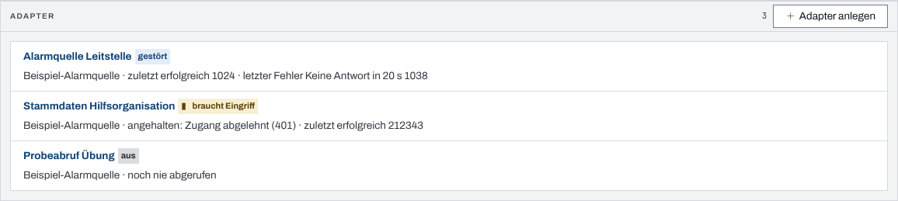

## Überblick

Eine **Anbindung** ist der Zugang eines Fremdsystems zu Lifeline Hub: etwa ein Alarm-Adapter
der Leitstelle, ein Einsatzbuch oder eine Brücke für Positionen. Das Fremdsystem meldet sich mit
einem eigenen Schlüssel an und darf nur, was der Zugang an **Rechten** trägt.

Manche Absender können sich nicht mit einem eigenen Schlüssel anmelden, sondern nur eine Adresse
aufrufen: BOSWatch, FE2 mit „URL öffnen“, der Webhook von Divera oder OsmAnd. Für sie gibt es
den **Einwurf-Zugang**. Seine Adresse enthält einen geheimen Schlüssel. Über sie lässt sich nur
einliefern, nichts lesen.

Ein **Adapter** geht den umgekehrten Weg: Lifeline Hub ruft selbst bei einem Fremdsystem ab, im
Hintergrund und in einem festen Takt. Seine Zugangsdaten (Geheimnisse) liegen verschlüsselt auf
dem Server und lassen sich nur setzen, nie wieder lesen. Das Paneel „Adapter“ erscheint, sobald
der Server eine Adapterart kennt.

Anbindungen, Einwurf-Zugänge und Adapter legt der System-Admin in der Verwaltung unter
„Einstellungen“, „Anbindungen“ an. Wie ein Fremdsystem den Zugang technisch nutzt, steht in der Anleitung für
Entwickler (`docs/api/maschinenzugang.md`, für den Einwurf `docs/api/einwurf.md`). Wie ein
Lagemonitor angebunden wird und seinen Einsatz bekommt, steht unter
[Externe Lagemonitore](externe-lagemonitore.md).

## Abläufe

### Anbindung anlegen

Für den System-Admin:

1. In der Verwaltung unter „Einstellungen“ „Anbindungen“ wählen.
2. „Anbindung anlegen“ wählen, einen „Name“ eintragen, etwa „Alarm-Adapter Wache 1“, und unter
   „Rechte“ ankreuzen, was das Fremdsystem darf. Optional „Gültig bis“ setzen.
3. „Anlegen und Code zeigen“ wählen. Der Dialog zeigt einen Code wie `ABCD-EFGH-JKMN-PQRS`, wie
   lange er gilt (15 Minuten) und das Kommando zum Einlösen.
4. Den Code an den Betreiber des Fremdsystems geben und „Fertig“ wählen. Der Code ist danach
   nicht mehr abrufbar; der Dialog schließt nur über „Fertig“, damit er nicht versehentlich
   verschwindet. Danach steht die Ansicht der neuen Anbindung.

Der Kopf zeigt „wartet auf Schlüssel“, bis das Fremdsystem den Code eingelöst hat. Danach steht
dort „aktiv“ und im Paneel „Schlüssel“ der Fingerabdruck seines Schlüssels. Das Kommando zum Einlösen nennt denselben
Fingerabdruck; stimmen beide überein, hat das richtige Gerät eingelöst.

### Rechte oder Name ändern

1. In der Liste den Namen der Anbindung wählen. Die Ansicht der Anbindung öffnet sich.
2. Im Paneel „Zugang“ „Bearbeiten“ wählen.
3. Name, „Gültig bis“ oder Rechte ändern und „Speichern“ wählen. Ein leeres „Gültig bis“ heißt:
   gilt bis zum Widerruf.

Hat ein anderer Admin die Anbindung inzwischen geändert, fragt die Seite „Zwischenzeitlich
geändert“: „Verwerfen und neu laden“ zeigt seinen Stand, „Meine Änderung übernehmen“ speichert
den eigenen.

### Schlüssel wechseln

Wenn das Fremdsystem neu aufgesetzt wird oder sein Schlüssel verloren ist:

1. Im Menü der Zeile „Neuer Code (Schlüssel wechseln)“ wählen, oder in der Ansicht der
   Anbindung „Neuer Code“.
2. Den neuen Code wie beim Anlegen weitergeben.

Bis das Fremdsystem mit dem neuen Schlüssel zum ersten Mal anfragt, zeigt die Anbindung beide
Fingerabdrücke, und der alte Schlüssel gilt weiter. Danach gilt nur noch der neue.

### Anbindung widerrufen

1. Im Menü der Zeile oder im Kopf der Ansicht „Widerrufen …“ wählen.
2. Die Rückfrage mit „Widerrufen“ bestätigen.

Ab sofort kommt das Fremdsystem nicht mehr herein. Die Anbindung bleibt mit „widerrufen“ stehen,
samt Zeitpunkt und wer widerrufen hat.

### Webhook einrichten

Für den System-Admin:

1. In der Ansicht der Anbindung im Paneel „Webhook“ „Webhook einrichten“ wählen.
2. Unter „Ziel-URL“ die Adresse eintragen, die das Fremdsystem nennt; sie beginnt mit
   `https://`.
3. Unter „Ereignisarten“ ankreuzen, was zugestellt werden soll. Arten, die die Rechte der
   Anbindung nicht öffnen, stehen ausgegraut mit dem fehlenden Recht.
4. Nur für ein Fremdsystem im eigenen Netz, etwa im ELW: „Ziel im lokalen Netz erlauben“
   ankreuzen.
5. „Einrichten“ wählen.

Danach stehen die Paneele „Webhook“, „Zustellung“ und „Zustellungen“. Ohne Verbindung zum
Server sind die Aktionen gesperrt. Die „Webhook-Kennung (aud)“
braucht der Betreiber des Fremdsystems, um die Zustellungen zu prüfen. Ziel, Arten und die
Ausnahme ändert „Bearbeiten“ im Paneel „Webhook“.

### Testereignis senden

1. Im Paneel „Zustellung“ „Testereignis senden“ wählen; bei einem angehaltenen Webhook steht es
   im Menü „Weitere Aktionen zum Webhook“ neben „Wieder aufnehmen“.
2. Das Ergebnis steht sofort darunter, etwa „Testereignis: zugestellt (204)“ oder der Grund des
   Fehlschlags, und als „Test“ unter „Zustellungen“.

Ein Testereignis ändert nichts an der Zustellung: Ein angehaltener Webhook bleibt angehalten.

### Webhook wieder aufnehmen

1. Bei einem angehaltenen Webhook im Paneel „Zustellung“ „Wieder aufnehmen“ wählen.

Die Zustellung beginnt beim nächsten Durchgang wieder, mit dem Ereignis, an dem sie stehen blieb.

### Webhook entfernen

1. Im Paneel „Zustellung“ das Menü „Weitere Aktionen zum Webhook“ öffnen und „Webhook
   entfernen …“ wählen.
2. Die Rückfrage mit „Entfernen“ bestätigen.

Webhook und Verlauf sind danach gelöscht. Ein neuer Webhook beginnt beim aktuellen Stand.

### Einwurf-Zugang anlegen

Für den System-Admin:

1. In der Verwaltung unter „Einstellungen“ „Anbindungen“ wählen. Unter den Anbindungen steht das
   Paneel „Einwurf-Zugänge“.
2. „Einwurf-Zugang anlegen“ wählen und einen „Name“ eintragen, etwa „BOSWatch Wache 1“.
3. Unter „Zweck“ wählen, was der Absender einliefert: „Alarmmeldungen einliefern“ oder
   „Positionen einliefern“. Optional „Gültig bis“ setzen.
4. „Anlegen und Adresse zeigen“ wählen. Der Dialog zeigt die Adresse, die der Absender aufruft,
   und darunter den Schlüssel allein.
5. Die Adresse beim Absender eintragen und „Fertig“ wählen. Adresse und Schlüssel sind danach
   nicht mehr abrufbar; der Dialog schließt nur über „Fertig“.

Die Zeile zeigt „aktiv“, den Zweck und „noch nie genutzt“. Nach dem ersten angenommenen Einwurf
steht dort „zuletzt genutzt“ mit der Uhrzeit.

### Schlüssel eines Einwurf-Zugangs wechseln

Wenn die Adresse in fremde Hände geraten sein kann:

1. Im Menü der Zeile „Schlüssel wechseln …“ wählen.
2. Die Rückfrage mit „Schlüssel wechseln“ bestätigen.
3. Die neue Adresse beim Absender eintragen und „Fertig“ wählen.

Der bisherige Schlüssel gilt ab der Bestätigung nicht mehr. Bis die neue Adresse beim Absender
eingetragen ist, werden seine Einwürfe abgelehnt; gesperrt wird dadurch niemand. Ein abgelaufener
Zugang bekommt keinen neuen Schlüssel: Sein Menü bietet nur „Widerrufen …“, danach wird er neu
angelegt.

### Einwurf-Zugang widerrufen

1. Im Menü der Zeile „Widerrufen …“ wählen.
2. Die Rückfrage mit „Widerrufen“ bestätigen.

Ab sofort werden Einwürfe mit diesem Schlüssel abgelehnt. Der Zugang bleibt mit „widerrufen“
stehen, samt Zeitpunkt und wer widerrufen hat. Name, Zweck und „Gültig bis“ eines Einwurf-Zugangs
lassen sich nicht nachträglich ändern: Dafür wird der Zugang widerrufen und neu angelegt.

### Adapter anlegen

Für den System-Admin:

1. In der Verwaltung unter „Einstellungen“ „Anbindungen“ wählen. Unter den Einwurf-Zugängen steht
   das Paneel „Adapter“.

   

2. „Adapter anlegen“ wählen, unter „Art“ die Art des Fremdsystems wählen und einen „Name“
   eintragen, etwa „Alarmquelle Leitstelle“.
3. Die Felder der Art ausfüllen, etwa die Adresse, und das „Intervall“ in Sekunden prüfen. Die Art
   schlägt ein Intervall vor und nennt das kleinste erlaubte.
4. „Anlegen“ wählen. Danach steht die Ansicht des neuen Adapters.

Ein neuer Adapter ruft sofort ab. Fehlt ihm ein Geheimnis, das seine Art verlangt, hält er mit
„Geheimnis fehlt“ an, bis es gesetzt ist.

### Geheimnis setzen oder ersetzen

1. In der Ansicht des Adapters im Paneel „Geheimnisse“ an der Zeile „Setzen“ wählen, bei einem
   schon gesetzten Geheimnis „Ersetzen“.
2. Den Wert in das Feld eintragen oder einfügen und „Speichern“ wählen; Escape oder „Abbrechen“
   verwirft ihn.

   

Die Zeile zeigt danach nur „gesetzt“ mit Zeit und Person. Den Wert zeigt die Seite nie wieder,
auch nicht verdeckt. Ein Adapter, der wegen eines Fehlers angehalten war, ruft danach sofort neu
ab. „Entfernen …“ neben „Ersetzen“ löscht ein Geheimnis nach einer Rückfrage.

### Verbindung prüfen

1. In der Ansicht des Adapters „Verbindung prüfen“ wählen.
2. Das Ergebnis steht im Paneel „Zustand“, etwa „Verbindung prüfen: erreichbar (200) ·
   4 Einträge“ oder der Grund des Fehlschlags, und als „Prüfung“ unter „Letzte Versuche“.

   

Die Prüfung ruft einmal ab und übernimmt nichts. Sie ändert weder den Zustand noch den nächsten
Abruf.

### Adapter bearbeiten

1. In der Ansicht des Adapters im Paneel „Einstellungen“ „Bearbeiten“ wählen.
2. Name, Intervall oder die Felder der Art ändern und „Speichern“ wählen.

Ändert sich dabei der Server einer Adresse, fragt die Seite „Neues Ziel: Geheimnisse werden
entfernt“ und nennt den bisherigen und den neuen Server. „Speichern und entfernen“ speichert;
danach sind alle Geheimnisse des Adapters entfernt und werden neu gesetzt. So geht ein Geheimnis
nie an einen anderen Server als den, für den es gesetzt wurde.

### Adapter anhalten und fortsetzen

1. In der Ansicht des Adapters „Anhalten“ wählen. Der Adapter ruft nichts mehr ab und steht auf
   „aus“.
2. „Fortsetzen“ wählen. Der Adapter ruft sofort wieder ab.

„Fortsetzen“ steht auch bei einem Adapter, der mit „braucht Eingriff“ angehalten ist, etwa nach
einer Korrektur am Fremdsystem.

### Ziel im eigenen Netz erlauben

1. In der Ansicht des Adapters im Paneel „Netz“ den Schalter „Ziel im eigenen Netz erlauben“
   einschalten.
2. Die Rückfrage mit „Erlauben“ bestätigen.

Ausschalten geht ohne Rückfrage. Steht dann noch eine Adresse im eigenen Netz in den
Einstellungen, lehnt der Server das ab.

### Adapter löschen

1. In der Ansicht des Adapters „Löschen …“ wählen.
2. Die Rückfrage mit „Löschen“ bestätigen.

Der Adapter ist danach samt Geheimnissen und Verlauf gelöscht.

## Hintergrund

### Wer was darf

Anlegen, ändern, neuen Code ausstellen und widerrufen darf nur der System-Admin, und nur für die
eigene Organisation; ebenso einen Webhook einrichten, ändern, entfernen, wieder aufnehmen und
ein Testereignis senden. Eine Führungskraft sieht Liste und Ansicht samt Zustellungen ohne
Aktionen; vom Ziel eines Webhooks sieht sie nur den Server, nicht die ganze Adresse, weil diese
einen Schlüssel des Fremdsystems tragen kann. Dasselbe gilt für
Einwurf-Zugänge.

Bei Adaptern darf nur der System-Admin anlegen, ändern, Geheimnisse setzen und entfernen, prüfen,
anhalten, fortsetzen und löschen. Eine Führungskraft sieht Liste, Zustand, Geheimnisse (nur ob und
wann gesetzt) und Verlauf, aber keine Einstellungen: eine Adresse kann einen Hinweis auf den Zugang
tragen.

### Rechte

| Recht                     | Das Fremdsystem soll                               |
| ------------------------- | -------------------------------------------------- |
| Lage lesen                | die Lage eines freigegebenen Einsatzes lesen       |
| Einsätze lesen            | die Köpfe freigegebener Einsätze lesen             |
| Ereignisse abrufen        | erfahren, dass sich etwas geändert hat             |
| Alarmmeldungen einliefern | Alarme als Vorschlag einliefern, nie einen Einsatz |
| Positionen einliefern     | Positionen melden                                  |
| Rechner nutzen            | die Rechner verwenden                              |

Die Rechte stehen fest, die Wege dahinter kommen nach und nach. Heute öffnen vier Rechte etwas:

- „Rechner nutzen“: Damit rechnet ein Fremdsystem Unterkunft und Zelte durch, mit denselben
  Regeln wie der [Unterkunftsrechner](betreuung.md) und mit den Richtwerten der Organisation aus
  den [Stammdaten](stammdaten.md). Eigene Werte darf es je Rechnung mitschicken; gespeichert wird
  davon nichts. Die Werte eines Einsatzes nimmt es nur für den Einsatz, den die Einsatzleitung für
  die Anbindung freigegeben hat (unten).
- „Lage lesen“: das Lagebild eines Einsatzes, siehe unten.
- „Einsätze lesen“: der Kopf des freigegebenen Einsatzes, also Einsatznummer, Bezeichnung,
  Stichwort, Einsatzart, Nummer der Leitstelle, Einsatzort mit Koordinate und Beginn.
  Sachverhalt, meldende Stelle, Zahl der Betroffenen und Personen gehen nicht hinaus.
- „Ereignisse abrufen“: Das Fremdsystem erfährt, dass sich an seinem freigegebenen Einsatz etwas
  geändert hat, mit Zeitpunkt und Kennung des Einsatzes, ohne Inhalt. Allein öffnet dieses Recht
  nichts: Über den Einsatz erfährt nur etwas, wer auch „Einsätze lesen“ hat, über die Lage nur,
  wer auch „Lage lesen“ hat. Die Ereignisse bleiben sieben Tage abrufbar.

Mit den übrigen Rechten prüft ein Fremdsystem bisher nur seine Anmeldung. Einliefern lässt sich
heute über einen Einwurf-Zugang (siehe unten). Welche Daten die übrigen Rechte später öffnen,
nennt dieses Kapitel, sobald es sie gibt. Neben jedem Recht steht der technische Name, etwa
`alarmmeldungen:write`; so lässt es sich mit der Doku des Fremdsystems vergleichen. Ein
Fremdsystem legt nie selbst einen Einsatz an.

### Webhooks

Ein Webhook stellt die Ereignisse einer Anbindung zu, statt dass das Fremdsystem sie abruft: je
Ereignis eine Anfrage an die Ziel-URL, der Reihe nach, signiert mit dem Schlüssel dieser Instanz.
Zugestellt wird nur, was die Anbindung auch abrufen dürfte, also mit „Ereignisse abrufen“ und
dem passenden Leserecht, und nur für den freigegebenen Einsatz. Je Anbindung gibt es höchstens
einen Webhook.

Der Zustand im Kopf des Paneels „Webhook“:

- **„Webhook stellt zu“**: Alles ist zugestellt oder wird gerade zugestellt.
- **„Webhook gestört“**: Der letzte Versuch scheiterte. Dasselbe Ereignis kommt erneut, zuerst
  nach einer Minute, dann nach jeweils doppelt so langer Pause, höchstens alle sechs Stunden. Die
  späteren Ereignisse warten, damit die Reihenfolge stimmt. „Letzter Fehler“ und „Nächster
  Versuch“ stehen unter „Zustellung“. Die Liste der Anbindungen zeigt die Störung an der Zeile.
- **„Webhook angehalten“**: 24 Stunden lang ging nichts durch. Es gibt keinen Versuch mehr, bis
  der Admin „Wieder aufnehmen“ wählt. Lag das wartende Ereignis dann schon länger als sieben Tage,
  ist es gelöscht: Die Zustellung beginnt beim aktuellen Stand, und „Ereignisse verloren“ sagt,
  dass das Fremdsystem den Stand neu lesen muss.
- **„Webhook ruht“**: Die Anbindung darf gerade nichts bekommen, mit Grund: „Code noch nicht
  eingelöst“, „Anbindung widerrufen“, „Anbindung abgelaufen“ oder das fehlende Recht. Ereignisse
  gehen dabei nicht verloren, solange sie nicht älter als sieben Tage werden.

Als zugestellt gilt ein Ereignis, wenn das Fremdsystem es bestätigt. Antwortet es zu spät, kommt
dasselbe Ereignis noch einmal; das Fremdsystem erkennt das an der Nummer.

Die Ziel-URL muss mit `https://` beginnen und darf keinen Benutzernamen und kein Passwort
enthalten. Ein Ziel in einem internen Netz lehnt der Server ab, auch wenn ein Name dorthin zeigt.
„Ziel im lokalen Netz erlauben“ öffnet private Netze, etwa das Netz eines ELW; der Rechner selbst
und Adressen wie `169.254.169.254` bleiben gesperrt. Das Ziel braucht ein Zertifikat, dem der
Server vertraut; ein selbst ausgestelltes scheitert mit „Zertifikat des Ziels nicht anerkannt“.

Unter „Zustellungen“ stehen die letzten 50 Versuche mit Zeit, Nummer des Ereignisses oder
„Test“, Ergebnis und Dauer. Was das Fremdsystem geantwortet hat, speichert der Server nicht.

### Lage und Einsätze lesen braucht die Freigabe der Einsatzleitung

Eine Anbindung mit „Lage lesen“ oder „Einsätze lesen“ sieht nur den Einsatz, den die
Einsatzleitung auf der Seite „Geräte“ ihres Einsatzes im Paneel „Anbindungen“ für sie freigegeben
hat, und höchstens einen. Ohne Freigabe geht nichts hinaus, auch kein Ereignis.
Ihre Zeile nennt „liest“ mit der Bezeichnung des Einsatzes oder „kein Einsatz freigegeben“,
solange die Anbindung weder widerrufen noch abgelaufen ist. Die
Freigabe endet mit dem Abschluss des Einsatzes (auch wenn er danach wieder geöffnet wird), mit dem
Widerruf oder Ablauf der Anbindung und mit jeder Änderung an diesen beiden Rechten, wenn eines
dazukommt wie wenn eines wegfällt. Die
Einsatzleitung hat Lage oder Einsatzkopf in einem bestimmten Umfang freigegeben und entscheidet
über einen anderen neu.
Auch ein verlängertes „Gültig bis“ braucht eine neue Freigabe.
Abläufe und Inhalt des Lagebilds: [Externe Lagemonitore](externe-lagemonitore.md).

Trägt die Anbindung zusätzlich „Rechner nutzen“, rechnet sie mit derselben Freigabe auch mit den
Richtwerten, die der freigegebene Einsatz in seinen
[Einstellungen](einsatz-einstellungen.md) unter „Unterkunft“ gesetzt hat. Einen eigenen Schalter
dafür gibt es nicht: wer einer solchen Anbindung den Einsatz freigibt, gibt ihr auch diese Werte.
Bekommt eine Anbindung, die einen Einsatz liest, „Rechner nutzen“ erst später dazu, bleibt die
Freigabe bestehen, und die Anbindung rechnet ab da mit den Werten des Einsatzes; das
Einsatztagebuch nennt das nicht.
Eine Anbindung nur mit „Rechner nutzen“ steht nicht im Paneel und rechnet immer mit den Werten der
Organisation. Ein Rechner-Fremdsystem, das die Werte des Einsatzes braucht, bekommt deshalb
„Einsätze lesen“ dazu.

### Warum ein Fremdsystem nicht hereinkommt

Die Zeile nennt unter „Letzte Ablehnung“, warum die letzte Anfrage scheiterte, mit Uhrzeit. Das
Fremdsystem selbst erfährt nur „Anmeldung fehlgeschlagen“. Die häufigsten Gründe:

- **„Uhr geht 7 min nach“** (oder „vor“): Die Uhr des Fremdsystems weicht um mehr als 5 Minuten
  ab. Zeitabgleich (NTP) am Fremdsystem einschalten.
- **„Code noch nicht eingelöst“**: Der Code wurde nie oder zu spät eingelöst. „Neuer Code“
  wählen.
- **„Body passt nicht zur Signatur“, „Pfad passt nicht …“, „Anfrage für eine andere Instanz“**:
  Das Fremdsystem signiert falsch oder spricht die falsche Instanz an. Das ist eine Frage an den
  Betreiber des Fremdsystems.
- **„Zugang abgelaufen“**: „Gültig bis“ ist verstrichen. In der Ansicht „Bearbeiten“ wählen und
  verlängern.

### Was ein Einwurf kann

Ein Einwurf-Zugang hat genau einen Zweck. Wer seine Adresse kennt, kann einliefern, aber nichts
lesen, keinen Einsatz anlegen und keinen ändern. Die Antwort an den Absender ist leer.

- **Alarmmeldungen** legt der Server so ab, wie sie ankommen, ohne sie zu deuten. Die Oberfläche
  zeigt sie noch nicht; sichtbar ist nur „zuletzt genutzt“ am Zugang. Sie werden sieben Tage nach
  dem Empfang gelöscht.
- **Positionen** hängen an der Kennung, die der Absender mitschickt (bei OsmAnd die „Device ID“).
  Je Zugang und Kennung hält der Server genau eine Position, ohne Verlauf. Eine Position mit
  älterer Uhrzeit als die gespeicherte wird nicht übernommen. Kommt 24 Stunden lang keine neue,
  wird sie gelöscht. Die Lagekarte zeigt diese Positionen noch nicht.

Ruft ein Absender dieselbe Adresse mit demselben Inhalt mehrmals auf, entsteht kein zweiter
Eintrag: Der Server vermerkt am ersten, wie oft und wann er erneut kam. Ohne eigene Kennung des
Absenders gilt das zwei Minuten lang nach dem letzten Empfang; danach entsteht ein neuer Eintrag.

Je Zugang nimmt der Server höchstens 30 Einwürfe am Stück an, danach einen alle zwei Sekunden,
dazu höchstens 5 000 neue Alarmmeldungen am Tag und Positionen für 200 Kennungen. Ist die
Tagesgrenze erreicht, lehnt er jeden weiteren Einwurf des Zugangs ab, bis wieder Platz ist.

### Einwurf nur verschlüsselt

Der Schlüssel steht in der Adresse. Der Server nimmt einen Einwurf deshalb nur über eine
verschlüsselte Verbindung (https) an. Das Paneel „Einwurf-Zugänge“ warnt in zwei Fällen:

- **„Einwürfe ohne TLS erlaubt“**: Der Betreiber hat Einwürfe auch unverschlüsselt zugelassen.
  Schlüssel und Inhalt sind dann im Netz mitlesbar.
- **„Einwürfe werden abgelehnt“**: Der Server ist weder selbst über https erreichbar noch kennt
  er einen vertrauten Reverse-Proxy. Jeder Einwurf scheitert, bis der Betreiber das einrichtet
  (`docs/betrieb-tls.md`).

Die Adresse im Dialog beginnt mit dem Namen, unter dem die Seite gerade geöffnet ist. Erreicht
der Absender den Server unter einem anderen Namen, wird dieser Teil beim Eintragen ersetzt. Wo
der Absender es kann, sendet er per POST: Bei einem Aufruf per GET stehen auch die Alarmdaten in
der Adresse.

### Zustand eines Adapters

- **„ok“**: Der letzte Abruf war erfolgreich. Die Liste zeigt dann keinen Status, nur „zuletzt
  erfolgreich“.
- **„noch nie abgerufen“**: Der Adapter ist neu und hat noch nicht abgerufen.
- **„gestört“**: Der letzte Abruf scheiterte an etwas Vorübergehendem (keine Verbindung, keine
  Antwort in 20 s, Fehler des Servers). Der Adapter versucht es von selbst wieder, zuerst nach
  einer Minute, dann nach jeweils doppelt so langer Pause, höchstens alle 15 Minuten, nie öfter als
  sein Intervall. Eine Alarmquelle kommt so nach einer Störung von selbst wieder.
- **„braucht Eingriff“**: Der Abruf scheiterte an etwas, das nur ein Mensch beheben kann: Zugang
  abgelehnt, Geheimnis fehlt oder ist unlesbar, Einstellung ungültig, Ziel in einem gesperrten Netz
  oder Weiterleitung. Der Adapter hält an, statt es endlos zu wiederholen. Er läuft wieder, sobald
  ein Geheimnis oder eine Einstellung geändert ist oder der Admin „Fortsetzen“ wählt.
- **„aus“**: Der Admin hat den Adapter angehalten.
- **„Art unbekannt“**: Der Server kennt die Art dieses Adapters nicht mehr. Der Adapter ruft nicht
  ab; Einstellungen und „Verbindung prüfen“ sind gesperrt, löschen geht.

Unter „Letzte Versuche“ stehen die letzten 50 Abrufe und Prüfungen mit Zeit, Ergebnis und Dauer.
Was das Fremdsystem geantwortet hat, speichert der Server nicht. Eine Benachrichtigung bei einer
Störung gibt es nicht: Den Zustand zeigt nur diese Seite.

### Geheimnisse eines Adapters

Ein Geheimnis liegt verschlüsselt in der Datenbank, mit einem Schlüssel, den der Betrieb dem
Server beim Start mitgibt (`LIFELINE_GEHEIMNIS_SCHLUESSEL`). Entschlüsselt wird es nur im Abruf,
direkt vor der Anfrage. In keiner Antwort, keinem Protokoll und keiner Sicherung steht es im
Klartext. Der Hinweis „Geheimnisspeicher“ über den Adaptern nennt zwei Störungen:

- **„Schlüssel fehlt“**: Der Server hat keinen Schlüssel. Geheimnisse lassen sich nicht setzen,
  Adapter mit Geheimnis halten mit „Geheimnisspeicher ohne Schlüssel“ an.
- **„Schlüssel passt nicht“**: Mindestens ein Geheimnis wurde mit einem anderen Schlüssel gesetzt,
  etwa nach dem Einspielen einer Sicherung auf einem anderen Rechner. Seine Zeile nennt es
  „unlesbar“; „Neu setzen“ behebt es.

Die Ziele eines Adapters prüft der Server wie die Ziele eines Webhooks: nur über https, keine
Weiterleitung, kein Ziel in einem internen Netz. „Ziel im eigenen Netz erlauben“ öffnet private
Netze; der Rechner selbst und Adressen wie `169.254.169.254` bleiben gesperrt.

### Am ELW

Meldet sich die Instanz für die Organisation bei einem Hub, nimmt sie keine Fremdsysteme an. Die
Seite nennt dann den Hub; Anbindungen und Einwurf-Zugänge werden dort angelegt. Bestehende
Anbindungen bleiben stehen und gelten wieder, sobald die Kopplung mit dem Hub endet; solange nennt
ihre Zeile keinen Einsatz. Eine Freigabe aus der Zeit davor ruht (siehe
[Externe Lagemonitore](externe-lagemonitore.md)). Bestehende Einwurf-Zugänge lassen sich weiter
widerrufen, ihre Einwürfe werden abgelehnt. Adapter ruft eine solche Instanz nicht ab; die Seite
zeigt sie mit „Am Hub anbinden“, und alle Aktionen sind gesperrt. Ihre Geheimnisse gehen nicht an
den Hub: ein Adapter wird am Hub neu angelegt.

Eine Direktkopplung vor Ort mit einem zweiten ELW sperrt nichts davon: Ohne Hub nimmt jeder der
beiden ELW seine Fremdsysteme selbst an.

### Schlüssel und Code

Der Code gilt 15 Minuten und einmal. Gespeichert wird er nicht, nur abgeleitete Werte; der Code
selbst geht beim Einlösen nie über die Leitung. Den privaten Schlüssel kennt nur das Fremdsystem.

### Was protokolliert wird

Anlegen, neuer Code, Einlösen, Ändern und Widerruf stehen im
[Zugangsprotokoll](zugangsprotokoll.md), mit Rechten und Fingerabdruck. Ebenso Einrichten,
Ändern, Entfernen und Wiederaufnehmen eines Webhooks und, als eigener Eintrag, das Erlauben und
Zurücknehmen eines Ziels im lokalen Netz; genannt wird der Server des Ziels, nie die ganze
Adresse. Ein Testereignis steht nicht darin. Jede angenommene Anfrage
zählt je Anbindung, Route und Tag; „zuletzt genutzt“ nennt die letzte, auf die Minute genau. Die
Zählung wird nach 365 Tagen gelöscht.

Bei einem Einwurf-Zugang stehen Anlegen, Schlüsselwechsel und Widerruf im Zugangsprotokoll, mit
dem Zweck und nie mit dem Schlüssel. „Zuletzt genutzt“ nennt den letzten angenommenen Einwurf.
Der Server schreibt den Schlüssel in kein Protokoll.

Bei einem Adapter stehen Anlegen, Ändern, Löschen, Setzen und Entfernen eines Geheimnisses,
Anhalten, Fortsetzen und das Erlauben und Zurücknehmen eines Ziels im eigenen Netz im
Zugangsprotokoll, mit Art, Platz und Server des Ziels, nie mit einem Wert. „Verbindung prüfen“
steht nicht darin.
