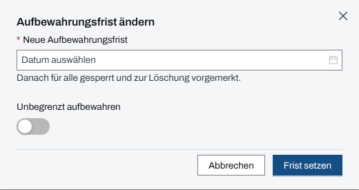
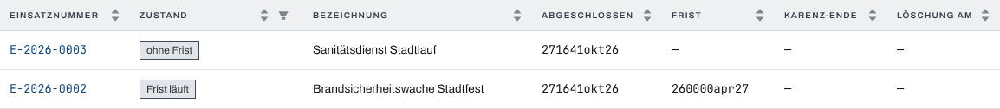
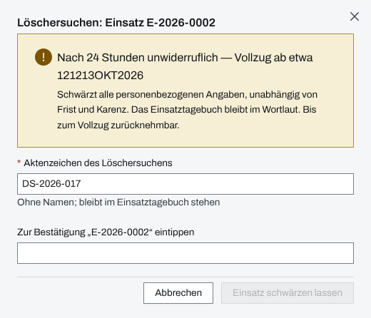

## Überblick

Ein abgeschlossener Einsatz enthält Personendaten: Namen, Kontakte, Zustand von Patienten,
Fotos. Die Aufbewahrung legt fest, wie lange sie gelesen werden können und wann sie geschwärzt
werden. Dafür trägt jeder Einsatz eine **Aufbewahrungsfrist**, auf Wunsch dazu eigene Fristen je
Datenkategorie. Nach Ablauf schwärzt der Server die Personendaten; übrig bleibt ein pseudonymes
Gerüst, das Skelett, mit dem Einsatztagebuch im Wortlaut.

Die Frist eines Einsatzes setzt die Einsatzleitung oder ein System-Admin. Vorgaben, Übersicht,
Archivakte und Löschersuchen sind Sache der System-Admins.

## Abläufe

### Die Aufbewahrungsfrist eines Einsatzes setzen

Für die Einsatzleitung und System-Admins der Organisation des Einsatzes:

1. Im Einsatz „Einstellungen“ öffnen und den Reiter „Aufbewahrung“ wählen.
2. Im Paneel „Aufbewahrungsfrist“ „Frist ändern“ wählen.
3. Unter „Neue Aufbewahrungsfrist“ einen Zeitpunkt wählen, oder „Unbegrenzt aufbewahren“
   einschalten.

   

4. „Frist setzen“ wählen, bei unbegrenzter Aufbewahrung „Frist aufheben“.
5. Wird die Frist kürzer, auch beim ersten Setzen, die Rückfrage „Aufbewahrungsfrist
   verkürzen?“ mit „Verkürzen“ bestätigen.

Ist der Einsatz abgeschlossen, stehen unter der Frist die Datenkategorien „Behandlung“,
„Personenauskunft“ und „Anhänge“, jede mit eigenem „Frist ändern“. Die erste Frist einer
Kategorie verlangt eine „Rechtsgrundlage“.

### Die Nachbereitung eines Einsatzes ändern

Für die Einsatzleitung und System-Admins der Organisation des Einsatzes, ab dem Abschluss:

1. Im Einsatz „Einstellungen“ öffnen und den Reiter „Aufbewahrung“ wählen.
2. Im Paneel „Nachbereitung“ „Nachbereitung ändern“ wählen.
3. Unter „Ende der Nachbereitung“ einen Zeitpunkt wählen, oder „Ohne Nachbereitung“ einschalten.
4. „Frist setzen“ wählen, ohne Nachbereitung „Frist aufheben“.

### Vorgaben der Organisation festlegen

Für System-Admins:

1. Oben „Verwaltung“ öffnen und unter „Einstellungen“ „Einsatz-Vorgaben“ wählen.
2. Im Paneel „Aufbewahrung“ die „Aufbewahrungs-Dauer (Tage)“ eintragen und bei Bedarf „Skelett
   endgültig löschen nach (Tage ab Abschluss)“ und „Nachbereitung (Tage ab Abschluss)“.
3. Im Paneel „Aufbewahrung je Datenkategorie“ je Kategorie eine Dauer und die Rechtsgrundlage
   eintragen.
4. „Speichern“ wählen.
5. Wird die Skelett-Frist zum ersten Mal gesetzt oder verkürzt, die Rückfrage „Skelett-Frist
   bestätigen?“ mit „Skelette löschen lassen“ bestätigen.

### Archiv-Schlüssel einrichten

Für System-Admins am Hub. Nötig ist das Werkzeug [age](https://age-encryption.org) auf dem
Rechner, der den privaten Schlüssel verwahrt.

1. Dort einen Schlüssel erzeugen: `age-keygen -o archiv-schluessel.txt`. Die Datei enthält den
   privaten Schlüssel; die Zeile `# public key: age1…` nennt den öffentlichen.
2. In der Verwaltung unter „Einstellungen“ „Archiv-Schlüssel“ öffnen und „Schlüssel eintragen“
   wählen.
3. Eine „Bezeichnung“ eintragen, etwa den Ort der Verwahrung, und unter „Öffentlicher Schlüssel“
   die Zeichenkette `age1…` einfügen. „Eintragen“ wählen.
4. Der Dialog „Probe für …“ zeigt einen verschlüsselten Text. Ihn kopieren, in eine Datei
   `probe.age` legen und dort entschlüsseln: `age -d -i archiv-schluessel.txt probe.age`.
5. Den achtstelligen Code unter „Code“ eintragen und „Prüfen“ wählen.

Erst ein geprüfter Schlüssel gilt. Wer den Dialog vorher schließt, gibt den Code später über das
Menü des Schlüssels mit „Code eingeben …“ ein; die Probe selbst zeigt die App nur einmal. Nach
fünf falschen Codes ist die Probe gesperrt: dann den Schlüssel entfernen und neu eintragen.

Mindestens zwei geprüfte Schlüssel an getrennten Orten verwahren. Geht der private Schlüssel
verloren, lässt sich kein Archiv mehr öffnen, das an ihn verschlüsselt ist.

### Ein Archiv herunterladen

Für System-Admins:

1. In der Verwaltung „Aufbewahrung“ öffnen und die Archivakte des Einsatzes wählen.
2. Im Paneel „Archiv“ „Herunterladen“ wählen. Die Datei heißt
   `einsatz-<Einsatznummer>-block-<n>.sqlite.age`.
3. Am Rechner mit dem privaten Schlüssel entschlüsseln:
   `age -d -i archiv-schluessel.txt -o einsatz.sqlite einsatz-…-block-1.sqlite.age`.

Jeder Abruf steht im Zugangsprotokoll unter „Archiv heruntergeladen“.

### Abgeschlossene Einsätze überblicken

Für System-Admins:

1. In der Verwaltung „Aufbewahrung“ öffnen.
2. Über das Trichterzeichen am Kopf „Zustand“ einen oder mehrere Zustände ankreuzen, etwa
   „Frist läuft“ und „fällig“; die Zahl hinter jedem Zustand nennt, wie viele Einsätze ihn tragen.
   Ein Klick auf einen Spaltenkopf sortiert, etwa nach „Frist“. Sortierung und Filter stehen in der
   Adresse und gelten beim Rückweg aus der Archivakte wieder.

   

   Ein Einsatz, den ein ELW nach der Nachbereitung an den Hub übergeben hat, steht am ELW als
   „verwahrt“ mit „An … übergeben“; eine Archivakte gibt es dazu nicht mehr.
3. Unter 1600 px Fensterbreite stehen „Vorgemerkt am“, „Schwärzung auf Antrag ab“ und „Geschwärzt am“
   nicht in der Tabelle; bei Bedarf unter „Spalten“ einblenden.
4. Eine Zeile wählen, um die Archivakte des Einsatzes zu öffnen.

Die Archivakte zeigt Aufbewahrung, Datenkategorien, Löschersuchen, Register und das
Einsatztagebuch, alles pseudonym: „ohne Namen, Kontakte, Orte und Sachverhalt“. Oben steht je
nach Zustand „Frist ändern“ oder „Wiederherstellen“. Die Register und die Löschersuchen
sortieren und filtern ebenfalls im Spaltenkopf, etwa nach „Status“ oder „Ausmaß“; diese Wahl gilt,
solange die Akte offen ist.

### Einem Löschersuchen nachkommen

Für System-Admins, wenn eine Person die Löschung ihrer Daten verlangt:

1. In der Verwaltung „Aufbewahrung“ öffnen und die Archivakte des Einsatzes wählen.
2. Im Paneel „Löschersuchen (Art. 17)“ „Person suchen und schwärzen“ wählen, unter „Name oder
   Rufnummer“ den ganzen Namen oder die Rufnummer eintragen, „Suchen“ wählen und beim Treffer
   „Antrag stellen“. Soll der ganze Einsatz geschwärzt werden, stattdessen „Einsatz sofort
   schwärzen“ wählen. Bei einem archivierten Einsatz gibt es keine Personensuche: Das
   Löschersuchen geht dort nur für den ganzen Einsatz und löscht das Archiv.
3. Das „Aktenzeichen des Löschersuchens“ eintragen, ohne Namen.
4. Zur Bestätigung die angezeigte Kennung eintippen.

   

5. „Einsatz schwärzen lassen“ bzw. „Person schwärzen lassen“ wählen. Die App meldet
   „Löschersuchen erfasst — Vollzug in 24 Stunden“.

Bis zum Vollzug lässt sich der Antrag in der Liste des Paneels zurücknehmen.

## Hintergrund

### Der Weg eines Einsatzes

1. **Laufender Einsatz:** Eine Frist sperrt nie einen laufenden Einsatz; sie greift erst ab dem
   Abschluss.
2. **Abschluss:** Ohne gesetzte Frist setzt der Abschluss sie aus der Aufbewahrungs-Dauer des
   Einsatzes oder der Organisation. Ohne Dauer bleibt der Einsatz ohne Frist.
3. **Frist abgelaufen:** Ab dann ist der Einsatz für alle gesperrt, auch für die Einsatzleitung
   und System-Admins; es bleibt nur die pseudonyme Archivakte. Der Server prüft alle zehn
   Minuten und merkt ihn zur Löschung vor.
4. **Karenz:** 30 Tage lang lässt er sich noch wiederherstellen: in der Archivakte
   „Wiederherstellen“ wählen und eine neue Frist in der Zukunft oder „Unbegrenzt aufbewahren“
   angeben.
5. **Schwärzung:** Danach entfernt der Server die Personendaten, Anhänge und Bilder der
   Lagekarte unwiderruflich. Das Skelett bleibt mit Einsatzdaten, Zählern und dem
   Einsatztagebuch im Wortlaut.
6. **Endgültige Löschung:** Hat die Organisation eine Skelett-Frist, löscht der Server das
   Skelett danach samt Einsatztagebuch. Übrig bleibt eine Zeile im Löschprotokoll der
   Organisation.

Vormerkung, Schwärzung und jede Änderung einer Frist stehen im Einsatztagebuch.

### Nachbereitung und Verwahrung

Die Nachbereitung ist die Zeit nach dem Abschluss, in der ein Einsatz an der Installation bleibt,
an der er läuft. Hat die Organisation eine Nachbereitung in Tagen, setzt der Abschluss ihr Ende
auf Abschluss plus Dauer; das Einsatztagebuch hält es fest, ebenso jede Änderung.

Mit dem Ende der Nachbereitung gilt an einem ELW, der mit einem Hub gekoppelt ist:

- **Eigene Einsätze** übergibt der ELW dem Hub zur Verwahrung. Der Hub übernimmt den Einsatz mit
  allen Einträgen und Anhängen als eigenen Einsatz; ab dann gelten dort seine Aufbewahrung und
  die Fristen je Datenkategorie, die der ELW mitgibt. Das Einsatztagebuch am Hub nennt „Zur
  Verwahrung übernommen von …“. Trägt am Hub schon ein Einsatz dieselbe Einsatznummer, bekommt
  der übernommene eine neue, und der Eintrag nennt beide. Erst wenn der Hub die Übernahme
  bestätigt, löscht der ELW den Einsatz; im Löschprotokoll bleibt eine Zeile mit der Nummer.
- **Fehlt dem Hub noch etwas**, etwa ein neuerer Stand oder ein Anhang, wartet die Übergabe.
  Das Paneel „Nachbereitung“ nennt dann „Wartet auf …“ und den Grund; fehlende Anhänge holt der
  Hub zuerst. Solange der Hub nicht bestätigt hat, bleibt der Einsatz am ELW. Läuft in dieser
  Zeit seine Aufbewahrungsfrist ab, geht die Frist vor: der ELW merkt ihn zur Löschung vor und
  schwärzt ihn wie jeden anderen Einsatz.
- **Ändert sich der Einsatz am ELW während der Übergabe**, etwa seine Frist, bleibt er am ELW.
  Das Paneel nennt „Nach der Übergabe geändert“. Der Hub behält seinen Stand vom Zeitpunkt der
  Übernahme.
- **Nicht übergeben** wird ein Einsatz, der zur Löschung vorgemerkt oder geschwärzt ist oder ein
  offenes Löschersuchen hat.
- **Spiegel von Einsätzen des Hubs** löscht der ELW nach dem Ende der Nachbereitung, sobald kein
  Antrag mehr offen ist. Der Einsatz bleibt am Hub.

Ohne Kopplung zu einem Hub bleibt ein Einsatz nach der Nachbereitung, wo er ist, außer die
Organisation hat einen geprüften Archiv-Schlüssel (siehe „Archiv nach der Nachbereitung“). Löscht eine
Installation einen Einsatz, den sie führt, löscht die gekoppelte ihren Spiegel davon beim
nächsten Abgleich.

### Archiv nach der Nachbereitung

Hat die Organisation am Hub mindestens einen geprüften Archiv-Schlüssel, archiviert der Server
jeden ihrer Einsätze, sobald dessen Nachbereitung endet:

- Er legt eine Datei mit dem ganzen Einsatz an, mit Einträgen, Registern, Lagekarte und
  Anhängen, und verschlüsselt sie an alle geprüften Schlüssel der Organisation. Lesen kann das
  Archiv nur, wer einen der privaten Schlüssel hat, auch der Server selbst nicht.
- Danach schwärzt er den Einsatz sofort, ohne Karenz. Am Hub bleiben das Skelett und die
  Archivakte; das Einsatztagebuch nennt die Archivierung.
- **Fristen je Datenkategorie** gelten im Archiv weiter. Läuft eine Kategorie früher ab als der
  Einsatz, entstehen mehrere Blöcke: Block 1 mit allem gilt bis zur ersten Kategorie-Frist,
  Block 2 ohne diese Kategorie bis zur nächsten, und so fort; der letzte gilt bis zum Ende der
  Aufbewahrungsfrist des Einsatzes, ohne Frist unbegrenzt. Ein abgelaufener Block wird gelöscht,
  das Einsatztagebuch nennt ihn. Heruntergeladen wird immer der Block, der gerade gilt.
- **Nicht archiviert** wird ein Einsatz, dessen Aufbewahrungsfrist schon abgelaufen ist, der zur
  Löschung vorgemerkt, geschwärzt oder zum Abräumen vorgemerkt ist, ein Demo-Einsatz und ein
  Einsatz mit offenem Löschersuchen. Ein ELW, der seine Einsätze einem Hub übergibt,
  archiviert nicht selbst.
- Ein **Löschersuchen** an einem archivierten Einsatz geht nur für den ganzen Einsatz; sein
  Vollzug löscht alle Blöcke unwiderruflich.
- Die Skelett-Frist wartet, bis der letzte Block gelöscht ist.

### Fristen je Datenkategorie

- **Behandlung**: Zustand, PAT-Nummer, benötigte Fachrichtung und Anlass der Hilfeleistung der
  Personen, Lage und Notiz ihrer Verletzungen, die Einsatznummer der Leitstelle am Transport sowie
  die Notizen zu Sichtung, Verlauf und UHS-Belegung.
- **Personenauskunft**: Herkunftsadresse und Melderkontakt der Personen.
- **Anhänge**: Datei-Anhänge und die Bilder der Lagekarte.

Ohne eigene Frist „folgt der Frist des Einsatzes“. Eine Kategorie-Frist wirkt nur, wenn sie
früher abläuft als die des Einsatzes. Danach wird die Kategorie vorgemerkt und nach 30 Tagen
Karenz geschwärzt; der Einsatz selbst bleibt lesbar. Name, Geburtsdatum, Fundort und Verbleib
einer Person bleiben, bis alle Zwecke der Person abgelaufen sind. Zur Behandlung gehört eine
Person, sobald sie eine Sichtung, eine Verlaufsnotiz, eine UHS-Belegung, einen Zustand, eine
Verletzung, eine Maßnahme, einen Transport, eine PAT-Nummer, die Kontamination
„kontaminiert“ oder am Verbleib eine Einsatznummer der Leitstelle trägt, auch wenn der Eintrag
aufgehoben ist („nicht kontaminiert“ zählt nicht); ihr Name bleibt dann bis zum Ablauf der
Behandlung.

Auch nach der Schwärzung bleiben die Angaben aus festen Listen ohne Freitext:
Sichtungskategorie, Körperregion, Ansicht, Art und Schwere einer Verletzung, die Maßnahmen,
Priorität und Art des Transports, die Kontamination sowie am Verbleib „Entlassen an“, die
Ablehnung gegen Rat und der Stand der Unterschrift.

Während der Karenz bleiben die Daten der Kategorie lesbar, auch in Druck und Export. Wer eine
Höchstfrist einhalten muss, wählt die Dauer deshalb so, dass Dauer und 30 Tage Karenz zusammen
darunter bleiben. Daher lautet der Vorschlag für die Personenauskunft 0 Tage.

### Löschersuchen

- Ein Löschersuchen wartet nicht auf Frist und Karenz. Es wird 24 Stunden nach dem Erfassen
  vollzogen; bis dahin lässt es sich zurücknehmen.
- **Person:** Entfernt werden Name, Kontakt, Adresse und Notizen der Person, bei Betroffenen
  auch ihre Fotos und Dateien. Erwähnungen in Freitexten (Einsatztagebuch, Chat,
  Führungsmodule) bleiben stehen.
- **Einsatz:** Alle personenbezogenen Angaben des Einsatzes werden geschwärzt; das
  Einsatztagebuch bleibt im Wortlaut.
- Das Aktenzeichen bleibt im Einsatztagebuch stehen und darf deshalb keinen Namen enthalten.
- Möglich ist ein Löschersuchen nur an einem abgeschlossenen, noch nicht geschwärzten Einsatz.
  Ausnahme ist ein archivierter Einsatz: Er ist schon geschwärzt, ein Löschersuchen für den
  ganzen Einsatz löscht sein Archiv.

### Wer was darf

- **Frist eines Einsatzes und der Kategorien:** Einsatzleitung und System-Admins der
  Organisation des Einsatzes, auch nach dem Abschluss.
- **Nachbereitung eines Einsatzes:** wie die Frist, ab dem Abschluss.
- **Aufbewahrungs-Dauer im Einsatz:** zusätzlich das Führungspersonal, solange der Einsatz läuft.
- **Vorgaben, Übersicht, Archivakte, Löschersuchen und Wiederherstellen:** nur System-Admins,
  und nur für Einsätze der eigenen Organisation.
- **Archiv-Schlüssel und Archiv-Download:** nur System-Admins der eigenen Organisation; jede
  Änderung und jeder Abruf steht im Zugangsprotokoll.

## Grundlagen und Quellen

- **Art. 17 DSGVO** (Recht auf Löschung): Grundlage des Löschersuchens.
- **age** ([age-encryption.org](https://age-encryption.org)): Format und Werkzeug der
  Verschlüsselung von Archiv und Schlüsselprobe.
- Vorschläge für die Dauer je Datenkategorie, die die App beim Eintragen nennt:
  - Behandlung 3650 Tage, nach § 630f Abs. 3 BGB entsprechend und der Empfehlung des DRK-LV
    Saarland zur patientenbezogenen Datenerfassung im Sanitätsdienst.
  - Personenauskunft 0 Tage, nach § 46 Abs. 5 BHKG NRW (Auskunftsstelle: höchstens ein Monat).
  - Anhänge 30 Tage, nach § 32b Abs. 3 NKatSG (Drohnenbilder: höchstens zwei Monate).

  Die Vorschläge sind keine Vorgaben; welche Frist gilt, entscheidet die Organisation.
