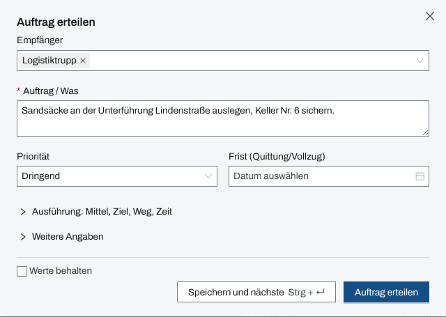
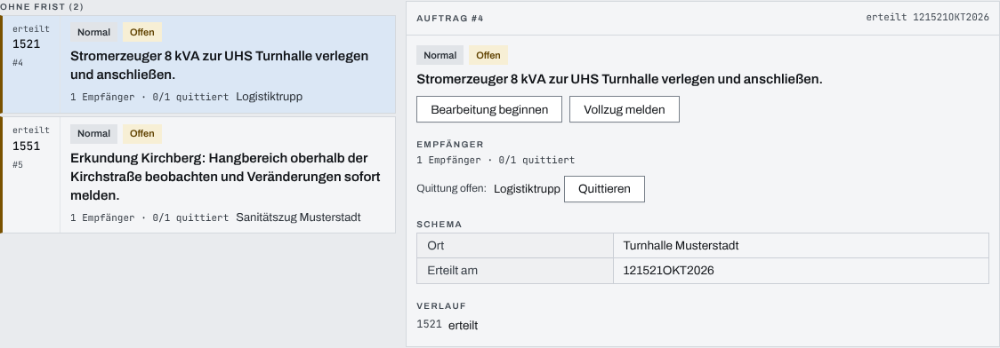
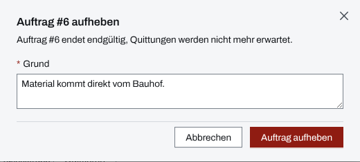
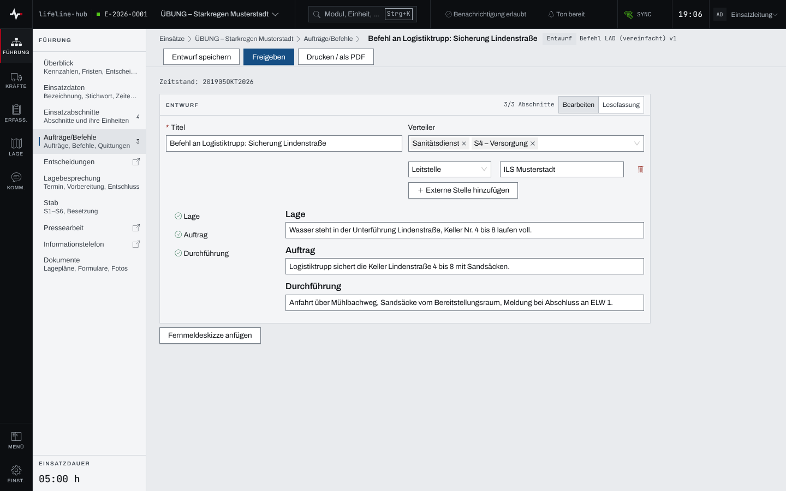
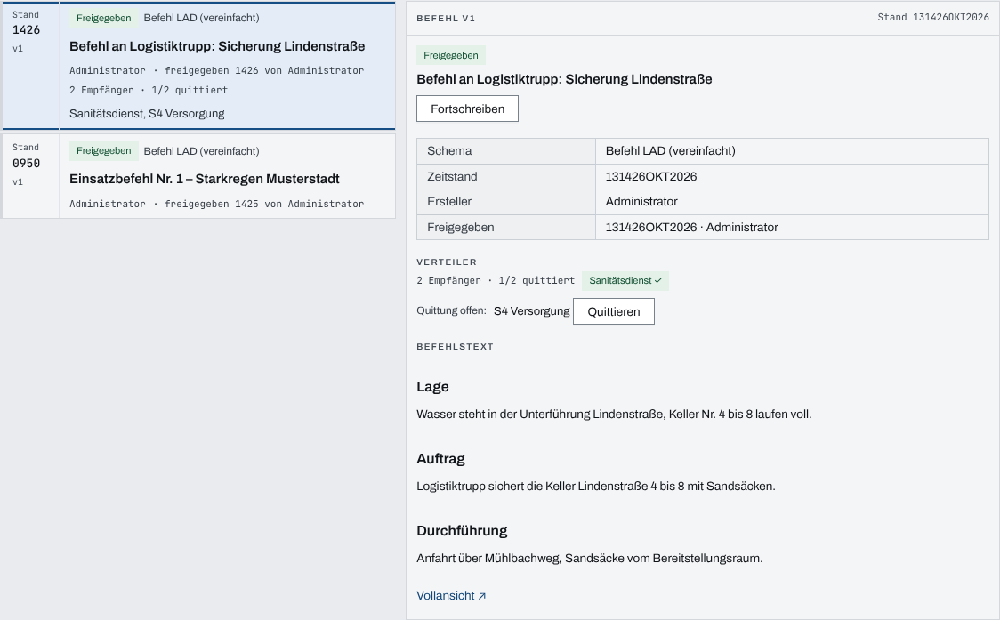

## Überblick

Das Modul „Aufträge/Befehle“ hat zwei Reiter:

- **Einzelaufträge** gehen an einen oder mehrere Empfänger. Jeder Empfänger quittiert den
  Empfang; ist die Arbeit getan, wird der Vollzug gemeldet und der Auftrag abgenommen. Ein
  Auftrag lässt sich berichtigen, solange noch niemand quittiert hat, und mit einem Grund
  aufheben, solange er nicht abgenommen ist.
- **Einsatzbefehle** sind Dokumente nach einem Befehlsschema. Sie entstehen als Entwurf, werden
  freigegeben und lassen sich danach nur noch in einer neuen Fassung fortschreiben.

Lesen dürfen alle mit Zugang zum Einsatz. Erteilen, Quittieren, Berichtigen, Aufheben,
Entwerfen und Freigeben dürfen Einsatzleitung und Führungspersonal, solange der Einsatz läuft
(siehe
[Rechte im Einsatz](rechte-im-einsatz.md)).

## Abläufe

### Einen Auftrag erteilen

Für Einsatzleitung und Führungspersonal:

1. Im Einsatz „Aufträge/Befehle“ öffnen, Reiter „Einzelaufträge“, und „Auftrag erteilen“ wählen.
   Der Dialog „Auftrag erteilen“ öffnet sich.
2. Unter „Empfänger“ die Einheit nennen: einen Abschnitt, eine Einheit oder eine Funktion (zum
   Beispiel S3) wählen oder eintippen. Ein Komma trennt mehrere Empfänger.

   

3. Unter „Auftrag / Was“ den Auftrag formulieren.
4. „Priorität“ und bei Bedarf „Frist (Quittung/Vollzug)“ setzen.
5. Bei Bedarf „Ausführung: Mittel, Ziel, Weg, Zeit“ aufklappen und „Mittel / Womit“, „Ziel / Ort“,
   „Weg“ und „Zeit / Wann“ eintragen.
6. Bei Bedarf „Weitere Angaben“ aufklappen: „Lage“, „Absicht“, „Verbindung / Meldewege“,
   „Sicherheit / Besonderes“, „Richtung“ (Intern oder Extern) und „Erteilt am (optional)“, bei
   extern dazu „Externe Stelle“ und „Bezeichnung der Stelle“. Steht die Richtung auf extern,
   heißt der Teil auch zugeklappt „Weitere Angaben · Richtung: Extern“.
7. „Auftrag erteilen“ wählen. Der Dialog schließt sich. Ist ein Feld in einem zugeklappten Teil zu lang, klappt der Teil auf
   und nennt den Grund am Feld.

„Speichern und nächste“ (Strg+Enter, am Mac ⌘+Enter) erteilt den Auftrag und leert das Formular
für den nächsten; der Dialog bleibt offen. Mit dem Häkchen „Werte behalten“ bleiben Empfänger,
Priorität und Richtung stehen.

### Aufträge finden und quittieren

1. Im Reiter „Einzelaufträge“ die Ansicht „Offen“ oder „Abgeschlossen“ wählen. Bei Bedarf im
   Suchfeld „Kennung, Text oder Empfänger“ suchen, eine Richtung wählen oder „Empfänger filtern“.

   

2. Einen Auftrag in der Liste wählen. Auf breitem Bildschirm steht er rechts neben der Liste, auf
   schmalem klappt er unter seiner Karte auf.
3. Im Auftrag unter „Empfänger“ steht neben „Quittung offen:“ jeder Empfänger, der noch nicht
   quittiert hat. „Quittieren“ wählen und die Rückfrage „Empfang/Kenntnis quittieren?“ mit
   „Empfang quittieren“ bestätigen.
4. Hat ein Empfänger mit der Arbeit begonnen, „Bearbeitung beginnen“ wählen. Ein Hinweis bietet
   sechs Sekunden lang „Rückgängig“.

Offene Aufträge stehen in den Gruppen „Überfällig“, „Heute fällig“, „Später“ und „Ohne Frist“.
Auf breitem Bildschirm ist der oberste Auftrag schon gewählt. Der gewählte Auftrag zeigt den
ganzen Text, alle Empfänger, die Felder des Befehlsschemas unter „Schema“ in derselben Reihenfolge
wie im Formular (leere Felder fehlen) und unter „Verlauf“ die Zeitpunkte von Erteilung,
Quittungen, Bearbeitung, Vollzug, Abnahme und Aufhebung. Die Suche findet auch ältere
abgeschlossene Aufträge, die noch nicht geladen sind.

### Einen Auftrag berichtigen

Für Einsatzleitung und Führungspersonal, solange der Auftrag offen ist und noch kein Empfänger
quittiert hat:

1. Den Auftrag wählen, im Auftrag das Menü „Aktionen zu Auftrag #…“ öffnen und „Berichtigen“
   wählen.
2. Der Dialog „Auftrag #… berichtigen“ öffnet sich mit dem bisherigen Stand. Auftragstext,
   Empfänger, Priorität, Frist und die Felder des Befehlsschemas ändern.
3. „Berichtigung speichern“ wählen. Der Dialog schließt sich.

Nach der ersten Quittung steht im Menü „Berichtigen (schon quittiert)“ gesperrt: Der Empfänger
hat den alten Wortlaut bestätigt. Dann den Auftrag aufheben und neu erteilen. „Richtung“ und
„Erteilt am“ lassen sich nicht berichtigen.

### Den Vollzug melden und den Auftrag abnehmen

Für Einsatzleitung und Führungspersonal:

1. Den Auftrag wählen und „Vollzug melden“ wählen.
2. Im Dialog „Vollzug melden“ die „Rückmeldung zur Erledigung“ eintragen und „Vollzug melden“
   wählen. Der Auftrag wechselt in die Ansicht „Abgeschlossen“; solange er gewählt bleibt, steht
   er mit dem Hinweis „Nicht mehr in dieser Ansicht“ weiter da.
3. Zur Kontrolle in „Abgeschlossen“ den Auftrag wählen, „Abnehmen“ wählen und die Rückfrage
   „Auftrag abnehmen?“ mit „Auftrag abnehmen“ bestätigen.

Die Abnahme lässt sich nicht zurücknehmen.

### Einen Auftrag aufheben

Für Einsatzleitung und Führungspersonal, solange der Auftrag nicht abgenommen ist:

1. Den Auftrag wählen und im Auftrag „Auftrag aufheben“ wählen. Bei einem offenen Auftrag steht
   es rot im Menü „Aktionen zu Auftrag #…“, sonst als roter Knopf.
2. Im Dialog „Auftrag #… aufheben“ den „Grund“ eintragen.

   

3. Mit „Auftrag aufheben“ bestätigen.

Der Auftrag steht danach unter „Abgeschlossen“ mit dem Etikett „Aufgehoben“; gewählt zeigt er
Zeit, Person und Grund. Quittungen werden nicht mehr erwartet; Quittieren, Vollzug und Abnahme sind nicht
mehr möglich. Das Aufheben lässt sich nicht zurücknehmen.

### Einen Einsatzbefehl entwerfen

Für Einsatzleitung und Führungspersonal:

1. Im Reiter „Einsatzbefehle“ „Befehl entwerfen“ wählen.
2. Im Dialog „Neuer Befehlsentwurf“ ein „Schema“ wählen und einen „Titel“ eintragen, dann
   „Entwurf anlegen“. Die App öffnet den Entwurf.
3. Die Abschnitte des Schemas ausfüllen. Neben jedem Feld zeigt die „Vorschau“ den gesetzten
   Text.

   

4. „Entwurf speichern“ wählen oder einfach weiterarbeiten: Der Entwurf speichert sich alle 30
   Sekunden und beim Verlassen eines Feldes selbst; neben den Knöpfen steht „zuletzt gespeichert
   …“.
5. Bei Bedarf „Fernmeldeskizze anfügen“ wählen. Die App nimmt die aktuelle Fernmeldeskizze als
   Bild auf und hängt sie unter „Anlagen“ an. Das geht nur mit Verbindung und nur, wenn der Stab
   im Einsatz freigegeben ist ([Funkplan, Fernmeldeskizze und Kommunikationsplan](funkplan.md)).

Ein gespeicherter Entwurf öffnet sich wieder über den Reiter „Einsatzbefehle“, Ansicht
„Entwürfe“: Befehl wählen und „Entwurf bearbeiten“.

### Einen Einsatzbefehl lesen

1. Im Reiter „Einsatzbefehle“ die Ansicht „Entwürfe“ oder „Freigegeben“ wählen, bei Bedarf im
   Suchfeld „Titel oder Schema“ suchen, und einen Befehl wählen. Er steht mit Schema, Zeitstand,
   Ersteller, Freigabe und dem ganzen „Befehlstext“ neben bzw. unter der Liste.

   

2. „Vollansicht“ öffnet den Befehl ganzseitig. Dort führt ein freigegebener Befehl im Kopf mit
   „Zum ETB-Eintrag“ ins Tagebuch, und „Drucken / als PDF“ gibt ihn auf Papier aus (siehe
   [Drucken und Export](drucken-export.md)). „Aufträge/Befehle“ oben im Ortspfad führt zurück, der
   Befehl ist dann gewählt.

### Einen Einsatzbefehl freigeben und fortschreiben

Für Einsatzleitung und Führungspersonal:

1. Den Entwurf in der Ansicht „Entwürfe“ wählen und „Freigeben“ wählen. Die Rückfrage „Befehl
   freigeben?“ warnt: „Endgültig: geht ins ETB, Korrektur nur per Fortschreibung.“ Mit
   „Freigeben“ bestätigen.
2. Ist später etwas zu ändern, den Befehl in der Ansicht „Freigegeben“ wählen und „Fortschreiben“
   wählen. Es entsteht eine neue Fassung als Entwurf, die sich zum Bearbeiten öffnet und wieder
   freigegeben wird.

Ein Befehl ohne jeden Text lässt sich nicht freigeben; die Rückfrage meldet dann „Der Befehl ist
leer und kann nicht freigegeben werden“. Die Fassung steht als „v1“, „v2“ … an der Karte; eine
Fortschreibung trägt denselben Titel wie ihr Vorgänger.

## Hintergrund

### Fristen und Alarm

Eine Frist am Auftrag gilt für Quittung und Vollzug. Bleibt das Feld leer, setzt die App die
Vorgabe aus den Einstellungen des Einsatzes unter „Verhalten & Automatik“, Feld „Quittierfrist
Aufträge (Minuten)“; ohne Vorgabe hat der Auftrag keine Frist.

Mit einer Frist legt die App die automatische Erinnerung „Auftrag #… Quittierfrist“ an. Läuft
die Frist ab, bevor alle Empfänger quittiert haben, meldet sich der Hinweis „Auftrag überfällig“
mit „Quittierfrist überschritten“ und „Öffnen“; die Karte steht unter „Überfällig“. Quittieren
alle Empfänger, schließt die Erinnerung.

Eine berichtigte Frist verschiebt die Erinnerung; sie meldet sich zur neuen Frist erneut. Eine
entfernte Frist und das Aufheben schließen sie. Eine selbst angelegte Erinnerung zum Auftrag
bleibt stehen.

Ein aufgehobener Auftrag ist nie offen und nie überfällig: Er fehlt in den Zahlen im Überblick,
im Lagedashboard, in der Vorbereitung der Lagebesprechung und im Lagebericht.

### Aufträge im Einsatztagebuch

Ein erteilter Auftrag schreibt eine „Anordnung“ ins ETB, solange „Automatische ETB-Einträge“
nicht ausgeschaltet ist. Der gemeldete Vollzug schreibt immer eine „Meldung“ mit der Rückmeldung.

Berichtigen und Aufheben schreiben immer eine „Anordnung“, auch bei ausgeschalteten
automatischen Einträgen: „Auftrag #4 aufgehoben: Lage hat sich erledigt“ bzw. „Auftrag #4
geändert: …“ mit neuem und vorherigem Wert, etwa „Frist 12.10. 16:00 (vorher 12.10. 15:00)“.
Die Felder des Befehlsschemas erscheinen dort nur mit ihrem Namen. Die ursprüngliche Anordnung
bleibt unverändert stehen.

Der Filter nach Einheit im ETB zeigt einen Eintrag zum Auftrag bei den Einheiten, an die er sich
beim Schreiben richtete. Werden die Empfänger berichtigt, bleibt die ursprüngliche Anordnung bei
den bisherigen Einheiten; die Anordnung „Auftrag #4 geändert: Empfänger …“ steht bei den bisherigen
und den neuen.

Aufträge lassen sich auch direkt aus einem ETB-Eintrag oder einer Meldung erteilen (siehe
[Einsatztagebuch](einsatztagebuch.md) und [Meldungen](meldungen.md)). Ein Auftrag aus einem
ETB-Eintrag führt unter „Verlauf“ mit „ETB-Eintrag“ zu diesem Eintrag zurück.

### Einzelauftrag oder Einsatzbefehl

Ein Einzelauftrag wird als Auftrag erteilt: nur der Auftrag kennt Empfänger, Quittung und Vollzug.
Das Schema „Einzelauftrag (EA/ZMW)“ bietet „Neuer Befehlsentwurf“ deshalb nicht mehr an.
Befehle, die schon mit diesem Schema angelegt sind, lassen sich weiter öffnen, bearbeiten,
freigeben, fortschreiben und drucken.

### Befehle im Einsatztagebuch

Mit der Freigabe schreibt der Befehl seinen vollständigen Text als „Anordnung“ ins ETB. Danach
ist die Fassung eingefroren, auch ihre Anlagen. Eine Fortschreibung ist eine neue Fassung mit
eigener Freigabe.

## Grundlagen und Quellen

Die Befehlsschemata der App sind „Befehl LAD (vereinfacht)“ mit Lage, Auftrag und Durchführung,
„Befehl LADEF (erweitert, SKK)“ mit zusätzlich Einsatzunterstützung sowie Führung und
Kommunikation, „Befehl SCHNEE“ mit Schadenlage, Nachbarn, Entschluss / Absicht, Einzelauftrag
und eigenem Standort sowie, nur noch an bestehenden Befehlen, „Einzelauftrag (EA/ZMW)“ mit
Einheit, Auftrag / Ziel, Mittel und Weg.

Das Auftragsformular folgt dem Einzelauftrag der FwDV 100: Einheit – Auftrag – Mittel – Ziel –
Weg, ergänzt um die Zeit. In dieser Reihenfolge wird ein Auftrag im Funk durchgegeben.
