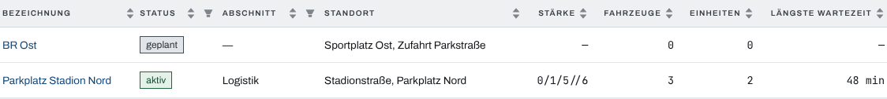
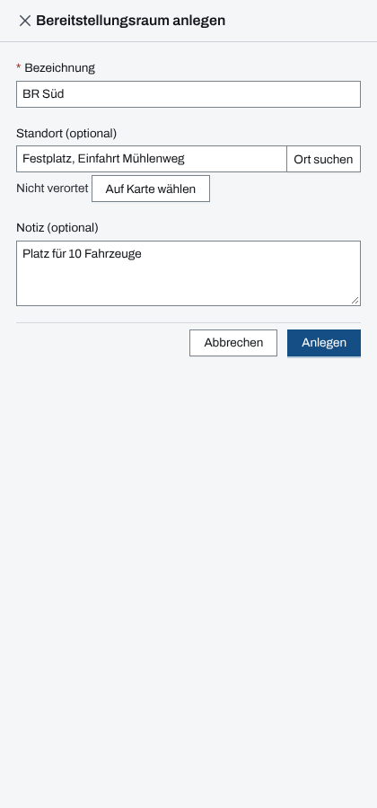
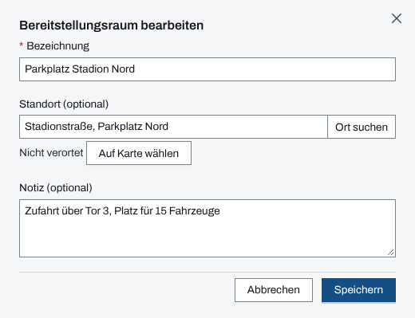
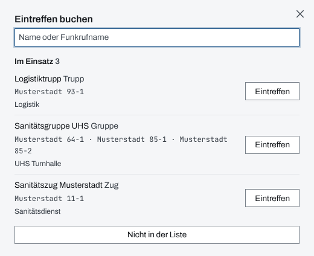
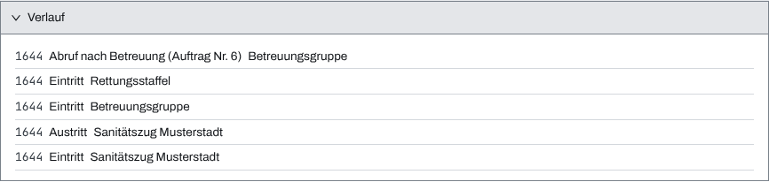

## Überblick

Ein **Bereitstellungsraum** (BR) ist der Ort, an dem Einheiten und Fahrzeuge auf ihren Einsatz
warten. Das Modul zeigt je Raum, wer dort bereitsteht, mit welcher Stärke und seit wann, wer am
längsten wartet, wer wann kam und ging, welche Kräfte noch keinem Raum zugewiesen sind und welches
Material dort liegt.

Dieses Kapitel beschreibt die Sicht der Einsatzleitung. Einsatzleitung und Führungspersonal legen
Räume an, ändern ihre Raumdaten, nehmen sie in Betrieb, weisen Kräfte zu und lösen Räume wieder
auf. Die Bedienung am gekoppelten Tablet eines Bereitstellungsraums beschreibt
[Bereitstellungsraum am Gerät](geraet-bereitstellungsraum.md).

## Abläufe

### Einen Bereitstellungsraum öffnen

1. Unter „Kräfte & Mittel“ „Bereitstellungsräume“ wählen. Die App öffnet den zuletzt gewählten Raum,
   sonst einen aktiven. Gibt es noch keinen, bietet sie „Ersten BR anlegen“ an.
2. Über den Namen des Raums im Seitenkopf in einen anderen Raum wechseln.
3. Für die Übersicht aller Räume in der Brotkrumenleiste „Bereitstellungsräume“ wählen. Die Liste
   zeigt je Raum Bezeichnung, Status, Abschnitt und Standort, dazu die Belegung: „Stärke“,
   „Fahrzeuge“, „Einheiten“ und „Längste Wartezeit“, mit denselben Werten wie der Raum selbst.

   

4. Über „Spalten“ lassen sich „Abschnitt“ und „Standort“ aus- und wieder einblenden; auf dem
   Handy fehlen sie zunächst, der Knopf nennt dann die Zahl der ausgeblendeten Spalten.

### Einen Bereitstellungsraum anlegen und in Betrieb nehmen

Für Einsatzleitung und Führungspersonal:

1. In der Übersicht „Neu“ wählen, oder im Seitenkopf eines Raums den Namen öffnen und „+ Neuer BR“
   wählen.
2. „Bezeichnung“ eingeben, bei Bedarf „Standort (optional)“ und „Notiz (optional)“.

   

3. „Anlegen“ wählen. Die App öffnet den neuen Raum; er steht auf „geplant“.
4. Ist der Raum eingerichtet, „In Betrieb nehmen“ wählen. Er steht dann auf „aktiv“.

### Bezeichnung, Standort und Notiz ändern

Für Einsatzleitung und Führungspersonal, solange der Raum geplant oder aktiv ist:

1. Den Raum öffnen und bei „Raumdaten“ „Bearbeiten“ wählen.
2. Im Dialog „Bereitstellungsraum bearbeiten“ „Bezeichnung“, „Standort (optional)“ oder
   „Notiz (optional)“ ändern. Ein geleertes Feld löscht die Angabe; die Bezeichnung bleibt Pflicht.

   

3. „Speichern“ wählen. Die neue Bezeichnung steht im Seitenkopf, im Umschalter und in der
   Übersicht, Standort und Notiz stehen unter „Raumdaten“; die Übersicht zeigt auch den Standort.

### Einen Bereitstellungsraum auf der Lagekarte verorten

Für Einsatzleitung und Führungspersonal, solange der Raum geplant oder aktiv ist:

1. Den Raum öffnen und bei „Raumdaten“ „Auf Karte verorten“ wählen. Steht der Raum schon auf der
   Karte, heißt der Knopf „Auf Karte versetzen“.
2. Die Lagekarte öffnet sich zum Platzieren dieses Raums. Auf die Stelle der Karte tippen, an der
   der Raum liegt. Die App meldet „Objekt verortet“.
3. Der Raum steht danach mit dem Zeichen „Bereitstellungsraum“ auf der Karte, beschriftet mit
   Bezeichnung, Stärke und Zahl der Fahrzeuge, etwa „Parkplatz Stadion Nord · 0/1/5//6 · 3 Fz“.
4. Ein Tipp auf das Zeichen zeigt unter „Ausgewählt“ Status, Stärke, Fahrzeuge, Einheiten, „Wartet
   seit“ und Abschnitt. „Im Fachmodul öffnen“ führt zurück zum Raum.

### Eintreffen buchen

Für Einsatzleitung und Führungspersonal, solange der Raum aktiv ist. Im Zustand „geplant“ steht
„Eintreffen buchen“ gesperrt, daneben „BR nicht in Betrieb“.

1. Den Raum öffnen und im Seitenkopf „Eintreffen buchen“ wählen.
2. In „Name oder Funkrufname“ den Namen, den Typ oder einen Funkrufnamen der Kraft eingeben. Die Treffer stehen
   unter „Erwartet“ und „Im Einsatz“, je mit Typ, den Funkrufnamen ihrer Fahrzeuge und, falls
   bekannt, „alarmiert …“, dem Abschnitt oder „eingetroffen …“.

   

3. Beim Treffer „Eintreffen“ wählen. Die Bestätigung lautet „… gebucht“; die Kraft steht danach
   in der Belegung des Raums.
4. Steht die Kraft nicht in der Liste, „Nicht in der Liste“ wählen. „Funkrufname“ ist mit der Suche
   vorbelegt; bei Bedarf „Trägerorganisation“, „Fahrzeugtyp“ und „Stärke“ eintragen, unter
   „Bemerkung“ einen freien Text, unter „Weiteres Fahrzeug“ mit „Fahrzeug hinzufügen“ die übrigen
   Fahrzeuge der Kraft.
5. „Unangemeldet buchen“ wählen. Die Bestätigung lautet „… unangemeldet gebucht, Einsatzleitung
   informiert“; die neue Einheit trägt in der Belegung „nicht übernommen“.
6. Gibt es im Einsatz schon eine Kraft mit diesem Funkrufnamen, steht „Schon im Einsatz: …“ und
   „Unangemeldet buchen“ ist gesperrt. „Diese buchen“ bucht die vorhandene Kraft, „Trotzdem neu
   anlegen“ legt die neue trotzdem an. Steht die vorhandene Kraft schon in einem Raum, fehlt
   „Diese buchen“.

### Kräfte zuweisen und entfernen

Für Einsatzleitung und Führungspersonal, solange der Raum aktiv ist:

1. Den Raum öffnen. Rechts steht „Kräfte ohne BR“: oben unter „Erwartet“ die Kräfte ohne
   Abschnitt, nach Typ gruppiert, darunter zugeklappt „Im Einsatz“ mit ihrer Zahl. Aufklappen zeigt
   die Kräfte, die schon in einem Abschnitt stehen.
2. Bei Bedarf in „Kräfte suchen“ einen Namen eingeben.
3. Bei einer Einheit oder einem Fahrzeug „zuweisen“ wählen. Sie erscheint unter „Bereitgestellte
   Einheiten“ oder „Bereitgestellte Fahrzeuge“; „Bereitgestellt“ zählt die Stärke, „Fahrzeuge“ die
   Fahrzeuge im Raum, auch die der bereitgestellten Einheiten. Anders als „Eintreffen buchen“
   trägt „zuweisen“ kein Eintreffen in die Zeitachse ein.

   

4. Rückt eine Kraft aus, bei ihr „entfernen“ wählen. Sie steht wieder unter „Kräfte ohne BR“.

### Sehen, wer am längsten wartet

1. Den Raum öffnen. Oben stehen „Bereitgestellt“ (Stärke), „Fahrzeuge“, „Einheiten“ und
   „Längste Wartezeit“; darunter steht, seit wann die am längsten wartende Kraft im Raum ist.
2. Unter „Bereitgestellte Einheiten“ steht die Einheit, die am längsten wartet, oben. Jede Zeile
   nennt Typ, Stärke, die Funkrufnamen ihrer Fahrzeuge und „seit“ mit Uhrzeit und Wartezeit, etwa
   „seit 1342 · 48 min“. Unter „Bereitgestellte Fahrzeuge“ stehen die Fahrzeuge ohne Einheit in
   derselben Folge.
3. Eine neu zugewiesene Kraft kommt ans Ende. Die Wartezeit zählt ohne Neuladen weiter.

### Den Verlauf eines Raums lesen

1. Den Raum öffnen und ganz unten „Verlauf“ aufklappen.
2. Die Liste nennt, neueste zuerst, je Ereignis die Uhrzeit, was geschah („Eintritt“, „Austritt“,
   „Wechsel von …“, „Wechsel nach …“), die Einheit oder das Fahrzeug und, falls erfasst, eine Notiz
   wie „Einheit aufgelöst“ oder „Fahrzeug entlassen“.

   

3. Bei offenem Verlauf erscheinen neue Ereignisse ohne Neuladen.

### Material im Raum führen

Für Einsatzleitung und Führungspersonal, wenn das Modul Material freigegeben ist, auch in einem
geplanten Raum:

1. Den Raum öffnen. Unter den bereitgestellten Fahrzeugen steht „Material“ mit der Zahl der Posten
   und, falls vorhanden, dem Ausfall, je Posten Menge und Status.
2. Unter „Material zuordnen …“ einen Posten wählen: unter „Ohne Ort“ die freien Posten, unter „An
   anderem Ort“ Posten, die schon an einem anderen Ort liegen, mit diesem Ort im Eintrag. Der
   Posten liegt danach im Raum.
3. Bei einem Verbrauchsgut mit Rest „Ausgeben“ wählen, die „Menge ausgeben“ eingeben und mit
   „Ausgeben“ bestätigen; die Zeile nennt danach den Rest.
4. Mit „Lösen“ einen Posten aus dem Raum lösen. Er bleibt ohne Ort im Einsatz.

### Einen Bereitstellungsraum auflösen oder stornieren

Für Einsatzleitung und Führungspersonal:

1. Einen aktiven Raum erst leeren: alle Kräfte „entfernen“. Solange noch Kräfte dort stehen, ist
   „Auflösen“ gesperrt, daneben steht „noch … belegt“.
2. „Auflösen“ wählen und die Rückfrage „BR auflösen?“ mit „BR auflösen“ bestätigen. Der Raum steht
   dann auf „aufgelöst“.
3. Ein Raum, der nie in Betrieb war, wird stattdessen mit „Stornieren“ verworfen; die Rückfrage „BR
   stornieren?“ mit „BR stornieren“ bestätigen. Er verschwindet aus Übersicht und Umschalter.

## Hintergrund

### Status eines Raums

Ein Raum durchläuft „geplant“, „aktiv“ und „aufgelöst“. Kräfte lassen sich nur einem aktiven Raum
zuweisen, Material schon einem geplanten: so lässt sich ein Raum vorbereiten. Ein aufgelöster Raum
nimmt kein Material mehr an; „Material zuordnen …“ steht dort gesperrt mit „BR aufgelöst“, und
Material, das noch dort liegt, lässt sich lösen. Bezeichnung, Standort und Notiz lassen sich ändern, solange der Raum geplant oder aktiv
ist; ein aufgelöster Raum ist nur zu lesen.

### Wer zugewiesen werden kann

„Kräfte ohne BR“ bietet Einheiten an und Fahrzeuge ohne Einheit, sofern sie in keinem Raum stehen.
Fahrzeuge einer Einheit werden nicht einzeln zugewiesen, sondern über ihre Einheit. Eine Kraft steht
höchstens in einem Raum; soll sie in einen anderen, wird sie zuerst im alten entfernt. Die Stärke
rechnet unterstellte Einheiten mit ein und zählt keine doppelt.

„Erwartet“ und „Im Einsatz“ trennen nach dem Abschnitt: eine Einheit ohne eigenen Abschnitt zählt
mit dem Abschnitt ihrer Über-Einheit. Fahrzeuge ohne Einheit stehen immer unter „Erwartet“. Im
Dialog „Eintreffen buchen“ steht eine Kraft außerdem unter „Im Einsatz“, sobald sie in ihrem
laufenden Einsatzabschnitt schon eingetroffen ist.

### Was ein Eintreffen schreibt

„Eintreffen“ bucht in einem Schritt den Eintritt in den Raum und, bei einer Einheit, das
Eintreffen in ihrer [Zeitachse](meldebild.md); ein Fahrzeug ohne Einheit bekommt nur den Eintritt.
Ist die Einheit in ihrem laufenden Einsatzabschnitt schon eingetroffen, bleibt die Zeitachse
unverändert. Das Einsatztagebuch bekommt genau einen Eintrag: „… im BR … eingetroffen“, oder
„… tritt in Bereitstellungsraum … ein“, wenn die Zeitachse nichts eingetragen hat. Bei einer
unangemeldeten Kraft trägt der Eintrag den Text der Meldung.

Eine unangemeldete Kraft legt die App als neue Einheit ohne Abschnitt an, benannt nach dem
Funkrufnamen des ersten Fahrzeugs, mit ihren Fahrzeugen und der Bemerkung. Die Stärke ist keine
Soll-Stärke; sie steht nur im Text der Meldung und des Einsatztagebuchs. Dazu geht eine Meldung an
die Einsatzleitung, etwa „Florian Nachbar 3 (FF Nachbarort, HLF) unangemeldet im BR Parkplatz Stadion
Nord eingetroffen, Stärke 0/1/8//9. Übernahme offen.“; die Bemerkung steht nicht darin.
Die Einheit trägt „nicht übernommen“, bis die Einsatzleitung sie übernimmt oder abweist (Kapitel
[Einheiten](einheiten.md)); danach trägt sie in der Belegung dauerhaft das neutrale Kennzeichen
„unangemeldet“.

Ob ein Funkrufname schon im Einsatz steht, vergleicht die App ohne Groß- und Kleinschreibung und
ohne doppelte Leerzeichen, mit Namen und Funkrufnamen der Einheiten und den Funkrufnamen der
Fahrzeuge. Kräfte aus den Stammdaten bietet der Dialog nicht an.

### Was die Zahlen zählen

„Fahrzeuge“ zählt jedes aktive Fahrzeug im Raum genau einmal: die einzeln bereitgestellten und
die Fahrzeuge der bereitgestellten Einheiten. Die Fahrzeuge einer unterstellten Einheit zählen
nur, wenn diese Einheit selbst im Raum steht. Entlassene oder stornierte Fahrzeuge zählen nicht.
Am gekoppelten Tablet des Raums steht dieselbe Zahl.
„noch … belegt“ vor dem Auflösen zählt dagegen nur, was einzeln im Raum steht: die Einheiten und
die Fahrzeuge ohne Einheit. Die Fahrzeuge einer Einheit gehen mit ihrer Einheit und halten das
Auflösen nicht auf.

### Wartezeit und Folge

„Seit“ ist der Zeitpunkt, an dem eine Kraft zuletzt in diesen Raum kam: ihr Eintritt oder ihr
Wechsel aus einem anderen Raum. Ein früherer Aufenthalt in einem anderen Raum zählt nicht. Fehlt
ein solcher Zeitpunkt, etwa bei älteren Daten, steht die Kraft ohne Zeitangabe am Ende der Liste;
die App schätzt nichts. Die Wartezeit rechnet in ganzen Minuten gegen die Uhr des Geräts; geht
diese nach, erscheint die Wartezeit kürzer, nie negativ. Die Fahrzeuge einer Einheit tragen kein
eigenes „seit“, sie stehen mit ihrer Einheit. „Längste Wartezeit“ ist die Wartezeit der Kraft, die
am längsten im Raum steht. Eine Farbe oder Warnung für lange Wartezeiten gibt es nicht.

Die Listen ordnen fest nach Wartezeit, bei gleicher Zeit nach Namen. Steht der Mauszeiger über
der Belegung oder liegt der Fokus dort, warten Zugänge anderer Arbeitsplätze hinter dem Hinweis
„… neu“, damit keine Zeile unter dem Zeiger springt; eigene Zuweisungen erscheinen sofort.

### Verlauf

Der Verlauf führt jedes Ereignis des Raums vollständig und ungeblättert, auch Austritte durch
Auflösen einer Einheit oder Entlassen eines Fahrzeugs. Ein Wechsel steht in beiden Räumen: im
verlassenen als „Wechsel nach …“, im neuen als „Wechsel von …“. Aufgelöste Einheiten und
entlassene Fahrzeuge stehen mit ihrem Namen. Auch ein aufgelöster Raum zeigt seinen Verlauf. Der
Verlauf lädt erst beim Aufklappen; beim Wechsel in einen anderen Raum klappt er zu. Wer den Raum
lesen darf, darf auch den Verlauf lesen.

### Druck

Der Druck des Raums zeigt alle Kräfte, auch solche, die gerade hinter dem Hinweis „… neu“ warten,
jeweils mit „seit“ und der Wartezeit zum Zeitpunkt des Drucks, dazu „Längste Wartezeit“. Der
Verlauf wird nicht gedruckt, solange er zugeklappt ist; ein aufgeklappter Verlauf druckt mit.

### Material im Raum

Material liegt an genau einem Ort (Kapitel [Material](material.md)); ein Posten von einem anderen
Ort wird ohne Rückfrage umgehängt, und das Einsatztagebuch nennt den alten und den neuen Ort.
Material in einem Bereitstellungsraum steht nicht im [Meldebild](meldebild.md). Zuordnen, Lösen
und Ausgeben verlangen Schreibrecht im Einsatz und die Freigabe des Moduls Material; ohne die
Freigabe fehlt die Sektion „Material“. Am gekoppelten Tablet eines Raums fehlt sie ebenso.

### Auf der Lagekarte

Auf der [Lagekarte](lagekarte.md) stehen die verorteten Räume in der Ebene
„Bereitstellungsräume“. Ein geplanter Raum trägt einen gestrichelten Ring um sein Zeichen und in
der Beschriftung „geplant“; Stärke und Fahrzeuge zeigt erst ein aktiver Raum. Ein aufgelöster oder
stornierter Raum verschwindet von der Karte. Ein Raum ohne Ort steht in der Leiste unter „Nicht
verortet“ und lässt sich auch dort platzieren; „Verortung löschen“ am gewählten Zeichen nimmt ihm
den Ort wieder. Die Koordinate ist unabhängig vom Freitext „Standort“: der eine ändert den
anderen nicht.

Fahrzeuge und Einheiten zählt die Karte wie der Raum selbst. Die Stärke rechnet sie aus der
Einheitenliste; fehlt das Recht auf das Modul Einheiten, steht sie nicht in der Beschriftung, und
unter „Ausgewählt“ steht „—“. Eine Änderung an Ort, Status oder Belegung erreicht jede offene
Karte ohne Neuladen. Ein gesicherter Lagestand zeigt die Räume so, wie sie beim Sichern waren.
Verorten kann nur, wer den Raum ändern darf; am gekoppelten Tablet eines Raums fehlt der Knopf.
Ist die Lagekarte gesperrt, steht „Auf Karte verorten (Keine Berechtigung)“ gesperrt da.

### Einsatztagebuch

Das Einsatztagebuch hält fest, wenn ein Raum in Betrieb genommen oder aufgelöst wird und wenn eine
Kraft in einen Raum eintritt, dort eintrifft oder ihn verlässt, jeweils mit Namen. Das Anlegen, das Ändern der
Raumdaten, das Verorten und das Stornieren eines Raums stehen nicht darin. Wird ein Raum umbenannt, behalten
frühere Einträge den alten Namen.

### Rechte und ohne Netz

Lesen darf, wer das Modul Bereitstellungsräume sieht. Anlegen, ändern, in Betrieb nehmen,
Eintreffen buchen, zuweisen, entfernen, auflösen und stornieren dürfen Einsatzleitung und
Führungspersonal, solange der Einsatz läuft (Kapitel [Rechte im Einsatz](rechte-im-einsatz.md)).
Eine unangemeldete Kraft verlangt zusätzlich das Recht auf Einheiten und auf Fahrzeuge; fehlt es,
steht der Grund im Dialog und nichts wird gebucht. Die Bereitstellungsräume
gehören nicht zu dem, was die App für die Arbeit ohne Netz vorhält (Kapitel
[Ohne Netz](ohne-netz.md)).
