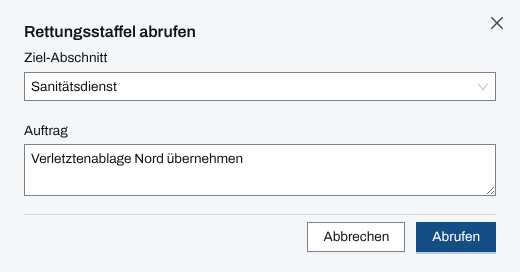

## Überblick

Ein **Bereitstellungsraum** (BR) ist der Ort, an dem Einheiten und Fahrzeuge auf ihren Einsatz
warten. Das Modul zeigt je Raum, wer dort bereitsteht, mit welcher Stärke und seit wann, wer am
längsten wartet, wer abgerufen ist und noch ausrücken soll, wer wann kam und ging, welche Kräfte
noch keinem Raum zugewiesen sind und welches Material dort liegt.

Dieses Kapitel beschreibt die Sicht der Einsatzleitung. Einsatzleitung und Führungspersonal legen
Räume an, ändern ihre Raumdaten, nehmen sie in Betrieb, weisen Kräfte zu, rufen sie mit Ziel und
Auftrag ab und lösen Räume wieder auf. Die Bedienung am gekoppelten Tablet eines Bereitstellungsraums beschreibt
[Bereitstellungsraum am Gerät](geraet-bereitstellungsraum.md).

## Abläufe

### Einen Bereitstellungsraum öffnen

1. Unter „Kräfte & Mittel“ „Bereitstellungsräume“ wählen. Die App öffnet den zuletzt gewählten Raum,
   sonst einen aktiven. Gibt es noch keinen, bietet sie „Ersten BR anlegen“ an.
2. Über den Namen des Raums im Seitenkopf in einen anderen Raum wechseln.
3. Für die Übersicht aller Räume in der Brotkrumenleiste „Bereitstellungsräume“ wählen. Die Liste
   zeigt je Raum Bezeichnung, Status, Abschnitt und Standort, dazu die Belegung: „Stärke“,
   „Fahrzeuge“, „Einheiten“ und „Längste Wartezeit“, mit denselben Werten wie der Raum selbst.

   

4. Über „Spalten“ lassen sich „Abschnitt“ und „Standort“ aus- und wieder einblenden; auf dem
   Handy fehlen sie zunächst, der Knopf nennt dann die Zahl der ausgeblendeten Spalten.

### Einen Bereitstellungsraum anlegen und in Betrieb nehmen

Für Einsatzleitung und Führungspersonal:

1. In der Übersicht „Neu“ wählen, oder im Seitenkopf eines Raums den Namen öffnen und „+ Neuer BR“
   wählen.
2. „Bezeichnung“ eingeben, bei Bedarf „Standort (optional)“ und „Notiz (optional)“. Den Standort
   mit Enter oder „Ort suchen“ suchen und einen Treffer wählen, dann ist der Raum gleich verortet;
   ohne Treffer bleibt er freier Text.

   

3. „Anlegen“ wählen. Die App öffnet den neuen Raum; er steht auf „geplant“.
4. Ist der Raum eingerichtet, „In Betrieb nehmen“ wählen. Er steht dann auf „aktiv“.

### Bezeichnung, Standort und Notiz ändern

Für Einsatzleitung und Führungspersonal, solange der Raum geplant oder aktiv ist:

1. Den Raum öffnen und bei „Raumdaten“ „Bearbeiten“ wählen.
2. Im Dialog „Bereitstellungsraum bearbeiten“ „Bezeichnung“, „Standort (optional)“ oder
   „Notiz (optional)“ ändern. Ein geleertes Feld löscht die Angabe; die Bezeichnung bleibt Pflicht.
   Eine Korrektur am Text des Standorts behält den Punkt, ein neuer Treffer versetzt ihn.

   

3. „Speichern“ wählen. Die neue Bezeichnung steht im Seitenkopf, im Umschalter und in der
   Übersicht, Standort und Notiz stehen unter „Raumdaten“; die Übersicht zeigt auch den Standort.

### Einen Bereitstellungsraum auf der Lagekarte verorten

Für Einsatzleitung und Führungspersonal, solange der Raum geplant oder aktiv ist:

1. Den Raum öffnen und bei „Raumdaten“ „Auf Karte verorten“ wählen. Steht der Raum schon auf der
   Karte, heißt der Knopf „Auf Karte versetzen“.
2. Die Lagekarte öffnet sich zum Platzieren dieses Raums. Auf die Stelle der Karte tippen, an der
   der Raum liegt. Die Karte meldet die Bezeichnung mit „verortet“, etwa „Parkplatz Stadion Nord
   verortet“; „Zurück zu …“ führt auf die Seite des Raums zurück.
3. Der Raum steht danach mit dem Zeichen „Bereitstellungsraum“ auf der Karte, beschriftet mit
   Bezeichnung, Stärke und Zahl der Fahrzeuge, etwa „Parkplatz Stadion Nord · 0/1/5//6 · 3 Fz“.
4. Ein Tipp auf das Zeichen zeigt unter „Auswahl“ Status, Stärke, Fahrzeuge, Einheiten, „Wartet
   seit“ und Abschnitt. „Im Fachmodul öffnen“ führt zurück zum Raum.

### Eintreffen buchen

Für Einsatzleitung und Führungspersonal, solange der Raum aktiv ist. Im Zustand „geplant“ steht
„Eintreffen buchen“ gesperrt, daneben „BR nicht in Betrieb“.

1. Den Raum öffnen und im Seitenkopf „Eintreffen buchen“ wählen.
2. In „Name oder Funkrufname“ den Namen, den Typ oder einen Funkrufnamen der Kraft eingeben. Die Treffer stehen
   unter „Erwartet“ und „Im Einsatz“, je mit Typ, den Funkrufnamen ihrer Fahrzeuge und, falls
   bekannt, „alarmiert …“, dem Abschnitt oder „eingetroffen …“. Darüber stehen unter „Aus
   Nachforderungen“ die Kräfte, die eine Nachforderung mit diesem Raum als Ziel erwartet: je
   Rufname der Zusage eine Zeile mit Art, „Nachforderung 2× RTW“, Stufe und „erwartet …“, ohne
   genannten Rufnamen eine Zeile „RTW ohne Rufname“.

   

3. Beim Treffer „Eintreffen“ wählen. Die Bestätigung lautet „… gebucht“; die Kraft steht danach
   in der Belegung des Raums. Unter „Aus Nachforderungen“ bucht „Eintreffen“ die Einheit, die im
   Einsatz schon so heißt; gibt es keine, öffnet sich die Erfassung mit Rufname und Art als
   „Funkrufname“ und „Fahrzeugtyp“, darüber „Aus Nachforderung 2× RTW“, und „Eintreffen buchen“
   legt sie an. Beide Wege verknüpfen die Einheit mit der Nachforderung.
4. Steht die Kraft nicht in der Liste, „Nicht in der Liste“ wählen. „Funkrufname“ ist mit der Suche
   vorbelegt; bei Bedarf „Trägerorganisation“, „Fahrzeugtyp“ und „Stärke“ eintragen, unter
   „Bemerkung“ einen freien Text, unter „Weiteres Fahrzeug“ mit „Fahrzeug hinzufügen“ die übrigen
   Fahrzeuge der Kraft.
5. „Unangemeldet buchen“ wählen. Die Bestätigung lautet „… unangemeldet gebucht, Einsatzleitung
   informiert“; die neue Einheit trägt in der Belegung „nicht übernommen“.
6. Gibt es im Einsatz schon eine Kraft mit diesem Funkrufnamen, steht „Schon im Einsatz: …“ und
   „Unangemeldet buchen“ ist gesperrt. „Diese buchen“ bucht die vorhandene Kraft, „Trotzdem neu
   anlegen“ legt die neue trotzdem an. Steht die vorhandene Kraft schon in einem Raum, fehlt
   „Diese buchen“. Kommt die Erfassung aus „Aus Nachforderungen“, verknüpfen beide Knöpfe die
   Einheit mit der Nachforderung; ein Fahrzeug ohne Einheit lässt sich nicht verknüpfen, das sagt
   der Hinweis neben dem Knopf.
7. Ohne Netz lautet die Bestätigung „Offline vorgemerkt: Eintreffen …“. Die Kraft steht unter
   „Vorgemerkt“, bis sie beim Server gebucht ist; eine vorgemerkte Kraft bietet die Suche nicht
   noch einmal an.

### Kräfte zuweisen und austragen

Für Einsatzleitung und Führungspersonal, solange der Raum aktiv ist:

1. Den Raum öffnen. Rechts steht „Kräfte ohne BR“: oben unter „Erwartet“ die Kräfte ohne
   Abschnitt, nach Typ gruppiert, darunter zugeklappt „Im Einsatz“ mit ihrer Zahl. Aufklappen zeigt
   die Kräfte, die schon in einem Abschnitt stehen.
2. Bei Bedarf in „Kräfte suchen“ einen Namen eingeben.
3. Bei einer Einheit oder einem Fahrzeug „zuweisen“ wählen. Sie erscheint unter „Bereitgestellte
   Einheiten“ oder „Bereitgestellte Fahrzeuge“; „Bereitgestellt“ zählt die Stärke, „Fahrzeuge“ die
   Fahrzeuge im Raum, auch die der bereitgestellten Einheiten. Anders als „Eintreffen buchen“
   trägt „zuweisen“ kein Eintreffen in die Zeitachse ein.

   ![Bereitstellungsraum „Parkplatz Stadion Nord“ mit „Auf Karte verorten“ und „Bearbeiten“ an den Raumdaten: oben unter „Abgerufen“ die Betreuungsgruppe mit „abgerufen … → Betreuung · Auftrag Nr. …“, „Ausrücken buchen“ und „Abruf zurücknehmen“, darunter unter „Bereitgestellte Einheiten“ die Rettungsstaffel mit ihren Fahrzeugen, „seit … · 48 min“ und „Abrufen“; Stärke 0/1/5//6, „Fahrzeuge“ 3, „Einheiten“ 2, „Längste Wartezeit“ 48 min und die Seitenleiste „Kräfte ohne BR“ mit aufgeklapptem „Im Einsatz“](../bilder/bereitstellungsraeume/raum.png)

4. Ist eine Kraft irrtümlich gebucht oder ohne Abruf gegangen, bei ihr das Aktionsmenü öffnen und
   „Austragen“ wählen. Sie steht wieder unter „Kräfte ohne BR“.

### Eine Kraft abrufen

Für Einsatzleitung und Führungspersonal, solange der Raum aktiv ist:

1. Den Raum öffnen und bei der Einheit oder dem Fahrzeug unter „Bereitgestellte Einheiten“ bzw.
   „Bereitgestellte Fahrzeuge“ „Abrufen“ wählen.
2. Bei einer Einheit unter „Ziel-Abschnitt“ den Abschnitt wählen, dem sie unterstellt werden soll.
   Vorbelegt ist der Abschnitt des Raums; leer bleibt die Unterstellung, wie sie ist. Ein Fahrzeug
   ohne Einheit hat kein „Ziel-Abschnitt“.
3. Bei Bedarf unter „Auftrag“ den Auftrag eintragen; leer wird kein Auftrag erteilt. Nimmt die
   Einheit Untereinheiten mit, nennt der Dialog sie neben dem Knopf („mit …“).

   

4. „Abrufen“ wählen. Die Bestätigung nennt Ziel und Auftragsnummer, etwa „Rettungsstaffel
   abgerufen → Sanitätsdienst · Auftrag Nr. 7“. Die Kraft steht danach oben unter „Abgerufen“ mit
   „abgerufen“, der Uhrzeit, dem Ziel und der Auftragsnummer, bis ihr Ausrücken gebucht ist.
5. Gibt es am Raum keinen Einweiser, der das Ausrücken bucht, stattdessen im Aktionsmenü der Kraft
   „Abrufen und austragen“ wählen: derselbe Dialog, „Abrufen und austragen“ ruft ab und trägt die
   Kraft im selben Schritt aus dem Raum aus.

### Ausrücken buchen oder einen Abruf zurücknehmen

1. Den Raum öffnen. Unter „Abgerufen“ stehen die abgerufenen Kräfte, die am längsten abgerufene
   oben. Eine mitgenommene Untereinheit nennt „mit …“ ihre Einheit.
2. Rückt die Kraft aus, „Ausrücken buchen“ wählen. Die Bestätigung lautet „… ausgerückt“; die
   Kraft und die mit ihr abgerufenen Untereinheiten stehen in keinem Raum mehr. Meist bucht das
   der Einweiser am Tablet des Raums ([Bereitstellungsraum am Gerät](geraet-bereitstellungsraum.md)).
3. War der Abruf ein Irrtum, „Abruf zurücknehmen“ wählen. Die Kraft steht wieder unter den
   bereitgestellten, mit ihren Untereinheiten.

### Sehen, wer am längsten wartet

1. Den Raum öffnen. Oben stehen „Bereitgestellt“ (Stärke), „Fahrzeuge“, „Einheiten“ und
   „Längste Wartezeit“; darunter steht, seit wann die am längsten wartende Kraft im Raum ist.
2. Unter „Bereitgestellte Einheiten“ steht die Einheit, die am längsten wartet, oben. Jede Zeile
   nennt Typ, Stärke, die Funkrufnamen ihrer Fahrzeuge und „seit“ mit Uhrzeit und Wartezeit, etwa
   „seit 1342 · 48 min“. Unter „Bereitgestellte Fahrzeuge“ stehen die Fahrzeuge ohne Einheit in
   derselben Folge.
3. Eine neu zugewiesene Kraft kommt ans Ende. Die Wartezeit zählt ohne Neuladen weiter.

### Den Verlauf eines Raums lesen

1. Den Raum öffnen und ganz unten „Verlauf“ aufklappen.
2. Die Liste nennt, neueste zuerst, je Ereignis die Uhrzeit, was geschah („Eintritt“, „Austritt“,
   „Austritt nach …“, „Abruf nach … (Auftrag Nr. …)“, „Abruf zurückgenommen“, „Wechsel von …“,
   „Wechsel nach …“), die Einheit oder das Fahrzeug und, falls erfasst, eine Notiz wie „Einheit
   aufgelöst“ oder „Fahrzeug entlassen“. Der Abruf einer mitgenommenen Untereinheit lautet „Abruf
   mit … nach …“.

   

3. Bei offenem Verlauf erscheinen neue Ereignisse ohne Neuladen.

### Material im Raum führen

Für Einsatzleitung und Führungspersonal, wenn das Modul Material freigegeben ist, auch in einem
geplanten Raum:

1. Den Raum öffnen. Unter den bereitgestellten Fahrzeugen steht „Material“ mit der Zahl der Posten
   und, falls vorhanden, dem Ausfall, je Posten Menge und Status.
2. Unter „Material zuordnen …“ einen Posten wählen: unter „Ohne Ort“ die freien Posten, unter „An
   anderem Ort“ Posten, die schon an einem anderen Ort liegen, mit diesem Ort im Eintrag. Der Posten
   liegt danach im Raum. Bei einem Verbrauchsgut mit Menge ab 2 und Rest fragt ein Dialog zuerst die
   „Menge hierher“, vorbelegt mit der ganzen Menge: „Hierher“ holt den ganzen Posten, eine kleinere
   Menge holt nur diesen Teil, und der Rest bleibt am bisherigen Ort. Der Dialog nennt das Ergebnis,
   etwa „Danach hier 20, Staffel A 30“.
3. Bei einem Verbrauchsgut mit Rest „Ausgeben“ wählen, die „Menge ausgeben“ eingeben und mit
   „Ausgeben“ bestätigen; die Zeile nennt danach den Rest.
4. Mit „Lösen“ einen Posten aus dem Raum lösen. Er bleibt ohne Ort im Einsatz. Die Zeile bleibt als
   „Gelöst“ an ihrer Stelle, bis Zeiger und Fokus den Bereich verlassen haben, damit kein anderer
   Knopf unter den Finger rückt. „Rückgängig“ im Hinweis oben holt den Posten zurück.

### Einen Bereitstellungsraum auflösen oder stornieren

Für Einsatzleitung und Führungspersonal:

1. Einen aktiven Raum erst leeren: abgerufene Kräfte ausrücken lassen, die übrigen austragen.
   Solange noch Kräfte dort stehen, auch abgerufene, ist „Auflösen“ gesperrt, daneben steht
   „noch … belegt“.
2. „Auflösen“ wählen und die Rückfrage „BR auflösen?“ mit „BR auflösen“ bestätigen. Der Raum steht
   dann auf „aufgelöst“.
3. Ein Raum, der nie in Betrieb war, wird stattdessen mit „Stornieren“ verworfen; die Rückfrage „BR
   stornieren?“ mit „BR stornieren“ bestätigen. Er verschwindet aus Übersicht und Umschalter.
   Liegt dort noch Material, lehnt die App den Storno ab und nennt den Grund über der Seite;
   erst die Posten mit „Lösen“ aus dem Raum nehmen.

## Hintergrund

### Status eines Raums

Ein Raum durchläuft „geplant“, „aktiv“ und „aufgelöst“. Kräfte lassen sich nur einem aktiven Raum
zuweisen, Material schon einem geplanten: so lässt sich ein Raum vorbereiten. Ein aufgelöster Raum
nimmt kein Material mehr an; „Material zuordnen …“ steht dort gesperrt mit „BR aufgelöst“, und
Material, das noch dort liegt, lässt sich lösen. Bezeichnung, Standort und Notiz lassen sich ändern, solange der Raum geplant oder aktiv
ist; ein aufgelöster Raum ist nur zu lesen.

### Wer zugewiesen werden kann

„Kräfte ohne BR“ bietet Einheiten an und Fahrzeuge ohne Einheit, sofern sie in keinem Raum stehen.
Fahrzeuge einer Einheit werden nicht einzeln zugewiesen, sondern über ihre Einheit. Eine Kraft steht
höchstens in einem Raum; soll sie in einen anderen, wird sie zuerst im alten ausgetragen. Die Stärke
rechnet unterstellte Einheiten mit ein und zählt keine doppelt.

„Erwartet“ und „Im Einsatz“ trennen nach dem Abschnitt: eine Einheit ohne eigenen Abschnitt zählt
mit dem Abschnitt ihrer Über-Einheit. Fahrzeuge ohne Einheit stehen immer unter „Erwartet“. Im
Dialog „Eintreffen buchen“ steht eine Kraft außerdem unter „Im Einsatz“, sobald sie in ihrem
laufenden Einsatzabschnitt schon eingetroffen ist.

### Was ein Eintreffen schreibt

„Eintreffen“ bucht in einem Schritt den Eintritt in den Raum und, bei einer Einheit, das
Eintreffen in ihrer [Zeitachse](meldebild.md); ein Fahrzeug ohne Einheit bekommt nur den Eintritt.
Ist die Einheit in ihrem laufenden Einsatzabschnitt schon eingetroffen, bleibt die Zeitachse
unverändert. Das Einsatztagebuch bekommt genau einen Eintrag: „… im BR … eingetroffen“, oder
„… tritt in Bereitstellungsraum … ein“, wenn die Zeitachse nichts eingetragen hat. Bei einer
unangemeldeten Kraft trägt der Eintrag den Text der Meldung.

Eine unangemeldete Kraft legt die App als neue Einheit ohne Abschnitt an, benannt nach dem
Funkrufnamen des ersten Fahrzeugs, mit ihren Fahrzeugen und der Bemerkung. Die Stärke ist keine
Soll-Stärke; sie steht nur im Text der Meldung und des Einsatztagebuchs. Dazu geht eine Meldung an
die Einsatzleitung, etwa „Florian Nachbar 3 (FF Nachbarort, HLF) unangemeldet im BR Parkplatz Stadion
Nord eingetroffen, Stärke 0/1/8//9. Übernahme offen.“; die Bemerkung steht nicht darin.
Die Einheit trägt „nicht übernommen“, bis die Einsatzleitung sie übernimmt oder abweist (Kapitel
[Einheiten](einheiten.md)); danach trägt sie in der Belegung dauerhaft das neutrale Kennzeichen
„unangemeldet“.

Ob ein Funkrufname schon im Einsatz steht, vergleicht die App ohne Groß- und Kleinschreibung und
ohne doppelte Leerzeichen, mit Namen und Funkrufnamen der Einheiten und den Funkrufnamen der
Fahrzeuge. Kräfte aus den Stammdaten bietet der Dialog nicht an.

### Kräfte aus einer Nachforderung

Hat eine Nachforderung den Raum als Ziel, trägt „Als Einheit übernehmen“ an ihrer Karte die
eingetroffenen Kräfte mit dem Haken „In BR … eintragen“ ein (Kapitel
[Nachforderungen](nachforderung.md)). Die Belegung zeigt sie wie jede eingetroffene Einheit, mit
dem Zeitpunkt von „Eintreffen melden“; die Zeitachse jeder Einheit nennt das Eintreffen im Raum.
Das Einsatztagebuch bekommt keinen Eintrag je Einheit, sondern einen für die ganze Übernahme, etwa
„Nachforderung 2× RTW: als Einheiten übernommen (83-1, 83-2), im BR Nord eingetroffen“. Wird die
Übernahme einer Einheit storniert, bucht die App ihren Austritt; der Verlauf des Raums zeigt
Eintritt und Austritt, bei einer angelegten Einheit mit der Notiz „Einheit aufgelöst“, bei einer
verknüpften mit „Übernahme storniert“.

Schon vorher, solange die Nachforderung zugesagt oder unterwegs ist, nennt „Eintreffen buchen“ ihre
Kräfte unter „Aus Nachforderungen“, am Desktop wie am gekoppelten Gerät des Raums. Von der
Nachforderung zeigt die Gruppe nur Art, Anzahl, Stufe, die Rufnamen der Zusage und das erwartete
Eintreffen, keine Details, Begründung oder Adressaten; ohne Freigabe des Moduls Nachforderungen
fehlt sie. Eine so gebuchte Einheit verweist auf die Nachforderung, die Karte der Nachforderung
nennt sie, und ihr Rufname verschwindet aus der Gruppe; ist die Anzahl erreicht, die ganze
Nachforderung. Die Stufe bleibt: „Eintreffen melden“ an der Karte bleibt der Einsatzleitung. Das
Einsatztagebuch bekommt genau einen Eintrag mit Verweis auf die Nachforderung, etwa „Nachforderung
2× RTW: 83-1 im BR Nord eingetroffen“; eine dabei neu angelegte Einheit meldet sich wie jede
unangemeldete Kraft bei der Einsatzleitung, mit „aus Nachforderung 2× RTW“ statt „unangemeldet“,
und trägt „nicht übernommen“, bis die Einsatzleitung sie übernimmt.

### Was ein Abruf schreibt

Ein Abruf ist eine Entscheidung der Führung: die Kraft verlässt den Raum erst, wenn ihr Ausrücken
gebucht ist. Bis dahin steht sie unter „Abgerufen“ und zählt weiter in „Bereitgestellt“,
„Fahrzeuge“, „Einheiten“ und „noch … belegt“; ihr „seit“ und damit die Wartezeit laufen weiter.
Am Tablet des Raums erscheint der Abruf ohne Neuladen, ohne Ton und ohne Benachrichtigung.

In einem Schritt unterstellt der Abruf eine Einheit dem gewählten Abschnitt und erteilt den
Auftrag. Der Auftrag steht danach unter [Aufträge und Befehle](auftraege-befehle.md) mit der Kraft als Empfänger und
dem Abschnitt als Ort und benachrichtigt wie jeder andere Auftrag. Eine Einheit nimmt ihre
Untereinheiten über alle Ebenen mit, die im selben Raum stehen und nicht schon eigens abgerufen
sind; Unterstellung und Auftrag bekommt nur die Einheit selbst. Die Fahrzeuge einer Einheit gehen
mit ihr; einzeln abrufen lässt sich nur ein Fahrzeug ohne Einheit, und es hat keine
Unterstellung.

„Ausrücken buchen“ trägt die Kraft und die mit ihr abgerufenen Untereinheiten aus dem Raum aus.
„Abruf zurücknehmen“ hebt den Abruf auf, auch für die mitgenommenen Untereinheiten; Unterstellung
und Auftrag bleiben, ein Auftrag wird bei Bedarf unter Aufträge aufgehoben. „Abrufen und
austragen“ ruft ab und trägt aus, ohne dass jemand das Ausrücken bestätigt.

Mehrere Kräfte auf einmal abzurufen gibt es nicht; ein Verband geht mit seiner Einheit.

### Was die Zahlen zählen

„Fahrzeuge“ zählt jedes aktive Fahrzeug im Raum genau einmal: die einzeln bereitgestellten und
die Fahrzeuge der bereitgestellten Einheiten. Die Fahrzeuge einer unterstellten Einheit zählen
nur, wenn diese Einheit selbst im Raum steht. Entlassene oder stornierte Fahrzeuge zählen nicht.
Am gekoppelten Tablet des Raums steht dieselbe Zahl.
„noch … belegt“ vor dem Auflösen zählt dagegen nur, was einzeln im Raum steht: die Einheiten und
die Fahrzeuge ohne Einheit. Die Fahrzeuge einer Einheit gehen mit ihrer Einheit und halten das
Auflösen nicht auf.

### Wartezeit und Folge

„Seit“ ist der Zeitpunkt, an dem eine Kraft zuletzt in diesen Raum kam: ihr Eintritt oder ihr
Wechsel aus einem anderen Raum. Ein früherer Aufenthalt in einem anderen Raum zählt nicht. Fehlt
ein solcher Zeitpunkt, etwa bei älteren Daten, steht die Kraft ohne Zeitangabe am Ende der Liste;
die App schätzt nichts. Die Wartezeit rechnet in ganzen Minuten gegen die Uhr des Geräts; geht
diese nach, erscheint die Wartezeit kürzer, nie negativ. Die Fahrzeuge einer Einheit tragen kein
eigenes „seit“, sie stehen mit ihrer Einheit. „Längste Wartezeit“ ist die Wartezeit der Kraft, die
am längsten im Raum steht. Eine Farbe oder Warnung für lange Wartezeiten gibt es nicht.

Die Listen ordnen fest nach Wartezeit, bei gleicher Zeit nach Namen; „Abgerufen“ ordnet nach der
Zeit des Abrufs. Steht der Mauszeiger über der Belegung oder liegt der Fokus dort, warten Zugänge
anderer Arbeitsplätze hinter dem Hinweis „… neu“ bzw. „… neu abgerufen“, damit keine Zeile unter
dem Zeiger springt; eigene Zuweisungen und Abrufe erscheinen sofort.

### Verlauf

Der Verlauf führt jedes Ereignis des Raums vollständig und ungeblättert, auch Austritte durch
Auflösen einer Einheit oder Entlassen eines Fahrzeugs. Ein Wechsel steht in beiden Räumen: im
verlassenen als „Wechsel nach …“, im neuen als „Wechsel von …“. Aufgelöste Einheiten und
entlassene Fahrzeuge stehen mit ihrem Namen. Auch ein aufgelöster Raum zeigt seinen Verlauf. Der
Verlauf lädt erst beim Aufklappen; beim Wechsel in einen anderen Raum klappt er zu. Wer den Raum
lesen darf, darf auch den Verlauf lesen.

### Druck

Der Druck des Raums zeigt alle Kräfte, auch solche, die gerade hinter dem Hinweis „… neu“ warten,
jeweils mit „seit“ und der Wartezeit zum Zeitpunkt des Drucks, dazu „Längste Wartezeit“. Der
Verlauf wird nicht gedruckt, solange er zugeklappt ist; ein aufgeklappter Verlauf druckt mit.

### Material im Raum

Material liegt an genau einem Ort (Kapitel [Material](material.md)); ein Posten von einem anderen
Ort wird ohne Rückfrage umgehängt, und das Einsatztagebuch nennt den alten und den neuen Ort.
Material in einem Bereitstellungsraum steht nicht im [Meldebild](meldebild.md). Zuordnen, Lösen
und Ausgeben verlangen Schreibrecht im Einsatz und die Freigabe des Moduls Material; ohne die
Freigabe fehlt die Sektion „Material“. Am gekoppelten Tablet eines Raums fehlt sie ebenso.

### Auf der Lagekarte

Auf der [Lagekarte](lagekarte.md) stehen die verorteten Räume in der Ebene
„Bereitstellungsräume“. Ein geplanter Raum trägt einen gestrichelten Ring um sein Zeichen und in
der Beschriftung „geplant“; Stärke und Fahrzeuge zeigt erst ein aktiver Raum. Ein aufgelöster oder
stornierter Raum verschwindet von der Karte. Ein Raum ohne Ort steht in der Leiste unter „Nicht
verortet“ und lässt sich auch dort platzieren; „Verortung löschen“ am gewählten Zeichen nimmt ihm
den Ort wieder. Die Koordinate ist unabhängig vom Freitext „Standort“: der eine ändert den
anderen nicht.

Fahrzeuge und Einheiten zählt die Karte wie der Raum selbst. Die Stärke rechnet sie aus der
Einheitenliste; fehlt das Recht auf das Modul Einheiten, steht sie nicht in der Beschriftung, und
unter „Auswahl“ steht „—“. Eine Änderung an Ort, Status oder Belegung erreicht jede offene
Karte ohne Neuladen. Ein gesicherter Lagestand zeigt die Räume so, wie sie beim Sichern waren.
Verorten kann nur, wer den Raum ändern darf; am gekoppelten Tablet eines Raums fehlt der Knopf.
Ist die Lagekarte gesperrt, steht „Auf Karte verorten (Keine Berechtigung)“ gesperrt da.

### Einsatztagebuch

Das Einsatztagebuch hält fest, wenn ein Raum in Betrieb genommen oder aufgelöst wird und wenn eine
Kraft in einen Raum eintritt, dort eintrifft oder ihn verlässt, jeweils mit Namen. Ein Abruf
schreibt genau einen Eintrag mit Ziel und Auftragsnummer, etwa „Rettungsstaffel aus
Bereitstellungsraum Parkplatz Stadion Nord abgerufen nach Sanitätsdienst (Auftrag Nr. 7)“, mit
mitgenommenen Untereinheiten „… mit …“, bei „Abrufen und austragen“ mit „… und ausgerückt“; den
Auftragstext wiederholt er nicht. Das Ausrücken lautet „… rückt aus Bereitstellungsraum … aus nach
…“, die Rücknahme „Abruf von … aus Bereitstellungsraum … zurückgenommen“. Das Anlegen, das Ändern der
Raumdaten, das Verorten und das Stornieren eines Raums stehen nicht darin. Wird ein Raum umbenannt, behalten
frühere Einträge den alten Namen.

### Rechte und ohne Netz

Lesen darf, wer das Modul Bereitstellungsräume sieht. Anlegen, ändern, in Betrieb nehmen,
Eintreffen buchen, zuweisen, abrufen, Ausrücken buchen, Abrufe zurücknehmen, austragen, auflösen
und stornieren dürfen Einsatzleitung und Führungspersonal, solange der Einsatz läuft (Kapitel
[Rechte im Einsatz](rechte-im-einsatz.md)).
Eine unangemeldete Kraft verlangt zusätzlich das Recht auf Einheiten und auf Fahrzeuge; fehlt es,
steht der Grund im Dialog und nichts wird gebucht. Beim Abruf verlangt der Ziel-Abschnitt
zusätzlich das Modul Einheiten (die Liste der Abschnitte das Modul Einsatzabschnitte), der Auftrag
das Modul Aufträge; fehlt eines, steht das Feld gesperrt mit „Modul … gesperrt“, und der Abruf
geht ohne diese Angabe. Die Bereitstellungsräume
gehören nicht zu dem, was die App für die Arbeit ohne Netz vorhält (Kapitel
[Ohne Netz](ohne-netz.md)). Auf einer mit Netz geöffneten Seite eines Raums lässt sich ein
Eintreffen trotzdem buchen: Die App merkt es vor und sendet es genau einmal, sobald wieder Netz da
ist, mit dem Zeitpunkt der Erfassung. „Vorgemerkt“ steht nur auf dem Gerät, das gebucht hat; in
den Zahlen des Raums zählt die Kraft erst nach dem Senden.
