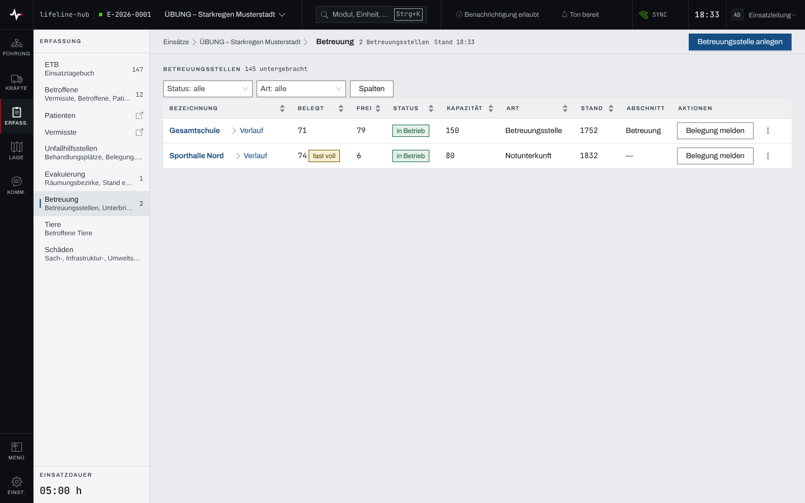
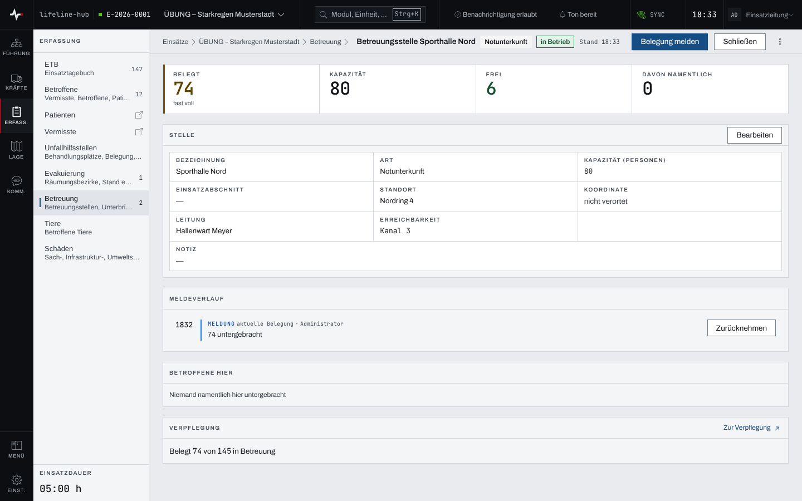
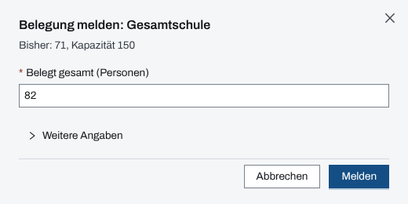

## Überblick

Das Modul „Betreuung“ führt die **Betreuungsstellen**: wie viele Personen dort untergebracht sind
und wie viel Platz noch frei ist. Gezählt wird ohne Namen: Meldungen nennen nur Zahlen. Die
Räumungsbezirke und den Stand „evakuiert“ führt das Modul „Evakuierung“
([Evakuierung](evakuierung.md)).

Der Kopf der Seite zählt die Betreuungsstellen und nennt volle Stellen. Über der Tabelle steht die
Summe der Untergebrachten. Jede Stelle hat eine eigene Seite mit ihrer Belegung, ihren Angaben,
dem Meldeverlauf und den namentlich dort untergebrachten Betroffenen.

## Abläufe

### Die Unterbringung ablesen

1. Im Modulpanel „Betreuung“ öffnen.

   

2. Die Tabelle nennt je Stelle die Belegung, die freien Plätze, den Status („vorbereitet“, „in
   Betrieb“, „geschlossen“), die Kapazität, die Art und die Zeit der letzten Meldung. Die Filter
   „Status“ und „Art“ engen die Tabelle ein.
3. „Verlauf“ an einer Stelle klappt alle Meldungen dazu auf.
4. Die Bezeichnung einer Stelle öffnet ihre Seite.

### Die Seite einer Betreuungsstelle

1. In der Tabelle die Bezeichnung der Stelle wählen, auf der Lagekarte „Im Fachmodul öffnen“.
2. Oben unter „Belegung in Zahlen“ belegt, Kapazität und frei ablesen, mit Zugriff auf
   „Betroffene“ auch „Davon namentlich“. Unter „Belegt“ steht „fast voll“, „voll“ oder
   „überbelegt“.

   

3. Unter „Stelle“ stehen Bezeichnung, Art, Kapazität, Einsatzabschnitt, Standort, Koordinate,
   Leitung, Erreichbarkeit und Notiz, unter „Meldeverlauf“ alle Belegungsmeldungen der Stelle.
4. Unter „Betroffene hier“ stehen die Betroffenen, deren Verbleib „Notunterkunft“ auf diese
   Stelle zeigt; ein Klick öffnet die Person. Ohne Zugriff auf „Betroffene“ steht dort „Keine
   Berechtigung“.
5. Unter „Verpflegung“ steht, wie viele der Personen „in Betreuung“ in dieser Stelle
   untergebracht sind; „Zur Verpflegung“ öffnet das Modul.

### Bedarf einer Stelle anfordern

Was eine Stelle braucht (Feldbetten, Decken, Hygieneartikel, Personal), wird als
[Nachforderung](nachforderung.md) für diese Stelle angefordert:

1. Auf der Seite der Stelle unter „Bedarf“ „Bedarf anfordern“ wählen.
2. Das Formular „Neue Nachforderung“ öffnet sich mit „Für Betreuungsstelle …“ und der
   vorbelegten Begründung. Art, Anzahl und Bezeichnung eintragen und „Nachforderung absetzen“
   wählen.
3. Zurück auf der Seite der Stelle steht die Nachforderung unter „Bedarf“ mit ihrem Stand; ein
   Klick öffnet sie. „Alle Nachforderungen der Stelle“ zeigt auch die eingetroffenen und die
   abgelehnten.

Ohne Zugriff auf „Nachforderung“ steht dort „Bedarf · Keine Berechtigung“.

### Eine Betreuungsstelle anlegen und ihre Belegung melden

1. „Betreuungsstelle anlegen“ wählen, „Bezeichnung“ und „Art“ angeben („Anlaufstelle“,
   „Betreuungsstelle“, „Betreuungsplatz“, „Notunterkunft“), dazu „Kapazität (Personen)“ und
   unter „Weitere Angaben“ „Standort“, „Leitung“, „Erreichbarkeit“ und „Notiz“. „Anlegen“
   wählen. Die Stelle steht auf „vorbereitet“.
2. Öffnet die Stelle, ihre Bezeichnung wählen und auf ihrer Seite „In Betrieb nehmen“ wählen.
3. An der Stelle in der Tabelle oder auf ihrer Seite „Belegung melden“ wählen.
4. Unter „Belegt gesamt (Personen)“ die Gesamtzahl der Untergebrachten eintragen.

   

5. „Melden“ wählen.

Eine Stelle ohne Koordinate lässt sich über „Auf Karte verorten“ im Menü auf der Lagekarte
setzen; „Zurück zu …“ führt danach auf die Seite der Stelle.

### Die Angaben einer Stelle ändern

1. Auf der Seite der Stelle am Abschnitt „Stelle“ „Bearbeiten“ wählen.
2. Die Felder ändern. Ein ungültiger Wert wird am Feld genannt, etwa eine leere Bezeichnung oder
   eine Leitung mit mehr als 200 Zeichen.
3. „Speichern“ wählen, oder „Abbrechen“, um nichts zu ändern.

Gespeichert werden nur die geänderten Felder; eine Änderung, die jemand anderes inzwischen an
einem anderen Feld gespeichert hat, bleibt erhalten. Wer die Seite mit ungespeicherten Änderungen
verlassen will, wird gefragt.

### Eine Meldung zurücknehmen

1. An der Stelle „Verlauf“ aufklappen.
2. An der falschen Meldung „Zurücknehmen“ wählen und die Rückfrage „Meldung zurücknehmen?“
   bestätigen.

Die Meldung bleibt im Verlauf stehen, gekennzeichnet als zurückgenommen; es gilt wieder die
Meldung davor. Das lässt sich nicht umkehren.

## Hintergrund

### Wie gezählt wird

- Gemeldet wird immer die **Gesamtzahl**. Sie darf die Kapazität übersteigen; die Stelle ist dann
  „überbelegt“.
- Ab 90 % der Kapazität steht eine Stelle auf „fast voll“, bei genau 100 % auf „voll“. Ohne
  Kapazität zeigt sie keine freien Plätze.
- Eine Stelle ohne Meldung zählt nicht als null: sie steht auf „keine Meldung“.
- Ein Zeitpunkt in der Zukunft wird abgelehnt. Eine Meldung mit einem älteren Zeitpunkt als die
  aktuelle wird als nachgetragen geführt („nachgetragen um …“), die aktuelle bleibt stehen.
- „davon namentlich“ an einer Stelle zählt die Betroffenen, deren Verbleib „Notunterkunft“ auf
  diese Stelle zeigt ([Betroffene und Sichtung](betroffene.md)). Die Zahl ist ein Hinweis und
  kein Teil der Belegung.

### Schließen und Stornieren

Eine Stelle wird auf ihrer Seite mit „Schließen“ geschlossen. Ist sie noch belegt, verlangt der
Dialog zuerst die Leermeldung („Alle haben die Stelle verlassen — Belegung 0 melden“). An einer
geschlossenen Stelle lassen sich keine Belegungen melden und keine Meldungen zurücknehmen; „Wieder
öffnen“ setzt sie zurück in Betrieb.

„Stornieren“ steht im Menü der Stelle, in der Tabelle wie auf ihrer Seite. Es ist nur für
Fehlanlagen gedacht und nicht umkehrbar. Der Dialog bietet stattdessen das Schließen an. Der
Nachweis im Einsatztagebuch bleibt. Nachforderungen für eine stornierte Stelle bleiben bestehen, verweisen aber auf
keine Stelle mehr.

### Einsatztagebuch

Jede Anlage, jede Belegungsmeldung und jeder Statuswechsel einer Stelle steht im
Einsatztagebuch, eine Rücknahme als Berichtigung. Eine geänderte Leitung oder Erreichbarkeit
steht dort nur als „weitere Angaben“, ohne Namen und Nummer. Beim Schwärzen des Einsatzes werden
Leitung und Erreichbarkeit geleert.

### Verpflegung

Die Belegung der Betreuungsstellen ergibt die Zahl „in Betreuung“, mit der das Modul
„Verpflegung“ den Bedarf der Betreuten rechnet ([Verpflegung](verpflegung.md)). Unterkünfte für
Einsatzkräfte gehören deshalb nicht als Betreuungsstelle hierher.

### Rechte

Anlegen und melden dürfen Einsatzleitung und Führungspersonal eines laufenden Einsatzes
([Rechte im Einsatz](rechte-im-einsatz.md)); ohne dieses Recht steht ein Hinweis über der Seite,
und die Knöpfe sind gesperrt. „Betreuung“ und „Evakuierung“ sind getrennte Module mit eigenen
Einstellungen ([Einstellungen des Einsatzes und Module](einsatz-einstellungen.md)). Die Bedienung am gekoppelten Gerät einer Betreuungsstelle beschreibt
[Betreuungsstelle am Gerät](geraet-betreuungsstelle.md).

### Ohne Netz

Die Betreuung bleibt ohne Netz lesbar. Belegungsmeldungen lassen sich vormerken; sie tragen den
Zeitpunkt der Erfassung und gehen hinaus, sobald Netz da ist. Anlegen und Status gehen nur mit Netz.
Mehr in [Arbeiten ohne Netz](ohne-netz.md).
