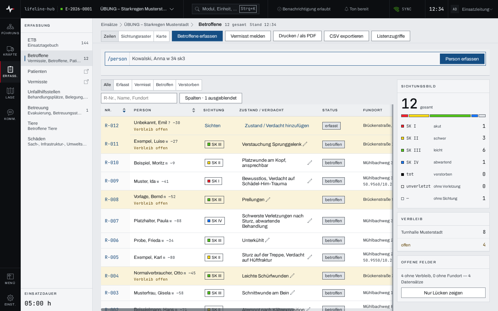
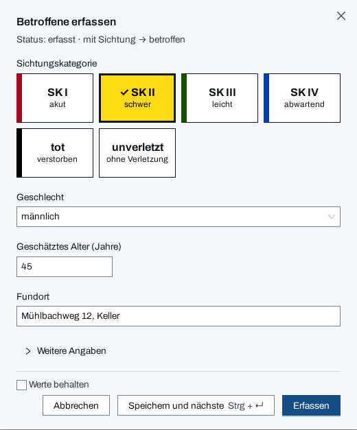
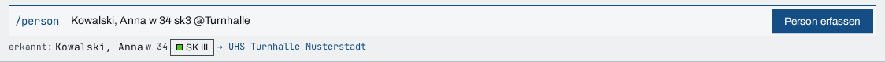
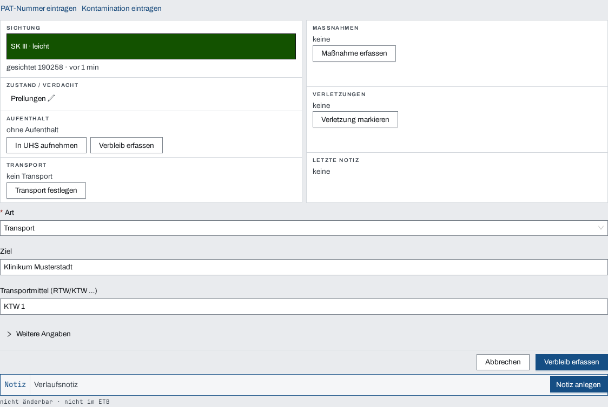
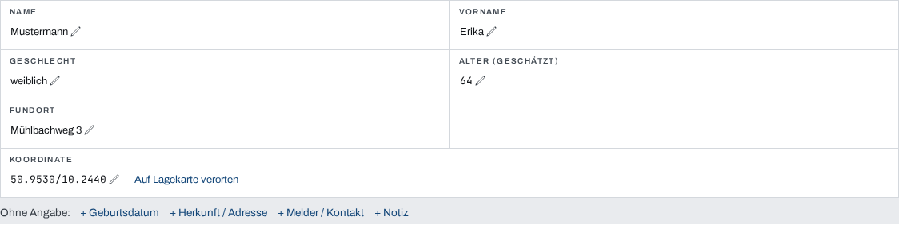

## Überblick

Das Modul „Betroffene“ führt jede Person, um die sich der Einsatz kümmert: Verletzte, Unverletzte,
Verstorbene und Vermisste. Jede Person bekommt eine Registriernummer (R-001, R-002 …), eine
Sichtungskategorie und, sobald sie die Einsatzstelle verlässt, einen Verbleib. Für Patienten führt
das Modul dazu den Transport, die Maßnahmen, die Verletzungen am Körperschema, die Nummer der
Patientenanhängetasche (PAT-Nummer) und eine Kontamination. Pflichtfelder gibt
es nicht; Name und Alter dürfen fehlen.

Die Liste zeigt neben den Personen das Sichtungsbild, den Verbleib und die offenen Felder.
Abgeschlossene Patienten (übergeben, vor Ort entlassen, in einer Notunterkunft oder mit Verbleib
des Leichnams) stehen nur auf Wunsch darin. Im Modulpanel führen „Patienten“ direkt ins
Sichtungsraster und „Vermisste“ in die Liste der Vermissten.

## Abläufe

### Die Lage der Betroffenen ablesen

1. Im Modulpanel „Betroffene“ öffnen. Die Liste zeigt je Person Registriernummer, Name, Sichtung,
   Zustand, Status, Fundort, Verbleib, Transport und Zeit; eine kontaminierte Person trägt neben
   dem Namen „kontaminiert“. Ein Klick auf die Zeile öffnet die Person.

   

2. Rechts zählt das „Sichtungsbild“ die Personen in Versorgung je Sichtungskategorie, „Verbleib“
   zählt alle angetroffenen Personen je Verbleib („Unterwegs“, „Transport“, „Notunterkunft“ …)
   und Unfallhilfsstelle, „Offene Felder“ nennt, wem Verbleib oder Fundort fehlt.
3. Mit „Nur Lücken zeigen“ bleiben nur die Personen mit offenen Feldern in der Liste.
4. Über die Leiste oben wechselt die Ansicht zwischen „Zeilen“, „Sichtungsraster“ und „Karte“
   (Fundorte mit Koordinate). Das Sichtungsraster zeigt je Kategorie eine Spalte mit Zahl, darin
   je Person eine Karte mit Kennung, Name, Zeit seit der Sichtung, Aufenthalt und
   Transportpriorität; die älteste Sichtung steht oben. Ein Tipp auf Kennung oder Name öffnet die
   Person, ein Tipp auf die Sichtung öffnet die Sichtungswahl.
5. Der Statusfilter („Alle“, „Erfasst“, „Vermisst“, „Betroffen“, „Verstorben“) und die Suche
   nach R-Nr., PAT-Nr., Name oder Fundort engen die Liste ein. Feiner geht es im Kopf der Spalten
   „Sichtung“, „Status“, „Verbleib“ und „Abschnitt“: das Trichterzeichen öffnet die Werte zum
   Ankreuzen, etwa „SK I“ oder „Offen“, „OK“ übernimmt sie. Ein Klick auf einen Spaltenkopf
   sortiert nach dieser Spalte, die Sichtung in der Folge SK I bis unverletzt, ein zweiter kehrt
   die Folge um. Ist die Liste eingeschränkt, steht darüber „Gefiltert“ mit der Zahl der Treffer
   und je Wert ein Knopf, etwa „Sichtung: SK I“, der genau diesen Filter entfernt; „Filter
   zurücksetzen“ leert Suche und Filter. Der Abschnitt ist der der Unfallhilfsstelle, in der die
   Person gerade ist; die Spalte steht unter 1600 px Fensterbreite unter „Spalten“.
6. „Abgeschlossene zeigen“ neben dem Statusfilter nimmt die abgeschlossenen Patienten wieder in
   Zeilen, Sichtungsraster und Karte auf; die Zahl dahinter sagt, wie viele es sind. Ohne
   abgeschlossene Patienten steht der Schalter nicht da.

### Eine Person mit der Maske erfassen

1. „Betroffene erfassen“ wählen.
2. Unter „Sichtungskategorie“ die Fläche der Kategorie antippen, dazu „Geschlecht“, „Geschätztes
   Alter (Jahre)“ und „Fundort“, soweit bekannt. Ein zweiter Tipp auf die gewählte Fläche nimmt
   die Wahl zurück; die Person wird dann ohne Sichtung erfasst.

   

3. Name, Vorname, Zustand, Koordinate und Notiz stehen unter „Weitere Angaben“.
4. „Erfassen“ wählen. Die Quittung nennt die neue Registriernummer („Erfasst als R-…“).

Kommen mehrere Personen nacheinander, speichert „Speichern und nächste“ (Strg + Enter) und hält
die Maske offen. Mit „Werte behalten“ bleibt der Fundort für die nächste Person stehen; die
Sichtung wird nie übernommen.

### Eine Person mit der Kurzeingabe erfassen

1. In der Liste in das Feld „Kurzeingabe Person“ (Zeile „/person“) schreiben, etwa
   „Kowalski, Anna w 34 sk3 @Turnhalle“.

   

2. Unter dem Feld steht, was erkannt wurde („erkannt: …“). Was sich nicht deuten lässt, nennt
   die Zeile unter „Nicht erfasst: …“; dann wird nichts angelegt.
3. Enter speichert. Das Feld leert sich, rechts steht „Zuletzt: …“ mit der Registriernummer.
   Escape leert das Feld, ohne zu speichern.

Die Kürzel: „Nachname, Vorname“; „m“, „w“ oder „d“ mit dem Alter (geschätzt als „~50“); „sk1“
bis „sk4“, „skt“ für tot und „sku“ für unverletzt; „#Breite/Länge“ für die Koordinate des
Fundorts; „@Name“ für die Unfallhilfsstelle, in die die Person aufgenommen wird.

### In der Liste nachsichten und Lücken schließen

1. In der Liste auf die Sichtung der Person tippen; bei einer ungesichteten Person steht dort
   „Sichten“. Die Sichtungswahl öffnet sich über der Zeile.
2. Die Fläche der Kategorie antippen und „Übernehmen“ wählen. Die Zeile zeigt die neue Kategorie,
   die Liste bleibt offen. „Abbrechen“ schließt die Wahl, ohne zu speichern.
3. Fehlt einer Person der Verbleib, steht in ihrer Spalte „Verbleib“ der Knopf „Verbleib
   erfassen“. Ihn wählen, „Art“ und „Ziel“ angeben (beim Transport das „Rettungsmittel“) und
   „Erfassen“ wählen.
4. Das Menü am Ende der Zeile (am Handy in der Karte der Person) bietet „Sichten“, „Verbleib
   erfassen“ und „Auf Lagekarte verorten“, bei einem Patienten im Eigentransport zusätzlich
   „Übergabe quittieren“.

Mit „Nur Lücken zeigen“ lässt sich die Liste so Zeile für Zeile abarbeiten: eine Zeile, deren
Lücke gerade geschlossen wurde, bleibt mit dem neuen Wert stehen, bis die Ansicht, der Filter oder
„Nur Lücken zeigen“ wechselt; die Zahl unter „Offene Felder“ sinkt sofort.

### Sichten und den Verbleib erfassen

1. In der Liste die Person öffnen. Oben auf der Seite „Person R-…“ steht der Patientenkopf:
   PAT-Nummer und „kontaminiert“, falls angegeben, darunter Sichtung mit Zeit („gesichtet … · vor
   42 min“), „Zustand / Verdacht“, Aufenthalt oder Verbleib, „Transport“, „Maßnahmen“,
   „Verletzungen“ und „Letzte Notiz“.
2. Auf die Sichtung tippen. Darunter klappt die Sichtungswahl auf: die Fläche der Kategorie
   antippen, bei Bedarf eine „Kurzbegründung (optional)“, und „Übernehmen“ wählen.
3. Verlässt die Person die Einsatzstelle, im Kopf „Verbleib erfassen“ wählen und die „Art“
   wählen: „Transport“, „Notunterkunft“, „Entlassung vor Ort“, „verbleibt vor Ort“ oder
   „Verbleib des Leichnams“. Dazu das „Ziel“ und beim Transport das „Rettungsmittel“: ein
   Fahrzeug unter „Im Einsatz“ wählen, wenn ein Fahrzeug des Einsatzes fährt (die Marke am Feld
   zeigt „Eigentransport“), sonst das fremde Rettungsmittel eintippen oder unter „Bisher
   verwendet“ bzw. „Fahrzeugstamm“ wählen (Marke „fremdes Rettungsmittel“).

   

4. „Verbleib erfassen“ im Paneel wählen. Danach zeigt der Kopf den Verbleib.

Bei „Notunterkunft“ bietet das Paneel die Betreuungsstellen des Einsatzes an; die gewählte Stelle
wird zum Ziel. Eine Notiz entsteht über die Zeile „Notiz“ im Kopf mit „Notiz anlegen“.

### Die Übergabe eines Eigentransports quittieren

1. Die Person im Eigentransport öffnen. Im Kopf steht beim Verbleib „Übergabe quittieren“; in der
   Liste bietet ihn das Menü der Zeile, im Grundriss der Unfallhilfsstelle die Spalte „Unterwegs“.
2. Bei Bedarf „Übergeben um“ (leer heißt jetzt) und das „Ziel“ anpassen.
3. „Übergabe quittieren“ wählen. Der Kopf zeigt „übergeben → Ziel“, der Patient ist abgeschlossen.

### Den Transport festlegen

1. Im Patientenkopf bei „Transport“ „Transport festlegen“ wählen.
2. Unter „Priorität“ „sofort“, „dringlich“ oder „normal“ wählen, unter „Art“ „liegend“,
   „sitzend“ oder „mit Notarzt“, bei Bedarf die „Fachrichtung“, etwa „Unfallchirurgie“. „ohne“
   lässt Priorität oder Art leer.
3. „Transport festlegen“ im Paneel wählen. Der Kopf zeigt den Stand, etwa „dringlich · liegend ·
   Unfallchirurgie“, mit der Zeit.

Das Paneel öffnet mit dem bisherigen Stand. Sind Priorität, Art und Fachrichtung alle leer, ist
der Transport aufgehoben.

### Eine Maßnahme erfassen

1. Im Patientenkopf bei „Maßnahmen“ „Maßnahme erfassen“ wählen.
2. Unter „Maßnahme“ die Fläche wählen, etwa „Zugang“, „Sauerstoff“ oder „Immobilisation“.
3. Liegt die Durchführung zurück, unter „Durchgeführt (optional)“ die Uhrzeit eintragen, auch
   eine vor dem Erfassen der Person; ohne Angabe gilt der Zeitpunkt der Erfassung.
4. „Maßnahme erfassen“ im Paneel wählen. Der Kopf nennt die Maßnahme mit Uhrzeit.

Eine versehentlich erfasste Maßnahme hebt „Aufheben“ unter „Erfasst“ im selben Paneel auf, nach
der Rückfrage mit „Maßnahme aufheben“; sie bleibt im Verlauf als aufgehoben stehen.

### Eine Verletzung am Körperschema markieren

1. Im Patientenkopf bei „Verletzungen“ „Verletzung markieren“ wählen. Das Paneel zeigt das
   Körperschema mit vorn und hinten, daneben die nummerierte Liste. Ist der Platz zu schmal für
   beide Ansichten samt Wahl daneben (etwa in der Dichte „Handschuh“ am Tablet), steht eine Ansicht;
   „vorn“ und „hinten“ darüber schalten um.
2. Auf die verletzte Stelle der Figur tippen, etwa den linken Unterarm. Daneben erscheint der
   Name der Stelle („Unterarm links, vorn“) mit der Wahl der Art.

   

3. Bei Bedarf unter „Schwere (optional)“ „leicht“, „mittel“ oder „schwer“ wählen; vorgewählt ist
   „keine Angabe“. Die Schwere gilt nur für die gewählte Stelle.
4. Die Fläche der Art antippen, etwa „Fraktur-Verdacht“. Damit ist die Verletzung gespeichert:
   an der Stelle steht ein Sternchen mit der nächsten Nummer, die Liste nennt dieselbe Nummer.
5. Zum Aufheben auf das Sternchen tippen und „Aufheben“ wählen. Das Sternchen verschwindet, die
   übrigen behalten ihre Nummern.
6. „Schließen“ wählen.

Die Figur folgt dem Geschlecht der Person: männlich, weiblich oder, bei divers, unbekannt oder
ohne Angabe, neutral. Ein später eingetragenes Geschlecht verschiebt keine Markierung. Auf
schmalen Bildschirmen wechselt die Leiste „Ansicht“ zwischen vorn und hinten. Die Stellen lassen
sich auch mit der Tastatur erreichen: die Pfeiltasten wandern von Stelle zu Stelle, Enter wählt.

### PAT-Nummer und Kontamination eintragen

1. Im Patientenkopf oben „PAT-Nummer eintragen“ wählen, die Nummer der Patientenanhängetasche
   schreiben und „Speichern“ wählen. Der Kopf zeigt sie als „PAT …“.
2. „Kontamination eintragen“ wählen, „kontaminiert“ oder „nicht kontaminiert“ wählen und
   „Speichern“ wählen.

Ein Klick auf einen eingetragenen Wert öffnet ihn wieder zum Bearbeiten. Nur „kontaminiert“ trägt
eine Marke, in Kopf und Liste.

### Das Blatt einer Person drucken

1. Die Person öffnen und im Kopf der Seite „Druckansicht“ wählen; auf schmalen Bildschirmen
   steht der Punkt unter dem Menü im Kopf.
2. Die Druckansicht zeigt Personendaten, Sichtung, Zustand / Verdacht, Transport, PAT-Nummer,
   Kontamination, Maßnahmen und das Körperschema mit der nummerierten Liste.
3. „Drucken / als PDF“ wählen ([Drucken und Export](drucken-export.md)).

Die Druckansicht ist ein fester Stand: Neues holt „Neu laden“. Gibt es die Person im Einsatz
nicht, sagt die Seite „Person nicht gefunden“.

### Aufenthalt und Bezüge pflegen

1. Steht die Person in keiner Unfallhilfsstelle, im Kopf „In UHS aufnehmen“ wählen und die UHS
   wählen. Steht sie schon in einer, verlegen „Verlegen“ und „Austragen“ sie.
2. Gehört der Person ein Tier oder ist sie bei einem Schaden geschädigt, „Bezüge“ aufklappen und
   „Bezug hinzufügen“ wählen.
3. Im Feld „Tier oder Schaden“ nach Kennung, Art, Name oder Ort suchen, den Treffer wählen und
   „Hinzufügen“ wählen. Die Liste nennt den Bezug dann etwa „Halter von T-003 · Hund „Bello““.
4. „Bezug lösen“ an der Zeile hebt einen Bezug wieder auf.

### Personendaten ergänzen und berichtigen

1. Die Person öffnen. Unter „Personendaten“ steht jede Angabe mit ihrem Wert; was noch fehlt,
   steht in der Zeile „Ohne Angabe“ als „+ Name“, „+ Geburtsdatum“ und so weiter.
   
2. Den Wert oder „+ …“ wählen. Das Feld öffnet sich an seiner Stelle.
3. Die Angabe schreiben und „Speichern“ wählen; die App meldet etwa „Name gespeichert“.
   „Abbrechen“ verwirft die Eingabe. Das Geburtsdatum steht als „TT.MM.JJJJ“, „1.2.1980“ und
   „01.02.80“ gehen ebenso.
4. Hat jemand anderes dieselbe Angabe seit dem Öffnen geändert, fragt die App
   „Zwischenzeitlich geändert“ und nennt den neuen Wert. „Überschreiben“ speichert die eigene
   Eingabe, „Verwerfen und neu laden“ übernimmt den neuen Stand. Wer die Rückfrage mit Escape
   schließt, entscheidet nichts: die Eingabe bleibt offen.

### Den Fundort auf der Lagekarte verorten

1. Die Person öffnen und bei „Koordinate“ „Auf Lagekarte verorten“ wählen, oder in der Liste im
   Menü der Zeile „Auf Lagekarte verorten“. Die Lagekarte öffnet sich zum Platzieren dieser Person.
2. Auf die Stelle der Karte tippen, an der die Person gefunden wurde. Der Marker erscheint, auch
   wenn die Ebene „Betroffene“ ausgeschaltet ist, und die Karte meldet „R-… verortet“.
3. „Zurück zu R-…“ wählen. Die Seite der Person zeigt die neue Koordinate. „Auf der Karte
   bleiben“ lässt die Karte offen.

Ein erneutes Verorten setzt den Fundort neu und läuft genauso
([Lagekarte, Zeichnen und Messen](lagekarte.md)). Ist die Koordinate bekannt, lässt sie sich auch
eintippen: in den Personendaten bei „Koordinate“ den Wert oder „Koordinate eintragen“ wählen,
Breite und Länge wie „52.2691/9.1342“ eingeben (ein Komma als Dezimalzeichen geht ebenso) und
„Speichern“ wählen. Ein leeres Feld nimmt die Koordinate weg.

### Eine vermisste Person melden und abgleichen

1. „Vermisst melden“ wählen. Unter „Weitere Angaben“ stehen statt Zustand und Koordinate
   „vermisst seit“ und „Melder / Kontakt“; ohne Angabe gilt „vermisst seit“ ab der Meldung.
2. „Erfassen“ wählen. Die Person steht mit dem Status „vermisst“ in der Liste.
3. Wird jemand gefunden, der die vermisste Person sein könnte: den Statusfilter „Vermisst“
   wählen und in der Spalte „Abgleich vorschlagen“ die gefundene Person wählen.
4. Die Einsatzleitung öffnet die vermisste Person und entscheidet unter „Vermisstenabgleich“ mit
   „Bestätigen“ oder „Verwerfen“.

Nach dem Bestätigen steht die Vermisstmeldung auf „abgemeldet“, und das Einsatztagebuch vermerkt
„Vermisstmeldung R-… aufgeklärt — identisch mit R-…“.

## Hintergrund

### Status und Sichtung

Status und Sichtung sind zwei getrennte Angaben. Der Status sagt, wo die Person im Einsatz steht:

- **erfasst**: angelegt, noch nicht gesichtet,
- **betroffen**: gesichtet; die erste Sichtung hebt „erfasst“ von selbst auf „betroffen“,
- **vermisst**: gemeldet, aber nicht angetroffen,
- **verstorben** und **abgemeldet**.

Den Status ändert das Aktionsmenü der Seite mit „Auf „…“ setzen“; „verstorben“ fragt vorher nach.
Eine Sichtung „tot“ ändert den Status nicht. Die Seite der Person weist dann auf den Widerspruch
hin und bietet „Auf „verstorben“ setzen“ an. Vermisste und abgemeldete Personen lassen sich nicht
sichten.

Die Sichtungskategorien und ihre Farben: SK I akut (rot), SK II schwer (gelb), SK III leicht
(grün), SK IV abwartend (blau), tot (schwarz), unverletzt (ohne Farbe). Bei der Wahl ist jede
Kategorie eine eigene Farbfläche mit Kürzel und Bedeutungswort. Die gewählte trägt ein Häkchen und
einen kräftigen Rahmen, die übrigen treten zurück und zeigen ihre Farbe nur noch als Streifen am
Rand. So ist die Wahl auch ohne Farbe zu erkennen. Jede Fläche ist mindestens 72 px hoch, auch in
der kompakten Darstellung.

Wird eine Person mit SK I erfasst oder auf SK I hochgestuft, auch bei ihrer ersten Sichtung,
bekommen alle im Einsatz, die das Modul „Betroffene“ lesen, den Hinweis „Sichtung I“ mit der
Registriernummer und dem Sprung zur Person; Name und Befund stehen nicht darin. Wer sichtet,
bekommt keinen Hinweis, gekoppelte Geräte ebenso wenig. Eine erneute Sichtung mit SK I, eine
Herabstufung, eine nachgereichte ältere Sichtung und das Bearbeiten der Angaben bleiben still.

Wird eine Person als vermisst erfasst oder auf „vermisst“ gesetzt, bekommen dieselben Leser den
Alarm „Vermisstenmeldung“ mit der Registriernummer und dem Sprung zur Person, mit Alarmton und
nicht abschaltbar. Je Wechsel kommt er einmal; wird die Person gefunden und später erneut
vermisst, kommt er wieder.

„Stornieren“ nimmt eine Fehlerfassung aus den Arbeitssichten; der Datensatz bleibt erhalten.

### Erfassungszeit und Verlauf

Jeder Eintrag einer Person (Sichtung, Verbleib, Notiz, Transport, Maßnahme, Verletzung) trägt
den Zeitpunkt seiner Erfassung, auch wenn er ohne Netz vorgemerkt war und später ankommt. Der
Verlauf der Person steht nach diesen Zeitpunkten. Ein Eintrag, der deutlich nach seiner
Erfassung ankam, trägt dort „nachgetragen …“ mit der Zeit der Ankunft.

Was im Kopf gilt, entscheidet der jüngste Zeitpunkt, nicht die Ankunft: Kommt eine Sichtung von
vor 20 Minuten an, nachdem schon eine neuere gespeichert ist, steht sie im Verlauf, die aktuelle
Sichtung bleibt. Dasselbe gilt für Verbleib und Transport. Ein Zeitpunkt mehr als eine Minute in
der Zukunft wird abgelehnt; einer vor dem Erfassen der Person zählt als Zeitpunkt der Erfassung
der Person. Ausgenommen ist die Uhrzeit, zu der eine Maßnahme durchgeführt wurde: Sie darf vor dem
Erfassen der Person liegen, etwa bei einem Tourniquet am Fundort, aber nicht vor dem Beginn des
Einsatzes; eine frühere Uhrzeit lehnt der Server ab.

### Transport, Maßnahmen und Verletzungen

Die Priorität des Transports ordnet innerhalb der Sichtungskategorie, nie über ihr: In der Liste
der Unfallhilfsstelle steht unter SK I zuerst „sofort“, dann „dringlich“, „normal“ und ohne
Priorität ([Unfallhilfsstellen](unfallhilfsstellen.md)). Sie steht als Wort ohne eigene Farbe;
die einzige Farbe an der Person bleibt die Sichtung. Die Spalte „Transport“ der Liste lässt sich
nach der Priorität sortieren.

Maßnahmen und Verletzungen werden nur angehängt. Korrigiert wird durch „Aufheben“, genau einmal;
der Eintrag bleibt im Verlauf mit der Zeit des Aufhebens. Der Kopf zeigt höchstens drei
Maßnahmen und drei Verletzungen, die jüngsten zuerst und mit Uhrzeit, und nennt den Rest als
„+ n weitere“; vollständig stehen sie im
Paneel und im Verlauf. Die Nummern der Verletzungen folgen fest der Reihenfolge der Erfassung;
nach einem Aufheben bleibt eine Lücke.

### Personendaten

Jede Angabe wird einzeln gespeichert; eine Sichtung, ein Statuswechsel oder eine Änderung an einer
anderen Angabe lösen dabei keine Rückfrage aus, nur eine Änderung derselben Angabe. Solange eine
Angabe geändert und nicht gespeichert ist, stehen die übrigen gesperrt („Erst „Name“ speichern oder
abbrechen“), und wer die Seite verlässt, wird gefragt („Bleiben“ oder „Verwerfen“). Ein
zweistelliges Jahr im Geburtsdatum gilt als das jüngste, das nicht in der Zukunft liegt; ein Datum
nach heute und ein geschätztes Alter über 120 lehnt das Feld ab. Ein Geburtsdatum aus früheren
Fassungen, das kein Datum ist, steht unverändert da. Name und Vorname fassen höchstens 200
Zeichen, Herkunft, Fundort und Melder 500, die Notiz 2.000; der Zähler erscheint kurz vor der
Grenze. „Zustand / Verdacht“, PAT-Nummer und Kontamination stehen nur im Patientenkopf.

### Offene Felder

Als Lücke zählt nur, wer angetroffen wurde (erfasst, betroffen, verstorben). Ohne Verbleib heißt:
weder ein Verbleib noch eine Unfallhilfsstelle. Ohne Fundort heißt: weder eine Ortsangabe noch
eine Koordinate. Solche Zeilen sind in der Liste markiert.

### Arbeiten in der Liste

Solange die Sichtungswahl, das Menü einer Zeile oder ein Dialog aus der Zeile offen ist, rücken
neu eintreffende Personen nicht in die Liste, und die Reihenfolge bleibt; ein Band über der Liste
nennt sie („1 neuer Eintrag — anzeigen“). So springt keine Zeile unter dem Finger weg. Wird eine
Sichtung aus der Liste abgelehnt, steht der Grund an der Zeile; ist die Zeile gerade nicht zu
sehen, über der Liste.

### Filter und Sortierung bleiben stehen

Sortierung und Filter der Liste stehen in der Adresse der Seite. Zurück aus der Ansicht einer
Person, Neuladen und ein weitergegebener Link zeigen dieselbe Liste. Der Suchbegriff steht nicht
in der Adresse, weil er einen Namen tragen kann: er bleibt beim Zurück und beim Wiederöffnen über
das Modulpanel stehen, bis zur Abmeldung, und fällt beim Wechsel des Statusfilters weg. Auf dem
Handy stehen Sichtung, Status und Verbleib nicht als eigene Auswahlfelder über der Liste; ein
Filter aus einem Link wirkt dort trotzdem und steht als Knopf darüber.

### Unterwegs und abgeschlossen

Wer einen Patienten transportiert, entscheidet, ob er noch in der Verantwortung des Einsatzes ist.
Fährt ein fremdes Rettungsmittel, ist der Patient mit dem Speichern übergeben und abgeschlossen.
Fährt ein Fahrzeug, das im Einsatz disponiert ist (Eigentransport), ist der Patient „unterwegs“,
bis die Übergabe am Ziel quittiert ist; erst dann ist er abgeschlossen. Ohne Fahrzeug aus dem
Einsatz lässt sich kein Eigentransport speichern. Ein vorgemerkter Eigentransport oder eine
vorgemerkte Übergabe geht auch dann durch, wenn das Fahrzeug inzwischen entlassen wurde, solange
es zur Erfassungszeit disponiert war.

Abgeschlossen sind außerdem „Entlassung vor Ort“, „Notunterkunft“ und „Verbleib des Leichnams“.
„verbleibt vor Ort“ und ein nur angemeldeter Transport schließen nicht ab. Abgeschlossene fehlen
in Zeilen, Sichtungsraster und Karte, bis „Abgeschlossene zeigen“ an ist, und immer auf der
Lagekarte und in den Patientenzahlen der Lage; Detailseite, Suche, Druck und Export finden sie
weiter. In einer Notunterkunft bleibt die Person im Modul Betreuung sichtbar.

Die Vorschläge zum Rettungsmittel kommen aus den Fahrzeugen im Einsatz, den bisher im Einsatz
eingetragenen fremden Rettungsmitteln und dem Fahrzeugstamm der Organisation. Im
Einsatztagebuch steht „Person R-…: im Eigentransport“ bzw. „Person R-…: übergeben“, ohne Ziel und
ohne Fahrzeug.

### Unfallhilfsstelle und Verbleib

Wer mit „@…“ oder über „Patient aufnehmen“ einer Unfallhilfsstelle zugeordnet wird, steht dort im
Wartebereich ([Unfallhilfsstellen](unfallhilfsstellen.md)). Ein Verbleib „Transport“,
„Notunterkunft“ oder „Entlassung vor Ort“ beendet den Aufenthalt in der Unfallhilfsstelle, ebenso
der Status „verstorben“ oder „abgemeldet“ und das Stornieren. Ein nachgereichter Verbleib, der
älter ist als die letzte Aufnahme in eine Unfallhilfsstelle oder der letzte Wechsel dort, beendet
den Aufenthalt nicht.

Eine Person mit Verbleib „Notunterkunft“ in einer Betreuungsstelle zählt dort unter „davon
namentlich“ ([Betreuung](betreuung.md)). Zur Wahl unter „Bezug hinzufügen“ stehen nur freie
Tiere (ohne Halter) und Schäden ohne Geschädigte, die nicht abgeschlossen sind; ein fremder Bezug
wird nie still überschrieben.

### Einsatztagebuch und Zugriffsprotokoll

Das Einsatztagebuch führt Betroffene nur mit Registriernummer, ohne Namen: „Person R-… erfasst“,
„Person R-…: Sichtung SK …“, „Person R-…: Transportpriorität dringlich“, Statuswechsel und
Stornierungen. Ein nachgereichter älterer Eintrag steht dort zu seiner Erfassungszeit mit
„nachgetragen“, bei Sichtung und Transportpriorität mit dem Wert, der weiter gilt. Art und
Fachrichtung des Transports, Maßnahmen, Verletzungen, PAT-Nummer und Kontamination stehen nicht
im Einsatztagebuch. Die Notiz im Patientenkopf ist nicht änderbar und erscheint nicht im
Einsatztagebuch.

Jedes Öffnen der Seite einer Person wird protokolliert, ebenso jedes Öffnen ihrer Druckansicht,
der CSV-Export und der Druck der Liste. Die Einsatzleitung sieht das Protokoll unter „Listenzugriffe“ im Kopf der Liste und unter
„Zugriffs-Audit“ auf der Seite der Person.

### Rechte

Erfassen und ändern dürfen Einsatzleitung und Führungspersonal eines laufenden Einsatzes
([Rechte im Einsatz](rechte-im-einsatz.md)). Einen Vermisstenabgleich bestätigen oder verwerfen
darf nur die Einsatzleitung. Wer nicht schreiben darf, sieht über der Liste „Nur Ansicht“ mit dem
Grund („nur Einsatzleitung und Führungspersonal“ bzw. „Einsatz abgeschlossen“); Sichtungswahl,
„Verbleib erfassen“ und das Menü der Zeilen fehlen dann, ebenso „Transport festlegen“,
„Maßnahme erfassen“, „Verletzung markieren“ und das Eintragen von PAT-Nummer und Kontamination;
die Angaben stehen lesend da, leere Personendaten als Satz „Ohne Angabe: …“. Am Gerät (UHS,
Betreuungsstelle) lassen sich die Personendaten ebenso schreiben. Am UHS-Gerät lässt sich aus der
Liste sichten, aber nicht verorten,
und eine Druckansicht gibt es dort nicht ([UHS-Tablet und UHS-Laptop](geraet-uhs.md)).

### Ohne Netz

Personen lassen sich ohne Netz erfassen, über die Maske, die Kurzeingabe und die Aufnahme; bis
zur Verbindung tragen sie „R-…“ statt der Nummer. An einer schon geöffneten Person lassen sich
Sichtung, Verbleib, Notiz, Transport, Maßnahme und Verletzung vormerken, aus der Liste Sichtung
und Verbleib; am Ort
steht dann „Offline vorgemerkt“, und der Eintrag geht mit seiner Erfassungszeit hinaus, sobald
Netz da ist. Aufheben, PAT-Nummer, Kontamination, „Zustand / Verdacht“ (im Kopf und in der Liste)
und die Personendaten brauchen Netz und stehen bis dahin mit Grund gesperrt („Ohne Verbindung
nicht änderbar“); eine Änderung der Personendaten wird nicht vorgemerkt. Ein schon getippter
Zustand bleibt im Feld stehen und lässt sich mit Netz speichern.

Lesbar bleiben in der Liste Sichtung, Verbleib, Unfallhilfsstelle, Kontamination sowie Priorität
und Art des Transports. Adresse, Melder, Notiz, Zustand und Fundort liegen nicht auf dem Gerät
und erscheinen als „nicht geladen“. PAT-Nummer und Fachrichtung liegen ebenfalls nicht dort;
startet die App ohne Netz neu, findet die Suche eine Person deshalb nicht über die PAT-Nummer. Mehr in [Arbeiten ohne Netz](ohne-netz.md).

## Grundlagen und Quellen

Die Sichtungskategorien SK I bis SK IV und ihre Farben folgen der Einteilung des Bundesamts für
Bevölkerungsschutz und Katastrophenhilfe (BBK).
