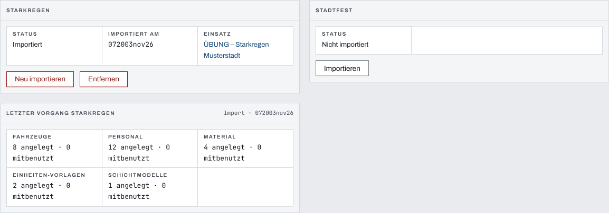
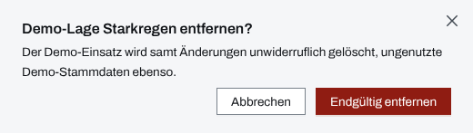

## Überblick

Demo-Daten sind fertig befüllte Übungslagen. Es gibt zwei, jede für sich wählbar:

- **Starkregen**: ein Einsatz „ÜBUNG – Starkregen Musterstadt“ mit Abschnitten, Einheiten samt
  Untereinheiten, Fahrzeugen mit Besatzung, Material, Betroffenen, Betreuung, Meldungen,
  Aufträgen, Lagebericht und Einsatztagebuch, dazu die Fahrzeuge, das Personal und das Material,
  die er braucht, eine Einheiten-Vorlage und ein Schichtmodell.
- **Stadtfest**: ein Sanitätsdienst „ÜBUNG – Sanitätsdienst Stadtfest Musterstadt“ mit den
  Abschnitten Bühne, Eingang und Festmeile, zwei Streifen, einer Unfallhilfsstelle mit Grundriss,
  einem KTW und rund zwanzig Patientenkontakten über den Abend, jeder mit Anlass und Verbleib.

Sie eignen sich zum Kennenlernen, für Schulungen und für Vorführungen. Ein System-Admin spielt
jede Lage ein, entfernt sie wieder oder setzt sie auf den Anfangsstand zurück.

Die Seite „Demo-Daten“ gibt es nur, wenn der Server mit eingeschalteten Demo-Daten gestartet
wurde, und nur für System-Admins.

## Abläufe

### Demo-Daten importieren

1. Oben „Verwaltung“ öffnen und „Demo-Daten“ wählen. Ist keine Lage importiert, zeigt auch die
   Einsatzliste den Hinweis „Demo-Daten nicht importiert“ mit „Zu den Demo-Daten“.
2. Im Paneel der Lage, „Starkregen“ oder „Stadtfest“, „Importieren“ wählen. Die App meldet etwa
   „Demo-Lage Stadtfest importiert“.
3. Im Paneel der Lage den Demo-Einsatz wählen, um ihn zu öffnen.

   

### Die Übungslage zurücksetzen

1. Unter „Demo-Daten“ im Paneel der Lage „Neu importieren“ wählen.
2. Die Rückfrage, etwa „Demo-Lage Starkregen neu importieren?“, mit „Ersetzen“ bestätigen.

Der Demo-Einsatz dieser Lage steht danach wieder auf dem Anfangsstand; alles, was in ihm
geändert wurde, ist weg. Die andere Lage bleibt, wie sie ist.

### Demo-Daten entfernen

1. Unter „Demo-Daten“ im Paneel der Lage „Entfernen“ wählen.
2. Die Rückfrage, etwa „Demo-Lage Starkregen entfernen?“, mit „Endgültig entfernen“ bestätigen.

   

Das Paneel „Letzter Vorgang“ der Lage zählt danach je Fahrzeuge, Personal, Material,
Einheiten-Vorlagen, Schichtmodelle und Planungen, was entfernt und was behalten wurde. Die andere Lage
bleibt, wie sie ist.

## Hintergrund

### Was der Import anlegt

- Je Lage genau einen Einsatz der Einsatzart Übung, mit fiktivem Ort und erkennbar erfundenen
  Namen. Der importierende System-Admin ist seine Einsatzleitung; sonst ist niemand Mitglied. Als
  Einsatzleiter der eigenen Führungsstelle steht der Zugführer der Übungslage, mit dem Eintrag
  „Einsatzleitung übernommen“ im Einsatztagebuch.
- Alle Zeiten liegen kurz vor dem Import: der Einsatz läuft seit einigen Stunden, der jüngste
  Eintrag ist wenige Minuten alt. Beim Import entsteht kein Alarm.
- Fahrzeuge, Personal und Material, je Lage mit eigenen Kennungen. Gibt es in der Organisation
  schon einen Datensatz im Dienst mit derselben Kennung (Funkrufname, Personalnummer,
  Bestandsnummer), benutzt der Import ihn mit und lässt ihn unverändert. „Letzter Vorgang“ zählt das als „mitbenutzt“.
- Nur beim Starkregen: die Einheiten-Vorlage „Sanitätszug Musterstadt“ mit der Untereinheit
  „Rettungsstaffel“, beide mit Demo-Fahrzeugen und Stammbesetzung. Gibt es schon eine aktive Vorlage mit demselben Namen,
  benutzt der Import sie unverändert mit. Ist der Sanitätszug mitbenutzt, steht eine neu
  angelegte Rettungsstaffel ohne Unterstellung.
- Nur beim Starkregen: das Schichtmodell „12-h-Schicht Hochwasser“ mit Wechsel um 06:00 und
  18:00 und vier Stunden Mindestdauer. Es wird nie die Vorgabe der Organisation, prägt also keinen echten Einsatz; der
  Demo-Einsatz nimmt es als seine Vorgabe für die Ablösung, wenn die Organisation keine eigene
  hat. Gibt es schon ein Schichtmodell mit demselben Namen, benutzt der Import es unverändert mit.
- Nur beim Stadtfest: die Planung „Stadtfest Musterstadt“ für den Samstag nach dem Import, mit
  der Unfallhilfsstelle, beiden Streifen, einer Sanitätswache an der Bühne und dem KTW als Posten,
  dazu zwei Helfer, eine Einteilung, in der ein Mensch doppelt verplant ist, und der Ablauf mit
  Festbeginn, Einlass Bühne, Bühnenprogramm und Feuerwerk. Gibt es schon eine
  Planung mit demselben Namen, bleibt sie unverändert.
- **Keine** Benutzerkonten. Kataloge wie Status, Einheitstypen und Qualifikationen benutzt der
  Import nur mit; fehlt ein benötigter Eintrag, bricht er mit einer Meldung ab.

- Beim Stadtfest: die Patientenkontakte mit Anlass und versorgender Einheit. Die meisten sind
  entlassen, einer gegen Rat (Behandlung abgelehnt), einer an die Polizei; einer fährt im eigenen
  KTW, einer mit einem Rettungsmittel der Leitstelle samt Einsatznummer. Drei liegen zum Abend
  noch auf Plätzen der Unfallhilfsstelle, einer ist bei einer Streife in Versorgung.

Der Import läuft ganz oder gar nicht: scheitert ein Schritt, bleibt alles wie vorher.

### Marke „Demo“

Was der Import angelegt hat, trägt die Marke „Demo“, in den Stammdaten und in den Tabellen des
Einsatzes. So bleibt erkennbar, was zur Übungslage gehört.

### Was „Entfernen“ und „Neu importieren“ löschen

- **Entfernen** löscht den Demo-Einsatz der gewählten Lage mit allem, was an ihm hängt, unwiderruflich, und danach
  ihre Demo-Stammdaten. Die andere Lage bleibt unberührt. Ein Demo-Datensatz, den inzwischen etwas anderes nutzt, etwa ein
  echter Einsatz, bleibt stehen und verliert seine Marke („behalten“). Mitbenutzte Datensätze
  rührt das Entfernen nicht an.
- Demo-Vorlagen fallen vor den Demo-Fahrzeugen und dem Demo-Personal. Eine Demo-Vorlage, unter
  der eine eigene Vorlage steht oder die unter einer eigenen Vorlage steht, bleibt als
  „behalten“ stehen, mit ihren Fahrzeugen und ihrer Stammbesetzung.
- **Neu importieren** entfernt und importiert in einem Zug. Scheitert der Import, bleibt der
  bisherige Demo-Stand erhalten.
- Die Adresse eines entfernten Demo-Einsatzes führt nie zu einem anderen Einsatz: seine
  interne Kennung vergibt das System nicht wieder.

Echte Einsätze und Stammdaten ohne Marke berühren beide Vorgänge nicht.

### Einschalten

Die Demo-Daten schaltet der Betreiber des Servers frei, mit dem Startschalter `--demo-daten` oder
der Umgebungsvariable `LIFELINE_DEMO_DATEN=true`. Ohne Freischaltung fehlt die Seite ganz.
