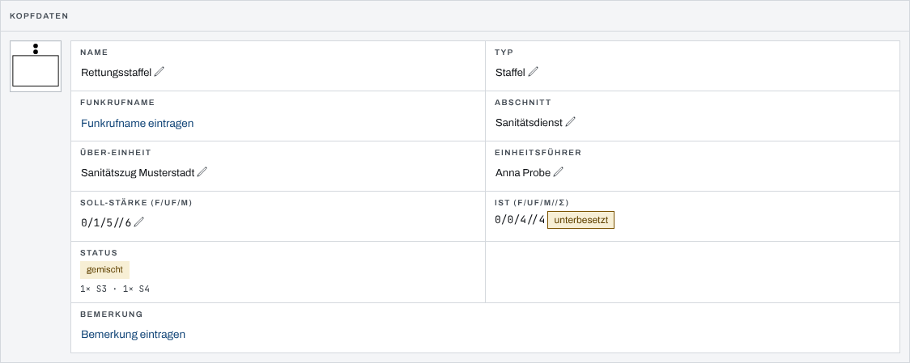
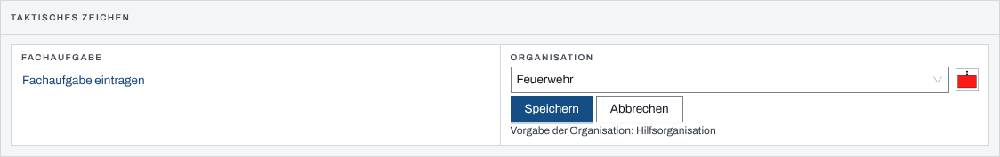

## Überblick

Eine **Einheit** fasst Personal, Fahrzeuge und Material unter einem Namen zusammen, etwa einen Zug,
eine Staffel oder einen Trupp. Einheiten lassen sich einander unterstellen und einem
Einsatzabschnitt zuordnen. Ihre Ist-Stärke ergibt sich aus dem zugeordneten Personal, die
Soll-Stärke trägt die Führung ein.

Das Modul zeigt die Gliederung aller Einheiten; jede Einheit hat eine eigene Seite mit den
Paneelen „Kopfdaten“, „Fahrzeuge und Besatzung“, „Zeitachse“, „Material“, „Funk und
Kommunikation“ und „Taktisches Zeichen“, zuletzt „Einheit auflösen“. „Fahrzeuge und Besatzung“
zeigt je Fahrzeug, wer darauf sitzt, und darunter, wer ohne Fahrzeug zur Einheit gehört. Jede
Angabe wird an ihrem Wert geändert. Eine stehende Einheit wie ein Sanitätszug lässt sich in einem Zug aus ihrer
Einheiten-Vorlage bilden, samt Untereinheiten, Fahrzeugen und Besatzung. Bilden, ändern und
zuordnen dürfen Einsatzleitung und Führungspersonal.

## Abläufe

### Die Gliederung lesen

1. Unter „Kräfte & Mittel“ „Einheiten“ öffnen.
2. In der Tabelle „Gliederung“ je Einheit „Einheitsführer“, „Ist“, „Soll“, „Abschnitt“ und
   „Fahrzeuge“ lesen. Unterstellte Einheiten stehen eingerückt unter ihrer Über-Einheit; das Plus-
   bzw. Minuszeichen vor einer Einheit klappt ihre Untereinheiten auf und zu. Am Handy stehen
   nur Einheit, „Ist“ und „Soll“; die übrigen Spalten holt der Knopf „Spalten · 3 ausgeblendet“
   zurück.

   

3. Den Namen einer Einheit wählen, um ihre Seite zu öffnen.

### Eine Einheit bilden

Für Einsatzleitung und Führungspersonal:

1. In „Einheiten“ „Einheit bilden“ wählen.
2. Die „Vorlage“ leer lassen, einen „Name“ eingeben und bei Bedarf einen „Typ“ wählen. Das Feld
   „Vorlage“ steht nur, wenn die Organisation aktive Einheiten-Vorlagen hat.

   

3. „Bilden“ wählen. Die App öffnet die Seite der neuen Einheit.

### Eine Einheit aus einer Vorlage bilden

Für Einsatzleitung und Führungspersonal:

1. In „Einheiten“ „Einheit bilden“ wählen.
2. Unter „Vorlage“ die Vorlage wählen und „Weiter“ wählen. Untereinheiten einer Vorlage stehen mit
   ihrem Pfad, etwa „Sanitätszug Musterstadt › Rettungsstaffel“.
3. Auf der Seite „Einheit aus Vorlage bilden“ den „Name“ der obersten Einheit prüfen und bei Bedarf
   einen „Abschnitt“ wählen.
4. Im Baum der Vorlage anhaken, was mitkommt. Fahrzeuge, die neu oder im Einsatz frei sind, sind
   angehakt, Personen nicht; jede Zeile nennt rechts ihren Zustand im Einsatz.

   

5. „Einheit bilden“ wählen. Neben dem Knopf steht, was entsteht, etwa „1 Zug, 1 Staffel,
   3 Fahrzeuge, 2 Kräfte“. Die App öffnet das Meldebild mit der neuen Einheit markiert, ihre
   Untereinheiten und Fahrzeuge aufgeklappt.

### Angaben einer Einheit ändern

Für Einsatzleitung und Führungspersonal:

1. Die Einheit öffnen.
2. Im Paneel „Kopfdaten“ den Wert der Angabe wählen, etwa „Name“. Eine leere Angabe steht als
   Aufforderung da, etwa „Funkrufname eintragen“.

   

3. Den neuen Wert eingeben oder wählen und mit „Speichern“ oder Enter übernehmen. „Abbrechen“
   oder Escape lässt den alten Wert stehen. In „Bemerkung“ bricht Enter die Zeile um; übernommen
   wird mit Strg+Enter oder „Speichern“. Name und Funkrufname dürfen höchstens 200 Zeichen lang
   sein, die Bemerkung höchstens 2 000; eine längere Bemerkung nennt das Feld „zu lang“ und
   speichert sie nicht.
4. Unter „Soll-Stärke (F/UF/M)“ Führer, Unterführer und Mannschaft zusammen eintragen. Unter „Ist
   (F/UF/M//Σ)“ steht die Ist-Stärke, mit unterstellten Einheiten auch die kumulierte, und
   daneben „unterbesetzt“ oder „Soll erfüllt“.
5. Hat die Einheit kein Fahrzeug, unter „Status“ den Status wählen; „kein Status“ nimmt ihn
   zurück.
6. Im Paneel „Funk und Kommunikation“ ebenso „Sprechgruppen“, „Kommunikationsmittel“ und
   „Erreichbarkeit / Nummer“ ändern. Die Erreichbarkeit darf höchstens 200 Zeichen lang sein.

### Das taktische Zeichen setzen

Für Einsatzleitung und Führungspersonal:

1. Die Einheit öffnen.
2. Im Paneel „Taktisches Zeichen“ „Fachaufgabe eintragen“ oder „Organisation eintragen“ wählen
   (bei gesetztem Wert den Wert).
3. Einen Eintrag wählen. Das kleine Zeichen neben der Auswahl zeigt das Zeichen mit der Wahl.

   

4. „Speichern“ wählen. Das große Zeichen im Kopf, das Meldebild und die Lagekarte zeigen das
   neue Zeichen.

### Personal und Fahrzeuge zuordnen

Für Einsatzleitung und Führungspersonal:

1. Die Einheit öffnen.
2. Im Paneel „Fahrzeuge und Besatzung“ unter „Fahrzeug zuordnen …“ ein Fahrzeug wählen. Unter
   „Im Einsatz frei“ stehen Fahrzeuge im Einsatz ohne Einheit, unter „Aus dem Stamm“ Fahrzeuge
   der Organisation, die noch nicht im Einsatz sind; Demo-Fahrzeuge stehen zuletzt unter
   „Demo-Daten“. Ein Stamm-Fahrzeug wird mit der Wahl in den Einsatz geholt. Zu speichern ist
   nichts.
3. Ebenso unter „Person zuordnen …“ eine Person wählen. Hat die Einheit Fahrzeuge, steht die
   Person zunächst unter „Ohne Fahrzeug“.
4. Im Menü „Aktionen zu Person …“ (drei Punkte) einer Person „Auf …“ mit dem Funkrufnamen wählen.
   Die Person steht dann unter dem Fahrzeug. Neben dem Fahrzeug steht die Besatzung als Ist und
   Soll, mit „unterbesetzt“ oder „Soll erfüllt“, und wer davon aus einer anderen Einheit oder
   ohne Einheit mitfährt.

   

5. Im selben Menü setzt „Als Einheitsführer“ die Person als Einheitsführer, „Vom Fahrzeug
   lösen“ nimmt sie vom Fahrzeug und lässt sie in der Einheit, „Aus Einheit lösen“ löst sie aus
   der Einheit.
6. Den FMS-Status eines Fahrzeugs am Status in seiner Zeile wählen; „Aus Einheit lösen“ daneben
   löst das Fahrzeug aus der Einheit. Gelöste Kräfte bleiben im Einsatz, nur ohne Einheit.

### Material zuordnen, lösen und ausgeben

Für Einsatzleitung und Führungspersonal, wenn das Modul Material freigegeben ist:

1. Die Einheit öffnen. Das Paneel „Material“ zeigt jeden Posten mit Menge und Status; die
   Kopfzeile zählt die Posten und, falls vorhanden, den Ausfall.
2. Unter „Material zuordnen …“ einen Posten wählen: unter „Ohne Ort“ die freien Posten, unter „An
   anderem Ort“ Posten, die schon an einem anderen Ort liegen, mit diesem Ort im Eintrag. Die Wahl
   holt den Posten an die Einheit.
3. Bei einem Verbrauchsgut mit Rest „Ausgeben“ wählen, im Dialog die „Menge ausgeben“ eingeben und
   mit „Ausgeben“ bestätigen. Die Zeile nennt danach den Rest, etwa „15 von 20 übrig“.
4. Mit „Aus Einheit lösen“ einen Posten wieder lösen. Er bleibt ohne Ort im Einsatz.

### Eine Einheit auflösen

Für Einsatzleitung und Führungspersonal:

1. Die Einheit öffnen.
2. Im letzten Paneel „Einheit auflösen“ „Einheit auflösen“ wählen.
3. Die Rückfrage „Einheit auflösen?“ mit „Einheit auflösen“ bestätigen. Die Mitglieder werden frei,
   unterstellte Einheiten rücken eine Ebene hoch.
4. Auf der Seite „Einheiten“ steht die aufgelöste Einheit unter der Gliederung im Block
   „Aufgelöst“ mit dem Zeitpunkt.

   

### Eine unangemeldete Einheit übernehmen oder abweisen

Für Einsatzleitung und Führungspersonal. Bucht ein Bereitstellungsraum eine Kraft, die der Einsatz
noch nicht kannte, entsteht eine Einheit mit „nicht übernommen“ (Kapitel
[Bereitstellungsräume](bereitstellungsraeume.md)). Die Meldung dazu steht unter „Meldungen“.

1. Die Einheit öffnen: in der Gliederung oder im Meldebild. Unter dem Kopf steht das Paneel
   „Übernahme“ mit „eingetroffen …“.
2. „Übernehmen“ wählen, bei Bedarf „Abschnitt“ und „Über-Einheit“ wählen und mit „Übernehmen“
   bestätigen. Die Bestätigung lautet „… übernommen“; „nicht übernommen“ und das Paneel
   verschwinden, die Einheit bleibt im Raum.
3. Gehört die Kraft nicht in den Einsatz, stattdessen „Abweisen“ wählen und die Rückfrage „Einheit
   abweisen?“ mit „Abweisen“ bestätigen. Die Einheit verlässt den Raum und wird aufgelöst, ihre
   Fahrzeuge werden entlassen; die App kehrt zur Gliederung zurück.

Dieselben Knöpfe stehen auch an der Meldung „… unangemeldet im BR … eingetroffen“ (Kapitel
[Meldungen](meldungen.md)).

## Hintergrund

### Wer zu einer Einheit gehört

Eine Person, ein Fahrzeug oder ein Materialposten gehört höchstens einer Einheit an. Die
Auswahlfelder bieten aus dem Einsatz nur an, was noch keiner Einheit zugeordnet ist; wer in eine
andere Einheit wechseln soll, wird dort zuerst gelöst. Aus dem Stamm stehen nur Kräfte im Dienst,
die weder im Einsatz stehen noch aus ihm entlassen wurden; eine entlassene Kraft kommt über
die Module [Personal](personal.md) und [Fahrzeuge und FMS](fahrzeuge.md) zurück. Eine Stamm-Kraft
wird mit der Wahl disponiert und zugeordnet, ganz oder gar nicht: ist sie inzwischen außer Dienst
oder schon im Einsatz, geschieht nichts, und der Grund steht unter dem Auswahlfeld. Material kommt
nur über das Modul [Material](material.md) in den Einsatz. Ein Materialposten liegt an höchstens
einem Ort: an einer Einheit, auf einem Fahrzeug, an einer UHS oder in einem Bereitstellungsraum.
„Material zuordnen …“ bietet Posten ohne Ort und Posten an anderen Orten an; ein Posten von einem
anderen Ort wird ohne Rückfrage umgehängt, und das Einsatztagebuch nennt den alten und den neuen
Ort. Material auf einem Fahrzeug der Einheit steht nicht im Paneel „Material“, sondern als
„Beladung“ am Fahrzeug in der Fahrzeugliste und im [Meldebild](meldebild.md).
Die Einheit eines Fahrzeugs lässt sich auch in der Fahrzeugliste wählen; ein Wechsel hängt das
Fahrzeug dabei aus seiner bisherigen Einheit um. Seine Besatzung aus der bisherigen oder ohne
Einheit kommt mit, außer dem Einheitsführer der bisherigen Einheit. Ein Fahrzeug ohne Einheit lässt sich dort auch als
eigene Einheit führen; seine Besatzung ohne Einheit kommt dann mit (Kapitel
[Fahrzeuge und FMS](fahrzeuge.md)).

### Stärke

Die Ist-Stärke zählt das zugeordnete Personal nach seiner Stärke-Position (Führer, Unterführer,
Mannschaft), die im Modul Personal gesetzt wird. Eine Person ohne Stärke-Position zählt als
Mannschaft, hier wie im Meldebild, an der UHS und im Einsatzbericht. Einheitsführer ist ein eigenes
Merkmal: eine Person mit der Position „Führer“ ist dadurch noch nicht Einheitsführer. Je Einheit
gibt es einen Einheitsführer, eine Person der Einheit; solange keiner gesetzt ist, steht im Kopf
„Einheitsführer eintragen“. Die kumulierte Ist-Stärke rechnet alle unterstellten Einheiten mit ein.

In der Gliederung steht unter „Ist“ die kumulierte Ist-Stärke: ein Zug zählt seine Gruppen mit,
jede Gruppe zeigt ihre eigene. Fehlt in einer Position (Führer, Unterführer oder Mannschaft) jemand
gegenüber dem Soll, steht darunter „unterbesetzt“, als Hinweis, nicht als Warnung; mehr Kräfte in
einer Position gleichen eine fehlende nicht aus. Eine erfüllte Stärke trägt kein Zeichen.

### Gliederung und Meldebild

Die Gliederung zeigt dieselben Einheiten in derselben Ordnung wie das
[Meldebild](meldebild.md): nach der Reihenfolge der Einsatzabschnitte, darin in der Reihenfolge, in
der die Einheiten gebildet wurden; unterstellte Einheiten unter ihrer Über-Einheit. Eine
unterstellte Einheit ohne eigenen Abschnitt zeigt den Abschnitt ihrer Über-Einheit. Fahrzeuge,
Personal und Material einer Einheit stehen im Meldebild und auf der Seite der Einheit, nicht in der
Gliederung. Die Gesamtstärke aller Kräfte steht über der Tabelle, zusammen mit dem Weg ins
Meldebild.

### Besatzung und Freigaben

Die Besatzung (wer auf welchem Fahrzeug sitzt) ist dieselbe wie im [Meldebild](meldebild.md); sie
wird auch in den Modulen Personal und Fahrzeuge gesetzt. Das Soll der Besatzung trägt das
Fahrzeug. Eine Person auf einem Fahrzeug einer anderen Einheit steht in ihrer Einheit unter „Ohne
Fahrzeug“ mit „fährt auf …“.

Die Besatzung zeigt die Seite nur, wenn die Module Personal und Fahrzeuge beide freigegeben
sind. Fehlt eine Freigabe, stehen Fahrzeuge und Personen ohne Besatzung untereinander, darüber
„Ohne Besatzung“ mit den gesperrten Modulen; „Auf …“, „Vom Fahrzeug lösen“ und die FMS-Wahl fehlen
dann, und Namen führen nicht ins gesperrte Modul. Ohne Freigabe Personal bzw. Fahrzeuge bietet
„Person zuordnen …“ bzw. „Fahrzeug zuordnen …“ nichts an und nennt den Grund. Ohne Freigabe Material
stehen die Posten der Einheit weiter im Paneel „Material“, „Material zuordnen …“ steht gesperrt mit
„Modul Material gesperrt“, und „Aus Einheit lösen“ und „Ausgeben“ fehlen.

### Status und Zeitachse

Der Status einer Einheit folgt ihren Fahrzeugen; ohne Fahrzeug wird er von Hand gesetzt, im
Meldebild oder auf der Seite der Einheit. Das Paneel „Zeitachse“ zeigt Einsatzdauer und Ereignisse der Einheit (Kapitel [Meldebild
und Kräfte-Zeitachse](meldebild.md)).

Wechselt der Status einer Einheit ohne Fahrzeug von Hand aus gebunden oder nicht verfügbar in
verfügbar, bekommen Einsatzleitung und S3 den Hinweis „Wieder verfügbar“ mit der Einheit, wie bei
einem Fahrzeug (Kapitel [Fahrzeuge und FMS](fahrzeuge.md)). Folgt der Status den Fahrzeugen,
meldet nur das Fahrzeug, die Einheit nicht noch einmal. Den eigenen Wechsel meldet die App nicht.

### Jede Angabe für sich

Jede Angabe wird für sich gespeichert. Was ein anderer Arbeitsplatz oder die Fernmeldeskizze
inzwischen an einer anderen Angabe derselben Einheit geändert hat, bleibt erhalten; nur die
geänderte Angabe wird überschrieben. Ein abgelehnter Wert bleibt in der offenen Zeile stehen,
der Grund steht darunter.

### Unangemeldete Einheiten

„nicht übernommen“ steht an der Einheit in der Gliederung, im Meldebild, im Kopf ihrer Seite und
in der Belegung des Bereitstellungsraums, bis sie übernommen oder abgewiesen ist. Bis dahin lässt
sich die Einheit wie jede andere bearbeiten. Übernehmen bestätigt die Meldung des Eintreffens und
schreibt einen Eintrag ins Einsatztagebuch, mit Abschnitt und Über-Einheit, falls gewählt. Abweisen ist endgültig: wie beim Auflösen bleibt die Einheit mit Zeitachse
und Einsatztagebuch im Nachweis, ihre Fahrzeuge stehen als entlassen in der Fahrzeugliste. Im
Bereitstellungsraum trägt eine übernommene Einheit weiter das neutrale Kennzeichen
„unangemeldet“.

### Taktisches Zeichen

Das taktische Zeichen gehört zur Lage: es wird wie auf der Lagekarte gespeichert, ohne Eintrag im
Einsatztagebuch, und verschiebt die Einheit auf der Karte nicht. Ohne eigene Organisation zeichnet
die App die Vorgabe der Organisation; die Zeile „Organisation“ nennt sie dann („Vorgabe der
Organisation: …“).

### Auflösen

Eine aufgelöste Einheit verschwindet aus Gliederung, Stärke, Statusband, Lagemonitor, Karte und
Auswahllisten. Ihre Mitglieder bleiben im Einsatz, nur ohne Einheit; eine laufende Ablösung endet,
ein Bereitstellungsraum trägt ihren Austritt ein. Mit Zeitachse und Einsatztagebuch bleibt sie im
Nachweis: im Block „Aufgelöst“, in „insgesamt eingesetzt“ und in der Anlage „Einheiten mit
Einsatzzeiten“ des Einsatzberichts. Eine Einheit ohne jede Spur (keine Mitglieder, keine
Ereignisse, kein Eintrag im Tagebuch, keine Ablösung, kein Bereitstellungsraum, kein Auftrag, keine
Meldung, kein Dokument, kein Verteiler, keine Verpflegungsausgabe) wird beim Auflösen ganz
gelöscht. Eine Einheit, an die Verpflegung ausgegeben wurde, bleibt als aufgelöst stehen, auch wenn
die Ausgabe zurückgenommen ist; die Ausgabe nennt sie weiter. An einer aufgelösten Einheit lässt
sich nichts mehr ändern.

### Einsatztagebuch

Ins Einsatztagebuch schreibt die App selbst: das Bilden und Auflösen einer Einheit, eine neue
Abschnittszuordnung, einen Wechsel des Einheitsführers, einen Statuswechsel von Hand und jedes
Zuordnen und Lösen von Personal, Fahrzeugen und Material. Eine Kraft aus dem Stamm bekommt einen
Eintrag für Disposition und Einheit zusammen, wie im Modul Personal bzw. Fahrzeuge. Das Setzen
auf ein Fahrzeug und das Lösen davon stehen als Eintrag des Fahrzeugs im Einsatztagebuch. Änderungen an Name, Typ, Unterstellung, Soll-Stärke, Funkangaben und
taktischem Zeichen stehen nicht im Einsatztagebuch.

### Aus einer Vorlage bilden

Die Einheiten-Vorlagen pflegt die Verwaltung unter „Stammdaten“ (Kapitel
[Stammdaten](stammdaten.md)). Beim Bilden entsteht der ganze Baum der Vorlage mit Typ,
Funkrufname, taktischen Zeichen und eigener Soll-Stärke; die oberste Einheit trägt den Namen von
der Seite und den gewählten Abschnitt, die Untereinheiten die Namen ihrer Vorlagen und den
Abschnitt ihrer Über-Einheit. Steht schon eine aktive Einheit gleichen Namens im Einsatz, zeigt das
Feld „Name schon vergeben“, sperrt aber nicht: zwei Züge derselben Vorlage sind erlaubt.

Der Zustand je Zeile:

- „neu“: noch nicht im Einsatz; die Kraft wird beim Bilden in den Einsatz geholt.
- „im Einsatz“: im Einsatz, ohne Einheit; sie kommt in die neue Einheit.
- „in «2. Zug»“ bzw. „auf «RTW 3»“: gehört schon einer Einheit an oder sitzt auf einem anderen
  Fahrzeug. Wählbar nur als „umhängen aus «2. Zug»“ bzw. „umhängen von «RTW 3»“; sie verlässt dann
  ihre Einheit oder ihr Fahrzeug. Ein umgehängtes Fahrzeug nimmt seine Besatzung mit, auch wer
  nicht in der Vorlage steht; das Einsatztagebuch zählt sie zu den Kräften.
- „außer Dienst“: nicht wählbar.
- „entlassen, wird wieder aufgenommen“: aus dem Einsatz entlassen; die Kraft wird beim Bilden
  erneut in den Einsatz geholt. Ein entlassenes Fahrzeug ist vorab gewählt, eine Person nicht.

Eine gewählte Person, deren Fahrzeug nicht mitkommt, steht mit „ohne Fahrzeug“ und kommt ohne
Fahrzeug in die Einheit. Sitzt eine Person ohne Einheit schon auf ihrem Fahrzeug aus der Vorlage und wird dieses
abgewählt, steht an ihr „verlässt «…»“: sie steigt beim Bilden aus.

Das Bilden gelingt ganz oder gar nicht. Hat sich seit dem Öffnen der Seite etwas geändert, etwa
ein Fahrzeug ist inzwischen einem anderen Zug zugeordnet, entsteht nichts; der Grund steht an der
Zeile, und die Zeilen zeigen den neuen Stand. Ein gesetztes Häkchen bleibt dabei stehen, die Kraft
wird nicht still umgehängt; unter ihr steht „umhängen aus «2. Zug»“ bzw. „umhängen von «RTW 3»“, und
ein Klick darauf übernimmt sie beim nächsten Bilden. Je Bildung sind höchstens 50 Fahrzeuge und
50 Personen möglich; darüber bleibt „Einheit bilden“ gesperrt und nennt die Grenze. Eine Vorlage
mit mehr als 20 Einheiten lässt sich nicht bilden.

Ohne Freigabe des Moduls Fahrzeuge oder Personal fehlen dessen Zeilen; über dem Baum steht
„Fahrzeuge gesperrt“ bzw. „Personal gesperrt“, und gebildet werden nur die Einheiten mit dem, was
freigegeben ist. Ohne Freigabe des Meldebilds öffnet die App nach dem Bilden die Seite der neuen
Einheit. Ins Einsatztagebuch schreibt die App einen Eintrag für die ganze Bildung, mit Untereinheiten,
Fahrzeugen, Kräften und wer woher umgehängt wurde.

### Rechte und ohne Netz

Lesen darf, wer das Modul Einheiten sieht. Bilden, ändern, zuordnen und auflösen dürfen
Einsatzleitung und Führungspersonal, solange der Einsatz läuft (Kapitel [Rechte im
Einsatz](rechte-im-einsatz.md)); das gilt auch für Übernehmen. Abweisen verlangt zusätzlich das
Recht auf Fahrzeuge, weil es die Fahrzeuge entlässt. An der Meldung führt ohne Recht auf Einheiten
nur ein Verweis zur Einheit. Ohne dieses Recht zeigt die Seite einer Einheit nur die Werte,
leere als „—“, ohne Statuswahl, ohne Menü an den Personen, ohne Auswahlfelder, ohne Lösen und
ohne das Paneel „Einheit auflösen“. Material zuordnen, lösen und ausgeben verlangt nicht das Recht
auf Einheiten, sondern Schreibrecht im Einsatz und die Freigabe des Moduls Material: der Ort gehört
zum Material (Kapitel [Material](material.md)). Eine aufgelöste Einheit nimmt kein Material mehr
an; „Material zuordnen …“ steht dort gesperrt mit „Einheit aufgelöst“, Lösen bleibt. Ohne Netz
bleiben Gliederung und Einheiten mit dem zuletzt geladenen Stand lesbar; ändern lässt sich nichts,
und eine Vorlage lässt sich weder ansehen noch bilden (Kapitel [Ohne Netz](ohne-netz.md)).
