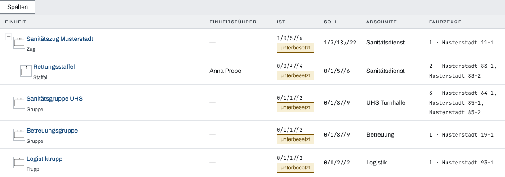
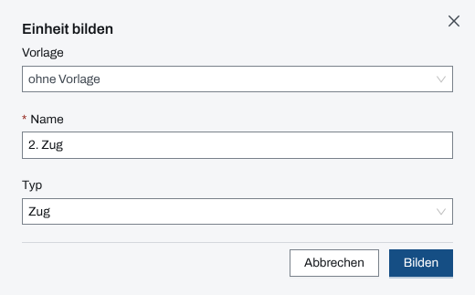
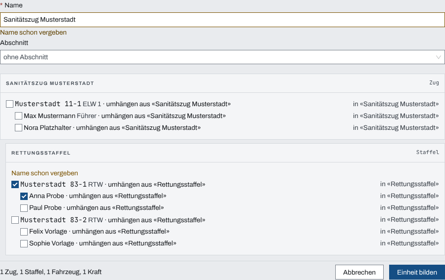
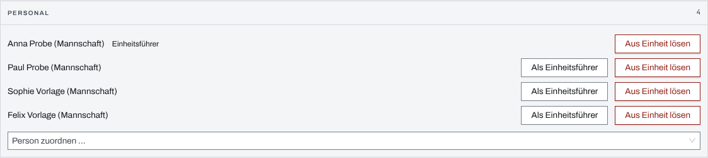
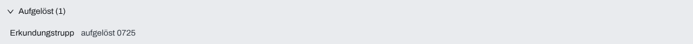

## Überblick

Eine **Einheit** fasst Personal, Fahrzeuge und Material unter einem Namen zusammen, etwa einen Zug,
eine Staffel oder einen Trupp. Einheiten lassen sich einander unterstellen und einem
Einsatzabschnitt zuordnen. Ihre Ist-Stärke ergibt sich aus dem zugeordneten Personal, die
Soll-Stärke trägt die Führung ein.

Das Modul zeigt die Gliederung aller Einheiten; jede Einheit hat eine eigene Seite mit Kopfdaten,
Zeitachse und den Paneelen „Personal“, „Fahrzeuge“ und „Material“. Eine stehende Einheit wie ein
Sanitätszug lässt sich in einem Zug aus ihrer Einheiten-Vorlage bilden, samt Untereinheiten,
Fahrzeugen und Besatzung. Bilden, ändern und zuordnen dürfen Einsatzleitung und Führungspersonal.

## Abläufe

### Die Gliederung lesen

1. Unter „Kräfte & Mittel“ „Einheiten“ öffnen.
2. In der Tabelle „Gliederung“ je Einheit „Einheitsführer“, „Ist“, „Soll“, „Abschnitt“ und
   „Fahrzeuge“ lesen. Unterstellte Einheiten stehen eingerückt unter ihrer Über-Einheit; das Plus-
   bzw. Minuszeichen vor einer Einheit klappt ihre Untereinheiten auf und zu. Am Handy stehen
   nur Einheit, „Ist“ und „Soll“; die übrigen Spalten holt der Knopf „Spalten · 3 ausgeblendet“
   zurück.

   

3. Den Namen einer Einheit wählen, um ihre Seite zu öffnen.

### Eine Einheit bilden

Für Einsatzleitung und Führungspersonal:

1. In „Einheiten“ „Einheit bilden“ wählen.
2. Die „Vorlage“ leer lassen, einen „Name“ eingeben und bei Bedarf einen „Typ“ wählen. Das Feld
   „Vorlage“ steht nur, wenn die Organisation aktive Einheiten-Vorlagen hat.

   

3. „Bilden“ wählen. Die App öffnet die Seite der neuen Einheit.

### Eine Einheit aus einer Vorlage bilden

Für Einsatzleitung und Führungspersonal:

1. In „Einheiten“ „Einheit bilden“ wählen.
2. Unter „Vorlage“ die Vorlage wählen und „Weiter“ wählen. Untereinheiten einer Vorlage stehen mit
   ihrem Pfad, etwa „Sanitätszug Musterstadt › Rettungsstaffel“.
3. Auf der Seite „Einheit aus Vorlage bilden“ den „Name“ der obersten Einheit prüfen und bei Bedarf
   einen „Abschnitt“ wählen.
4. Im Baum der Vorlage anhaken, was mitkommt. Fahrzeuge, die neu oder im Einsatz frei sind, sind
   angehakt, Personen nicht; jede Zeile nennt rechts ihren Zustand im Einsatz.

   

5. „Einheit bilden“ wählen. Neben dem Knopf steht, was entsteht, etwa „1 Zug, 1 Staffel,
   3 Fahrzeuge, 2 Kräfte“. Die App öffnet das Meldebild mit der neuen Einheit markiert, ihre
   Untereinheiten und Fahrzeuge aufgeklappt.

### Die Kopfdaten einer Einheit pflegen

Für Einsatzleitung und Führungspersonal:

1. Die Einheit öffnen.
2. Im Paneel „Kopfdaten“ „Name“, „Typ“, „Abschnitt“ und „Über-Einheit“ setzen.
3. Unter „Soll-Stärke (F/UF/M)“ Führer, Unterführer und Mannschaft eintragen. Daneben stehen die
   Ist-Stärke und die kumulierte Ist-Stärke samt unterstellter Einheiten.
4. Unter „Funk / Kommunikation“ bei Bedarf „Funkrufname“, „Sprechgruppen“, „Kommunikationsmittel“,
   „Erreichbarkeit / Nummer“ und „Bemerkung“ eintragen.
5. „Speichern“ wählen.

### Personal, Fahrzeuge und Material zuordnen

Für Einsatzleitung und Führungspersonal:

1. Die Einheit öffnen.
2. Im Paneel „Personal“ unter „Person zuordnen …“ eine Person wählen. Sie steht sofort in der Liste;
   zu speichern ist nichts.

   

3. Mit „Als Einheitsführer“ eine Person der Einheit als Einheitsführer setzen.
4. Ebenso in „Fahrzeuge“ unter „Fahrzeug zuordnen …“ und in „Material“ unter „Material zuordnen …“
   wählen.
5. Mit „Entfernen“ eine Person, ein Fahrzeug oder Material wieder aus der Einheit lösen. Es bleibt
   im Einsatz, nur ohne Einheit.

### Eine Einheit auflösen

Für Einsatzleitung und Führungspersonal:

1. Die Einheit öffnen.
2. Im Paneel „Kopfdaten“ „Auflösen“ wählen.
3. Die Rückfrage „Einheit auflösen?“ mit „Einheit auflösen“ bestätigen. Die Mitglieder werden frei,
   unterstellte Einheiten rücken eine Ebene hoch.
4. Auf der Seite „Einheiten“ steht die aufgelöste Einheit unter der Gliederung im Block
   „Aufgelöst“ mit dem Zeitpunkt.

   

## Hintergrund

### Wer zu einer Einheit gehört

Eine Person, ein Fahrzeug oder ein Materialposten gehört höchstens einer Einheit an. Die
Auswahlfelder bieten nur an, was noch keiner Einheit zugeordnet ist; wer in eine andere Einheit
wechseln soll, wird dort zuerst entfernt. Disponiert, also in den Einsatz geholt, werden Kräfte in
den Modulen [Personal](personal.md), [Fahrzeuge und FMS](fahrzeuge.md) und [Material](material.md).
Die Einheit eines Fahrzeugs lässt sich auch in der Fahrzeugliste wählen; ein Wechsel hängt das
Fahrzeug dabei aus seiner bisherigen Einheit um.

### Stärke

Die Ist-Stärke zählt das zugeordnete Personal nach seiner Stärke-Position (Führer, Unterführer,
Mannschaft), die im Modul Personal gesetzt wird. Einheitsführer ist ein eigenes Merkmal: eine Person
mit der Position „Führer“ ist dadurch noch nicht Einheitsführer, die Seite weist darauf hin. Je
Einheit gibt es einen Einheitsführer. Die kumulierte Ist-Stärke rechnet alle unterstellten Einheiten
mit ein.

In der Gliederung steht unter „Ist“ die kumulierte Ist-Stärke: ein Zug zählt seine Gruppen mit,
jede Gruppe zeigt ihre eigene. Fehlt in einer Position (Führer, Unterführer oder Mannschaft) jemand
gegenüber dem Soll, steht darunter „unterbesetzt“, als Hinweis, nicht als Warnung; mehr Kräfte in
einer Position gleichen eine fehlende nicht aus. Eine erfüllte Stärke trägt kein Zeichen.

### Gliederung und Meldebild

Die Gliederung zeigt dieselben Einheiten in derselben Ordnung wie das
[Meldebild](meldebild.md): nach der Reihenfolge der Einsatzabschnitte, darin in der Reihenfolge, in
der die Einheiten gebildet wurden; unterstellte Einheiten unter ihrer Über-Einheit. Eine
unterstellte Einheit ohne eigenen Abschnitt zeigt den Abschnitt ihrer Über-Einheit. Fahrzeuge,
Personal und Material einer Einheit stehen im Meldebild und auf der Seite der Einheit, nicht in der
Gliederung. Die Gesamtstärke aller Kräfte steht über der Tabelle, zusammen mit dem Weg ins
Meldebild.

### Status und Zeitachse

Der Status einer Einheit folgt ihren Fahrzeugen; ohne Fahrzeug wird er im Meldebild von Hand
gesetzt. Das Paneel „Zeitachse“ zeigt Einsatzdauer und Ereignisse der Einheit (Kapitel [Meldebild
und Kräfte-Zeitachse](meldebild.md)).

### Auflösen

Eine aufgelöste Einheit verschwindet aus Gliederung, Stärke, Statusband, Lagemonitor, Karte und
Auswahllisten. Ihre Mitglieder bleiben im Einsatz, nur ohne Einheit; eine laufende Ablösung endet,
ein Bereitstellungsraum trägt ihren Austritt ein. Mit Zeitachse und Einsatztagebuch bleibt sie im
Nachweis: im Block „Aufgelöst“, in „insgesamt eingesetzt“ und in der Anlage „Einheiten mit
Einsatzzeiten“ des Einsatzberichts. Eine Einheit ohne jede Spur (keine Mitglieder, keine
Ereignisse, kein Eintrag im Tagebuch, keine Ablösung, kein Bereitstellungsraum, kein Auftrag, keine
Meldung, kein Dokument, kein Verteiler) wird beim Auflösen ganz gelöscht. An einer aufgelösten Einheit lässt sich nichts mehr ändern.

### Einsatztagebuch

Ins Einsatztagebuch schreibt die App selbst: das Bilden und Auflösen einer Einheit, eine neue
Abschnittszuordnung, einen Wechsel des Einheitsführers und jedes Zuordnen und Lösen von Personal,
Fahrzeugen und Material. Änderungen an Name, Typ, Unterstellung, Soll-Stärke und Funkangaben stehen
nicht im Einsatztagebuch.

### Aus einer Vorlage bilden

Die Einheiten-Vorlagen pflegt die Verwaltung unter „Stammdaten“ (Kapitel
[Stammdaten](stammdaten.md)). Beim Bilden entsteht der ganze Baum der Vorlage mit Typ,
Funkrufname, taktischen Zeichen und eigener Soll-Stärke; die oberste Einheit trägt den Namen von
der Seite und den gewählten Abschnitt, die Untereinheiten die Namen ihrer Vorlagen und den
Abschnitt ihrer Über-Einheit. Steht schon eine aktive Einheit gleichen Namens im Einsatz, zeigt das
Feld „Name schon vergeben“, sperrt aber nicht: zwei Züge derselben Vorlage sind erlaubt.

Der Zustand je Zeile:

- „neu“: noch nicht im Einsatz; die Kraft wird beim Bilden in den Einsatz geholt.
- „im Einsatz“: im Einsatz, ohne Einheit; sie kommt in die neue Einheit.
- „in «2. Zug»“ bzw. „auf «RTW 3»“: gehört schon einer Einheit an oder sitzt auf einem anderen
  Fahrzeug. Wählbar nur als „umhängen aus «2. Zug»“ bzw. „umhängen von «RTW 3»“; sie verlässt dann
  ihre Einheit oder ihr Fahrzeug.
- „außer Dienst“: nicht wählbar.
- „entlassen“: eine entlassene Person wird erneut in den Einsatz geholt; ein entlassenes Fahrzeug
  ist nicht wählbar.

Eine gewählte Person, deren Fahrzeug nicht mitkommt, steht mit „ohne Fahrzeug“ und kommt ohne
Fahrzeug in die Einheit. Sitzt eine Person ohne Einheit schon auf ihrem Fahrzeug aus der Vorlage und wird dieses
abgewählt, steht an ihr „verlässt «…»“: sie steigt beim Bilden aus.

Das Bilden gelingt ganz oder gar nicht. Hat sich seit dem Öffnen der Seite etwas geändert, etwa
ein Fahrzeug ist inzwischen einem anderen Zug zugeordnet, entsteht nichts; der Grund steht an der
Zeile, und die Zeilen zeigen den neuen Stand. Ein gesetztes Häkchen bleibt dabei stehen; wer die Kraft
trotzdem übernehmen will, nimmt es weg und setzt es neu, dann als „umhängen“. Je Bildung sind höchstens 50 Fahrzeuge und
50 Personen möglich; darüber bleibt „Einheit bilden“ gesperrt und nennt die Grenze. Eine Vorlage
mit mehr als 20 Einheiten lässt sich nicht bilden.

Ohne Freigabe des Moduls Fahrzeuge oder Personal fehlen dessen Zeilen; über dem Baum steht
„Fahrzeuge gesperrt“ bzw. „Personal gesperrt“, und gebildet werden nur die Einheiten mit dem, was
freigegeben ist. Ohne Freigabe des Meldebilds öffnet die App nach dem Bilden die Seite der neuen
Einheit. Ins Einsatztagebuch schreibt die App einen Eintrag für die ganze Bildung, mit Untereinheiten,
Fahrzeugen, Kräften und wer woher umgehängt wurde.

### Rechte und ohne Netz

Lesen darf, wer das Modul Einheiten sieht. Bilden, ändern, zuordnen und auflösen dürfen
Einsatzleitung und Führungspersonal, solange der Einsatz läuft (Kapitel [Rechte im
Einsatz](rechte-im-einsatz.md)). Ohne Netz bleiben Gliederung und Einheiten mit dem zuletzt
geladenen Stand lesbar; ändern lässt sich nichts, und eine Vorlage lässt sich weder ansehen noch
bilden (Kapitel [Ohne Netz](ohne-netz.md)).
