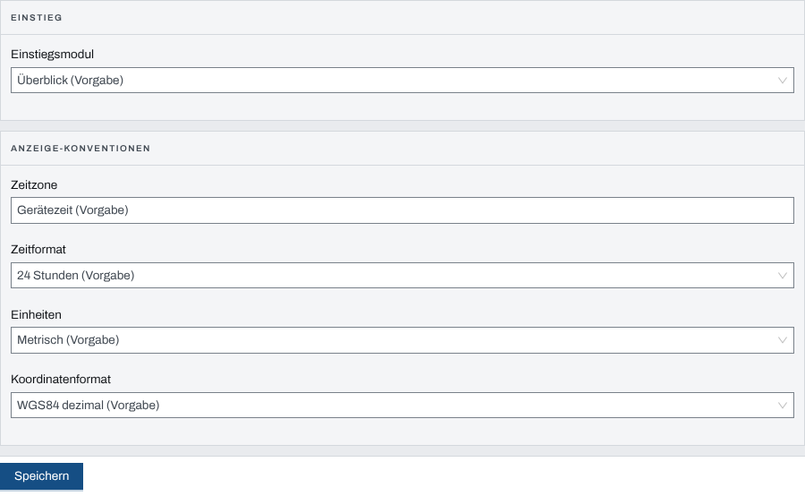
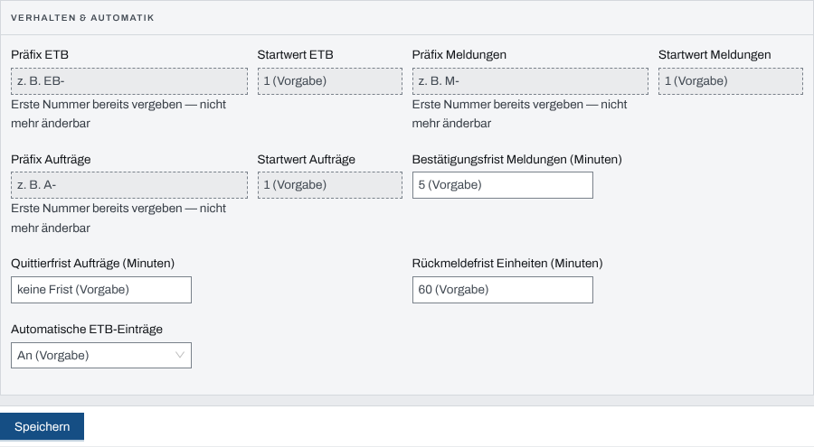
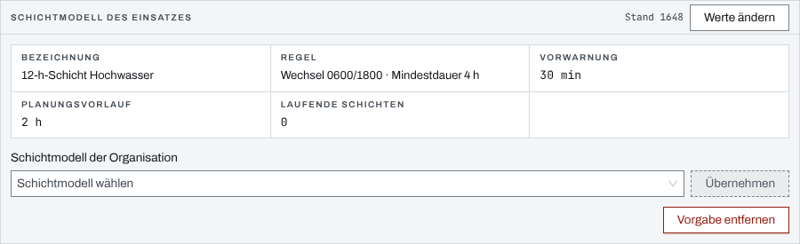
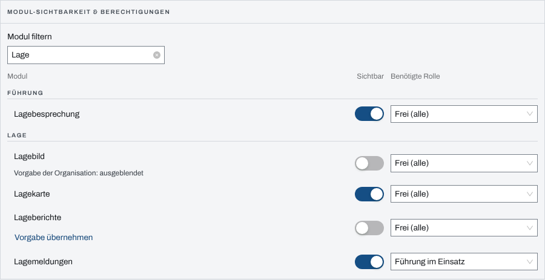

## Überblick

Das Modul „Einstellungen“ eines Einsatzes legt fest, wie dieser eine Einsatz arbeitet: mit
welchem Modul er sich öffnet, wie Zeiten und Koordinaten erscheinen, wie Einträge nummeriert
werden, welche Fristen gelten und wer welche Module sieht. Jede Einstellung gilt nur für diesen
Einsatz. Was hier leer bleibt, übernimmt die Vorgabe der Organisation aus der Verwaltung, und
fehlt auch die, die Vorgabe des Systems.

Bedient wird das Modul von der Einsatzleitung und dem Führungspersonal, die Reiter „Module“ und
„Zugriff“ nur von der Einsatzleitung. Der Reiter „Ablösung“ legt das Schichtmodell fest, nach dem
die Ablösung des Einsatzes rechnet (Kapitel [Ablösung](abloesung.md)). Der Reiter „Kennzahlen“
wählt, was Platz 3 der Kennzahlen im Lagebild zeigt. Der Reiter „Benachrichtigungen“ legt fest,
welche Eingänge für welche Funktion still bleiben. Den Reiter „Aufbewahrung“ beschreibt das Kapitel
[Aufbewahrung](aufbewahrung.md), die Reiter „Pegel“ und „Geräte“ die Kapitel zu Wetter und
Pegeln und zu gekoppelten Geräten, den Reiter „Zugriff“ (wer im Einsatz mit welcher Rolle
arbeitet) das Kapitel [Rechte im Einsatz](rechte-im-einsatz.md).

## Abläufe

### Einstiegsmodul und Anzeige festlegen

1. Im Einsatz „Einstellungen“ öffnen; der Reiter „Allgemein“ ist gewählt.
2. Unter „Einstiegsmodul“ das Modul wählen, mit dem sich der Einsatz öffnet.
3. Unter „Anzeige-Konventionen“ „Zeitzone“, „Zeitdarstellung“, „Einheiten“ und „Koordinatenformat“
   wählen. „Zeitdarstellung“ ist „Taktisch“ (101430okt26, die Vorgabe) oder „Datum und Uhrzeit“
   (10.10.26 14:30); sie gilt am Bildschirm und im Druck.

   

4. „Speichern“ wählen. Die App meldet „Einstellungen gespeichert“.

Ein Feld mit dem Zusatz „(Vorgabe)“ ist nicht gesetzt und folgt der Organisation. Wer ein Feld
leert, stellt es auf die Vorgabe zurück.

### Nummern, Fristen und automatische ETB-Einträge einstellen

1. Den Reiter „Verhalten & Automatik“ öffnen.
2. Für ETB, Meldungen und Aufträge je „Präfix …“ (höchstens acht Zeichen) und „Startwert …“
   eintragen.
3. „Bestätigungsfrist Meldungen (Minuten)“, „Quittierfrist Aufträge (Minuten)“ und
   „Rückmeldefrist Einheiten (Minuten)“ eintragen.
4. Unter „Automatische ETB-Einträge“ „An“ oder „Aus“ wählen.

   

5. „Speichern“ wählen.

### Das Schichtmodell des Einsatzes festlegen

Für Einsatzleitung und Führungspersonal:

1. Den Reiter „Ablösung“ öffnen. Unter „Schichtmodell des Einsatzes“ steht die Vorgabe des
   Einsatzes mit Bezeichnung, Regel, Vorwarnung, Planungsvorlauf und laufenden Schichten.

   

2. Um ein Schichtmodell der Organisation zu übernehmen, unter „Schichtmodell der Organisation“
   eines wählen und „Übernehmen“ wählen.
3. Für eigene Werte „Werte ändern“ (ohne Vorgabe „Eigene Werte setzen“) wählen, „Bezeichnung“,
   „Typ“ und Rhythmus bzw. „Wechselzeiten“ und „Mindestdauer“ eintragen, nach Bedarf unter
   „Vorwarnung … · Planungsvorlauf …“ beide Werte, und „Speichern“ wählen.
4. Ohne Vorgabe „Vorgabe entfernen“ wählen. War das ein Versehen, in der Meldung „Rückgängig“
   wählen.

Jede Änderung gilt sofort, ohne Speichern-Leiste. Die App meldet „Vorgabe des Einsatzes
gespeichert“.

### Richtwerte für die Unterkunft anpassen

Für Einsatzleitung und Führungspersonal:

1. Den Reiter „Unterkunft“ öffnen. Jede Zeile nennt einen Richtwert des Rechners „Unterkunft
   planen“, gruppiert nach „Schlafen“, „Sanitär“, „Gesundheit“, „Ver- und Entsorgung“,
   „Verpflegung“ und „Zelte“.
2. Den Wert für diesen Einsatz ins Feld eintragen und das Feld verlassen oder Enter drücken.
3. Um zum Wert der Organisation zurückzukehren, das Feld leeren und verlassen.

Jede Änderung gilt sofort, ohne Speichern-Leiste. Neben dem Feld steht, woher der wirksame Wert
kommt („Einsatz“, „Organisation“ oder „Vorgabe“), und die Vorgabe des Programms.

### Nachforderungen im Lagebild zeigen

Für Einsatzleitung und Führungspersonal:

1. Den Reiter „Kennzahlen“ öffnen.
2. „Nachforderungen offen auf Platz 3“ einschalten. Platz 3 der Kennzahlen im Lagebild zeigt dann
   „Nachforderungen offen“ statt „Schäden offen“.
3. Zum Zurücknehmen den Schalter ausschalten.

Jede Änderung gilt sofort, ohne „Speichern“.

### Eingänge für Funktionen still stellen

Für Einsatzleitung und Führungspersonal:

1. Den Reiter „Benachrichtigungen“ öffnen. Unter „Still je Funktion“ steht je Eingang eine Zeile,
   etwa „Neuer Auftrag“ oder „Neuer Lagebericht“.
2. In der Zeile unter „Still für“ die Funktionen wählen, für die der Eingang still sein soll, etwa
   „S2“ oder „ohne Funktion“. „niemand“ heißt: für alle ein Eingang.
3. Um eine Funktion herauszunehmen, ✕ an ihrem Namen wählen.

Jede Änderung gilt sofort, ohne „Speichern“. Ist die Zeile danach links rot markiert und steht
über der Liste ein Fehler, hat der Server die Änderung nicht angenommen; die Zeile steht wieder wie
vorher.

### Module ausblenden oder auf eine Rolle beschränken

Für die Einsatzleitung:

1. Den Reiter „Module“ öffnen.
2. Unter „Modul filtern“ einen Teil des Modulnamens eintippen.
3. In der Zeile des Moduls „Sichtbar“ ausschalten, um es auszublenden, oder unter „Benötigte
   Rolle“ „Führung im Einsatz“, „Führungskraft der Organisation“ oder „Admin“ wählen.

   

4. Um einen eigenen Wert für „Sichtbar“ zurückzunehmen, in der Zeile „Vorgabe übernehmen“ wählen.
   Das Modul folgt dann wieder der Organisation.

Jede Änderung gilt sofort, ohne „Speichern“. Die App meldet „Modul-Einstellung gespeichert“.

## Hintergrund

### Woher ein Wert kommt

Jede Einstellung gilt in der Reihenfolge Einsatz, Organisation, System. Steht unter einem Feld
„Vorgabe der Organisation: …“, hat die Verwaltung dafür einen eigenen Wert gesetzt; das Kapitel
[Verwaltung](verwaltung.md) beschreibt diese Vorgaben. Das gilt auch für „Sichtbar“ und
„Benötigte Rolle“ der Module. Ohne beide gelten: Einstiegsmodul
„Überblick“, Gerätezeit, 24 Stunden, metrisch, WGS84 dezimal, Bestätigungsfrist 5 Minuten, keine
Quittierfrist, Rückmeldefrist 60 Minuten, automatische ETB-Einträge an. Als Einstiegsmodul
stehen nur fertige Module zur Wahl. Die Fristen nehmen 1 bis 10080 Minuten (sieben Tage).

Wer ein Formular mit ungespeicherten Eingaben verlassen will, bekommt die Rückfrage
„Ungespeicherte Änderungen“.

### Schichtmodell des Einsatzes

Beim Anlegen bekommt ein Einsatz eine Kopie des Schichtmodells, das die Organisation als Vorgabe
führt; der Dialog „Neuen Einsatz anlegen“ nennt es in der Zeile „Schichtmodell: … (Vorgabe)“.
Ohne Vorgabe der Organisation hat der Einsatz keine. „Übernehmen“ kopiert ein Modell der
Organisation; spätere Änderungen in den Stammdaten erreichen den Einsatz nicht. Ändert sich die
Vorgabe, rechnen die laufenden Schichten neu, die ihr folgen. Entfernen lässt ihren Rhythmus
stehen, die Vorwarnung fällt auf 30 Minuten. Jede Änderung steht im Einsatztagebuch als
Entscheidung. Ist das Modul Ablösung im Einsatz nicht freigegeben, zeigt der Reiter nur „Modul
„Ablösung“ nicht freigegeben“.

### Nummern

Präfix und Startwert eines Nummernkreises lassen sich nur ändern, solange darin noch keine
Nummer vergeben ist. Danach sind beide Felder gesperrt: „Erste Nummer bereits vergeben — nicht
mehr änderbar“. So bleiben die Nummern eines Einsatzes eindeutig.

### Automatische ETB-Einträge

Steht die Einstellung auf „An“, schreibt jede neue Meldung einen ETB-Eintrag vom Typ „Meldung“
und jeder neue Auftrag einen vom Typ „Anordnung“. Auf „Aus“ entstehen diese Einträge nicht;
was ins Einsatztagebuch gehört, trägt dann jemand selbst ein.

### Kennzahlen im Lagebild

Das Lagebild zeigt immer sechs Kennzahlen; zwei Plätze wechseln mit Entscheidungen am Einsatz
(Kapitel [Lagebild](lagebild.md)). „Nachforderungen offen“ ist eine solche Entscheidung: gewählt
bleibt gewählt, auch wenn gerade keine Nachforderung offen ist (dann steht dort 0). Eine
angeordnete Evakuierung geht vor: Solange sie besteht, zeigt Platz 3 „Evakuiert“, und der Reiter
nennt das unter dem Schalter. Die Wahl bleibt gespeichert und wirkt wieder, sobald die Evakuierung
aufgehoben ist. Wer das Modul Nachforderungen nicht sehen darf, sieht auf Platz 3 „Nachforderungen
offen“ mit „—“ und „nicht freigegeben“, nie eine Zahl. Lagebilder, die gerade offen sind, bieten
den neuen Zuschnitt über den Hinweis „Kennzahlreihe geändert: …“ an.

### Still je Funktion

Still heißt: Die Benachrichtigung steht nur unter „Eingänge“ bei „Früher“, ohne Band, Ton und
Zahl, wie eine Art, die jemand für sich abgeschaltet hat (Kapitel
[Einsatz auswählen und Oberfläche](einsatz-oberflaeche.md)). Sie geht an dieselben Personen wie sonst; die
Einstellung ändert nur, wie laut sie bei ihnen ankommt.

Die Funktionen einer Person sind ihre Besetzung im Stab (EL über die Führungsstelle, S1 bis S6
über die Sachgebiete; ein Sachgebiet „bei der Einsatzleitung“ zählt für die Einsatzleitung) und die
Funktion ihrer Mitgliedschaft im Einsatz. Hat sie keine, gilt „ohne Funktion“. Still wird ein
Eingang nur, wenn er für jede ihrer Funktionen still steht: Wer S2 und S4 ist, bekommt einen
Auftrag als Eingang, solange nur S2 still steht. Wer eine Art unter „Benachrichtigungen“ im
Benutzermenü selbst abgeschaltet hat, bekommt sie weiter still, gleich was hier steht.

Ohne Einstellung ist „Neuer Lagebericht“ still, alle anderen Eingänge sind laut. Alarme, die
Unwetterwarnung, „Neuer Einsatz“ und „Aufnahme in einen Einsatz“ stehen nicht in der Liste; sie
lassen sich hier nicht still stellen. Die Einstellung gilt für Benachrichtigungen, die danach
entstehen; was schon im Verlauf steht, bleibt, wie es ist. Welche Namen die Funktionen tragen,
folgt den Bezeichnungen der Organisation; S7 steht nur in der Liste, wenn die Organisation es
führt.

### Was „Sichtbar“ und „Benötigte Rolle“ bewirken

- **Ausgeblendet** fehlt ein Modul in der Navigation aller Personen und ist für sie gesperrt.
  Nur System-Admins erreichen es noch über seine Adresse; in ihrer Navigation fehlt es ebenso.
- **„Führung im Einsatz“** lässt die Einsatzleitung, das Führungspersonal, Führungskräfte der
  Organisation und System-Admins in das Modul. Beobachter bleiben draußen, ebenso gekoppelte
  Geräte: ein Gerät arbeitet an einer Stelle und zählt nicht als Führung. Wer als Einsatzleitung
  ein Modul der Führung vorbehalten will, wählt diese Stufe; damit sperrt sie sich nicht selbst
  aus.
- **„Führungskraft der Organisation“** lässt nur Führungskräfte der Organisation und
  System-Admins in das Modul. Gemeint ist die Rolle in der Organisation, nicht die im Einsatz:
  Einsatzleitung und Führungspersonal ohne diese Organisationsrolle bleiben draußen.
- **„Admin“** lässt nur System-Admins in das Modul.
- **„Frei (alle)“** schränkt nichts ein; es gelten die Rollen im Einsatz.

Ohne eigenen Wert im Einsatz folgen „Sichtbar“ und „Benötigte Rolle“ den „Modulen für alle
Einsätze“ der Organisation, auch während der Einsatz läuft. Blendet die Organisation ein Modul aus,
steht der Schalter aus und darunter „Vorgabe der Organisation: ausgeblendet“. Wer ihn einschaltet,
setzt einen eigenen Wert: Das Modul bleibt in diesem Einsatz sichtbar, bis jemand „Vorgabe
übernehmen“ wählt. Eine geänderte Rolle ändert die Sichtbarkeit nicht.
„Einsatzdaten“ und „Einstellungen“ sind „immer sichtbar, nicht ausblendbar“, damit sich niemand
selbst aussperrt.

Wurde der Einsatz mit einer Einsatz-Vorlage angelegt (Kapitel [Stammdaten](stammdaten.md)),
stehen die Module, die sie ausblendet, als eigene Werte des Einsatzes aus: der Schalter ist aus,
und in der Zeile steht „Vorgabe übernehmen“. Einschalten setzt den eigenen Wert auf sichtbar;
„Vorgabe übernehmen“ nimmt ihn zurück, und das Modul folgt wieder der Organisation. Ein Modul, das
die Organisation selbst ausblendet, bleibt auch mit Vorlage ausgeblendet.

### Wer was darf

- „Allgemein“, „Verhalten & Automatik“ und die Aufbewahrungs-Dauer ändern die Einsatzleitung,
  das Führungspersonal und System-Admins der Organisation des Einsatzes.
- „Module“ ändern nur die Einsatzleitung und System-Admins der Organisation des Einsatzes.
  Die Hinweise „Vorgabe der Organisation: …“ in „Module“ sieht jede Person, die im Einsatz
  mitarbeitet oder zur Organisation des Einsatzes gehört, auch ohne Rolle in der Organisation.
- „Zugriff“ bedient nur die Einsatzleitung eines laufenden Einsatzes, auch ein System-Admin nur
  mit dieser Rolle.
- „Ablösung“ ändern die Einsatzleitung und das Führungspersonal eines laufenden Einsatzes, wie
  die Rhythmus-Vorgabe eines Abschnitts; ein System-Admin ohne Rolle im Einsatz sieht sie nur.
- „Unterkunft“ ändern die Einsatzleitung, das Führungspersonal und System-Admins der
  Organisation des Einsatzes, solange er läuft; alle anderen sehen die Werte nur.
- „Kennzahlen“ ändern die Einsatzleitung und das Führungspersonal eines laufenden Einsatzes, wie
  die Pegel; ein System-Admin ohne Rolle im Einsatz sieht den Schalter nur.
- „Benachrichtigungen“ ändern die Einsatzleitung, das Führungspersonal und System-Admins der
  Organisation des Einsatzes, solange er läuft. Wer den Einsatz sieht, sieht die Liste; an den
  Zeilen steht dann „nur lesen“ bzw. nach dem Abschluss „Einsatz abgeschlossen“.
- Alle anderen sehen die Einstellungen als „Nur Ansicht“.

Nach dem Abschluss ist der Einsatz eingefroren; nur die Aufbewahrungsfrist lässt sich noch
ändern, siehe [Einsatz abschließen und Einsatzbericht](einsatzabschluss.md). Die Rollen im
Einsatz beschreibt [Rechte im Einsatz](rechte-im-einsatz.md).
