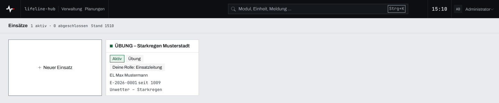
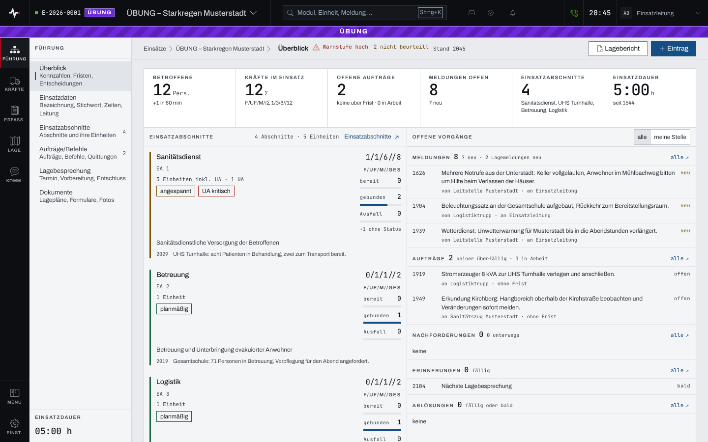
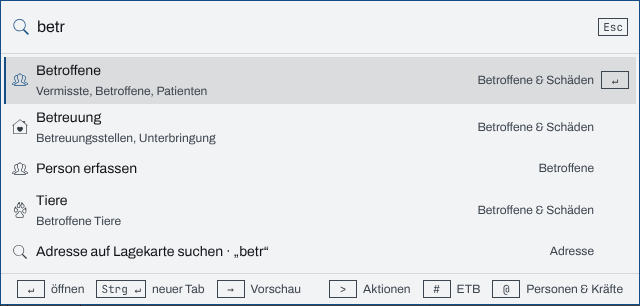
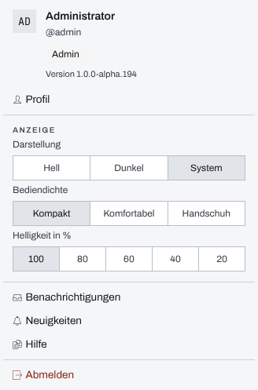

## Überblick

Nach der Anmeldung zeigt Lifeline Hub die **Einsatzliste**. Von dort öffnet jede Person die
Einsätze, in denen sie mitarbeitet. Im Einsatz gliedert sich die Oberfläche in die
**Kopfzeile** oben, die **Kategorien** am linken Rand, die **Module** der gewählten Kategorie
daneben und die Seite des Moduls. Die **Sprungpalette** erreicht jedes Modul, jeden Einsatz und
viele Datensätze über die Tastatur.

Wie die App aussieht, stellt jedes Gerät selbst ein: Darstellung (hell oder dunkel),
Bediendichte (kompakt, komfortabel, Handschuh) und Helligkeit. Das Kapitel richtet sich an alle,
die Lifeline Hub bedienen.

## Abläufe

### Einen Einsatz öffnen

1. Die Einsatzliste öffnen: Sie erscheint nach der Anmeldung. Aus einem Einsatz führt „Alle
   Einsätze …“ im Menü am Einsatznamen dorthin, auf großen Monitoren auch „lifeline-hub“ links
   oben in der Kopfzeile.
2. Die Kachel des Einsatzes wählen. Sie nennt Status, Einsatzart, die eigene Rolle („Eigene
   Rolle: …“), den Einsatzleiter („EL …“, sonst „EL nicht erfasst“) und, soweit erfasst, Ort,
   Einsatznummer, Beginn („seit …“) und Stichwort. Eine Übung trägt statt der grauen Einsatzart
   die violette Marke „ÜBUNG“.

   

„Eigene Rolle: Einsatzleitung“ nennt nur die eigenen Rechte im Einsatz. Wer den Einsatz führt,
steht unter „EL“; festgelegt wird er bei der Führungsstelle (siehe
[Einsatzdaten und Führungsstelle](einsatzdaten.md)).

Ab acht laufenden Einsätzen steht über den Kacheln das Suchfeld „Einsätze durchsuchen“; es
sucht in Bezeichnung, Ort und Stichwort. Abgeschlossene Einsätze stehen kleiner darunter unter
„Abgeschlossen“.

Legt jemand anderes einen Einsatz an, während der Zeiger über den Kacheln steht oder eine Kachel
den Fokus hat, rückt keine Kachel. Unter den Kacheln steht dann „1 neuer Einsatz“; „anzeigen“
holt ihn in die Liste. Sonst ordnet er sich ein, sobald Zeiger und Fokus die Kacheln verlassen.

### Einen Einsatz anlegen

Für System-Admins und Führungskräfte der Organisation:

1. In der Einsatzliste „Neuer Einsatz“ wählen.
2. Im Dialog „Neuen Einsatz anlegen“ steht oben die „Vorlage“, vorbelegt mit „Alle Module“.
   Darunter steht, wie viele Module der neue Einsatz zeigt. Nach Bedarf eine Einsatz-Vorlage
   wählen, etwa „MANV“. Ist das Stichwort mit einer Vorlage gekoppelt, stellt es sie selbst ein;
   die mitgelieferten Stichworte sind es (etwa „MANV15“ mit „MANV“, „B2“ mit „Kleinlage“). Gibt
   die Vorlage eine Einsatzart vor, steht sie unter „Einsatzart“, solange diese nicht von Hand
   geändert wurde.
3. Die „Bezeichnung“ eintragen, dazu „Stichwort“, „Einsatzart“ und „Alarmzeit“. Die
   Stichwort-Vorschläge erscheinen beim Tippen. Die Alarmzeit ist mit dem jetzigen Zeitpunkt
   vorbelegt.
4. Wenn bekannt, den „Einsatzort“ eintippen und mit Enter oder „Ort suchen“ suchen, dann einen
   der Treffer wählen. Ein kleiner Kartenausschnitt zeigt den gewählten Ort; die Nadel lässt sich
   ziehen. Darunter steht dann der Ortsname der neuen Stelle, und „Als Adresse übernehmen“ setzt
   ihn als Einsatzort. Kann der Browser keine Karte zeichnen, steht dort „Karte auf diesem Gerät nicht
   darstellbar“, und der Ort wird trotzdem übernommen. Freier Text ohne Suche geht auch; den Punkt
   dazu setzt „Auf Karte wählen“, oder er wird später in den Einsatzdaten nachgetragen. Eine
   getippte Koordinate gilt gleich als Punkt.
5. „Anlegen“ wählen. Die App öffnet den neuen Einsatz.

Eine Einsatz-Vorlage blendet die Module aus, die sie nicht zeigt; im neuen Einsatz fehlen sie in
der Navigation. Eine von Hand gewählte Vorlage bleibt stehen, auch wenn danach ein gekoppeltes
Stichwort gewählt wird. Ohne Vorlage der Organisation fehlt das Feld „Vorlage“. Die Vorlagen pflegt
die Verwaltung (Kapitel [Stammdaten](stammdaten.md)); im Einsatz lassen sich die Module unter
„Einstellungen“ wieder einschalten (Kapitel
[Einstellungen des Einsatzes und Module](einsatz-einstellungen.md)).

### Zwischen Einsätzen wechseln

1. In der Kopfzeile auf den Namen des Einsatzes tippen. Das Menü listet die laufenden Einsätze;
   unter jedem Namen stehen Einsatzart, Einsatznummer und Ort, soweit sie vorliegen. Bei einer
   Übung entfällt die Einsatzart, die Marke „ÜBUNG“ nennt sie schon. Hat ein Einsatz keine
   Nummer, steht an ihrer Stelle sein Beginn, etwa „seit 14nov26“.
2. Einen anderen Einsatz wählen, oder „Alle Einsätze …“ für die Einsatzliste. Der andere Einsatz
   öffnet in demselben Modul, auf dessen Startseite: wer in „Fahrzeuge“ wechselt, sieht dort die
   Fahrzeugliste des anderen Einsatzes. Ein geöffnetes Fahrzeug, eine Auswahl oder ein Filter
   bleiben im alten Einsatz zurück.

Ist das Modul im anderen Einsatz nicht freigegeben (ausgeblendet durch die Vorlage oder für die
eigene Rolle gesperrt), öffnet er ohne Hinweis sein Standardmodul. Der Einsatzwechsel in der
Sprungpalette führt ebenso in dasselbe Modul, auch mit **Strg+↵** im neuen Tab. Die Ankunft
zählt nicht als Besuch: „Zuletzt besucht“ in der Palette bleibt dabei unverändert.

### Ein Modul öffnen

1. Links eine Kategorie wählen: „Führung“, „Kräfte“ (Kräfte & Mittel), „Betroff.“ (Betroffene &
   Schäden), „Lage“, „Komm.“ (Kommunikation) oder unten „Einst.“ (Einstellungen). Das ETB steht
   unter „Führung“, direkt hinter dem Überblick. Die App springt in das Modul der
   Kategorie, das in diesem Einsatz zuletzt offen war, beim ersten Mal in ihr erstes Modul, und
   zeigt daneben ihre Module. Unter jedem Modul steht in bis zu zwei Zeilen, was es enthält.

   

2. In der Modulliste das Modul wählen. Die Zahl neben einem Modul zählt dessen Inhalt, etwa
   Einträge im Einsatztagebuch, offene Aufträge oder ungelesene Nachrichten im Chat.
3. Die Modulliste einklappen: unten in der Kategorienleiste „Menü“ wählen, oder ein zweites
   Mal auf die offene Kategorie tippen. „Menü“ klappt sie wieder aus. Eingeklappt bleibt sie
   auch beim Sprung in eine andere Kategorie.

Ein Modul lässt sich auch in einem neuen Tab öffnen, etwa für einen zweiten Bildschirm: mit
**Strg+Klick** (am Mac **⌘+Klick**) oder der mittleren Maustaste auf das Modul, oder über „In
neuem Tab öffnen“ im Menü der rechten Maustaste. Eine Kategorie öffnet so ihr erstes Modul.
Gesperrte Module öffnen sich auf keinem dieser Wege.

Auf schmalen Schirmen (Tablet hochkant, Telefon) stehen Kategorien und Module hinter
„Navigation öffnen“ links oben.

### Mit der Sprungpalette springen

1. **Strg+K** drücken (am Mac **⌘K**) oder in der Kopfzeile „Suchen“ wählen. Auf dem Handy steht
   „Suchen“ im Einsatz oben in der Navigation („Navigation öffnen“ links oben).
2. Einige Buchstaben tippen, etwa den Namen eines Moduls, eines Fahrzeugs oder einer Person.

   

3. Mit den Pfeiltasten einen Treffer wählen und mit **↵** öffnen; **Strg+↵** (am Mac **⌘↵**)
   öffnet ihn in einem neuen Tab. **→** am Ende der Eingabe zeigt eine Vorschau, **Esc**
   schließt die Palette.

Ein Zeichen am Anfang der Eingabe grenzt die Suche ein: **>** nur Aktionen, **#** nur das
Einsatztagebuch (`#42` findet Eintrag 42), **@** nur Personen und Kräfte. Auf einem Gerät mit
Touch stehen diese Filter als Knöpfe am unteren Rand der Palette.

### Hilfe zur Seite öffnen

1. In der Kopfzeile das Fragezeichen „Hilfe zu dieser Seite“ wählen oder **?** drücken (außerhalb
   eines Eingabefelds); **F1** geht auch aus einem Eingabefeld. Auf dem Handy steht „Hilfe zu
   dieser Seite“ im Einsatz unten in der Navigation. In der Sprungpalette heißt der Befehl
   ebenso.
2. Rechts öffnet sich eine Seitenleiste mit dem Kapitel zur Seite, auf der man gerade arbeitet.
   Die Seite bleibt daneben bedienbar. Wechselt man das Modul, wechselt das Kapitel mit.
3. „In der Hilfe öffnen“ zeigt das Kapitel in der vollen Hilfe, am breiten Bildschirm mit Maus in
   einem neuen Tab. „Alle Kapitel“ führt zur Übersicht. Ein Verweis im Text öffnet das genannte
   Kapitel in der vollen Hilfe.
4. Mit Tastatur zeigt der Reiter „Tastenkürzel“ die Tasten, die überall gelten, die der
   Sprungpalette und die des aktuellen Moduls zuerst. Der Palettenbefehl „Tastenkürzel“ öffnet
   ihn direkt. **Esc**, **?** oder das Kreuz schließen die Leiste.

Beim ersten Besuch steht über der Einsatzliste eine Willkommenskarte mit den wichtigsten
Handgriffen und dem Link „Einweisung lesen“. „Verstanden“ oder das Kreuz schließen sie für immer,
auf jedem Gerät derselben Person.

### Aktionen einer Zeile über das Kontextmenü aufrufen

1. Mit der rechten Maustaste auf eine Zeile oder Karte einer Liste klicken, neben ihren Titel. Am
   Tablet lange auf die Zeile drücken, ohne den Finger zu bewegen. Steht der Fokus in der Zeile,
   öffnet auch die Kontextmenü-Taste oder **Umschalt+F10** das Menü.
2. Im Menü einen Eintrag wählen. Oben steht die sichtbare Aktion der Zeile (etwa „Entlassen“),
   darunter die Einträge des Menüs „⋮“, Unumkehrbares rot unter einem Strich. **Esc** schließt das
   Menü, ohne etwas auszulösen.

### Darstellung, Bediendichte und Helligkeit einstellen

1. Oben rechts das „Benutzermenü“ öffnen (auf dem Handy im Einsatz: unten in der Navigation).
   Unter „Anzeige“ stehen drei Leisten.
2. In der Leiste „Darstellung“ „Hell“, „Dunkel“ oder „System“ wählen.
3. In der Leiste „Bediendichte“ „Kompakt“, „Komfortabel“ oder „Handschuh“ wählen.
4. In der Leiste „Helligkeit in %“ eine Stufe von „100“ bis „20“ wählen.

   

Die gewählte Stufe ist in ihrer Leiste hervorgehoben. Jede Wahl gilt sofort, das Menü bleibt
dabei offen; **Esc** oder ein Klick daneben schließt es. Mit der Tastatur führt **Tab** vom Menü
in die Leisten und von Leiste zu Leiste, die **Pfeiltasten** wählen innerhalb einer Leiste.
Dieselben drei Leisten stehen im Einsatz unter „Einstellungen“ im Reiter „Anzeige“ und im Profil
im Bereich „Darstellung auf diesem Gerät“; dort gelten sie genauso nur für dieses Gerät und
brauchen kein Recht, auch nicht im abgeschlossenen Einsatz. Außerdem stehen die Einstellungen in
der Sprungpalette („Darstellung: …“, „Dichte: …“, „Helligkeit: …“).

Ist im Einsatz eine Warnung aktiv, lässt sich die Anzeige nicht unter eine Untergrenze dimmen: die
Leiste nennt sie („mind. 80 % (Warnung aktiv)“), die dunkleren Stufen sind gesperrt, und eine Wahl
darunter steht als „Gewählt 40 %, wirkt 80 %“ unter der Leiste. Endet die Warnung, gilt wieder die
eigene Wahl.

### Eine Zeit eintragen

1. Ins Zeitfeld klicken. Der bisherige Wert ist markiert, Tippen ersetzt ihn.
2. Die Zeit tippen, etwa „1430“ für heute 14:30 oder „101430okt26“ für den 10. Oktober 2026,
   14:30. Neben dem Feld steht, wie die Eingabe gelesen wird („= 171430okt26“).
3. Mit Enter übernehmen. In einem Formular sendet derselbe Tastendruck das Formular ab.

Wer lieber wählt: „Kalender und Uhrzeit“ neben dem Feld öffnen, einen Tag wählen, unter
„Uhrzeit“ die Uhrzeit eintragen und „Übernehmen“. Dort stehen auch die Schnellwahlen, etwa
„jetzt“ und „−5 min“ oder „+30 min“. Escape verwirft eine angefangene Eingabe.

### Auf eine Benachrichtigung reagieren

1. Die Meldung lesen: Ein Alarm steht in der Alarmzone direkt unter der Kopfzeile, ein Eingang
   im Eingangsband unten. Vorn steht die Art, etwa „Auftrag überfällig“ oder „Neuer Auftrag“,
   dahinter, wo vorhanden, der Gegenstand, etwa „Auftrag #12“.
2. „Öffnen“ wählen, um zum Gegenstand zu springen, oder „Gelesen“, um auf der Seite zu bleiben.
   Stehen im Eingangsband mehrere Eingänge, führt der Knopf in das Modul, etwa „Zu Aufträgen“;
   kommen sie aus mehreren Modulen, öffnet „Ansehen“ die Liste der Eingänge.
3. Wer einen Alarm oder das Band nur aus dem Weg haben will, wählt ✕ („Ausblenden, ohne zu
   quittieren“).

„Öffnen“, „Gelesen“ und ein Sprung aus dem Band quittieren die Benachrichtigung: Sie verschwindet
auch in anderen Tabs und auf anderen Geräten derselben Person. ✕ quittiert nichts: Der Eintrag
bleibt unter „Eingänge“ bei „Neu“ und kommt in diesem Tab nicht wieder, bis der Tab geschlossen
wird; andere Tabs und Geräte zeigen ihn weiter. „Ansehen“ quittiert ebenfalls nichts.

### Eingänge nachlesen

1. In der Kopfzeile „Eingänge“ wählen (das Zeichen des Posteingangs; die Zahl darüber nennt die
   ungelesenen). Auf dem Handy und auf dem Tablet mit Finger trägt die Alarmzentrale die Zahl:
   sie öffnen und „Eingänge, … ungelesen“ wählen.
2. Unter „Neu“ stehen die ungelesenen Eingänge, unter „Früher“ die gelesenen, jeweils mit der
   Uhrzeit, der Art und der Kennung.
3. Einen Eintrag wählen: Die App springt zum Gegenstand, der Eintrag gilt als gelesen.
4. Oder „Alle gelesen“ wählen: Alle Eingänge des Einsatzes gelten als gelesen, auf allen Geräten
   der Person. Alarme bleiben, bis jemand sie selbst öffnet oder schließt.

Steht nach „Alle gelesen“ „Nicht gespeichert, bitte noch einmal.“, hat der Server die Änderung
nicht angenommen. Ohne Netz zeigt „Eingänge“ den Stand der letzten Verbindung („Stand HH:MM ·
offline“), auch nach einem Neuladen; „Alle gelesen“ merkt die App dann vor („Offline vorgemerkt“),
die Zahl verschwindet sofort, und die Markierung geht hinaus, sobald wieder Netz da ist. Was bis
dahin neu eingeht, bleibt ungelesen. Einen einzelnen Eintrag ohne Netz zu öffnen, markiert ihn
ebenso: Die Zahl sinkt sofort, die Markierung geht hinaus, sobald wieder Netz da ist.

### Eingänge auf diesem Gerät stumm schalten

1. In der Kopfzeile „Eingänge“ wählen.
2. Oben in der Liste „Stumm“ wählen. Unter „Stumm auf diesem Gerät“ steht je Eingang ein Schalter,
   etwa „Neuer Auftrag“.
3. Den Schalter eines Eingangs einschalten, der auf diesem Gerät leise bleiben soll, oder
   ausschalten, um ihn wieder zu hören. Die Änderung gilt sofort; der Knopf zeigt danach, wie
   viele stumm sind, etwa „Stumm · 2“.

### Benachrichtigungen einstellen

1. Oben rechts das „Benutzermenü“ öffnen und „Benachrichtigungen“ wählen. Im Einsatz führt auch
   „Benachrichtigungen einstellen →“ unten in den „Eingängen“ dorthin.
2. Unter „Hinweise“ den Schalter einer Art ausschalten, deren Hinweise nicht mehr erscheinen
   sollen, oder einschalten, um sie wieder zu bekommen. Die Änderung gilt sofort.

Unter „Alarme“ stehen die Arten, die sich nicht abschalten lassen, mit „immer an“. Steht an einer
Zeile „nicht gespeichert“, hat der Server die Änderung nicht angenommen; der Schalter steht wieder
wie vorher.

„Testbenachrichtigung“ unter „Test“ zeigt sofort eine Meldung des Betriebssystems und spielt den
kurzen Ton (nicht bei „Ton stumm“), auch wenn der Tab vorn ist; hat der Browser noch nicht nach der
Erlaubnis gefragt, fragt er zuerst. Daneben erscheint „gesendet“ oder, warum keine Meldung kam,
„blockiert“ (im Browser verweigert), „nicht verfügbar“ (das Gerät kann keine zeigen) oder „aus“
(die Frage blieb ohne Antwort).

### Benachrichtigungen bei geschlossener App

Damit Benachrichtigungen auch ankommen, wenn kein Tab der App offen ist, etwa auf dem Handy in
der Tasche:

1. Oben rechts das „Benutzermenü“ öffnen und „Benachrichtigungen“ wählen.
2. Unter „Dieses Gerät“ den Schalter „Auch bei geschlossener App“ einschalten.
3. Fragt der Browser, ob die Seite Benachrichtigungen zeigen darf, „Erlauben“ wählen.

Der Schalter gilt für diesen Browser auf diesem Gerät, nicht für die Person; auf jedem Gerät, das
melden soll, einmal einschalten. Nach dem Abmelden kommen keine Meldungen mehr; meldet sich
dieselbe Person wieder an, gilt der Schalter wieder, ohne dass sie ihn neu setzt.

Ist der Schalter an, erscheint darunter „Mit Absender und Wortlaut“, zunächst aus. Aus heißt:
Eine Meldung bei geschlossener App sagt nur, dass eine Sofortmeldung oder neue Meldung kam, etwa
„Sofortmeldung eingegangen“, ohne Absender und Wortlaut. Das ist Absicht, denn die Meldung steht
auch auf dem gesperrten Bildschirm, wo Umstehende sie lesen können, und bleibt dort, bis sie
weggewischt wird. Wer ein Gerät nur selbst in der Hand hat, kann den Schalter einschalten; dann
nennt die Meldung wie in der App den Absender und den Anfang des Wortlauts. Auch dieser Schalter
gilt nur für dieses Gerät und bleibt nach einer neuen Anmeldung erhalten.

Arbeitet die Instanz im Fahrzeug (ELW) mit einem Hub zusammen und stammt das eigene Konto vom
Hub, kommen die Meldungen bei geschlossener App vom Hub. Statt des Schalters steht dann „Push
läuft über ‹Name des Hubs›“ mit dem Link „Am Hub einschalten“: dort, an der Seite
„Benachrichtigungen“ des Hubs, den Schalter wie oben einschalten. Das Gerät erhält dann Meldungen
zu den Einsätzen des ELW, solange es dort angemeldet ist. Wer nur am ELW ein Konto hat, etwa als
Spontanhelfer, schaltet wie gewohnt am ELW ein.

Fehlt der Schalter, bietet ihn dieses Gerät nicht: Der Betrieb hat die Zustellung nicht
eingeschaltet, der Browser kann sie nicht, oder die App läuft als Desktop- oder iOS-App, die ohnehin
selbst melden. Ohne iOS-App erscheint er auf dem iPhone und iPad nur in der installierten Web-App
(„Zum Home-Bildschirm“ in Safari), nicht im Browser-Tab. Steht „Vom Browser blockiert“ daneben, hat
der Browser die Erlaubnis verweigert; sie lässt sich nur in den Einstellungen des Browsers für diese
Seite wieder geben.

## Hintergrund

### Die Kopfzeile

Von links nach rechts:

- **Statuspunkt, Einsatznummer und Name** des offenen Einsatzes; über den Namen geht der Wechsel
  in einen anderen Einsatz. Der Name hat Vorrang: Wird es eng, schrumpft zuerst das Suchfeld bis
  auf die Lupe, erst dann kürzt der Name mit „…“. Ganz steht er im Tooltip.
- **Suchen** öffnet die Sprungpalette. Am Touch-Gerät steht dort kein Tastenkürzel.
- **Eingänge**: der Verlauf der eigenen Benachrichtigungen dieses Einsatzes; die Zahl darüber
  nennt die ungelesenen Eingänge (siehe „Eingänge nachlesen“).
- **Alarmzentrale**: Das erste Zeichen zeigt, ob der Browser Benachrichtigungen zeigen darf
  (Haken: erlaubt, Bildschirm: aus oder nicht verfügbar, Verbotsschild: blockiert), die Glocke, ob
  Alarmtöne zu hören sind. Ist alles in Ordnung, stehen beide nur als Zeichen; den
  Zustand nennt der Tooltip. „Ton stumm“, „Ton blockiert“ und „Benachrichtigung blockiert“ stehen
  als Wort und auffällig da: Eine Sofortmeldung oder eine fällige Erinnerung bliebe dann ohne Ton
  bzw. ohne Meldung. Stummschalten gilt für alle Töne auf diesem Gerät, in jedem Einsatz, auch für
  den Ton bei neuen Meldungen.
- **Verbindung**: Das grüne Funkzeichen heißt, die Live-Verbindung steht; gelb wird sie beim Start
  gerade aufgebaut. „VERBINDE“ (die Verbindung wird wiederhergestellt, auch wenn sie 45 Sekunden
  lang nichts mehr geliefert hat, etwa im Funkloch), „GETRENNT“, „OFFLINE“,
  „WARTET“ (vorgemerkte Einträge) und „PRÜFEN“ (abgelehnte Einträge) melden eine Störung mit Wort; was dann gilt, steht in
  [Arbeiten ohne Netz](ohne-netz.md).
- **Uhr**: die Uhrzeit des Geräts.
- **Hilfe zu dieser Seite** (Fragezeichen) öffnet die Seitenleiste mit dem Kapitel zur Seite
  (siehe „Hilfe zur Seite öffnen“).
- **Benutzermenü** mit Name, Funktion im Einsatz, Profil, der Anzeige des Geräts (Darstellung,
  Bediendichte, Helligkeit), den Benachrichtigungen, den Neuigkeiten, der Hilfe und zuletzt
  „Abmelden“ mit Rückfrage.
  Rückmeldung und Lizenzen stehen in der Hilfe.

Auf dem Handy und auf dem Tablet mit Finger stehen Alarmzentrale und Eingänge in einem
Knopf. Außerhalb eines Einsatzes führt „Verwaltung“ in die Verwaltung der Organisation. Wer dort
keine Rechte hat, sieht den Eintrag mit Schloss und „Keine Berechtigung“.

Die Kopfzeile bleibt beim Rollen oben stehen, auf jedem Gerät. Auf dem Handy trägt sie im Einsatz
eine Zeile: „Navigation öffnen“, Statuspunkt und Name, Alarmzentrale, Verbindung und Uhr; nur im
Handschuh-Betrieb bricht sie um, wenn die Alarmzentrale eine Störung im Wort nennt. „Suchen“
steht dort oben in der Navigation, „Hilfe zu dieser Seite“ und das Benutzermenü unten in der
Navigation. Über einer Seite
steht am Handy kein Ortspfad, den Einsatz nennt die Kopfzeile; auf einer Detailseite führt
„‹ Betroffene“ (oder die jeweilige Liste) zurück. Außerhalb eines Einsatzes führt am Handy das
Zeichen links oben zur Einsatzliste.

Über der Kopfzeile erscheint bei Bedarf die **Betriebszeile**: bei Störungen der Verbindung, bei
vorgemerkten oder abgelehnten Einträgen und mit „Neue Version verfügbar.“, wenn eine neue
Fassung der App bereitliegt. „Jetzt neu laden“ lädt sie. Auf dem Handy bleibt sie bei einer
Störung der Verbindung über der Kopfzeile stehen.

Mit der Tastatur ist auf jeder Seite mit Kopfzeile und in der Hilfe der erste Halt der Knopf
„Zum Inhalt springen“, noch vor der Betriebszeile; er erscheint erst mit dem Fokus, oben links über
der Kopfzeile. **↵** darauf führt an Kopfzeile, Kategorien und Modulen vorbei an den Anfang der
Seite, der nächste **Tab** steht auf ihrem ersten Bedienelement. In der Verwaltung führt er auch am
Menü vorbei, in der Hilfe an der Kapitelliste.

### Übung oder Realeinsatz

Hat ein Einsatz die Einsatzart „Übung“, ist das überall zu sehen, ohne den Namen zu lesen:

- Unter der Kopfzeile steht ein violettes, schräg gestreiftes Band „ÜBUNG“ über die volle Breite,
  in jedem Modul. Es bleibt beim Rollen unter der Kopfzeile stehen.
- Ab Tabletbreite steht in der Kopfzeile vor dem Namen die Marke „ÜBUNG“.
- Der Titel des Browser-Tabs beginnt mit „ÜBUNG ·“.
- In der Einsatzliste, im Einsatzwechsel, in der Sprungpalette und auf „Zurück zu …“ in Profil
  und Verwaltung trägt eine Übung dieselbe Marke. Die Sprungpalette findet Übungen auch über das
  Wort „Übung“.
- Gedruckt steht „ÜBUNG“ im Druckkopf (siehe [Drucken und Export](drucken-export.md)), als
  Bild-Anlage im Kopf des Bilds.

Entscheidend ist allein die Einsatzart, nicht der Name: Ein Einsatz „Übungsgelände Brand“ mit
der Einsatzart „Realeinsatz“ trägt keine Marke. Ändern lässt sich die Einsatzart in den
[Einsatzdaten](einsatzdaten.md). Erkennbar ist eine Übung immer am Wort „ÜBUNG“ auf dem
gestreiften Band oder der Marke; Violett allein heißt nichts, auch Entscheidungen im
Einsatztagebuch und Abschnitte auf der Lagekarte sind violett.

### Hinweise auf der Einsatzliste

Zwei Hinweise erreichen eine Person auch dann, wenn sie keinen Einsatz geöffnet hat:

- **„Aufgenommen in …“** mit dem Namen des Einsatzes geht an die Person, die die
  Einsatzleitung in einen Einsatz aufnimmt. Ein Wechsel der Rolle oder der Funktion bei einem
  bestehenden Mitglied ist keine Aufnahme und bleibt still; wer entfernt und wieder aufgenommen
  wird, erhält den Hinweis erneut.
- **„Neuer Einsatz“** mit dem Namen des Einsatzes geht beim Anlegen an die Führungskräfte und
  System-Admins der Organisation, die ihn lesen dürfen. Wer ihn nicht lesen darf, etwa ein
  Konto ohne Rolle in der Organisation, erfährt von ihm nichts.

Beide Hinweise führen in den Einsatz. Eigene Aktionen bleiben still: Wer den Einsatz anlegt,
bekommt keinen Hinweis dazu. Auch das Einspielen der Demo-Daten meldet nichts.

### Was ein Einsatz zeigt

Ein Einsatz öffnet mit dem „Überblick“, es sei denn, die Einsatzleitung hat in den Einstellungen
des Einsatzes ein anderes „Einstiegsmodul“ festgelegt. Welche Module erscheinen, legt der
Einsatz fest: Ein ausgeblendetes Modul fehlt in der Liste, ein gesperrtes steht mit „Keine
Berechtigung“ da. Was die eigene Rolle im Einsatz erlaubt, steht in
[Rechte im Einsatz](rechte-im-einsatz.md).

Unten in der Modulliste läuft die **Einsatzdauer** seit Beginn des Einsatzes.

Auf langen Seiten rollt nur der Inhalt. Die Kopfzeile bleibt oben stehen, ab Tabletbreite auch
der Kopf der Seite mit Titel und Knöpfen; auf breiten Bildschirmen auch die Kategorien und die
Modulliste daneben. Hat eine Kategorie mehr Module, als ins Fenster passen, rollt die Modulliste
für sich. In einem niedrigen Fenster rollt der Kopf der Seite mit, damit für den Inhalt Platz
bleibt. Dasselbe gilt in der Verwaltung.

Einige Einträge der Modulliste sind **Sprungmarken** in eine Ansicht eines Moduls. Sie stehen
eingerückt mit einer feinen Linie direkt unter diesem Modul: „Entscheidungen“ unter „ETB“
(Kategorie „Führung“, nur Entscheidungen), „Patienten“ und „Vermisste“ unter „Betroffene“,
„FMS-Tableau“ unter „Fahrzeuge“, „Ohne Schicht“ unter „Ablösung“ sowie „Fernmeldeskizze“ und
„Kommunikationsplan“ unter „Fernmeldewesen“ (Kategorie „Kommunikation“). Nach dem Sprung ist das
Modul darüber hervorgehoben. Das
„Informationstelefon“ ist keine Sprungmarke, sondern ein eigenes Modul der Kategorie
„Kommunikation“.
Eine Sprungmarke ist gesperrt oder fehlt, wenn ihr Zielmodul gesperrt ist oder fehlt; „Ohne
Schicht“ ist außerdem gesperrt, wenn das Modul Einheiten gesperrt ist. Den vollen Namen einer
gesperrten Marke zeigt der Hinweis beim Zeigen mit der Maus.

Wer aus einem Einsatz ins Profil, in die Benachrichtigungen, die Neuigkeiten, die Hilfe oder die
Verwaltung wechselt, findet dort „Zurück zu …“: Es führt an die zuletzt geöffnete Stelle des
Einsatzes zurück, solange er läuft; in der Hilfe an die Stelle, aus der sie geöffnet wurde, auch
wenn man im Einsatz inzwischen weitergearbeitet hat. Ist der Einsatz abgeschlossen, führt die
Hilfe stattdessen „Zu den Einsätzen“. Am breiten Schirm mit Maus öffnet die Hilfe aus einem
Einsatz in einem neuen Tab, in der Desktop-App in einem eigenen Fenster; der Einsatz bleibt im
ersten Tab offen. Am Handy und am Tablet öffnet sie im selben Tab.

### Wenn eine Seite nicht angezeigt werden kann

Scheitert eine Seite beim Anzeigen, etwa an einem unerwarteten Datensatz, steht an ihrer Stelle
„Diese Seite konnte nicht angezeigt werden“ mit dem Satz „Der Fehler wurde gemeldet. Die anderen
Module arbeiten weiter.“ Kopfzeile, Kategorien und Modulliste bleiben stehen und lassen sich
weiter bedienen. Zwei Auswege stehen darunter:

- „Neu laden“ lädt die App neu.
- „Zum Überblick“ führt in den Überblick des Einsatzes. Ist der Überblick gesperrt, führt der
  Knopf in das erste freie Modul.

Jedes andere Modul, über Kategorien, Modulliste oder Sprungpalette gewählt, zeigt wieder seine
normale Seite. Außerhalb eines Einsatzes, auf der Einsatzliste, im Profil und in der Verwaltung,
heißt der zweite Ausweg „Zur Einsatzliste“, auf einem gekoppelten Gerät „Zur Startseite“.
Scheitert der Rahmen selbst, steht dieselbe Meldung als ganze Seite, mit „Neu laden“ und „Zur
Einsatzliste“.

Auf dem Überblick und im Lagebild fällt bei einem solchen Fehler nur die betroffene Kachel aus. An
ihrer Stelle steht „Diese Kachel konnte nicht angezeigt werden“ mit „Der Fehler wurde gemeldet.“
und dem Knopf „Neu laden“. Alle anderen Kacheln bleiben stehen und lassen sich weiter bedienen.

Der Fehler geht von selbst als Bericht an den Server der Organisation. Der Bericht nennt die Art
der Seite ohne Kennungen aus der Adresse, die Version der App und die technische Meldung; der
Server schreibt ihn nur in sein Protokoll. Ohne Netz entfällt der Bericht ohne weiteren Hinweis.

### Wenn es ein Objekt nicht (mehr) gibt

Führt eine Adresse auf ein Objekt, das es im Einsatz nicht oder nicht mehr gibt, etwa auf eine
Person oder einen Befehl aus einem anderen Einsatz, bleibt die Seite im Einsatz und die Adresse in
der Leiste stehen. An Stelle des Objekts steht „Diese Person gibt es nicht (mehr)“ oder
entsprechend, mit einem Knopf zur Liste des Moduls, etwa „Zu den Betroffenen“. „Erneut abrufen“
fehlt dort, denn ein neuer Versuch fände das Objekt auch nicht. Scheitert der Abruf dagegen an der
Verbindung oder am Server, steht der Fehler mit „Erneut abrufen“. Eine solche Adresse merkt sich
der Einsatz nicht als letzten Ort: „Zurück zu …“ aus dem Profil führt nicht dorthin.

Zeigt ein Link aus einem anderen Modul auf einen Eintrag einer Liste, etwa auf eine Meldung, einen
Auftrag oder ein Fahrzeug, den es nicht (mehr) gibt, steht über der Liste ein Hinweis wie „Meldung
#123 gibt es nicht (mehr)“. Die Zahl ist die Kennung aus dem Link; sie kann von der laufenden
Nummer abweichen, die die Liste zeigt. Kein Eintrag ist dann gewählt oder hervorgehoben. Der
Hinweis verschwindet mit ✕, mit der Wahl eines Eintrags oder mit dem nächsten Link.

### Wo das Kontextmenü gilt

Das Kontextmenü zeigt genau die Aktionen, die die Zeile auch als Knopf und im Menü „⋮“ anbietet;
fehlt das Schreibrecht, fehlen sie hier ebenso. Eine Zeile ohne Aktion, ein Link (etwa der Titel der
Zeile), ein Bild, ein Eingabefeld und markierter Text behalten das Menü des Browsers mit „In neuem
Tab öffnen“, „Bild speichern unter“, „Kopieren“ und „Einfügen“. Am Tablet lässt sich Text in einer
Zeile mit Kontextmenü nicht durch langes Drücken markieren, außer im Einsatztagebuch (siehe
unten).

Das Kontextmenü steht in den Listen Material, Fahrzeuge, Personen, Dokumente und Presse, in den
Tabellen der Betreuungsstellen und Evakuierungsbezirke, an den Blöcken im Raster des Schichtplans
(Kapitel [Ablösung](abloesung.md)), im Einsatztagebuch an den Einträgen, an den Karten von
Meldungen, Nachforderungen, Aufträgen, Ablösungen, Verpflegungsstellen und Zeitfenstern, an den Nachrichten im Chat, im Kommunikationsplan, in den Einstellungen des
Einsatzes bei Pegeln, Geräten und Lagemonitoren, bei den Personen einer Einheit und an den
Bild-Hintergründen der Lagekarte. Im Einsatztagebuch öffnen es nur Rechtsklick und Tasten; ein
langer Druck am Tablet markiert dort weiter Text. In der Verwaltung gilt es für die Stammdaten
(Fahrzeuge, Personal, Material, Schichtmodelle, Externe Stellen, Sprechgruppen, Verpflegungsplan)
und für die Benutzer; Stammdaten, die am Hub gepflegt werden, haben keines.

Wo eine Zeile ihre Aktionen als Knöpfe zeigt (etwa „Bearbeiten“ und „Deaktivieren“), stehen im
Kontextmenü dieselben. Trägt eine Karte mehrere Knöpfe, stehen alle Knöpfe ihrer Aktionszeile im
Menü, danach die Einträge des Menüs „⋮“; Sprünge wie „Ausgabe öffnen“, Auswahlfelder wie
„Bearbeiter zuweisen“ und Knöpfe einzelner Zeilen in der Karte, etwa „Quittieren“ an einem
Empfänger eines Auftrags, bleiben an der Karte. Ein Knopf, der vorher nachfragt, fragt aus dem
Kontextmenü in einem Dialog nach. Bei einem Bild-Hintergrund öffnet es nur auf dem Namen, nicht auf
Schalter, Deckkraft und Ansicht. Der Zählschirm der Verpflegungsausgabe hat kein Kontextmenü, damit
ein langer Druck auf eine Zähltaste nichts anderes auslöst. Lagekarte und Fernmeldeskizze haben ein
eigenes Kontextmenü an der Stelle, auf die gedrückt wurde.

### Was die Sprungpalette kennt

Ohne Eingabe stehen oben die zuletzt ausgeführten Befehle und die zuletzt geöffneten Module.
Mit Eingabe sucht die Palette in Modulen, Ansichten (den Sprungmarken der Modulliste, etwa
„Kommunikationsplan“ oder „Vermisste“), Schnellaktionen („Person erfassen“, „ETB-Eintrag schreiben“,
„Meldung erfassen“, „Auftrag erteilen“, „Nachforderung stellen“, „Fahrzeugstatus setzen“, „Anruf
erfassen“ …), laufenden Einsätzen, Einstellungen, der „Hilfe“ und, ab zwei Zeichen, in den
Datensätzen des Einsatzes: Personen, Fahrzeuge (auch über Fahrzeugtyp und Kennzeichen), Personal
(auch über die Funktion), Einheiten, Einträge des Einsatztagebuchs und weitere.
Module und Ansichten, die der Einsatz nicht freigibt, fehlen; Schnellaktionen stehen nur dort, wo die eigene
Rolle schreiben darf.

Ein Treffer braucht für jedes getippte Wort einen Wortanfang oder, ab drei Zeichen, einen Teil
eines Wortes; „rtw“ findet also Fahrzeuge vom Typ RTW, aber nicht die Lagekarte. Umlaute und ihre
Umschrift gelten gleich („kraefte“ findet „Kräfte“). Module sind auch unter gängigen Abkürzungen
und früheren Namen zu finden, etwa „BHP“ für die Unfallhilfsstellen, „Tagebuch“ für das ETB und
„Meldebild“ für die Kräfteübersicht.

Die Schnellaktionen stehen nach eigener Nutzung geordnet: was eine Person am häufigsten
ausführt, steht oben, bei Gleichstand gilt die feste Folge (Person, ETB-Eintrag, Meldung,
Lagemeldung, Auftrag, Nachforderung, Fahrzeugstatus, dann die übrigen). Die Zählung gehört der
Person, nicht dem Gerät, und gilt deshalb an jedem Rechner. Solange die Palette offen ist, bleibt
die Folge stehen.

„Koordinaten: …“ in der Palette stellt das Koordinatenformat für dieses Gerät ein. Es gilt vor
der Vorgabe des Einsatzes und der Organisation, bis eine andere Wahl getroffen wird.
„Zeitdarstellung: …“ wählt ebenso für dieses Gerät, ob Zeiten taktisch („101430okt26“) oder als
Datum und Uhrzeit („10.10.26 14:30“) stehen; „Zeitdarstellung: Vorgabe des Einsatzes“ stellt
zurück. Ausdrucke folgen immer der Vorgabe (siehe [Profil und Sicherheit](profil-sicherheit.md)).

### Benachrichtigungen

Eine Benachrichtigung geht an die Personen, die sie betrifft, nicht an alle im Einsatz. Sie hat
eine von drei Stufen:

- **Alarm** („Sofortmeldung“, „Sofortmeldung unbestätigt“, „Auftrag überfällig“, „Ablösung
  fällig“, „Vermisstenmeldung“, „Unwetterwarnung“): Eintrag in der Alarmzone mit dem Wort „ALARM“
  und roter Kante, dazu der Alarmton.
  Alarme lassen sich nicht abschalten.
- **Eingang** (unter „Benachrichtigungen“ als „Hinweise“): Eingangsband unten und ein kurzer,
  tieferer Ton, höchstens alle zwei Minuten. Jede Art lässt sich unter „Benachrichtigungen“
  abschalten.
- **Still**: Was eine abgeschaltete Art meldet, steht nur unter „Eingänge“ bei „Früher“, ohne
  Band, Ton und Zahl. In den Zählern und Listen der Module bleibt es sichtbar. Ebenso still kommt
  ein Eingang, den die Einstellungen des Einsatzes für alle Funktionen der Person still stellen;
  „Neuer Lagebericht“ ist das ohne eigene Einstellung (Kapitel
  [Einstellungen des Einsatzes und Module](einsatz-einstellungen.md)).

Die Schalter gehören zur **Person**, nicht zum Gerät: Sie gelten auf jedem Gerät, an dem sie sich
anmeldet. Stummschalten in der Alarmzentrale gehört dagegen zum Gerät und gilt für alle Töne.

Auch „Stumm auf diesem Gerät“ unter „Eingänge“ gehört zum **Gerät**, gilt aber je Art: Ein stummer
Eingang bringt auf diesem Gerät kein Band, keinen Ton und keine Meldung des Betriebssystems. Er
bleibt ungelesen, zählt über „Eingänge“, im Titel des Tabs und am Symbol der App und steht unter
„Neu“. Andere Geräte derselben Person melden ihn wie sonst; so bleibt etwa das Tablet leise, während
der Rechner im Stab klingelt. Alarme lassen sich nicht stumm schalten. Die Einstellung bleibt beim
Abmelden auf dem Gerät, wie „Ton stumm“. Sie gilt auch, wenn „Auch bei geschlossener App“
eingeschaltet und die App zu ist: Für eine stumme Art erscheint dann keine Meldung des
Betriebssystems, ein Alarm schon. Wer ohne Netz umschaltet, hat bei geschlossener App bis zur
nächsten Anmeldung noch den alten Stand.

Die **Alarmzone** trägt nur Alarme (dazu, außerhalb eines Einsatzes, „Neuer Einsatz“ und
„Aufnahme in einen Einsatz“ mit dem Wort „HINWEIS“ und blauer Kante). Sie steht direkt unter
der Kopfzeile, unter einem Übungsband, und schiebt die Seite um ihre Zeile nach unten, statt
etwas zu verdecken; beim Rollen bleibt sie unter der Kopfzeile stehen. Menüs, Dialoge und die
Navigation liegen über ihr. Ohne Alarm steht sie nicht. Ein Alarm bleibt, bis er geöffnet, als
gelesen markiert oder ausgeblendet wird. Ab zwei Alarmen steht der jüngste mit „+ n weitere“;
aufgeklappt nennt die Zone ihre Zahl („3 Alarme“) und je Art die Zahl, etwa „2 × Auftrag
überfällig · 1 × Bestätigung ausstehend“, darunter jeden Alarm mit eigenem „Öffnen“, „Gelesen“
und ✕. Die Unwetterwarnung hat kein „Gelesen“; eine neuere ersetzt die ältere. Das Eingangsband
steht nie in der Zone und liegt nie über ihr.

Ist der Tab verdeckt und darf der Browser Benachrichtigungen zeigen (Tooltip „Benachrichtigung
erlaubt“ in der Kopfzeile), erscheint zusätzlich eine Meldung des Betriebssystems. Sie schließt,
sobald der Tab wieder vorn ist; dann trägt die Alarmzone.

Geht eine Benachrichtigung unterwegs verloren, etwa während einer Störung der Verbindung oder
eines Neustarts des Servers, holt die App sie nach, sobald die Verbindung wieder steht. Ebenso
beim Öffnen eines Einsatzes: Was in den letzten zwölf Stunden kam und noch nicht quittiert ist,
erscheint mit der Uhrzeit, zu der es kam, außer es wurde in diesem Tab ausgeblendet. Für alle nachgeholten zusammen klingt höchstens einmal
der kurze Ton. „Neuer Einsatz“ und „Aufnahme in einen Einsatz“ erscheinen auch außerhalb eines
Einsatzes, in der Einsatzliste, im Profil und in der Verwaltung; „Öffnen“ führt in den Einsatz.

Ist „Auch bei geschlossener App“ eingeschaltet, kommt eine Benachrichtigung auch ohne offenen
Tab als Meldung des Betriebssystems, Alarme wie Hinweise; abgeschaltete Hinweis-Arten bleiben aus.
Ein Tipp auf die Meldung öffnet die App beim Gegenstand. Ist ein Tab der App gerade vorn, zeigt er
den Alarm in der Alarmzone, und die Meldung des Betriebssystems entfällt. Quittiert die Person an einem anderen
Gerät, geht die Meldung auf diesem Gerät nicht in jedem Fall von selbst weg; sie lässt sich dann
wegwischen. Ohne Verbindung zum Server, etwa ohne VPN, zeigt die Meldung nur „Alarm“ oder „Neue
Benachrichtigung“; den Inhalt zeigt die App nach dem Öffnen.

Alle Eingänge eines Einsatzes stehen im **Eingangsband** unten rechts. Hat die Seite unten eine feste Leiste, etwa die Erfassung im
Einsatztagebuch oder „Entwurf speichern“ und „Freigeben“ am Befehl, steht das Band darüber und
deckt keinen ihrer Knöpfe ab. Es bündelt sie: „3 neue Meldungen“ oder, sind andere Eingänge dabei, „3 neue
Eingänge“, mit den beiden jüngsten und darunter „+ n weitere“; eine Meldung nennt Absender und
Wortlautanfang. Sein Ton klingt höchstens alle zwei Minuten, auch wenn in der Zeit zehn Eingänge
kommen. Wer gerade in ein Feld schreibt, behält den Fokus: Das Band erscheint erst, wenn das Feld
verlassen ist. Auf der Seite „Meldungen“ zeigt es keine Meldungen, denn dort stehen sie schon in
der Liste; eine Übernahme in die Lage bleibt ebenso auf „Lagemeldungen“ aus. Was eine Meldung
auslöst und wer sie bekommt, steht in [Meldungen](meldungen.md).

Auf dem **Handy** gibt es im Einsatz weder Alarmzone noch Eingangsband, sondern eine schmale
Leiste unten über die ganze Breite, etwa „1 Alarm · 3 Eingänge“. Sie steht über einer festen
Leiste wie der Erfassung im Einsatztagebuch. Ein Tipp öffnet von unten „Alarme und Eingänge“:
oben die Alarme mit „Öffnen“, „Gelesen“ und ✕, darunter die Eingänge wie unter „Eingänge“. Stehen
nur Eingänge an, blendet ✕ an der Leiste sie aus. Wer in ein Feld tippt, bekommt den Platz: Die
Leiste klappt ein. Steht ein Alarm an, bleibt sie dabei als eine Zeile mit diesem Alarm stehen.

Solange im Einsatz ungelesene Eingänge offen sind, steht ihre Zahl vorn im Titel des Tabs, etwa
„(3) Lagekarte · …“, dieselbe wie über „Eingänge“. Ist die App installiert, trägt auch ihr Symbol
die Zahl, wo das Betriebssystem das zeigt. Gelesen ist ein Eingang für die Person, nicht für das
Gerät: Was sie am Telefon liest, zählt am Laptop nicht mehr. „Eingänge“ zeigt höchstens die jüngsten
200 Benachrichtigungen; ein ungelesener Eintrag bleibt 24 Stunden, ein gelesener 24 Stunden ab dem
Lesen.

Gekoppelte Geräte bekommen keine Benachrichtigungen.

### Einstellungen des Geräts

Darstellung, Bediendichte und Helligkeit gehören zum **Gerät**, nicht zur Person: Sie bleiben
nach dem Abmelden stehen und gelten für jede Person, die sich an diesem Gerät anmeldet.

- **Darstellung**: Vorgabe ist „Dunkel“ für den Nachtbetrieb. „System“ folgt der Einstellung des
  Betriebssystems. Kopfzeile und Kategorienleiste bleiben in jeder Darstellung dunkel.
- **Bediendichte**: „Kompakt“ ist für Maus und Tastatur am Laptop gedacht, „Komfortabel“ für die
  Bedienung mit dem Finger, „Handschuh“ für Handschuhe. Ohne eigene Wahl beginnt ein Gerät mit
  Touch als Hauptbedienung mit „Komfortabel“, jedes andere mit „Kompakt“. „Handschuh“ gibt es nur
  auf Wahl.
- **Helligkeit** dunkelt die ganze Anzeige ab, für den abgedunkelten Führungsraum bei Nacht. Den
  Bildschirm selbst macht sie nicht heller als 100 %.

### Zeitangaben

Alle Zeiten stehen in der Schreibweise, die Einsatz und Organisation vorgeben; Vorgabe ist
taktisch. Am Gerät lässt sie sich mit „Zeitdarstellung: …“ übersteuern.

- **Taktisch**: ein Zeitpunkt als Datum-Zeit-Gruppe („101430okt26“). In Listen, Zeitachsen und
  Kennzahlen steht heute nur die Uhrzeit („1430“), an anderen Tagen Tag und Uhrzeit („091430“).
  Ein Tag allein steht als „10okt26“.
- **Datum und Uhrzeit**: „10.10.26 14:30“, in Listen „14:30“ bzw. „09.10. 14:30“, ein Tag allein
  „10.10.26“.

Im Einsatztagebuch nennt der Kopf einer Stundengruppe den Beginn der Stunde („1400“, am Vortag
„091400“). Ausdrucke (Einsatztagebuch, Listen, Einsatzbericht) folgen immer Einsatz und
Organisation, nie der Wahl am Gerät; die Zeitspalte des gedruckten Einsatztagebuchs trägt die volle
Datum-Zeit-Gruppe. Die Platzhalter „{uhrzeit}“ und „{datum}“ in Textbausteinen setzen „1430“ und
„10okt26“ bzw. „14:30“ und „10.10.26“ ein.

Die Uhr in der Kopfzeile zeigt die Zeit des Geräts in derselben Darstellung wie alle Zeiten („1430“
bzw. „14:30“); auch der Datenstand („Stand 1430“) zählt in der Zeit des Geräts. Dauern stehen in
jeder Darstellung gleich: „45 min“, „8 h“, „5 h 01 min“, die Einsatzdauer ab einem Tag „2 d 14 h“. Texte, die der Server selbst schreibt (etwa
automatische Einträge im Einsatztagebuch beim Eintreffen einer Einheit oder zu einer
Verpflegung), nennen Zeiten noch als „30.09. 06:40“.

### Wie Zeitfelder Zeiten lesen

Ein Zeitfeld zeigt seinen Wert als Datum-Zeit-Gruppe: Tag, Stunde und Minute zweistellig, dazu
Monat und Jahr („171430okt26“). Gelesen werden:

- **Uhrzeit allein** („1430“, „14:30“, „630“): heute.
- **Tag und Uhrzeit** („171430“): im laufenden Monat.
- **Datum-Zeit-Gruppe** mit Monat, mit oder ohne Jahr („171430okt26“, „171430OKT2026“), Monat mit
  oder ohne Umlaut („mrz“, „mär“).
- **Datum mit Punkten** („17.10.26 1430“, „17.10.2026 14:30“) und ISO („2026-10-17 14:30“).
- **Relativ zu jetzt**: „j“ oder „jetzt“, „-5“ (vor fünf Minuten), „-1h“, „+30“, „+2h“.

Felder für **Ereignisse** (Eingang, Ereigniszeit, Alarmzeit) legen eine Uhrzeit, die heute noch
bevorsteht, auf gestern: „2350“ kurz nach Mitternacht ist der Vorabend. Felder für **Fristen**
(Wiedervorlage, Termin, Frist) legen eine Uhrzeit, die heute vorbei ist, auf morgen. Das Feld
nennt dann „gestern“ oder „morgen“. Beim Ende eines Zeitraums gilt eine Uhrzeit am Tag des
Beginns, und liegt sie davor, am Folgetag („2200“ bis „0600“ geht über Mitternacht).

In der Nacht, in der die Sommerzeit endet, gibt es 02:00 bis 02:59 zweimal. Ein Feld für
Ereignisse nimmt dann das letzte Mal, das schon vorbei ist: „0247“ um 02:50 Winterzeit ist drei
Minuten her. Ein Feld für Fristen nimmt das nächste Mal, das noch kommt. Andere Felder und der
Kalender nehmen das erste Mal (Sommerzeit). Wenn die Sommerzeit beginnt, gibt es 02:00 bis 02:59
nicht; eine solche Uhrzeit gilt eine Stunde später. Nur ein Feld für Ereignisse nimmt sie eine
Stunde früher, wenn sie sonst noch bevorstünde: „0230“ um 03:20 ist dann 01:30 Winterzeit.

Eine Eingabe, die sich nicht lesen lässt, wird nicht übernommen; das Feld nennt den Grund („Uhrzeit
gibt es nicht“). Wer das Feld trotzdem verlässt, behält den bisherigen Wert; der Grund steht so
lange am Feld, bis erneut getippt, gewählt, die Zeit anders gesetzt (im Einsatztagebuch etwa mit
„/zeit“) oder im Feld Enter bzw. Escape gedrückt wird. Das Einsatztagebuch sendet bis dahin nicht. „Jetzt“ und die
Schnellwahlen rechnen mit der Uhr des Servers, nicht mit der des Geräts. Zeiten gelten in der
Zeitzone des Einsatzes; weicht das Gerät davon ab, steht die Zone am Feld.

### Helligkeit bei einer Warnung

Solange im offenen Einsatz eine Warnung aktiv ist, wirkt die Helligkeit mit **mindestens
80 %**, damit Warnungen lesbar bleiben. Das Menü zeigt dann „Helligkeit · mind. 80 % (Warnung
aktiv)“; die dunkleren Stufen sind gesperrt. Als Warnung zählen:

- ein Gefahrengebiet mit der Warnstufe „hoch“ oder „akut“,
- eine Meldung, deren Bestätigung überfällig ist,
- eine jetzt geltende Unwetterwarnung des Deutschen Wetterdienstes für den Einsatzort
  („Unwetterwarnung“ oder „Extremes Unwetter“).

Die eigene Wahl bleibt dabei erhalten: Endet die Warnung oder verlässt man den Einsatz, gilt sie
wieder.

## Grundlagen und Quellen

- FwDV/DV 810 „Sprech- und Datenfunkverkehr“ (Ausgabe 2018): Zeitangaben als Tag des Monats und
  Uhrzeitgruppe, bei Bedarf mit Monat und Jahr („271938jan19“). Nach dieser Schreibweise zeigen
  die Zeitfelder ihren Wert.
