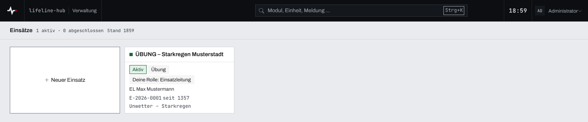
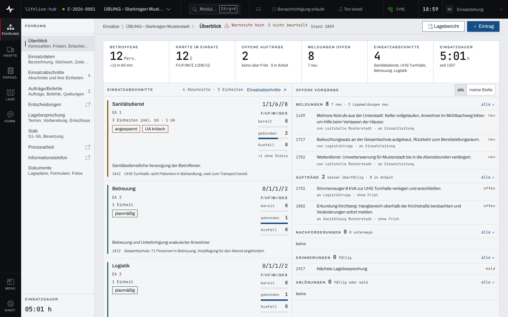
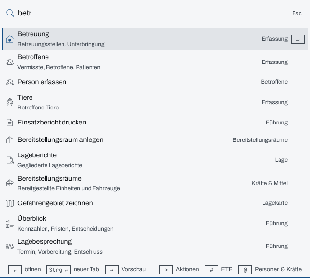
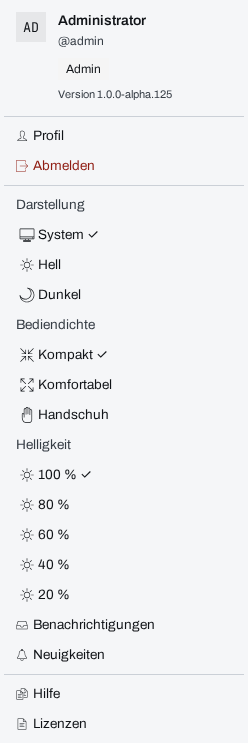

## Überblick

Nach der Anmeldung zeigt Lifeline Hub die **Einsatzliste**. Von dort öffnet jede Person die
Einsätze, in denen sie mitarbeitet. Im Einsatz gliedert sich die Oberfläche in die
**Kopfzeile** oben, die **Kategorien** am linken Rand, die **Module** der gewählten Kategorie
daneben und die Seite des Moduls. Die **Sprungpalette** erreicht jedes Modul, jeden Einsatz und
viele Datensätze über die Tastatur.

Wie die App aussieht, stellt jedes Gerät selbst ein: Darstellung (hell oder dunkel),
Bediendichte (kompakt, komfortabel, Handschuh) und Helligkeit. Das Kapitel richtet sich an alle,
die Lifeline Hub bedienen.

## Abläufe

### Einen Einsatz öffnen

1. Die Einsatzliste öffnen: Sie erscheint nach der Anmeldung, sonst führt „lifeline-hub“ links
   oben in der Kopfzeile dorthin.
2. Die Kachel des Einsatzes wählen. Sie nennt Status, Einsatzart, die eigene Rolle („Deine
   Rolle: …“), den Einsatzleiter („EL …“, sonst „EL nicht erfasst“) und, soweit erfasst, Ort,
   Einsatznummer, Beginn („seit …“) und Stichwort.

   

„Deine Rolle: Einsatzleitung“ nennt nur die eigenen Rechte im Einsatz. Wer den Einsatz führt,
steht unter „EL“; festgelegt wird er bei der Führungsstelle (siehe
[Einsatzdaten und Führungsstelle](einsatzdaten.md)).

Ab acht laufenden Einsätzen steht über den Kacheln das Suchfeld „Einsätze durchsuchen“; es
sucht in Bezeichnung, Ort und Stichwort. Abgeschlossene Einsätze stehen kleiner darunter unter
„Abgeschlossen“.

Legt jemand anderes einen Einsatz an, während der Zeiger über den Kacheln steht oder eine Kachel
den Fokus hat, rückt keine Kachel. Unter den Kacheln steht dann „1 neuer Einsatz“; „anzeigen“
holt ihn in die Liste. Sonst ordnet er sich ein, sobald Zeiger und Fokus die Kacheln verlassen.

### Einen Einsatz anlegen

Für System-Admins und Führungskräfte der Organisation:

1. In der Einsatzliste „Neuer Einsatz“ wählen.
2. Im Dialog „Neuen Einsatz anlegen“ die „Bezeichnung“ eintragen, dazu „Stichwort“,
   „Einsatzart“ und „Alarmzeit“. Die Alarmzeit ist mit dem jetzigen Zeitpunkt vorbelegt.
3. Wenn bekannt, den „Einsatzort“ eintippen und mit Enter oder „Ort suchen“ suchen, dann einen
   der Treffer wählen. Ein kleiner Kartenausschnitt zeigt den gewählten Ort; die Nadel lässt sich
   ziehen. Darunter steht dann der Ortsname der neuen Stelle, und „Als Adresse übernehmen“ setzt
   ihn als Einsatzort. Kann der Browser keine Karte zeichnen, steht dort „Karte auf diesem Gerät nicht
   darstellbar“, und der Ort wird trotzdem übernommen. Freier Text ohne Suche geht auch; den Punkt
   dazu setzt „Auf Karte wählen“, oder er wird später in den Einsatzdaten nachgetragen. Eine
   getippte Koordinate gilt gleich als Punkt.
4. Nach Bedarf unter den Feldern bei „Module:“ statt „Alle Module“ eine Einsatz-Vorlage wählen,
   etwa „MANV“. Ist das Stichwort mit einer Vorlage gekoppelt, steht sie dort schon. Gibt die
   Vorlage eine Einsatzart vor, steht sie unter „Einsatzart“, solange diese nicht von Hand
   geändert wurde.
5. „Anlegen“ wählen. Die App öffnet den neuen Einsatz.

Eine Einsatz-Vorlage blendet die Module aus, die sie nicht zeigt; im neuen Einsatz fehlen sie in
der Navigation. Eine von Hand gewählte Vorlage bleibt stehen, auch wenn danach ein gekoppeltes
Stichwort gewählt wird. Ohne Vorlage der Organisation steht keine Auswahl da. Die Vorlagen pflegt
die Verwaltung (Kapitel [Stammdaten](stammdaten.md)); im Einsatz lassen sich die Module unter
„Einstellungen“ wieder einschalten (Kapitel
[Einstellungen des Einsatzes und Module](einsatz-einstellungen.md)).

### Zwischen Einsätzen wechseln

1. In der Kopfzeile auf den Namen des Einsatzes tippen. Das Menü listet die laufenden Einsätze
   mit Einsatznummer und Ort.
2. Einen anderen Einsatz wählen, oder „Alle Einsätze …“ für die Einsatzliste.

### Ein Modul öffnen

1. Links eine Kategorie wählen: „Führung“, „Kräfte“, „Erfass.“ (Erfassung), „Lage“, „Komm.“
   (Kommunikation) oder unten „Einst.“ (Einstellungen). Die App springt in das erste Modul der
   Kategorie und zeigt daneben ihre Module.

   

2. In der Modulliste das Modul wählen. Die Zahl neben einem Modul zählt dessen Inhalt, etwa
   Einträge im Einsatztagebuch, offene Aufträge oder ungelesene Nachrichten im Chat.
3. Die Modulliste einklappen: unten in der Kategorienleiste „Menü“ wählen, oder ein zweites
   Mal auf die offene Kategorie tippen. „Menü“ klappt sie wieder aus.

Auf schmalen Schirmen (Tablet hochkant, Telefon) stehen Kategorien und Module hinter
„Navigation öffnen“ links oben.

### Mit der Sprungpalette springen

1. **Strg+K** drücken (am Mac **⌘K**) oder in der Kopfzeile „Suchen“ wählen.
2. Einige Buchstaben tippen, etwa den Namen eines Moduls, eines Fahrzeugs oder einer Person.

   

3. Mit den Pfeiltasten einen Treffer wählen und mit **↵** öffnen; **Strg+↵** (am Mac **⌘↵**)
   öffnet ihn in einem neuen Tab. **→** am Ende der Eingabe zeigt eine Vorschau, **Esc**
   schließt die Palette.

Ein Zeichen am Anfang der Eingabe grenzt die Suche ein: **>** nur Aktionen, **#** nur das
Einsatztagebuch (`#42` findet Eintrag 42), **@** nur Personen und Kräfte. Auf einem Gerät mit
Touch stehen diese Filter als Knöpfe am unteren Rand der Palette.

### Darstellung, Bediendichte und Helligkeit einstellen

1. Oben rechts das „Benutzermenü“ öffnen.
2. Unter „Darstellung“ „System“, „Hell“ oder „Dunkel“ wählen.
3. Unter „Bediendichte“ „Kompakt“, „Komfortabel“ oder „Handschuh“ wählen.
4. Unter „Helligkeit“ eine Stufe von „100 %“ bis „20 %“ wählen.

   

Die gewählte Stufe trägt ein Häkchen. Dieselben Einstellungen stehen in der Sprungpalette
(„Darstellung: …“, „Dichte: …“, „Helligkeit: …“).

### Eine Zeit eintragen

1. Ins Zeitfeld klicken. Der bisherige Wert ist markiert, Tippen ersetzt ihn.
2. Die Zeit tippen, etwa „1430“ für heute 14:30 oder „101430okt26“ für den 10. Oktober 2026,
   14:30. Neben dem Feld steht, wie die Eingabe gelesen wird („= 171430okt26“).
3. Mit Enter übernehmen. In einem Formular sendet derselbe Tastendruck das Formular ab.

Wer lieber wählt: „Kalender und Uhrzeit“ neben dem Feld öffnen, einen Tag wählen, unter
„Uhrzeit“ die Uhrzeit eintragen und „Übernehmen“. Dort stehen auch die Schnellwahlen, etwa
„jetzt“ und „−5 min“ oder „+30 min“. Escape verwirft eine angefangene Eingabe.

### Auf eine Benachrichtigung reagieren

1. Die Meldung lesen: Ein Alarm steht als Toast oben rechts, ein Eingang im Eingangsband unten.
   Oben steht die Art, etwa „Auftrag überfällig“ oder „Neuer Auftrag“, darunter, wo vorhanden,
   die Kennung, etwa „Auftrag #12“.
2. „Öffnen“ wählen, um zum Gegenstand zu springen, oder mit ✕ schließen. Stehen im Eingangsband
   mehrere Eingänge, führt der Knopf in das Modul, etwa „Zu Aufträgen“; kommen sie aus mehreren
   Modulen, öffnet „Ansehen“ die Liste der Eingänge.

„Öffnen“, ein Sprung und ✕ quittieren die Benachrichtigung: Sie verschwindet auch in anderen
Tabs und auf anderen Geräten derselben Person. „Ansehen“ quittiert nichts.

### Eingänge nachlesen

1. In der Kopfzeile „Eingänge“ wählen (das Zeichen des Posteingangs; die Zahl darüber nennt die
   ungelesenen). Auf dem Handy und auf dem Tablet mit Finger trägt die Alarmzentrale die Zahl:
   sie öffnen und „Eingänge, … ungelesen“ wählen.
2. Unter „Neu“ stehen die ungelesenen Eingänge, unter „Früher“ die gelesenen, jeweils mit der
   Uhrzeit, der Art und der Kennung.
3. Einen Eintrag wählen: Die App springt zum Gegenstand, der Eintrag gilt als gelesen.
4. Oder „Alle gelesen“ wählen: Alle Eingänge des Einsatzes gelten als gelesen, auf allen Geräten
   der Person. Alarme bleiben, bis jemand sie selbst öffnet oder schließt.

Steht nach „Alle gelesen“ „Nicht gespeichert, bitte noch einmal.“, hat der Server die Änderung
nicht angenommen. Ohne Netz zeigt „Eingänge“ den Stand der letzten Verbindung („Stand HH:MM ·
offline“), auch nach einem Neuladen; „Alle gelesen“ merkt die App dann vor („Offline vorgemerkt“),
die Zahl verschwindet sofort, und die Markierung geht hinaus, sobald wieder Netz da ist. Was bis
dahin neu eingeht, bleibt ungelesen. Einen einzelnen Eintrag ohne Netz zu öffnen, markiert ihn
nicht als gelesen.

### Benachrichtigungen einstellen

1. Oben rechts das „Benutzermenü“ öffnen und „Benachrichtigungen“ wählen.
2. Unter „Hinweise“ den Schalter einer Art ausschalten, deren Hinweise nicht mehr erscheinen
   sollen, oder einschalten, um sie wieder zu bekommen. Die Änderung gilt sofort.

Unter „Alarme“ stehen die Arten, die sich nicht abschalten lassen, mit „immer an“. Steht an einer
Zeile „nicht gespeichert“, hat der Server die Änderung nicht angenommen; der Schalter steht wieder
wie vorher.

„Testbenachrichtigung“ unter „Test“ zeigt sofort eine Meldung des Betriebssystems und spielt den
kurzen Ton (nicht bei „Ton stumm“), auch wenn der Tab vorn ist; hat der Browser noch nicht nach der
Erlaubnis gefragt, fragt er zuerst. Daneben erscheint „gesendet“ oder, warum keine Meldung kam,
„blockiert“ (im Browser verweigert), „nicht verfügbar“ (das Gerät kann keine zeigen) oder „aus“
(die Frage blieb ohne Antwort).

### Benachrichtigungen bei geschlossener App

Damit Benachrichtigungen auch ankommen, wenn kein Tab der App offen ist, etwa auf dem Handy in
der Tasche:

1. Oben rechts das „Benutzermenü“ öffnen und „Benachrichtigungen“ wählen.
2. Unter „Dieses Gerät“ den Schalter „Auch bei geschlossener App“ einschalten.
3. Fragt der Browser, ob die Seite Benachrichtigungen zeigen darf, „Erlauben“ wählen.

Der Schalter gilt für diesen Browser auf diesem Gerät, nicht für die Person; auf jedem Gerät, das
melden soll, einmal einschalten. Nach dem Abmelden kommen keine Meldungen mehr; meldet sich
dieselbe Person wieder an, gilt der Schalter wieder, ohne dass sie ihn neu setzt.

Fehlt der Schalter, bietet ihn dieses Gerät nicht: Der Betrieb hat die Zustellung nicht
eingeschaltet, der Browser kann sie nicht, oder die App läuft als Desktop-App, die ohnehin selbst
meldet. Auf dem iPhone und iPad erscheint er nur in der installierten App („Zum Home-Bildschirm“
in Safari), nicht im Browser-Tab. Steht „Vom Browser blockiert“ daneben, hat der Browser die
Erlaubnis verweigert; sie lässt sich nur in den Einstellungen des Browsers für diese Seite wieder
geben.

## Hintergrund

### Die Kopfzeile

Von links nach rechts:

- **Statuspunkt, Einsatznummer und Name** des offenen Einsatzes; über den Namen geht der Wechsel
  in einen anderen Einsatz.
- **Suchen** öffnet die Sprungpalette.
- **Eingänge**: der Verlauf der eigenen Benachrichtigungen dieses Einsatzes; die Zahl darüber
  nennt die ungelesenen Eingänge (siehe „Eingänge nachlesen“).
- **Alarmzentrale**: „Benachrichtigung …“ zeigt, ob der Browser Benachrichtigungen zeigen darf,
  „Ton …“, ob Alarmtöne zu hören sind. „Ton stumm“ und „Ton blockiert“ stehen auffällig da: Eine
  Sofortmeldung oder eine fällige Erinnerung bliebe dann ohne Ton. Stummschalten gilt für alle
  Töne auf diesem Gerät, in jedem Einsatz, auch für den Ton bei neuen Meldungen.
- **Verbindung**: „SYNC“ heißt, die Live-Verbindung steht. „VERBINDE“, „GETRENNT“, „OFFLINE“,
  „WARTET“ (vorgemerkte Einträge) und „PRÜFEN“ (abgelehnte Einträge) melden eine Störung; was
  dann gilt, steht in [Arbeiten ohne Netz](ohne-netz.md).
- **Uhr**: die Uhrzeit des Geräts.
- **Benutzermenü** mit Name, Funktion im Einsatz, Profil, Abmelden, den Einstellungen des Geräts,
  den Benachrichtigungen und der Hilfe.

Auf schmalen Schirmen zeigt die Kopfzeile Ruhezustände nur als Zeichen; jede Störung behält ihr
Wort. Auf dem Handy und auf dem Tablet mit Finger stehen Alarmzentrale und Eingänge in einem
Knopf. Außerhalb eines Einsatzes führt „Verwaltung“ in die Verwaltung der Organisation. Wer dort
keine Rechte hat, sieht den Eintrag mit Schloss und „Keine Berechtigung“.

Über der Kopfzeile erscheint bei Bedarf die **Betriebszeile**: bei Störungen der Verbindung, bei
vorgemerkten oder abgelehnten Einträgen und mit „Neue Version verfügbar.“, wenn eine neue
Fassung der App bereitliegt. „Jetzt neu laden“ lädt sie.

### Hinweise auf der Einsatzliste

Zwei Hinweise erreichen eine Person auch dann, wenn sie keinen Einsatz geöffnet hat:

- **„Aufgenommen in …“** mit dem Namen des Einsatzes geht an die Person, die die
  Einsatzleitung in einen Einsatz aufnimmt. Ein Wechsel der Rolle oder der Funktion bei einem
  bestehenden Mitglied ist keine Aufnahme und bleibt still; wer entfernt und wieder aufgenommen
  wird, erhält den Hinweis erneut.
- **„Neuer Einsatz“** mit dem Namen des Einsatzes geht beim Anlegen an die Führungskräfte und
  System-Admins der Organisation, die ihn lesen dürfen. Wer ihn nicht lesen darf, etwa ein
  Konto ohne Rolle in der Organisation, erfährt von ihm nichts.

Beide Hinweise führen in den Einsatz. Eigene Aktionen bleiben still: Wer den Einsatz anlegt,
bekommt keinen Hinweis dazu. Auch das Einspielen der Demo-Daten meldet nichts.

### Was ein Einsatz zeigt

Ein Einsatz öffnet mit dem „Überblick“, es sei denn, die Einsatzleitung hat in den Einstellungen
des Einsatzes ein anderes „Einstiegsmodul“ festgelegt. Welche Module erscheinen, legt der
Einsatz fest: Ein ausgeblendetes Modul fehlt in der Liste, ein gesperrtes steht mit „Keine
Berechtigung“ da. Was die eigene Rolle im Einsatz erlaubt, steht in
[Rechte im Einsatz](rechte-im-einsatz.md).

Unten in der Modulliste läuft die **Einsatzdauer** seit Beginn des Einsatzes.

Einige Einträge der Modulliste sind **Sprungmarken** in ein anderes Modul: „Entscheidungen“
(Einsatztagebuch, nur Entscheidungen), „Patienten“ und „Vermisste“ (Betroffene), „FMS-Tableau“
(Fahrzeuge), unter „Stab“ dessen Arbeitsseiten „Pressearbeit“ und „Informationstelefon“ sowie
unter „Fernmeldewesen“ (Kategorie „Kommunikation“) „Fernmeldeskizze“ und „Kommunikationsplan“.
Eine Sprungmarke ist gesperrt oder fehlt, wenn ihr Zielmodul gesperrt ist oder fehlt.

Wer aus einem Einsatz ins Profil oder in die Verwaltung wechselt, findet dort „Zurück zu …“: Es
führt an die zuletzt geöffnete Stelle des Einsatzes zurück, solange er läuft.

### Was die Sprungpalette kennt

Ohne Eingabe stehen oben die zuletzt ausgeführten Befehle und die zuletzt geöffneten Module.
Mit Eingabe sucht die Palette in Modulen, Ansichten (den Sprungmarken der Modulliste, etwa
„Kommunikationsplan“ oder „Vermisste“), Schnellaktionen („Person erfassen“, „ETB-Eintrag schreiben“,
„Anruf erfassen“ …), laufenden Einsätzen, Einstellungen und, ab zwei Zeichen, in den Datensätzen des
Einsatzes: Personen, Fahrzeuge, Personal, Einheiten, Einträge des Einsatztagebuchs und weitere.
Module und Ansichten, die der Einsatz nicht freigibt, fehlen; Schnellaktionen stehen nur dort, wo die eigene
Rolle schreiben darf.

„Koordinaten: …“ in der Palette stellt das Koordinatenformat für dieses Gerät ein. Es gilt vor
der Vorgabe des Einsatzes und der Organisation, bis eine andere Wahl getroffen wird.
„Zeitdarstellung: …“ wählt ebenso für dieses Gerät, ob Zeiten taktisch („101430okt26“) oder als
Datum und Uhrzeit („10.10.26 14:30“) stehen; „Zeitdarstellung: Vorgabe des Einsatzes“ stellt
zurück. Ausdrucke folgen immer der Vorgabe (siehe [Profil und Sicherheit](profil-sicherheit.md)).

### Benachrichtigungen

Eine Benachrichtigung geht an die Personen, die sie betrifft, nicht an alle im Einsatz. Sie hat
eine von drei Stufen:

- **Alarm** („Sofortmeldung“, „Sofortmeldung unbestätigt“, „Auftrag überfällig“, „Ablösung
  fällig“, „Vermisstenmeldung“, „Unwetterwarnung“): Toast oben rechts in Warnfarbe und Alarmton.
  Alarme lassen sich nicht abschalten.
- **Eingang** (unter „Benachrichtigungen“ als „Hinweise“): Eingangsband unten und ein kurzer,
  tieferer Ton, höchstens alle zwei Minuten. Jede Art lässt sich unter „Benachrichtigungen“
  abschalten.
- **Still**: Was eine abgeschaltete Art meldet, steht nur unter „Eingänge“ bei „Früher“, ohne
  Band, Ton und Zahl. In den Zählern und Listen der Module bleibt es sichtbar.

Die Schalter gehören zur **Person**, nicht zum Gerät: Sie gelten auf jedem Gerät, an dem sie sich
anmeldet. Stummschalten in der Alarmzentrale gehört dagegen zum Gerät und gilt für alle Töne.

Toasts tragen nur Alarme (dazu, außerhalb eines Einsatzes, „Neuer
Einsatz“ und „Aufnahme in einen Einsatz“). Sie bleiben stehen, bis sie geöffnet oder geschlossen
werden. Höchstens drei stehen einzeln da; ab dem vierten fasst ein Sammeltoast die älteren
zusammen. Er nennt ihre Zahl, bei mehreren Arten je Art eine Zeile wie „2 × Auftrag überfällig“,
und je Bereich einen Sprung, etwa „Zu Aufträgen“ oder „Zu Meldungen“. Ein Sprung schließt alle
Toasts und quittiert sie, ebenso ✕ am Sammeltoast. Das Eingangsband nimmt den Toasts keinen
Platz und liegt nie über ihnen.

Ist der Tab verdeckt und darf der Browser Benachrichtigungen zeigen („Benachrichtigung erlaubt“
in der Kopfzeile), erscheint zusätzlich eine Meldung des Betriebssystems. Sie schließt, sobald der
Tab wieder vorn ist; dann trägt der Toast.

Geht eine Benachrichtigung unterwegs verloren, etwa während einer Störung der Verbindung oder
eines Neustarts des Servers, holt die App sie nach, sobald die Verbindung wieder steht. Ebenso
beim Öffnen eines Einsatzes: Was in den letzten zwölf Stunden kam und noch nicht quittiert ist,
erscheint mit der Uhrzeit, zu der es kam. Für alle nachgeholten zusammen klingt höchstens einmal
der kurze Ton. „Neuer Einsatz“ und „Aufnahme in einen Einsatz“ erscheinen auch außerhalb eines
Einsatzes, in der Einsatzliste, im Profil und in der Verwaltung; „Öffnen“ führt in den Einsatz.

Ist „Auch bei geschlossener App“ eingeschaltet, kommt eine Benachrichtigung auch ohne offenen
Tab als Meldung des Betriebssystems, Alarme wie Hinweise; abgeschaltete Hinweis-Arten bleiben aus.
Ein Tipp auf die Meldung öffnet die App beim Gegenstand. Ist ein Tab der App gerade vorn, zeigt er
den Toast, und die Meldung des Betriebssystems entfällt. Quittiert die Person an einem anderen
Gerät, geht die Meldung auf diesem Gerät nicht in jedem Fall von selbst weg; sie lässt sich dann
wegwischen. Ohne Verbindung zum Server, etwa ohne VPN, zeigt die Meldung nur „Alarm“ oder „Neue
Benachrichtigung“; den Inhalt zeigt die App nach dem Öffnen.

Alle Eingänge eines Einsatzes stehen im **Eingangsband** unten, auf dem Handy über die ganze
Breite, sonst rechts. Hat die Seite unten eine feste Leiste, etwa die Erfassung im
Einsatztagebuch oder „Entwurf speichern“ und „Freigeben“ am Befehl, steht das Band darüber und
deckt keinen ihrer Knöpfe ab. Es bündelt sie: „3 neue Meldungen“ oder, sind andere Eingänge dabei, „3 neue
Eingänge“, mit den beiden jüngsten und darunter „+ n weitere“; eine Meldung nennt Absender und
Wortlautanfang. Sein Ton klingt höchstens alle zwei Minuten, auch wenn in der Zeit zehn Eingänge
kommen. Wer gerade in ein Feld schreibt, behält den Fokus: Das Band erscheint erst, wenn das Feld
verlassen ist. Auf der Seite „Meldungen“ zeigt es keine Meldungen, denn dort stehen sie schon in
der Liste; eine Übernahme in die Lage bleibt ebenso auf „Lagemeldungen“ aus. Was eine Meldung
auslöst und wer sie bekommt, steht in [Meldungen](meldungen.md).

Solange im Einsatz ungelesene Eingänge offen sind, steht ihre Zahl vorn im Titel des Tabs, etwa
„(3) Lagekarte · …“, dieselbe wie über „Eingänge“. Ist die App installiert, trägt auch ihr Symbol
die Zahl, wo das Betriebssystem das zeigt. Gelesen ist ein Eingang für die Person, nicht für das
Gerät: Was sie am Telefon liest, zählt am Laptop nicht mehr. „Eingänge“ zeigt höchstens die jüngsten
200 Benachrichtigungen; ein ungelesener Eintrag bleibt 24 Stunden, ein gelesener 24 Stunden ab dem
Lesen.

Gekoppelte Geräte bekommen keine Benachrichtigungen.

### Einstellungen des Geräts

Darstellung, Bediendichte und Helligkeit gehören zum **Gerät**, nicht zur Person: Sie bleiben
nach dem Abmelden stehen und gelten für jede Person, die sich an diesem Gerät anmeldet.

- **Darstellung**: Vorgabe ist „Dunkel“ für den Nachtbetrieb. „System“ folgt der Einstellung des
  Betriebssystems. Kopfzeile und Kategorienleiste bleiben in jeder Darstellung dunkel.
- **Bediendichte**: „Kompakt“ ist für Maus und Tastatur am Laptop gedacht, „Komfortabel“ für die
  Bedienung mit dem Finger, „Handschuh“ für Handschuhe. Ohne eigene Wahl beginnt ein Gerät mit
  Touch als Hauptbedienung mit „Komfortabel“, jedes andere mit „Kompakt“. „Handschuh“ gibt es nur
  auf Wahl.
- **Helligkeit** dunkelt die ganze Anzeige ab, für den abgedunkelten Führungsraum bei Nacht. Den
  Bildschirm selbst macht sie nicht heller als 100 %.

### Zeitangaben

Alle Zeiten stehen in der Schreibweise, die Einsatz und Organisation vorgeben; Vorgabe ist
taktisch. Am Gerät lässt sie sich mit „Zeitdarstellung: …“ übersteuern.

- **Taktisch**: ein Zeitpunkt als Datum-Zeit-Gruppe („101430okt26“). In Listen, Zeitachsen und
  Kennzahlen steht heute nur die Uhrzeit („1430“), an anderen Tagen Tag und Uhrzeit („091430“).
  Ein Tag allein steht als „10okt26“.
- **Datum und Uhrzeit**: „10.10.26 14:30“, in Listen „14:30“ bzw. „09.10. 14:30“, ein Tag allein
  „10.10.26“.

Im Einsatztagebuch nennt der Kopf einer Stundengruppe den Beginn der Stunde („1400“, am Vortag
„091400“). Ausdrucke (Einsatztagebuch, Listen, Einsatzbericht) folgen immer Einsatz und
Organisation, nie der Wahl am Gerät; die Zeitspalte des gedruckten Einsatztagebuchs trägt die volle
Datum-Zeit-Gruppe. Die Platzhalter „{uhrzeit}“ und „{datum}“ in Textbausteinen setzen „1430“ und
„10okt26“ bzw. „14:30“ und „10.10.26“ ein.

Die Uhr in der Kopfzeile bleibt eine Wanduhr in der Zeit des Geräts („14:30“); auch der
Datenstand („Stand 1430“) zählt in der Zeit des Geräts. Texte, die der Server selbst schreibt (etwa
automatische Einträge im Einsatztagebuch beim Eintreffen einer Einheit oder zu einer
Verpflegung), nennen Zeiten noch als „30.09. 06:40“.

### Wie Zeitfelder Zeiten lesen

Ein Zeitfeld zeigt seinen Wert als Datum-Zeit-Gruppe: Tag, Stunde und Minute zweistellig, dazu
Monat und Jahr („171430okt26“). Gelesen werden:

- **Uhrzeit allein** („1430“, „14:30“, „630“): heute.
- **Tag und Uhrzeit** („171430“): im laufenden Monat.
- **Datum-Zeit-Gruppe** mit Monat, mit oder ohne Jahr („171430okt26“, „171430OKT2026“), Monat mit
  oder ohne Umlaut („mrz“, „mär“).
- **Datum mit Punkten** („17.10.26 1430“, „17.10.2026 14:30“) und ISO („2026-10-17 14:30“).
- **Relativ zu jetzt**: „j“ oder „jetzt“, „-5“ (vor fünf Minuten), „-1h“, „+30“, „+2h“.

Felder für **Ereignisse** (Eingang, Ereigniszeit, Alarmzeit) legen eine Uhrzeit, die heute noch
bevorsteht, auf gestern: „2350“ kurz nach Mitternacht ist der Vorabend. Felder für **Fristen**
(Wiedervorlage, Termin, Frist) legen eine Uhrzeit, die heute vorbei ist, auf morgen. Das Feld
nennt dann „gestern“ oder „morgen“. Beim Ende eines Zeitraums gilt eine Uhrzeit am Tag des
Beginns, und liegt sie davor, am Folgetag („2200“ bis „0600“ geht über Mitternacht).

Eine Eingabe, die sich nicht lesen lässt, wird nicht übernommen; das Feld nennt den Grund („Uhrzeit
gibt es nicht“). Wer das Feld trotzdem verlässt, behält den bisherigen Wert. „Jetzt“ und die
Schnellwahlen rechnen mit der Uhr des Servers, nicht mit der des Geräts. Zeiten gelten in der
Zeitzone des Einsatzes; weicht das Gerät davon ab, steht die Zone am Feld.

### Helligkeit bei einer Warnung

Solange im offenen Einsatz eine Warnung aktiv ist, wirkt die Helligkeit mit **mindestens
80 %**, damit Warnungen lesbar bleiben. Das Menü zeigt dann „Helligkeit · mind. 80 % (Warnung
aktiv)“; die dunkleren Stufen sind gesperrt. Als Warnung zählen:

- ein Gefahrengebiet mit der Warnstufe „hoch“ oder „akut“,
- eine Meldung, deren Bestätigung überfällig ist,
- eine jetzt geltende Unwetterwarnung des Deutschen Wetterdienstes für den Einsatzort
  („Unwetterwarnung“ oder „Extremes Unwetter“).

Die eigene Wahl bleibt dabei erhalten: Endet die Warnung oder verlässt man den Einsatz, gilt sie
wieder.

## Grundlagen und Quellen

- FwDV/DV 810 „Sprech- und Datenfunkverkehr“ (Ausgabe 2018): Zeitangaben als Tag des Monats und
  Uhrzeitgruppe, bei Bedarf mit Monat und Jahr („271938jan19“). Nach dieser Schreibweise zeigen
  die Zeitfelder ihren Wert.
