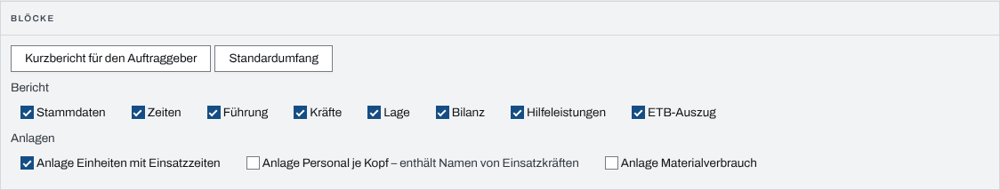
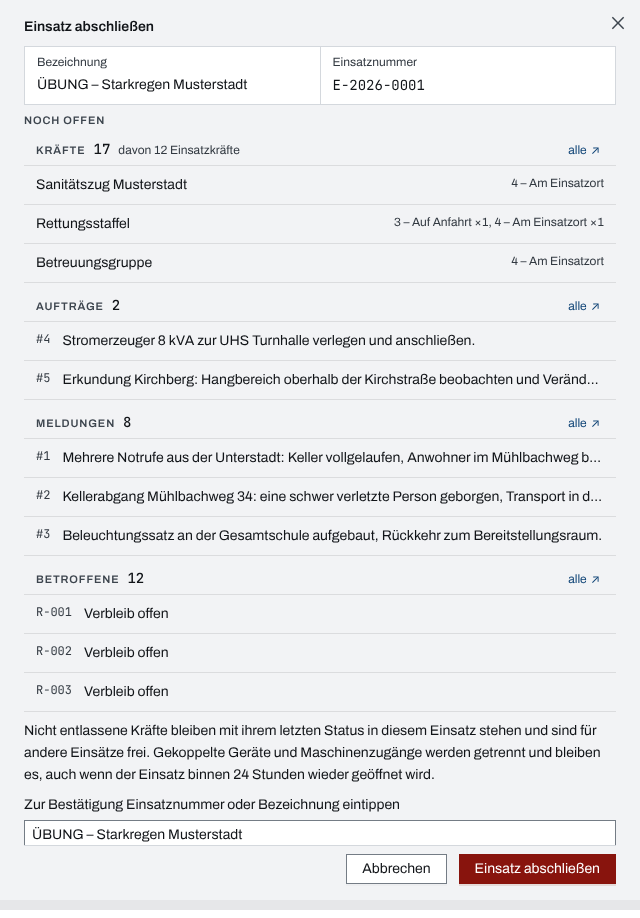
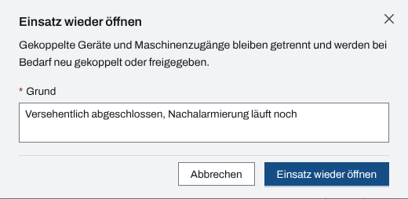

## Überblick

Ist ein Einsatz vorbei, schließt die Einsatzleitung ihn in den Einsatzdaten ab. Vorher nennt ein
Dialog, was noch offen ist, und verlangt die Einsatznummer oder die Bezeichnung des Einsatzes.
Danach ist er schreibgeschützt: niemand legt mehr Einträge an oder berichtigt sie. War es der
falsche Einsatz oder zu früh, öffnen Einsatzleitung und System-Admins der Organisation ihn binnen
24 Stunden mit Grund wieder. Der Einsatzbericht fasst den Einsatz zum Drucken oder als PDF
zusammen, aus Stammdaten, Zeiten, Führung, Kräften, Lage, Bilanz, Hilfeleistungen und einem
Auszug des Einsatztagebuchs. Er lässt sich jederzeit erzeugen, auch während der Einsatz noch
läuft. Für den Auftraggeber eines Sanitätsdienstes gibt es einen Kurzbericht ohne
Einsatztagebuch und ohne Anlagen.

## Abläufe

### Einsatzbericht drucken

1. Im Einsatz „Einsatzdaten“ öffnen und oben „Einsatzbericht drucken“ wählen (am Handy unter
   „Weitere“). Die Seite
   „Einsatzbericht – Druckansicht“ öffnet sich.
2. Unter „Blöcke“ abwählen, was nicht in den Bericht soll, und bei Bedarf eine der Anlagen
   dazunehmen.

   

3. „Drucken / als PDF“ wählen und im Druckdialog des Browsers drucken oder als PDF speichern.

„Standardumfang“ stellt die Auswahl auf alle Blöcke des Berichts ohne Anlagen zurück. „Neu laden“
holt den aktuellen Stand, „Zurück zu den Einsatzdaten“ verlässt die Druckansicht.

### Kurzbericht für den Auftraggeber

1. Die Druckansicht wie oben öffnen.
2. Unter „Blöcke“ „Kurzbericht für den Auftraggeber“ wählen. Gewählt sind dann „Stammdaten“,
   „Zeiten“, „Kräfte“ und „Hilfeleistungen“, der Kopf nennt als Umfang „Kurzbericht für den
   Auftraggeber“.
3. Bei Bedarf eine Anlage dazunehmen, etwa „Anlage Materialverbrauch“. Der Kopf nennt dann die
   gewählten Blöcke als „Auswahl“.
4. „Drucken / als PDF“ wählen.

### Einsatz abschließen

Für die Einsatzleitung:

1. Im Einsatz „Einsatzdaten“ öffnen.
2. Ganz unten im Paneel „Einsatzabschluss“ „Einsatz abschließen…“ wählen. Der Dialog „Einsatz
   abschließen“ nennt Bezeichnung und Einsatznummer in voller Länge.
3. Unter „Noch offen“ prüfen, was noch offen ist: nicht entlassene Kräfte mit ihrem Status,
   offene Aufträge und Meldungen, laufende Nachforderungen sowie vermisste Betroffene und solche,
   deren Verbleib offen oder unterwegs ist. Je Gruppe stehen die Zahl und bis zu drei Einträge;
   „alle ↗“ springt in das Modul, der Einsatz bleibt dabei aktiv. Steht „Nichts offen“, ist
   alles erledigt.
4. In „Zur Bestätigung Einsatznummer oder Bezeichnung eintippen“ die interne Einsatznummer oder
   die Bezeichnung eintippen. Groß- und Kleinschreibung spielen keine Rolle.

   

5. „Einsatz abschließen“ wählen. Der Knopf ist erst aktiv, wenn die Eingabe passt.

Die App meldet „Einsatz abgeschlossen“. Am besten den Einsatzbericht vor dem Abschluss einmal
durchsehen.

### Einsatz wieder öffnen

Für die Einsatzleitung und System-Admins der Organisation des Einsatzes, binnen 24 Stunden nach
dem Abschluss:

1. Die „Einsatzdaten“ des abgeschlossenen Einsatzes öffnen. Das Paneel „Einsatzabschluss“ nennt
   „Abgeschlossen am … von …“ und daneben, bis wann der Einsatz wieder zu öffnen ist.
2. „Einsatz wieder öffnen…“ wählen.
3. Unter „Grund“ eintragen, warum der Einsatz wieder geöffnet wird.

   

4. „Einsatz wieder öffnen“ wählen.

Die App meldet „Einsatz wieder geöffnet“. Der Einsatz ist wieder aktiv und beschreibbar.

## Hintergrund

### Was der Abschluss bewirkt

- Der Einsatz ist eingefroren, auch für Einsatzleitung und System-Admins. Binnen 24 Stunden lässt
  er sich wieder öffnen (unten), danach nicht mehr.
- Das Einsatztagebuch erhält den Systemeintrag „Einsatz abgeschlossen“ mit der Person, die
  abgeschlossen hat.
- Offene Punkte warnen nur; der Abschluss geht auch mit offenen Aufträgen oder Betroffenen. Die
  Zahlen im Dialog zählen den ganzen Einsatz, auch Module, die für die eigene Person gesperrt sind;
  „alle ↗“ steht nur bei Modulen, die sie öffnen darf.
- Nicht entlassene Fahrzeuge, Einheiten und Einsatzkräfte bleiben mit ihrem letzten Status in
  diesem Einsatz stehen; der Abschluss entlässt sie nicht. Für andere Einsätze sind sie frei und
  lassen sich dort disponieren.
- Alle gekoppelten Geräte verlieren ihre Kopplung, und die Freigabe für Maschinenzugänge
  ([Anbindungen](anbindungen.md)) endet.
- Hat der Einsatz oder die Organisation eine Aufbewahrungs-Dauer und noch keine
  Aufbewahrungsfrist, setzt der Abschluss die Frist auf Abschluss plus Dauer. Das
  Einsatztagebuch hält das fest. Eine schon gesetzte Frist bleibt unverändert.
- Hat die Organisation Vorgaben je Datenkategorie, entstehen daraus die Fristen für
  Behandlung, Personenauskunft und Anhänge dieses Einsatzes.
- Hat die Organisation eine Nachbereitung in Tagen, setzt der Abschluss ihr Ende auf Abschluss
  plus Dauer. Das Einsatztagebuch hält das fest. Danach übergibt ein ELW, der mit einem Hub
  gekoppelt ist, den Einsatz dem Hub; ohne Kopplung bleibt er, wo er ist.

Nur Aufbewahrungsfrist und Nachbereitung lassen sich danach noch ändern; das Kapitel
[Aufbewahrung](aufbewahrung.md) beschreibt den Weg und die Folgen.

### Was das Wiederöffnen bewirkt

- Der Einsatz ist wieder aktiv; Abschlusszeitpunkt und abschließende Person sind geleert.
- Das Einsatztagebuch erhält einen Systemeintrag „Einsatz wieder geöffnet“ mit dem
  ursprünglichen Abschlusszeitpunkt, der Person, die abgeschlossen hatte, und dem Grund; Erfasser
  ist die Person, die wieder öffnet.
- Was der Abschluss selbst gesetzt hat, nimmt das Wiederöffnen zurück, je mit einem Eintrag im
  Einsatztagebuch: die Aufbewahrungsfrist, die Fristen je Datenkategorie samt ihrer Vormerkung
  und das Ende der Nachbereitung. Eine von Hand gesetzte Aufbewahrungsfrist oder Kategorie-Frist
  bleibt; eine von Hand geänderte Nachbereitung geht mit. Ein erneuter Abschluss setzt die
  Fristen ab dem neuen Zeitpunkt.
- Gekoppelte Geräte und Maschinenzugänge bleiben getrennt: Geräte werden neu gekoppelt, die
  Freigabe einer Anbindung neu erteilt.

### Wann sich ein Einsatz nicht wieder öffnen lässt

- 24 Stunden nach dem Abschluss: der Knopf fehlt dann.
- Wenn die Aufbewahrung schon greift: der Einsatz oder eine seiner Datenkategorien ist
  geschwärzt, ein Löschersuchen ist gestellt, der Einsatz ist archiviert, zur Verwahrung
  übergeben oder zum Abräumen vorgesehen. Der Dialog nennt dann den Grund.
- Ist der Einsatz zur Löschung vorgemerkt, liest ihn niemand mehr, und er lässt sich auch nicht
  wieder öffnen.
- Am Spiegel eines Einsatzes, den eine gekoppelte Installation führt: wieder öffnen kann nur die
  führende Installation, der Spiegel folgt mit dem nächsten Abgleich.

### Wer einen abgeschlossenen Einsatz noch liest

Mitglieder des Einsatzes lesen ihn noch 24 Stunden nach dem Abschluss. Danach lesen ihn nur noch
die Einsatzleitung, Führungskräfte der Organisation und System-Admins, bis die
Aufbewahrungsfrist abläuft. Danach liest ihn niemand mehr, auch den Einsatzbericht nicht: die
Druckansicht zeigt dann „Einsatzbericht nicht verfügbar“ mit „Kein Zugriff oder
Aufbewahrungsfrist abgelaufen“.

### Wer abschließen und drucken darf

- **Abschließen** darf nur die Einsatzleitung eines laufenden Einsatzes. Ein System-Admin ohne
  diese Rolle sieht das Paneel am laufenden Einsatz nicht.
- **Wieder öffnen** dürfen binnen 24 Stunden die Einsatzleitung und System-Admins der
  Organisation des Einsatzes, auch ohne Rolle im Einsatz. Führungspersonal, Beobachter,
  Führungskräfte der Organisation, gekoppelte Geräte und System-Admins anderer Organisationen
  dürfen es nicht; ihnen fehlt der Knopf. Wer den abgeschlossenen Einsatz liest, sieht im Paneel,
  wann und von wem er abgeschlossen wurde.
- **Drucken** darf jeder, der die Einsatzdaten liest, auch ein Beobachter. Jeder Block holt
  seine Daten mit den Rechten der Person, die druckt. Sperrt der Einsatz ein Modul für sie, steht
  am Block „– kein Zugriff: …“ mit dem Modul, und die Druckansicht zeigt „Einsatzbericht nicht
  verfügbar“, bis der Block abgewählt ist.
- Ein im Einsatz ausgeblendetes Modul erscheint im Bericht als „In diesem Einsatz nicht genutzt“.

### Wer im Bericht als Einsatzleitung steht

Der Block „Führung“ nennt unter „Einsatzleitung“ den Einsatzleiter mit „Seit“, wie er in
„Einsatzdaten“ festgelegt ist (siehe [Einsatzdaten und Führungsstelle](einsatzdaten.md)), sonst
„nicht erfasst“. Mitglieder mit der Rolle Einsatzleitung stehen dort nicht; die Rolle ist ein
Recht, keine Führungsfunktion.

Darunter nennt der Block unter „Führungsfunktionen“ für EL und S1 bis S6 die Mitglieder, die die
Funktion in ihrer Mitgliedschaft tragen, mehrere alphabetisch, sonst „nicht vergeben“; S7 steht
nur, wenn jemand es trägt. Gepflegt wird die Funktion im Reiter „Zugriff“ der Einstellungen (siehe
[Rechte im Einsatz](rechte-im-einsatz.md)).

### Was die Hilfeleistungen zählen

Der Block „Hilfeleistungen“ zählt Kontakte: jede erfasste Person außer den vermissten. Er nennt
sie nach Anlass, nach Stunde der Erfassung (in der Zeitzone der Organisation), nach Verbleib und
„Entlassen an“, dazu die Transporte nach Rettungsmittel und Ziel, die Ablehnungen gegen Rat und
die Kontakte je versorgender Einheit. Es sind nur Zahlen: kein Name, keine Registriernummer, kein
Fundort. Ein vorangemeldeter Transport zählt noch nicht als Transport. Eine Ablehnung gegen Rat
bleibt gezählt, wenn der Eigentransport danach übergeben wird. Das Ziel steht nur bei
Transporten im Bericht. Der Block braucht das Recht am Modul Betroffene, wie die Bilanz.

### Stand, Anlagen und Adresse

- Ein Bericht zu einem laufenden Einsatz trägt im Kopf „Vorläufig – Einsatz läuft“.
- Der Bericht ist ein Schnappschuss: Er zeigt den Stand beim Öffnen und ändert sich erst mit
  „Neu laden“.
- Die „Anlage Personal je Kopf“ „enthält Namen von Einsatzkräften“; vor der Weitergabe
  bedenken, wer den Ausdruck bekommt.
- Die „Anlage Materialverbrauch“ nennt je Verbrauchsgut die ausgegebene Menge, auch von Posten,
  die aus dem Einsatz genommen sind. Geräte stehen nicht darin. Sie braucht das Recht am Modul
  Material.
- Mindestens ein Block bleibt immer gewählt; der letzte lässt sich nicht abwählen.
- Die Auswahl steht in der Adresse der Seite. Ein Lesezeichen oder ein geteilter Link öffnet
  den Bericht mit denselben Blöcken.
