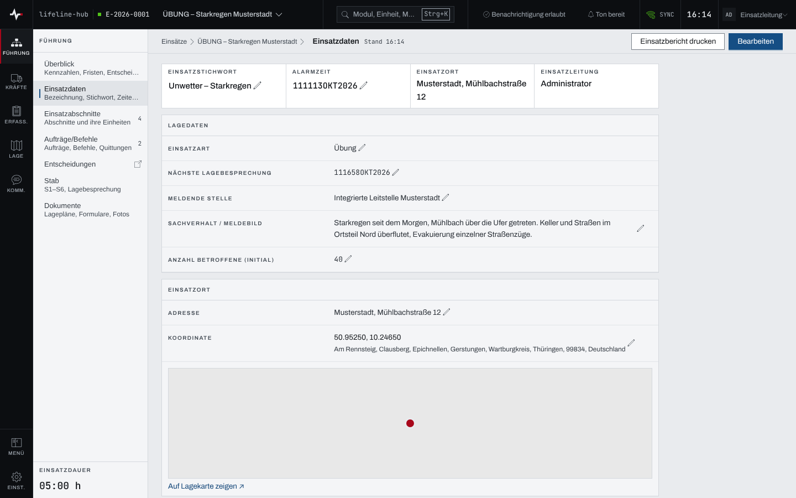
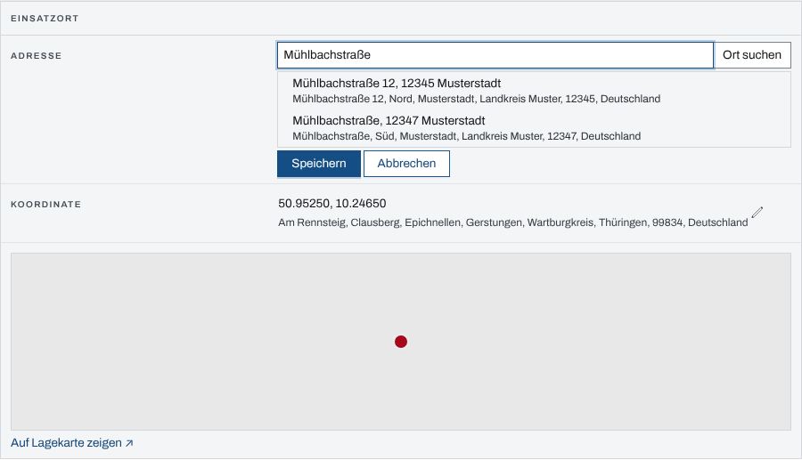
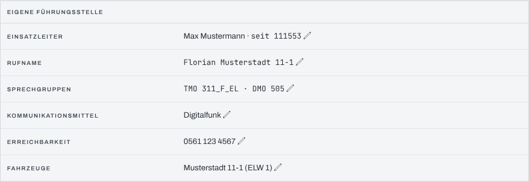

## Überblick

Die Seite „Einsatzdaten“ hält die Stammangaben des Einsatzes: die Kopfleiste mit Stichwort,
Alarmzeit, Einsatzort und Einsatzleitung, darunter die „Lagedaten“, den „Einsatzort“ mit Adresse,
Koordinate und Kartenausschnitt, die „Eigene Führungsstelle“ und den „Zugriff“ auf den Einsatz. Lesen können alle Mitglieder des Einsatzes. Ändern dürfen
Einsatzleitung und Führungspersonal sowie die Administration der Organisation, der der Einsatz
gehört. Den Zugriff verwaltet nur die Einsatzleitung.

## Abläufe

### Eine Angabe ändern

1. „Einsatzdaten“ öffnen.

   

2. Den Wert der Zeile wählen (Stift daneben) oder, wenn die Zeile leer ist, „… eintragen“.
3. Den neuen Wert eingeben.
4. Mit Enter oder „Speichern“ übernehmen. Escape oder „Abbrechen“ verwirft die Eingabe. Die App
   meldet „… gespeichert“.

So lassen sich Einsatzstichwort, Alarmzeit, Einsatzart, Nächste Lagebesprechung, Meldende
Stelle, Sachverhalt / Meldebild und Anzahl Betroffene (initial) ändern. Den Einsatzort ändert das
Paneel „Einsatzort“ (nächster Ablauf).

### Den Einsatzort suchen und verorten

1. Im Paneel „Einsatzort“ an der Zeile „Adresse“ den Wert wählen oder „Adresse eintragen“.
2. Die Adresse eintippen, etwa „Bahnhofstraße 1, Musterstadt“, und Enter drücken oder „Ort
   suchen“ wählen. Die Suche braucht mindestens drei Zeichen.
3. Aus der Liste „Treffer“ den passenden Ort wählen. Der Text des Treffers steht dann im Feld.

   

4. „Speichern“ wählen. Adresse und Koordinate werden zusammen gespeichert, der Kartenausschnitt
   zeigt den Ort mit einer Nadel.

Ein Ort ohne Adresse (Waldweg, Autobahn-Kilometer) wird als freier Text eingetragen und ohne
Suche gespeichert. Die Koordinate dazu trägt die Zeile „Koordinate“ ein, in jedem Format, das
„Koordinatenformat“ anbietet. „Auf Lagekarte zeigen“ öffnet die Lagekarte um den Einsatzort.

### Alle Angaben auf einmal bearbeiten

1. Im Seitenkopf „Bearbeiten“ wählen. Es öffnet sich „Einsatzdaten bearbeiten“.
2. Die Felder ändern. Nur hier lässt sich auch die „Bezeichnung“ ändern. Die Koordinate nimmt
   mehrere Formate an („Koordinatenformat“).
3. „Speichern“ wählen.

### Die eigene Führungsstelle erfassen

1. In „Einsatzdaten“ zum Paneel „Eigene Führungsstelle“ gehen.

   

2. „Rufname“, „Sprechgruppen“, „Kommunikationsmittel“, „Erreichbarkeit“ und „Fahrzeuge“ Zeile
   für Zeile eintragen und speichern wie jede andere Angabe.

### Ein Mitglied hinzufügen

Für die Einsatzleitung:

1. Im Paneel „Zugriff“ unter „Benutzer …“ die Person wählen.
2. Daneben die Rolle wählen (Vorgabe „Führungspersonal“).
3. „Hinzufügen“ wählen.

Die Rolle eines Mitglieds lässt sich in der Tabelle direkt ändern. „Entfernen“ fragt mit
„Mitglied entfernen?“ nach.

### Die Führungsstelle eines Mitglieds festlegen

Für die Einsatzleitung:

1. Im Paneel „Zugriff“ in der Spalte „Führungsstelle“ „Führungsstelle festlegen“ oder den
   bisherigen Wert wählen.
2. Im Dialog eine Funktion aus der Liste wählen oder einen Freitext eingeben.

   

3. „Speichern“ wählen.

## Hintergrund

### Wer was darf

- **Angaben und eigene Führungsstelle** ändern Einsatzleitung und Führungspersonal sowie die
  Administration der Organisation des Einsatzes, solange der Einsatz läuft. Wer das nicht darf,
  sieht den Hinweis „nur Einsatzleitung, Führungspersonal oder Org-Admin“.
- **Zugriff** (Mitglieder, Rollen, Führungsstelle je Mitglied) verwaltet nur die
  Einsatzleitung. Die letzte Einsatzleitung lässt sich weder herabstufen noch entfernen
  („Gesperrt: letzte Einsatzleitung“).
- Was die Rollen im Einzelnen bedeuten, steht in [Rechte im Einsatz](rechte-im-einsatz.md).

### Die Auswahl „Benutzer …“

Die Auswahl bietet jede aktive Person der Organisation des Einsatzes an, die noch nicht Mitglied
ist, mit ihrem Anzeigenamen. Die Einsatzleitung braucht dafür keine Rolle in der Administration.
Personen anderer Organisationen, deaktivierte Konten und gekoppelte Geräte stehen nicht darin.
Ist niemand mehr übrig, zeigt die Auswahl „Keine weitere Person der Organisation“. Wer
aufgenommen ist, verschwindet aus der Auswahl, wer entfernt wird, steht wieder darin.

### Was eine Änderung bewirkt

- Jede Zeile speichert nur ihren eigenen Wert, das Formular „Bearbeiten“ nur die geänderten
  Felder. Wer eine Zeile verlässt, ohne zu speichern, behält den alten Wert.
- Änderungen an Angaben und eigener Führungsstelle erscheinen sofort an allen anderen Geräten. Sie
  schreiben keinen Eintrag ins Einsatztagebuch.
- Die „Einsatznummer“ unter „Technische Angaben“ vergibt das System; sie lässt sich nicht ändern.
- Die **eigene Führungsstelle** speist Funkplan, Fernmeldeskizze und Kommunikationsplan (siehe
  [Funkplan, Fernmeldeskizze und Kommunikationsplan](funkplan.md)); dort wird sie nicht
  bearbeitet. „Fahrzeuge“ bietet nur disponierte Fahrzeuge an und nur, wenn das Modul Fahrzeuge
  freigegeben ist.
- Die **Führungsstelle eines Mitglieds** ist der erste Vorschlag, wenn das Einsatztagebuch die
  Person nach ihrem Rufnamen fragt, noch vor ihrem eigenen Sachgebiet im Stab.

### Adresse und Koordinate des Einsatzorts

- Ein gewählter Treffer speichert Adresse und Koordinate in einem Schritt. Wird danach der Text
  geändert, gilt er als freie Adresse: gespeichert wird nur der Text, die bisherige Koordinate
  bleibt. Unter der Koordinate steht der Ortsname, den die Koordinate ergibt; weicht er von der
  Adresse ab, passen beide nicht zusammen.
- Die Suche fragt den Geocoder der Organisation (ohne Einstellung den öffentlichen Nominatim)
  und bevorzugt Orte in der Umgebung des bisherigen Einsatzorts. Sie sucht erst auf Enter oder
  „Ort suchen“, nie beim Tippen. Für alle Nutzer zusammen geht höchstens eine Anfrage je Sekunde
  hinaus; ist die Suche gerade belegt, steht „Adresssuche ausgelastet“ am Feld, und „Erneut
  suchen“ versucht es wieder. „Adresssuche nicht erreichbar“ heißt, der Geocoder antwortet
  nicht.
- An den Geocoder gehen nur der Suchtext und ein grober Ausschnitt um den Einsatzort, keine
  weiteren Einsatzdaten.
- Die Suche braucht das Recht, die Einsatzdaten zu ändern, aber kein Recht auf die Lagekarte.
  „Auf Lagekarte zeigen“ steht nur, wenn der Einsatzort eine Koordinate hat und die Lagekarte
  freigegeben ist.
- Der Kartenausschnitt nimmt die Kartengrundlage nach der Vorgabe der Lagekarte: die
  Online-Karte, wenn eine eingerichtet ist (Kacheln kommen über den Kachelspeicher des Servers),
  sonst die installierten Offline-Karten, sonst eine Karte ohne Kacheln mit der Nadel. Ohne
  Koordinate steht dort „Nicht verortet“.

### Ohne Netz

Die Angaben des Einsatzkopfs bleiben ohne Netz lesbar, Zugriff und eigene Führungsstelle nicht
(siehe [Arbeiten ohne Netz](ohne-netz.md)). Die Adresssuche ist ohne Netz gesperrt („Adresssuche
ohne Netz nicht verfügbar“).
