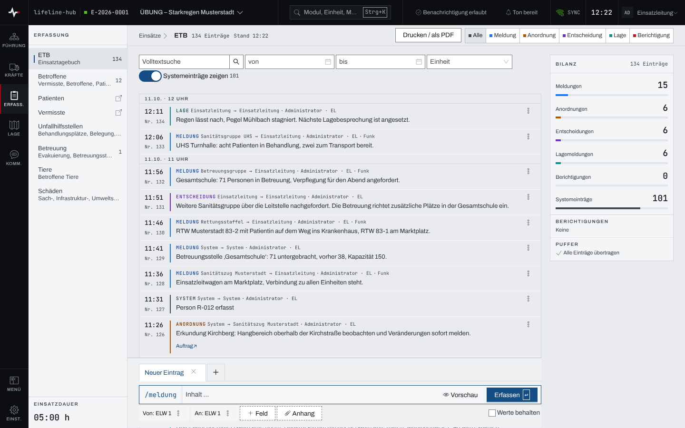
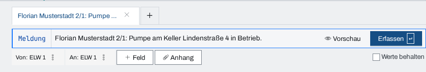
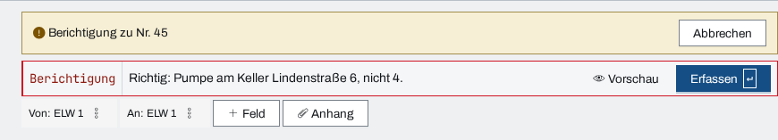
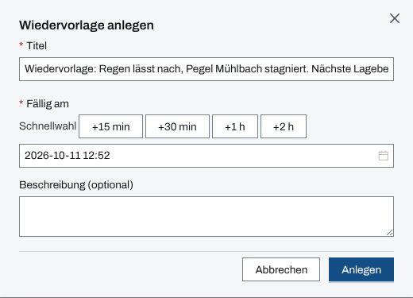

## Überblick

Das Einsatztagebuch (ETB) ist die fortlaufende Niederschrift des Einsatzes. Jeder Eintrag trägt
eine laufende Nummer, die Ereigniszeit, einen Typ („Meldung“, „Anordnung“, „Lage“ oder
„Entscheidung“), „Von“ und „An“ sowie den Inhalt. Die Zeitachse liest sich wie ein Funkprotokoll:
der älteste Eintrag steht oben, der neueste unten direkt über der Erfassungsleiste.

Ein erfasster Eintrag lässt sich weder ändern noch löschen. Ein Fehler wird mit einer
**Berichtigung** korrigiert: einem neuen Eintrag, der auf den alten verweist. Viele Einträge
entstehen von selbst, etwa aus Meldungen, Aufträgen, Befehlen und Nachforderungen oder als
Systemeintrag (Typ „System“), wenn sich Abschnitte, Einheiten oder Gefahren ändern.

Lesen dürfen alle mit Zugang zum Einsatz. Erfassen, Berichtigen und Wiedervorlagen anlegen dürfen
Einsatzleitung und Führungspersonal, solange der Einsatz läuft (siehe
[Rechte im Einsatz](rechte-im-einsatz.md)).

## Abläufe

### Das Tagebuch lesen

1. Im Einsatz das Modul „ETB“ öffnen.

   

2. Die Seite öffnet am Ende: der neueste Eintrag steht über der Erfassungsleiste. Nach oben
   rollen liest zurück; „Ältere laden“ über der Zeitachse holt frühere Einträge. Wer weiter als
   eine Bildschirmhöhe zurückgerollt ist, kommt rechts über der Erfassungsleiste mit „Nach oben“
   in einem Zug zum Anfang mit Filterleiste und „Ältere laden“.
3. Sind seit dem letzten Besuch Einträge hinzugekommen, trennt eine Linie wie „Neu seit 1304 · 14
   Einträge“ die gesichteten von den neuen. Liegt der zuletzt gesichtete Eintrag nicht im
   geladenen Teil oder ist ein Filter gesetzt, steht derselbe Hinweis über der Zeitachse, mit „Zur
   Marke springen“. „alle als gesichtet markieren“ setzt die Lesemarke auf den neuesten Eintrag.
4. Kommen neue Einträge an, während die Seite am Ende steht, erscheinen sie unten und die Seite
   läuft mit. Wer hochgerollt hat oder ein Menü in der Zeitachse offen hat, sieht stattdessen
   unten „3 neue Einträge“; „anzeigen“ fügt sie ein und rollt ans Ende.

Die Seitenleiste „Bilanz“ zählt die Einträge nach Typ und nennt die jüngsten Berichtigungen; ist
ein Filter gesetzt, heißt sie „Bilanz im Filter“. Einträge vom Typ „Lage“ zählt sie als
„Lagefeststellungen“; „Lagemeldungen“ ist das eigene Modul der lagerelevanten Meldungen
(Kapitel [Lagemeldungen](lagemeldungen.md)).

### Einen Eintrag erfassen

Für Einsatzleitung und Führungspersonal:

1. In der Erfassungsleiste am Fuß der Seite den Text in das Feld „Inhalt …“ schreiben.

   

2. Den Typ prüfen: Der Knopf links zeigt ihn als Wort, zum Beispiel „Meldung“, und die Leiste
   trägt seine Farbe als Rahmen, links als Kante wie die Zeitachse (eine Anordnung etwa orange). Ein Klick darauf wechselt den Typ. Schneller
   geht es mit einem Schrägstrich am Zeilenanfang, etwa „/anordnung“ oder „/lage“.
3. „Von“ und „An“ prüfen. Beide sind mit dem persönlichen Standard-Rufnamen vorbelegt. Das Menü
   eines Chips bietet „Nur für diesen Eintrag ändern“ und „Standard-Rufname ändern“; ein „@“ im
   Text setzt ebenfalls einen Rufnamen ein.
4. „Erfassen“ wählen oder Enter drücken. Auf einem Touch-Gerät erfasst erst Strg+Enter (⌘+Enter
   am Mac); Enter allein beginnt dort eine neue Zeile.

Inhalt, „Von“ und „An“ sind Pflicht. Ist noch kein Standard-Rufname gesetzt, fragt die
Erfassungsleiste zuerst danach. „Vorschau“ zeigt den Eintrag so, wie er in der Zeitachse
erscheinen wird.

### Felder, Bausteine und Werte setzen

1. In der Erfassungsleiste „+ Feld“ wählen oder einen Schrägstrich mitten im Text tippen.
2. Ein Feld wählen: „Ereigniszeit“ (für einen Nachtrag), „Von“, „An“, „Meldeweg“ (Funk, Telefon,
   Persönlich, Sonstige) oder „Veranlassung“. Darunter stehen die Textbausteine der Organisation.
3. Den Wert eintragen und den Eintrag wie gewohnt erfassen. Schneller geht ein Nachtrag mit
   „/zeit“ am Textanfang: „/zeit 1420 Pumpe läuft“ setzt die Ereigniszeit auf 14:20, „/zeit -10“
   auf zehn Minuten vor jetzt; der Rest der Zeile bleibt der Inhalt. Erlaubt sind dieselben
   Angaben wie im Zeitfeld (etwa „1420“, „14:20“, „101420“). Eine unlesbare Angabe bleibt als
   Text stehen, und unter dem Feld steht der Grund. Eine Ereigniszeit in der Zukunft nimmt die
   Erfassung nicht an: der Chip nennt „liegt in der Zukunft“, Text und Felder bleiben stehen.
   Liegt die Ereigniszeit an einem anderen Tag, zeigt der Chip den Tag mit, etwa „162350“.
4. Wer mehrere Einträge vom selben Absender hintereinander erfasst, setzt das Häkchen „Werte
   behalten“: „Von“, „An“, „Meldeweg“ und der Typ bleiben dann nach dem Erfassen stehen, eine
   Folge von Anordnungen bleibt also Anordnungen. Ohne Häkchen und in einem neuen Reiter über „+“
   beginnt der nächste Eintrag als „Meldung“.

Die Chips „Von“ und „An“ bieten eine Buchstabierhilfe mit den Tafeln „Deutsch“ und „NATO“. Bei
Typ „Lage“ führt der Verweis „Als strukturierten Lagebericht erfassen →“ zu den Lageberichten
([Lageberichte](lageberichte.md)).

### Meldung und Lage gehen in den Meldungseingang

Ein Eintrag vom Typ „Meldung“ oder „Lage“ legt beim Erfassen zugleich eine Meldung im
Meldungseingang an: Typ „Lage“ als Lagemeldung, die auch auf der Seite Lagemeldungen steht, Typ
„Meldung“ als Meldung der Art „Sonstige“. „Von“ wird Absender, „An“ Empfänger; Meldeweg, Inhalt
und Ereigniszeit gehen mit. Der Eintrag trägt danach den Verweis „Meldung #12 ↗“, der die Meldung
hervorgehoben öffnet ([Meldungen](meldungen.md)). Einen zweiten, automatischen Eintrag gibt es
dafür nicht.

Für eine reine Mitschrift ohne Meldung:

1. Bei Typ „Meldung“ oder „Lage“ das Häkchen „Nur protokollieren“ setzen. Es steht mit „Werte
   behalten“ rechts neben dem Entwurfsreiter, auf einem schmalen Bildschirm unter dem Feld.
2. Den Eintrag erfassen. Er steht nur im ETB.

„Nur protokollieren“ gilt für einen Eintrag und ist danach wieder aus, auch mit „Werte behalten“;
ein Entwurf merkt es sich bis zum Senden. Ist das Modul Meldungen für die Person gesperrt, ist das
Häkchen gesetzt und nicht änderbar, daneben steht „Modul Meldungen gesperrt“: dann wird nur
protokolliert. Bei den anderen Typen und in einer Berichtigung fehlt das Häkchen.

### Eine Datei anhängen

Für Einsatzleitung und Führungspersonal, nur mit Verbindung:

1. In der Erfassungsleiste „Anhang“ wählen und eine oder mehrere Dateien aussuchen.
2. Den Inhalt schreiben; ein Eintrag nur aus Dateien geht nicht.
3. „Erfassen“ wählen. Erst jetzt werden die Dateien hochgeladen und mit dem Eintrag verbunden.

Ein Eintrag trägt höchstens zehn Dateien zu je höchstens 25 MiB. Ohne Netz steht neben „Anhang“
„offline“. Scheitert das Hochladen einer Datei, wird der Eintrag nicht erfasst, und die Leiste
nennt den Grund.

### Mit mehreren Entwürfen arbeiten

1. Über der Erfassungsleiste „+“ („Weiteren Entwurf anlegen“) wählen. Neben „Neuer Eintrag“
   entsteht ein zweiter Reiter.
2. Zwischen den Reitern wechseln; jeder behält Text, Felder und Anhänge.
3. Einen Entwurf mit dem ✕ am Reiter verwerfen. Ein leerer Entwurf verschwindet sofort. Hat er
   Inhalt, warnt die Rückfrage „Entwurf verwerfen?“: „Text, Felder und Anhänge gehen verloren.“
   „Verwerfen“ bestätigt, „Behalten“ bricht ab.

### Einträge suchen und filtern

Alle Filter stehen in einer Leiste direkt über der Zeitachse.

1. Einen Typ wählen: „Alle“, „Meldung“, „Anordnung“, „Entscheidung“, „Lage“ oder „Berichtigung“.
2. Mit dem Knopf „System“ die automatischen Systemeinträge aus- und einblenden; die Zahl daneben
   nennt, wie viele es sind. Ausgeblendet steht dort „… ausgeblendet“ und der Punkt ist
   gestrichen.
3. „Zeitraum“ öffnet eine Schnellwahl: „Letzte Stunde“, „Letzte 4 Stunden“, „Seit letzter
   Lagebesprechung“ (nur, wenn eine abgehalten ist) und „Heute“. Unter „Eigener Zeitraum“ lassen
   sich „von“ und „bis“ taktisch tippen („1400“, „171400“); „bis“ leer heißt bis jetzt. „Zeitraum
   übernehmen“ setzt ihn, „Ohne Zeitraum“ nimmt ihn heraus. Der Knopf zeigt danach den Zeitraum,
   etwa „seit 1345“.
4. Bei Bedarf eine Einheit wählen oder in die „Volltextsuche“ tippen.
5. Solange ein Filter gesetzt ist, steht direkt über der Erfassung ein bernsteinfarbenes Band,
   etwa „Gefiltert · 7 von 134 Einträgen sichtbar · Meldung · seit 1345“. „Filter zurücksetzen“
   darin führt zur vollen Liste zurück.

Passt ein eben erfasster Eintrag nicht zum Filter, nennt das Band „Nr. … erfasst – außerhalb des
Filters“; „anzeigen“ hebt den Filter auf und springt zum Eintrag. Unter „Seit letzter
Lagebesprechung“ nennt das Band außerdem Einträge, die nach der Besprechung erfasst wurden, deren
Ereigniszeit aber davor liegt („+1 Nachtrag vor 1330 erfasst“); „anzeigen“ erweitert den Zeitraum
um sie.

Die Volltextsuche findet Wortanfänge in Inhalt, „Von“, „An“ und „Veranlassung“, ohne auf Groß-
und Kleinschreibung zu achten; bei mehreren Wörtern müssen alle vorkommen. Der Filter steht in der
Adresse der Seite und lässt sich als Link weitergeben; ein gewählter Zeitraum steht dort mit
festen Uhrzeiten, ein Link zeigt also beim Empfänger dieselben Einträge. Auf schmalen Bildschirmen
rollt der Typ einzeilig im Kopf, die übrigen Filter liegen hinter dem Knopf „Filter“, der die Zahl
gesetzter Filter trägt.

### Einen Eintrag berichtigen

Für Einsatzleitung und Führungspersonal:

1. An dem Eintrag das Menü „Aktionen zu Eintrag …“ öffnen und „Berichtigen“ wählen.
2. Die Erfassungsleiste zeigt „Berichtigung zu Nr. …“. Den richtigen Wortlaut schreiben.

   

3. „Erfassen“ wählen. „Abbrechen“ verlässt den Modus ohne Eintrag.

Der alte Eintrag trägt danach in seiner Kopfzeile die Marke „berichtigt“ und den Sprung „→ Nr. …“
auf die jüngste Berichtigung; sein Text bleibt unverändert lesbar. Die Marke steht auch, wenn die
Berichtigung gerade nicht angezeigt ist, etwa unter dem Typfilter „Meldung“. Die Berichtigung
zeigt „berichtigt Nr. …“ mit dem Verweis „Grundeintrag anzeigen ↗“. Auch eine Berichtigung lässt
sich wieder berichtigen; die Erfassungsleiste nennt dann die Kette, etwa „Berichtigung zu Nr. 135
(berichtigt Nr. 134)“.

### Eine Wiedervorlage anlegen

Für Einsatzleitung und Führungspersonal:

1. An dem Eintrag das Menü „Aktionen zu Eintrag …“ öffnen und „Wiedervorlage“ wählen.

   

2. Den vorbelegten „Titel“ prüfen.
3. „Fällig am“ setzen; die „Schnellwahl“ bietet +15 min, +30 min, +1 h und +2 h und, wenn
   geplant, die nächste Lagebesprechung.
4. Bei Bedarf eine „Beschreibung (optional)“ schreiben und „Anlegen“ wählen.

Die Wiedervorlage erscheint als Erinnerung (Kapitel [Erinnerungen](erinnerungen.md)) mit einem
Verweis zurück auf den Eintrag.

### Aus einem Eintrag einen Auftrag erteilen

Für Einsatzleitung und Führungspersonal:

1. An dem Eintrag das Menü „Aktionen zu Eintrag …“ öffnen und „Auftrag erteilen“ wählen.
2. Im Dialog „Aus ETB-Eintrag Auftrag erteilen“ den Empfänger eintragen, den vorbelegten Text
   unter „Auftrag / Was“ prüfen und den Auftrag erteilen.

Ist das Modul Aufträge im Einsatz nicht freigegeben, steht der Menüpunkt gesperrt als „Auftrag
erteilen (keine Berechtigung)“ da. Wie Aufträge weiterlaufen, beschreibt das Kapitel
[Aufträge und Befehle](auftraege-befehle.md).

## Hintergrund

### Warum nichts geändert werden kann

Das ETB ist ein Beleg. Ein Eintrag bleibt so, wie er erfasst wurde; die Korrektur steht als
eigener, verknüpfter Eintrag daneben. Weicht die Ereigniszeit um mindestens eine Minute vom
Eingang ab, zeigt der Eintrag „⧖ nachgetragen um …“; wurde er an einem anderen Tag erfasst als
das Ereignis, steht der Tag dabei, etwa „⧖ nachgetragen 110020“.

### Automatische Einträge

Weitere Module schreiben selbst ins ETB:

- eine Meldung als „Meldung“ mit Absender und Empfänger,
- ein erteilter Auftrag als „Anordnung“, sein Vollzug immer als „Meldung“,
- ein freigegebener Befehl als „Anordnung“ mit dem Befehlstext,
- eine Nachforderung immer als „Meldung“, jede ihrer Stufen als Systemeintrag,
- eine Lagemeldung als „Lage“,
- die erste Übernahme einer Meldung in die Lage als Systemeintrag „Meldung #12 in die Lage
  übernommen“ (nicht bei einer Lagemeldung; ältere Einträge lauten „… an die Lage übergeben“).

Ob Meldungen und erteilte Aufträge einen Eintrag erzeugen, legt in den Einstellungen des
Einsatzes unter „Verhalten & Automatik“ das Feld „Automatische ETB-Einträge“ fest; ohne Angabe gilt die Vorgabe
der Organisation, sonst „An“ ([Einstellungen des Einsatzes und Module](einsatz-einstellungen.md)). Ein
automatischer Eintrag zeigt einen Verweis auf seinen Ursprung, etwa „Auftrag ↗“, „Befehl ↗“,
„Meldung #12 ↗“ oder „Nachforderung ↗“. Der Verweis auf eine Meldung oder Nachforderung öffnet
deren Seite mit der Karte hervorgehoben.

Nennt ein automatischer Eintrag eine Zeit, etwa „benötigt bis 211530okt26“ oder den Zeitraum einer
Verpflegung „241200sep26–1330“, steht sie in der Zeitdarstellung des Einsatzes bzw. der
Organisation, nicht in der Wahl an deinem Gerät: der Eintrag ist für alle derselbe. Ältere Einträge
behalten die Schreibweise, mit der sie geschrieben wurden.

Systemeinträge stehen leiser als Handeinträge: kleinere, gedämpfte Schrift, der Text ungekürzt.
„System → System“ entfällt, eine bekannte Seite wie „System → ELW 1“ bleibt. Folgen drei oder mehr
Systemeinträge innerhalb einer Stunde direkt aufeinander, fasst das ETB sie zu einer Zeile
„3 Systemeinträge · 1301–1312 · anzeigen“ zusammen; „anzeigen“ klappt sie auf, „zuklappen“
wieder zu. Ein Systemeintrag mit Berichtigung, Nachtrag, Anhang, Dokument oder Verweis steht immer
einzeln. Unter dem Typfilter „System“, bei einer Volltextsuche und im Druck wird nichts
zusammengefasst; ein Link auf einen zusammengefassten Eintrag klappt seine Zeile auf.

### Entwürfe auf dem Gerät

Entwürfe liegen nur auf dem Gerät, auf dem sie entstanden sind, und gehören der angemeldeten
Person. Beim Abmelden werden sie gelöscht. Ein leerer Entwurf verschwindet nach 24 Stunden ohne
Änderung.

Lehnt der Gerätespeicher das Entfernen eines verworfenen oder gesendeten Entwurfs ab, schließt
der Reiter trotzdem, und über den Reitern steht „Entwurf nicht aus dem Gerätespeicher entfernt“.
Taucht der Entwurf nach dem Neuladen wieder auf, lässt er sich erneut verwerfen.

### Ohne Netz

Ohne Verbindung nimmt das ETB Einträge weiter an und merkt sie als „offline vorgemerkt“ vor. Sie
gehen raus, sobald das Netz zurück ist. Lehnt der Server einen vorgemerkten Eintrag ab, steht er
mit „Erneut senden“ und „Verwerfen“ in der Zeitachse. Ein vorgemerkter Eintrag vom Typ „Meldung“
oder „Lage“ legt seine Meldung erst beim Senden an; wird er abgelehnt, etwa weil das Modul
Meldungen inzwischen gesperrt ist, bietet seine Zeile zusätzlich „Nur protokollieren“, und er geht
ohne Meldung hinaus. Anhänge gehen nur mit Verbindung. Mehr dazu im
Kapitel [Arbeiten ohne Netz](ohne-netz.md).

### Abgeschlossener Einsatz

Nach dem Abschluss des Einsatzes ist das ETB nur noch lesbar. Abgeschlossen wird in den
Einsatzdaten ([Einsatz abschließen und Einsatzbericht](einsatzabschluss.md)). Drucken lässt sich das ETB
jederzeit, siehe [Drucken und Export](drucken-export.md).

## Grundlagen und Quellen

Die Buchstabierhilfe folgt in der Tafel „Deutsch“ der klassischen deutschen Buchstabiertafel nach
DIN 5009 (Anton, Berta, …) und in der Tafel „NATO“ dem internationalen Funkalphabet (Alfa,
Bravo, …).
