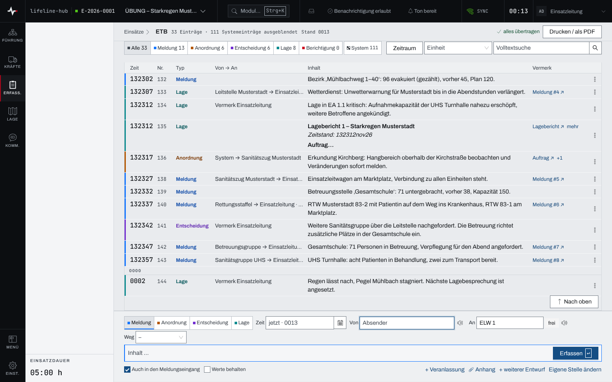
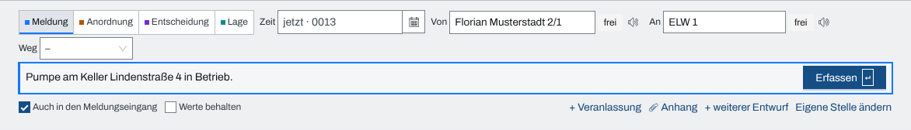
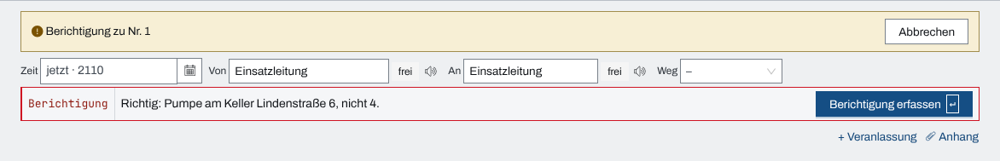
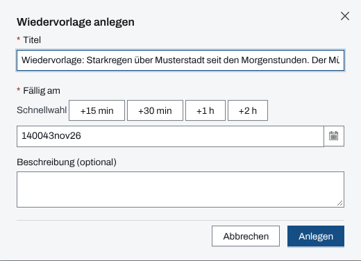

## Überblick

Das Einsatztagebuch (ETB) ist die fortlaufende Niederschrift des Einsatzes. Jeder Eintrag trägt
eine laufende Nummer, die Ereigniszeit, einen Typ („Meldung“, „Anordnung“, „Lage“ oder
„Entscheidung“), „Von“ und „An“ sowie den Inhalt. Die Zeitachse liest sich wie ein Funkprotokoll:
der älteste Eintrag steht oben, der neueste unten direkt über der Erfassungsleiste.

Ein erfasster Eintrag lässt sich weder ändern noch löschen. Ein Fehler wird mit einer
**Berichtigung** korrigiert: einem neuen Eintrag, der auf den alten verweist. Viele Einträge
entstehen von selbst, etwa aus Meldungen, Aufträgen, Befehlen und Nachforderungen oder als
Systemeintrag (Typ „System“), wenn sich Abschnitte, Einheiten oder Gefahren ändern.

Lesen dürfen alle mit Zugang zum Einsatz. Erfassen, Berichtigen und Wiedervorlagen anlegen dürfen
Einsatzleitung und Führungspersonal, solange der Einsatz läuft (siehe
[Rechte im Einsatz](rechte-im-einsatz.md)).

## Abläufe

### Das Tagebuch lesen

1. Im Einsatz das Modul „ETB“ öffnen.

   

2. Die Seite öffnet am Ende: der neueste Eintrag steht über der Erfassungsleiste. Nach oben
   rollen liest zurück; „Ältere laden“ über der Zeitachse holt frühere Einträge. Wer weiter als
   eine Bildschirmhöhe zurückgerollt ist, kommt rechts über der Erfassungsleiste mit „Nach oben“
   in einem Zug zum Anfang mit Filterleiste und „Ältere laden“.
3. In der Bediendichte „Kompakt“ auf einem breiten Bildschirm steht jeder Eintrag in einer Zeile
   mit den Spalten „Zeit“, „Nr.“, „Typ“, „Von → An“, „Inhalt“ und „Vermerk“; der Spaltenkopf
   bleibt beim Rollen stehen. Hinter „Von → An“ steht der Meldeweg, etwa „ELW 1 → EL · Funk“; ist
   der Text länger als die Spalte, endet er mit „…“, und der volle Text erscheint beim Zeigen auf
   die Spalte. Sind Von und An dieselbe Stelle, steht dort „Vermerk EL“ statt „EL → EL“.
4. Verweise und Marken stehen in der Spalte „Vermerk“, etwa „Meldung #5 ↗“, „Nachtrag · erfasst
   1926“, „berichtigt durch Nr. 231“, „berichtigt Nr. 230“ oder ein Anhang. Passen nicht alle
   hinein, endet die Spalte mit „+2“: „+2“ zeigt alle unter dem Text, „zuklappen“ nimmt sie
   zurück. Alle Vermerke nennt auch das Zeigen auf die Spalte und das Menü „Aktionen zu Eintrag
   …“, aus dem ein Verweis sich öffnen und ein Anhang sich herunterladen lässt.
5. Ein langer Eintrag, etwa ein Lagebericht, steht auf drei Zeilen; „mehr“ zeigt ihn ganz,
   „weniger“ klappt ihn wieder zu. Ein Link auf den Eintrag und eine Volltextsuche, die in seinem
   Text trifft, zeigen ihn ganz.
6. Sind seit dem letzten Besuch Einträge hinzugekommen, trennt eine Linie wie „Neu seit 1304 · 14
   Einträge“ die gesichteten von den neuen. Liegt der zuletzt gesichtete Eintrag nicht im
   geladenen Teil oder ist ein Filter gesetzt, steht derselbe Hinweis über der Zeitachse, mit „Zur
   Marke springen“. „alle als gesichtet markieren“ setzt die Lesemarke auf den neuesten Eintrag.
7. Kommen neue Einträge an, während die Seite am Ende steht, erscheinen sie unten und die Seite
   läuft mit. Wer hochgerollt hat oder ein Menü in der Zeitachse offen hat, sieht stattdessen
   unten „3 neue Einträge“; „anzeigen“ fügt sie ein und rollt ans Ende.

Wer einen Eintrag geschrieben hat, erscheint beim Zeigen auf die Zeile und im Menü „Aktionen zu
Eintrag …“ als „Verfasser: …“; die Zeile selbst bleibt einzeilig. Ein berichtigter Eintrag steht
durchgestrichen da, lesbar wie zuvor. In den Bediendichten „Komfortabel“ und „Handschuh“ und auf
mittelbreiten Bildschirmen stehen Verfasser und Meldeweg rechts im Eintrag und die Verweise unter
dem Text, ein Nachtrag als „⧖ nachgetragen um …“. Auf dem Handy trägt jeder Eintrag oben eine
Kopfzeile mit Zeit, Typ und Von → An, darunter den Text in voller Breite und darunter die Verweise.

Der Seitenkopf nennt die Zahl der Einträge, etwa „57 Einträge · 171 Systemeinträge ausgeblendet“,
und rechts den Sendestatus: „alles übertragen“, solange nichts aussteht. Die Zahl je Typ steht an
den Typ-Segmenten der Filterleiste; der Titel eines Segments nennt die Mehrzahl, Einträge vom Typ
„Lage“ etwa als „Lagefeststellungen“. „Lagemeldungen“ ist das eigene Modul der lagerelevanten
Meldungen (Kapitel [Lagemeldungen](lagemeldungen.md)). Berichtigungen findet der Typfilter
„Berichtigung“.

### Einen Eintrag erfassen

Für Einsatzleitung und Führungspersonal:

1. In der Erfassungsleiste am Fuß der Seite die Felder über dem Inhalt prüfen. Sie stehen in der
   Reihenfolge des Papier-ETB: Typ, Zeit, Von, An und Weg.

   

2. Den Typ wählen: „Meldung“, „Anordnung“, „Entscheidung“ oder „Lage“. Das gewählte Feld und die
   Leiste tragen die Farbe des Typs. Auf dem Handy steht der Typ als Knopf mit Pfeil vor dem Inhalt.
   Schneller geht es mit einem Schrägstrich am Zeilenanfang, etwa „/anordnung“ oder „/lage“.
3. „Von“ und „An“ prüfen. Der Typ belegt sie mit der eigenen Stelle vor (dem persönlichen
   Standard-Rufnamen):

   | Typ | Von | An |
   | --- | --- | --- |
   | Meldung | leer, auszufüllen | eigene Stelle |
   | Anordnung | eigene Stelle | leer, auszufüllen |
   | Entscheidung, Lage | eigene Stelle | eigene Stelle |

   Ein anderer Wert gilt nur für diesen Eintrag. Ein „@“ im Text setzt einen Rufnamen ein: bei
   einer Anordnung als „An“, sonst als „Von“.
4. Den Inhalt in das Feld „Inhalt …“ schreiben und „Erfassen“ wählen oder Enter drücken. Auf einem
   Touch-Gerät erfasst erst Strg+Enter (⌘+Enter am Mac); Enter allein beginnt dort eine neue Zeile.

Beim Öffnen steht der Cursor im ersten leeren Pflichtfeld, bei einer Meldung also in „Von“, sonst
im Inhalt; nach dem Erfassen ebenso. Inhalt, „Von“ und „An“ sind Pflicht: fehlt eine Seite, nennt
die Fußzeile „Absender fehlt“ oder „Empfänger fehlt“, das Feld ist rot markiert und hat den Cursor;
Text und Felder bleiben stehen. Ist noch kein Standard-Rufname gesetzt, fragt die Erfassungsleiste
zuerst danach; „Eigene Stelle ändern“ in der Fußzeile ändert ihn. „Vorschau“ erscheint, sobald der
Text Formatierung trägt (etwa **fett**, eine Liste oder einen Verweis), und zeigt ihn so, wie er in
der Zeitachse erscheinen wird.

### Felder, Bausteine und Werte setzen

1. Mit Tab von Feld zu Feld gehen: Zeit, Von, An, Weg und dann in den Inhalt. Ein Wert gilt, sobald
   das Feld verlassen wird; Enter in einem Feld übernimmt ihn und springt in den Inhalt.
2. „Zeit“ ist leer und zeigt „jetzt · 1926“, solange der Eintrag die Zeit des Erfassens bekommt. Für
   einen Nachtrag die Uhrzeit eintragen, etwa „1912“. Erlaubt sind dieselben Angaben wie in jedem
   Zeitfeld (etwa „1420“, „14:20“, „101420“, „-10“ für zehn Minuten vor jetzt). Weicht die Zeit ab,
   wird das Feld gelb, die Fußzeile nennt „Nachtrag · Ereignis vor 14 min“ und der Knopf heißt
   „Erfassen als 1912“. Ein geleertes Feld gilt wieder „jetzt“. Liegt die Zeit an einem anderen Tag,
   zeigt das Feld den Tag mit, etwa „162350okt26“.
3. Schneller geht ein Nachtrag mit „/zeit“ am Textanfang: „/zeit 1420 Pumpe läuft“ trägt 1420 in
   „Zeit“ ein, der Rest der Zeile bleibt der Inhalt. Eine unlesbare Angabe bleibt als Text stehen,
   und die Fußzeile nennt den Grund. Eine Zeit in der Zukunft nimmt die Erfassung nicht an: die
   Fußzeile nennt „Zeit liegt in der Zukunft“, das Feld hat den Cursor, Text und Felder bleiben.
4. „Weg“ ist der Meldeweg: Funk, Telefon, Persönlich oder Sonstige. „+ Veranlassung“ rechts in der
   Fußzeile holt das Feld „Veranlassung“ in die Zeile. Ein Schrägstrich mitten im Text öffnet die
   Liste der Felder und darunter die Textbausteine der Organisation.
5. Wer mehrere Einträge vom selben Absender hintereinander erfasst, setzt das Häkchen „Werte
   behalten“: „Von“, „An“, „Weg“ und der Typ bleiben dann nach dem Erfassen stehen, eine Folge von
   Anordnungen bleibt also Anordnungen. Die Zeit bleibt nie stehen. Ohne Häkchen beginnt der nächste
   Eintrag als „Meldung“.

In „Von“ und „An“ schlägt das Feld Funkrufnamen vor: unter „Im Einsatz“ die disponierten
Fahrzeuge, die Einheiten und die Sachgebiete, unter „Stammdaten“ die Fahrzeuge im Dienst und die
externen Stellen, unter „Zuletzt verwendet“ die an diesem Gerät zuletzt übernommenen Werte;
Demo-Daten stehen am Ende. Der oberste passende Vorschlag ist markiert; Enter und Tab übernehmen
ihn. Einen frei getippten Rufnamen übernimmt der letzte Eintrag der Liste, „„Abschnitt Nord“ als
Freitext übernehmen“; passt kein Vorschlag, gilt der Text. Er trägt im Feld die Marke „frei“.
Escape schließt die Liste und lässt den Text stehen.

Neben „Von“ und „An“ steht die Buchstabierhilfe mit den Tafeln „Deutsch“ und „NATO“. Bei Typ „Lage“
führt „Als strukturierten Lagebericht erfassen →“ in der Fußzeile zu den Lageberichten
([Lageberichte](lageberichte.md)).

### Meldung und Lage gehen in den Meldungseingang

Ein Eintrag vom Typ „Meldung“ oder „Lage“ kann zugleich eine Meldung im Meldungseingang anlegen:
Typ „Lage“ als Lagemeldung, die auch auf der Seite Lagemeldungen steht, Typ „Meldung“ als Meldung
der Art „Sonstige“. „Von“ wird Absender, „An“ Empfänger; Meldeweg, Inhalt und Ereigniszeit gehen
mit. Der Eintrag trägt danach den Verweis „Meldung #12 ↗“, der die Meldung hervorgehoben öffnet
([Meldungen](meldungen.md)). Einen zweiten, automatischen Eintrag gibt es dafür nicht.

Das steuert das Häkchen „Auch in den Meldungseingang“ links in der Fußzeile:

1. Bei Typ „Meldung“ oder „Lage“ steht es an, wenn der Eintrag von außen kommt. Sind „Von“ und „An“
   beide die eigene Stelle (ein eigener Vermerk, etwa „Lage ruhig“), steht es aus.
2. Für eine reine Mitschrift ohne Meldung das Häkchen entfernen, für einen eigenen Vermerk, der
   doch in den Eingang soll, setzen.
3. Den Eintrag erfassen.

Die Wahl gilt für einen Eintrag; danach steht das Häkchen wieder auf der Vorgabe, auch mit „Werte
behalten“. Ein Entwurf merkt sie sich bis zum Senden. Ist das Modul Meldungen für die Person
gesperrt, ist das Häkchen aus und nicht änderbar, daneben steht „Modul Meldungen gesperrt“: dann
wird nur protokolliert. Bei den anderen Typen und in einer Berichtigung fehlt das Häkchen.

### Eine Datei anhängen

Für Einsatzleitung und Führungspersonal, nur mit Verbindung:

1. In der Erfassungsleiste „Anhang“ wählen und eine oder mehrere Dateien aussuchen.
2. Den Inhalt schreiben; ein Eintrag nur aus Dateien geht nicht.
3. „Erfassen“ wählen. Erst jetzt werden die Dateien hochgeladen und mit dem Eintrag verbunden.

Ein Eintrag trägt höchstens zehn Dateien zu je höchstens 25 MiB. Ohne Netz steht neben „Anhang“
„offline“. Scheitert das Hochladen einer Datei, wird der Eintrag nicht erfasst, und die Leiste
nennt den Grund.

### Mit mehreren Entwürfen arbeiten

1. Rechts in der Fußzeile der Erfassungsleiste „+ weiterer Entwurf“ wählen. Über der Leiste
   erscheinen die Reiter, etwa „Neuer Eintrag“ und der neue.
2. Zwischen den Reitern wechseln; jeder behält Text, Felder und Anhänge. Mit nur einem Entwurf
   stehen keine Reiter da.
3. Einen Entwurf mit dem ✕ am Reiter verwerfen. Ein leerer Entwurf verschwindet sofort. Hat er
   Inhalt, warnt die Rückfrage „Entwurf verwerfen?“: „Text, Felder und Anhänge gehen verloren.“
   „Verwerfen“ bestätigt, „Behalten“ bricht ab.

### Einträge suchen und filtern

Alle Filter stehen in einer Leiste direkt über der Zeitachse. Ist das Fenster hoch genug, bleibt
sie mit dem Seitenkopf beim Rollen oben stehen; ein gesetzter Filter ist so auch am Ende der
Zeitachse über der Erfassung zu sehen und zu ändern.

1. Einen Typ wählen: „Alle“, „Meldung“, „Anordnung“, „Entscheidung“, „Lage“ oder „Berichtigung“.
   Jedes Segment trägt die Zahl seiner Einträge, „Alle“ die Summe ohne Systemeinträge. Ist ein
   Zeitraum, eine Einheit oder eine Suche gesetzt, zählen die Segmente nur, was dazu passt.
2. Systemeinträge sind beim Öffnen ausgeblendet. Der Knopf „System“ blendet sie ein und wieder
   aus; die Zahl daneben nennt, wie viele es sind, ausgeblendet ist sein Punkt gestrichen. Der
   Seitenkopf nennt dann, wie viele ausgeblendet sind, etwa „171 Systemeinträge ausgeblendet“.
3. „Zeitraum“ öffnet eine Schnellwahl: „Letzte Stunde“, „Letzte 4 Stunden“, „Seit letzter
   Lagebesprechung“ (nur, wenn eine abgehalten ist) und „Heute“. Unter „Eigener Zeitraum“ lassen
   sich „von“ und „bis“ taktisch tippen („1400“, „171400“); „bis“ leer heißt bis jetzt. „Zeitraum
   übernehmen“ setzt ihn, „Ohne Zeitraum“ nimmt ihn heraus. Der Knopf zeigt danach den Zeitraum,
   etwa „seit 1345“.
4. Bei Bedarf eine Einheit wählen oder in die „Volltextsuche“ tippen.
5. Solange ein Filter gesetzt ist, steht direkt über der Erfassung ein bernsteinfarbenes Band,
   etwa „Gefiltert · 7 von 134 Einträgen sichtbar · Meldung · seit 1345“, und der Seitenkopf
   nennt „7 Treffer“. „Filter zurücksetzen“ darin führt zur vollen Liste zurück; die
   Systemeinträge sind danach wieder ausgeblendet. Das Ausblenden der Systemeinträge allein gilt
   nicht als Filter.

Passt ein eben erfasster Eintrag nicht zum Filter, nennt das Band „Nr. … erfasst – außerhalb des
Filters“; „anzeigen“ hebt den Filter auf und springt zum Eintrag. Unter „Seit letzter
Lagebesprechung“ nennt das Band außerdem Einträge, die nach der Besprechung erfasst wurden, deren
Ereigniszeit aber davor liegt („+1 Nachtrag vor 1330 erfasst“); „anzeigen“ erweitert den Zeitraum
um sie.

Die Volltextsuche findet Wortanfänge in Inhalt, „Von“, „An“ und „Veranlassung“, ohne auf Groß-
und Kleinschreibung zu achten; bei mehreren Wörtern müssen alle vorkommen. Der Filter steht in der
Adresse der Seite und lässt sich als Link weitergeben; ein gewählter Zeitraum steht dort mit
festen Uhrzeiten, ein Link zeigt also beim Empfänger dieselben Einträge, auch im Druck.
Eingeblendete Systemeinträge stehen dort als „system=an“. Ein älterer Link ohne diese Angabe, der
früher die Systemeinträge mitzeigte, zeigt sie nicht mehr; ein Link auf einen einzelnen
Systemeintrag blendet sie selbst ein und meldet „Systemeinträge eingeblendet, um den Eintrag zu
zeigen“. Auf schmalen Bildschirmen
rollt der Typ einzeilig im Kopf, die übrigen Filter liegen hinter dem Knopf „Filter“, der die Zahl
gesetzter Filter trägt (eingeblendete Systemeinträge zählen mit); dort klebt nichts, der Sendestatus
steht neben dem Typ.

### Einen Eintrag berichtigen

Für Einsatzleitung und Führungspersonal:

1. An dem Eintrag das Menü „Aktionen zu Eintrag …“ öffnen und „Berichtigen“ wählen.
2. Die Erfassungsleiste zeigt „Berichtigung zu Nr. …“. Den richtigen Wortlaut schreiben.

   

3. „Erfassen“ wählen. „Abbrechen“ verlässt den Modus ohne Eintrag.

Der alte Eintrag steht danach durchgestrichen da, sein Text bleibt lesbar. In der Spalte
„Vermerk“ trägt er „berichtigt durch Nr. …“ als Sprung auf die Berichtigung; in den Bediendichten
„Komfortabel“ und „Handschuh“ steht in seiner Kopfzeile die Marke „berichtigt“ mit dem Sprung
„→ Nr. …“ auf die jüngste Berichtigung. Die Kennzeichnung steht auch, wenn die
Berichtigung gerade nicht angezeigt ist, etwa unter dem Typfilter „Meldung“, und ebenso im
Lagebild und im Überblick. In der Lageentwicklung eines Lagevortrags steht eine berichtigte
Entscheidung mit dem Text „berichtigt → Nr. …“. Die Berichtigung
zeigt „berichtigt Nr. …“, in der Spalte „Vermerk“ als Sprung, sonst mit dem Verweis „Grundeintrag
anzeigen ↗“. Auch eine Berichtigung lässt
sich wieder berichtigen; die Erfassungsleiste nennt dann die Kette, etwa „Berichtigung zu Nr. 135
(berichtigt Nr. 134)“.

### Eine Wiedervorlage anlegen

Für Einsatzleitung und Führungspersonal:

1. An dem Eintrag das Menü „Aktionen zu Eintrag …“ öffnen und „Wiedervorlage“ wählen.

   

2. Den vorbelegten „Titel“ prüfen.
3. „Fällig am“ setzen; die „Schnellwahl“ bietet +15 min, +30 min, +1 h und +2 h und, wenn
   geplant, die nächste Lagebesprechung.
4. Bei Bedarf eine „Beschreibung (optional)“ schreiben und „Anlegen“ wählen.

Die Wiedervorlage erscheint als Erinnerung (Kapitel [Erinnerungen](erinnerungen.md)) mit einem
Verweis zurück auf den Eintrag.

### Aus einem Eintrag einen Auftrag erteilen

Für Einsatzleitung und Führungspersonal:

1. An dem Eintrag das Menü „Aktionen zu Eintrag …“ öffnen und „Auftrag erteilen“ wählen.
2. Im Dialog „Aus ETB-Eintrag Auftrag erteilen“ den Empfänger eintragen, den vorbelegten Text
   unter „Auftrag / Was“ prüfen und den Auftrag erteilen.

Ist das Modul Aufträge im Einsatz nicht freigegeben, steht der Menüpunkt gesperrt als „Auftrag
erteilen (keine Berechtigung)“ da. Wie Aufträge weiterlaufen, beschreibt das Kapitel
[Aufträge und Befehle](auftraege-befehle.md).

## Hintergrund

### Warum nichts geändert werden kann

Das ETB ist ein Beleg. Ein Eintrag bleibt so, wie er erfasst wurde; die Korrektur steht als
eigener, verknüpfter Eintrag daneben. Weicht die Ereigniszeit um mindestens eine Minute vom
Eingang ab, zeigt der Eintrag in der Spalte „Vermerk“ „Nachtrag · erfasst …“ (in den
Bediendichten „Komfortabel“ und „Handschuh“ „⧖ nachgetragen um …“); wurde er an einem anderen Tag
erfasst als das Ereignis, steht der Tag dabei, etwa „Nachtrag · erfasst 110020“.

### Automatische Einträge

Weitere Module schreiben selbst ins ETB:

- eine Meldung als „Meldung“ mit Absender und Empfänger,
- ein erteilter Auftrag als „Anordnung“, sein Vollzug immer als „Meldung“,
- ein freigegebener Befehl als „Anordnung“ mit dem Befehlstext,
- eine Nachforderung immer als „Meldung“, jede ihrer Stufen als Systemeintrag,
- eine Lagemeldung als „Lage“,
- die erste Übernahme einer Meldung in die Lage als Systemeintrag „Meldung #12 in die Lage
  übernommen“ (nicht bei einer Lagemeldung; ältere Einträge lauten „… an die Lage übergeben“).

Ob Meldungen und erteilte Aufträge einen Eintrag erzeugen, legt in den Einstellungen des
Einsatzes unter „Verhalten & Automatik“ das Feld „Automatische ETB-Einträge“ fest; ohne Angabe gilt die Vorgabe
der Organisation, sonst „An“ ([Einstellungen des Einsatzes und Module](einsatz-einstellungen.md)). Ein
automatischer Eintrag zeigt einen Verweis auf seinen Ursprung, etwa „Auftrag ↗“, „Befehl ↗“,
„Meldung #12 ↗“ oder „Nachforderung ↗“. Der Verweis auf eine Meldung oder Nachforderung öffnet
deren Seite mit der Karte hervorgehoben. Ein Auftrag und die Auflösung einer Einheit tragen je
genannte Einheit „Einheit «Name» ↗“; er öffnet die Seite der Einheit, bei einer aufgelösten die
lesende ([Einheiten](einheiten.md)).

Nennt ein automatischer Eintrag eine Zeit, etwa „benötigt bis 211530okt26“ oder den Zeitraum einer
Verpflegung „241200sep26–1330“, steht sie in der Zeitdarstellung des Einsatzes bzw. der
Organisation, nicht in der Wahl an deinem Gerät: der Eintrag ist für alle derselbe. Ältere Einträge
behalten die Schreibweise, mit der sie geschrieben wurden.

Systemeinträge sind beim Öffnen ausgeblendet; „System“ in der Filterleiste blendet sie ein
(siehe „Einträge suchen und filtern“). Eingeblendet stehen sie leiser als Handeinträge: kleinere,
gedämpfte Schrift, der Text ungekürzt.
„System → System“ entfällt, eine bekannte Seite wie „System → ELW 1“ bleibt. Folgen drei oder mehr
Systemeinträge innerhalb einer Stunde direkt aufeinander, fasst das ETB sie zu einer Zeile
„3 Systemeinträge · 1301–1312 · anzeigen“ zusammen; „anzeigen“ klappt sie auf, „zuklappen“
wieder zu. Ein Systemeintrag mit Berichtigung, Nachtrag, Anhang, Dokument oder Verweis steht immer
einzeln. Unter dem Typfilter „System“, bei einer Volltextsuche und im Druck wird nichts
zusammengefasst; ein Link auf einen zusammengefassten Eintrag klappt seine Zeile auf.

### Entwürfe auf dem Gerät

Entwürfe liegen nur auf dem Gerät, auf dem sie entstanden sind, und gehören der angemeldeten
Person. Beim Abmelden werden sie gelöscht. Ein leerer Entwurf verschwindet nach 24 Stunden ohne
Änderung.

Lehnt der Gerätespeicher das Entfernen eines verworfenen oder gesendeten Entwurfs ab, schließt
der Reiter trotzdem, und über den Reitern steht „Entwurf nicht aus dem Gerätespeicher entfernt“.
Taucht der Entwurf nach dem Neuladen wieder auf, lässt er sich erneut verwerfen.

### Ohne Netz

Ohne Verbindung nimmt das ETB Einträge weiter an und merkt sie als „offline vorgemerkt“ vor. Sie
gehen raus, sobald das Netz zurück ist. Bis dahin nennt der Seitenkopf statt „alles übertragen“
etwa „2 ausstehend“ (bei einer Ablehnung zuerst „1 abgelehnt“); ein Klick darauf springt zu den
vorgemerkten Zeilen. Lehnt der Server einen vorgemerkten Eintrag ab, steht er
mit „Erneut senden“ und „Verwerfen“ in der Zeitachse. Ein vorgemerkter Eintrag vom Typ „Meldung“
oder „Lage“ legt seine Meldung erst beim Senden an; wird er abgelehnt, etwa weil das Modul
Meldungen inzwischen gesperrt ist, bietet seine Zeile zusätzlich „Nur protokollieren“, und er geht
ohne Meldung hinaus. Anhänge gehen nur mit Verbindung. Mehr dazu im
Kapitel [Arbeiten ohne Netz](ohne-netz.md).

### Rechtsklick auf einen Eintrag

Ein Rechtsklick auf einen Eintrag öffnet dasselbe Menü wie „Aktionen zu Eintrag …“, ebenso die
Kontextmenü-Taste oder **Umschalt+F10**, wenn der Fokus im Eintrag steht. An einer abgelehnten
Zeile stehen darin „Erneut senden“, „Nur protokollieren“ (wenn die Zeile es anbietet) und rot
„Verwerfen“, das wie der Knopf ohne Rückfrage verwirft. Ein vorgemerkter Eintrag, ein Eintrag ohne Aktion, ein Verweis und
markierter Text behalten das Menü des Browsers. Am Tablet öffnet ein langer Druck im ETB kein
Menü: Text bleibt markierbar, die Aktionen stehen im Menü „⋮“.

### Abgeschlossener Einsatz

Nach dem Abschluss des Einsatzes ist das ETB nur noch lesbar. Abgeschlossen wird in den
Einsatzdaten ([Einsatz abschließen und Einsatzbericht](einsatzabschluss.md)). Drucken lässt sich das ETB
jederzeit, siehe [Drucken und Export](drucken-export.md).

## Grundlagen und Quellen

Die Buchstabierhilfe folgt in der Tafel „Deutsch“ der klassischen deutschen Buchstabiertafel nach
DIN 5009 (Anton, Berta, …) und in der Tafel „NATO“ dem internationalen Funkalphabet (Alfa,
Bravo, …).
