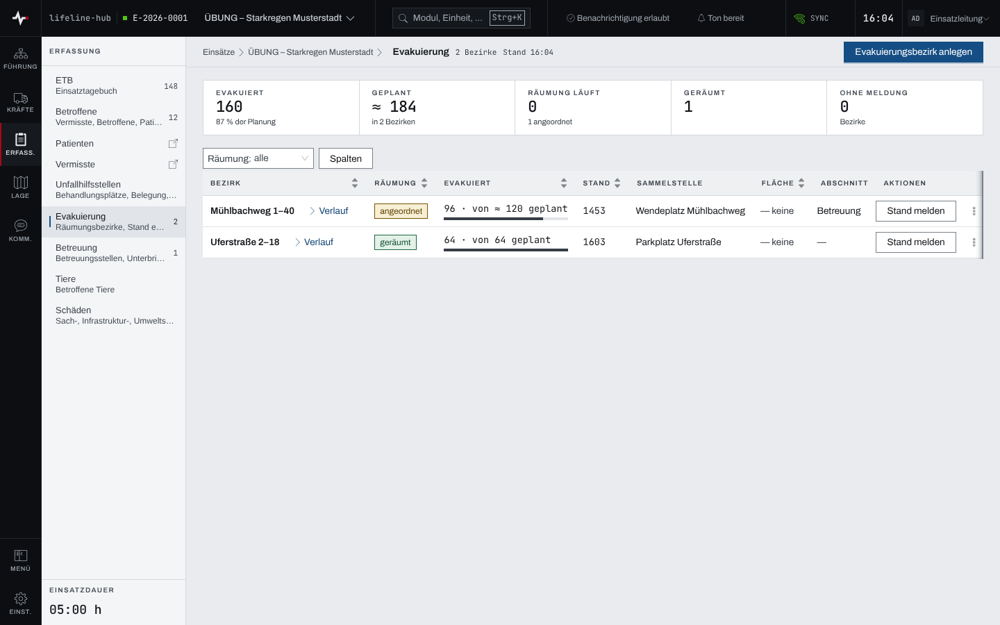
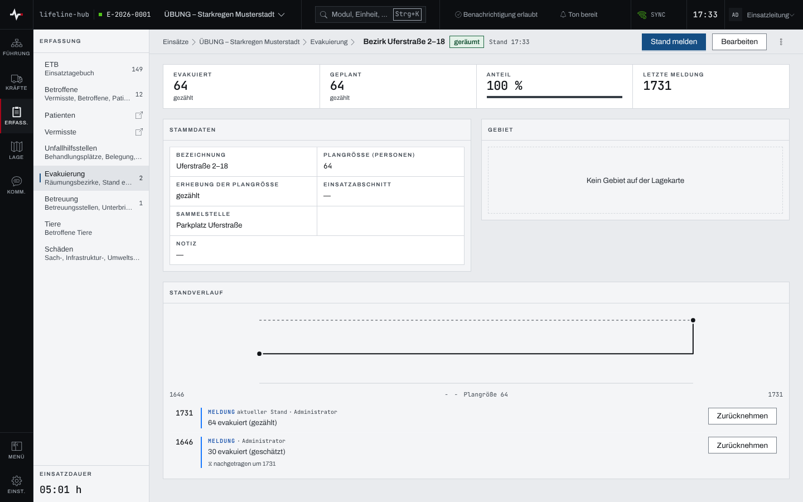
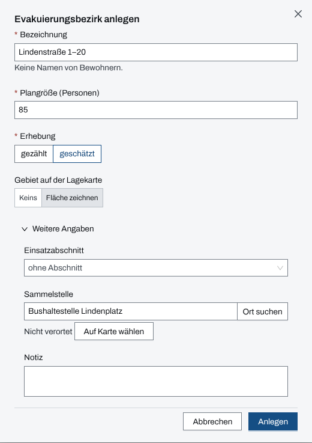
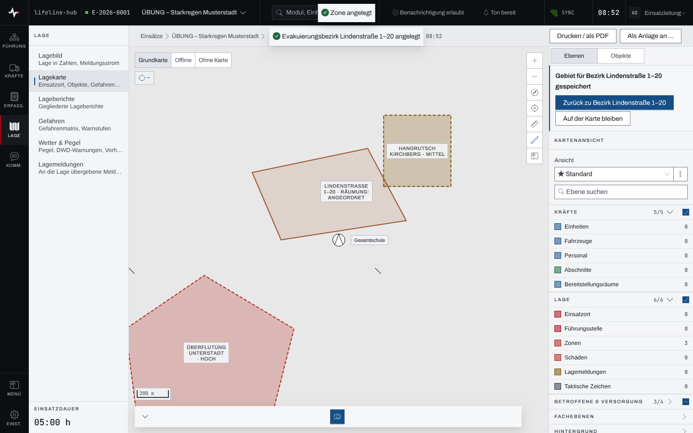
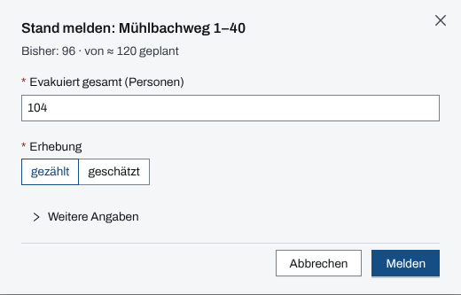

## Überblick

Das Modul „Evakuierung“ führt die **Evakuierungsbezirke**: wie viele Personen ein Gebiet verlassen
sollen und wie viele es schon verlassen haben. Gezählt wird ohne Namen: Meldungen nennen nur
Zahlen. Wo die Evakuierten unterkommen, führt das Modul „Betreuung“
([Betreuung](betreuung.md)).

Der Kopf der Seite zählt die Bezirke. Darunter steht „Räumung in Zahlen“, darunter die Tabelle der
Bezirke. Jeder Bezirk hat eine eigene Seite mit allem, was zu ihm gehört.

## Abläufe

### Die Räumung ablesen

1. Im Modulpanel „Evakuierung“ öffnen.

   

2. Das Band oben fasst die aktiven Bezirke zusammen: „Evakuiert“ mit dem Anteil an der Planung,
   „Geplant“, „Räumung läuft“ (mit der Zahl der nur angeordneten Bezirke), „Geräumt“ und „Ohne
   Meldung“.
3. Die Tabelle nennt je Bezirk den Räumungszustand („angeordnet“, „läuft“, „geräumt“,
   „aufgehoben“), evakuiert von geplant, die Zeit des letzten Stands, die Sammelstelle, die
   zugeordneten Flächen der Lagekarte und den Einsatzabschnitt. „≈“ kennzeichnet eine geschätzte
   Zahl. Der Filter „Räumung“ engt die Tabelle ein.
4. „Verlauf“ an einem Bezirk klappt alle Standmeldungen dazu auf.
5. Die Bezeichnung eines Bezirks öffnet seine Seite.

### Einen Bezirk im Blick haben

1. In der Tabelle die Bezeichnung des Bezirks wählen. Von der Lagekarte führt „Im Fachmodul
   öffnen“ an einer Fläche des Bezirks ebenso hierher.

   

2. Der Kopf nennt den Bezirk und seinen Räumungszustand. „Bezirk in Zahlen“ nennt „Evakuiert“,
   „Geplant“, den „Anteil“ an der Planung mit Balken und unter „Letzte Meldung“ deren Zeit. „≈“
   kennzeichnet eine geschätzte Zahl.
3. „Stammdaten“ nennt Bezeichnung, Plangröße, Erhebung, Einsatzabschnitt, Sammelstelle und Notiz.
4. „Gebiet“ zeigt die zugeordneten Flächen der Lagekarte als kleinen Ausschnitt. „Auf Lagekarte
   öffnen“ führt auf die Karte, mit einer Fläche des Bezirks ausgewählt. Ohne Fläche steht „Kein
   Gebiet auf der Lagekarte“. „Gebiet zeichnen“ (ohne Fläche) und „Weitere Teilfläche zeichnen“
   (mit Fläche) öffnen die Lagekarte zum Zeichnen einer Fläche für diesen Bezirk. Kann der
   Browser keine Karte zeichnen (Voraussetzung wie bei der [Lagekarte](lagekarte.md)), steht an
   Stelle des Ausschnitts „Karte auf diesem Gerät nicht darstellbar“; der Sprung bleibt.
5. „Standverlauf“ zeigt ab zwei Meldungen eine Linie des Stands über die Zeit, die Plangröße
   gestrichelt, darunter alle Meldungen.

### Einen Evakuierungsbezirk anlegen

1. „Evakuierungsbezirk anlegen“ wählen.
2. Unter „Bezeichnung“ das Gebiet nennen, etwa Straße und Hausnummern, ohne Namen von Bewohnern.
3. Die „Plangröße (Personen)“ eintragen und unter „Erhebung“ angeben, ob sie „gezählt“ oder
   „geschätzt“ ist.
4. Unter „Gebiet auf der Lagekarte“ „Keins“ wählen, wenn das Gebiet nicht gleich gezeichnet
   werden soll. Vorgewählt ist „Fläche zeichnen“ (weiter unter „Einen Bezirk mit Gebiet
   anlegen“).
5. Unter „Weitere Angaben“ bei Bedarf „Einsatzabschnitt“, „Sammelstelle“ und „Notiz“ ergänzen.

   

6. „Anlegen“ wählen. Der Bezirk steht auf „angeordnet“.

### Einen Bezirk mit Gebiet anlegen

1. Den Bezirk anlegen wie oben, unter „Gebiet auf der Lagekarte“ „Fläche zeichnen“ gewählt.
2. Nach „Anlegen“ öffnet die Lagekarte zum Zeichnen. Das Band unten auf der Karte nennt „Bezirk …
   · Fläche“ mit der Bezeichnung des Bezirks.
3. Die Eckpunkte des Gebiets auf der Karte setzen, „Abschließen“ und „Speichern“ wählen.

   

4. Die Rückmeldung „Gebiet für Bezirk … gespeichert“ bietet „Zurück zu Bezirk …“ an; „Auf der
   Karte bleiben“ schließt sie. Die Fläche ist dem Bezirk zugeordnet und trägt seine Bezeichnung.

Ein Gebiet für einen bestehenden Bezirk entsteht ebenso über „Gebiet zeichnen“ oder „Weitere
Teilfläche zeichnen“ im Menü des Bezirks oder auf seiner Seite. „Verwerfen“ beim Zeichnen lässt
den Bezirk ohne neue Fläche.

### Den Stand eines Bezirks melden

1. Am Bezirk „Stand melden“ wählen. Der Dialog nennt den bisherigen Stand.
2. Unter „Evakuiert gesamt (Personen)“ die Gesamtzahl eintragen, nicht den Zuwachs, und die
   „Erhebung“ angeben (vorgewählt „gezählt“).

   

3. Liegt die Meldung zurück, unter „Weitere Angaben“ den „Zeitpunkt“ eintragen; leer gilt jetzt.
4. „Melden“ wählen. Direkt danach bietet die Bestätigung „Rückgängig“ an.

Auf der Seite des Bezirks steht „Stand melden“ oben im Kopf.

### Die Räumung weiterschalten

1. Die Seite des Bezirks öffnen.
2. Den Knopf neben „Stand melden“ wählen: „Räumung beginnen“ bei einem angeordneten Bezirk, „Als
   geräumt melden“ bei laufender Räumung, „Erneut anordnen“ bei einer aufgehobenen Anordnung.
3. Rückwege wie „Zurück auf angeordnet“ oder „Räumung wieder aufnehmen“ stehen im Menü „…“.
4. „Anordnung aufheben“ steht rot im Menü und fragt vorher nach. Ein aufgehobener Bezirk zählt in
   keiner Kennzahl der Räumung mehr.

In der Tabelle setzt „Räumung setzen“ im Menü eines Bezirks den Zustand ebenso.

### Plangröße und Angaben eines Bezirks ändern

1. Auf der Seite des Bezirks „Bearbeiten“ wählen. Die Stammdaten werden zu Eingabefeldern.
2. Die Angaben ändern, etwa die „Plangröße (Personen)“ und ihre „Erhebung“.
3. „Speichern“ wählen. Gespeichert wird nur, was geändert wurde; was jemand anders inzwischen
   geändert hat, bleibt stehen. „Abbrechen“ verwirft die Eingabe.

Wer mit ungespeicherten Änderungen die Seite verlässt, wird gefragt, ob die Änderungen verworfen
werden sollen.

### Einen Bezirk auf der Lagekarte zeigen

1. Im Menü des Bezirks „Auf Karte zeigen“ wählen oder auf seiner Seite „Auf Lagekarte öffnen“.
   Beides steht nur an Bezirken, denen auf der Lagekarte mindestens eine Fläche zugeordnet ist.
2. Die Lagekarte öffnet mit einer Fläche des Bezirks ausgewählt.

Umgekehrt führt „Im Fachmodul öffnen“ an einer zugeordneten Fläche auf der Lagekarte auf die
Seite des Bezirks.

### Eine Standmeldung zurücknehmen

1. Am Bezirk „Verlauf“ aufklappen oder auf der Seite des Bezirks unter „Standverlauf“ suchen.
2. An der falschen Meldung „Zurücknehmen“ wählen und die Rückfrage „Meldung zurücknehmen?“
   bestätigen.

Die Meldung bleibt im Verlauf stehen, gekennzeichnet als zurückgenommen; es gilt wieder die
Meldung davor. Das lässt sich nicht umkehren.

## Hintergrund

### Wie gezählt wird

- Gemeldet wird immer die **Gesamtzahl**. Sie darf die Plangröße übersteigen.
- Ein Bezirk ohne Meldung zählt nicht als null: er steht auf „keine Meldung“. Hat kein aktiver
  Bezirk eine Meldung, steht bei „Evakuiert“ „—“.
- Stornierte und aufgehobene Bezirke zählen nicht in „Räumung in Zahlen“. Ohne aktiven Bezirk
  fehlt das Band ganz.
- Ein Zeitpunkt in der Zukunft wird abgelehnt. Eine Meldung mit einem älteren Zeitpunkt als die
  aktuelle wird als nachgetragen geführt („nachgetragen um …“), die aktuelle bleibt stehen.

### Lagebild

Sobald ein Bezirk angeordnet ist, trägt der Einsatz die Kennzahl „Evakuiert“ im Lagebild
([Lagebild](lagebild.md)); sie führt auf diese Seite. Wer das Modul „Evakuierung“ nicht sehen
darf, sieht dort keine Zahl.

### Stornieren

„Stornieren“ ist nur für Fehlanlagen gedacht und nicht umkehrbar. Es steht im Menü des Bezirks,
in der Tabelle wie auf seiner Seite. Der Dialog bietet stattdessen „Räumung setzen“ an. Ein stornierter Bezirk verliert seine Flächen auf der Lagekarte; die Flächen
bleiben als nicht zugeordnete Bezirksflächen stehen. Der Nachweis im Einsatztagebuch bleibt.

### Einsatztagebuch

Das Anlegen eines Bezirks, eine neue Plangröße sowie „angeordnet“ und „aufgehoben“ stehen als
Entscheidung im Einsatztagebuch, „läuft“, „geräumt“ und Standmeldungen als Meldung, eine
Rücknahme als Berichtigung.

### Rechte

Anlegen und melden dürfen Einsatzleitung und Führungspersonal eines laufenden Einsatzes
([Rechte im Einsatz](rechte-im-einsatz.md)); ohne dieses Recht steht ein Hinweis über der Seite,
und die Knöpfe sind gesperrt. Die Seite eines Bezirks bleibt lesbar, ohne „Stand melden“ und
„Bearbeiten“. Wer die Lagekarte nicht sehen darf, sieht unter „Gebiet“ nur die Zahl der Flächen
und kann kein Gebiet zeichnen: „Fläche zeichnen“, „Gebiet zeichnen“ und „Weitere Teilfläche
zeichnen“ sind dann gesperrt. Ein Link zum Zeichnen auf einen fremden oder stornierten Bezirk
öffnet die Lagekarte ohne Zeichenmodus. „Evakuierung“ und „Betreuung“ sind getrennte Module: jedes lässt sich
für sich ausblenden oder auf Rollen beschränken
([Einstellungen des Einsatzes und Module](einsatz-einstellungen.md)). Das gekoppelte Gerät einer
Betreuungsstelle sieht keine Bezirke.

Ein älterer Link auf einen Bezirk, auch unter „Betreuung“, öffnet die Seite des Bezirks.

### Ohne Netz

Die Evakuierung bleibt ohne Netz lesbar. Standmeldungen lassen sich vormerken; sie tragen den
Zeitpunkt der Erfassung und gehen hinaus, sobald Netz da ist. Anlegen, Räumung, Bearbeiten und
Stornieren gehen nur mit Netz. Mehr in [Arbeiten ohne Netz](ohne-netz.md).
