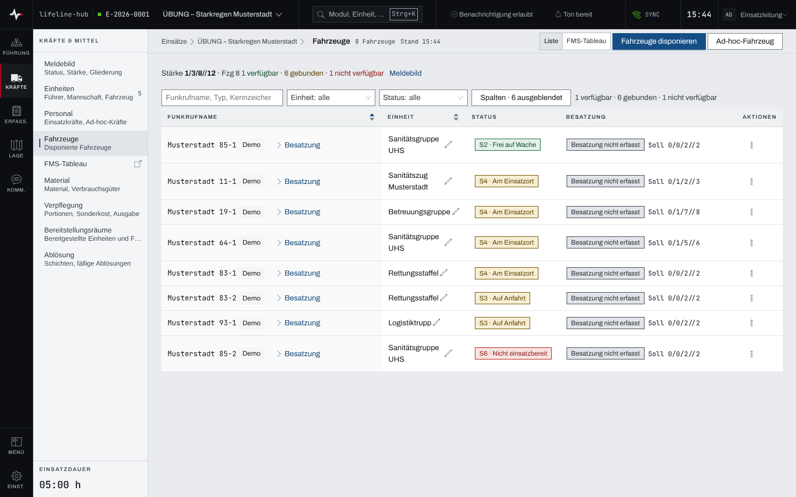
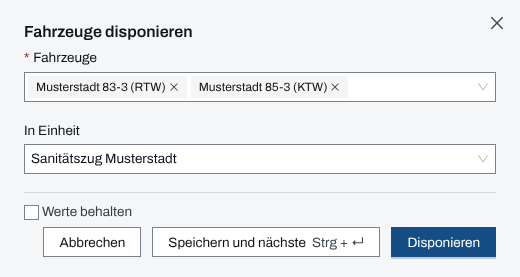
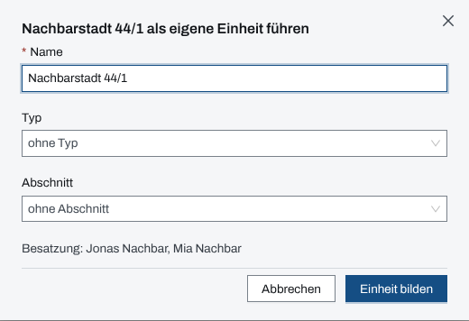
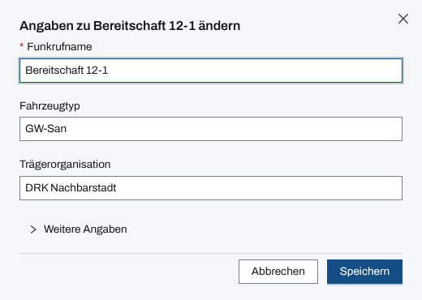
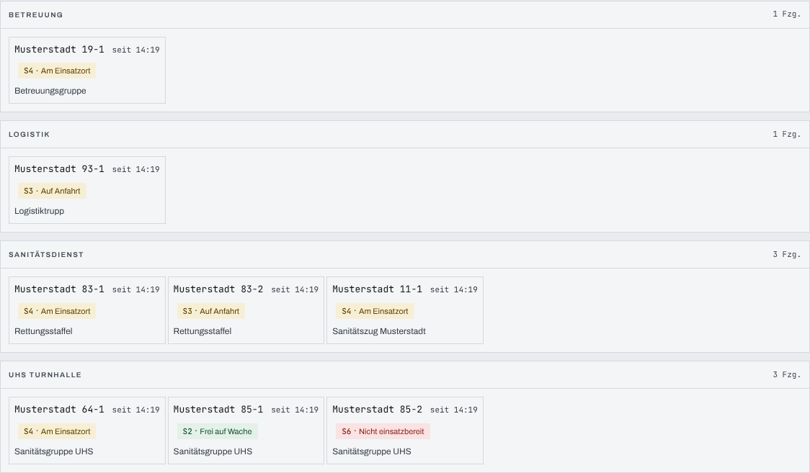
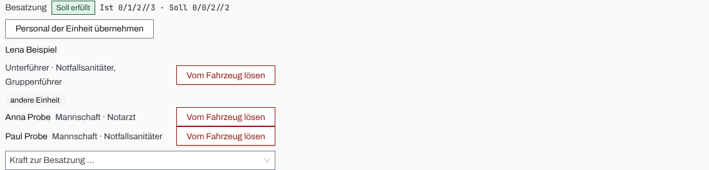
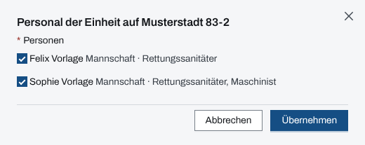
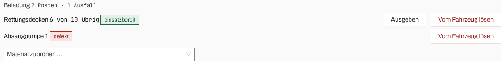

## Überblick

Das Modul **Fahrzeuge** führt alle Fahrzeuge, die im Einsatz disponiert sind, aus dem Fahrzeugstamm
der Organisation oder ad hoc erfasst. Je Fahrzeug stehen Funkrufname, Einheit, FMS-Status und
Besatzung. Typ, Abschnitt, „Seit“ (wann der Status gesetzt wurde), Kennzeichen und Träger stehen
erst ab 1600 px Fensterbreite in der Liste, darunter lassen sie sich wie die Bemerkung unter
„Spalten“ einblenden. Ist das Modul Einheiten im Einsatz nicht freigegeben, fehlen Einheit und
Abschnitt.

Zwei Ansichten zeigen dieselben Fahrzeuge: die **Liste** zum Pflegen und Vergleichen und das
**FMS-Tableau** als Überblick über die ganze Flotte, in dem sich der Status mit einem Klick oder
einer Ziffer setzen lässt. Disponieren, Status setzen, die Einheit wählen, Besatzung zuordnen und
entlassen dürfen Einsatzleitung und Führungspersonal.

## Abläufe

### Die Fahrzeugliste lesen

1. Unter „Kräfte & Mittel“ „Fahrzeuge“ öffnen; oben rechts steht die Ansicht „Liste“.
2. Je Fahrzeug „Einheit“, „Status“ und „Besatzung“ lesen. Die Besatzung steht als Urteil, etwa
   „Besatzung nicht erfasst“ oder „Soll erfüllt“, daneben Ist- und Soll-Stärke.

   

3. In „Funkrufname, Typ, Kennzeichen“ suchen oder unter „Einheit“ und „Status“ filtern; steht die
   Spalte „Abschnitt“ in der Liste, auch nach Abschnitt.

### Fahrzeuge aus dem Stamm disponieren

Für Einsatzleitung und Führungspersonal, für ein Fahrzeug oder mehrere:

1. „Fahrzeuge disponieren“ wählen.
2. Unter „Fahrzeuge“ ein oder mehrere Fahrzeuge aus dem Stamm wählen. Die Suche findet
   Funkrufname, Typ, Kennzeichen und Träger.
3. Bei Bedarf unter „In Einheit“ die Einheit wählen, zu der die Fahrzeuge gehören.

   

4. „Disponieren“ wählen, oder „Speichern und nächste“ für die nächste Einheit; mit „Werte
   behalten“ bleibt die Einheit stehen.
5. Lässt sich ein Fahrzeug nicht disponieren, nimmt die App keines der gewählten auf und nennt
   unter der Auswahl den Grund je Fahrzeug. „Abgelehnte abwählen“ nimmt sie aus der Auswahl.

### Ein Ad-hoc-Fahrzeug disponieren

Für Einsatzleitung und Führungspersonal, wenn ein Fahrzeug nicht im Stamm steht, etwa ein
Fahrzeug einer Nachbarwehr:

1. „Ad-hoc-Fahrzeug“ wählen.
2. „Funkrufname“ eingeben, bei Bedarf „Fahrzeugtyp“, „Trägerorganisation“, „Kennzeichen“ und unter
   „Weitere Angaben“ die „OPTA“.
3. „Disponieren“ wählen. Mit „Speichern und nächste“ und „Werte behalten“ bleiben Trägerorganisation
   und Fahrzeugtyp für das nächste Fahrzeug stehen.

### Die Einheit eines Fahrzeugs ändern

Für Einsatzleitung und Führungspersonal, wenn das Modul Einheiten freigegeben ist:

1. In der Zeile des Fahrzeugs unter „Einheit“ „Einheit eintragen“ wählen, oder bei einer schon
   zugeordneten Einheit ihren Namen.
2. Die Einheit wählen. Die Auswahl ist nach Abschnitt gegliedert, unterstellte Einheiten stehen
   mit ihrem Pfad, etwa „Sanitätszug Musterstadt › Rettungsstaffel“. Mit dem Kreuz im Feld wird die
   Einheit geleert.
3. „Speichern“ wählen. Der Abschnitt daneben folgt der neuen Einheit; lehnt die App ab, steht der
   Grund am Feld.

### Ein Fahrzeug als eigene Einheit führen

Für Einsatzleitung und Führungspersonal, wenn das Modul Einheiten freigegeben ist und ein Fahrzeug
allein fährt, etwa ein RTW einer Nachbarwache:

1. In der Zeile des Fahrzeugs „Weitere Aktionen“ öffnen und „Als eigene Einheit führen …“ wählen.
   Der Eintrag steht nur bei einem Fahrzeug ohne Einheit.
2. „Name“ prüfen; vorbelegt ist der Funkrufname. Unter „Typ“ steht ein Einheitentyp nur dann
   schon, wenn genau ein Typ dieselbe Soll-Stärke hat wie das Fahrzeug. Bei Bedarf den „Abschnitt“
   wählen.
3. Unter den Feldern steht „Besatzung: …“ mit den Personen, die mit dem Fahrzeug in die Einheit
   kommen.

   

4. „Einheit bilden“ wählen. Die Liste bleibt stehen, in der Spalte „Einheit“ steht die neue
   Einheit. Lehnt die App ab, steht der Grund im Dialog, etwa wenn das Fahrzeug inzwischen einer
   anderen Einheit angehört.

### Angaben eines Ad-hoc-Fahrzeugs ändern

Für Einsatzleitung und Führungspersonal, etwa bei einem Tippfehler im Funkrufnamen:

1. In der Zeile des Fahrzeugs „Weitere Aktionen“ öffnen und „Angaben ändern …“ wählen.
2. „Funkrufname“, „Fahrzeugtyp“ oder „Trägerorganisation“ ändern; „Kennzeichen“ und „OPTA“ stehen
   unter „Weitere Angaben“, dessen Kopf die eingetragenen Werte nennt.

   

3. „Speichern“ wählen. Ohne Änderung schließt der Dialog, ohne etwas zu schreiben.

Bei einem Fahrzeug aus dem Stamm steht der Eintrag gesperrt als „Angaben ändern · aus dem Stamm“;
wer die Stammdaten der Organisation pflegen darf, springt mit „Im Stamm ändern ↗“ zum Fahrzeug im
Stamm.

### Den FMS-Status im Tableau setzen

Für Einsatzleitung und Führungspersonal:

1. In „Fahrzeuge“ die Ansicht „FMS-Tableau“ wählen, oder in der Seitenleiste „FMS-Tableau“.
2. Die Kacheln stehen nach Abschnitt und Einheit geordnet, nie nach Status. Jede nennt Funkrufname,
   Status, „seit“ wann er gilt und die Einheit. Eine unterstellte Einheit ohne eigenen Abschnitt
   steht im Abschnitt ihrer Über-Einheit.

   

3. Den Status einer Kachel anklicken und den neuen Status wählen. Schneller mit der Tastatur: mit
   der Tabulatortaste auf die Kachel gehen und die FMS-Ziffer tippen, etwa „4“ für „S4 · Am
   Einsatzort“.

In der Liste setzt die Spalte „Status“ den Status auf dieselbe Weise.

### Die Besatzung eines Fahrzeugs zuordnen

Für Einsatzleitung und Führungspersonal:

1. In der Liste beim Fahrzeug „Besatzung“ aufklappen.
2. Unter „Kraft zur Besatzung …“ eine Person wählen. Sie steht sofort in der Besatzung.

   

3. Je Person stehen Position und Funktion. Mit „Vom Fahrzeug lösen“ eine Person wieder von der
   Besatzung lösen; eine Rückfrage gibt es nicht, sie bleibt als Personal im Einsatz.

### Personal der Einheit als Besatzung übernehmen

Für Einsatzleitung und Führungspersonal, wenn das Fahrzeug einer Einheit angehört:

1. In der Liste beim Fahrzeug „Besatzung“ aufklappen und „Personal der Einheit übernehmen“ wählen.
   Ist der Knopf gesperrt, steht daneben „keine freien Kräfte der Einheit“: alle Kräfte der
   Einheit sitzen schon auf einem Fahrzeug.
2. Die Liste nennt die Kräfte der Einheit, die auf keinem Fahrzeug sitzen, je mit Position und
   Funktion. Angehakt sind so viele, wie bis zur Soll-Stärke des Fahrzeugs fehlen, je Position;
   der Führer der Einheit steht vorn.

   

3. Bei Bedarf Häkchen setzen oder entfernen, dann „Übernehmen“ wählen. Alle gewählten Kräfte sitzen
   danach auf dem Fahrzeug, und die Besatzung zeigt Ist- und Soll-Stärke. Wer inzwischen auf ein
   anderes Fahrzeug gesetzt oder entlassen wurde, verschwindet aus der Liste und wird nicht
   übernommen. Lehnt die App eine Person dennoch ab, steht der Grund an ihr und niemand ist
   zugeordnet.

### Material auf ein Fahrzeug laden

Für Einsatzleitung und Führungspersonal, wenn das Modul Material freigegeben ist:

1. In der Liste beim Fahrzeug „Besatzung“ aufklappen. Unter der Besatzung steht „Beladung“ mit der
   Zahl der Posten und, falls vorhanden, dem Ausfall, je Posten Menge und Status.

   

2. Unter „Material zuordnen …“ einen Posten wählen: unter „Ohne Ort“ die freien Posten, unter „An
   anderem Ort“ Posten, die schon an einem anderen Ort liegen, mit diesem Ort im Eintrag. Der
   Posten steht danach in der Beladung.
3. Bei einem Verbrauchsgut mit Rest „Ausgeben“ wählen, die „Menge ausgeben“ eingeben und mit
   „Ausgeben“ bestätigen; die Zeile nennt danach den Rest.
4. Mit „Vom Fahrzeug lösen“ einen Posten wieder abladen. Er bleibt ohne Ort im Einsatz.

### Ein Fahrzeug aus dem Einsatz entlassen

Für Einsatzleitung und Führungspersonal, wenn ein Fahrzeug den Einsatz verlässt:

1. In der Zeile des Fahrzeugs „Weitere Aktionen“ öffnen und „Entlassen“ wählen, auf dem Handy
   „Entlassen“ auf der Karte. Eine Rückfrage gibt es nicht.
2. Das Fahrzeug verlässt die Liste und das FMS-Tableau. Der Hinweis unten bietet einige Sekunden
   lang „Rückgängig“.
3. Unter der Liste „Entlassen“ aufklappen. Dort stehen alle entlassenen Fahrzeuge mit Typ und
   Zeitpunkt.

   

4. Kommt das Fahrzeug zurück, „Erneut disponieren“ wählen.

### Eine Fehldisposition stornieren

Für Einsatzleitung und Führungspersonal, wenn ein Fahrzeug versehentlich disponiert wurde:

1. In der Zeile des Fahrzeugs „Weitere Aktionen“ öffnen und „Stornieren“ wählen.
2. Die Rückfrage „… stornieren?“ mit „Stornieren“ bestätigen.
3. Lehnt die App ab, steht der Grund an der Zeile; das Fahrzeug lässt sich dann nur entlassen.

## Hintergrund

### Wer zur Auswahl steht

„Fahrzeuge disponieren“ bietet die Fahrzeuge des Fahrzeugstamms an, die in Dienst stehen und noch
nicht im Einsatz sind. Ein entlassenes Fahrzeug fehlt dort; es kommt über „Erneut disponieren“ im
Block „Entlassen“ zurück. Ad-hoc-Fahrzeuge gibt es nur im Einsatz. Ein Absenden nimmt höchstens 50
Fahrzeuge auf und gilt ganz oder gar nicht. Das Feld „In Einheit“ steht nur, wenn das Modul
Einheiten im Einsatz freigegeben ist; Personal und Besatzung bringt das Disponieren eines
Fahrzeugs nicht mit.

### FMS-Status und Ziffern

Die Statuswerte pflegt die Organisation im Statuskatalog der Stammdaten. Ein Wert mit „FMS-Anker“
trägt seine Ziffer als Code („S3 · Auf Anfahrt“); nur er lässt sich im Tableau per Ziffer setzen.
Ist eine Ziffer keinem oder mehreren Statuswerten zugeordnet, meldet das Tableau das und ändert
nichts. Mit Strg, ⌘ oder Alt ist eine Ziffer kein Statuswechsel.

### Besatzung und Einheit

Die Besatzung ist unabhängig von der Einheit: eine Person kann auf einem Fahrzeug sitzen, das zu
einer anderen Einheit gehört; die Marke „andere Einheit“ zeigt das an. Eine Person sitzt höchstens
auf einem Fahrzeug; „Kraft zur Besatzung …“ bietet nur Personen an, die noch auf keinem Fahrzeug
sitzen. Das Soll der Besatzung kommt aus der Stärke im Fahrzeugstamm; ein Ad-hoc-Fahrzeug hat
keines. „Besatzung nicht erfasst“ heißt: keine Person zugeordnet, das Personal läuft dann oft nur
über die Einheit. Einer Einheit wird ein Fahrzeug beim Disponieren aus dem Stamm, in der Spalte
„Einheit“ der Liste oder im Modul [Einheiten](einheiten.md) zugeordnet; alle drei Wege sind
derselbe. Wechselt ein Fahrzeug von einer Einheit in eine andere, sehen beide Einheiten das sofort,
und das Einsatztagebuch nennt die vorige Einheit. Dieselbe Einheit noch einmal zu wählen ändert
nichts.

### Als eigene Einheit führen

Die neue Einheit trägt das Fahrzeug und als Soll-Stärke die des Fahrzeugs. Mit ihr kommen alle
Personen, die auf dem Fahrzeug sitzen und noch keiner Einheit angehören; wer auf dem Fahrzeug
sitzt, aber zu einer anderen Einheit gehört, bleibt dort und behält die Marke „andere Einheit“.
Einheit, Fahrzeug, Besatzung und Einsatztagebuch entstehen ganz oder gar nicht: gehört das
Fahrzeug inzwischen einer Einheit an oder ist es entlassen, entsteht nichts. Der Name hat höchstens
200 Zeichen. Das Feld „Abschnitt“ steht nur, wenn das Modul Einsatzabschnitte freigegeben ist.

Die Kräfte-Zeitachse der neuen Einheit bleibt zunächst leer, auch wenn das Fahrzeug schon einen
Status hat: ein Eintrag entsteht erst beim nächsten Statuswechsel mit Zeitachsen-Marke oder als
Nachtrag von Hand (Kapitel [Meldebild und Kräfte-Zeitachse](meldebild.md)). Im Meldebild steht die
Einheit sofort, mit dem Fahrzeug und der Stärke ihrer Besatzung.

### Personal der Einheit übernehmen

Zur Wahl stehen nur Kräfte der Einheit des Fahrzeugs, die auf keinem Fahrzeug sitzen. Die
Vorauswahl zählt je Position (Führer, Unterführer, Mannschaft) die freien Plätze bis zum Soll,
abzüglich der Besatzung, die schon sitzt; eine Kraft ohne Position zählt als Mannschaft. Hat das
Fahrzeug kein Soll, etwa ein Ad-hoc-Fahrzeug, sind alle angehakt. Ein Absenden ordnet höchstens 50
Personen zu und gilt ganz oder gar nicht.

### Beladung

Die Beladung ist das Material, dessen Ort das Fahrzeug ist (Kapitel [Material](material.md)). Sie
steht im Meldebild unter dem Fahrzeug nach der Besatzung, und ein ausgefallener Posten darin tönt
die Einheit des Fahrzeugs. Ein Posten von einem anderen Ort wird ohne Rückfrage umgehängt; das
Einsatztagebuch nennt den alten und den neuen Ort. Ohne Freigabe des Moduls Material fehlt der
Block „Beladung“.

### Abschnitt

Ein Fahrzeug hat keinen eigenen Abschnitt; die Spalte „Abschnitt“ zeigt den der Einheit, und hat
die Einheit keinen, den ihrer nächsten Über-Einheit mit Abschnitt. Das FMS-Tableau gliedert nach
demselben Abschnitt.

### Angaben aus dem Stamm

Funkrufname, Typ, Kennzeichen, Trägerorganisation und OPTA eines Fahrzeugs aus dem Stamm gehören
dem Fahrzeugstamm der Organisation und lassen sich im Einsatz nicht ändern; die App lehnt das ab.
Im Einsatz änderbar sind sie nur bei einem Ad-hoc-Fahrzeug. Jede Angabe hat höchstens 200 Zeichen,
die Bemerkung höchstens 2.000.

### Status der Einheit und Zeitachse

Aus dem Status ihrer Fahrzeuge leitet sich der Status der Einheit im Meldebild ab. Trägt ein
Statuswert im Katalog eine Zeitachsen-Marke, schreibt der Wechsel auch die Kräfte-Zeitachse der
Einheit (Kapitel [Meldebild und Kräfte-Zeitachse](meldebild.md)).

### Entlassen und Stornieren

Entlassen ist der Normalweg: Das Fahrzeug verlässt seine Einheit, die Führungsstelle und einen
Bereitstellungsraum; seine Besatzung bleibt als Personal im Einsatz, nur ohne Fahrzeug. Seine
Beladung bleibt im Einsatz zurück, ohne Ort; das Einsatztagebuch nennt, wie viele Posten. Aufträge
nennen es weiter als Empfänger. In Stärke, Statusband, Lagemonitor, Lagekarte und Auswahllisten
zählt es nicht mehr; der Block „Entlassen“ unter der Liste führt es weiter. Erneut disponiert,
steht es wieder in der Liste, mit dem Anfangsstatus wie beim Disponieren; Besatzung, Einheit und
Bereitstellungsraum kommen nicht zurück.

Stornieren korrigiert eine Fehldisposition und lässt keine Spur. Es geht nur in den ersten 15
Minuten nach der Disposition und nur, solange das Fahrzeug noch nichts im Einsatz hat: keinen
Statuswechsel, keine Besatzung, keine Beladung, keine Einheit, keinen Bereitstellungsraum, keine
Führungsstelle, keinen Auftrag. Wer einmal entlassen war, lässt sich auch nach dem erneuten Disponieren nicht mehr
stornieren. Ein storniertes Fahrzeug erscheint in keiner Liste und steht beim nächsten Disponieren
wieder zur Wahl.

An einem entlassenen oder stornierten Fahrzeug lässt sich nichts mehr ändern: Status setzen,
Besatzung zuordnen, einer Einheit, der Führungsstelle oder einem Auftrag zuordnen und einen
Bereitstellungsraum belegen lehnt die App ab.

### Einsatztagebuch

Disponieren, jeder Statuswechsel, das Zuordnen und Lösen der Besatzung, das Zuordnen zu einer
Einheit, das Ändern der Angaben eines Ad-hoc-Fahrzeugs (ein Eintrag, der jede Änderung mit altem
und neuem Wert nennt), das Entlassen, das erneute Disponieren und das Stornieren stehen im
Einsatztagebuch. Mehrere Fahrzeuge aus einem Absenden stehen dort als ein Eintrag mit Zahl,
Einheit und Funkrufnamen. Ebenso steht „Personal der Einheit übernehmen“ als ein Eintrag mit Zahl
und Namen der Kräfte. Ein Fahrzeug als eigene Einheit zu führen schreibt drei Einträge: die
gebildete Einheit, das zugeordnete Fahrzeug und, wenn Personen mitkommen, die mitgekommenen Kräfte.

### Rechte und ohne Netz

Lesen darf, wer das Modul Fahrzeuge sieht; beide Ansichten stehen auch ohne Schreibrecht offen.
Disponieren, Status setzen, die Einheit wählen, Angaben ändern, Besatzung zuordnen oder aus der
Einheit übernehmen, entlassen und stornieren dürfen Einsatzleitung und Führungspersonal, solange
der Einsatz läuft (Kapitel [Rechte im Einsatz](rechte-im-einsatz.md)). Die Einheit wählen und ein
Fahrzeug als eigene Einheit führen darf nur, wer im Modul Einheiten schreiben darf. Material laden,
abladen und ausgeben verlangt Schreibrecht im Einsatz und die Freigabe des Moduls Material.
Ohne Netz bleibt die Liste mit dem zuletzt geladenen Stand lesbar; ändern lässt sich nichts (Kapitel
[Ohne Netz](ohne-netz.md)).
