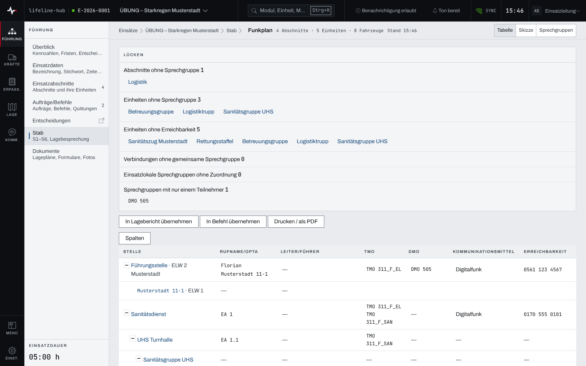
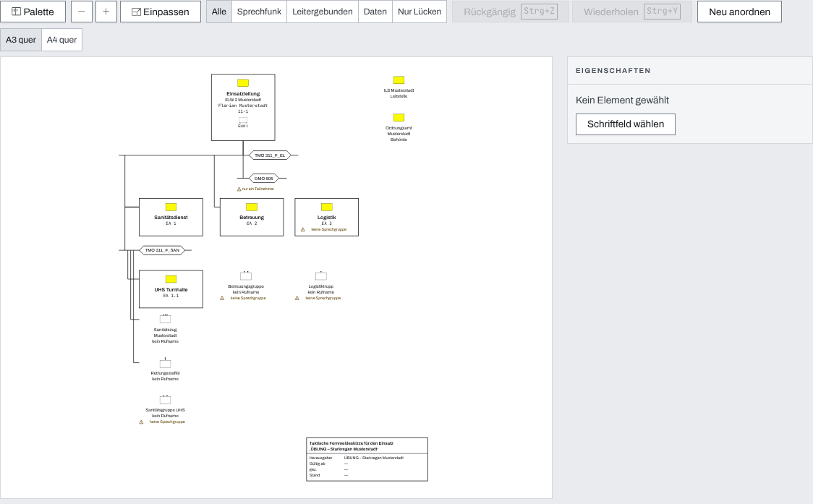
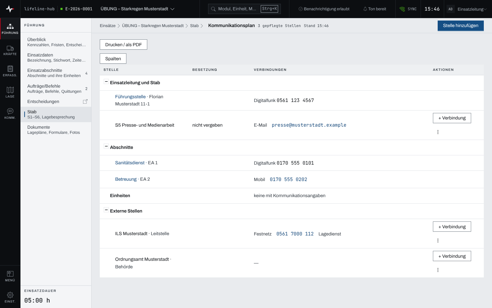
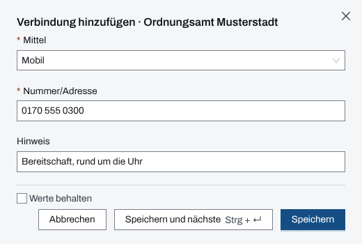

## Überblick

Die Werkzeuge des Sachgebiets S6 stehen im Modul **Fernmeldewesen** in der Kategorie
„Kommunikation“, mit den Reitern „Funkplan“, „Fernmeldeskizze“, „Sprechgruppen“ und
„Kommunikationsplan“. Der **Funkplan** zeigt, wer im Einsatz über welche Sprechgruppen und Wege
erreichbar ist, als Tabelle, als taktische **Fernmeldeskizze** oder als Liste der Sprechgruppen,
und nennt die Lücken. Der **Kommunikationsplan** sammelt die Verbindungen zu Stellen außerhalb der
Gliederung, etwa zur Leitstelle oder zu Behörden. Das Modul braucht keinen Stab: Auch ein ELW 1
ohne Stab funkt und plant damit. Lesen können alle Mitglieder des Einsatzes, pflegen dürfen
Einsatzleitung und Führungspersonal.

## Abläufe

### Den Funkplan lesen und Lücken schließen

1. In der Modulliste unter „Kommunikation“ „Fernmeldewesen“ wählen, oder in der Sprungpalette
   „Funk“ tippen.
2. Den Reiter „Funkplan“ wählen. Oben stehen die „Lücken“, darunter der Plan von
   der Führungsstelle über die Abschnitte bis zu Einheiten und Fahrzeugen.

   

3. Einen Namen in den Lücken oder im Plan wählen. Er führt zum Datensatz, an dem die Angabe
   fehlt: Abschnitt, Einheit oder, bei der eigenen Führungsstelle, „auf Einsatzdaten erfassen“.
4. Dort Sprechgruppen, Kommunikationsmittel und Erreichbarkeit eintragen. Der Funkplan zeigt die
   Änderung sofort.

### Den Funkplan weitergeben

1. Im Funkplan „Drucken / als PDF“ wählen, um ihn zu drucken.
2. „In Lagebericht übernehmen“ legt einen Lagebericht „Funkplan …“ mit dem heutigen Stand an.
3. „In Befehl übernehmen“ legt einen Befehl an, in dem der Funkplan unter „Führung und
   Kommunikation“ steht.

### Sprechgruppen vergleichen

1. Im Fernmeldewesen den Reiter „Sprechgruppen“ wählen. Je Sprechgruppe stehen „Bedingung“,
   „Hinweis“, „Herkunft“ und die „Teilnehmer“ mit ihren Rufnamen.
2. Im Kopf der Spalte „Bedingung“ nach „TMO“ oder „DMO“ filtern, im Kopf von „Herkunft“ nach
   „Katalog“ oder „einsatzlokal“: das Trichterzeichen öffnet die Werte zum Ankreuzen, „OK“
   übernimmt sie. Ein Klick auf einen Spaltenkopf sortiert nach dieser Spalte, „Teilnehmer“ nach
   ihrer Zahl; ohne Sortierung stehen TMO vor DMO.
3. Ist die Liste eingeschränkt, steht darüber „Gefiltert“ mit der Zahl der Treffer und je Wert ein
   Knopf, etwa „Bedingung: DMO“, der genau diesen Filter entfernt; „Filter zurücksetzen“ leert die
   Filter. Filter und Sortierung stehen in der Adresse der Seite.
4. Einen Teilnehmer wählen. Er führt zu seinem Datensatz, dort wird die Sprechgruppe zugeordnet.

### Die Fernmeldeskizze bearbeiten

1. Im Fernmeldewesen den Reiter „Fernmeldeskizze“ wählen, oder in der Modulliste unter
   „Fernmeldewesen“ gleich „Fernmeldeskizze“.

   

2. Ein Element wählen. Rechts unter „Eigenschaften“ stehen seine Angaben; über das Menü des
   Elements stehen „Verbinden mit …“, „zum Datensatz ↗“, „Lösen“ und „Entfernen“ bereit.
3. Über „Palette“ eine „Externe Stelle“, eine „Komponente“ oder einen „Bereich“ anlegen oder eine
   Sprechgruppe auf die Fläche ziehen.
4. Mit „Ebenen“ nur Sprechfunk, leitergebundene Wege, Daten oder nur Lücken zeigen; „Einpassen“
   holt die ganze Skizze ins Bild.
5. Mit „Rückgängig“ (Strg+Z) und „Wiederholen“ (Strg+Y) Schritte zurücknehmen; „Neu anordnen“
   verwirft alle verschobenen Lagen.
6. Zum Drucken „Papierformat“ wählen („A3 quer“ oder „A4 quer“) und „Drucken / als PDF“.

### Eine Stelle in den Kommunikationsplan aufnehmen

1. Im Fernmeldewesen den Reiter „Kommunikationsplan“ wählen, in der Modulliste unter
   „Fernmeldewesen“ gleich „Kommunikationsplan“, oder „Stab“ öffnen und in der Zeile S6
   „Kommunikationsplan“ wählen.

   

2. „Stelle hinzufügen“ wählen.
3. Unter „Art“ „Führungsfunktion“, „Leitstelle“, „Behörde“, „Verbindungsperson“ oder „Sonstige
   Stelle“ wählen, bei einer Führungsfunktion die „Funktion“, sonst die „Bezeichnung“.
4. Bei einer externen Stelle bietet „Bezeichnung“ die passenden Stellen aus den
   [Stammdaten](stammdaten.md) an. Eine davon wählen oder einen eigenen Text eintragen. Die Wahl
   trägt die „Rufnummer“ der Stelle ein, sofern dort noch nichts von Hand steht.
5. „Anlegen“ wählen. Eine eingetragene „Rufnummer“ steht danach als Festnetz-Verbindung an der
   Stelle.

Fehlt dem Plan jede Leitstelle, nennt das Paneel „Lücken“ die zuständige Leitstelle aus den
Stammdaten als Knopf, etwa „ILS Nord hinzufügen“. Er öffnet „Stelle hinzufügen“ mit Art,
Bezeichnung und Rufnummer vorbelegt.

### Eine Verbindung erfassen

1. Im Kommunikationsplan bei der Stelle „+ Verbindung“ wählen.
2. Unter „Mittel“ Festnetz, Mobil, Fax, E-Mail, Messenger, Melder oder Sonstiges wählen,
   „Nummer/Adresse“ und bei Bedarf einen „Hinweis“ eintragen.

   

3. „Speichern“ wählen; „Speichern und nächste“ hält den Dialog für die nächste Verbindung offen.

Über das Menü der Zeile lassen sich Verbindungen bearbeiten oder entfernen, die Bezeichnung
ändern und die Stelle entfernen.

## Hintergrund

### Wer was darf

Das Fernmeldewesen hat eine eigene Freigabe, unabhängig vom Stab: Ist der Stab ausgeblendet oder
gesperrt, bleibt das Fernmeldewesen voll nutzbar; ist das Fernmeldewesen gesperrt, hilft auch ein
freier Stab nicht. Ohne Stab fehlt nur, was vom Stab kommt: im Kommunikationsplan steht als
Besetzung einer Führungsfunktion „—“ (Stab nicht freigegeben), und die Skizze zeigt im Kasten
„Einsatzleitung“ keine Sachgebiete. Bei Einführung des Moduls galt die Rollen-Vorgabe des Stabs
auch für das Fernmeldewesen, eine Ausblendung des Stabs nicht. Kommunikationsplan und
Fernmeldeskizze pflegen Einsatzleitung und Führungspersonal, solange der Einsatz läuft. „In Lagebericht übernehmen“ braucht zusätzlich das Modul Lageberichte, „In Befehl
übernehmen“ das Modul Aufträge. Auf schmalen Bildschirmen und ohne Netz ist die Skizze nur
lesbar. Einzelheiten stehen in [Rechte im Einsatz](rechte-im-einsatz.md).

### Eine Wahrheit

Der Funkplan wird nicht eigens gepflegt. Er entsteht aus Abschnitten, Einheiten, Fahrzeugen,
Personal, Sprechgruppen und der eigenen Führungsstelle (siehe
[Einsatzdaten und Führungsstelle](einsatzdaten.md)). In der Zeile der Führungsstelle steht unter
„Leiter/Führer“ der dort festgelegte Einsatzleiter, sonst „—“. Ordnet die Skizze einer Stelle eine
Sprechgruppe zu, schreibt sie das in den Datensatz der Stelle; Funkplan und Skizze zeigen danach
dasselbe. Die Skizze speichert selbst nur Lage, Komponenten, Verbindungen, Bereiche und das
Schriftfeld. Externe Stellen der Skizze sind die des Kommunikationsplans.

Trägt die eigene Führungsstelle eine Bezeichnung, etwa „ELW 2 Musterstadt“, steht sie im Funkplan
neben „Führungsstelle“ und in der Skizze als eigene Zeile unter „Einsatzleitung“.

Auch im Kommunikationsplan stehen Abschnitte, Einheiten und die eigene Führungsstelle nur
abgeleitet; ihre Angaben pflegt man an ihrem Datensatz, die der Führungsstelle in „Einsatzdaten“
(siehe [Einsatzdaten und Führungsstelle](einsatzdaten.md)). Die Führungsstelle steht dort als
erste Zeile unter „Einsatzleitung und Stab“, sobald sie erfasst ist, mit ihrem Rufnamen und dem
Einsatzleiter, etwa „Florian Kreis 10-1 · Einsatzleiter Anna Schulz“; ist keiner festgelegt, steht
„Einsatzleiter nicht erfasst“. Gepflegt werden im
Kommunikationsplan nur Stellen ohne eigenen Datensatz. Jede Führungsfunktion kommt je Einsatz
einmal vor.

### Sortieren und Filtern

Nur die Liste „Sprechgruppen“ lässt sich sortieren und filtern. Der Funkplan steht in der Ordnung
der Führungsorganisation, von der Führungsstelle über die Abschnitte bis zu Einheiten und
Fahrzeugen, und der Kommunikationsplan in seinen vier Gruppen; diese Folge ist die Aussage. Statt
zu filtern, klappt man Zweige und Gruppen zu. Welche Stellen ohne Sprechgruppe sind, nennen die
„Lücken“.

### Stellen aus den Stammdaten

Vorgeschlagen werden nur aktive externe Stellen der eigenen Organisation. Der Kommunikationsplan
kennt weniger Arten als die Stammdaten: eine Polizeidienststelle kommt als „Behörde“ hinein, eine
Hilfsorganisation als „Sonstige Stelle“. Übernommen werden Bezeichnung und Rufnummer als Text,
nicht der Funkrufname, denn der Plan sammelt Verbindungen außerhalb des Funks. Wird die Stelle
später in den Stammdaten umbenannt, geändert oder deaktiviert, bleibt der Kommunikationsplan, wie
er ist. Die Rufnummer wird als „Festnetz“ übernommen; ist sie eine Mobilnummer, lässt sich das
Mittel an der Verbindung ändern. Lässt sich die Rufnummer nicht speichern, steht die Stelle
trotzdem im Plan, und über dem Plan steht „Rufnummer nicht übernommen“ mit Grund.

### Lücken

Das Paneel „Lücken“ nennt Abschnitte und Einheiten ohne Sprechgruppe, Einheiten ohne
Erreichbarkeit, Verbindungen ohne gemeinsame Sprechgruppe, einsatzlokale Sprechgruppen ohne
Zuordnung, Sprechgruppen mit nur einem Teilnehmer, eine fehlende Verbindung zur Leitstelle und
eine nicht erfasste eigene Führungsstelle. Fehlt eine Quelle, steht „—“ mit Grund statt einer 0.
Der Kopf des Paneels zählt alle Lücken zusammen, etwa „6 Lücken“; eine Einheit ohne Sprechgruppe
und ohne Erreichbarkeit zählt dabei zweimal, die fehlende eigene Führungsstelle nicht. Fehlt eine
Quelle, steht dort keine Zahl. Dieselbe Zahl steht auf der Seite „Stab“ am Werkzeug „Funkplan“.

### Was nicht vorkommt

- Die „Erreichbarkeit“ zeigt die Tabelle am Bildschirm erst bei großer Fensterbreite, im Druck
  immer, im Lagebericht nie.
- Kontaktangaben des Personals stehen nie im Kommunikationsplan; die Besetzung einer Funktion
  steht dort nur als Nebentext.
- Die Skizze zeigt keine Rufnummern und keine Personennamen.
- Weder Funkplan noch Skizze noch Kommunikationsplan schreiben ins Einsatztagebuch. Der
  Kommunikationsplan geht nicht in den Lagebericht; er wird gedruckt.

### Skizze als Anlage

Lagebericht und Befehl können die Fernmeldeskizze mit „Fernmeldeskizze anfügen“ als Bild
mitnehmen, wenn das Fernmeldewesen freigegeben ist. Gedruckt wird die Skizze mit dem Funkplan als Anlage.

### Alte Adressen

Lesezeichen auf die frühere Adresse unter „Stab“ führen weiter zum Fernmeldewesen, auch mit der
gewählten Darstellung.

### Ohne Netz

Der Kommunikationsplan bleibt ohne Netz lesbar, seine Bedienung ist dann gesperrt. Die eigene
Führungsstelle wird nicht vorgehalten; nach einem Neuladen ohne Netz steht sie dort als „nicht
geladen“. Die Daten der Skizze werden nicht
vorgehalten; der Funkplan nennt sie ohne Netz „nicht geladen“ (siehe
[Arbeiten ohne Netz](ohne-netz.md)).

## Grundlagen und Quellen

- FwDV 100, Anlage 5: Funkplan.
- BBK, „Taktische Zeichen im Bevölkerungsschutz“, Anhang J.5: Fernmeldeskizze.
- DV 800, Nr. 1.5.1.1: Kommunikationsunterlagen im Befehl.
