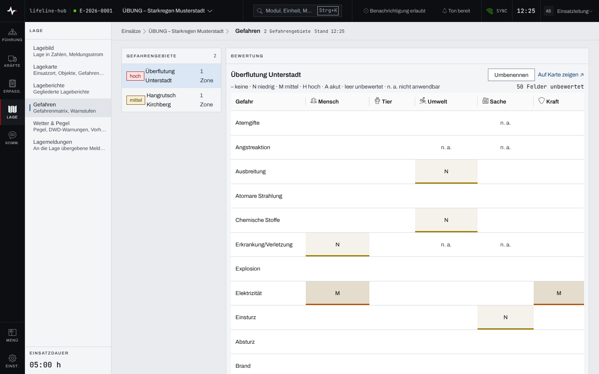
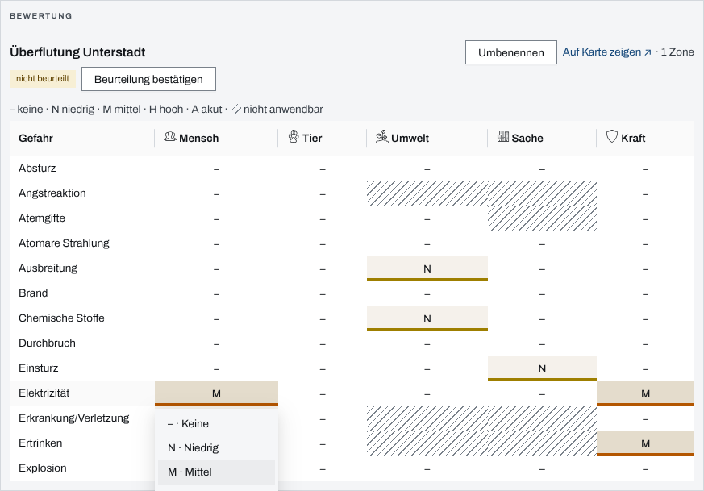
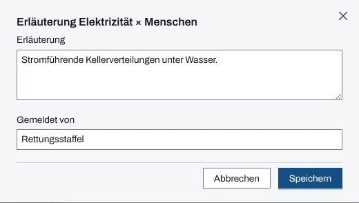

## Überblick

Das Modul „Gefahren“ bewertet je Gefahrengebiet, welche Gefahr welches Schutzobjekt wie stark
bedroht. Die Bewertung ist eine Matrix aus 13 Gefahrentypen und fünf Schutzobjekten. Aus ihr
ergibt sich die Warnstufe des Gebiets, die Lagekarte, Lagebild und Überblick zeigen. Die Gebiete
selbst entstehen auf der Lagekarte; bewertet und benannt werden sie hier.

## Abläufe

### Gefahrengebiete ansehen

1. Im Bereich „Lage“ „Gefahren“ öffnen. Links stehen unter „Gefahrengebiete“ alle Gebiete mit
   ihrer höchsten Warnstufe. Darunter steht bei einem beurteilten Gebiet, wie viele Gefahren es
   trägt und wie hoch die höchste ist, etwa „3 Gefahren · hoch“, bei einem anderen
   „nicht beurteilt“.
2. Ein Gebiet in der Liste wählen. Rechts unter „Bewertung“ steht seine Matrix: je Zeile ein
   Gefahrentyp, je Spalte ein Schutzobjekt, in der Zelle das Kürzel der Warnstufe. Darüber steht,
   ob die Matrix beurteilt ist: „beurteilt“ mit Zeit und Person oder „nicht beurteilt“.

   

3. Um das Gebiet auf der Karte zu sehen, „Auf Karte zeigen ↗“ wählen. Die Lagekarte öffnet sich
   und zeigt das Gebiet. Daneben steht, aus wie vielen Zonen es besteht („· 1 Zone“).

### Eine Gefahr bewerten

1. Das Gebiet wählen.
2. In der Matrix die Zelle der Gefahr und des Schutzobjekts wählen, etwa „Elektrizität“ in der
   Spalte „Mensch“. Die ganze Zelle ist die Schaltfläche, nicht nur das Kürzel in ihrer Mitte.

   

3. Im Menü die Stufe wählen: „N · Niedrig“, „M · Mittel“, „H · Hoch“ oder „A · Akut“. Die Zelle
   zeigt sofort das Kürzel.

### Die Beurteilung bestätigen

1. Das Gebiet wählen und die Matrix Zeile für Zeile durchsehen. Jede Zelle ohne andere Stufe
   zeigt „–“ (keine).
2. Gefahren, die bestehen, wie oben bewerten.
3. „Beurteilung bestätigen“ wählen. Über der Matrix steht danach „beurteilt“ mit Zeit und dem
   eigenen Namen, und in der Gebietsliste entfällt „nicht beurteilt“.

### Eine Bewertung erläutern

1. Eine Zelle wählen und im Menü „Erläuterung …“ wählen. Das geht an jeder Zelle, auch an einer
   auf „–“.
2. Unter „Erläuterung“ festhalten, worin die Gefahr besteht oder warum sie nicht besteht, und
   unter „Gemeldet von“, wer sie gemeldet hat.

   

3. „Speichern“ wählen. Die Zelle trägt danach oben rechts ein kleines Dreieck, und unter der
   Matrix steht sie in der Liste „Erläuterungen“.

### Erläuterungen lesen

1. Das Gebiet wählen. Unter der Matrix stehen unter „Erläuterungen“ alle Zellen mit Erläuterung:
   Gefahr und Schutzobjekt, die Stufe, der Text, wer sie gemeldet hat und wann und von wem sie
   zuletzt geändert wurde.
2. Eine Zeile wählen. Mit Schreibrecht öffnet sich der Dialog der Zelle, ohne Schreibrecht hebt
   die Matrix die Zelle mit einem Rahmen hervor.

### Ein Gefahrengebiet umbenennen

1. Das Gebiet in der Liste wählen.
2. „Umbenennen“ wählen.
3. Unter „Bezeichnung“ den neuen Namen eingeben und „Speichern“ wählen. Ohne Namen speichert die
   App nichts.

## Hintergrund

### Matrix und Warnstufe

- Die Zeilen sind die 13 Gefahrentypen, alphabetisch von „Absturz“ bis „Explosion“, die Spalten
  die Schutzobjekte Menschen, Tiere, Umwelt, Sachwerte und Einsatzkräfte („Mensch“, „Tier“,
  „Umwelt“, „Sache“, „Kraft“). In derselben Folge stehen die Gefahren im Lagebild, in der
  Vorschau der Sprungpalette und in der Gefahrenauswahl eines Schadens.
- Jede Zeile ist so hoch wie eine Schaltfläche der eingestellten Bediendichte. Am Arbeitsplatz
  im Führungsfahrzeug (kompakt) steht die ganze Matrix ohne Bildlauf auf dem Schirm.
- Jede Zelle zeigt „–“ (keine), bis eine andere Stufe gesetzt ist. Eine Zelle, die nie gewählt
  wurde, und eine Zelle auf „– · Keine“ sagen dasselbe.
- Schraffierte Zellen sind Paare, die nicht anwendbar sind; sie lassen sich nicht bewerten. Die
  Legende unter der Matrix nennt die Kürzel, die Schraffur und das Dreieck „mit Erläuterung“.
- Eine Zelle mit Erläuterung trägt oben rechts ein Dreieck in der Farbe ihres Kürzels; ein
  Screenreader liest „… · mit Erläuterung“. Die Liste „Erläuterungen“ steht in derselben Folge
  wie die Matrix, alphabetisch nach Gefahr, darin nach Schutzobjekt. Ohne Erläuterung im Gebiet
  fehlt sie ganz.
- Eine Erläuterung zu „–“ (keine) wird gespeichert und zählt als Aussage, etwa „geprüft, kein
  Strom im Keller“: Lagekarte und Lagevortrag nennen sie mit, Lagebild und Vorschau der
  Sprungpalette zeigen die Gefahr mit dem Dreieck. Die Warnstufe des Gebiets und die Zahl seiner
  Gefahren ändert sie nicht.
- Dasselbe Dreieck tragen die Zellen der Matrix in der Vorschau eines Gefahrengebiets in der
  Sprungpalette und die Gefahren im Paneel „Gefahrenmatrix“ des Lagebilds (Kapitel
  [Lagebild](lagebild.md)). Den Text der Erläuterung zeigen beide nicht.
- Die höchste Stufe aller Zellen ist die Warnstufe des Gebiets. Sie steht in der Liste, als Text
  an der Fläche auf der Lagekarte und, über alle Gebiete, im Überblick und im Lagebild.

### Beurteilung

- Ob jemand die Matrix angesehen hat, zeigt nicht die Zelle, sondern das Gebiet: „nicht
  beurteilt“, bis jemand „Beurteilung bestätigen“ wählt, danach „beurteilt“ mit Zeit und Person.
  Ein neues Gebiet ist nicht beurteilt.
- In der Gebietsliste zählt ein beurteiltes Gebiet seine Gefahren: jede Gefahr mit mindestens
  einer Zelle über „keine“ zählt einmal, gleich für wie viele Schutzobjekte. Daneben steht die
  höchste Stufe. Ein beurteiltes Gebiet ohne Gefahr zeigt „0 Gefahren“.
- Ändert in einem beurteilten Gebiet jemand eine Zelle, nennt die Beurteilung danach die Zeit
  dieser Änderung und diese Person. In einem nicht beurteilten Gebiet ändert eine Zelle daran
  nichts: Eine gesetzte Zelle sagt nichts über die übrigen.
- Nicht beurteilte Gebiete nennt auch das Lagebild unter dem Paneel „Gefahrenmatrix“ und die
  Kennzahl „Warnstufe“ im Überblick.
- Die Gefahren eines Gebiets mit Stufe und Erläuterung zeigt auch die Lagekarte, wenn eine Zone
  des Gebiets gewählt ist (Kapitel [Lagekarte, Zeichnen und Messen](lagekarte.md)), und die
  Übernahme „Gefahren-/Schadenlage“ in den Lagevortrag (Kapitel [Lageberichte](lageberichte.md)).
  „Gemeldet von“ übernimmt der Lagevortrag nicht.

### Einsatztagebuch

Jede geänderte Warnstufe schreibt einen Systemeintrag ins Einsatztagebuch, etwa „Gefahr «Elektrizität» für
«Menschen» in «Überflutung Unterstadt» auf Warnstufe «hoch» gesetzt.“; eine auf „Keine“
gesenkte endet mit „… aufgehoben.“ Eine Zelle ohne Bewertung auf „Keine“ zu setzen, schreibt
keinen Eintrag. Jedes „Beurteilung bestätigen“ schreibt „Beurteilung der Gefahrenmatrix in
«Überflutung Unterstadt» bestätigt.“

### Ein Gebiet anlegen

Ein Gefahrengebiet entsteht durch Zeichnen auf der Lagekarte, mit „Gefahrengebiet zeichnen“
(Kapitel [Lagekarte, Zeichnen und Messen](lagekarte.md)). Gibt es noch keines, zeigt die Seite
„Noch keine Gefahrengebiete“ und, mit Schreibrecht, den Knopf „Gefahrengebiet zeichnen“: Er
öffnet die Lagekarte gleich im Zeichenmodus. Ein Gebiet ohne Bezeichnung heißt
„Gefahrengebiet #…“, bis es umbenannt wird.

### Rechte und ohne Netz

Lesen kann jede Person im Einsatz. Bewerten, erläutern, die Beurteilung bestätigen und
umbenennen brauchen das Schreibrecht:
Einsatzleitung oder Führungspersonal in einem laufenden Einsatz (Kapitel
[Rechte im Einsatz](rechte-im-einsatz.md)). Ohne Schreibrecht steht über der Matrix der Grund,
„Umbenennen“ und „Beurteilung bestätigen“ fehlen, und die Zellen lassen sich nicht wählen; die
Liste „Erläuterungen“ bleibt lesbar.

Die Gefahrengebiete hält die App für die Arbeit ohne Netz vor, die Matrix nicht (Kapitel
[Arbeiten ohne Netz](ohne-netz.md)).
