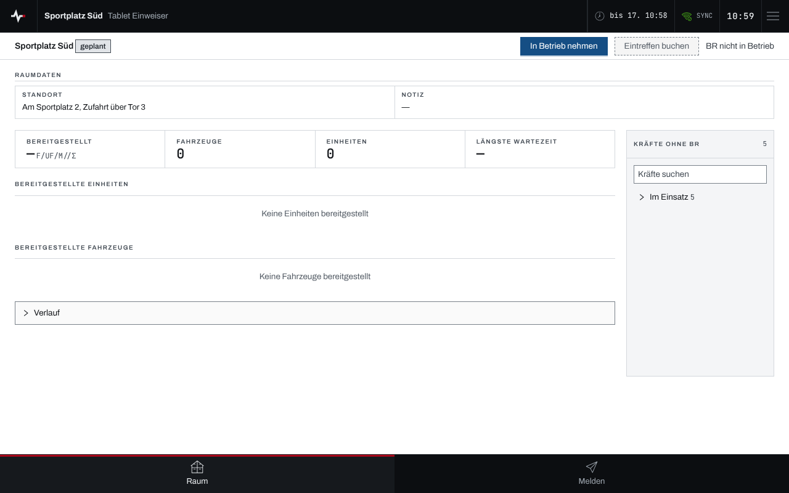
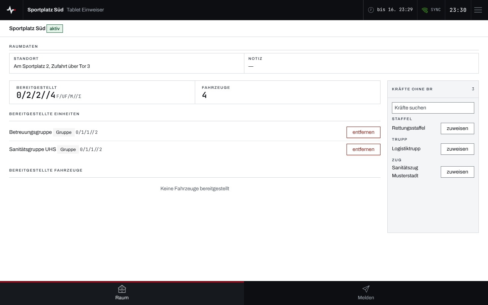
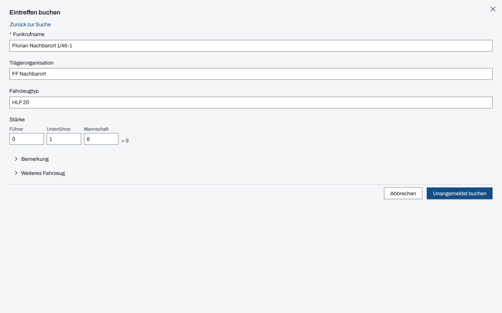
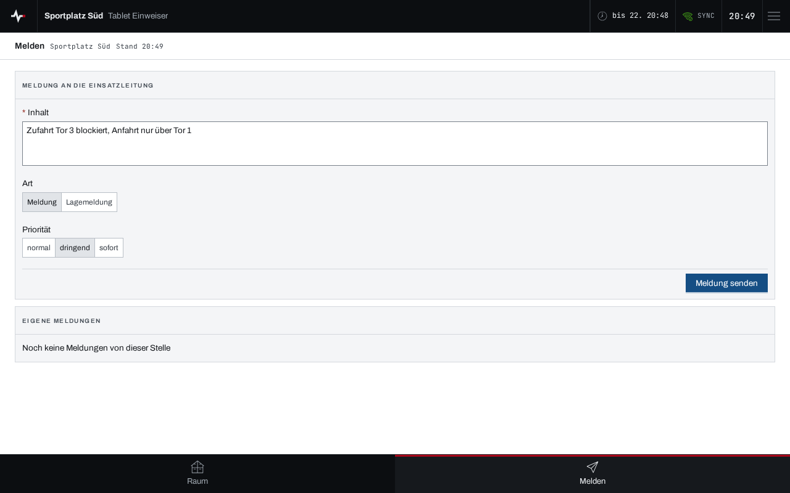

## Überblick

Ein Tablet am **Bereitstellungsraum** führt die Kräfte, die dort bereitstehen: Es bucht
eintreffende Einheiten und Fahrzeuge ein, auch solche, die im Einsatz noch niemand kennt, zeigt,
welche Kräfte die Einsatzleitung abgerufen hat, bucht ihr Ausrücken, trägt Kräfte aus, nimmt
einen geplanten Raum in Betrieb, zeigt das Material des Raums und schickt Meldungen an die
Einsatzleitung. Es ist an genau einen Bereitstellungsraum gekoppelt (siehe
[Geräte koppeln](geraete-koppeln.md)) und zeigt nur diesen.

Die Navigation unten führt zu „Raum“ und „Melden“. Die Bedienung des Geräts selbst steht in
[Gerät bedienen](geraet-bedienen.md).

## Abläufe

### Raum in Betrieb nehmen

1. „Raum“ öffnen. Ein Raum, den die Einsatzleitung erst geplant hat, trägt „geplant“.

   

2. Sobald der Raum besetzt ist, „In Betrieb nehmen“ wählen. Der Raum trägt danach „aktiv“.

Im Zustand „geplant“ nimmt der Raum noch keine Kräfte an: die Knöpfe zum Zuweisen fehlen,
„Eintreffen buchen“ steht gesperrt mit „BR nicht in Betrieb“.

### Eintreffen buchen

1. „Raum“ öffnen und oben „Eintreffen buchen“ wählen. Die Suche füllt den Bildschirm.
2. Den Namen oder einen Funkrufnamen der Kraft eingeben. Die Treffer stehen unter „Erwartet“ und
   „Im Einsatz“. Kündigt eine Nachforderung Kräfte für diesen Raum an, stehen sie darüber unter
   „Aus Nachforderungen“, je Rufname mit Art, Nachforderung und „erwartet …“.
3. Beim Treffer „Eintreffen“ wählen. Die Bestätigung lautet „… gebucht“; die Kraft erscheint am
   Ende von „Bereitgestellte Einheiten“ oder „Bereitgestellte Fahrzeuge“ mit „seit“ und ihrer
   Wartezeit. Oben steht, wer am längsten wartet. Unter „Aus Nachforderungen“ bucht „Eintreffen“
   die gleichnamige Einheit des Einsatzes; gibt es keine, öffnet sich die Erfassung mit Rufname und
   Art vorbelegt und „Aus Nachforderung …“ darüber, und „Eintreffen buchen“ legt sie an.

   

### Eine unangemeldete Kraft buchen

1. Wie oben „Eintreffen buchen“ wählen und den Funkrufnamen eingeben.
2. Findet die Suche die Kraft nicht, „Nicht in der Liste“ wählen. „Funkrufname“ ist mit der Suche
   vorbelegt.
3. Was die Kraft meldet eintragen: „Trägerorganisation“, „Fahrzeugtyp“ und „Stärke“, unter
   „Bemerkung“ einen freien Text, unter „Weiteres Fahrzeug“ die übrigen Fahrzeuge.

   

4. „Unangemeldet buchen“ wählen. Die Bestätigung lautet „… unangemeldet gebucht, Einsatzleitung
   informiert“. Die Kraft steht als neue Einheit im Raum und trägt „nicht übernommen“, bis die
   Einsatzleitung sie übernimmt oder abweist.
5. Steht „Schon im Einsatz: …“, kennt der Einsatz den Funkrufnamen schon. „Diese buchen“ bucht die
   vorhandene Kraft; „Trotzdem neu anlegen“ nur, wenn es wirklich eine andere Kraft ist. Steht die
   vorhandene Kraft schon in einem Raum, fehlt „Diese buchen“.

### Ohne Netz buchen

1. Wie oben „Eintreffen buchen“ wählen und die Kraft buchen, aus der Suche oder mit „Nicht in der
   Liste“.
2. Die Bestätigung lautet „Offline vorgemerkt: Eintreffen …“. Die Kraft steht unter
   „Vorgemerkt“, unter den bereitgestellten Fahrzeugen, mit „vorgemerkt“ und der Uhrzeit der
   Erfassung.
3. Nichts weiter tun: Sobald wieder Netz da ist, geht die Buchung hinaus. Die Kraft steht dann in
   der Belegung, „Vorgemerkt“ verschwindet.
4. Meldet die Betriebszeile „abgelehnt – prüfen“, hat der Server die Buchung abgelehnt, etwa weil
   der Raum inzwischen aufgelöst ist. Prüfen wie im Kapitel [Arbeiten ohne Netz](ohne-netz.md).

### Kräfte aus der Liste zuweisen

1. „Raum“ öffnen. Rechts stehen unter „Kräfte ohne BR“ die Einheiten und die Fahrzeuge ohne
   Einheit, die keinem Bereitstellungsraum zugeordnet sind: oben „Erwartet“, darunter zugeklappt
   „Im Einsatz“ für Kräfte, die schon in einem Abschnitt stehen.
2. Bei Bedarf unter „Kräfte suchen“ den Namen eingeben.
3. Bei der Kraft „zuweisen“ wählen. Anders als „Eintreffen“ trägt das kein Eintreffen in die
   Zeitachse der Kraft ein.

### Abgerufene Kräfte ausrücken lassen

1. „Raum“ öffnen. Ruft die Einsatzleitung eine Kraft ab, steht sie ohne Neuladen oben unter
   „Abgerufen“: mit „abgerufen“, der Uhrzeit des Abrufs, dem Ziel und der Auftragsnummer, etwa
   „abgerufen 1454 → Sanitätsdienst · Auftrag Nr. 6“. Ein Ton erklingt nicht.

   

2. Der Kraft das Ziel nennen und sie ausrücken lassen.
3. „Ausrücken buchen“ wählen. Die Bestätigung lautet „… ausgerückt“; die Kraft und die mit ihr
   abgerufenen Untereinheiten stehen in keinem Raum mehr.

### Kräfte austragen

1. „Raum“ öffnen.
2. Bei einer Kraft, die ohne Abruf geht oder irrtümlich gebucht ist, das Aktionsmenü öffnen und
   „Austragen“ wählen. Sie steht danach wieder unter „Kräfte ohne BR“.

### Verlauf lesen

1. „Raum“ öffnen und ganz unten „Verlauf“ aufklappen.
2. Die Liste nennt, neueste zuerst, wann welche Kraft eingetreten, abgerufen, ausgetreten oder aus
   einem anderen Raum gewechselt ist und wann ein Abruf zurückgenommen wurde. Ein Wechsel nennt den
   anderen Raum mit seiner Bezeichnung, ein Abruf und das Ausrücken danach das Ziel.

### Material des Raums ansehen

1. „Raum“ öffnen. Unter der Belegung steht „Material“ mit der Zahl der Posten und, falls vorhanden,
   dem Ausfall.
2. Je Posten stehen Bezeichnung, Menge (etwa „6 von 10 übrig“) und Status. Liegt nichts im Raum,
   steht dort „Kein Material“.

Die Sektion fehlt, wenn das Modul Material im Einsatz nicht freigegeben ist.

### Meldung an die Einsatzleitung

1. Unten „Melden“ wählen.
2. Den „Inhalt“ eingeben, unter „Art“ „Meldung“ oder „Lagemeldung“ und die „Priorität“ (normal,
   dringend, sofort) wählen. Eine Lagemeldung steht bei der Führung gleich in den Lagemeldungen.

   

3. „Meldung senden“ wählen. Die Bestätigung lautet „Meldung #… gesendet“; die Meldung steht danach
   unter „Eigene Meldungen“.

## Hintergrund

### Was das Tablet nicht tut

Das Tablet führt nur seinen eigenen Raum. Es legt keinen Raum an, wechselt nicht in einen anderen,
ändert weder Stammdaten noch Bezeichnung, Standort und Notiz des Raums, löst den Raum nicht auf und
storniert ihn nicht; das bleibt der Einsatzleitung. Auch an den Einheiten und Fahrzeugen selbst ändert es nichts,
mit einer Ausnahme: „Unangemeldet buchen“ und „Eintreffen buchen“ aus einer Nachforderung legen eine
neue Einheit mit ihren Fahrzeugen an. Ob sie bleibt, entscheidet die Einsatzleitung; Übernehmen und
Abweisen gibt es am Tablet nicht (Kapitel [Einheiten](einheiten.md)). Die Suche findet nur Kräfte
des Einsatzes, keine aus den Stammdaten.

Nachforderungen selbst stehen am Tablet nicht. Es sieht nur, wer für den eigenen Raum erwartet wird
(Art, Anzahl, Stufe, Rufnamen, erwartetes Eintreffen), und verknüpft beim Buchen die Einheit mit der
Nachforderung. „Eintreffen melden“, Ablehnen, Zurückziehen und „Als Einheit übernehmen“ bleiben der
Einsatzleitung (Kapitel [Nachforderungen](nachforderung.md)).

Material zeigt das Tablet nur an, und nur das Material des eigenen Raums. Zuordnen, Lösen,
Ausgeben, Erfassen und den Status ändern bleibt der Führungsstelle (Kapitel
[Material](material.md)); fehlt am Raum etwas, geht das als Meldung an die Einsatzleitung.

Abrufen ist eine Entscheidung der Einsatzleitung: am Tablet gibt es weder „Abrufen“ noch „Abruf
zurücknehmen“. Das Tablet zeigt den Abruf und bucht das Ausrücken. Bis dahin zählt die abgerufene
Kraft weiter in den Zahlen des Raums.

### Was ein Eintreffen schreibt

„Eintreffen“ bucht den Eintritt in den Raum und bei einer Einheit das Eintreffen in ihrer
Zeitachse, mit genau einem Eintrag im Einsatztagebuch. Eine unangemeldete Kraft schickt dazu eine
Meldung an die Einsatzleitung; die Bemerkung steht nicht darin. Einzelheiten stehen im Kapitel
[Bereitstellungsräume](bereitstellungsraeume.md).

### Ohne Netz

Eine Buchung ohne Netz zählt mit dem Zeitpunkt der Erfassung und kommt genau einmal an, auch
wenn die Verbindung mitten im Senden abreißt. „Vorgemerkt“ steht nur auf diesem Tablet; die
Einsatzleitung sieht die Kraft und die Meldung zu einer unangemeldeten Kraft erst nach dem
Senden.

Eine vorgemerkte Kraft steht in der Suche mit „vorgemerkt …“ und lässt sich nicht noch einmal
buchen. „Schon vorgemerkt: …“ nennt eine vorgemerkte unangemeldete Kraft mit demselben
Funkrufnamen; dann gibt es nur „Trotzdem neu anlegen“. Ob ein Funkrufname schon im Einsatz steht,
prüft das Tablet mit den Kräften, die es zuletzt mit Netz geladen hat; was es nicht kennt, prüft
der Server beim Senden. Lehnt er ab, steht die Buchung mit dem Grund unter „Offline-Aktionen
wiederherstellen“.

Das Tablet hält den Raum nicht für die Arbeit ohne Netz vor: Buchen ohne Netz geht auf der Seite,
die mit Netz geöffnet war. Vorgemerkte Buchungen bleiben auf dem Tablet, bis sie gesendet sind.

### Verlauf und Wartezeiten

Das Tablet liest den Verlauf seines eigenen Raums wie die Einsatzleitung; Wartezeit, Folge und
Verlauf beschreibt das Kapitel [Bereitstellungsräume](bereitstellungsraeume.md). Von einem anderen
Raum sieht es nur die Bezeichnung in einem Wechsel, nicht dessen Belegung oder Verlauf.

### Absender der Meldungen

Meldungen tragen den Raum und die Gerätebezeichnung als Absender, etwa „Sportplatz Süd · Tablet
Einweiser“.
