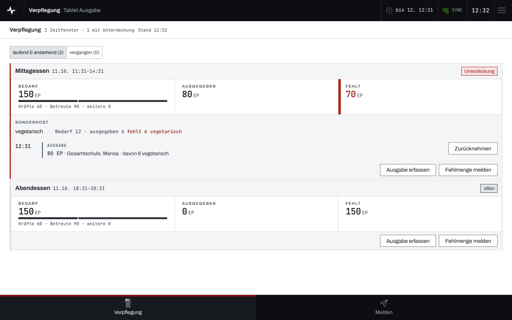
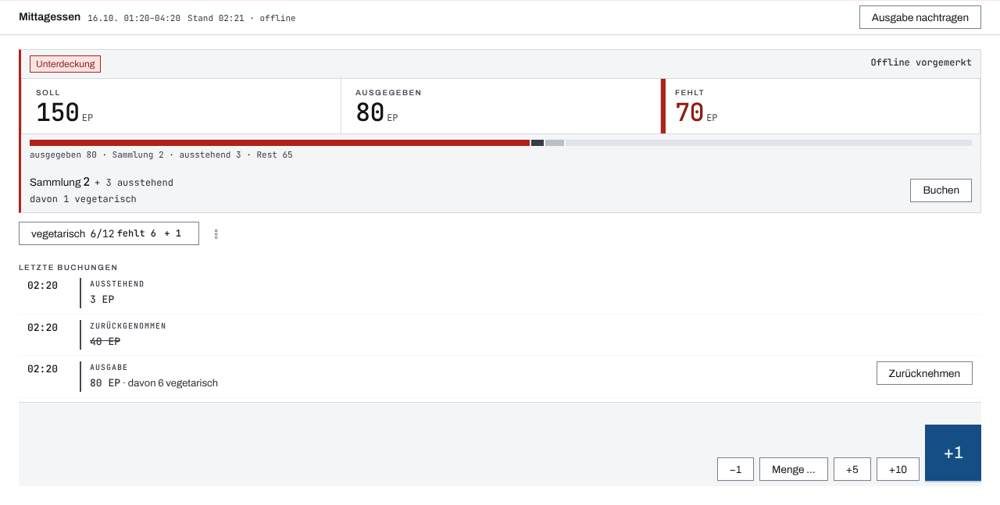
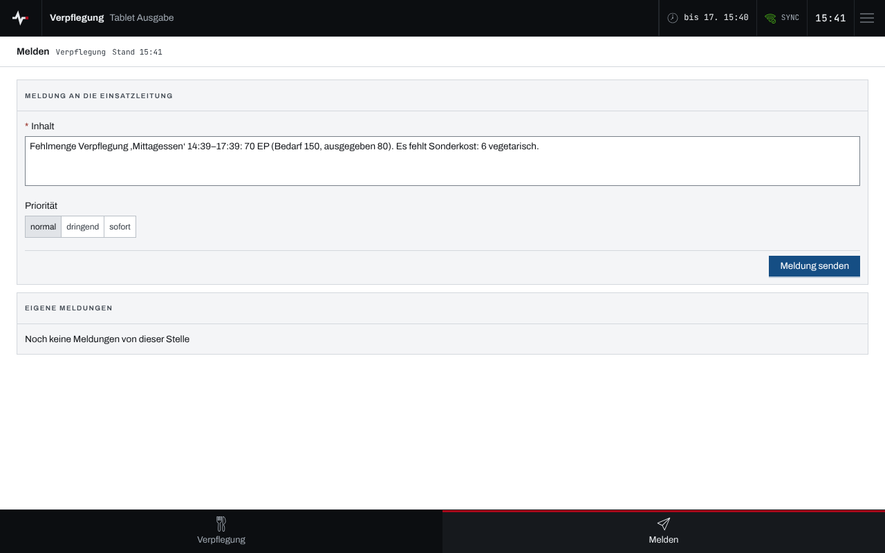

## Überblick

Ein Tablet an der **Essensausgabe** zählt, wie viele Essensportionen (EP) je Zeitfenster
ausgegeben sind, bucht sie bei Bedarf auf die Einheit, die abholt, zeigt, welche Einheit noch
nicht verpflegt ist, und meldet eine Fehlmenge an die Einsatzleitung. Die Zeitfenster mit ihrem
Bedarf plant die Einsatzleitung; das Tablet arbeitet mit ihnen, plant aber selbst nicht.

Die Verpflegungsansicht ist an keine Stelle gebunden und sieht alle Zeitfenster und alle
Verpflegungsstellen des Einsatzes (siehe [Geräte koppeln](geraete-koppeln.md)); an welcher Stelle
ausgegeben wird, wählt das Tablet beim Zählen. Die Navigation unten führt zu „Verpflegung“ und
„Melden“. Die Bedienung des Geräts selbst steht in [Gerät bedienen](geraet-bedienen.md).

## Abläufe

### Zeitfenster im Blick behalten

1. „Verpflegung“ öffnen. Oben wechselt die Leiste zwischen „laufend & anstehend“, „vergangen“
   und „Stellen“.
2. Jede Karte zeigt Bezeichnung, Zeitraum und die Art, etwa „warm“, dazu „Bedarf“ (Kräfte,
   Betreute, weitere), „Ausgegeben“ und „Fehlt“, darunter je Stelle das dort Ausgegebene, die
   Sonderkost und die einzelnen Ausgaben.

   

3. Unter „Stellen“ die Verpflegungsstellen des Einsatzes lesen: Art, Standort, Status und das
   laufende Zeitfenster mit den an der Stelle ausgegebenen Portionen.

Rechts oben steht die Deckung: „gedeckt“, „offen“ (Fehlmenge, Zeitfenster noch nicht begonnen)
oder „Unterdeckung“ (Fehlmenge, Zeitfenster hat begonnen).

### Portionen zählen

1. Beim laufenden oder anstehenden Zeitfenster „Ausgabe öffnen“ wählen. Oben stehen „Soll“,
   „ausgegeben“ und „fehlt“, unten die Zähltasten; die Navigation zeigt weiter „Verpflegung“.
   „Ausgabe öffnen“ in der Zeile einer Stelle auf der Karte öffnet die Ausgabe gleich mit dieser
   Stelle.
2. Unter den Zahlen die eigene Stelle wählen oder „ohne Stelle“. Ist dem Zeitfenster genau eine
   Stelle zugeordnet, ist sie schon gewählt. Daneben steht, wie viel an ihr ausgegeben ist, etwa
   „an der Stelle 80 EP“.
3. Holt eine Einheit ab, unter „Empfänger“ die Einheit wählen oder weiter unten in der Liste
   „Noch nicht verpflegt“ bei ihr „Wählen“ tippen. Die Taste mit ihrer Stärke, etwa „+9“, zählt so
   viele Portionen auf einmal; „−1“ nimmt einzelne zurück, wenn weniger da sind. Für eine
   Zuführung „Zuführung …“ mit dem Abschnitt wählen, sonst bleibt es bei „ohne Empfänger“.
4. Je ausgegebene Portion „+1“ tippen, für mehrere „+5“, „+10“ oder „Menge …“. Für Sonderkost die
   Taste der Kostform tippen, etwa „vegetarisch“; sie zählt auch in die Sammlung.

   

5. Verzählt: „−1“ nimmt die zuletzt gezählte Portion zurück.
6. Nichts weiter tun: nach kurzer Ruhe bucht das Tablet die Sammlung als eine Ausgabe und meldet
   „Gebucht: …“ mit „Rückgängig“. „Buchen“ bucht sofort.

### Sehen, welche Einheit noch nicht verpflegt ist

1. In der Ausgabeansicht unter den Sonderkost-Tasten „Noch nicht verpflegt“ lesen: die
   eingetroffenen Einheiten ohne Ausgabe in diesem Zeitfenster, mit Funkrufname, Stärke und
   Abschnitt. Darunter stehen gesondert die Einheiten „ohne Eintreffen“.
2. Unter „Verpflegt“ stehen die Einheiten mit Menge und Uhrzeit ihrer Ausgabe und die Zuführungen
   an Abschnitte.
3. Auf der Liste der Zeitfenster zeigt die Klappe „Einheiten“ jeder Karte dieselben Listen.

### Ausgabe nachtragen

1. Beim Zeitfenster „Ausgabe nachtragen“ wählen, auch bei einem vergangenen. Der Dialog
   „Ausgabe nachtragen: …“ nennt Bedarf, bisher Ausgegebenes und die Fehlmenge.
2. Unter „Menge (EP)“ die ausgegebenen Portionen eintragen, unter „Empfänger“ bei Bedarf die
   Einheit oder die Zuführung wählen (bei leerer Menge trägt die Einheit ihre Stärke ein) und
   unter „Stelle“ die Stelle. „Zeitpunkt“ leer heißt jetzt. Der Ort (im Einsatz mit Stellen
   „Zuführungsziel“), Sonderkost und eine Bemerkung stehen unter „Weitere Angaben“.
3. „Nachtragen“ wählen. Die Ausgabe steht danach in der Karte, „Ausgegeben“ und „Fehlt“ rechnen
   sie mit.

### Ausgabe zurücknehmen

1. In der Karte oder unter „Letzte Buchungen“ bei der Ausgabe „Zurücknehmen“ wählen.
2. Die Rückfrage „Ausgabe zurücknehmen?“ mit „Zurücknehmen“ bestätigen.

Die Rücknahme ist endgültig. Eine falsch gezählte Ausgabe wird zurückgenommen und neu gezählt
oder nachgetragen.

### Fehlmenge melden

1. Beim Zeitfenster „Fehlmenge melden“ wählen. Der Knopf steht nur da, solange etwas fehlt.
2. Die Seite „Melden“ öffnet sich mit vorbereitetem Text, etwa „Fehlmenge Verpflegung ‚Mittagessen‘
   …: 70 EP (Bedarf 150, ausgegeben 80).“ samt fehlender Sonderkost.

   

3. Bei Bedarf Text und „Priorität“ anpassen und „Meldung senden“ wählen.

## Hintergrund

### Was das Tablet nicht tut

Zeitfenster anlegen, den Bedarf ändern und Zeitfenster löschen bleiben der Einsatzleitung,
ebenso Stellen anlegen, bearbeiten, in Betrieb nehmen, auflösen und stornieren und das Zuordnen
von Stellen zu Zeitfenstern; am Tablet fehlen diese Knöpfe. Eine Ausgabe auf eine Nachforderung zu buchen, lehnt der Server für
ein Gerät ab. Statt nachzufordern meldet das Tablet die Fehlmenge an die Einsatzleitung.

### Wie gezählt wird

Gezählte Portionen sammeln sich erst auf dem Tablet und gehen als eine Ausgabe an den Server:
3 Sekunden nach dem letzten Tipp, spätestens 15 Sekunden nach dem ersten, sofort ab 50 Portionen,
mit „Buchen“, wenn das Zeitfenster endet oder wenn eine andere Stelle oder ein anderer Empfänger
gewählt wird. Die Ausgabe trägt Stelle und Empfänger, die bei ihrer ersten Portion gewählt
waren. Den Empfänger merkt sich das Tablet nicht. Eine aufgelöste Stelle steht nicht zur
Wahl. Die gewählte Stelle merkt sich das Tablet nicht; geöffnet wird mit der Stelle, aus deren
Zeile auf der Karte „Ausgabe öffnen“ kam, sonst mit der einzigen zugeordneten Stelle oder ohne
Stelle. Die Wahl beim Öffnen bleibt, auch wenn die Einsatzleitung währenddessen die Stellen des
Zeitfensters ändert; nur das Auflösen der gewählten Stelle setzt sie auf „ohne Stelle“. Bei einem vergangenen Zeitfenster sind die
Zähltasten gesperrt („Zeitfenster vorbei“). „Fehlt“ zählt nur Gebuchtes; die Sammlung steht
daneben.

### Wer als verpflegt gilt

Eine Ausgabe an eine Einheit verpflegt auch ihre Untereinheiten. Eine Zuführung an einen
Abschnitt verpflegt keine Einheit; die Zeilen der Einheiten im Abschnitt nennen sie nur. Ohne
Eintreffen in der Kräfte-Zeitachse steht eine Einheit gesondert unter „ohne Eintreffen“, wer erst
nach dem Ende des Zeitfensters eintraf, fehlt für dieses Zeitfenster. Die Einheiten liest das
Tablet aus der Verpflegung selbst, mit Namen und Stärke, aber ohne Namen von Personen; die
Einheitenliste des Einsatzes bleibt ihm verschlossen.

### Länge der Angaben

Der Ort einer Ausgabe darf höchstens 500 Zeichen lang sein, ihre Bemerkung 2 000. Darüber sendet
der Dialog „Ausgabe nachtragen“ nicht, und der Zähler unter dem Feld nennt die Überlänge; gekürzt
wird nichts. Eine zu lange Bemerkung klappt „Weitere Angaben“ beim Nachtragen auf. Zugeklappt
nennt der Kopf, was darin eingetragen ist, etwa „Weitere Angaben · 3 vegan · Bemerkung“.

### Ohne Netz

Ausgaben merkt das Gerät ohne Netz vor und sendet sie nach (siehe
[Arbeiten ohne Netz](ohne-netz.md)). Bis dahin stehen sie in der Karte als „ausstehend“, in der
Ausgabeansicht unter „Letzte Buchungen“ und als „+ … ausstehend“, und zählen noch nicht in
„Ausgegeben“ und „Fehlt“; eine vorgemerkte Ausgabe an eine Einheit nimmt diese noch nicht aus
„Noch nicht verpflegt“, ihre Zeile zeigt „ausstehend … EP“. Wird das Tablet gesperrt, die Ansicht verlassen oder ein anderes
Zeitfenster geöffnet, geht die offene Sammlung ohne Meldung in die Warteschlange; verloren geht
nichts. Startet das Tablet ohne Netz neu, stehen keine Zeitfenster bereit, und es gibt nichts zu
zählen; die Ausgabeansicht zeigt dann „Zeitfenster nicht geladen“. Löst die Einsatzleitung eine
Stelle auf, während das Tablet ohne Netz an ihr zählt, nimmt der Server die vor der Auflösung
gezählten Ausgaben an; eine später gezählte lehnt er ab, sie steht dann unter „abgelehnt –
prüfen“.

### Absender der Meldungen

Meldungen tragen „Verpflegung“ und die Gerätebezeichnung als Absender, etwa „Verpflegung ·
Tablet Ausgabe“.
