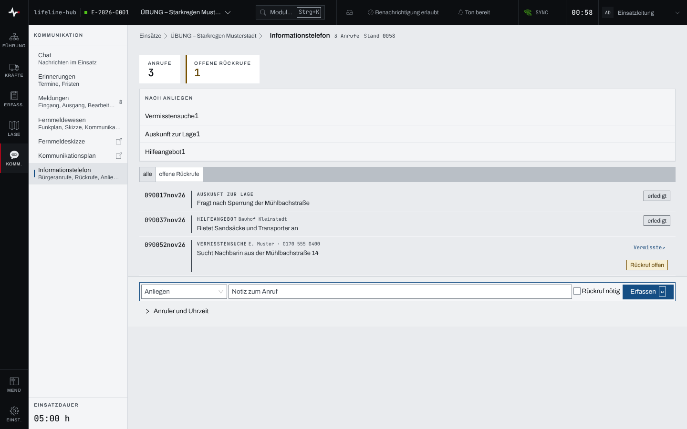

## Überblick

Das **Informationstelefon** ist ein eigenes Modul in der Kategorie „Kommunikation“. Es
protokolliert Anrufe aus der Bevölkerung und hält offene Rückrufe nach. Lesen können alle
Mitglieder des Einsatzes, erfassen dürfen Einsatzleitung und Führungspersonal.

## Abläufe

### Einen Anruf am Informationstelefon erfassen

1. In der Sprungpalette „Anruf erfassen“ wählen: das Informationstelefon öffnet sich, der Cursor
   steht im „Anliegen“. Ohne Palette: in der Modulliste unter „Kommunikation“ „Informationstelefon“
   wählen.
2. In der Leiste unten das „Anliegen“ wählen und eine „Notiz zum Anruf“ eintragen.

   

3. Muss zurückgerufen werden, „Rückruf nötig“ anhaken und die „Rückrufnummer“ eintragen. Unter
   „Anrufer und Uhrzeit“ stehen „Name“, „Rückrufnummer“ und „Uhrzeit“ (leer gilt jetzt).
4. „Erfassen“ wählen oder Enter drücken.

### Einen Rückruf erledigen

1. Im Informationstelefon mit „offene Rückrufe“ nur die offenen zeigen.
2. Beim Anruf die Statusanzeige „Rückruf offen“ auf „erledigt“ setzen.

## Hintergrund

### Wer was darf

Anrufe erfassen und Rückrufe erledigen Einsatzleitung und Führungspersonal, solange der Einsatz
läuft. Einzelheiten stehen in [Rechte im Einsatz](rechte-im-einsatz.md). Das Informationstelefon
folgt allein der Freigabe des eigenen Moduls „Informationstelefon“: Wer es ausblendet oder auf eine
Rolle beschränkt, tut das unter „Module“ in den Einstellungen des Einsatzes. Neue Anrufe anderer
Plätze erreichen nur, wer das Informationstelefon öffnen darf.

Früher gehörte das Informationstelefon zum Modul „Stab“. Beim Wechsel auf das eigene Modul hat es
dessen Vorgaben übernommen: Wo der Stab ausgeblendet oder auf eine Rolle beschränkt war, ist es das
Informationstelefon auch, in Einsätzen, in den Vorgaben der Organisation und in Einsatz-Vorlagen.
Lesezeichen auf die frühere Adresse unter „Stab“ führen weiter zum Informationstelefon, auch mit
einem Link auf einen einzelnen Anruf.

### Einsatztagebuch

Anrufe schreiben nichts ins Einsatztagebuch; das Anrufprotokoll ist selbst der Nachweis.

### Viele Anrufe

Das Anrufprotokoll liest sich wie das Einsatztagebuch: der älteste geladene Anruf steht oben, der
jüngste unten direkt über der Erfassung, und die Seite öffnet am Ende. Geladen sind zuerst die
jüngsten 100 Anrufe; „Ältere laden“ über der Liste holt die nächsten. Die Zahlen „Anrufe“ und
„offene Rückrufe“ und die Aufgliederung „Nach Anliegen“ zählen immer alle Anrufe des Einsatzes,
auch die noch nicht geladenen. Ein Link auf einen älteren Anruf zeigt ihn hervorgehoben am Anfang
der Liste. Neue Anrufe anderer Plätze erscheinen am Ende unten; wer hochgerollt hat, sieht dort
„1 neuer Anruf“ mit „anzeigen“.

### Personenbezug

Anrufer, Rückrufnummer und Notizen sind personenbezogen. Die App schwärzt sie, wenn die
Aufbewahrungsfrist des Einsatzes abläuft.

### Vermisstensuche

Ein Anruf mit dem Anliegen „Vermisstensuche“ trägt im Protokoll den Verweis „Vermisste ↗“, wenn
das Modul Betroffene freigegeben ist. Er führt zur Liste der Vermissten; der Anruf selbst legt dort
niemanden an.

### Ohne Netz

Das Informationstelefon wird ohne Netz nicht vorgehalten (siehe [Arbeiten ohne Netz](ohne-netz.md)).
