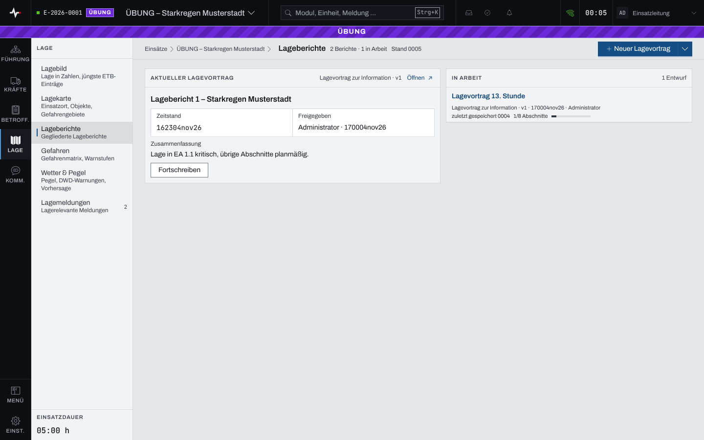
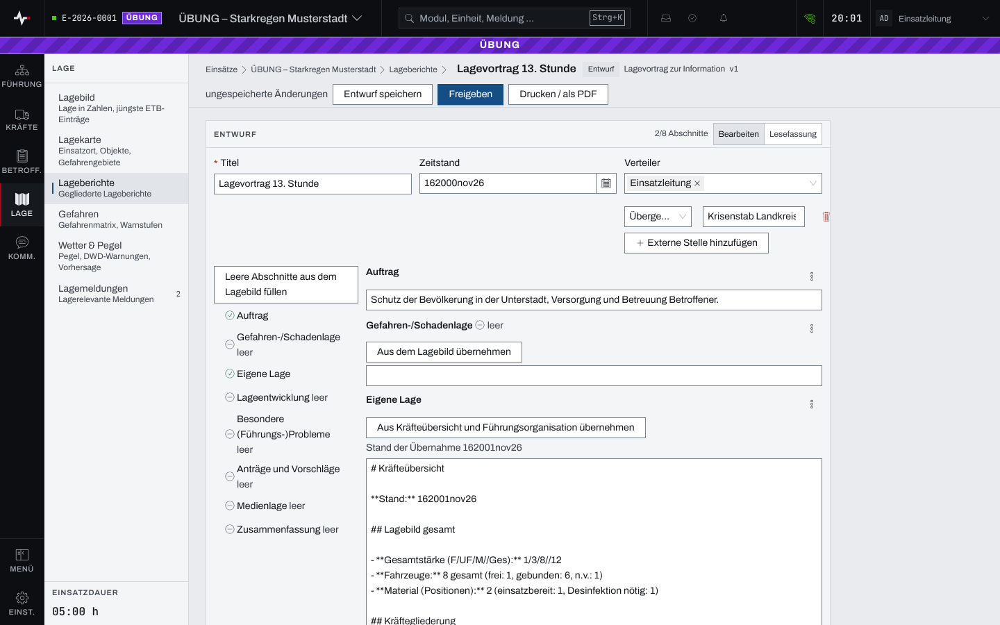
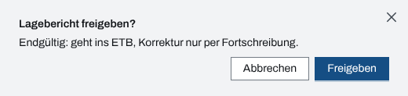
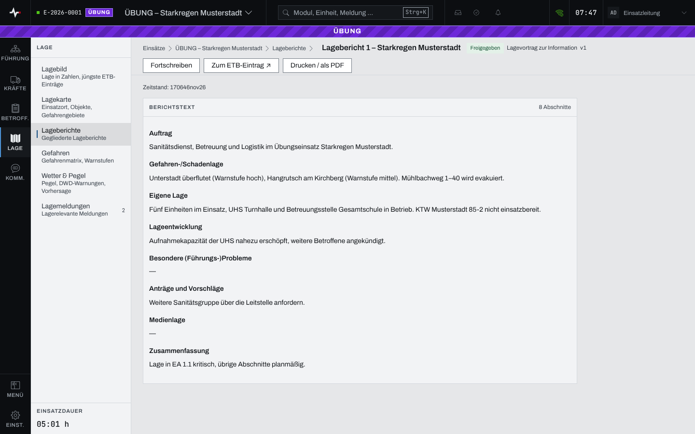

## Überblick

Ein Lagebericht hält die Lage zu einem Zeitstand in gegliederter Form fest, etwa als Lagevortrag.
Er entsteht als Entwurf, wird gemeinsam geschrieben und mit der Freigabe endgültig: Dann steht er
im Einsatztagebuch. Eine spätere Fassung entsteht durch Fortschreiben. Ein neuer Lagevortrag zur
Information startet mit Zahlen und Ständen aus den Modulen; der Vortragende prüft und ergänzt
sie.

## Abläufe

### Den aktuellen Stand lesen

1. Im Bereich „Lage“ „Lageberichte“ öffnen. Oben steht „Aktueller Lagevortrag“: der jüngste
   freigegebene Bericht mit Zeitstand, wer ihn wann freigegeben hat, und den ersten Zeilen der
   Zusammenfassung.

   

2. „Öffnen ↗“ wählen, um den ganzen Bericht zu lesen.
3. Unter „In Arbeit“ stehen die Entwürfe mit „zuletzt gespeichert“ und der Zahl der gefüllten
   Abschnitte, etwa „5/8 Abschnitte“. Den Titel wählen, um einen Entwurf zu öffnen.
4. Unter „Verlauf“ stehen die früheren Freigaben, die jüngste zuerst.

### Einen Lagevortrag anlegen

1. In den Lageberichten „Neuer Lagevortrag“ wählen. Es entsteht sofort ein Entwurf
   „Lagevortrag zur Information“, und er öffnet sich. Gefahren-/Schadenlage, Eigene Lage,
   Lageentwicklung und Besondere (Führungs-)Probleme sind schon aus den Modulen gefüllt (Tabelle
   unter „Übernahmen im Lagevortrag zur Information“).
2. Für einen Lagevortrag ohne diese Inhalte stattdessen den Pfeil neben dem Knopf und „Leerer
   Lagevortrag“ wählen; für eine andere Vorlage dort „Lagevortrag zur Entscheidung“ oder „Freier
   Bericht“.
3. Im Entwurf den vorgeschlagenen „Titel“ übernehmen oder ändern; er nennt die Uhrzeit, etwa
   „Lageüberblick 1410“. Stellt der Einsatz (oder die Organisation) „Datum und Uhrzeit“ ein, heißt
   er „Lageüberblick 14:10“; die Darstellung auf dem eigenen Gerät ändert den Vorschlag nicht.
   Der „Zeitstand“ ist der Zeitpunkt des Anlegens und lässt sich dort ebenfalls ändern.

### Einen Entwurf schreiben

1. Den Entwurf öffnen. Alle Abschnitte der Vorlage stehen offen untereinander, jeder mit seinem
   Textfeld. Ein leeres Feld ist eine Zeile hoch und wächst beim Schreiben mit. Der Cursor steht
   im ersten leeren Abschnitt.
2. Die „Gliederung“ nennt alle Abschnitte; ein leerer trägt dort und in seinem Kopf „leer“. Ein
   Abschnitt in der Gliederung springt zu ihm und setzt den Cursor hinein. Auf breiten Schirmen
   steht die Gliederung links und bleibt beim Rollen stehen, sonst steht sie als Zeile über den
   Abschnitten.
3. Das ⋮ im Kopf eines Abschnitts bietet „Text kopieren“, „In der Lesefassung zeigen“ und
   „Abschnitt leeren“. Leeren fragt vorher nach und lässt sich nicht rückgängig machen. Dieselben
   Einträge öffnen ein Rechtsklick, ein langer Druck oder Umschalt+F10 auf den Kopf oder auf den
   Abschnitt in der Gliederung; dort steht zusätzlich „Zum Abschnitt springen“. Im Textfeld
   bleibt das Menü des Browsers zum Kopieren und Einfügen.
4. Unter „Verteiler“ wählen, an wen der Bericht geht: Einsatzabschnitte, Einheiten, Funktionen
   oder eigener Text. Externe Stellen wie die übergeordnete Führung kommen mit „Externe Stelle
   hinzufügen“ dazu.
5. Den Text in die Abschnitte schreiben. Im Lagevortrag zur Information steht im Kopf eines
   Abschnitts ein Knopf, der Inhalte übernimmt, etwa „Aus Kräfteübersicht und Führungsorganisation
   übernehmen“ in „Eigene Lage“. Sind dort Abschnitte leer, füllt „Leere Abschnitte aus dem
   Lagebild füllen“ über der Gliederung alle auf einmal; gefüllte bleiben, wie sie sind.

   

6. „Lesefassung“ oben im Entwurf zeigt den ganzen Bericht gesetzt, so wie er gedruckt wird;
   „Bearbeiten“ führt zu den Textfeldern zurück. Gedruckt wird, was gerade steht.
7. „Entwurf speichern“ wählen. Oben steht danach „zuletzt gespeichert …“ mit der Uhrzeit.

### Einen Lagebericht freigeben

1. Im Entwurf „Freigeben“ wählen.
2. Die Rückfrage „Lagebericht freigeben?“ lesen.

   

3. „Freigeben“ wählen. Der Bericht ist nun freigegeben und steht im Einsatztagebuch.

### Einen Lagebericht fortschreiben

1. Einen freigegebenen Bericht öffnen. Er zeigt den „Berichtstext“ zum Lesen, dazu
   „Fortschreiben“, „Zum ETB-Eintrag ↗“ und „Drucken / als PDF“.

   

2. „Fortschreiben“ wählen. Es öffnet sich eine neue Fassung als Entwurf mit dem Text und den
   Anlagen und dem Verteiler der freigegebenen; sie wird wie jeder Entwurf geschrieben und
   freigegeben. Übernommene Abschnitte, die noch aus der Vorfassung stammen, zeigen ihren
   „Stand der Übernahme“ mit ⧖ und „aus der Vorfassung“; eine neue Übernahme im Abschnitt bringt
   die aktuellen Zahlen.

### Einen Lagebericht per E-Mail, Fax oder Matrix senden

Für Einsatzleitung und Führungspersonal, mit freigegebenem Bericht:

1. Einen freigegebenen Bericht öffnen und „Senden“ wählen.
2. Im Dialog „Senden“ unter „An“ die Adressen ankreuzen. Die Adressen stehen je Stelle unter
   ihrem Namen, jede einzeln mit „Mail“, „Matrix“ oder „Fax“ davor. Vorbelegt ist je Stelle aus dem Verteiler des
   Berichts genau eine Adresse: ihr erster Matrix-Raum, sonst ihre erste Mailadresse; eine
   Faxnummer wird immer selbst angekreuzt. Soll dieselbe Stelle den Bericht auf mehreren Wegen
   bekommen, die weitere Adresse dazu ankreuzen.

3. „Senden“ wählen. Unter dem Berichtstext erscheint der Abschnitt „Versand“ mit einer Zeile je
   Adresse, ihrem Weg und ihrem Stand: „wartet“, „übergeben 14:32“, beim Fax „übergeben 14:32,
   Zustellung wird geprüft“ und danach „zugestellt 14:34“, oder „fehlgeschlagen: …“. Ein
   Matrix-Raum steht dort mit seinem Alias, eine Raum-ID gekürzt.
4. Ist ein Versand fehlgeschlagen oder die Zustellung unklar, in seiner Zeile „Erneut senden“
   wählen.

Hat keine Stelle eine Adresse, steht im Dialog „Keine Adresse hinterlegt“, für Admins mit dem Weg
„Adressen bei den Externen Stellen eintragen“. Ist kein Mailserver eingerichtet, meldet der Dialog
„Kein Mailserver eingerichtet“, fehlt der Faxzugang, „Kein Faxzugang eingerichtet“. Fehlt das
Matrix-Konto oder ist es angehalten, lehnt der Server erst beim Senden ab, und es geht nichts
hinaus: danach sind die Matrix-Räume mit „Kein Matrix-Konto eingerichtet“ bzw. „Das Matrix-Konto
ist angehalten“ gesperrt, und je betroffener Stelle ist stattdessen ihre erste Mailadresse
angekreuzt. Erneut „Senden“ wählen.

## Hintergrund

### Übernahmen im Lagevortrag zur Information

| Abschnitt | Knopf | Was übernommen wird |
| --- | --- | --- |
| Gefahren-/Schadenlage | „Aus dem Lagebild übernehmen“ | Betroffene, Vermisste, Sichtung, offene Schäden, höchste Warnstufe, Gefahren je Gebiet mit Stufe und Erläuterung, Wetterwarnungen, Bedingungen am Einsatzort, Stand und Trend der Pegel (nur bei festgelegtem Pegel) |
| Eigene Lage | „Aus Kräfteübersicht und Führungsorganisation übernehmen“ | Kräfteübersicht und Führungsorganisation des ganzen Einsatzes |
| Lageentwicklung | „Aus dem ETB übernehmen“ | neue Einträge seit der letzten Lagebesprechung je Typ, neue Entscheidungen mit Nummer und Zeit, eine berichtigte mit „berichtigt → Nr. …“ |
| Besondere (Führungs-)Probleme | „Aus dem Führungsstand übernehmen“ | überfällige Aufträge, Meldungen mit überfälliger Bestätigung, ungesichtete Meldungen, Lücken im Funkplan |

- Jeder übernommene Text nennt seinen Stand als Datum-Zeit-Gruppe. Eine Fortschreibung übernimmt
  den Text mit diesem Stand; neue Zahlen bringt erst eine neue Übernahme in den Abschnitt.
- Im Entwurf zeigt jeder Abschnitt mit Übernahme über dem Text „Stand der Übernahme“ mit der
  Datum-Zeit-Gruppe, wann sein Text zuletzt übernommen wurde. Die Fortschreibung trägt diesen
  Stand mit; liegt er vor dem Fortschreiben, steht er hervorgehoben mit „aus der Vorfassung“.
  Wer den Text eines Abschnitts ganz löscht, löscht auch den Stand; ein von Hand ergänzter Text
  behält ihn. Abschnitte ohne Übernahme zeigen keinen Stand, auf Papier steht er nicht.
- Beim Anlegen und mit „Leere Abschnitte aus dem Lagebild füllen“ steht derselbe Text wie mit dem
  Knopf im Abschnitt. Die App lädt die Daten erst mit diesem Klick.
- Ist eine Quelle für die Person ganz gesperrt, steht im Abschnitt „—“ mit Grund; diese Quelle
  fragt die App dann gar nicht an.
- Die Abschnitte „Auftrag“, „Anträge und Vorschläge“, „Medienlage“ und „Zusammenfassung“ und der
  ganze Lagevortrag zur Entscheidung bleiben von Hand.
- Gefahren-/Schadenlage, Lageentwicklung und Besondere (Führungs-)Probleme übernehmen nur Zahlen,
  Nummern, Arten und Zeiten, keinen Freitext aus Aufträgen, Meldungen, Einsatztagebuch,
  Betroffenen oder Schäden.
- Der Teil „Gefahrengebiete“ der Gefahren-/Schadenlage nennt je Gebiet den Namen, bei einem
  unbestätigten „(unbestätigt)“, und darunter jede gesetzte Gefahr mit Stufe und
  Erläuterung (Kapitel [Gefahren](gefahren.md)). Name und Erläuterung sind Beurteilung der eigenen
  Führung; „gemeldet von“ und wer zuletzt geändert hat, übernimmt der Text nicht.
- Eine gesperrte oder nicht geladene Quelle steht als „—“ mit Grund, nie als 0.
- Den Teil „Pegel“ übernimmt die Gefahren-/Schadenlage nur, wenn am Einsatz ein maßgeblicher Pegel
  festgelegt ist (Kapitel [Wetter und Pegel](wetter-pegel.md)); sonst entfällt er ganz. Das Wetter
  steht vor dem Pegel.
- Gab es noch keine Lagebesprechung, zählt die Lageentwicklung seit Einsatzbeginn.
- Steht im Abschnitt schon Text, fragt die App vor der Übernahme „… ersetzen?“; „Ersetzen“
  überschreibt ihn. „Leere Abschnitte aus dem Lagebild füllen“ fragt nicht, denn es ersetzt
  nichts: Was beim Eintreffen der Daten schon Text trägt, bleibt.

### Speichern

Ein Entwurf speichert sich alle 30 Sekunden und beim Verlassen eines Feldes von selbst. Oben steht,
ob „ungespeicherte Änderungen“ vorliegen oder wann „zuletzt gespeichert“ wurde.

Wer den Entwurf mit ungespeicherten Änderungen verlässt, etwa über „Lageberichte“ oder den
Zurück-Knopf des Browsers, bekommt die Rückfrage „Ungespeicherte Änderungen“, wie beim
Einsatzbefehl:

- „Bleiben“ kehrt in den Entwurf zurück, die Eingaben bleiben stehen.
- „Verwerfen“ verlässt den Entwurf ohne die ungespeicherten Änderungen.
- „Speichern und weiter“ speichert zuerst und verlässt den Entwurf danach. Gelingt das Speichern
  nicht, steht der Grund in der Rückfrage, und der Entwurf bleibt offen.

### Freigabe und Fassungen

Die Freigabe ist endgültig: Der Text geht ins Einsatztagebuch, eine Korrektur gibt es nur als
Fortschreibung. Die Fortschreibung ist eine neue Fassung mit demselben Titel; die Vorgänger
bleiben freigegeben und stehen im Verlauf. Als aktueller Lagevortrag gilt die Freigabe mit dem
jüngsten Zeitstand, gleich welcher Vorlage. Die ersten Zeilen darunter stammen aus der
„Zusammenfassung“, beim Lagevortrag zur Entscheidung aus dem „Vorschlag der besten Möglichkeit“,
beim freien Bericht aus dem „Bericht“; ist der Abschnitt leer, fehlen sie. „Fortschreiben“ steht in der Übersicht nur, solange
der aktuelle Bericht noch nicht fortgeschrieben ist; eine Fortschreibung in Arbeit steht unter
„In Arbeit“.

### Verteiler

Der Verteiler ist freiwillig und fasst höchstens 50 Einträge; Personen und Fahrzeuge gehören
nicht hinein. Jeder Eintrag behält den Namen, den er beim Speichern hatte, und eine Funktion
nennt nie die Person, die sie besetzt. Bei der Freigabe steht der Verteiler im ETB-Eintrag als
Empfänger („An“) und vollständig als Abschnitt „Verteiler“ am Ende des Textes; ohne Verteiler
bleibt „System“ der Empfänger. Auf dem Papier steht er im Kopf des Blatts.

### Benachrichtigung bei der Freigabe

Mit der Freigabe erhält jede Person, die eine Funktion aus dem Verteiler in ihrer Mitgliedschaft
trägt (EL: zuerst der Einsatzleiter der Führungsstelle), die Benachrichtigung „Neuer
Lagebericht“ mit der Fassung, etwa „Version 2“, und dem Sprung zum Bericht. Sie ist still: Sie
steht unter „Eingänge“ bei „Früher“, ohne Band, Ton und Zahl. Für welche Funktionen sie als Eingang
kommt, legt der Reiter „Benachrichtigungen“ der Einstellungen fest (Kapitel
[Einstellungen des Einsatzes und Module](einsatz-einstellungen.md)). Einsatzabschnitte, Einheiten, externe
Stellen und eigener Text im Verteiler erreichen niemanden, ebenso wer die Lageberichte nicht
sehen darf. Wer freigibt, bekommt nichts, auch wenn die eigene Funktion im Verteiler steht.
Entwürfe melden nichts; eine Fortschreibung meldet sich erst mit ihrer eigenen Freigabe, und jede
Freigabe meldet sich genau einmal.

### Versand per E-Mail und Matrix

Der Versand gilt nur für Stellen mit hinterlegter Mailadresse, hinterlegtem Matrix-Raum oder
hinterlegter Threema-ID (Kapitel [Stammdaten](stammdaten.md), „Externe Stellen“) und braucht für
jeden Weg die passende Anbindung der Organisation: einen Mailserver, ein Matrix-Konto bzw. ein
Threema-Gateway (Kapitel [Anbindungen](anbindungen.md)). Vorgewählt ist je Stelle eine Adresse:
der Matrix-Raum, sonst die Threema-ID, sonst die Mailadresse. Fehlt eine Anbindung, sperrt der
Dialog nach dem Senden die Adressen dieses Weges und wählt je Stelle die nächste vor. Ein Mensch löst jeden Versand aus; nichts geht von selbst hinaus.

- **Nur freigegebene, jüngste Fassung.** Gesendet wird der Text der Freigabe mit den Anlagen als
  Bilder und einem Fuß mit Einsatz, Absender und Zeit. Wird inzwischen eine neuere Fassung
  freigegeben, geht ein noch wartender Versand nicht mehr hinaus und steht als „fehlgeschlagen:
  Neuere Fassung freigegeben“ da. „Erneut senden“ sendet den Text, wie er beim Absenden war; für
  eine Fortschreibung die neue Fassung senden. Übersteigen die Anlagen zusammen 20 MB, meldet der
  Versand „Anhänge zu groß für eine Mail“ bzw. „Anhänge zu groß für den Matrix-Server“; in einen
  Matrix-Raum geht jede Anlage außerdem nur bis zur Grenze, die der Matrix-Server nennt.
- **Wiederholung.** Ist der Mailserver nicht erreichbar, versucht die App es bis zu 30 Minuten
  lang weiter; danach steht der Versand als „fehlgeschlagen“ da. Eine Ablehnung durch den
  Mailserver, eine falsche Anmeldung oder eine gestörte Anbindung scheitern sofort.
- **„Zustellung unklar“.** Bricht die Verbindung ab, nachdem der Text übertragen wurde, aber bevor
  der Mailserver bestätigt, ist offen, ob die Mail raus ist. Die App wiederholt dann nicht von
  selbst; ob „Erneut senden“, entscheidet die Person (sonst käme dieselbe Meldung doppelt an).
  Ebenso nach einem Neustart des Servers mitten in einer Zustellung, auf beiden Wegen.
- **Matrix-Räume.** Eine Nachricht in einen Matrix-Raum besteht aus dem Text (Betreff fett) und
  je Anlage einem Bild. Bricht die Verbindung mitten im Senden ab, versucht die App es im selben
  Fenster von 30 Minuten weiter und sendet nur, was noch fehlt; der Matrix-Server erkennt einen
  wiederholten Teil und legt ihn nicht doppelt ab. Ist der Raum verschlüsselt, geht die Nachricht
  verschlüsselt hinaus, nie im Klartext; geht das nicht, steht der Versand als „fehlgeschlagen:
  Verschlüsseln nicht möglich“ da. Das Matrix-Konto tritt einem Raum bei, wenn es eingeladen ist
  oder der Raum öffentlich ist; sonst „fehlgeschlagen: Kein Zutritt zum Raum“.
- **Threema-IDs.** Eine Nachricht an eine Threema-ID besteht aus dem Text (Betreff fett) und je
  Anlage einem Bild, alles Ende-zu-Ende verschlüsselt. Ein Text über 3500 Bytes wird an Absätzen
  in mehrere Nachrichten geteilt („(1/2)“ …). Threema bestätigt nur die Annahme, der Versand steht
  dann auf „übergeben“. Bricht die Verbindung mitten im Senden ab, steht er auf „Zustellung
  unklar“; „Erneut senden“ schickt nur, was noch nicht angekommen ist. Hat sich der Schlüssel
  der Threema-ID geändert, geht nichts hinaus („fehlgeschlagen: Verschlüsseln nicht möglich“).
- **Einsatztagebuch.** Jedes Ergebnis steht im ETB, etwa „Lagebericht Nr. 3 per E-Mail an Leitstelle
  Nord (lagedienst@…) übergeben“ oder „… per Matrix an Leitstelle Nord (#lage:…) übergeben“; ein Wiederholungsversuch im Fenster schreibt nichts. Ein Versand
  ist nie halb: er ist übergeben und im ETB, oder er steht sichtbar als fehlgeschlagen da.
- **Rechte und Netz.** Senden und „Erneut senden“ brauchen das Schreibrecht; die Liste „Versand“
  sehen alle, die den Bericht lesen dürfen. Ohne Netz ist „Senden“ gesperrt („Ohne Netz nicht
  möglich“). Führt eine andere Instanz den Einsatz, sendet dieser Rechner nicht
  („Einsatz wird von einer anderen Instanz geführt“).
- **PDF im Anhang.** Jede Mail trägt den Bericht zusätzlich als PDF (Kopf mit Absender, Zeit,
  ÜBUNG bei einer Übung, Betreff, Empfänger und Einsatz; jede Anlage auf eigener Seite). Ist das
  PDF zu groß oder lässt es sich nicht bauen, geht die Mail ohne PDF hinaus und die Zeile sagt
  „ohne PDF“. Gedruckt wird weiter über „Drucken / als PDF“ im Browser.

### Versand per Fax

Der Versand per Fax braucht eine Faxnummer an der Stelle (Kapitel [Stammdaten](stammdaten.md),
„Externe Stellen“) und den Faxzugang der Organisation (Kapitel [Anbindungen](anbindungen.md)).
Sonst gilt alles wie beim Versand per E-Mail.

- **Das Fax ist das PDF.** Es geht schwarz auf weiß hinaus, höchstens 30 Seiten und 10 MB. Wäre
  es länger, lehnt „Senden“ ab („Fax zu lang (höchstens 30 Seiten)“), auch für die Mails derselben
  Auswahl; dann den Bericht kürzen oder nur per E-Mail senden.
- **„Zustellung wird geprüft“, dann „zugestellt“.** sipgate nimmt das Fax erst nur an; die App
  fragt danach nach, bis es „zugestellt“ ist oder „fehlgeschlagen: Fax nicht zugestellt“ (etwa
  weil die Gegenstelle besetzt war; dann „Erneut senden“). Bestätigt sipgate innerhalb von zwei
  Stunden nichts, steht „Zustellung nicht bestätigt“ da. Das ETB bekommt den Eintrag erst mit dem
  Ergebnis, etwa „Lagebericht Nr. 3 per Fax an Leitstelle Nord (+49…) zugestellt“.
- **Kein doppeltes Fax.** Bricht die Verbindung nach dem Absenden ab, sendet die App nicht von
  selbst noch einmal; ob „Erneut senden“, entscheidet die Person.

### Anlagen

Im Entwurf lässt sich mit „Fernmeldeskizze anfügen“ die Fernmeldeskizze als Anlage anhängen; das
geht nur mit Verbindung und für Personen, die das Fernmeldewesen sehen. Im Druck steht jede
Anlage auf einem eigenen Blatt.

### Rechte und ohne Netz

Lesen kann jede Person im Einsatz, auch ein Beobachter; ohne Schreibrecht ist „Neuer
Lagevortrag“ gesperrt, und der Grund steht darüber. Anlegen, schreiben, freigeben und
fortschreiben brauchen das Schreibrecht: Einsatzleitung oder Führungspersonal in einem laufenden
Einsatz (Kapitel [Rechte im Einsatz](rechte-im-einsatz.md)). Die Lageberichte hält die App für
die Arbeit ohne Netz nicht vor (Kapitel [Arbeiten ohne Netz](ohne-netz.md)).
