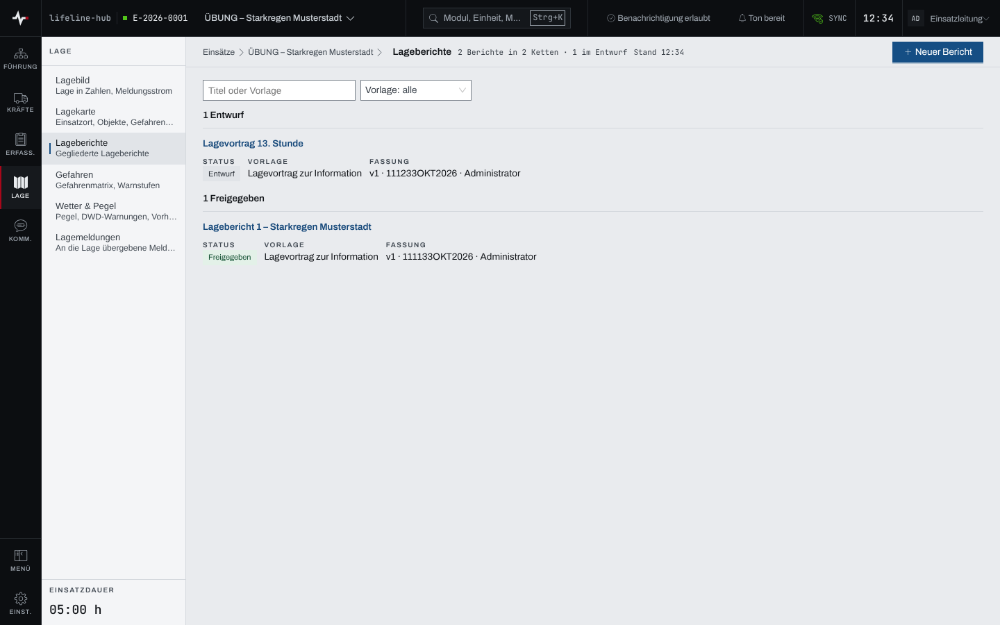
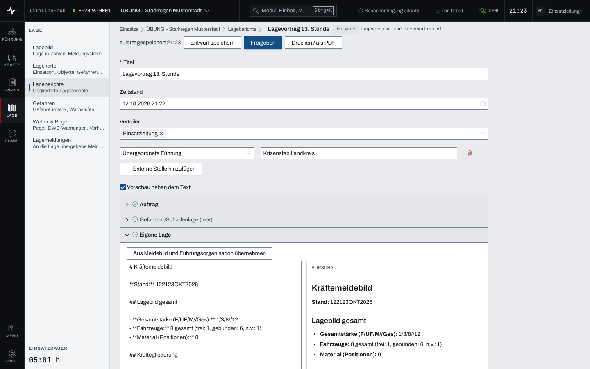
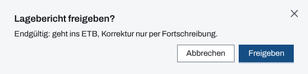
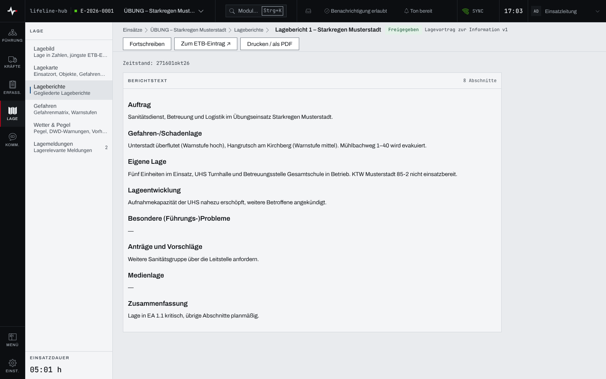

## Überblick

Ein Lagebericht hält die Lage zu einem Zeitstand in gegliederter Form fest, etwa als Lagevortrag.
Er entsteht als Entwurf, wird gemeinsam geschrieben und mit der Freigabe endgültig: Dann steht er
im Einsatztagebuch. Eine spätere Fassung entsteht durch Fortschreiben. Ein neuer Lagevortrag zur
Information startet mit Zahlen und Ständen aus den Modulen; der Vortragende prüft und ergänzt
sie.

## Abläufe

### Den aktuellen Stand lesen

1. Im Bereich „Lage“ „Lageberichte“ öffnen. Oben steht „Aktueller Lagevortrag“: der jüngste
   freigegebene Bericht mit Zeitstand, wer ihn wann freigegeben hat, und den ersten Zeilen der
   Zusammenfassung.

   

2. „Öffnen ↗“ wählen, um den ganzen Bericht zu lesen.
3. Unter „In Arbeit“ stehen die Entwürfe mit „zuletzt gespeichert“ und der Zahl der gefüllten
   Abschnitte, etwa „5/8 Abschnitte“. Den Titel wählen, um einen Entwurf zu öffnen.
4. Unter „Verlauf“ stehen die früheren Freigaben, die jüngste zuerst.

### Einen Lagevortrag anlegen

1. In den Lageberichten „Neuer Lagevortrag“ wählen. Es entsteht sofort ein Entwurf
   „Lagevortrag zur Information“, und er öffnet sich. Gefahren-/Schadenlage, Eigene Lage,
   Lageentwicklung, Besondere (Führungs-)Probleme und Medienlage sind schon aus den Modulen
   gefüllt (Tabelle unter „Übernahmen im Lagevortrag zur Information“).
2. Für einen Lagevortrag ohne diese Inhalte stattdessen den Pfeil neben dem Knopf und „Leerer
   Lagevortrag“ wählen; für eine andere Vorlage dort „Lagevortrag zur Entscheidung“ oder „Freier
   Bericht“.
3. Im Entwurf den vorgeschlagenen „Titel“ übernehmen oder ändern; er nennt die Uhrzeit, etwa
   „Lageüberblick 1410“ (bei „Datum und Uhrzeit“ „Lageüberblick 14:10“). Der „Zeitstand“ ist der Zeitpunkt des Anlegens und lässt sich dort
   ebenfalls ändern.

### Einen Entwurf schreiben

1. Den Entwurf öffnen. Alle Abschnitte der Vorlage stehen offen untereinander, jeder mit seinem
   Textfeld. Ein leeres Feld ist eine Zeile hoch und wächst beim Schreiben mit. Der Cursor steht
   im ersten leeren Abschnitt.
2. Die „Gliederung“ nennt alle Abschnitte; ein leerer trägt dort und in seinem Kopf „leer“. Ein
   Abschnitt in der Gliederung springt zu ihm und setzt den Cursor hinein. Auf breiten Schirmen
   steht die Gliederung links und bleibt beim Rollen stehen, sonst steht sie als Zeile über den
   Abschnitten.
3. Unter „Verteiler“ wählen, an wen der Bericht geht: Einsatzabschnitte, Einheiten, Funktionen
   oder eigener Text. Externe Stellen wie die übergeordnete Führung kommen mit „Externe Stelle
   hinzufügen“ dazu.
4. Den Text in die Abschnitte schreiben. Im Lagevortrag zur Information steht im Kopf eines
   Abschnitts ein Knopf, der Inhalte übernimmt, etwa „Aus Meldebild und Führungsorganisation
   übernehmen“ in „Eigene Lage“. Sind dort Abschnitte leer, füllt „Leere Abschnitte aus dem
   Lagebild füllen“ über der Gliederung alle auf einmal; gefüllte bleiben, wie sie sind.

   

5. „Lesefassung“ oben im Entwurf zeigt den ganzen Bericht gesetzt, so wie er gedruckt wird;
   „Bearbeiten“ führt zu den Textfeldern zurück. Gedruckt wird, was gerade steht.
6. „Entwurf speichern“ wählen. Oben steht danach „zuletzt gespeichert …“ mit der Uhrzeit.

### Einen Lagebericht freigeben

1. Im Entwurf „Freigeben“ wählen.
2. Die Rückfrage „Lagebericht freigeben?“ lesen.

   

3. „Freigeben“ wählen. Der Bericht ist nun freigegeben und steht im Einsatztagebuch.

### Einen Lagebericht fortschreiben

1. Einen freigegebenen Bericht öffnen. Er zeigt den „Berichtstext“ zum Lesen, dazu
   „Fortschreiben“, „Zum ETB-Eintrag ↗“ und „Drucken / als PDF“.

   

2. „Fortschreiben“ wählen. Es öffnet sich eine neue Fassung als Entwurf mit dem Text und den
   Anlagen und dem Verteiler der freigegebenen; sie wird wie jeder Entwurf geschrieben und
   freigegeben. Übernommene Abschnitte, die noch aus der Vorfassung stammen, zeigen ihren
   „Stand der Übernahme“ mit ⧖ und „aus der Vorfassung“; eine neue Übernahme im Abschnitt bringt
   die aktuellen Zahlen.

## Hintergrund

### Übernahmen im Lagevortrag zur Information

| Abschnitt | Knopf | Was übernommen wird |
| --- | --- | --- |
| Gefahren-/Schadenlage | „Aus dem Lagebild übernehmen“ | Betroffene, Vermisste, Sichtung, offene Schäden, höchste Warnstufe, Gefahren je Gebiet mit Stufe und Erläuterung, Wetterwarnungen, Bedingungen am Einsatzort, Stand und Trend der Pegel (nur bei festgelegtem Pegel) |
| Eigene Lage | „Aus Meldebild und Führungsorganisation übernehmen“ | Kräftemeldebild und Führungsorganisation des ganzen Einsatzes |
| Lageentwicklung | „Aus dem ETB übernehmen“ | neue Einträge seit der letzten Lagebesprechung je Typ, neue Entscheidungen mit Nummer und Zeit |
| Besondere (Führungs-)Probleme | „Aus dem Führungsstand übernehmen“ | überfällige Aufträge, Meldungen mit überfälliger Bestätigung, ungesichtete Meldungen, Lücken im Funkplan |
| Medienlage | „Aus S5 übernehmen“ | Presse-Log, Pressemitteilungen, Infotelefon, ohne Personenbezug |

- Jeder übernommene Text nennt seinen Stand als Datum-Zeit-Gruppe. Eine Fortschreibung übernimmt
  den Text mit diesem Stand; neue Zahlen bringt erst eine neue Übernahme in den Abschnitt.
- Im Entwurf zeigt jeder Abschnitt mit Übernahme über dem Text „Stand der Übernahme“ mit der
  Datum-Zeit-Gruppe, wann sein Text zuletzt übernommen wurde. Die Fortschreibung trägt diesen
  Stand mit; liegt er vor dem Fortschreiben, steht er hervorgehoben mit „aus der Vorfassung“.
  Wer den Text eines Abschnitts ganz löscht, löscht auch den Stand; ein von Hand ergänzter Text
  behält ihn. Abschnitte ohne Übernahme zeigen keinen Stand, auf Papier steht er nicht.
- Beim Anlegen und mit „Leere Abschnitte aus dem Lagebild füllen“ steht derselbe Text wie mit dem
  Knopf im Abschnitt. Die App lädt die Daten erst mit diesem Klick.
- Ist eine Quelle für die Person ganz gesperrt, steht im Abschnitt „—“ mit Grund, etwa
  „— (Stab nicht freigegeben)“ in der Medienlage; diese Quelle fragt die App dann gar nicht an.
- Die Abschnitte „Auftrag“, „Anträge und Vorschläge“ und „Zusammenfassung“ und der ganze
  Lagevortrag zur Entscheidung bleiben von Hand.
- Gefahren-/Schadenlage, Lageentwicklung und Besondere (Führungs-)Probleme übernehmen nur Zahlen,
  Nummern, Arten und Zeiten, keinen Freitext aus Aufträgen, Meldungen, Einsatztagebuch,
  Betroffenen oder Schäden.
- Der Teil „Gefahrengebiete“ der Gefahren-/Schadenlage nennt je Gebiet den Namen, bei einem
  nicht beurteilten „(nicht beurteilt)“, und darunter jede gesetzte Gefahr mit Stufe und
  Erläuterung (Kapitel [Gefahren](gefahren.md)). Name und Erläuterung sind Beurteilung der eigenen
  Führung; „gemeldet von“ und wer zuletzt geändert hat, übernimmt der Text nicht.
- Eine gesperrte oder nicht geladene Quelle steht als „—“ mit Grund, nie als 0.
- Den Teil „Pegel“ übernimmt die Gefahren-/Schadenlage nur, wenn am Einsatz ein maßgeblicher Pegel
  festgelegt ist (Kapitel [Wetter und Pegel](wetter-pegel.md)); sonst entfällt er ganz. Das Wetter
  steht vor dem Pegel.
- Gab es noch keine Lagebesprechung, zählt die Lageentwicklung seit Einsatzbeginn.
- Steht im Abschnitt schon Text, fragt die App vor der Übernahme „… ersetzen?“; „Ersetzen“
  überschreibt ihn. „Leere Abschnitte aus dem Lagebild füllen“ fragt nicht, denn es ersetzt
  nichts: Was beim Eintreffen der Daten schon Text trägt, bleibt.

### Speichern

Ein Entwurf speichert sich alle 30 Sekunden und beim Verlassen eines Feldes von selbst. Oben steht,
ob „ungespeicherte Änderungen“ vorliegen oder wann „zuletzt gespeichert“ wurde.

Wer den Entwurf mit ungespeicherten Änderungen verlässt, etwa über „Lageberichte“ oder den
Zurück-Knopf des Browsers, bekommt die Rückfrage „Ungespeicherte Änderungen“, wie beim
Einsatzbefehl:

- „Bleiben“ kehrt in den Entwurf zurück, die Eingaben bleiben stehen.
- „Verwerfen“ verlässt den Entwurf ohne die ungespeicherten Änderungen.
- „Speichern und weiter“ speichert zuerst und verlässt den Entwurf danach. Gelingt das Speichern
  nicht, steht der Grund in der Rückfrage, und der Entwurf bleibt offen.

### Freigabe und Fassungen

Die Freigabe ist endgültig: Der Text geht ins Einsatztagebuch, eine Korrektur gibt es nur als
Fortschreibung. Die Fortschreibung ist eine neue Fassung mit demselben Titel; die Vorgänger
bleiben freigegeben und stehen im Verlauf. Als aktueller Lagevortrag gilt die Freigabe mit dem
jüngsten Zeitstand, gleich welcher Vorlage. Die ersten Zeilen darunter stammen aus der
„Zusammenfassung“, beim Lagevortrag zur Entscheidung aus dem „Vorschlag der besten Möglichkeit“,
beim freien Bericht aus dem „Bericht“; ist der Abschnitt leer, fehlen sie. „Fortschreiben“ steht in der Übersicht nur, solange
der aktuelle Bericht noch nicht fortgeschrieben ist; eine Fortschreibung in Arbeit steht unter
„In Arbeit“.

### Verteiler

Der Verteiler ist freiwillig und fasst höchstens 50 Einträge; Personen und Fahrzeuge gehören
nicht hinein. Jeder Eintrag behält den Namen, den er beim Speichern hatte, und eine Funktion
nennt nie die Person, die sie besetzt. Bei der Freigabe steht der Verteiler im ETB-Eintrag als
Empfänger („An“) und vollständig als Abschnitt „Verteiler“ am Ende des Textes; ohne Verteiler
bleibt „System“ der Empfänger. Auf dem Papier steht er im Kopf des Blatts.

### Benachrichtigung bei der Freigabe

Mit der Freigabe erhält jede Person, die eine Funktion aus dem Verteiler besetzt (laut
Stab-Besetzung, sonst laut Funktion in der Mitgliedschaft), den Hinweis „Neuer Lagebericht“ mit
der Fassung, etwa „Version 2“, und dem Sprung zum Bericht. Einsatzabschnitte, Einheiten, externe
Stellen und eigener Text im Verteiler erreichen niemanden, ebenso wer die Lageberichte nicht
sehen darf. Wer freigibt, bekommt nichts, auch wenn die eigene Funktion im Verteiler steht.
Entwürfe melden nichts; eine Fortschreibung meldet sich erst mit ihrer eigenen Freigabe, und jede
Freigabe meldet sich genau einmal.

### Anlagen

Im Entwurf lässt sich mit „Fernmeldeskizze anfügen“ die Fernmeldeskizze als Anlage anhängen; das
geht nur mit Verbindung und für Personen, die das Fernmeldewesen sehen. Im Druck steht jede
Anlage auf einem eigenen Blatt.

### Rechte und ohne Netz

Lesen kann jede Person im Einsatz, auch ein Beobachter; ohne Schreibrecht ist „Neuer
Lagevortrag“ gesperrt, und der Grund steht darüber. Anlegen, schreiben, freigeben und
fortschreiben brauchen das Schreibrecht: Einsatzleitung oder Führungspersonal in einem laufenden
Einsatz (Kapitel [Rechte im Einsatz](rechte-im-einsatz.md)). Die Lageberichte hält die App für
die Arbeit ohne Netz nicht vor (Kapitel [Arbeiten ohne Netz](ohne-netz.md)).
