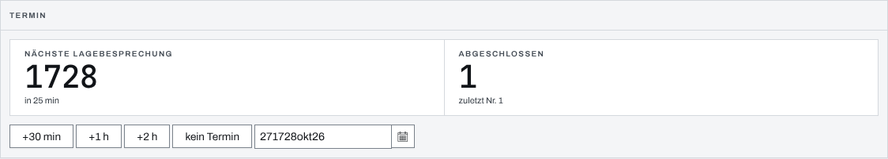
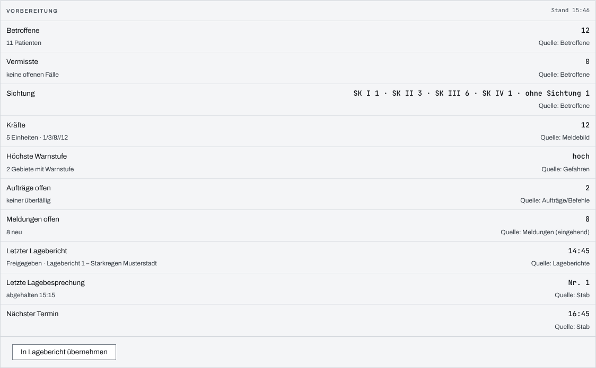
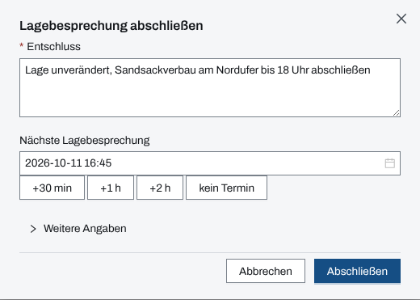

## Überblick

Die Seite „Lagebesprechung“ trägt den Rhythmus der Lagebesprechungen: den Termin der nächsten
Besprechung, ihre Vorbereitung, den Abschluss mit dem Entschluss und den Verlauf aller
Besprechungen. Sie ist ein eigenes Modul unter Führung und steht auch dann zur Verfügung, wenn der
Einsatz ohne Stab geführt wird. Lesen können alle Mitglieder des Einsatzes, bedienen Einsatzleitung
und Führungspersonal.

## Abläufe

### Den nächsten Termin setzen

1. „Lagebesprechung“ öffnen. Das Paneel „Termin“ zeigt die „Nächste Lagebesprechung“ mit ihrem
   Zustand, etwa „in 25 min“.

   

2. „+30 min“, „+1 h“ oder „+2 h“ wählen; gerechnet wird ab jetzt. Ein anderer Zeitpunkt lässt
   sich über „Termin wählen“ setzen.
3. „kein Termin“ leert den Termin.

### Die Lagebesprechung vorbereiten

1. Auf der Seite „Lagebesprechung“ das Paneel „Vorbereitung“ lesen. Es stellt die Kennzahlen für
   die Besprechung zusammen: Betroffene, Vermisste, Sichtung, Kräfte, höchste Warnstufe, offene
   Aufträge und Meldungen, letzter Lagebericht, letzte Lagebesprechung und nächster Termin, jede
   Zeile mit ihrer Quelle.

   

2. Soll der Stand festgehalten werden, „In Lagebericht übernehmen“ wählen. Das legt einen
   Lagebericht „Vorbereitung Lagebesprechung …“ an.

### Die Lagebesprechung abschließen

1. Im Seitenkopf „Lagebesprechung abschließen“ wählen.
2. Den „Entschluss“ eintragen.
3. Unter „Nächste Lagebesprechung“ den Termin setzen, mit „+30 min“, „+1 h“, „+2 h“ oder
   direkt; „kein Termin“ leert ihn.

   

4. Lag die Besprechung früher, unter „Weitere Angaben“ den „Zeitpunkt der Besprechung“ setzen;
   leer gilt jetzt.
5. „Abschließen“ wählen.

Das Paneel „Verlauf“ zeigt danach alle Besprechungen, die neueste zuerst, jede mit Nummer, Zeit,
Entschluss, dem beim Abschluss gesetzten Termin und dem Verweis „ETB-Eintrag“. Ein langer
Entschluss steht gekürzt da; „ganz zeigen“ öffnet ihn.

## Hintergrund

### Wer was darf

Termin und Abschluss bedienen Einsatzleitung und Führungspersonal, solange der Einsatz läuft. Wer
das nicht darf, sieht „Lagebesprechung abschließen“ und die Schnellwahl gesperrt mit dem Grund
darunter. „In Lagebericht übernehmen“ erscheint nur für sie und nur, wenn das Modul Lageberichte
freigegeben ist. Einzelheiten stehen in [Rechte im Einsatz](rechte-im-einsatz.md).

Die Lagebesprechung hat ihre eigene Freigabe. Ist der Stab ausgeblendet oder gesperrt, bleibt sie
voll nutzbar; ist sie selbst gesperrt, fehlen Seite, Verweise und die Schnellaktion „Lagebesprechung
abschließen“ in der Befehlspalette.

### Ein Termin für den ganzen Einsatz

Der Termin der nächsten Lagebesprechung gilt für den ganzen Einsatz. Ihn zeigen auch die Marken im
[Führungsüberblick](ueberblick.md), die Zeile „Nächste Lagebesprechung“ auf der Seite
[Stab](stab.md) und die Schnellwahl der Wiedervorlage im
[Einsatztagebuch](einsatztagebuch.md), auch für Mitglieder ohne Freigabe der Lagebesprechung.
Gesetzt wird er nur hier.

### Was ins Einsatztagebuch geht

- **Abschluss:** ein Eintrag vom Typ Entscheidung mit der Veranlassung „Lagebesprechung“, der
  Nummer, dem Zeitpunkt, dem Entschluss und dem nächsten Termin. Die Nummer zählt je Einsatz
  fortlaufend. Eintrag, Nummer und Termin entstehen gemeinsam oder gar nicht. Der Entschluss darf
  höchstens 10.000 Zeichen lang sein.
- **Termin ohne Abschluss:** kein Eintrag. Der Termin ist eine Wiedervorlage, keine Entscheidung.
- **Vorbereitung:** kein Eintrag.

### Vorbereitung

Die „Vorbereitung“ rechnet keine eigenen Zahlen, sie zeigt dieselben wie Überblick und
Modulzähler. Fehlt einer Person das Recht auf eine Quelle oder ist die Quelle nicht geladen, steht
„—“ mit Grund, nie eine 0. Sie gibt kein Vortragsschema vor und friert nichts ein; einen festen
Stand gibt es nur über „In Lagebericht übernehmen“.

### Fälliger Termin

Erreicht die Uhr den Termin, zeigt das Paneel „Termin“ „jetzt fällig“, danach „seit … min
überfällig“, als Hinweis, nicht als Alarm. Dasselbe Wort steht in der Zeile der Stab-Seite und an
der Marke im Führungsüberblick.

### Ohne Netz

Termin, Verlauf und Vorbereitung werden ohne Netz nicht vorgehalten (siehe
[Arbeiten ohne Netz](ohne-netz.md)).

## Grundlagen und Quellen

- FwDV 100, Abschnitt 3.3.3.2, S. 42: Lagebesprechung bei oder unmittelbar nach Erteilung
  dokumentieren.
- EEMUA 191: Ein fälliger Termin ist kein Alarm (Alarmbudget).
