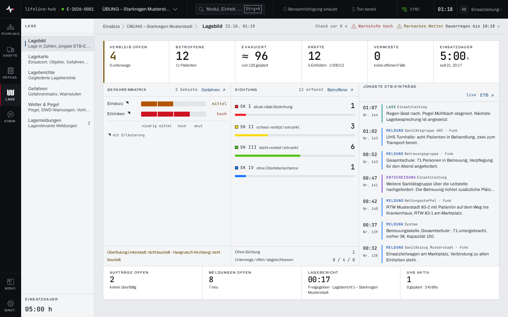
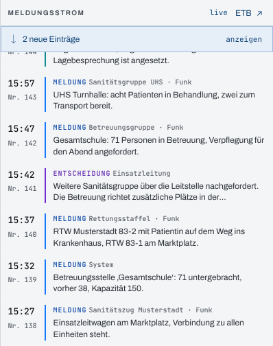

## Überblick

Das Lagebild zeigt die ganze Lage auf einem Schirm: sechs Kennzahlen, die Gefahren je Gefahrentyp,
die Sichtung der Betroffenen, den Strom der jüngsten Einträge aus dem Einsatztagebuch und darunter
den Führungsstand. Es ist eine reine Leseansicht für alle, die den Einsatz sehen; jede Zahl kommt
aus dem Modul, in dem sie erfasst wird.

## Abläufe

### Das Lagebild lesen

1. Im Bereich „Lage“ „Lagebild“ öffnen. Im Seitenkopf stehen Datum und Uhrzeit, rechts das Alter
   des Datenstands („Stand vor … s“), sobald eine erhöhte Warnstufe gilt, der Hinweis
   „Warnstufe …“ und, sobald für den Einsatzort eine Wetterwarnung gilt oder angekündigt ist, ihre
   Marke, etwa „Markantes Wetter Dauerregen bis 21:00 ↗“. Die Marke öffnet „Wetter & Pegel“.
2. Das Kennzahlenband lesen. Fest stehen „Betroffene“, „Kräfte“, „Vermisste“ und „Einsatzdauer“;
   die Plätze ganz links und in der Mitte richten sich nach der Lage (siehe Hintergrund).
3. Die drei Paneele darunter lesen: „Gefahrenmatrix“, „Sichtung“ und „Meldungsstrom“.

   

4. Am Fuß den Führungsstand lesen: „Aufträge offen“, „Meldungen offen“, der jüngste
   „Lagebericht“ und „UHS aktiv“.
5. Um ins Modul zu wechseln, den Verweis eines Paneels wählen, etwa „Gefahren ↗“ in der
   Gefahrenmatrix.

### Neue Einträge im Meldungsstrom anzeigen

1. Im Lagebild bleiben, während neue Einträge eingehen. Der Meldungsstrom schiebt sie nicht
   zwischen die gelesenen Zeilen, sondern kündigt sie oben an („… neue Einträge“).

   

2. „anzeigen“ wählen: Die neuen Einträge stehen oben im Strom, der Hinweis verschwindet.

## Hintergrund

### Die wechselnden Kennzahlen

- **Ganz links** steht der Leitpegel, sobald ein maßgeblicher Pegel festgelegt ist (Kapitel
  [Wetter und Pegel](wetter-pegel.md)); sonst „Verbleib offen“.
- **In der Mitte** steht „Evakuiert“, sobald eine Evakuierung angeordnet ist; sonst „Schäden
  offen“.

Wer die Plätze belegt, steht am Einsatz. Ändert sich das, während das Lagebild offen ist, tauscht
die Reihe nicht unter dem Blick: Ein Hinweis „Kennzahlreihe geändert: …“ bietet den neuen
Zuschnitt an, „übernehmen“ setzt ihn. „Vermisste“ nennt dazu, wie viele Fälle seit über vier
Stunden offen sind.

### Wetter im Seitenkopf

Die Wettermarke nennt die Warnung des Deutschen Wetterdienstes mit der höchsten Stufe, bei
gleicher Stufe die geltende vor der angekündigten, und zählt die übrigen („(+ 1 weitere)“). Sie
steht bei jeder amtlichen Stufe, ohne Ton und ohne Hinweis; eine neue Unwetterwarnung meldet der
Unwetterhinweis (Kapitel [Wetter und Pegel](wetter-pegel.md)). Ist „Wetter & Pegel“ für die Person
nicht freigegeben oder der Stand der Warnungen unbekannt, fehlt die Marke. Das Wetter steht nie im
Kennzahlenband: dessen Plätze folgen nur Festlegungen am Einsatz, nie einem Messwert.

### Was die Paneele verdichten

- **Gefahrenmatrix:** je Gefahrentyp mit einer Stufe über „keine“ die höchste Warnstufe über
  alle Gefahrengebiete und Schutzobjekte; ohne solche Stufe steht „Keine Gefahr über Stufe
  „keine“.“ Darunter stehen die Gebiete, deren Matrix noch nicht beurteilt ist, etwa
  „Hangrutsch Kirchberg: nicht beurteilt“, bei mehr als zwei nur ihre Zahl. Bewertet und
  beurteilt wird im Kapitel [Gefahren](gefahren.md).
- **Sichtung:** die Betroffenen in Versorgung je Sichtungskategorie, dazu „Ohne Sichtung“ und
  „Unterwegs / offen / abgeschlossen“: unterwegs im Eigentransport, ohne Verbleib, abgeschlossen
  (übergeben, entlassen, Notunterkunft, Verbleib des Leichnams). Abgeschlossene zählen in keiner
  Sichtungskategorie; die Kennzahl „Betroffene“ nennt sie hinter den Patienten („3 Patienten · 2
  abgeschlossen“), „Verbleib offen“ nennt, wie viele unterwegs sind.
- **Meldungsstrom:** die jüngsten Einträge des Einsatztagebuchs. Rechts im Kopf steht der Zustand
  der Leitung: „live“, „Verbindung wird aufgebaut“ oder „Verbindung unterbrochen“.
- **Führungsstand:** „Aufträge offen“ und „Meldungen offen“ zählen wie die Module selbst; ein
  überfälliger Auftrag oder eine überfällige Meldung steht hier hervorgehoben.

### Gesperrte Module und ohne Netz

Ist ein Modul für die Person nicht freigegeben, steht seine Kennzahl als „—“ mit Grund, nie als 0;
fällt eine Quelle aus, bleibt der Rest lesbar. Ohne Netz zeigt das Lagebild den zuletzt geladenen
Stand der vorgehaltenen Daten; die Gefahrenmatrix und die Pegel gehören nicht dazu (Kapitel
[Arbeiten ohne Netz](ohne-netz.md)).
