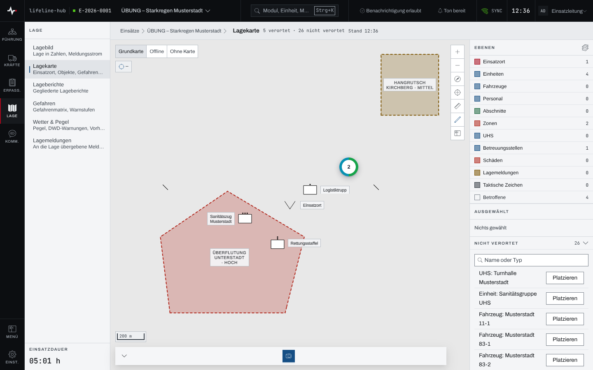
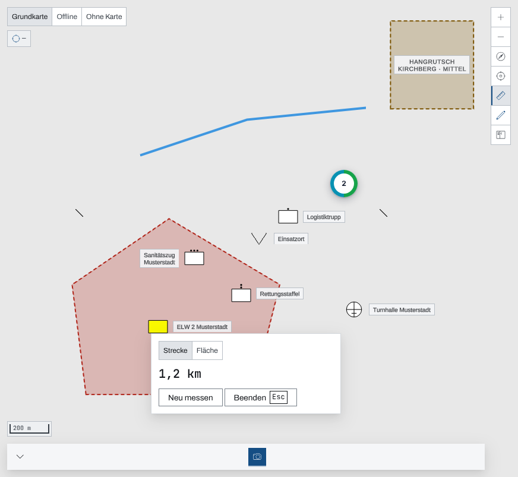
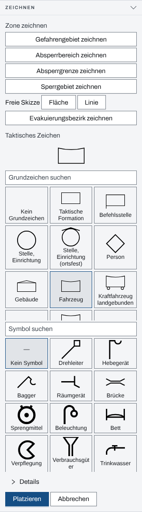
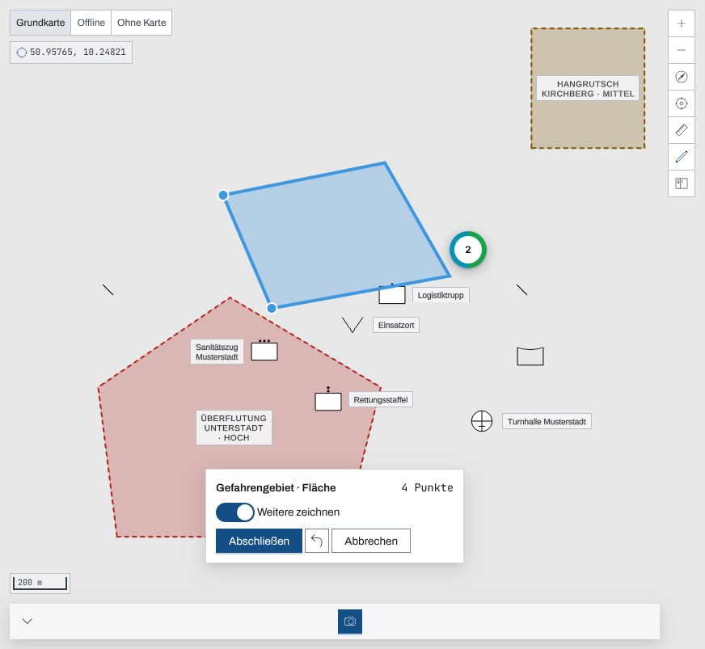

## Überblick

Die Lagekarte zeigt, wo was ist: Einsatzort, Einheiten, Zonen, Gefahrengebiete, Stellen,
Bereitstellungsräume, Lagemeldungen und taktische Zeichen. Rechts steht die Leiste mit zwei
Ansichten: „Ebenen“ ordnet alles, was die Karte zeigen kann, in Gruppen; „Objekte“ führt die noch
nicht verorteten und die verorteten Objekte und das Zeichnen. Darüber steht das gewählte Objekt.
Auf der Karte wird gelesen, verortet,
gezeichnet und gemessen. Lesen und Messen kann jede Person im Einsatz, Verorten und Zeichnen nur,
wer im Einsatz schreiben darf.

## Abläufe

### Die Karte lesen und ein Objekt verorten

1. Im Bereich „Lage“ „Lagekarte“ öffnen. Oben links die Kartengrundlage wählen: eine Online-Karte
   (Name nach Einrichtung), „Offline“ oder „Ohne Karte“.
2. In der Leiste unter „Ebenen“ eine Gruppe aufklappen, etwa „Kräfte“, und eine Ebene antippen,
   um sie aus- oder einzublenden; die Zahl rechts nennt ihre Objekte. Das Kästchen am Kopf einer
   Gruppe blendet alle ihre Ebenen auf einmal ein oder aus. „Ebene suchen“ findet eine Ebene über
   ihren Namen oder den Namen ihrer Gruppe.

   

3. Für ein Objekt ohne Ort in der Leiste „Objekte“ wählen und dort unter „Nicht verortet“
   „Platzieren“. Oben in der Leiste stehen dann das Objekt, ein Feld für die Koordinate und
   „Abbrechen“; am Handy steht „Abbrechen“ im Band unten auf der Karte.
4. Auf die Stelle der Karte tippen, an die das Objekt gehört. Die App meldet „Objekt verortet“.

### Ein Objekt von seiner Seite aus verorten

1. Auf der Seite einer Person „Auf Lagekarte verorten“ wählen, auf der Seite eines Schadens oder
   Bereitstellungsraums „Auf Karte verorten“, für eine Betreuungsstelle „Auf Karte verorten“ in
   ihrem Menü. Die Lagekarte öffnet sich zum Platzieren dieses Objekts.
2. Auf die Stelle der Karte tippen, an die das Objekt gehört. Die Karte fliegt den neuen Marker
   an und zeigt ihn unter „Ausgewählt“. Oben in der Leiste, am Handy im Band unten auf der Karte,
   steht die Kennung mit „verortet“, etwa „R-005 verortet“.
3. „Zurück zu R-005“ wählen: Die Seite des Objekts öffnet sich wieder und zeigt die neue
   Koordinate. Wer weiter auf der Karte arbeitet, wählt „Auf der Karte bleiben“.

### Einen Abschnitt fokussieren

1. Auf der Karte die Fläche oder das Zeichen eines Einsatzabschnitts antippen. Er erscheint unter
   „Ausgewählt“.
2. „Abschnitt fokussieren“ wählen. Die Karte zeigt die Fläche des Abschnitts, Kräfte anderer
   Abschnitte erscheinen blass. Unten auf der Karte steht ein Band mit „Fokus“ und dem Namen des
   Abschnitts.
3. „Fokus aufheben“ wählen oder Esc drücken. Steht noch ein Objekt unter „Ausgewählt“, schließt
   das erste Esc dieses, das zweite hebt den Fokus auf. Die Karte kehrt zum Ausschnitt vor dem
   Fokus zurück.

### Eine Strecke oder Fläche messen

1. Rechts an der Karte „Messen“ wählen.
2. Im Band unten „Strecke“ oder „Fläche“ wählen.
3. Die Punkte nacheinander auf die Karte tippen; der Wert wächst mit.
4. „Abschließen“ wählen. Der Wert bleibt stehen, „Neu messen“ beginnt eine neue Messung.

   

5. „Beenden“ wählen oder Esc drücken.

### Ein taktisches Zeichen setzen

1. Rechts an der Karte „Zeichenwerkzeuge“ wählen. Die Leiste zeigt „Objekte“ mit dem Paneel
   „Zeichnen“; dort „Taktisches Zeichen platzieren“ wählen.
2. Ein Grundzeichen wählen, bei Bedarf ein Symbol; beide Listen lassen sich durchsuchen. Ein
   Symbol ohne Grundzeichen, etwa ein Piktogramm oder einen Zustand, setzt „Kein Grundzeichen“
   und danach das Symbol. Unter „Details“ stehen Organisation, Fachaufgabe, Einheit, Farbe und
   „Bezeichnung“.

   

3. „Platzieren“ wählen und auf die Stelle der Karte tippen. Die App meldet „Taktisches Zeichen
   angelegt“.
4. Solange „Weitere platzieren“ an ist, setzt jeder weitere Tipp dasselbe Zeichen noch einmal.
   „Fertig“ beendet das Setzen. Beides steht oben in der Leiste, am Handy im Band unten auf der
   Karte.

### Eine Zone zeichnen

1. Im Paneel „Zeichnen“ (Leiste, „Objekte“) unter „Zone zeichnen“ die Art wählen, etwa
   „Gefahrengebiet zeichnen“.
   Für eine freie Skizze „Fläche“ oder „Linie“ wählen.
2. Die Eckpunkte nacheinander auf die Karte tippen. Das Band unten zählt die Punkte;
   „Letzten Punkt zurück“ nimmt den letzten wieder weg.

   

3. Soll nur diese eine Zone entstehen, den Schalter „Weitere zeichnen“ ausschalten.
4. „Abschließen“ und danach „Speichern“ wählen. Die App meldet „Zone angelegt“.

## Hintergrund

### Die Leiste: Ebenen und Objekte

Die Ansicht „Ebenen“ ordnet die Ebenen in feste Gruppen: „Kräfte“ (Einheiten, Fahrzeuge, Personal,
Abschnitte, Bereitstellungsräume), „Lage“ (Einsatzort, Führungsstelle, Zonen, Schäden,
Lagemeldungen, taktische Zeichen), „Betroffene & Versorgung“ (Betroffene, Unfallhilfsstellen,
Betreuungsstellen), „Fachebenen“ mit „Warnungen“, „Wasser“, „Umwelt“ und „Verkehr & Infrastruktur“
sowie „Hintergrund“ mit den Bild-Hintergründen und, am Handy, der Kartengrundlage. Der Kopf einer
Gruppe nennt, wie viele ihrer Ebenen an sind. Eine Ebene, die eine Rolle nicht sehen darf, steht
gesperrt mit ihrem Grund da und bleibt auch beim Kästchen der Gruppe aus. Konnte die App eine
Quelle nicht laden, steht „—“ statt einer Zahl.

Eine Fachebene nennt unter ihrem Namen, was sie zeigt, und eingeschaltet, von wann ihr Stand ist;
„offline“, „keine Daten“ oder „näher heranzoomen“ sagen, warum sie gerade nichts zeigt.

Ganz oben in „Ebenen“ steht die Kartenansicht mit „In dieser Ansicht speichern“. Welche Ansicht
der Leiste vorn steht und welche Gruppen offen sind, merkt sich das Gerät. Zu Beginn sind
„Kräfte“ und „Lage“ offen.

### Tippen auf der Karte

Ein Tipp gehört genau einem Ziel: Ein Tipp auf ein Zeichen oder einen Marker wählt dieses Objekt;
liegen mehrere Flächen an der Stelle, fragt ein Menü, welche gemeint ist. Beim Messen setzt ein
Tipp auf einen Marker oder ein Bündel keinen Messpunkt, die Punkte gehören auf die freie Karte. Ein Rechtsklick oder ein langer Druck auf eine freie Stelle öffnet ein Menü
mit „Koordinate kopieren“, „Messen ab hier“ und, mit Schreibrecht, „Hier Zeichen setzen“.

### Was die Zeichenwahl anbietet

Die Zeichenwahl bietet nur an, was sich mit dem gewählten Zeichen darstellen lässt: Ein
Landfahrzeug bekommt keine Stärke wie „Zug“, und ein Grundzeichenwechsel verwirft, was das neue
Grundzeichen nicht trägt. Die Farbe kommt aus einer festen Palette und steht nur bei Zeichen
zur Wahl, die eine Füllung tragen, etwa bei der Gefahr; eine freie Farbe und eine Angabe
„Funktion“ gibt es nicht. Führt die DV 102 für ein Symbol zwei Darstellungen, stehen beide als
eigene Kachel da: bei den Fernmeldezeichen „(Funk)“ für die drahtlose und „(Draht)“ für die
leitergebundene Form. Sonst trägt die zweite ihren eigenen Namen, etwa „Gefährliche Stoffe
(Chlor)“, oder, wo die DV 102 keinen führt, „(zweite Darstellung)“.

Nach „Kein Grundzeichen“ ist noch kein Zeichen gewählt: Die Vorschau zeigt „Symbol wählen“,
„Platzieren“ ist gesperrt, und am gewählten Zeichen wird nichts gespeichert, bis ein Symbol
gewählt ist.

Zeichen aus älteren Ständen der App zeigt die Karte so genau, wie es geht. Lässt sich ein
solches Zeichen nicht mehr ganz darstellen, nennt das gewählte Zeichen „vereinfacht
dargestellt“ und die alte Angabe; eine gespeicherte freie Farbe erscheint als nächstliegende
Farbe der Palette. Wer das Zeichen ändert, speichert es neu.

### Verwerfen und Esc beim Zeichnen

Nach „Abschließen“ wirft „Verwerfen“ die Figur weg und beendet das Zeichnen. Esc geht dagegen
schrittweise zurück: Eine abgeschlossene, noch nicht gespeicherte Figur wird verworfen, und es geht
zurück zum Zeichnen; eine angefangene Figur wird verworfen; ohne Figur endet das Zeichnen. Schon
gespeicherte Zonen bleiben, der Knopf heißt dann „Fertig“ statt „Abbrechen“.

### Verorten von einer Seite aus

Wer ein Objekt von seiner Seite aus verortet, sieht dessen Ebene auf der Karte, auch wenn sie
ausgeschaltet ist; ihr Schalter steht weiter auf aus und trägt den Zusatz „eingeblendet“. Die
Ansicht gilt dadurch nicht als geändert und speichert nichts davon. Die Ebene bleibt eingeblendet,
bis die Lagekarte verlassen wird. Betroffene zeigt die Karte auch so nur mit Zugriff auf das Modul
„Personen“.

„Zurück zu …“ steht nur, wenn die Karte von der Seite des Objekts geöffnet wurde. Eine
Unfallhilfsstelle wird über „Nicht verortet“ verortet und hat deshalb keinen Rückweg. Ein Objekt,
das über „Nicht verortet“ platziert wird, meldet sich wie bisher mit „Objekt verortet“.

### Fokus auf einen Abschnitt

Der Fokus ändert nur, wie die Karte aussieht. Kräfte anderer Abschnitte bleiben auf der Karte und
lassen sich weiter antippen, sie erscheinen nur blass: Einheiten, Fahrzeuge, Abschnittszeichen und
Flächen. Eine Einheit ohne eigenen Abschnitt zählt zum Abschnitt der Einheit, unter der sie steht,
ein Fahrzeug zum Abschnitt seiner Einheit. Unterabschnitte gehören zum fokussierten Abschnitt und
bleiben voll. Kräfte ohne Abschnitt, Personal, Schäden, Zonen und alles Übrige bleiben ebenfalls
voll. Ebenen, Zahlen und Listen der Leiste ändern sich nicht.

Hat der Abschnitt keine Fläche, zeigt die Karte seine Unterabschnitte und seine verorteten
Kräfte; gibt es auch die nicht, bleibt der Ausschnitt, wie er ist. Der Fokus wird nicht
gespeichert: Nach dem Neuladen und in einem anderen Einsatz ist er aufgehoben. Ein Link auf die
Lagekarte kann einen Abschnitt mitbringen; die Karte öffnet dann mit diesem Fokus.

### Gefahrengebiete

Ein gezeichnetes Gefahrengebiet erscheint im Kapitel [Gefahren](gefahren.md) und wird dort
bewertet und benannt. Auf der Karte trägt es seinen Namen und die höchste Warnstufe als Text.

Ein neu gezeichnetes Gefahrengebiet meldet die App allen im Einsatz, die die Lagekarte lesen,
als Hinweis „Neue Gefahr“ mit Sprung zum Gebiet auf der Karte. Wer das Gebiet zeichnet, bekommt
keinen Hinweis, gekoppelte Geräte ebenso wenig. Ändern, Umbenennen und Bewerten eines bestehenden
Gebiets bleiben still.

### Rechte

Lesen, Ebenen schalten und Messen gehen mit jeder Rolle. Verorten, Zeichnen und Zeichen setzen
brauchen das Schreibrecht im Einsatz: Einsatzleitung oder Führungspersonal in einem laufenden
Einsatz (Kapitel [Rechte im Einsatz](rechte-im-einsatz.md)). Ohne Schreibrecht fehlt das Paneel
„Zeichnen“.

### Bereitstellungsräume

Die Ebene „Bereitstellungsräume“ zeigt jeden verorteten Raum mit dem Zeichen „Bereitstellungsraum“
nach DV 102, beschriftet mit Bezeichnung, Stärke und Zahl der Fahrzeuge. Ein geplanter Raum trägt
einen gestrichelten Ring und „geplant“, ein aufgelöster fehlt. Verortet wird ein Raum aus seiner
Seite heraus oder unter „Nicht verortet“ (Kapitel [Bereitstellungsräume](bereitstellungsraeume.md)).
Wer das Modul Bereitstellungsräume nicht sehen darf, sieht die Ebene gesperrt mit „Keine
Berechtigung“ und findet keinen Raum in der Suche.

### Die eigene Führungsstelle

Trägt die eigene Führungsstelle in den Einsatzdaten eine Koordinate, steht sie auf der Karte mit
dem Zeichen „Befehlsstelle“ und ihrer Bezeichnung, in der Ebene „Führungsstelle“. Auf der Karte
lässt sie sich weder verschieben noch verorten; ihr Standort wird in den Einsatzdaten gepflegt
(Kapitel [Einsatzdaten und Führungsstelle](einsatzdaten.md)). Nach einem Neuladen ohne Netz und
in einem früheren Lagestand fehlt sie.

### Ohne Netz

Zonen, Zeichen, Gefahrengebiete, Schäden, Lagemeldungen, Kartenbilder und die übrigen Objekte der
Karte hält die App für die Arbeit ohne Netz vor (Kapitel [Arbeiten ohne Netz](ohne-netz.md)).
Ausgenommen sind die Bereitstellungsräume: nach einem Neuladen ohne Netz fehlen sie auf der
Karte.

Die Kartengrundlage ist davon getrennt: Eine Online-Karte holt der Server aus dem Internet,
„Offline“ zeigt eine Karte, die auf dem Server selbst liegt, und kommt ohne Internet aus. Ist eine
der beiden nicht eingerichtet, ist sie gesperrt und nennt den Grund. „Ohne Karte“ zeigt die
Objekte ohne Kartengrund.

## Grundlagen und Quellen

- Die taktischen Zeichen der Lagekarte folgen der DV 102.
