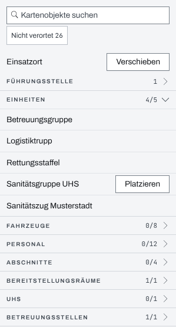
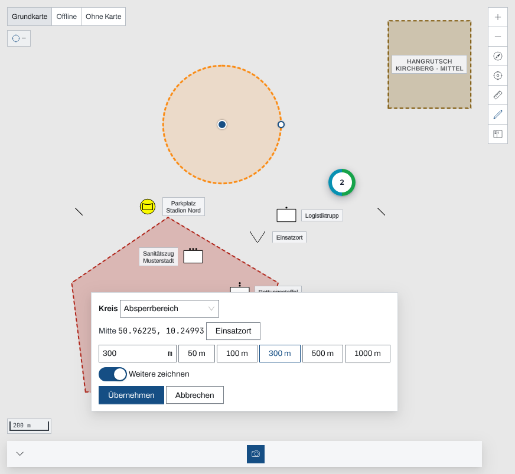
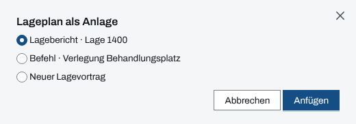

## Überblick

Die Lagekarte zeigt, wo was ist: Einsatzort, Einheiten, Zonen, Gefahrengebiete, Stellen,
Bereitstellungsräume, Lagemeldungen und taktische Zeichen. Rechts steht die Leiste mit den
Ansichten „Ebenen“ und „Objekte“: „Ebenen“ ordnet alles, was die Karte zeigen kann, in Gruppen;
„Objekte“ führt alle Objekte des Einsatzes in einer durchsuchbaren Liste, verortet oder nicht.
Gezeichnet wird über den Knopf „Zeichenwerkzeuge“ rechts an der Karte. Solange ein Objekt gewählt ist, kommt die Ansicht „Auswahl“ dazu. Auf der Karte wird
gelesen, verortet, gezeichnet und gemessen. Lesen und Messen kann jede Person im Einsatz, Verorten und Zeichnen nur,
wer im Einsatz schreiben darf.

## Abläufe

### Die Karte lesen und ein Objekt verorten

1. Im Bereich „Lage“ „Lagekarte“ öffnen. Oben links die Kartengrundlage wählen: eine Online-Karte
   (Name nach Einrichtung), „Offline“ oder „Ohne Karte“.
2. In der Leiste unter „Ebenen“ eine Gruppe aufklappen, etwa „Kräfte“, und eine Ebene antippen,
   um sie aus- oder einzublenden; die Zahl rechts nennt ihre Objekte. Das Kästchen am Kopf einer
   Gruppe blendet alle ihre Ebenen auf einmal ein oder aus. „Ebene suchen“ findet eine Ebene über
   ihren Namen oder den Namen ihrer Gruppe.

   

3. In der Leiste „Objekte“ wählen und unter „Kartenobjekte suchen“ den Namen eintippen, etwa
   „Turnhalle“; „Nicht verortet“ zeigt nur die Objekte ohne Ort. In der Zeile des Objekts
   „Platzieren“ wählen. Die Zeile sagt dann „wird platziert“; oben in der Leiste stehen das Objekt,
   ein Feld für die Koordinate und „Abbrechen“, am Handy steht „Abbrechen“ im Band unten auf der
   Karte.
4. Auf die Stelle der Karte tippen, an die das Objekt gehört. Die App meldet „Objekt verortet“.

### Ein Objekt wählen

1. Auf der Karte einen Marker antippen oder in der Leiste unter „Objekte“ eine Zeile wählen. Die
   Leiste zeigt die Ansicht „Auswahl“ mit Angaben und Aktionen des Objekts; ein verortetes Objekt
   fliegt die Karte an.

   

2. Mit „Ebenen“ oder „Objekte“ bleibt das Objekt gewählt, „Auswahl“ holt es zurück.
3. „Zurück zu Objekte“ (oder „Zurück zu Ebenen“) wählen oder Esc drücken: Die Auswahl ist
   aufgehoben, die Leiste steht wieder dort, wo sie vorher stand.

### Ein Objekt von seiner Seite aus verorten

1. Auf der Seite einer Person „Auf Lagekarte verorten“ wählen, auf der Seite eines Schadens,
   Bereitstellungsraums oder Tiers „Auf Karte verorten“, für eine Betreuungsstelle „Auf Karte
   verorten“ in ihrem Menü. Die Lagekarte öffnet sich zum Platzieren dieses Objekts.
2. Auf die Stelle der Karte tippen, an die das Objekt gehört. Die Karte fliegt den neuen Marker
   an und zeigt ihn unter „Auswahl“. Oben in der Leiste, am Handy im Band unten auf der Karte,
   steht die Kennung mit „verortet“, etwa „R-005 verortet“.
3. „Zurück zu R-005“ wählen: Die Seite des Objekts öffnet sich wieder und zeigt die neue
   Koordinate. Wer weiter auf der Karte arbeitet, wählt „Auf der Karte bleiben“.

### Einen Abschnitt fokussieren

1. Auf der Karte die Fläche oder das Zeichen eines Einsatzabschnitts antippen. Er erscheint unter
   „Auswahl“. Ein Abschnitt ohne Fläche wird in der Leiste unter „Objekte“ gewählt.
2. „Abschnitt fokussieren“ wählen. Die Karte zeigt die Fläche des Abschnitts, Kräfte anderer
   Abschnitte erscheinen blass. Unten auf der Karte steht ein Band mit „Fokus“ und dem Namen des
   Abschnitts.
3. „Fokus aufheben“ wählen oder Esc drücken. Ist noch ein Objekt gewählt, hebt das erste Esc die
   Auswahl auf, das zweite den Fokus. Die Karte kehrt zum Ausschnitt vor dem
   Fokus zurück.

### Eine Strecke, Fläche oder einen Radius messen

1. Rechts an der Karte „Messen“ wählen.
2. Im Band unten „Strecke“, „Fläche“ oder „Radius“ wählen.
3. Die Punkte nacheinander auf die Karte tippen; der Wert wächst mit. Beim Radius ist der erste
   Punkt die Mitte und der zweite der Rand; der Kreis steht gestrichelt auf der Karte, und das
   Band zeigt „r = …“ und daneben die Fläche des Kreises. Mit „Beenden“ verschwindet der Kreis.
4. „Abschließen“ wählen. Der Wert bleibt stehen, „Neu messen“ beginnt eine neue Messung.

   

5. „Beenden“ wählen oder Esc drücken.

### Ein taktisches Zeichen setzen

1. Rechts an der Karte „Zeichenwerkzeuge“ wählen. Unter „Taktisches Zeichen“ stehen die zuletzt
   verwendeten Zeichen. Ein Tipp auf eines davon wählt es ohne Zeichenwahl; dann gleich auf die
   Stelle der Karte tippen wie in Schritt 3. Für ein anderes Zeichen „Weitere …“ wählen.
2. Ein Grundzeichen wählen, bei Bedarf ein Symbol; beide Listen lassen sich durchsuchen. Ein
   Symbol ohne Grundzeichen, etwa ein Piktogramm oder einen Zustand, setzt „Kein Grundzeichen“
   und danach das Symbol. Unter „Details“ stehen Organisation, Fachaufgabe, Einheit, Farbe und
   „Bezeichnung“.

   

3. „Platzieren“ wählen und auf die Stelle der Karte tippen. Die App meldet „Taktisches Zeichen
   angelegt“.
4. Solange „Weitere platzieren“ an ist, setzt jeder weitere Tipp dasselbe Zeichen noch einmal.
   „Fertig“ beendet das Setzen. Beides steht oben in der Leiste, am Handy im Band unten auf der
   Karte.

### Eine Zone zeichnen

1. Rechts an der Karte „Zeichenwerkzeuge“ wählen und unter „Flächen und Linien“ die Art, etwa
   „Gefahrengebiet“. Eine freie Skizze entsteht mit „Freie Skizze“ als Fläche oder mit „Linie“
   daneben als Linie. Esc oder ein Tipp neben das Menü schließt es, ohne zu zeichnen.
2. Die Eckpunkte nacheinander auf die Karte tippen. Das Band unten zählt die Punkte;
   „Letzten Punkt zurück“ nimmt den letzten wieder weg.

   

3. Soll nur diese eine Zone entstehen, den Schalter „Weitere zeichnen“ ausschalten.
4. „Abschließen“ und danach „Speichern“ wählen. Die App meldet „Zone angelegt“.

### Einen Absperr- oder Gefahrenbereich als Kreis zeichnen

1. Unter „Zeichenwerkzeuge“ neben der Art, etwa „Absperrbereich“, „Kreis“ wählen. Mit
   Schreibrecht geht es auch über einen Rechtsklick oder langen Druck auf die Karte und „Kreis
   hier …“; die Stelle ist dann schon die Mitte.
2. Im Band unten unter „Art“ bei Bedarf eine andere Art wählen.
3. Auf die Mitte des Kreises tippen; ein weiterer Tipp versetzt sie. „Einsatzort“ oder
   „Suchnadel“ übernimmt deren Lage als Mitte.
4. Den Radius in Metern eintragen oder „50 m“, „100 m“, „300 m“, „500 m“ oder „1000 m“ wählen.
   Der Kreis steht gestrichelt auf der Karte; der Griff an seinem Rand stellt den Radius auch durch
   Ziehen ein, das Band zeigt dann den gezogenen Wert.

   
5. „Übernehmen“ wählen. Die App meldet „Zone angelegt“. Solange „Weitere zeichnen“ an ist, beginnt
   danach der nächste Kreis mit demselben Radius; „Fertig“ beendet das Zeichnen.

### Eine Zone punktweise ändern

1. Die Zone auf der Karte wählen und in der Auswahl „Punkte bearbeiten“ wählen.
2. An jedem Eckpunkt steht ein eckiger Griff: Ziehen verschiebt den Punkt, ein Tipp wählt ihn.
   Ein runder Griff auf der Mitte einer Kante setzt dort einen neuen Punkt; gezogen landet er, wo
   er losgelassen wird.
3. „Punkt entfernen“ nimmt den gewählten Punkt weg, „Letzte Änderung zurück“ die letzte Änderung.
4. „Übernehmen“ wählen. Die App meldet „Zone gespeichert“, und die Zone steht wieder in der
   Auswahl. „Abbrechen“ lässt die Zone, wie sie war.

### Die Mitte eines Kreises verschieben

1. Den Kreis auf der Karte wählen und in der Auswahl „Mitte verschieben“ wählen.
2. Auf die neue Mitte tippen, den Griff in der Mitte ziehen oder „Einsatzort“ oder „Suchnadel“
   wählen. Der Radius bleibt; Zahl, Schnellwahl und der Griff am Rand ändern ihn wie beim Zeichnen.
3. „Übernehmen“ wählen. Die App meldet „Zone gespeichert“, und der Kreis steht wieder in der
   Auswahl.

### Den Lageplan drucken oder anhängen

1. Den Ausschnitt so einstellen, wie er auf dem Blatt stehen soll: Ebenen, Zoom und Drehung.
2. Zum Drucken im Kopf der Seite „Drucken / als PDF“ wählen; auf schmalen Bildschirmen steht der
   Punkt unter „Weitere“. Im Druckdialog des Browsers drucken oder als PDF speichern.
3. Zum Anhängen „Als Anlage an …“ wählen, im Dialog einen offenen Lagebericht oder Befehl oder
   „Neuer Lagevortrag“ wählen und „Anfügen“ wählen. Die App meldet „Lageplan an … angefügt“; ein
   neuer Lagevortrag öffnet sich.

   

## Hintergrund

### Die Leiste: Ebenen, Objekte und Auswahl

Die Ansicht „Ebenen“ ordnet die Ebenen in feste Gruppen: „Kräfte“ (Einheiten, Fahrzeuge, Personal,
Abschnitte, Bereitstellungsräume), „Lage“ (Einsatzort, Führungsstelle, Zonen, Schäden,
Lagemeldungen, taktische Zeichen), „Betroffene & Versorgung“ (Betroffene, Unfallhilfsstellen,
Betreuungsstellen, Tiere), „Fachebenen“ mit „Warnungen“, „Wasser“, „Umwelt“ und „Verkehr &
Infrastruktur“ sowie „Hintergrund“ mit den Bild-Hintergründen und, am Handy, der Kartengrundlage. Der Kopf einer
Gruppe nennt, wie viele ihrer Ebenen an sind. Eine Ebene, die eine Rolle nicht sehen darf, steht
gesperrt mit ihrem Grund da und bleibt auch beim Kästchen der Gruppe aus. Konnte die App eine
Quelle nicht laden, steht „—“ statt einer Zahl.

Eine Fachebene nennt unter ihrem Namen, was sie zeigt, und eingeschaltet, von wann ihr Stand ist;
„offline“, „keine Daten“ oder „näher heranzoomen“ sagen, warum sie gerade nichts zeigt.

Ganz oben in „Ebenen“ steht die Kartenansicht mit „In dieser Ansicht speichern“. Welche Ansicht
der Leiste vorn steht und welche Gruppen offen sind, merkt sich das Gerät. Zu Beginn sind
„Kräfte“ und „Lage“ offen.

Die Ansicht „Objekte“ führt den Einsatzort als erste Zeile, darunter die Objekte in Gruppen je
Art: Einheiten, Fahrzeuge, Führungskräfte, Abschnitte, Bereitstellungsräume, Unfallhilfsstellen,
Betreuungsstellen, Tiere, Schäden, dazu Führungsstelle, Lagemeldungen, taktische Zeichen und
Betroffene, soweit sie verortet sind. Der Kopf einer Gruppe nennt, wie viele ihrer Objekte
verortet sind und wie viele es gibt, etwa „Einheiten 3/5“; ohne Suchbegriff sind die Gruppen zu,
mit Suchbegriff stehen die Gruppen mit Treffern offen. „Nicht verortet“ zeigt nur die Objekte ohne
Ort und nennt ihre Zahl. Eine Zeile trägt, was mit dem Objekt auf der Karte geht: „Platzieren“
für ein Objekt ohne Ort, „Fläche zeichnen“ für einen Abschnitt ohne Fläche. Objekte eines Moduls,
das eine Rolle nicht sehen darf, fehlen in der Liste. Konnte die App eine Liste nicht laden, steht
das über der Liste und „—“ statt der Zahl.

Die Ansicht „Auswahl“ gibt es nur, solange ein Objekt gewählt ist; eine neue Auswahl holt sie nach
vorn. Esc schließt zuerst ein aufgefächertes Bündel von Markern, dann die Auswahl, dann den Fokus
auf einen Abschnitt. Während gezeichnet oder gemessen wird, gilt Esc dem Werkzeug.

### Der Lageplan

Gedruckt und angehängt wird der Ausschnitt, der gerade zu sehen ist, als Bild: auf einem Blatt A4
quer mit Druckkopf (Stand, Ansicht, Kartengrundlage), Maßstabsleiste, „Maßstab ca. 1 : …“,
Nordpfeil und einer Legende. Alles steht auf einem Blatt: Trägt der Kopf ein Logo oder ist die
Legende lang, wird das Bild kleiner gedruckt, Maßstabsleiste und „Maßstab ca. 1 : …“ gelten für
das gedruckte Bild. Die Legende nennt nur, was auf dem Bild steht: Ebenen mit Anzahl,
jede Zone mit ihrer Beschriftung samt Warnstufe, Fachebenen mit Stand und sichtbare
Bild-Hintergründe. Eine Ebene, die die eigene Rolle nicht sehen darf, steht weder auf dem Bild
noch in der Legende. Ist eine Fachebene veraltet, steht das über der Legende. Kacheln, die noch
nicht geladen sind, bleiben leere Fläche. In einem früheren Lagestand trägt das Blatt dessen
Stand.

Die Anlage ist ein PNG mit Kopf, Karte, Maßstab, Nordpfeil und Legende und steht im Lagebericht
oder Befehl als „Lageplan“ unter den Anlagen (Kapitel [Lageberichte](lageberichte.md)).
Anhängen braucht das Schreibrecht im Einsatz und eine Verbindung; angeboten werden nur Entwürfe
der Module, die die eigene Rolle sieht. Fehlt etwas davon, steht „Als Anlage an …“ gesperrt und
nennt den Grund.

### Voraussetzung im Browser

Die Karte zeichnet der Browser über die Grafikschnittstelle WebGL2. Aktuelle Browser auf Fükw,
Tablet und Handy bringen sie mit; fehlen kann sie etwa, wenn die Hardwarebeschleunigung des
Browsers abgeschaltet ist oder der Browser ohne Grafikausgabe läuft. Dann steht an Stelle der
Karte „Karte auf diesem Gerät nicht darstellbar“. Leiste, Objektliste und Auswahl bleiben
bedienbar, nur die Karte selbst fehlt. Ein Lageplan entsteht so nicht: „Drucken / als PDF“
meldet „Lageplan nicht gedruckt“, „Als Anlage an …“ meldet „Lageplan nicht angefügt“, beide mit
demselben Grund.

### Tippen auf der Karte

Ein Tipp gehört genau einem Ziel: Ein Tipp auf ein Zeichen oder einen Marker wählt dieses Objekt;
liegen mehrere Flächen an der Stelle, fragt ein Menü, welche gemeint ist. Beim Messen setzt ein
Tipp auf einen Marker oder ein Bündel keinen Messpunkt, die Punkte gehören auf die freie Karte. Ein Rechtsklick oder ein langer Druck auf eine freie Stelle öffnet ein Menü
mit „Koordinate kopieren“, „Messen ab hier“ und, mit Schreibrecht, „Hier Zeichen setzen“ und
„Kreis hier …“.

### Zeichen auf dunkler Karte

Steht die Karte dunkel (im Nachtbetrieb oder mit dem Karten-Design „Dunkel“), ist jedes
taktische Zeichen hell umrandet: ein schmaler weißer Rand folgt seinem Umriss, Stärkepunkte und
Räder sind weiß. Zeichen ohne Organisationsfarbe, etwa der Einsatzort, sind sonst nur ein
schwarzer Umriss und wären auf dem dunklen Grund nicht zu sehen. Farbige Flächen und die schwarze
Schrift darin bleiben, wie sie sind; nur Blau ist etwas heller. Auf heller Karte entfällt der
Rand. Der Lageplan zeigt die Karte, wie sie zu sehen ist. Die Symbolkachel im Inspector zeigt das
Zeichen im dunklen Modus ebenso.

### Was die Zeichenwahl anbietet

Die Zeichenwahl bietet nur an, was sich mit dem gewählten Zeichen darstellen lässt: Ein
Landfahrzeug bekommt keine Stärke wie „Zug“, und ein Grundzeichenwechsel verwirft, was das neue
Grundzeichen nicht trägt. Die Farbe kommt aus einer festen Palette und steht nur bei Zeichen
zur Wahl, die eine Füllung tragen, etwa bei der Gefahr; eine freie Farbe und eine Angabe
„Funktion“ gibt es nicht. Führt die DV 102 für ein Symbol zwei Darstellungen, stehen beide als
eigene Kachel da: bei den Fernmeldezeichen „(Funk)“ für die drahtlose und „(Draht)“ für die
leitergebundene Form. Sonst trägt die zweite ihren eigenen Namen, etwa „Gefährliche Stoffe
(Chlor)“, oder, wo die DV 102 keinen führt, „(zweite Darstellung)“.

Nach „Kein Grundzeichen“ ist noch kein Zeichen gewählt: Die Vorschau zeigt „Symbol wählen“,
„Platzieren“ ist gesperrt, und am gewählten Zeichen wird nichts gespeichert, bis ein Symbol
gewählt ist.

Zeichen aus älteren Ständen der App zeigt die Karte so genau, wie es geht. Lässt sich ein
solches Zeichen nicht mehr ganz darstellen, nennt das gewählte Zeichen „vereinfacht
dargestellt“ und die alte Angabe; eine gespeicherte freie Farbe erscheint als nächstliegende
Farbe der Palette. Wer das Zeichen ändert, speichert es neu.

### Verwerfen und Esc beim Zeichnen

Nach „Abschließen“ wirft „Verwerfen“ die Figur weg und beendet das Zeichnen. Esc geht dagegen
schrittweise zurück: Eine abgeschlossene, noch nicht gespeicherte Figur wird verworfen, und es geht
zurück zum Zeichnen; eine angefangene Figur wird verworfen; ohne Figur endet das Zeichnen. Schon
gespeicherte Zonen bleiben, der Knopf heißt dann „Fertig“ statt „Abbrechen“.

Beim Kreis gilt die Mitte als angefangene Figur: Das erste Esc nimmt die Mitte weg, der Radius
bleibt eingetragen; ein Esc ohne Mitte beendet das Zeichnen.

Beim Bearbeiten einer Zone, punktweise oder an der Mitte eines Kreises, gilt jede Änderung als
angefangene Figur: Das erste Esc stellt die gespeicherte Form wieder her, ein Esc ohne Änderung
beendet das Bearbeiten.

### Kreise

Ein Kreis wird als Fläche mit 64 Ecken gespeichert, dazu Mitte und Radius. Er gilt überall als
Zone seiner Art: Ein Gefahrengebiet als Kreis wird wie jedes Gefahrengebiet bewertet. Der Radius darf höchstens 50.000 m betragen. Das Einsatztagebuch nennt
ihn beim Anlegen, etwa „Absperrbereich «Nord» eingerichtet · Kreis r = 300 m“; die Karte schreibt
ihn hinter den Namen („Nord · r = 300 m“).

Wer einen Kreis auf der Karte wählt, sieht unter den Kennzahlen den „Radius“. Mit Schreibrecht
lässt er sich dort als Zahl ändern; nach dem Verlassen des Feldes rechnet die App den Kreis um
dieselbe Mitte neu, und das Einsatztagebuch hält „Radius 300 m → 500 m“ fest. Eine verschobene
Mitte rechnet den Kreis mit demselben Radius neu; das Einsatztagebuch nennt den Versatz, etwa
„Absperrbereich «Nord»: Mitte um 120 m versetzt“, mit geändertem Radius in derselben Zeile.

Wer eine Kreiszone punktweise ändert, macht aus ihr eine gewöhnliche Fläche: Mitte und Radius
entfallen, das Band sagt das vorher mit „Danach kein Kreis mehr“. Das Einsatztagebuch hält
„Absperrbereich «Nord» geändert“ fest.

### Bearbeiten an der Karte

Bearbeiten braucht das Schreibrecht im Einsatz; in einem früheren Lagestand fehlen die Knöpfe.
Solange eine Zone bearbeitet wird, steht sie gestrichelt als Vorschau auf der Karte, die
gespeicherte Form ist ausgeblendet. Liegen Griffe auf dem Bildschirm zu dicht, etwa an den 64
Ecken eines kleinen Kreises, fehlen einige, bis näher herangezoomt wird; der gewählte Punkt
steht immer. Wird die Zone währenddessen an einem anderen Gerät aufgehoben, endet das Bearbeiten.
Ändern zwei Geräte dieselbe Zone, gilt die zuletzt übernommene Form.

Andere Module können die Lagekarte mit einem vorbereiteten Kreis öffnen, mit Art, Radius und
Mitte. Angelegt wird erst, wenn der Mensch „Übernehmen“ wählt.

### Verorten von einer Seite aus

Wer ein Objekt von seiner Seite aus verortet, sieht dessen Ebene auf der Karte, auch wenn sie
ausgeschaltet ist; ihr Schalter steht weiter auf aus und trägt den Zusatz „eingeblendet“. Die
Ansicht gilt dadurch nicht als geändert und speichert nichts davon. Die Ebene bleibt eingeblendet,
bis die Lagekarte verlassen wird. Betroffene zeigt die Karte auch so nur mit Zugriff auf das Modul
„Personen“.

„Zurück zu …“ steht nur, wenn die Karte von der Seite des Objekts geöffnet wurde. Eine
Unfallhilfsstelle wird in der Leiste unter „Objekte“ verortet und hat deshalb keinen Rückweg. Ein
Objekt, das aus der Leiste platziert wird, meldet sich wie bisher mit „Objekt verortet“.

### Fokus auf einen Abschnitt

Der Fokus ändert nur, wie die Karte aussieht. Kräfte anderer Abschnitte bleiben auf der Karte und
lassen sich weiter antippen, sie erscheinen nur blass: Einheiten, Fahrzeuge, Abschnittszeichen und
Flächen. Eine Einheit ohne eigenen Abschnitt zählt zum Abschnitt der Einheit, unter der sie steht,
ein Fahrzeug zum Abschnitt seiner Einheit. Unterabschnitte gehören zum fokussierten Abschnitt und
bleiben voll. Kräfte ohne Abschnitt, Personal, Schäden, Zonen und alles Übrige bleiben ebenfalls
voll. Ebenen, Zahlen und Listen der Leiste ändern sich nicht. Ein Bündel mehrerer Marker erscheint
nur dann blass, wenn es ausschließlich Kräfte anderer Abschnitte enthält; ist auch nur ein Marker
dabei, der voll bleibt, bleibt das ganze Bündel voll. Ein blasses Bündel fächert beim Antippen auf
wie jedes andere. Der Lageplan zeigt die Bündel so wie die Karte.

Hat der Abschnitt keine Fläche, zeigt die Karte seine Unterabschnitte und seine verorteten
Kräfte; gibt es auch die nicht, bleibt der Ausschnitt, wie er ist. Der Fokus wird nicht
gespeichert: Nach dem Neuladen und in einem anderen Einsatz ist er aufgehoben. Ein Link auf die
Lagekarte kann einen Abschnitt mitbringen; die Karte öffnet dann mit diesem Fokus. So öffnet
„Auf Karte zeigen ↗“ beim gewählten Abschnitt auf der Seite
[Einsatzabschnitte](einsatzabschnitte.md) die Karte.

### Gefahrengebiete

Ein gezeichnetes Gefahrengebiet erscheint im Kapitel [Gefahren](gefahren.md) und wird dort
bewertet und benannt. Auf der Karte trägt es seinen Namen und die höchste Warnstufe als Text.

Ist eine Zone eines Gefahrengebiets gewählt, nennt der Inspector unter „Gefahren“ die gesetzten
Gefahren des Gebiets: jede Zelle der Matrix über „keine“ und jede mit Erläuterung, mit Stufe,
Gefahr × Schutzobjekt und dem Anfang der Erläuterung, in der Folge der Matrix. Er zeigt höchstens
fünf; bei mehr führt „alle in Gefahren ↗“ zur Matrix des Gebiets. Ohne gesetzte Gefahr steht dort
„keine Gefahr über „keine““. Ohne Freigabe für das Modul Gefahren und in einem früheren Lagestand
fehlt der Abschnitt.

Ein neu gezeichnetes Gefahrengebiet meldet die App allen im Einsatz, die die Lagekarte lesen,
als Hinweis „Neue Gefahr“ mit Sprung zum Gebiet auf der Karte. Wer das Gebiet zeichnet, bekommt
keinen Hinweis, gekoppelte Geräte ebenso wenig. Ändern, Umbenennen und Bewerten eines bestehenden
Gebiets bleiben still.

### Rechte

Lesen, Ebenen schalten und Messen gehen mit jeder Rolle. Verorten, Zeichnen und Zeichen setzen
brauchen das Schreibrecht im Einsatz: Einsatzleitung oder Führungspersonal in einem laufenden
Einsatz (Kapitel [Rechte im Einsatz](rechte-im-einsatz.md)). Ohne Schreibrecht fehlt der Knopf
„Zeichenwerkzeuge“.

### Bereitstellungsräume

Die Ebene „Bereitstellungsräume“ zeigt jeden verorteten Raum mit dem Zeichen „Bereitstellungsraum“
nach DV 102, beschriftet mit Bezeichnung, Stärke und Zahl der Fahrzeuge. Ein geplanter Raum trägt
einen gestrichelten Ring und „geplant“, ein aufgelöster fehlt. Verortet wird ein Raum aus seiner
Seite heraus oder in der Leiste unter „Objekte“ (Kapitel [Bereitstellungsräume](bereitstellungsraeume.md)).
Wer das Modul Bereitstellungsräume nicht sehen darf, sieht die Ebene gesperrt mit „Keine
Berechtigung“ und findet keinen Raum in der Suche.

### Tiere

Die Ebene „Tiere“ zeigt offene und vermisste Tiere mit Koordinate als Kreis mit „T“, beschriftet
mit Registriernummer und Spezies, etwa „T-003 (Hund)“; ein vermisstes Tier trägt zusätzlich
„vermisst“. Ein abgeschlossenes Tier fehlt. Ausgewählt zeigt die Karte Status, Spezies, Rufname
und Fundort und springt mit „Im Fachmodul öffnen“ zur Seite des Tiers. Verortet wird ein Tier aus
seiner Seite heraus oder in der Leiste unter „Objekte“ (Kapitel [Tiere](tiere.md)). Wer das Modul Tiere
nicht sehen darf, sieht die Ebene gesperrt mit „Keine Berechtigung“ und findet kein Tier in der
Suche.

### Die eigene Führungsstelle

Trägt die eigene Führungsstelle in den Einsatzdaten eine Koordinate, steht sie auf der Karte mit
dem Zeichen „Befehlsstelle“ und ihrer Bezeichnung, in der Ebene „Führungsstelle“. Auf der Karte
lässt sie sich weder verschieben noch verorten; ihr Standort wird in den Einsatzdaten gepflegt
(Kapitel [Einsatzdaten und Führungsstelle](einsatzdaten.md)). Nach einem Neuladen ohne Netz und
in einem früheren Lagestand fehlt sie.

### Ohne Netz

Zonen, Zeichen, Gefahrengebiete, Schäden, Lagemeldungen, Kartenbilder und die übrigen Objekte der
Karte hält die App für die Arbeit ohne Netz vor (Kapitel [Arbeiten ohne Netz](ohne-netz.md)).
Das gilt auch für die Bereitstellungsräume. Ausgenommen sind die Tiere: nach einem Neuladen ohne
Netz fehlen sie auf der Karte.

Die Kartengrundlage ist davon getrennt: Eine Online-Karte holt der Server aus dem Internet,
„Offline“ zeigt eine Karte, die auf dem Server selbst liegt, und kommt ohne Internet aus. Ist eine
der beiden nicht eingerichtet, ist sie gesperrt und nennt den Grund. „Ohne Karte“ zeigt die
Objekte ohne Kartengrund.

## Grundlagen und Quellen

- Die taktischen Zeichen der Lagekarte folgen der DV 102.
