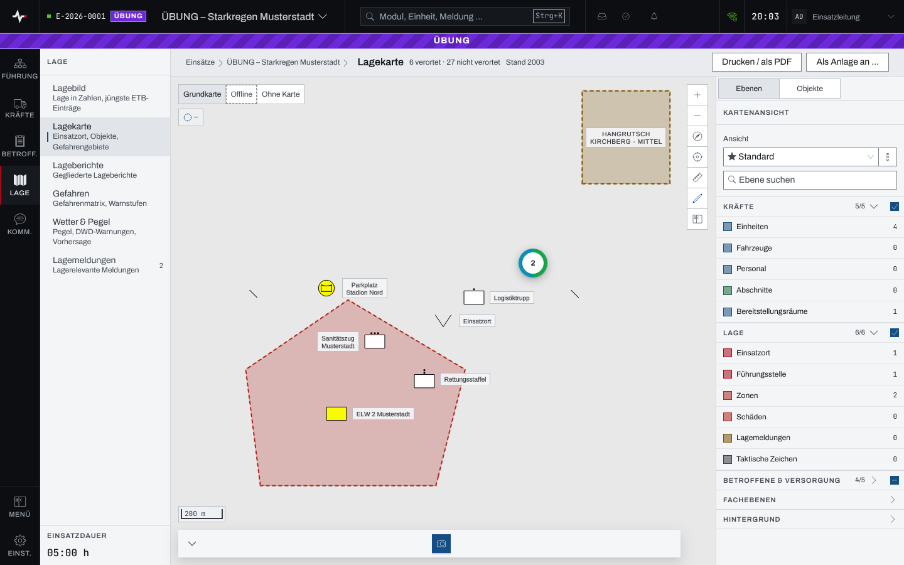
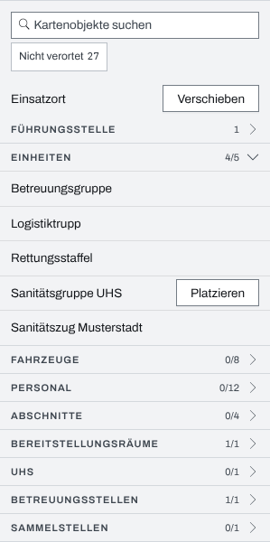
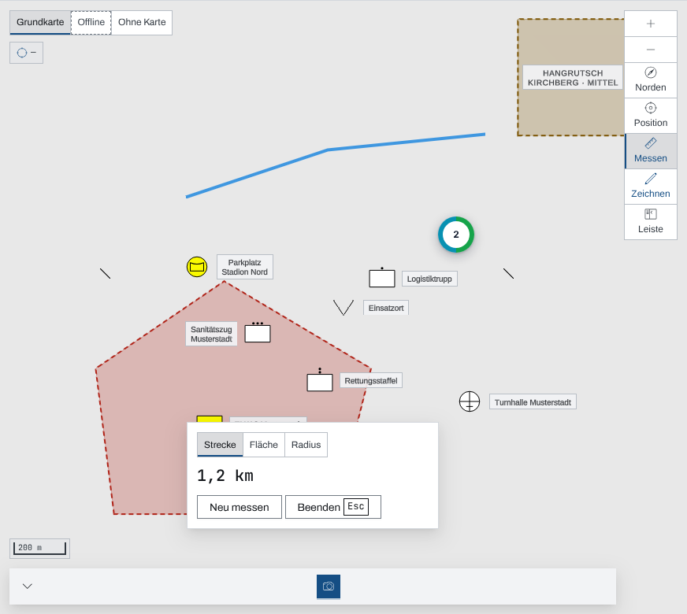
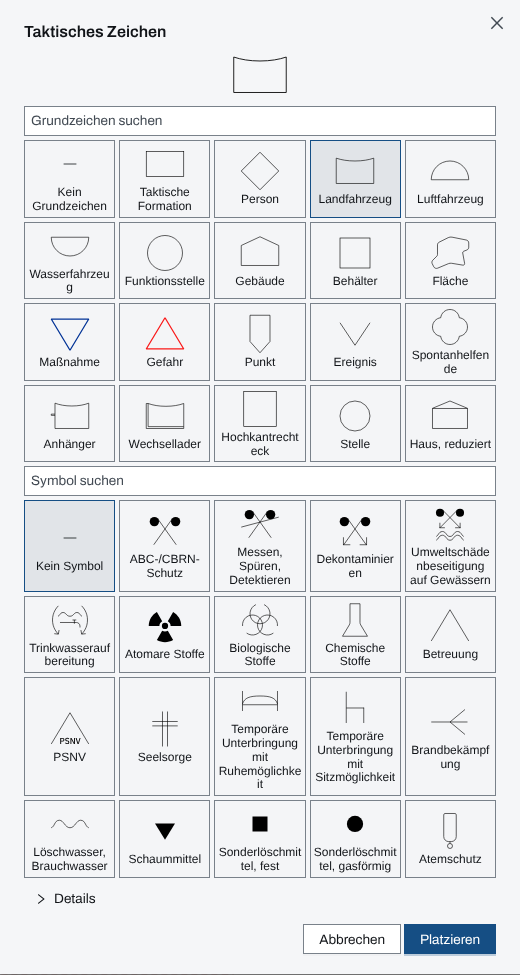
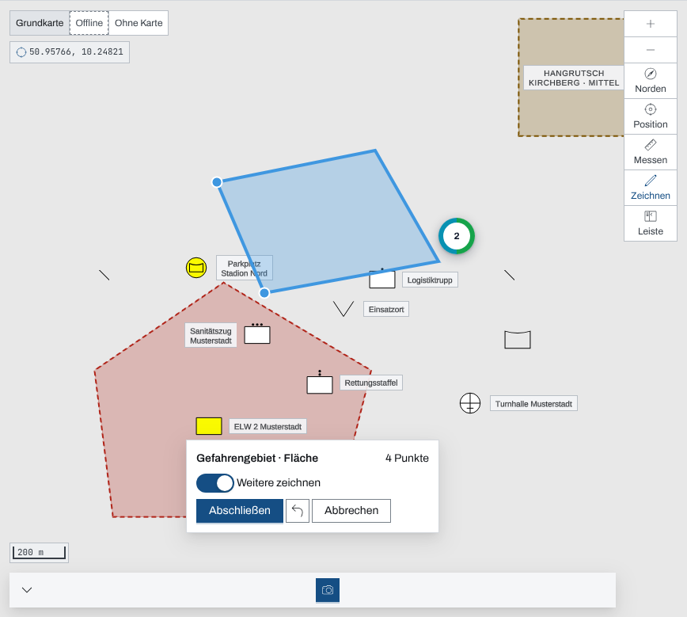
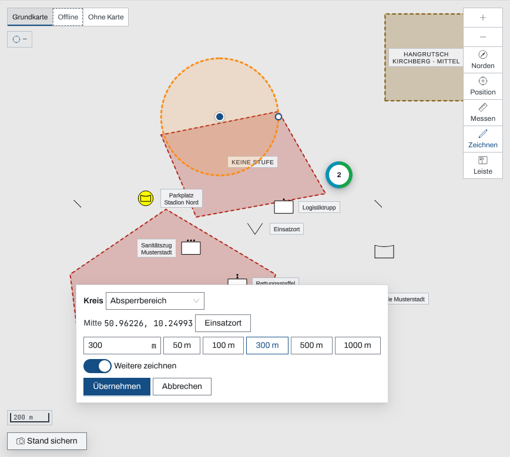
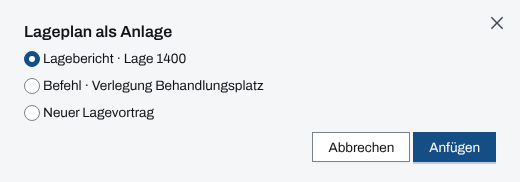
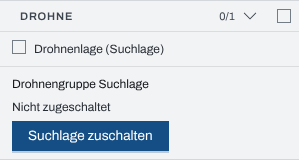
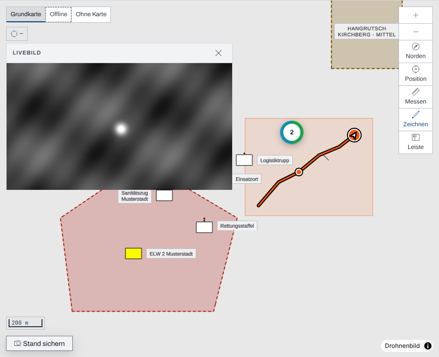
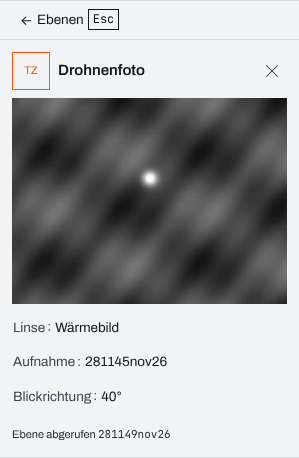

## Überblick

Die Lagekarte zeigt, wo was ist: Einsatzort, Einheiten, Zonen, Gefahrengebiete, Stellen,
Bereitstellungsräume, Lagemeldungen und taktische Zeichen. Rechts steht die Leiste mit den
Ansichten „Ebenen“ und „Objekte“: „Ebenen“ ordnet alles, was die Karte zeigen kann, in Gruppen;
„Objekte“ führt alle Objekte des Einsatzes in einer durchsuchbaren Liste, verortet oder nicht.
Gezeichnet wird über den Knopf „Zeichnen“ rechts an der Karte. Solange ein Objekt gewählt ist, kommt die Ansicht „Auswahl“ dazu. Auf der Karte wird
gelesen, verortet, gezeichnet und gemessen. Lesen und Messen kann jede Person im Einsatz, Verorten und Zeichnen nur,
wer im Einsatz schreiben darf.

## Abläufe

### Die Karte lesen und ein Objekt verorten

1. Im Bereich „Lage“ „Lagekarte“ öffnen. Oben links die Kartengrundlage wählen: eine Online-Karte
   (Name nach Einrichtung), „Offline“ oder „Ohne Karte“.
2. In der Leiste unter „Ebenen“ eine Gruppe aufklappen, etwa „Kräfte“, und eine Ebene antippen,
   um sie aus- oder einzublenden; die Zahl rechts nennt ihre Objekte. Das Kästchen am Kopf einer
   Gruppe blendet alle ihre Ebenen auf einmal ein oder aus. „Ebene suchen“ findet eine Ebene über
   ihren Namen oder den Namen ihrer Gruppe.

   

3. In der Leiste „Objekte“ wählen und unter „Kartenobjekte suchen“ den Namen eintippen, etwa
   „Turnhalle“; „Nicht verortet“ zeigt nur die Objekte ohne Ort. In der Zeile des Objekts
   „Platzieren“ wählen. Die Zeile sagt dann „wird platziert“; oben in der Leiste stehen das Objekt,
   ein Feld für die Koordinate und „Abbrechen“, am Handy steht „Abbrechen“ im Band unten auf der
   Karte.
4. Auf die Stelle der Karte tippen, an die das Objekt gehört. Die App meldet „Objekt verortet“.

### Den Einsatzort setzen, wenn er fehlt

1. Hat der Einsatz noch keinen Einsatzort, steht unten links auf der Karte „Einsatzort fehlt“.
   Ist nur eine Adresse ohne Punkt eingetragen, steht dort „Einsatzort nicht verortet“ mit der
   Adresse.
2. Wer den Ort auf der Karte sieht, wählt „Auf der Karte setzen“ und tippt auf die Stelle. Wer nur
   die Adresse kennt, wählt „Adresse eintragen“: Die Einsatzdaten öffnen sich beim Paneel
   „Einsatzort“, dort die Adresse suchen und übernehmen.
3. Sobald der Einsatzort einen Punkt hat, verschwindet der Hinweis. Solange gezeichnet, gemessen
   oder platziert wird, tritt er zurück. Ohne Schreibrecht steht er ohne Knöpfe da, im gesicherten
   Stand der Zeitachse gar nicht.

### Ein Objekt wählen

1. Auf der Karte einen Marker antippen oder in der Leiste unter „Objekte“ eine Zeile wählen. Die
   Leiste zeigt die Ansicht „Auswahl“ mit Angaben und Aktionen des Objekts. Ein Tipp auf den Marker
   lässt die Karte stehen; würde die aufgehende Leiste ihn verdecken, rückt die Karte ihn gerade so
   weit ins Bild, ohne zu zoomen. Eine Zeile der Liste fliegt die Karte zum Objekt und zoomt dabei
   nur heran, nie heraus.

   

2. Mit „Ebenen“ oder „Objekte“ bleibt das Objekt gewählt, „Auswahl“ holt es zurück.
3. „Zurück zu Objekte“ (oder „Zurück zu Ebenen“) wählen oder Esc drücken: Die Auswahl ist
   aufgehoben, die Leiste steht wieder dort, wo sie vorher stand.

### Ein Objekt von seiner Seite aus verorten

1. Auf der Seite einer Person „Auf Lagekarte verorten“ wählen, auf der Seite eines Schadens,
   Bereitstellungsraums oder Tiers „Auf Karte verorten“, für eine Betreuungsstelle „Auf Karte
   verorten“ in ihrem Menü. Die Lagekarte öffnet sich zum Platzieren dieses Objekts.
2. Auf die Stelle der Karte tippen, an die das Objekt gehört. Die Karte fliegt den neuen Marker
   an und zeigt ihn unter „Auswahl“. Oben in der Leiste, am Handy im Band unten auf der Karte,
   steht die Kennung mit „verortet“, etwa „R-005 verortet“.
3. „Zurück zu R-005“ wählen: Die Seite des Objekts öffnet sich wieder und zeigt die neue
   Koordinate. Wer weiter auf der Karte arbeitet, wählt „Auf der Karte bleiben“.

### Einen Abschnitt fokussieren

1. Auf der Karte die Fläche oder das Zeichen eines Einsatzabschnitts antippen. Er erscheint unter
   „Auswahl“. Ein Abschnitt ohne Fläche wird in der Leiste unter „Objekte“ gewählt.
2. „Abschnitt fokussieren“ wählen. Die Karte zeigt die Fläche des Abschnitts, Kräfte anderer
   Abschnitte erscheinen blass. Unten auf der Karte steht ein Band mit „Fokus“ und dem Namen des
   Abschnitts.
3. „Fokus aufheben“ wählen oder Esc drücken. Ist noch ein Objekt gewählt, hebt das erste Esc die
   Auswahl auf, das zweite den Fokus. Die Karte kehrt zum Ausschnitt vor dem
   Fokus zurück.

### Eine Strecke, Fläche oder einen Radius messen

1. Rechts an der Karte „Messen“ wählen.
2. Im Band unten „Strecke“, „Fläche“ oder „Radius“ wählen.
3. Die Punkte nacheinander auf die Karte tippen; der Wert wächst mit. Beim Radius ist der erste
   Punkt die Mitte und der zweite der Rand; der Kreis steht gestrichelt auf der Karte, und das
   Band zeigt „r = …“ und daneben die Fläche des Kreises. Mit „Beenden“ verschwindet der Kreis.
4. „Abschließen“ wählen. Der Wert bleibt stehen, „Neu messen“ beginnt eine neue Messung.

   

5. „Beenden“ wählen oder Esc drücken.

### Ein taktisches Zeichen setzen

1. Rechts an der Karte „Zeichnen“ wählen. Unter „Taktisches Zeichen“ stehen die zuletzt
   verwendeten Zeichen. Ein Tipp auf eines davon wählt es ohne Zeichenwahl; dann gleich auf die
   Stelle der Karte tippen wie in Schritt 3. Für ein anderes Zeichen „Weitere …“ wählen.
2. Ein Grundzeichen wählen, bei Bedarf ein Symbol; beide Listen lassen sich durchsuchen. Ein
   Symbol ohne Grundzeichen, etwa ein Piktogramm oder einen Zustand, setzt „Kein Grundzeichen“
   und danach das Symbol. Unter „Details“ stehen Organisation, Fachaufgabe, Einheit, Farbe und
   „Bezeichnung“. Die Fachaufgabe „Dekontaminieren“ gibt es auch „von Personal“ und „von Gerät“;
   das Zeichen trägt dann „P“ oder „G“ zwischen den Klammern.

   

3. „Platzieren“ wählen und auf die Stelle der Karte tippen. Die App meldet „Taktisches Zeichen
   angelegt“.
4. Solange „Weitere platzieren“ an ist, setzt jeder weitere Tipp dasselbe Zeichen noch einmal.
   „Fertig“ beendet das Setzen. Beides steht oben in der Leiste, am Handy im Band unten auf der
   Karte.

### Eine Zone zeichnen

1. Rechts an der Karte „Zeichnen“ wählen und unter „Flächen und Linien“ die Art, etwa
   „Gefahrengebiet“. Eine freie Skizze entsteht mit „Freie Skizze“ als Fläche oder mit „Linie“
   daneben als Linie. Esc oder ein Tipp neben das Menü schließt es, ohne zu zeichnen.
2. Die Eckpunkte nacheinander auf die Karte tippen. Das Band unten zählt die Punkte;
   „Letzten Punkt zurück“ nimmt den letzten wieder weg.

   

3. Soll nur diese eine Zone entstehen, den Schalter „Weitere zeichnen“ ausschalten.
4. „Abschließen“ und danach „Speichern“ wählen. Die App meldet „Zone angelegt“.

### Einen Absperr- oder Gefahrenbereich als Kreis zeichnen

1. Unter „Zeichnen“ neben der Art, etwa „Absperrbereich“, „Kreis“ wählen. Mit
   Schreibrecht geht es auch über einen Rechtsklick oder langen Druck auf die Karte und „Kreis
   hier …“; die Stelle ist dann schon die Mitte.
2. Im Band unten unter „Art“ bei Bedarf eine andere Art wählen.
3. Auf die Mitte des Kreises tippen; ein weiterer Tipp versetzt sie. „Einsatzort“ oder
   „Suchnadel“ übernimmt deren Lage als Mitte.
4. Den Radius in Metern eintragen oder „50 m“, „100 m“, „300 m“, „500 m“ oder „1000 m“ wählen.
   Der Kreis steht gestrichelt auf der Karte; der Griff an seinem Rand stellt den Radius auch durch
   Ziehen ein, das Band zeigt dann den gezogenen Wert.

   
5. „Übernehmen“ wählen. Die App meldet „Zone angelegt“. Solange „Weitere zeichnen“ an ist, beginnt
   danach der nächste Kreis mit demselben Radius; „Fertig“ beendet das Zeichnen.

### Eine Zone punktweise ändern

1. Die Zone auf der Karte wählen und in der Auswahl „Punkte bearbeiten“ wählen.
2. An jedem Eckpunkt steht ein eckiger Griff: Ziehen verschiebt den Punkt, ein Tipp wählt ihn.
   Ein runder Griff auf der Mitte einer Kante setzt dort einen neuen Punkt; gezogen landet er, wo
   er losgelassen wird.
3. „Punkt entfernen“ nimmt den gewählten Punkt weg, „Letzte Änderung zurück“ die letzte Änderung.
4. „Übernehmen“ wählen. Die App meldet „Zone gespeichert“, und die Zone steht wieder in der
   Auswahl. „Abbrechen“ lässt die Zone, wie sie war.

### Die Mitte eines Kreises verschieben

1. Den Kreis auf der Karte wählen und in der Auswahl „Mitte verschieben“ wählen.
2. Auf die neue Mitte tippen, den Griff in der Mitte ziehen oder „Einsatzort“ oder „Suchnadel“
   wählen. Der Radius bleibt; Zahl, Schnellwahl und der Griff am Rand ändern ihn wie beim Zeichnen.
3. „Übernehmen“ wählen. Die App meldet „Zone gespeichert“, und der Kreis steht wieder in der
   Auswahl.

### Den Lageplan drucken oder anhängen

1. Den Ausschnitt so einstellen, wie er auf dem Blatt stehen soll: Ebenen, Zoom und Drehung.
2. Zum Drucken im Kopf der Seite „Drucken / als PDF“ wählen; auf schmalen Bildschirmen steht der
   Punkt unter „Weitere“. Im Druckdialog des Browsers drucken oder als PDF speichern.
3. Zum Anhängen „Als Anlage an …“ wählen, im Dialog einen offenen Lagebericht oder Befehl oder
   „Neuer Lagevortrag“ wählen und „Anfügen“ wählen. Die App meldet „Lageplan an … angefügt“; ein
   neuer Lagevortrag öffnet sich.

   

### Die Lagekarte exportieren

Lesen genügt: jede Person im Einsatz kann exportieren.

1. Die Ebenen so einstellen, dass die gewünschten Objekte auf der Karte stehen; was ausgeblendet
   ist, kommt nicht in die Datei.
2. Im Kopf der Seite unter „Weitere Aktionen zur Lagekarte“ (auf schmalen Bildschirmen „Weitere“)
   „Exportieren: Google Earth (KMZ)“, „Exportieren: GIS (GeoJSON)“ oder „Exportieren: Fireboard
   (GPX)“ wählen.
3. Der Browser speichert die Datei, etwa `lagekarte-einsatz-42-2026-11-24-1405.kmz`. Steht am
   Eintrag „(Nichts eingeblendet)“, ist er gesperrt, bis mindestens ein Objekt zu sehen ist;
   „(lädt)“ steht da, solange die Karte ihre Daten lädt, „(läuft)“, solange die Datei entsteht.
4. Scheitert das Erzeugen, steht über der Karte „Export nicht erstellt“ mit dem Grund.

### Eine Fremdebene hinzufügen

Für Einsatzleitung und Führungspersonal in einem laufenden Einsatz. Eine Fremdebene zeigt Daten
Dritter auf der Karte, etwa Suchgebiete eines Nachbarkreises als GeoJSON, KML oder KMZ.

1. Im Kopf der Seite unter „Weitere Aktionen zur Lagekarte“ (auf schmalen Bildschirmen „Weitere“)
   „Fremdebene hinzufügen …“ wählen.
2. Unter „Quelle“ „Datei“ oder „Adresse“ wählen. Bei „Datei“ die Datei auswählen (höchstens
   10 MB), bei „Adresse“ die Adresse eintragen; sie muss mit `https://` beginnen.
3. Bei Bedarf einen „Name“ eintragen. Bleibt das Feld leer, schlägt der Server einen vor: der
   Name aus der Datei, bei einer Adresse der Name des Servers.
4. „Anlegen“ wählen. Die App meldet „Fremdebene hinzugefügt“; die Ebene steht danach in der
   Leiste unter „Fremdebenen“ und ist auf der Karte zu sehen.
5. Scheitert das Hinzufügen, steht im Dialog „Nicht hinzugefügt“ mit dem Grund, etwa „Die Datei
   ist zu groß (höchstens 10 MB).“ oder „Die Adresse ist nicht erreichbar.“

### Eine Fremdebene ein- oder ausblenden, umbenennen, färben oder entfernen

1. In der Leiste die Ansicht „Ebenen“ öffnen. Die Gruppe „Fremdebenen“ erscheint, sobald es eine
   Ebene gibt.
2. Die Zeile einer Fremdebene wählen, um sie ein- oder auszublenden. Das gilt nur an diesem
   Arbeitsplatz.
3. Für Einsatzleitung und Führungspersonal: am Menü der Zeile „Umbenennen …“, „Farbe …“ oder
   „Entfernen …“ wählen. Die Farbe ist einer von sechs Tönen (Indigo, Petrol, Pflaume, Oliv,
   Violett, Ocker).
4. „Entfernen …“ steht rot unter einem Trenner und fragt nach. Nach „Entfernen“ verschwindet die
   Ebene mit ihren Daten für alle; zurück kommt sie nur, wenn jemand sie neu hinzufügt. Ohne
   Verbindung ist das Menü gesperrt, über den Zeilen steht dann „Ohne Verbindung nicht änderbar“.
5. Ein Objekt einer Fremdebene auf der Karte antippen zeigt seinen Namen und seine Beschreibung
   unter „Fremde Daten“, nur zum Lesen.

### Ein Objekt einer Fremdebene als eigene Zeichnung übernehmen

Für alle, die in der Lagekarte zeichnen dürfen. Aus einem fremden Objekt wird eine Zeichnung des
Einsatzes; sie bleibt, wenn die Fremdebene entfernt wird, und lässt sich wie jede andere ändern
oder löschen.

1. Das Objekt auf der Karte antippen. Die Karte unter „Fremde Daten“ öffnet sich.
2. „Übernehmen …“ wählen.
3. Bei einer Fläche die Art wählen: Gefahrengebiet (vorgewählt), Absperrbereich, Sperrgebiet oder
   freie Skizze. Bei einer Linie: Absperrgrenze (vorgewählt) oder freie Skizze. Bei einem Punkt
   öffnet sich die Zeichenwahl; dort das taktische Zeichen wählen.
4. „Übernehmen“ bzw. „Platzieren“ wählen. Die App meldet „Objekt übernommen“.

Name des Objekts wird die Bezeichnung, bei einer Zone stehen Herkunft und Beschreibung in der
Notiz. Das ETB vermerkt die Herkunft, etwa „Gefahrengebiet «Brandfläche» eingerichtet
(übernommen aus Fremdebene «Lage Kreis X», Datei)“. Ein Objekt aus mehreren Teilen wird zu einer
Zeichnung je Teil, beschriftet „(1/3)“, „(2/3)“ und so fort; mehr als 20 Teile und Objekte, die
Flächen, Linien und Punkte mischen, lassen sich nicht übernehmen. Bricht die Übernahme ab, nennt
die Meldung, wie viele Teile schon angelegt sind.

### Drohnenbild aus Suchlage zuschalten oder abschalten

Für die Einsatzleitung in einem laufenden Einsatz. Voraussetzung ist eine Anbindung „Suchlage
(Drohne)“ der Organisation (Kapitel [Anbindungen](anbindungen.md)).

1. In der Leiste unter „Ebenen“ die Gruppe „Fachebenen“ und darin „Drohne“ aufklappen. Unter der
   Ebene „Drohnenlage (Suchlage)“ steht je Drohnenquelle ihr Name und „Nicht zugeschaltet“.

   

2. „Suchlage zuschalten“ wählen. Die Zeile zeigt danach „Zugeschaltet · Mission …“ mit dem Namen
   des laufenden Einsatzes in Suchlage.
3. Die Ebene „Drohnenlage (Suchlage)“ antippen, um sie einzublenden; sie steht zunächst aus. Auf
   der Karte erscheinen Fluggerät mit Blickrichtung, Flugspur, Suchgebiete und Fotos der Drohne.
4. Zum Abschalten in derselben Zeile „Abschalten“ wählen. Die Zeile steht wieder auf „Nicht
   zugeschaltet“, und die Drohnenlage verschwindet von der Karte.

### Das Livebild der Drohne ansehen

1. In der Leiste unter „Drohne“ an der zugeschalteten Quelle „Livebild“ wählen. Der Knopf steht
   nur, solange Suchlage ein Video meldet.
2. Über der Karte öffnet sich das Fenster „Livebild“ mit dem Bild der Drohne, ohne Ton. Karte und
   Leiste bleiben bedienbar.

   

3. Das Kreuz oben rechts im Fenster schließt es.

### Ein Foto der Drohne ansehen

1. Bei eingeblendeter Ebene „Drohnenlage (Suchlage)“ auf der Karte einen Bildpunkt der Drohnenlage
   antippen.
2. Die Leiste zeigt unter „Auswahl“ die Vorschau des Fotos mit Linse, Aufnahmezeit und
   Blickrichtung.

   

## Hintergrund

### Knöpfe an der Karte

Rechts oben an der Karte stehen die Knöpfe, jeder mit seinem Wort unter dem Symbol: „+“ und „−“
zoomen, „Norden“ richtet die Karte nach Norden aus, „Position“ zeigt den eigenen Standort,
„Messen“ misst Strecken und Flächen, „Zeichnen“ öffnet die Zeichenwerkzeuge und „Leiste“ blendet
die Leiste ein oder aus (ab Tablet quer; darunter steht dieser Knopf im Seitenkopf).

### Die Leiste: Ebenen, Objekte und Auswahl

Am Touch-Gerät ist die Leiste beim ersten Öffnen zu, auch am Tablet quer, damit die Karte die ganze
Breite hat. „Leiste“ blendet sie ein; das Gerät merkt sich die Wahl. Wer mit der Maus arbeitet,
findet sie ab Tablet-Breite offen vor. Wird ein Objekt gewählt, öffnet sie sich immer; wer darin auf
„Ebenen“ oder „Objekte“ wechselt, behält sie offen, bis die Seite neu lädt.

Die Ansicht „Ebenen“ ordnet die Ebenen in feste Gruppen: „Kräfte“ (Einheiten, Fahrzeuge, Personal,
Abschnitte, Bereitstellungsräume), „Lage“ (Einsatzort, Führungsstelle, Zonen, Schäden,
Lagemeldungen, taktische Zeichen), „Betroffene & Versorgung“ (Betroffene, Unfallhilfsstellen,
Betreuungsstellen, Sammelstellen, Tiere), „Fachebenen“ mit „Warnungen“, „Wasser“, „Umwelt“, „Verkehr &
Infrastruktur“ und „Satellitenauswertung“ sowie „Hintergrund“ mit den Bild-Hintergründen und, am Handy, der Kartengrundlage. Der Kopf einer
Gruppe nennt, wie viele ihrer Ebenen an sind. Eine Ebene, die eine Rolle nicht sehen darf, steht
gesperrt mit ihrem Grund da und bleibt auch beim Kästchen der Gruppe aus. Konnte die App eine
Quelle nicht laden, steht „—“ statt einer Zahl.

Eine Fachebene nennt unter ihrem Namen, was sie zeigt, und eingeschaltet, von wann ihr Stand ist;
„offline“, „keine Daten“ oder „näher heranzoomen“ sagen, warum sie gerade nichts zeigt.

„Autobahn-Lage (BAB)“ zeigt Baustellen, Sperrungen und Verkehrsmeldungen an Bundesautobahnen. Eine
Verkehrsmeldung nennt oben, was los ist, etwa „Stau · +17 min Reisezeitverlust“. „Lkw-Parkplätze
(BAB)“ zeigt die Rastanlagen mit ihren Pkw- und Lkw-Stellplätzen und der Ausstattung, nützlich bei
der Suche nach einem Bereitstellungsraum an der Autobahn. Wie voll eine Anlage gerade ist, weiß die
Quelle nicht. Beide Ebenen holen ihre Daten nach dem Einschalten erst im Hintergrund und zeigen bis
dahin „offline“, meist eine halbe Minute, sind beide zugleich an, bis zu einer Minute.

Eine Warnung der Ebene „Amtliche Warnungen (NINA)“ zeigt in ihren Details nur einen Auszug. Die vollständige
Meldung mit Beschreibung und Handlungsanweisung öffnet „Vollmeldung bei warnung.bund.de“ in einem
neuen Tab. Dort lässt sich auch die Echtheit der Warnung prüfen. Ohne Netz ist der Knopf gesperrt
und nennt den Grund.

„Satellitenauswertung (Copernicus EMS)“ zeigt die Karten des europäischen Notfalldienstes, wo er
für eine Großschadenslage aktiviert wurde: betroffene Flächen, Wassertiefe und Schäden an Gebäuden
und Straßen, gestrichelt umrandet das ausgewertete Gebiet. Außerhalb dieses Umrisses hat niemand
ausgewertet; eine leere Fläche dort heißt nicht „trocken“. Unter der Zeile stehen die Aktivierungen
im Ausschnitt mit ihrer Aufnahmezeit, denn ein Satellitenbild ist Stunden bis Tage alt. Gezeigt
werden laufende und in den letzten 30 Tagen geänderte Aktivierungen; „Ältere Aktivierungen“
blendet frühere ein, bis die Seite neu lädt. Von den Aktivierungen vor 2023 zeigt sie
ausgewählte, etwa das Hochwasser im Ahrtal 2021; für sie steht statt der Aufnahmezeit die
Lieferzeit da, denn diese Daten nennen keine Aufnahme.

„Copernicus-Satellitenbilder“ legt das Satellitenbild unter diese Flächen, aus dem der Dienst sie
ausgewertet hat, und unter alle anderen Fachebenen. So lässt sich prüfen, ob eine Fläche wirklich
Wasser ist und wie eine Straße aussieht. Gezeigt wird nur das Bild zu den Flächen, die gerade zu
sehen sind; Radaraufnahmen haben keins. Unter der Zeile stehen je Bild Aktivierung, Gebiet, Sensor
und Aufnahmezeit, bei einer Aufnahme älter als 24 Stunden mit „Satellitenaufnahme vom …“ in
Warnfarbe. Der Regler „Deckkraft“ blendet das Bild ab, damit Karte und Flächen durchscheinen; er
steht nach dem Neuladen wieder auf 80 %. „Nicht darstellbar“ heißt: Das Bild liegt in einer
Projektion vor, die die Karte nicht lagerichtig zeigen kann. „Ältere Aktivierungen“ gilt für beide
Copernicus-Ebenen und steht an der Zeile der Auswertung; ist sie aus, an der Zeile der Bilder. Die
Bilder lädt der Server; einmal angesehene Kacheln zeigt er weiter, wenn die Quelle ausfällt.

Ganz oben in „Ebenen“ steht die Kartenansicht mit „In dieser Ansicht speichern“. Welche Ansicht
der Leiste vorn steht und welche Gruppen offen sind, merkt sich das Gerät. Zu Beginn sind
„Kräfte“ und „Lage“ offen.

Die Ansicht „Objekte“ führt den Einsatzort als erste Zeile, darunter die Objekte in Gruppen je
Art: Einheiten, Fahrzeuge, Führungskräfte, Abschnitte, Bereitstellungsräume, Unfallhilfsstellen,
Betreuungsstellen, Tiere, Schäden, dazu Führungsstelle, Lagemeldungen, taktische Zeichen und
Betroffene, soweit sie verortet sind. Der Kopf einer Gruppe nennt, wie viele ihrer Objekte
verortet sind und wie viele es gibt, etwa „Einheiten 3/5“; ohne Suchbegriff sind die Gruppen zu,
mit Suchbegriff stehen die Gruppen mit Treffern offen. „Nicht verortet“ zeigt nur die Objekte ohne
Ort und nennt ihre Zahl. Eine Zeile trägt, was mit dem Objekt auf der Karte geht: „Platzieren“
für ein Objekt ohne Ort, „Fläche zeichnen“ für einen Abschnitt ohne Fläche. Objekte eines Moduls,
das eine Rolle nicht sehen darf, fehlen in der Liste. Konnte die App eine Liste nicht laden, steht
das über der Liste und „—“ statt der Zahl.

Die Ansicht „Auswahl“ gibt es nur, solange ein Objekt gewählt ist; eine neue Auswahl holt sie nach
vorn. Esc schließt zuerst ein aufgefächertes Bündel von Markern, dann die Auswahl, dann den Fokus
auf einen Abschnitt. Während gezeichnet oder gemessen wird, gilt Esc dem Werkzeug.

### Der Lageplan

Gedruckt und angehängt wird der Ausschnitt, der gerade zu sehen ist, als Bild: auf einem Blatt A4
quer mit Druckkopf (Stand, Ansicht, Kartengrundlage), Maßstabsleiste, „Maßstab ca. 1 : …“,
Nordpfeil und einer Legende. Alles steht auf einem Blatt: Trägt der Kopf ein Logo oder ist die
Legende lang, wird das Bild kleiner gedruckt, Maßstabsleiste und „Maßstab ca. 1 : …“ gelten für
das gedruckte Bild. Die Legende nennt nur, was auf dem Bild steht: Ebenen mit Anzahl,
jede Zone mit ihrer Beschriftung samt Warnstufe, Fachebenen mit Stand und sichtbare
Bild-Hintergründe. Eine Ebene, die die eigene Rolle nicht sehen darf, steht weder auf dem Bild
noch in der Legende. Ist eine Fachebene veraltet, steht das über der Legende. Kacheln, die noch
nicht geladen sind, bleiben leere Fläche. In einem früheren Lagestand trägt das Blatt dessen
Stand.

Die Anlage ist ein PNG mit Kopf, Karte, Maßstab, Nordpfeil und Legende und steht im Lagebericht
oder Befehl als „Lageplan“ unter den Anlagen. Bei einer Übung beginnt der Kopf des Bilds mit
„ÜBUNG ·“ (Kapitel [Lageberichte](lageberichte.md)).
Anhängen braucht das Schreibrecht im Einsatz und eine Verbindung; angeboten werden nur Entwürfe
der Module, die die eigene Rolle sieht. Fehlt etwas davon, steht „Als Anlage an …“ gesperrt und
nennt den Grund.

### Voraussetzung im Browser

Die Karte zeichnet der Browser über die Grafikschnittstelle WebGL2. Aktuelle Browser auf Fükw,
Tablet und Handy bringen sie mit; fehlen kann sie etwa, wenn die Hardwarebeschleunigung des
Browsers abgeschaltet ist oder der Browser ohne Grafikausgabe läuft. Dann steht an Stelle der
Karte „Karte auf diesem Gerät nicht darstellbar“. Leiste, Objektliste und Auswahl bleiben
bedienbar, nur die Karte selbst fehlt. Ein Lageplan entsteht so nicht: „Drucken / als PDF“
meldet „Lageplan nicht gedruckt“, „Als Anlage an …“ meldet „Lageplan nicht angefügt“, beide mit
demselben Grund.

### Tippen auf der Karte

Ein Tipp gehört genau einem Ziel: Ein Tipp auf ein Zeichen oder einen Marker wählt dieses Objekt;
liegen mehrere Flächen an der Stelle, fragt ein Menü, welche gemeint ist. Beim Messen setzt ein
Tipp auf einen Marker oder ein Bündel keinen Messpunkt, die Punkte gehören auf die freie Karte. Ein Rechtsklick oder ein langer Druck auf eine freie Stelle öffnet ein Menü
mit „Koordinate kopieren“, „Messen ab hier“ und, mit Schreibrecht, „Hier Zeichen setzen“ und
„Kreis hier …“.

### Zeichen auf dunkler Karte

Steht die Karte dunkel, ist jedes taktische Zeichen hell umrandet: ein schmaler weißer Rand folgt
seinem Umriss, Stärkepunkte und Räder sind weiß. Dunkel ist die Karte ohne Kartengrundlage und
die selbst gezeichnete Offline-Karte (Vektorkarte) im Nachtbetrieb oder mit dem Karten-Design
„Dunkel“. Eine Online-Karte behält ihre eigenen Farben; sie gilt als dunkel, wenn die Verwaltung
sie als „Dunkle Karte“ eingetragen hat (siehe Kapitel Karten). Eine Offline-Karte aus fertigen
Bildkacheln (Rasterkarte) behält ebenfalls ihre Farben und gilt als hell. Auf einer hellen
Online- oder Rasterkarte bleiben die Zeichen auch nachts ohne Rand. Zeichen ohne Organisationsfarbe, etwa der Einsatzort, sind sonst nur ein
schwarzer Umriss und wären auf dem dunklen Grund nicht zu sehen. Farbige Flächen und die schwarze
Schrift darin bleiben, wie sie sind; nur Blau ist etwas heller. Auf heller Karte entfällt der
Rand. Der Lageplan zeigt die Karte, wie sie zu sehen ist. Die Symbolkachel im Inspector zeigt das
Zeichen im dunklen Modus ebenso.

### Was die Zeichenwahl anbietet

Die Zeichenwahl bietet nur an, was sich mit dem gewählten Zeichen darstellen lässt: Ein
Landfahrzeug bekommt keine Stärke wie „Zug“, und ein Grundzeichenwechsel verwirft, was das neue
Grundzeichen nicht trägt. Die Farbe kommt aus einer festen Palette und steht nur bei Zeichen
zur Wahl, die eine Füllung tragen, etwa bei der Gefahr; eine freie Farbe und eine Angabe
„Funktion“ gibt es nicht. Führt die DV 102 für ein Symbol zwei Darstellungen, stehen beide als
eigene Kachel da: bei den Fernmeldezeichen „(Funk)“ für die drahtlose und „(Draht)“ für die
leitergebundene Form. Sonst trägt die zweite ihren eigenen Namen, etwa „Gefährliche Stoffe
(Chlor)“, oder, wo die DV 102 keinen führt, „(zweite Darstellung)“.

Nach „Kein Grundzeichen“ ist noch kein Zeichen gewählt: Die Vorschau zeigt „Symbol wählen“,
„Platzieren“ ist gesperrt, und am gewählten Zeichen wird nichts gespeichert, bis ein Symbol
gewählt ist.

Zeichen aus älteren Ständen der App zeigt die Karte so genau, wie es geht. Lässt sich ein
solches Zeichen nicht mehr ganz darstellen, nennt das gewählte Zeichen „vereinfacht
dargestellt“ und die alte Angabe; eine gespeicherte freie Farbe erscheint als nächstliegende
Farbe der Palette. Wer das Zeichen ändert, speichert es neu.

### Verwerfen und Esc beim Zeichnen

Nach „Abschließen“ wirft „Verwerfen“ die Figur weg und beendet das Zeichnen. Esc geht dagegen
schrittweise zurück: Eine abgeschlossene, noch nicht gespeicherte Figur wird verworfen, und es geht
zurück zum Zeichnen; eine angefangene Figur wird verworfen; ohne Figur endet das Zeichnen. Schon
gespeicherte Zonen bleiben, der Knopf heißt dann „Fertig“ statt „Abbrechen“.

Beim Kreis gilt die Mitte als angefangene Figur: Das erste Esc nimmt die Mitte weg, der Radius
bleibt eingetragen; ein Esc ohne Mitte beendet das Zeichnen.

Beim Bearbeiten einer Zone, punktweise oder an der Mitte eines Kreises, gilt jede Änderung als
angefangene Figur: Das erste Esc stellt die gespeicherte Form wieder her, ein Esc ohne Änderung
beendet das Bearbeiten. Das gilt auch mitten im Ziehen eines Griffs: Der Griff lässt los, und
weder Weiterziehen noch Loslassen ändert die Form danach.

### Kreise

Ein Kreis wird als Fläche mit 64 Ecken gespeichert, dazu Mitte und Radius. Er gilt überall als
Zone seiner Art: Ein Gefahrengebiet als Kreis wird wie jedes Gefahrengebiet bewertet. Der Radius darf höchstens 50.000 m betragen. Das Einsatztagebuch nennt
ihn beim Anlegen, etwa „Absperrbereich «Nord» eingerichtet · Kreis r = 300 m“; die Karte schreibt
ihn hinter den Namen („Nord · r = 300 m“).

Wer einen Kreis auf der Karte wählt, sieht unter den Kennzahlen den „Radius“. Mit Schreibrecht
lässt er sich dort als Zahl ändern; nach dem Verlassen des Feldes rechnet die App den Kreis um
dieselbe Mitte neu, und das Einsatztagebuch hält „Radius 300 m → 500 m“ fest. Eine verschobene
Mitte rechnet den Kreis mit demselben Radius neu; das Einsatztagebuch nennt den Versatz, etwa
„Absperrbereich «Nord»: Mitte um 120 m versetzt“, mit geändertem Radius in derselben Zeile.

Wer eine Kreiszone punktweise ändert, macht aus ihr eine gewöhnliche Fläche: Mitte und Radius
entfallen, das Band sagt das vorher mit „Danach kein Kreis mehr“. Das Einsatztagebuch hält
„Absperrbereich «Nord» geändert“ fest.

### Bearbeiten an der Karte

Bearbeiten braucht das Schreibrecht im Einsatz; in einem früheren Lagestand fehlen die Knöpfe.
Solange eine Zone bearbeitet wird, steht sie gestrichelt als Vorschau auf der Karte, die
gespeicherte Form ist ausgeblendet. Liegen Griffe auf dem Bildschirm zu dicht, etwa an den 64
Ecken eines kleinen Kreises, fehlen einige, bis näher herangezoomt wird; der gewählte Punkt
steht immer. Wird die Zone währenddessen an einem anderen Gerät aufgehoben, endet das Bearbeiten.
Ändern zwei Geräte dieselbe Zone, gilt die zuletzt übernommene Form.

Andere Module können die Lagekarte mit einem vorbereiteten Kreis öffnen, mit Art, Radius und
Mitte. Angelegt wird erst, wenn der Mensch „Übernehmen“ wählt.

### Verorten von einer Seite aus

Wer ein Objekt von seiner Seite aus verortet, sieht dessen Ebene auf der Karte, auch wenn sie
ausgeschaltet ist; ihr Schalter steht weiter auf aus und trägt den Zusatz „eingeblendet“. Die
Ansicht gilt dadurch nicht als geändert und speichert nichts davon. Die Ebene bleibt eingeblendet,
bis die Lagekarte verlassen wird. Betroffene zeigt die Karte auch so nur mit Zugriff auf das Modul
„Personen“.

„Zurück zu …“ steht nur, wenn die Karte von der Seite des Objekts geöffnet wurde. Eine
Unfallhilfsstelle wird in der Leiste unter „Objekte“ verortet und hat deshalb keinen Rückweg. Ein
Objekt, das aus der Leiste platziert wird, meldet sich wie bisher mit „Objekt verortet“.

Eine aufgelöste Unfallhilfsstelle fehlt auf der Karte und unter „Nicht verortet“, wie ein
aufgelöster Bereitstellungsraum. Ihr Ort lässt sich danach nicht mehr ändern.

### Fokus auf einen Abschnitt

Der Fokus ändert nur, wie die Karte aussieht. Kräfte anderer Abschnitte bleiben auf der Karte und
lassen sich weiter antippen, sie erscheinen nur blass: Einheiten, Fahrzeuge, Abschnittszeichen und
Flächen. Eine Einheit ohne eigenen Abschnitt zählt zum Abschnitt der Einheit, unter der sie steht,
ein Fahrzeug zum Abschnitt seiner Einheit. Unterabschnitte gehören zum fokussierten Abschnitt und
bleiben voll. Kräfte ohne Abschnitt, Personal, Schäden, Zonen und alles Übrige bleiben ebenfalls
voll. Ebenen, Zahlen und Listen der Leiste ändern sich nicht. Ein Bündel mehrerer Marker erscheint
nur dann blass, wenn es ausschließlich Kräfte anderer Abschnitte enthält; ist auch nur ein Marker
dabei, der voll bleibt, bleibt das ganze Bündel voll. Ein blasses Bündel fächert beim Antippen auf
wie jedes andere. Der Lageplan zeigt die Bündel so wie die Karte.

Hat der Abschnitt keine Fläche, zeigt die Karte seine Unterabschnitte und seine verorteten
Kräfte; gibt es auch die nicht, bleibt der Ausschnitt, wie er ist. Der Fokus wird nicht
gespeichert: Nach dem Neuladen und in einem anderen Einsatz ist er aufgehoben. Ein Link auf die
Lagekarte kann einen Abschnitt mitbringen; die Karte öffnet dann mit diesem Fokus. So öffnet
„Auf Karte zeigen ↗“ beim gewählten Abschnitt auf der Seite
[Einsatzabschnitte](einsatzabschnitte.md) die Karte.

### Gefahrengebiete

Ein gezeichnetes Gefahrengebiet erscheint im Kapitel [Gefahren](gefahren.md) und wird dort
bewertet und benannt. Auf der Karte trägt es seinen Namen und die höchste Warnstufe als Text.

Ist eine Zone eines Gefahrengebiets gewählt, nennt der Inspector unter „Gefahren“ die gesetzten
Gefahren des Gebiets: jede Zelle der Matrix über „keine“ und jede mit Erläuterung, mit Stufe,
Gefahr × Schutzobjekt und dem Anfang der Erläuterung, in der Folge der Matrix. Er zeigt höchstens
fünf; bei mehr führt „alle in Gefahren ↗“ zur Matrix des Gebiets. Ohne gesetzte Gefahr steht dort
„keine Gefahr über „keine““. Ohne Freigabe für das Modul Gefahren und in einem früheren Lagestand
fehlt der Abschnitt.

Ein neu gezeichnetes Gefahrengebiet meldet die App allen im Einsatz, die die Lagekarte lesen,
als Hinweis „Neue Gefahr“ mit Sprung zum Gebiet auf der Karte. Wer das Gebiet zeichnet, bekommt
keinen Hinweis, gekoppelte Geräte ebenso wenig. Ändern, Umbenennen und Bewerten eines bestehenden
Gebiets bleiben still.

### Fahrzeuge mit Ortung

Ist ein Fahrzeug an ein Gerät gekoppelt (Kapitel [Fahrzeuge und FMS](fahrzeuge.md), „Ein Fahrzeug
orten“), bewegt sich sein Marker mit der gemeldeten Position, ohne dass jemand ihn platziert. Unter
dem Namen steht dann die Quelle mit dem Alter, etwa „Ortung · vor 3 min“, wie bei Positionen aus
der Helfer-App („Helfer-App · vor 6 min“), und das Fahrzeug erscheint in der Liste „Geortet“. Ab
fünf Minuten wird der Marker blass, und die Liste „Geortet“ nennt „veraltet“. In der Ansicht
„Auswahl“ nennt die Zeile „Position“ dasselbe, etwa „Ortung · vor 7 min · veraltet“; eine von
Hand gesetzte Position zeigt „manuell“ und altert nie. Das Alter rechnet die App mit der Uhrzeit
der Messung am Gerät und aktualisiert es jede Minute, auch ohne neue Position. Ein eingefrorener
Lagestand misst das Alter gegen seinen Stand, nicht gegen die Uhr.

Ein gekoppeltes Fahrzeug lässt sich weiter von Hand platzieren. Eine später gemessene Position des
Geräts ersetzt die Handsetzung wieder. Hat das Fahrzeug keine Position, bleibt es unter
„Nicht verortet“, bis die erste eintrifft. Nach dem Abschluss des Einsatzes sind die Positionen
aus der Ortung gelöscht, das Fahrzeug steht dann ohne Ort in der Akte; von Hand gesetzte
Positionen bleiben.

### Zwischenzeitliche Änderungen

Platzieren und Verschieben einer Einheit, eines Fahrzeugs, einer Führungskraft, einer
Betreuungsstelle oder des Einsatzorts, „Fläche zeichnen“ für einen Abschnitt und die Wahl des
taktischen Zeichens eines Objekts haben kein offenes Feld. Als Vergleich gilt der Stand zu Beginn
der Handlung: beim Start des Platzierens oder Zeichnens, beim Zeichen der Stand bei der Wahl. Hat
ein anderer Arbeitsplatz genau diese Angabe inzwischen geändert, fragt die App „Zwischenzeitlich
geändert“: „Meine Änderung übernehmen“ speichert trotzdem; „Verwerfen und neu laden“ oder Esc
lassen die Handlung verfallen. Das Platzieren endet dann ohne „verortet“, und die Karte zeigt den
neuen Stand. Eine Änderung an einer anderen Angabe desselben Objekts, etwa am Zeichen statt am
Ort, löst keine Frage aus.

### Was der Export enthält

Die Datei enthält nur, was die Karte im Moment zeigt: eingeblendete Ebenen mit Abschnittsflächen,
Zonen, Gefahrengebieten, Evakuierungsbezirken und den Markern von Einsatzort, Führungsstelle,
Einheiten, Fahrzeugen, Stellen, Bereitstellungsräumen, Sammelstellen, Schäden und freien Zeichen.
Personen, Tiere, Lagemeldungen und Führungsfunktionen fehlen, ebenso Notizen und frei
eingetragene Texte. In der KMZ-Datei ist die Beschriftung die der Karte; Gefahrengebiete tragen
dort ihre Warnstufe und bei einem Kreis den Radius. Die GeoJSON-Datei trägt als Namen nur die
Bezeichnung, die Warnstufe steht als eigene Eigenschaft daneben. Gefahrengebiete haben feste
Farben nach Stufe, unabhängig vom Hell- oder Dunkelmodus der App. Die KMZ-Datei bringt die
taktischen Zeichen als Bilder mit, Punkte ohne Zeichen als Kreis in ihrer Farbe; die
GeoJSON-Datei trägt Art und Zeichen als Eigenschaften. Die GPX-Datei für Fireboard und
GPS-Geräte kennt weder Farben noch Zeichen: Punkte stehen als Wegpunkte mit der Beschriftung der
Karte und ihrer Art darin, Linien als Spur, Flächen und Kreise als geschlossene Spur entlang ihres
Umrisses. Gefahrengebiete tragen ihre Warnstufe deshalb auch dort im Namen. Als Stand trägt die Datei den Moment des
Exports, in der Historienansicht den gezeigten gesicherten Stand. Mit der Datei verlassen Geodaten das System; wer sie weitergibt,
verantwortet den Empfängerkreis.

### Fremdebenen

Eine Fremdebene ist eine Kartenebene aus Daten Dritter. Sie gehört zum Einsatz und ist für alle
sichtbar, die ihn sehen; ein- oder ausgeblendet wird je Arbeitsplatz, und das Gerät merkt sich
die Wahl je Einsatz. Fremde Daten erscheinen auf der Karte, im Lageplan samt Legende
(„Fremde Daten: Name“), bei der Auswahl und in gesicherten Ständen der Lage; in den Export (KMZ,
GeoJSON, GPX), im Lagemonitor und im Lagebild extern erscheinen sie nicht.

- **Dateien:** GeoJSON, KML und KMZ, jeweils bis 10 MB; ein KMZ darf entpackt höchstens 20 MB
  haben. Eine Ebene trägt höchstens 5000 Objekte und 200000 Stützpunkte, eine einzelne Linie oder
  ein Ring höchstens 5000. Koordinaten müssen in Längen- und Breitengrad (WGS84) stehen; Meterangaben
  einer anderen Projektion lehnt die App ab („Die Koordinaten liegen außerhalb der Erde. Ist die
  Datei in WGS84?“). Ist ein Teil eines Objekts unbrauchbar, fehlt nur dieser Teil.
- **Was übernommen wird:** Punkte, Linien und Flächen mit Name und Beschreibung. Stile, Symbole,
  Bilder, Ansichten und Verknüpfungen auf weitere Inhalte (etwa ein KML-„NetworkLink“) werden
  nicht gelesen und nie nachgeladen; in einer Beschreibung bleibt nur Text. Eine Datei mit einer
  DTD wird aus Sicherheitsgründen abgelehnt, ebenso eine, die der Virenscan beanstandet.
- **Adresse:** Der Server holt die Daten selbst ab, nicht der Browser. Erlaubt sind nur
  `https`-Adressen; Weiterleitungen werden nicht verfolgt. Adressen im eigenen Netz, etwa auf
  einem Server der Wache, ruft der Server nur ab, wenn ein System-Admin das erlaubt hat (siehe
  Kapitel [Verwaltung der Organisation](verwaltung.md)); der Server selbst (localhost) bleibt
  gesperrt.
- **Aktualität:** Eine Ebene aus einer Adresse wird nachgeholt, wenn die Karte sie anzeigt, höchstens
  einmal je Minute. Die Zeile nennt den Stand („abgerufen vor 3 min“). Ist der Abruf gestört,
  steht dort ein Warnhinweis mit dem Grund („Die Adresse ist nicht erreichbar.“); die zuletzt
  geholten Daten bleiben sichtbar und werden mit dem nächsten gelungenen Abruf ersetzt. Eine
  Ebene aus einer Datei ändert sich nicht. Nachgeholt wird nur auf der Instanz, die den Einsatz
  führt; eine Spiegel-Instanz zeigt den letzten gespeicherten Stand.
- **Die Adresse sehen nur Schreibende:** Wer nur lesen darf, sieht den Namen des Servers, nicht
  die vollständige Adresse.
- **Gesicherte Stände:** „Stand sichern“ hält jede Fremdebene mit ihrem damaligen Inhalt fest.
  Die Historienansicht zeigt genau diesen Inhalt, auch wenn die Ebene inzwischen neu abgerufen,
  geändert oder entfernt wurde. Werden die Anhänge eines abgeschlossenen Einsatzes geschwärzt,
  fällt der festgehaltene Inhalt mit; die Zeile sagt dann „nicht geladen“.
- **Ohne Netz:** Die App hält die Ebenen für die Arbeit ohne Netz vor, zusammen höchstens 16 MB je
  Einsatz, die kleinsten zuerst, und nur die, die an diesem Gerät eingeblendet waren. Eine Ebene
  darüber steht ohne Netz als „offline“ in der Leiste. Hinzufügen, Umbenennen, Färben und
  Entfernen brauchen eine Verbindung; die Einträge sind ohne Netz gesperrt.
- **Verantwortung:** Fremde Daten sind nicht geprüft und nicht Teil des Lagebilds. Wer sie in
  der Lagedarstellung verwendet, verantwortet ihre Herkunft.

### Drohnenbild aus Suchlage

Suchlage führt die Drohnengruppe: Fluggeräte, Flüge, Suchgebiete, Livebild und Fotos. Lifeline
Hub zeigt davon, was der laufende Einsatz in Suchlage meldet, auf der Lagekarte des Einsatzes, an
dem die Quelle zugeschaltet ist.

- **Ein Einsatz je Quelle:** Eine Drohnenquelle ist höchstens an einem laufenden Einsatz
  zugeschaltet. Hält ein anderer sie, steht in der Zeile „Bereits an Einsatz … zugeschaltet“, ohne
  Leserecht an diesem Einsatz „Bereits an einem anderen Einsatz zugeschaltet“, und kein Knopf.
  Freigegeben wird sie dort mit „Abschalten“ oder mit dem Abschluss jenes Einsatzes. Zu- und
  Abschalten stehen im Einsatztagebuch („Drohnenbild aus Suchlage zugeschaltet“ bzw.
  „… abgeschaltet“).
- **Was die Karte zeigt:** Fluggerät, Flugspuren und Suchgebiete des Einsatzes in Suchlage, auch
  von Flügen vor dem Zuschalten. Fotos erscheinen erst ab dem Zuschalten; was die Drohne davor
  aufgenommen hat, gehört nicht zu diesem Einsatz. Die Lage erneuert sich etwa alle 5 Sekunden.
- **Nichts wird gespeichert:** Lage, Livebild und Fotos holt der Server von Suchlage und gibt sie
  nur weiter. In der Datenbank steht nur, dass und seit wann die Quelle zugeschaltet ist. In einem
  gesicherten Stand der Lage gibt es weder die Quellenzeile noch das Livebild.
- **Seriennummern bleiben beim Server:** Fluggeräte, Videos und Fotos tragen im Browser eigene
  Kennungen, nicht die Seriennummern von Fluggerät oder Fernsteuerung.
- **Fotos:** Die Vorschau entfernt Metadaten wie Ort und Kamera, bevor sie den Browser erreicht.
  Fotos liefert Suchlage nur, wenn der Großbild-Zugang „Fotos für Lifeline Hub“ trägt.
- **Gestörte Anbindung:** Bringt kein Abruf einen neuen Stand, bleibt die letzte Lage auf der Karte;
  nach einer Minute steht an der Ebene „veraltet · Stand …“ mit der Zeit des letzten Stands. Ohne
  jeden Stand, etwa direkt nach einem Neustart, steht die Ebene auf „offline“. Ist die Anbindung angehalten, braucht sie einen
  Eingriff oder ist Suchlage nicht erreichbar, zeigt das Fenster „Kein Livebild“ und die Auswahl
  eines Fotos „Vorschau nicht abrufbar“. Kommt das Video zurück, startet das Fenster von selbst
  neu. Eine Störung der Anbindung meldet der Server den Admins (Kapitel
  [Anbindungen](anbindungen.md)).
- **Instanzkopplung:** An einer Organisation, die sich bei einem anderen Server meldet, ruft keine
  Anbindung ab; dort gibt es kein Drohnenbild.

### Rechte

Lesen, Ebenen schalten, Messen und Exportieren gehen mit jeder Rolle. Verorten, Zeichnen, Zeichen
setzen und Fremdebenen hinzufügen, ändern und entfernen brauchen das Schreibrecht im Einsatz:
Einsatzleitung oder Führungspersonal in einem laufenden Einsatz (Kapitel
[Rechte im Einsatz](rechte-im-einsatz.md)). Ohne Schreibrecht fehlt der Knopf „Zeichnen“, und
„Fremdebene hinzufügen …“ steht nicht im Menü. Das Drohnenbild aus Suchlage schaltet nur die
Einsatzleitung in einem laufenden Einsatz zu und ab; Drohnenlage, Livebild und Fotos sieht jede
Person, die die Lagekarte des Einsatzes lesen darf.

### Bereitstellungsräume

Die Ebene „Bereitstellungsräume“ zeigt jeden verorteten Raum mit dem Zeichen „Bereitstellungsraum“
nach DV 102, beschriftet mit Bezeichnung, Stärke und Zahl der Fahrzeuge. Ein geplanter Raum trägt
einen gestrichelten Ring und „geplant“, ein aufgelöster fehlt. Verortet wird ein Raum aus seiner
Seite heraus oder in der Leiste unter „Objekte“ (Kapitel [Bereitstellungsräume](bereitstellungsraeume.md)).
Wer das Modul Bereitstellungsräume nicht sehen darf, sieht die Ebene gesperrt mit „Keine
Berechtigung“ und findet keinen Raum in der Suche.

### Sammelstellen

Die Ebene „Sammelstellen“ zeigt die verortete Sammelstelle jedes Evakuierungsbezirks mit dem
taktischen Zeichen „Sammelplatz für Betroffene“ im Kreis, beschriftet mit dem Bezirk, etwa
„Sammelstelle Nord“. Fehlt sie, ist der Bezirk storniert oder seine Räumung aufgehoben; ein
geräumter Bezirk behält sie. Ausgewählt zeigt die Karte den Text der Sammelstelle, Räumung,
Evakuiert und Abschnitt und springt mit „Im Fachmodul öffnen“ zur Seite des Bezirks. Eine
Sammelstelle mit Text, aber ohne Punkt steht unter „Objekte“ als nicht verortet und lässt sich von
dort setzen; „Verortung löschen“ nimmt nur den Punkt, der Text bleibt (Kapitel
[Evakuierung](evakuierung.md)). Wer das Modul Evakuierung nicht sehen darf, sieht die Ebene
gesperrt mit „Keine Berechtigung“ und findet keine Sammelstelle in der Suche.

### Tiere

Die Ebene „Tiere“ zeigt offene und vermisste Tiere mit Koordinate mit dem taktischen Zeichen für
ein Tier, beschriftet mit Registriernummer und Spezies, etwa „T-003 (Hund)“; ein vermisstes Tier
liegt auf einer Scheibe in Achtung-Farbe und trägt zusätzlich „vermisst“. Ein abgeschlossenes Tier fehlt. Ausgewählt zeigt die Karte Status, Spezies, Rufname
und Fundort und springt mit „Im Fachmodul öffnen“ zur Seite des Tiers. Verortet wird ein Tier aus
seiner Seite heraus oder in der Leiste unter „Objekte“ (Kapitel [Tiere](tiere.md)). Wer das Modul Tiere
nicht sehen darf, sieht die Ebene gesperrt mit „Keine Berechtigung“ und findet kein Tier in der
Suche.

### Die eigene Führungsstelle

Trägt die eigene Führungsstelle in den Einsatzdaten eine Koordinate, steht sie auf der Karte mit
dem Zeichen „Befehlsstelle“ und ihrer Bezeichnung, in der Ebene „Führungsstelle“. Auf der Karte
lässt sie sich weder verschieben noch verorten; ihr Standort wird in den Einsatzdaten gepflegt
(Kapitel [Einsatzdaten und Führungsstelle](einsatzdaten.md)). Nach einem Neuladen ohne Netz und
in einem früheren Lagestand fehlt sie.

### Ohne Netz

Zonen, Zeichen, Gefahrengebiete, Schäden, Lagemeldungen, Kartenbilder und die übrigen Objekte der
Karte hält die App für die Arbeit ohne Netz vor (Kapitel [Arbeiten ohne Netz](ohne-netz.md)).
Das gilt auch für die Bereitstellungsräume. Ausgenommen sind die Tiere: nach einem Neuladen ohne
Netz fehlen sie auf der Karte.

Die Kartengrundlage ist davon getrennt: Eine Online-Karte holt der Server aus dem Internet,
„Offline“ zeigt eine Karte, die auf dem Server selbst liegt, und kommt ohne Internet aus. Ist eine
der beiden nicht eingerichtet, ist sie gesperrt und nennt den Grund. „Ohne Karte“ zeigt die
Objekte ohne Kartengrund.

## Grundlagen und Quellen

- Die taktischen Zeichen der Lagekarte folgen der DV 102.
