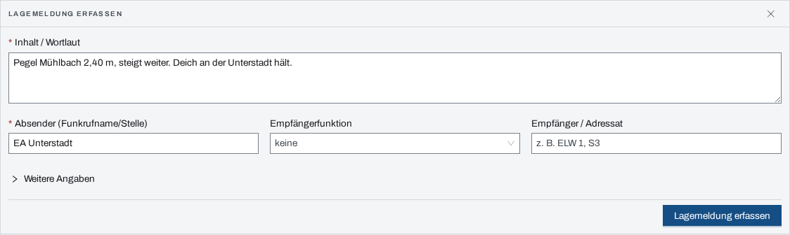
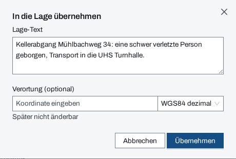
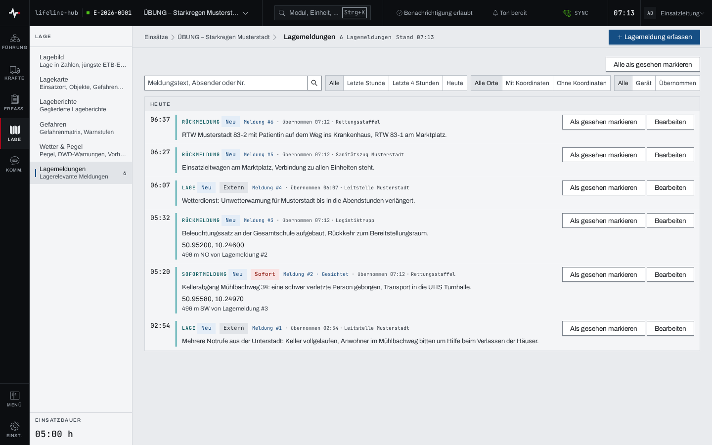

## Überblick

Jede Lagemeldung ist eine Meldung. Eine Meldung der Art „Lagemeldung“ steht ab dem Erfassen in
der Lage, gleich ob sie im Meldungsformular, auf der Seite „Lagemeldungen“ oder an einem
gekoppelten Gerät entsteht, und gleich ob sie eingeht oder nach außen geht. Meldungen anderer
Art, die die Lage betreffen, übernimmt die Führung im Modul „Meldungen“ in die Lage, auf Wunsch mit
eigenem Lage-Text und Ort. Das Modul
„Lagemeldungen“ zeigt beide als Zeitachse; verortete erscheinen zusätzlich als Marker auf der
Lagekarte.

## Abläufe

### Eine Lagemeldung erfassen

Für Einsatzleitung und Führungspersonal:

1. Im Bereich „Lage“ „Lagemeldungen“ öffnen und im Seitenkopf „Lagemeldung erfassen“ wählen.
   Steht noch keine Lagemeldung da, steht der Knopf auch in der leeren Ansicht.
2. „Inhalt / Wortlaut“ und „Absender (Funkrufname/Stelle)“ eingeben. Die Meldungsart ist
   „Lagemeldung“.

   

3. Ist der Ort bekannt, unter „Weitere Angaben“ bei „Verortung (optional)“ die Koordinate
   eingeben. Dort stehen auch Richtung, Priorität und Ereigniszeit.
4. „Lagemeldung erfassen“ wählen. Das Paneel schließt, die neue Lagemeldung steht mit der Marke
   „Neu“ oben in der Zeitachse.

Dieselbe Lagemeldung lässt sich auch im Modul „Meldungen“ erfassen, mit der Meldungsart
„Lagemeldung“; „Lagemeldung an übergeordnete Stelle“ belegt dort Art und Richtung „Extern“ vor
(Kapitel [Meldungen](meldungen.md)).

### Eine Meldung in die Lage übernehmen

1. Im Bereich „Kommunikation“ „Meldungen“ öffnen.
2. An der Meldung „In die Lage übernehmen“ wählen. Hat die Meldung mehrere Aktionen, liegt es im
   Menü „Aktionen zu Meldung …“.
3. Den vorbelegten „Lage-Text“ prüfen und bei Bedarf kürzen oder umformulieren.
4. Ist der Ort bekannt, unter „Verortung (optional)“ die Koordinate eingeben.

   

5. „Übernehmen“ wählen. Die App meldet „In die Lage übernommen“; die Meldung trägt danach
   „In der Lage ✓“.

### Lagemeldungen lesen und filtern

1. Im Bereich „Lage“ „Lagemeldungen“ öffnen. Je Tag, der jüngste zuerst, stehen die
   Lagemeldungen mit ihrer Ereigniszeit, Lage-Text und, falls verortet, der Koordinate. Die Zeile
   nennt vorn „Lage“, bei einer übernommenen Meldung anderer Art deren Art (etwa „Rückmeldung“),
   dazu „Sofort“ oder „Dringend“, „Extern“, die Meldung („Meldung #…“, ab „Gesichtet“ mit ihrem
   Stand), „übernommen …“ und den Absender; kam sie von einem gekoppelten Gerät, steht „· Gerät“
   dahinter. Der Kopf nennt die Zahl der Lagemeldungen.

   

2. Zum Eingrenzen im Suchfeld nach Meldungstext, Absender oder Nummer suchen oder ein Zeitfenster
   wählen: „Letzte Stunde“, „Letzte 4 Stunden“ oder „Heute“. Das Zeitfenster gilt für die
   Ereigniszeit.
3. Nach dem Ort filtern: „Mit Koordinaten“ oder „Ohne Koordinaten“; nach der Herkunft: „Gerät“
   (von einem gekoppelten Gerät erfasst) oder „Übernommen“ (Meldungen anderer Art, die in die Lage
   übernommen wurden). Der Kopf nennt dann „… von … Lagemeldungen“.
4. Um zur Meldung zu springen, „Meldung #…“ in der Zeile wählen.

### Lagemeldungen als gesehen markieren

Für Einsatzleitung und Führungspersonal:

1. Im Bereich „Lage“ „Lagemeldungen“ öffnen. Noch nicht zur Kenntnis genommene Lagemeldungen
   tragen die Marke „Neu“.
2. An einer Zeile „Als gesehen markieren“ wählen. Die Marke verschwindet, die Zeile nennt danach
   „gesehen“ mit Uhrzeit und Namen.
3. Um alle angezeigten auf einmal abzuhaken, über der Zeitachse „Alle als gesehen markieren“
   wählen. Ist ein Filter gesetzt, gilt das nur für die angezeigten.

### Lage-Text und Ort einer Lagemeldung ändern

Für Einsatzleitung und Führungspersonal, wenn das Modul Meldungen im Einsatz freigegeben ist:

1. In der Zeile der Lagemeldung „Bearbeiten“ wählen. Auf der Lagekarte heißt der Knopf im Paneel
   „Ausgewählt“ „Lage-Angaben bearbeiten“.
2. Den „Lage-Text“ ändern. Leer gilt wieder der Wortlaut der Meldung.
3. Unter „Verortung“ die Koordinate setzen, ändern oder leeren.
4. „Speichern“ wählen. Die App meldet „Lage-Angaben zu Meldung #… gespeichert“.

Mit Koordinate steht die Lagemeldung danach auf der Lagekarte, ohne nicht mehr.

## Hintergrund

### Lagemeldung und Meldung

- Eine Lagemeldung ist eine Meldung mit der Meldungsart „Lagemeldung“; sie steht nur einmal in
  der App. Im Modul „Meldungen“ wird sie wie jede Meldung gesichtet und bearbeitet;
  ihr Stand steht in der Zeile der Lagemeldungen an „Meldung #…“.
- „Neu“ in den Lagemeldungen heißt: noch niemand hat sie in der Lage zur Kenntnis genommen. Das ist
  unabhängig davon, ob die Meldung schon gesichtet oder bearbeitet ist.
- Eine Lagemeldung trägt im Einsatztagebuch den Typ „Lage“, sofern automatische Einträge an sind.
- Verortet wird beim Erfassen nur eine Lagemeldung; eine andere Meldung bekommt ihren Ort beim
  Übernehmen.

### Was die Übernahme bewirkt

- Eine Meldung wird genau einmal übernommen; danach fehlt „In die Lage übernehmen“ in ihrem Menü.
  Eine Lagemeldung steht schon in der Lage, ihr fehlt der Punkt von Anfang an.
- Ohne eigenen Lage-Text gilt der Inhalt der Meldung.
- Ohne Koordinate steht die Lagemeldung nur in der Zeitachse, mit Koordinate auch auf der
  Lagekarte in der Ebene „Lagemeldungen“ (Kapitel [Lagekarte, Zeichnen und Messen](lagekarte.md)).
  Lage-Text und Ort lassen sich danach ändern (Ablauf oben).
- Eine übernommene Meldung anderer Art lässt sich an ihrer Karte wieder „Aus der Lage nehmen“
  (Kapitel [Meldungen](meldungen.md)); Lage-Text und Ort gehen dabei verloren. Eine Lagemeldung
  bleibt in der Lage, auch wenn ihre Art geändert wird.
- Die Meldung selbst bleibt im Modul „Meldungen“ und wird dort weiter bearbeitet.
- Die erste Übernahme steht im Einsatztagebuch als „Meldung #… in die Lage übernommen“.

### Ereigniszeit und Übernahme

- Die Zeitachse ordnet nach der Ereigniszeit der Meldung, also wann es geschah, nicht wann die
  Meldung in die Lage übernommen wurde. Eine um 13:14 eingegangene und erst um 15:05 übernommene
  Meldung steht unter 13:14, unterhalb einer um 14:41 eingegangenen.
- Wann die Meldung übernommen wurde, steht in der Zeile als „übernommen …“; an einem anderen Tag als
  die Ereigniszeit mit Datum.
- Liegt eine verortete Lagemeldung in der Nähe, nennt der Ortsbezug unter der Koordinate sie mit
  der Nummer ihrer Meldung, etwa „496 m NO von Lagemeldung #3“.

### Neu und gesehen

- „Neu“ gilt für alle gleich: Sobald eine Person eine Lagemeldung als gesehen markiert, ist sie
  für alle gesehen. Es zählt die erste Markierung; eine zweite ändert Zeit und Namen nicht.
- Die Zahl der neuen Lagemeldungen steht im Modulmenü am Modul „Lagemeldungen“ („2 neue
  Lagemeldungen“) und auf der Stab-Seite in der Kachel S2, beide mit derselben Zahl. Steht keine
  neue an, zeigt das Modulmenü keine Zahl.
- „Alle als gesehen markieren“ erfasst nur die Lagemeldungen, die beim Wählen angezeigt waren.
  Eine, die in diesem Moment eingeht, bleibt neu.
- Wird eine schon gesehene Meldung mit geändertem Lage-Text erneut übernommen oder ihr Lage-Text
  geändert, ist die Lagemeldung wieder neu. Ein geänderter Ort lässt sie gesehen.
- Lagemeldungen, die vor dieser Funktion übernommen wurden, gelten als gesehen, ohne Namen. Ebenso
  Meldungen der Art „Lagemeldung“, die vor der Zusammenführung erfasst und nie übernommen wurden.

### Leere Ansicht

Steht noch keine Lagemeldung da, steht „Noch keine Lagemeldungen“ mit dem Knopf „Lagemeldung
erfassen“; wer nicht erfassen darf, sieht nur den Titel.
Passt nichts zum Filter, steht „Keine Lagemeldung passt zum Filter“ mit „Filter zurücksetzen“.

### Rechte und ohne Netz

Erfassen und übernehmen dürfen alle, die im Modul „Meldungen“ schreiben dürfen:
Einsatzleitung und Führungspersonal eines laufenden Einsatzes (Kapitel
[Rechte im Einsatz](rechte-im-einsatz.md)). Fehlt das Recht, steht im Seitenkopf „Nur Ansicht“
mit dem Grund, etwa „Modul Meldungen gesperrt“. Ohne Netz merkt die App eine erfasste Lagemeldung
vor und sendet sie, sobald die Verbindung zurück ist.
Als gesehen markieren dürfen alle, die im Modul „Lagemeldungen“ schreiben dürfen; wer nur liest,
sieht die Marke „Neu“, aber keinen Knopf. Die Lagemeldungen hält die App für die Arbeit ohne Netz
vor (Kapitel [Arbeiten ohne Netz](ohne-netz.md)); als gesehen markieren geht nur mit Verbindung,
ohne Netz sind die Knöpfe gesperrt.
