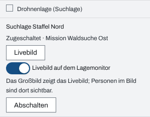
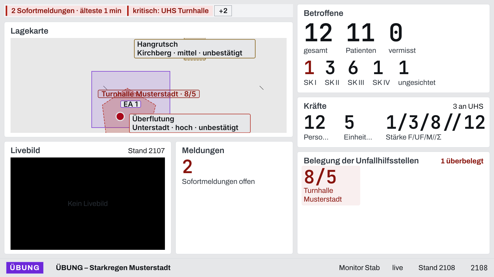
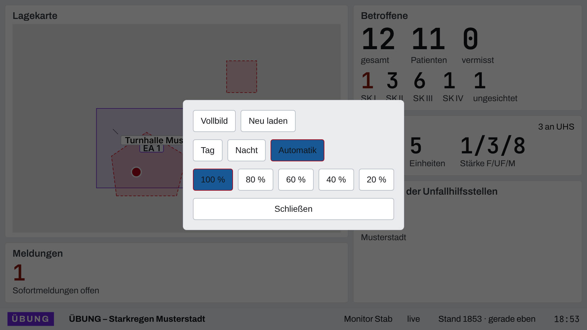

## Überblick

Der **Lagemonitor** ist ein Großbildschirm im Stabsraum oder Führungsfahrzeug. Er zeigt das
Lagebild des Einsatzes verdichtet in festen Kacheln: über der Lagekarte die Zeile „Was brennt“,
dazu die Lagekarte, den offenen Sofortmeldungen, den nächsten Programmpunkten der Veranstaltung, den
Betroffenen, den Kräften und der Belegung der Unfallhilfsstellen, unten eine Statusleiste. Er zeigt
**keine Namen von Personen** und keinen Meldungstext, spielt keinen Ton und wird nicht bedient: Antippen und
Ziehen auf den Kacheln bleiben ohne Wirkung.

Den Monitor koppelt die Einsatzleitung mit der Ansicht „Lagemonitor“ (siehe
[Geräte koppeln](geraete-koppeln.md)). Gekoppelt wird wie bei jedem Gerät (siehe
[Gerät bedienen](geraet-bedienen.md)).
Eine eigene Anzeige außerhalb der App liest das Lagebild als Anbindung, ohne Kopplung (siehe
[Externe Lagemonitore](externe-lagemonitore.md)).

## Abläufe

### Anzeige starten

1. Den Monitor koppeln. Er öffnet das Großbild mit dem Knopf „Anzeige starten“.
2. „Anzeige starten“ wählen. Der Monitor wechselt in den Vollbildmodus und hält den Bildschirm
   wach.

   

Kann der Browser den Bildschirm nicht wach halten, steht über der Statusleiste: „Dieser Browser
kann den Bildschirm nicht wach halten: bitte den Bildschirmschoner am Gerät abschalten.“

### Lagebild lesen

1. Die Zeile „Was brennt“ über der Lagekarte nennt dasselbe wie im Überblick und im Lagebild,
   in derselben Folge (Kapitel [Überblick](ueberblick.md)): offene Sofortmeldungen,
   überfällige Bestätigungen, Vermisste, kritische Abschnitte mit Namen, Einheiten mit
   überfälliger Rückmeldung mit Namen, Einheiten mit Ausfall und überfällige Aufträge in Rot,
   dringende Meldungen, fällige Erinnerungen und überfällige Nachforderungen in Gelb. Die
   Einheiten stehen in der Reihenfolge der Einheitenliste, Personennamen nennt der Monitor nie.
   Was nicht in die Zeile passt, steht als „+…“.
2. „Betroffene“ zählt gesamt, Patienten und vermisst, darunter die Sichtungskategorien SK I bis
   SK IV und „ungesichtet“. Patienten und Sichtungskategorien zählen nur, wer noch in Versorgung
   oder unterwegs ist; übergebene, entlassene und abgeschlossene Patienten zählen nur in
   „gesamt“. Ist am Einsatz die Reihe „Sanitätsdienst“ gewählt (Kapitel [Lagebild](lagebild.md)),
   steht dort „Hilfeleistungen“: Kontakte, letzte Stunde und vermisst, darunter in Versorgung,
   Transporte und SK I.
3. „Kräfte“ zählt Personal, Einheiten und die Stärke F/UF/M//Σ; oben rechts steht, wie viele Kräfte an
   aktiven Unfallhilfsstellen arbeiten, gezählt wie im Lagebild.
4. „Belegung der Unfallhilfsstellen“ nennt je UHS Belegte und Plätze, etwa „8/5“, bis zu sechs;
   der Rest steht als „+… weitere“. Überbelegte UHS (mehr Belegte als Plätze) stehen zuerst, rot
   hinterlegt, und oben in der Kachel steht, wie viele es sind, etwa „1 überbelegt“. Danach
   folgen die vollsten. Eine volle UHS („5/5“) gilt nicht als überbelegt.
5. Die Lagekarte zeigt den Einsatzort, jede verortete UHS mit Belegten und Plätzen (überbelegt
   rot), die Gefahrenzonen und die gezeichneten Flächen der Einsatzabschnitte mit ihrer
   Kurzbezeichnung, ohne Kurzbezeichnung mit ihrem Namen. Ein Gefahrengebiet trägt den Namen
   seines Gebiets und die höchste Warnstufe der Gefahrenmatrix, etwa „Hangrutsch Kirchberg ·
   hoch“, und ist in deren Farbe gefärbt wie auf der [Lagekarte](lagekarte.md); solange niemand
   die Beurteilung bestätigt hat, steht dahinter „unbestätigt“ (Kapitel
   [Gefahren](gefahren.md)). Ist in der Matrix noch keine Gefahr gesetzt, steht dort „keine
   Stufe“, und die Fläche ist vorsichtshalber rot. Ein langer Name bricht in der Beschriftung um.
   Absperrungen und Sperrgebiete tragen nur ihre Art, etwa „Absperrbereich“. Liegen
   Beschriftungen eng beieinander, rücken sie auseinander, statt sich zu überdecken: Die
   Beschriftung einer UHS bleibt an ihrem Ort, die der Flächen weicht aus. Der Punkt des
   Einsatzorts bleibt immer frei.
6. „Meldungen“ unter der Karte zählt die „Sofortmeldungen offen“, die noch niemand bestätigt
   hat.
7. „Ablauf“ neben „Meldungen“ nennt die nächsten drei Programmpunkte aus den
   [Einsatzdaten](einsatzdaten.md): oben Uhrzeit und Abstand, etwa „in 1 h 30 min“, darunter
   die Bezeichnung über die ganze Breite der Kachel.
   Ein Punkt fällt mit seiner Uhrzeit heraus; steht keiner mehr an, fehlt die Kachel.
   Zeigt der Monitor das Livebild (nächster Abschnitt), nennt „Ablauf“ nur den nächsten Punkt
   und darunter, wie viele noch folgen, etwa „+2 weitere“.
8. Steigt die Zahl der offenen Sofortmeldungen oder die Zahl in SK I, ist sie eine Minute lang
   farbig hinterlegt, und oben in der Kachel steht „Neue Sofortmeldung“ bzw. „Neu in SK I“.
9. Die Statusleiste nennt Einsatz, Gerät, Verbindung („live“, „verbinde …“, „getrennt“), den
   Stand der Daten mit Alter und die Uhr. Kommt 45 Sekunden lang nichts über die Leitung, steht
   dort „verbinde …“, und der Monitor baut die Verbindung neu auf. Bei einer Übung steht vor dem Einsatz die violette
   Marke „ÜBUNG“; „Einsatzart nicht geladen“ heißt, dass der Einsatz gerade nicht abrufbar ist.

### Livebild der Drohne einschalten

Für die Einsatzleitung: Ist am Einsatz eine Drohnenquelle zugeschaltet, kann der Monitor ihr
Livebild zeigen. Vorgabe ist aus: Personen im Bild wären auf dem Großbild für alle im Raum
sichtbar.

1. Auf der [Lagekarte](lagekarte.md) in den Ebenen unter „Fachebenen“ die Gruppe „Drohne“
   ansehen. Unter der zugeschalteten Quelle steht der Schalter „Livebild auf dem Lagemonitor“.
   Alle anderen sehen statt des Schalters nur, was gilt.
2. Den Schalter einschalten. Darunter steht „Das Großbild zeigt das Livebild; Personen im Bild
   sind dort sichtbar.“ Das Einsatztagebuch hält fest: „Livebild auf dem Lagemonitor
   eingeschaltet“.

   

### Livebild lesen

1. Mit dem nächsten Abruf nach dem Einschalten, spätestens nach 30 Sekunden, steht unter der
   Lagekarte links die Kachel „Livebild“, rechts daneben „Meldungen“ über „Ablauf“. Die Karte gibt dafür Höhe ab.

   

2. Oben rechts in der Kachel steht der Stand der Drohnenlage; ist er älter als zwei Minuten,
   ist er hervorgehoben.
3. Das Bild läuft stumm und ohne Bedienelemente. Kommt kein Stream an, bleibt die Kachel stehen
   und zeigt „Kein Livebild“, ohne Alarmfarbe und ohne Eintrag in „Was brennt“; der Monitor
   versucht es von selbst erneut.

Ausschalten nimmt die Kachel mit dem nächsten Abruf weg, und der Monitor erreicht das Bild sofort
nicht mehr. Ist die Lagekarte im Einsatz ausgeblendet, zeigt der Monitor auch kein Livebild.

### Gerätemenü öffnen

1. Drei Sekunden lang auf die Statusleiste drücken. Das Gerätemenü öffnet sich.

   

2. „Vollbild“ oder „Neu laden“ wählen, die Darstellung („Tag“, „Nacht“, „Automatik“) oder eine
   Helligkeit von 100 % bis 20 % einstellen.
3. „Schließen“ wählen. Ohne Bedienung schließt das Menü nach 30 Sekunden von selbst.

## Hintergrund

### Aktualität

Der Monitor holt das Lagebild alle 30 Sekunden neu; eine neue Sofortmeldung meldet der Server ihm
sofort, ohne Inhalt, und er holt das Lagebild dann gleich. Ist der Stand älter als zwei Minuten, steht
in der Statusleiste hervorgehoben „Veraltet · Stand …“. Dann zuerst die Verbindung prüfen; „Neu
laden“ im Gerätemenü baut die Seite neu auf.

Kann eine einzelne Kachel nicht angezeigt werden, steht an ihrer Stelle „Diese Kachel konnte
nicht angezeigt werden.“ Die übrigen Kacheln zeigen weiter die Lage. Der Fehler geht als Bericht an
den Server, und mit dem nächsten Abruf versucht der Monitor die Kachel von selbst erneut.

### Offene Sofortmeldungen und neue Dringlichkeit

Als Sofortmeldung zählt eine Meldung der Art „Sofortmeldung“ oder mit der Priorität „Sofort“.
Offen bleibt sie, bis sie bestätigt oder erledigt ist (siehe [Meldungen](meldungen.md)). Der
Monitor erhält nur die Zahl, weder Text noch Absender oder Empfänger.

Ob eine Zahl gestiegen ist, vergleicht der Monitor mit seinem letzten Stand. Eine neue
Sofortmeldung erscheint nach wenigen Sekunden, ohne Verbindung spätestens mit dem nächsten Abruf. Der
erste Stand nach dem Start oder nach „Neu laden“ wird nicht hervorgehoben, eine sinkende oder
gleichbleibende Zahl nie. Die Hervorhebung blinkt nicht und klingt nicht; fällt die Zahl auf
null, endet sie vorzeitig.

### Was der Monitor zeigt und was nicht

Der Monitor zeigt nur Zahlen, die Karte, die Bezeichnungen der nächsten Programmpunkte, in der
Zeile „Was brennt“ die Namen von Einheiten und Abschnitten und, nur wenn die Einsatzleitung es
eingeschaltet hat, das Livebild der Drohne, keine Personendaten und keine Namen von
Personen, keine Texte von Meldungen, Aufträgen oder Erinnerungen. Ist ein Modul im Einsatz
ausgeblendet, fehlt seine Angabe in „Was brennt“ wie im Überblick, ohne dass der Monitor „Stand
unvollständig“ meldet, und mit ihr die Kachel des Moduls: „Betroffene“ bzw. „Hilfeleistungen“
ohne das Modul Personen, „Meldungen“ ohne Meldungen, „Kräfte“ ohne Personal oder ohne Einheiten,
„Belegung der Unfallhilfsstellen“ samt „an UHS“ und den UHS auf der Karte ohne
Unfallhilfsstellen. Die übrigen Kacheln nehmen den Platz; „Ablauf“ bleibt. Ein Programmpunkt löst am Monitor keinen Alarm aus und wird nicht
hervorgehoben. Er schreibt
nichts: Er ist ein reiner Beobachter des Einsatzes. Hat der Einsatz keinen verorteten Einsatzort,
keine verortete UHS (ist das Modul Unfallhilfsstellen ausgeblendet, zählen seine UHS nicht) und
keine Fläche, zeigt die Kartenkachel „Kein Einsatzort verortet“.
Kann der Browser des Monitors keine Karte zeichnen (Voraussetzung wie bei der
[Lagekarte](lagekarte.md)), steht in der Kartenkachel „Karte auf diesem Gerät nicht darstellbar“;
alle übrigen Kacheln und die Statusleiste laufen weiter.

Auf der Karte fehlen Evakuierungsbezirke und freie Skizzen, außerdem Beschriftung und Notiz der
Gefahrenzonen sowie Leitung und Bemerkung der Abschnitte: Freitexte können Personen nennen.
Ein Gefahrengebiet trägt deshalb den Namen seines Gefahrengebiets, nicht die Beschriftung der
gezeichneten Fläche; wer die Beurteilung bestätigt hat, erfährt der Monitor nicht. Gehören
mehrere Flächen zu einem Gefahrengebiet, trägt jede die Beschriftung. Gefahrenzonen erscheinen
unabhängig von der Kartenansicht, in der sie gezeichnet wurden.

### Ende der Kopplung

Wie jedes gekoppelte Gerät verliert der Monitor seinen Zugriff mit dem Widerruf, dem Ablauf der
Kopplung oder dem Abschluss des Einsatzes und zeigt dann „Kopplung beendet“. Für einen
Dauerbetrieb über 24 Stunden verlängert die Einsatzleitung die Kopplung rechtzeitig (siehe
[Geräte koppeln](geraete-koppeln.md)).
