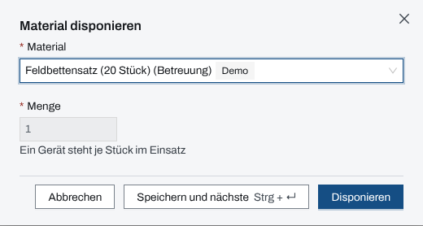
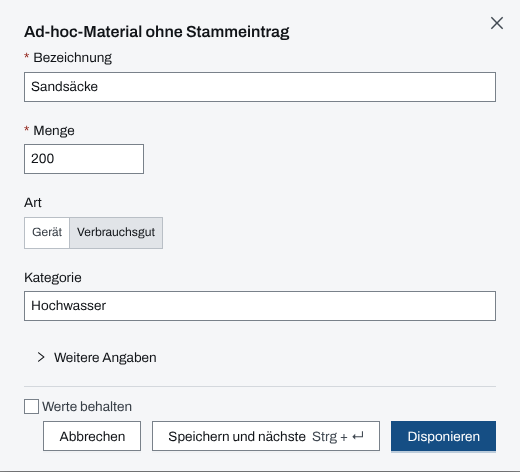
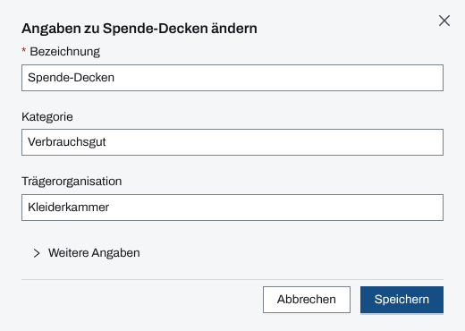
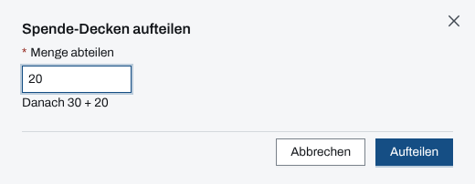

## Überblick

Das Modul **Material** führt Geräte und Verbrauchsgüter, die im Einsatz sind: Posten aus dem
Materialstamm der Organisation und Ad-hoc-Material ohne Stammeintrag, etwa Spenden oder Material
einer fremden Organisation. Je Posten stehen Bezeichnung, Kategorie, Ort, Menge, Status und
Bemerkung. Ein Gerät steht je Stück im Einsatz, ein Verbrauchsgut mit seiner Menge. Der Ort nennt,
wo der Posten liegt: bei einer Einheit, auf einem Fahrzeug, an einer UHS oder in einem
Bereitstellungsraum, immer an höchstens einem Ort.

Die Führung liest hier, was einsatzbereit, im Einsatz oder ausgefallen ist und wo es liegt.
Disponieren und ändern dürfen Einsatzleitung und Führungspersonal.

## Abläufe

### Die Materialliste lesen

1. Unter „Kräfte & Mittel“ „Material“ öffnen.
2. Die Zeile über der Liste zählt die Posten: „einsatzbereit“, „im Einsatz“ und „Ausfall“.
   „Meldebild“ führt ins Meldebild.

   

3. Die Liste ist nach Status gruppiert. In „Bezeichnung, Kategorie, Ort“ suchen oder nach „Ort“
   und „Status“ filtern. Der Filter „Ort“ kennt „ohne Ort“ und jede Einheit, jedes Fahrzeug, jede
   UHS und jeden Bereitstellungsraum der Liste. Der Filter „Status“ kennt zusätzlich
   „aufgebraucht“.
4. Auf schmaleren Schirmen, auch am Fükw, ist die Spalte „Kategorie“ ausgeblendet; die Kategorie
   steht dann gedämpft unter der Bezeichnung. „Spalten“ zeigt, wie viele Spalten fehlen, und
   blendet sie wieder ein.

### Material aus dem Stamm disponieren

Für Einsatzleitung und Führungspersonal:

1. „Material disponieren“ wählen.
2. Unter „Material“ einen Posten wählen und bei einem Verbrauchsgut die „Menge“ eingeben. Bei
   einem Gerät steht die Menge fest auf 1, mit dem Hinweis „Ein Gerät steht je Stück im Einsatz“.

   

3. „Disponieren“ wählen, oder „Speichern und nächste“ für den nächsten Posten.

### Ad-hoc-Material erfassen

Für Einsatzleitung und Führungspersonal, wenn ein Posten nicht im Materialstamm steht:

1. „Ad-hoc-Material“ wählen.
2. „Bezeichnung“ und „Menge“ eingeben, bei Bedarf „Kategorie“, „Trägerorganisation“ und unter
   „Weitere Angaben“ die „Bestandsnummer“.

   

3. „Disponieren“ wählen. Mit „Speichern und nächste“ und „Werte behalten“ bleiben Kategorie und
   Trägerorganisation für den nächsten Posten stehen.

Ad-hoc-Posten tragen in der Liste die Marke „ad-hoc“. Ein Ad-hoc-Posten mit Menge 1 gilt als
Gerät, ab Menge 2 als Verbrauchsgut.

### Den Ort ändern

Für Einsatzleitung und Führungspersonal:

1. In der Spalte „Ort“ den Einheitsnamen wählen, oder „Einheit eintragen“, wenn der Posten noch
   keiner Einheit gehört.
2. Eine Einheit wählen, oder „keine Einheit“ (erste Wahl), um den Posten von seiner Einheit zu
   lösen. Die Auswahl ist nach Abschnitt gegliedert, unterstellte Einheiten stehen mit ihrem Pfad.
3. „Speichern“ wählen. Escape oder „Abbrechen“ lässt den Ort unverändert.
4. Für die UHS ebenso: den UHS-Namen oder „UHS eintragen“ wählen, eine UHS oder „keine UHS“
   wählen und speichern. Angeboten werden geplante und aktive UHS; eine aufgelöste UHS, an der
   der Posten noch steht, steht gesperrt vorn in der Liste.

Ein Posten liegt an einem Ort: Wer eine UHS einträgt, löst ihn von seiner Einheit, und wer eine
Einheit einträgt, löst ihn von seiner UHS. Liegt ein Posten auf einem Fahrzeug oder in einem
Bereitstellungsraum, nennt die Spalte dessen Namen; eine Einheit oder UHS einzutragen, holt ihn
von dort.

### Menge, Status und Bemerkung ändern

Für Einsatzleitung und Führungspersonal:

1. Bei einem Verbrauchsgut in der Spalte „Menge“ die Zahl wählen, die neue Menge eingeben und mit
   „Speichern“ oder Enter bestätigen. Verlassen ohne Speichern ändert nichts. Die Menge ist
   mindestens 1 und nie kleiner als die ausgegebene Menge. Ein Gerät zeigt „1“ ohne Bearbeiten.
2. In der Spalte „Status“ einen Status wählen. Ein Gerät kennt einsatzbereit, im Einsatz, defekt,
   verbraucht und Desinfektion nötig, ein Verbrauchsgut einsatzbereit, im Einsatz und defekt.
3. In der Spalte „Bemerkung“ „Bemerkung hinzufügen“ wählen und den Text eintragen.

### Angaben eines Ad-hoc-Postens korrigieren

Für Einsatzleitung und Führungspersonal, etwa bei einem Tippfehler in der Bezeichnung:

1. In der Zeile des Postens „Weitere Aktionen“ öffnen und „Angaben ändern“ wählen.
2. „Bezeichnung“, „Kategorie“, „Trägerorganisation“ oder unter „Weitere Angaben“ die
   „Bestandsnummer“ ändern. Ein geleertes Feld löscht die Angabe; die Bezeichnung ist Pflicht.

   

3. „Speichern“ wählen.

Bei einem Posten aus dem Materialstamm heißt der Eintrag „Angaben ändern · im Stamm pflegen“ und
ist gesperrt: seine Angaben stehen im Materialstamm.

### Einen Posten aufteilen

Für Einsatzleitung und Führungspersonal, wenn ein Teil der Menge woanders gebraucht wird:

1. In der Zeile des Postens „Weitere Aktionen“ öffnen und „Aufteilen“ wählen.
2. Unter „Menge abteilen“ die Menge für die neue Zeile eingeben, von 1 bis eins unter der
   Menge und höchstens den Rest, der noch nicht ausgegeben ist. Darunter steht das Ergebnis, etwa
   „Danach 30 + 20“.

   

3. „Aufteilen“ wählen. Die neue Zeile steht in der Liste; ihren Ort in der Spalte „Ort“ ändern.

Bei Menge 1 heißt der Eintrag „Aufteilen · Menge 1“ und ist gesperrt, bei einem Gerät
„Aufteilen · Gerät“, bei einem aufgebrauchten Verbrauchsgut „Aufteilen · aufgebraucht“.

### Material aus dem Einsatz nehmen

Für Einsatzleitung und Führungspersonal, wenn ein Posten den Einsatz verlässt:

1. In der Zeile des Postens „Aus dem Einsatz nehmen“ wählen. Eine Rückfrage gibt es nicht.
2. Der Posten verlässt die Liste. Der Hinweis unten bietet einige Sekunden lang „Rückgängig“.
3. Unter der Liste „Aus dem Einsatz genommen“ aufklappen. Dort stehen alle herausgenommenen
   Posten mit Menge und Zeitpunkt.

   

4. Kommt der Posten zurück, „Erneut disponieren“ wählen.

### Eine Fehldisposition stornieren

Für Einsatzleitung und Führungspersonal, wenn ein Posten versehentlich disponiert wurde:

1. In der Zeile des Postens „Weitere Aktionen“ öffnen und „Stornieren“ wählen. Liegt der Posten
   an einem Ort, steht dort „Stornieren · zugeordnet“ gesperrt; dann zuerst den Ort lösen oder
   den Posten aus dem Einsatz nehmen.
2. Die Rückfrage „… stornieren?“ mit „Stornieren“ bestätigen.
3. Lehnt die App ab, steht der Grund an der Zeile; der Posten lässt sich dann nur aus dem Einsatz
   nehmen.

## Hintergrund

### Gerät und Verbrauchsgut

Die Art steht am Materialstamm (Kapitel [Stammdaten](stammdaten.md)) und geht beim Disponieren
auf den Posten über; eine spätere Änderung am Stamm ändert disponierte Posten nicht.

- **Gerät:** steht je Stück im Einsatz, mit Menge 1 und einem der fünf Status. Wer zwei Tragen
  braucht, disponiert sie zweimal.
- **Verbrauchsgut:** steht mit seiner Menge im Einsatz und kennt nur einsatzbereit, im Einsatz und
  defekt. Was davon ausgegeben ist, zeigt die Mengenzelle als Rest, etwa „30 von 50 übrig“. Ist
  alles ausgegeben, heißt der Posten „aufgebraucht“, in der Farbe von „verbraucht“; das ist kein
  eigener Status, sondern folgt aus der Ausgabe.

### Ein Ort je Posten

Ein Posten liegt bei einer Einheit, auf einem Fahrzeug, an einer UHS, in einem Bereitstellungsraum
oder „ohne Ort“, nie an zweien zugleich. Ein neuer Ort löst den bisherigen. Die Einheit wird über
das Modul [Einheiten](einheiten.md) gespeichert, dasselbe wie die Zuordnung dort. Im UHS-Reiter
„Material“ bietet „Material zuordnen“ nur Posten ohne Ort an.

Endet ein Ort, bleibt der Posten im Einsatz:

- Wird ein Fahrzeug entlassen, steht seine Beladung danach ohne Ort; der Eintrag im
  Einsatztagebuch nennt „Beladung ohne Ort: n Posten“. Ein Fahrzeug mit Beladung lässt sich nicht
  stornieren.
- Wird eine Einheit aufgelöst, steht ihr Material ohne Ort.
- Eine aufgelöste UHS oder ein aufgelöster Bereitstellungsraum nimmt kein Material mehr an;
  Material, das schon dort liegt, bleibt dort und lässt sich lösen. Im UHS-Reiter „Material“ ist
  „Material zuordnen“ an einer aufgelösten UHS gesperrt, mit dem Grund „UHS aufgelöst“.

### Umstellung des Bestands

Material, das vor der Einführung von Gerät und Verbrauchsgut disponiert war, wurde einmal
umgestellt, ohne Eintrag im Einsatztagebuch: Ein Posten mit Menge über 1 oder aus einem
Verbrauchsgut-Stamm ist ein Verbrauchsgut, alle anderen sind Geräte. Ein Verbrauchsgut mit
„verbraucht“ ist seitdem ganz ausgegeben, also „aufgebraucht“; eines mit „Desinfektion nötig“
steht auf „defekt“. Lag ein Posten zugleich bei einer Einheit und an einer UHS, blieb die UHS.
Was sich so geändert hat, steht in der Bemerkung des Postens, etwa „Umstellung Material-Modell:
vorher zugleich Einheit «Staffel A»“.

### Zählung

Die Zeile über der Liste zählt Posten, nicht Mengen, und immer die ganze Liste, auch wenn ein Filter
gesetzt ist. „Ausfall“ fasst defekt, verbraucht, Desinfektion nötig und aufgebraucht zusammen; ein
teilweise ausgegebenes Verbrauchsgut zählt nach seinem Status. Nur die Ausfall-Zahl ist
farbig, und nur, wenn sie über null liegt. Im Meldebild nennt die Zeile einer Einheit den Ausfall
ihres Materials nach derselben Regel; die Zahl der Kräfte im Meldebild zählt nur Personal und
Fahrzeuge (Kapitel [Meldebild und Kräfte-Zeitachse](meldebild.md)).

### Mehrere Posten derselben Art

Derselbe Stammposten lässt sich mehrmals disponieren, jeweils als eigene Zeile mit eigener Menge und
eigenem Status. Aufteilen macht aus einer Zeile zwei: Die neue Zeile übernimmt Art, Status,
Bemerkung, Ort und den Zeitpunkt der Disposition, die Ausgangszeile behält den Rest der Menge.
Abgeteilt wird nur, was noch nicht ausgegeben ist; die Ausgabe bleibt an der Ausgangszeile, die neue
Zeile beginnt ohne Ausgabe. Die
Auswahl beim Disponieren bietet den Materialstamm an, soweit er in Dienst steht; Demo-Posten stehen
in einer eigenen Gruppe am Ende.

### Status

Ein disponierter Posten beginnt mit „einsatzbereit“. Die fünf Statuswerte sind fest und gelten für
jede Organisation; „verbraucht“ und „Desinfektion nötig“ gibt es nur für Geräte.

### Aus dem Einsatz nehmen und Stornieren

Aus dem Einsatz nehmen ist der Normalweg: Der Posten verlässt seinen Ort. In
Auswahllisten, im Meldebild und in der UHS zählt er nicht mehr; der Block „Aus dem Einsatz
genommen“ unter der Liste führt ihn weiter. Erneut disponiert, steht er wieder in der Liste, mit
derselben Menge und demselben Status, aber ohne Ort. „Material disponieren“
legt dagegen immer eine neue Zeile an.

Stornieren korrigiert eine Fehldisposition und lässt keine Spur. Es geht nur in den ersten 15
Minuten nach der Disposition und nur, solange der Posten ohne Ort ist. Wer einmal aus dem Einsatz genommen war, lässt sich auch nach dem erneuten Disponieren nicht
mehr stornieren. Ein stornierter Posten erscheint in keiner Liste. Eine durch Aufteilen entstandene
Zeile hat dieselbe Frist wie ihre Ausgangszeile.

An einem herausgenommenen oder stornierten Posten lässt sich nichts mehr ändern: Menge, Status,
Bemerkung, Angaben und Ort setzen sowie aufteilen lehnt die App ab.

### Einsatztagebuch

Disponieren, jede Mengen- und Statusänderung, das Herausnehmen, das erneute Disponieren und das
Stornieren stehen im Einsatztagebuch, mit alter und neuer Menge bzw. altem und neuem Status. Dazu:

- Ort wechseln, auf jedem Weg und für jede Ortsart: „Material «Wolldecke» (×20): Einheit
  «Staffel A» → UHS «Turnhalle»“, beim ersten Ort „ohne Ort → Einheit «Staffel A»“, beim Lösen
  „… → ohne Ort“.
- Ausgabe ändern: „Material «Wolldecke»: Ausgabe 20 → 30 (Rest 20 von 50)“.
- Aufteilen: „Material «Wolldecke» aufgeteilt: 50 → 30 + 20“.
- Angaben ändern: ein Eintrag, der jede geänderte Angabe mit altem und neuem Wert nennt.

Eine Bemerkung ändert das Einsatztagebuch nicht.

### Rechte und ohne Netz

Lesen darf, wer das Modul Material sieht. Disponieren, ändern, aufteilen, aus dem Einsatz nehmen und
stornieren dürfen Einsatzleitung und Führungspersonal, solange der Einsatz läuft (Kapitel
[Rechte im Einsatz](rechte-im-einsatz.md)). Die Einheit im Ort ändert nur, wer auch das Modul
Einheiten nutzen darf, die UHS nur, wer das Modul Unfallhilfsstellen nutzen darf; sonst ist der
jeweilige Teil nur lesbar. Wer ein Modul nicht sieht, liest an seiner Stelle „zugeordnet“.
Ohne Netz bleibt die Liste mit dem zuletzt geladenen Stand lesbar; ändern lässt sich nichts (Kapitel
[Ohne Netz](ohne-netz.md)).
