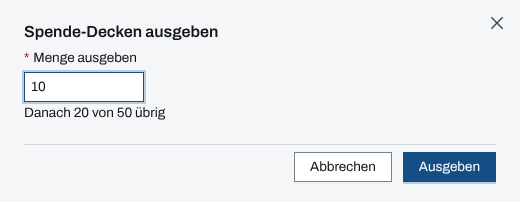

## Überblick

Das Modul **Material** führt Geräte und Verbrauchsgüter, die im Einsatz sind: Posten aus dem
Materialstamm der Organisation und Ad-hoc-Material ohne Stammeintrag, etwa Spenden oder Material
einer fremden Organisation. Je Posten stehen Bezeichnung, Kategorie, Ort, Menge, Status und
Bemerkung. Ein Gerät steht je Stück im Einsatz, ein Verbrauchsgut mit seiner Menge. Der Ort nennt,
wo der Posten liegt: bei einer Einheit, auf einem Fahrzeug, an einer UHS oder in einem
Bereitstellungsraum, immer an höchstens einem Ort.

Die Führung liest hier, was einsatzbereit, im Einsatz oder ausgefallen ist und wo es liegt.
Disponieren und ändern dürfen Einsatzleitung und Führungspersonal.

## Abläufe

### Die Materialliste lesen

1. Unter „Kräfte & Mittel“ „Material“ öffnen.
2. Die Zeile über der Liste zählt die Posten: „einsatzbereit“, „im Einsatz“ und „Ausfall“.
   „Meldebild“ führt ins Meldebild.

   

3. Die Liste ist nach Ort gruppiert: erst die Einheiten in der Folge des Kräftebaums, dann
   Fahrzeuge, Unfallhilfsstellen und Bereitstellungsräume, „ohne Ort“ zuletzt. Über der Tabelle
   steht je Ort die Zahl der Posten, auf schmalen Schirmen über jeder Gruppe. „Nach Status“ im
   Kopf gruppiert nach den Status, „aufgebraucht“ zuletzt; „Nach Ort“ kehrt zurück. Die Wahl
   gilt für diesen Einsatz, bis die Seite verlassen wird.
4. In „Bezeichnung, Kategorie, Ort“ suchen oder nach „Ort“ und „Status“ filtern. Der Filter „Ort“
   kennt „ohne Ort“ und jede Einheit, jedes Fahrzeug, jede UHS und jeden Bereitstellungsraum der
   Liste. Der Filter „Status“ kennt zusätzlich „aufgebraucht“.
5. Auf schmaleren Schirmen, auch am Fükw, ist die Spalte „Kategorie“ ausgeblendet; die Kategorie
   steht dann gedämpft unter der Bezeichnung. „Spalten“ zeigt, wie viele Spalten fehlen, und
   blendet sie wieder ein.

### Material aus dem Stamm disponieren

Für Einsatzleitung und Führungspersonal:

1. „Material disponieren“ wählen.
2. Unter „Material“ einen Posten wählen und bei einem Verbrauchsgut die „Menge“ eingeben. Bei
   einem Gerät steht die Menge fest auf 1, mit dem Hinweis „Ein Gerät steht je Stück im Einsatz“.
3. Unter „Ort“ eine Einheit, ein Fahrzeug, eine UHS oder einen Bereitstellungsraum wählen, oder
   „ohne Ort“ stehen lassen.

   

4. „Disponieren“ wählen, oder „Speichern und nächste“ für den nächsten Posten. Der Ort bleibt
   dabei stehen, weil eine Anlieferung meist an einen Ort geht.

### Ad-hoc-Material erfassen

Für Einsatzleitung und Führungspersonal, wenn ein Posten nicht im Materialstamm steht:

1. „Ad-hoc-Material“ wählen.
2. „Bezeichnung“ und „Menge“ eingeben. Unter „Art“ steht bei Menge 1 „Gerät“, ab Menge 2
   „Verbrauchsgut“; eine eigene Wahl bleibt stehen, auch wenn sich die Menge danach ändert.
   „Gerät“ setzt die Menge auf 1 und sperrt sie.
3. Bei Bedarf „Kategorie“ eingeben und unter „Weitere Angaben“ „Trägerorganisation“,
   „Bestandsnummer“ und „Ort“.

   

4. „Disponieren“ wählen. Mit „Speichern und nächste“ und „Werte behalten“ bleiben Kategorie und
   Trägerorganisation für den nächsten Posten stehen.

Ad-hoc-Posten tragen in der Liste die Marke „ad-hoc“. Derselbe Dialog steht an jedem Ort als
„Material erfassen“, dort ohne das Feld „Ort“ (siehe „Material an Einheit, Fahrzeug, UHS und
Bereitstellungsraum“ unten).

### Den Ort ändern

Für Einsatzleitung und Führungspersonal:

1. In der Spalte „Ort“ den Ort des Postens wählen, bei einem Posten ohne Ort „ohne Ort“.
2. Den neuen Ort wählen. Die Auswahl bietet „ohne Ort“ zuerst, dann je eine Gruppe
   „Einheiten“, „Fahrzeuge“, „Unfallhilfsstellen“ und „Bereitstellungsräume“; unterstellte
   Einheiten stehen mit ihrem Pfad. Tippen sucht in der Auswahl.
3. „Speichern“ wählen oder Enter drücken. Escape, „Abbrechen“ oder ein Klick daneben lässt den Ort
   unverändert.

Angeboten werden laufende Fahrzeuge sowie geplante und aktive UHS und Bereitstellungsräume. Ein
Ort, der nicht mehr wählbar ist, an dem der Posten aber noch liegt, steht gesperrt vorn in der
Auswahl. Lehnt die App ab, steht der Grund an der Angabe.

### Material ausgeben

Für Einsatzleitung und Führungspersonal, wenn von einem Verbrauchsgut etwas ausgeht, etwa Decken
an Betroffene:

1. In der Spalte „Menge“ „Ausgeben“ wählen.
2. Unter „Menge ausgeben“ eintragen, wie viel ausgeht, von 1 bis zum Rest. Darunter steht der
   Stand danach, etwa „Danach 20 von 50 übrig“.

   

3. „Ausgeben“ wählen. Die Spalte „Menge“ zeigt den Rest, etwa „20 von 50 übrig“.

Gerechnet wird mit dem Stand beim Öffnen des Dialogs. Ist alles ausgegeben, fehlt „Ausgeben“, und
der Posten heißt „aufgebraucht“. Ein Gerät zeigt in der Spalte „Menge“ nur „1“.

Eine Ausgabe zurücknehmen, etwa bei einer Fehlbuchung oder wenn Decken zurückkommen:

1. In der Zeile des Postens „Weitere Aktionen“ öffnen und „Ausgabe zurücknehmen …“ wählen.
2. Unter „Menge zurücknehmen“ eintragen, wie viel zurückkommt, von 1 bis zur Ausgabe.
3. „Zurücknehmen“ wählen.

Ist nichts ausgegeben, steht der Eintrag gesperrt als „Ausgabe zurücknehmen · nichts
ausgegeben“.

### Menge und Art ändern

Für Einsatzleitung und Führungspersonal:

1. Bei einem Verbrauchsgut in der Zeile „Weitere Aktionen“ öffnen und „Menge ändern …“ wählen.
2. Unter „Menge“ die neue Gesamtmenge eintragen, mindestens 1 und nie weniger als die
   ausgegebene Menge, und „Speichern“ wählen.
3. Die Art eines Ad-hoc-Postens wechselt im selben Menü: „Als Gerät führen“ bei einem
   Verbrauchsgut, „Als Verbrauchsgut führen“ bei einem Gerät. Der Wechsel gilt sofort.

Ein Verbrauchsgut wird nur mit Menge 1 und ohne Ausgabe ein Gerät; sonst steht der Eintrag
gesperrt mit dem Grund, etwa „Als Gerät führen · Menge über 1“. Ein Gerät mit „verbraucht“ oder
„Desinfektion nötig“ wird kein Verbrauchsgut: „Als Verbrauchsgut führen · Status verbraucht“.
Ein Posten aus dem Materialstamm hat keine Art-Einträge, seine Art steht im Materialstamm.

### Status und Bemerkung ändern

Für Einsatzleitung und Führungspersonal:

1. In der Spalte „Status“ einen Status wählen. Ein Gerät kennt einsatzbereit, im Einsatz, defekt,
   verbraucht und Desinfektion nötig, ein Verbrauchsgut einsatzbereit, im Einsatz und defekt.
2. In der Spalte „Bemerkung“ „Bemerkung hinzufügen“ wählen und den Text eintragen.

### Angaben eines Ad-hoc-Postens korrigieren

Für Einsatzleitung und Führungspersonal, etwa bei einem Tippfehler in der Bezeichnung:

1. In der Zeile des Postens „Weitere Aktionen“ öffnen und „Angaben ändern …“ wählen.
2. „Bezeichnung“, „Kategorie“, „Trägerorganisation“ oder unter „Weitere Angaben“ die
   „Bestandsnummer“ ändern. Ein geleertes Feld löscht die Angabe; die Bezeichnung ist Pflicht.

   

3. „Speichern“ wählen.

Bei einem Posten aus dem Materialstamm heißt der Eintrag „Angaben ändern · im Stamm pflegen“ und
ist gesperrt: seine Angaben stehen im Materialstamm.

### Einen Posten aufteilen

Für Einsatzleitung und Führungspersonal, wenn ein Teil der Menge woanders gebraucht wird:

1. Bei einem Verbrauchsgut in der Zeile „Weitere Aktionen“ öffnen und „Aufteilen …“ wählen.
2. Unter „Menge abteilen“ die Menge für die neue Zeile eingeben, von 1 bis eins unter der
   Menge und höchstens den Rest, der noch nicht ausgegeben ist. Darunter steht das Ergebnis, etwa
   „Danach 30 + 20“.

   

3. „Aufteilen“ wählen. Die neue Zeile steht in der Liste; ihren Ort in der Spalte „Ort“ ändern.

Bei Menge 1 heißt der Eintrag „Aufteilen · Rest 1“ und ist gesperrt, bei einem aufgebrauchten
Verbrauchsgut „Aufteilen · aufgebraucht“. Ein Gerät hat den Eintrag nicht.

### Material aus dem Einsatz nehmen

Für Einsatzleitung und Führungspersonal, wenn ein Posten den Einsatz verlässt:

1. In der Zeile des Postens „Aus dem Einsatz nehmen“ wählen. Eine Rückfrage gibt es nicht.
2. Der Posten verlässt die Liste. Der Hinweis unten bietet einige Sekunden lang „Rückgängig“.
3. Unter der Liste „Aus dem Einsatz genommen“ aufklappen. Dort stehen alle herausgenommenen
   Posten mit Menge und Zeitpunkt.

   

4. Kommt der Posten zurück, „Erneut disponieren“ wählen.

### Eine Fehldisposition stornieren

Für Einsatzleitung und Führungspersonal, wenn ein Posten versehentlich disponiert wurde:

1. In der Zeile des Postens „Weitere Aktionen“ öffnen und „Stornieren“ wählen. Liegt der Posten
   an einem Ort, steht dort „Stornieren · zugeordnet“ gesperrt; dann zuerst den Ort lösen oder
   den Posten aus dem Einsatz nehmen.
2. Die Rückfrage „… stornieren?“ mit „Stornieren“ bestätigen.
3. Lehnt die App ab, steht der Grund an der Zeile; der Posten lässt sich dann nur aus dem Einsatz
   nehmen.

## Hintergrund

### Gerät und Verbrauchsgut

Die Art steht am Materialstamm (Kapitel [Stammdaten](stammdaten.md)) und geht beim Disponieren
auf den Posten über; eine spätere Änderung am Stamm ändert disponierte Posten nicht. Ein
Ad-hoc-Posten bekommt die Art aus dem Dialog und wechselt sie über das Zeilenmenü.

- **Gerät:** steht je Stück im Einsatz, mit Menge 1 und einem der fünf Status. Wer zwei Tragen
  braucht, disponiert sie zweimal.
- **Verbrauchsgut:** steht mit seiner Menge im Einsatz und kennt nur einsatzbereit, im Einsatz und
  defekt. Was davon ausgegeben ist, zeigt die Mengenzelle als Rest, etwa „30 von 50 übrig“;
  ohne Ausgabe steht nur die Menge. Ist
  alles ausgegeben, heißt der Posten „aufgebraucht“, in der Farbe von „verbraucht“; das ist kein
  eigener Status, sondern folgt aus der Ausgabe.

### Ein Ort je Posten

Ein Posten liegt bei einer Einheit, auf einem Fahrzeug, an einer UHS, in einem Bereitstellungsraum
oder „ohne Ort“, nie an zweien zugleich. Ein neuer Ort löst den bisherigen; jede Ortsart wird
auf demselben Weg gespeichert.

### Material an Einheit, Fahrzeug, UHS und Bereitstellungsraum

Jeder Ort zeigt sein Material selbst, mit Menge, Status und der Zahl der Posten: die Seite einer
Einheit im Paneel „Material“, die Fahrzeugliste im Aufklapper unter „Beladung“, eine UHS im Bereich
„Material“ (die Zahl steht auch im Kopf der UHS) und ein Bereitstellungsraum in der Sektion „Material“ (Kapitel [Einheiten](einheiten.md),
[Fahrzeuge und FMS](fahrzeuge.md), [Unfallhilfsstellen](unfallhilfsstellen.md),
[Bereitstellungsräume](bereitstellungsraeume.md)). Dort holt „Material zuordnen …“ Posten ohne
Ort und Posten von einem anderen Ort her, der Knopf zum Lösen („Aus Einheit lösen“, „Vom Fahrzeug
lösen“, „Lösen“) setzt den Posten auf „ohne Ort“, und „Ausgeben“ öffnet denselben Dialog wie in der
Liste. Die Statusanzeige eines Postens setzt den Status wie die Spalte „Status“ der Liste, mit
denselben Status je Art. „Material erfassen“ legt Ad-hoc-Material an und ordnet es in einem
Schritt diesem Ort zu. Jeder dieser Wege speichert genauso wie die Liste. An einer UHS meldet
„Fehlmenge melden“ fehlendes Material als Nachforderung (Kapitel
[Nachforderungen](nachforderung.md)). Zuordnen, Erfassen, Status, Lösen und Ausgeben verlangen Schreibrecht im Einsatz und die Freigabe des Moduls Material; das
Recht auf das Modul des Orts, etwa Einheiten, genügt dafür nicht. Einheit und UHS zeigen ihr
Material auch ohne diese Freigabe, Fahrzeugliste und Bereitstellungsraum nicht.

Endet ein Ort, bleibt der Posten im Einsatz:

- Wird ein Fahrzeug entlassen, steht seine Beladung danach ohne Ort; der Eintrag im
  Einsatztagebuch nennt „Beladung ohne Ort: n Posten“. Ein Fahrzeug mit Beladung lässt sich nicht
  stornieren.
- Wird eine Einheit aufgelöst, steht ihr Material ohne Ort.
- Eine aufgelöste UHS oder ein aufgelöster Bereitstellungsraum nimmt kein Material mehr an;
  Material, das schon dort liegt, bleibt dort und lässt sich lösen. „Material zuordnen …“ und
  „Material erfassen“ sind dort gesperrt, mit dem Grund „UHS aufgelöst“ bzw. „BR aufgelöst“.

### Umstellung des Bestands

Material, das vor der Einführung von Gerät und Verbrauchsgut disponiert war, wurde einmal
umgestellt, ohne Eintrag im Einsatztagebuch: Ein Posten mit Menge über 1 oder aus einem
Verbrauchsgut-Stamm ist ein Verbrauchsgut, alle anderen sind Geräte. Ein Verbrauchsgut mit
„verbraucht“ ist seitdem ganz ausgegeben, also „aufgebraucht“; eines mit „Desinfektion nötig“
steht auf „defekt“. Lag ein Posten zugleich bei einer Einheit und an einer UHS, blieb die UHS.
Was sich so geändert hat, steht in der Bemerkung des Postens, etwa „Umstellung Material-Modell:
vorher zugleich Einheit «Staffel A»“.

### Zählung

Die Zeile über der Liste zählt Posten, nicht Mengen, und immer die ganze Liste, auch wenn ein Filter
gesetzt ist. „Ausfall“ fasst defekt, verbraucht, Desinfektion nötig und aufgebraucht zusammen; ein
teilweise ausgegebenes Verbrauchsgut zählt nach seinem Status. Nur die Ausfall-Zahl ist
farbig, und nur, wenn sie über null liegt. Im Meldebild nennt die Zeile einer Einheit den Ausfall
ihres Materials nach derselben Regel; die Zahl der Kräfte im Meldebild zählt nur Personal und
Fahrzeuge (Kapitel [Meldebild und Kräfte-Zeitachse](meldebild.md)).

### Mehrere Posten derselben Art

Derselbe Stammposten lässt sich mehrmals disponieren, jeweils als eigene Zeile mit eigener Menge und
eigenem Status. Aufteilen macht aus einer Zeile zwei: Die neue Zeile übernimmt Art, Status,
Bemerkung, Ort und den Zeitpunkt der Disposition, die Ausgangszeile behält den Rest der Menge.
Abgeteilt wird nur, was noch nicht ausgegeben ist; die Ausgabe bleibt an der Ausgangszeile, die neue
Zeile beginnt ohne Ausgabe. Die
Auswahl beim Disponieren bietet den Materialstamm an, soweit er in Dienst steht; Demo-Posten stehen
in einer eigenen Gruppe am Ende.

### Material aus einer Nachforderung

Material, das auf eine Nachforderung hin eingetroffen ist, legt man an ihrer Karte mit „Als
Material übernehmen“ an (Kapitel [Nachforderung](nachforderung.md)). Es steht dann als
Ad-hoc-Posten in der Liste und trägt unter der Bezeichnung den Verweis „aus Nachforderung: 3
Tauchpumpen für Keller Hauptstraße“. Der Verweis öffnet die Nachforderungen in der Ansicht
„Abgeschlossen“ und hebt die Karte hervor. Wer das Modul Nachforderungen nicht sieht, liest nur
„aus Nachforderung #4“, ohne Link.

Der Posten verhält sich wie jeder andere: Ort, Menge, Status und Angaben lassen sich ändern.
Aufgeteilt verweisen beide Teile auf die Nachforderung; storniert oder aus dem Einsatz genommen
behält er den Verweis. Der Eintrag im Einsatztagebuch beim Übernehmen nennt die Herkunft (Abschnitt
„Einsatztagebuch“).

### Status

Ein disponierter Posten beginnt mit „einsatzbereit“. Die fünf Statuswerte sind fest und gelten für
jede Organisation; „verbraucht“ und „Desinfektion nötig“ gibt es nur für Geräte.

### Aus dem Einsatz nehmen und Stornieren

Aus dem Einsatz nehmen ist der Normalweg: Der Posten verlässt seinen Ort. In
Auswahllisten, im Meldebild und in der UHS zählt er nicht mehr; der Block „Aus dem Einsatz
genommen“ unter der Liste führt ihn weiter, ebenso das Meldebild und seine Übernahme in einen
Lagebericht. Erneut disponiert, steht er wieder in der Liste, mit
derselben Menge und demselben Status, aber ohne Ort. „Material disponieren“
legt dagegen immer eine neue Zeile an.

Stornieren korrigiert eine Fehldisposition und lässt keine Spur. Es geht nur in den ersten 15
Minuten nach der Disposition und nur, solange der Posten ohne Ort ist. Wer einmal aus dem Einsatz genommen war, lässt sich auch nach dem erneuten Disponieren nicht
mehr stornieren. Ein stornierter Posten erscheint in keiner Liste. Eine durch Aufteilen entstandene
Zeile hat dieselbe Frist wie ihre Ausgangszeile.

An einem herausgenommenen oder stornierten Posten lässt sich nichts mehr ändern: Menge, Status,
Bemerkung, Angaben und Ort setzen sowie aufteilen lehnt die App ab.

### Einsatztagebuch

Disponieren, jede Mengen- und Statusänderung, das Herausnehmen, das erneute Disponieren und das
Stornieren stehen im Einsatztagebuch, mit alter und neuer Menge bzw. altem und neuem Status. Dazu:

- Ort wechseln, auf jedem Weg und für jede Ortsart: „Material «Wolldecke» (×20): Einheit
  «Staffel A» → UHS «Turnhalle»“, beim ersten Ort „ohne Ort → Einheit «Staffel A»“, beim Lösen
  „… → ohne Ort“.
- Ausgeben und zurücknehmen: „Material «Wolldecke»: Ausgabe 0 → 20 (Rest 30 von 50)“.
- Art wechseln: „Material «Wolldecke»: Art Gerät → Verbrauchsgut“.
- Aufteilen: „Material «Wolldecke» aufgeteilt: 50 → 30 + 20“.
- Angaben ändern: ein Eintrag, der jede geänderte Angabe mit altem und neuem Wert nennt.
- Aus einer Nachforderung übernehmen: der Eintrag des Disponierens mit der Herkunft, etwa
  „Material «Tauchpumpe» (×1) disponiert, Ort Einheit «Rettungsstaffel», aus Nachforderung «3
  Tauchpumpen für Keller Hauptstraße»“.

Eine Bemerkung ändert das Einsatztagebuch nicht.

### Rechte und ohne Netz

Lesen darf, wer das Modul Material sieht. Disponieren, ändern, aufteilen, aus dem Einsatz nehmen und
stornieren dürfen Einsatzleitung und Führungspersonal, solange der Einsatz läuft (Kapitel
[Rechte im Einsatz](rechte-im-einsatz.md)). Der Ort gehört dem Material: Wer Material ändern
darf, setzt jede Ortsart, auch eine Einheit ohne Recht auf das Modul Einheiten. Wer ein Modul
nicht sieht, liest an seiner Stelle „zugeordnet“, und die Auswahl bietet diese Ortsart nicht an.
Ohne Schreibrecht führt der Name des Orts in sein Modul.
Ohne Netz bleibt die Liste mit dem zuletzt geladenen Stand lesbar; ändern lässt sich nichts (Kapitel
[Ohne Netz](ohne-netz.md)).
