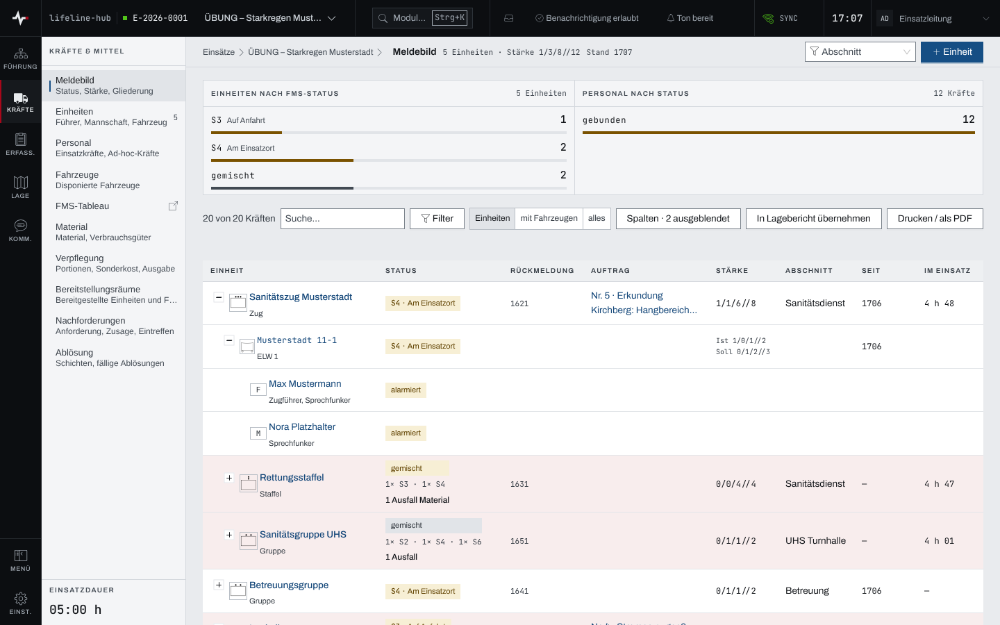
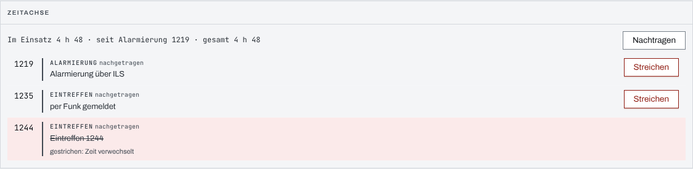
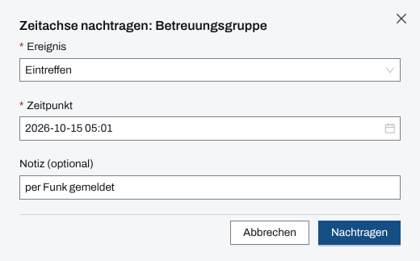

## Überblick

Das **Meldebild** zeigt auf einer Seite, was an Kräften im Einsatz ist, gegliedert als
Kräftebaum: jede Einheit mit ihren Untereinheiten, darunter ihre Fahrzeuge mit Besatzung, ihr
Personal und ihr Material. Je Einheit stehen Status, letzte Rückmeldung, laufender Auftrag, Stärke,
Abschnitt und Einsatzdauer. Darüber zählt ein Statusband die Einheiten und das Personal. Es ist die
Seite für den Lagevortrag und für die Frage, wo etwas fehlt.

Die **Kräfte-Zeitachse** hält je Einheit und Person fest, wann sie alarmiert wurde, eingetroffen
ist, abgelöst oder entlassen wurde. Aus ihr rechnet die App Einsatzdauer und Ruhezeit.

Beides liest, wer die Module Einheiten und Personal sieht; Einsatzleitung und Führungspersonal
setzen Status, tragen nach und streichen.

## Abläufe

### Das Meldebild lesen

1. Unter „Kräfte & Mittel“ das „Meldebild“ öffnen. Der Kopf nennt die Zahl der Einheiten und die
   Stärke (Führer/Unterführer/Mannschaft//Gesamt).
2. Im Statusband die Zahl unter „Einheiten“ ablesen; der Balken darunter gliedert sie nach
   FMS-Status, die Legende nennt Code und Zahl, etwa „S3 2 · S4 1“. Daneben steht „Personal“ mit
   der Gliederung nach Kategorie. „Rückmeldung“ mit dem Wort „keine Rückmeldung“ erscheint nur,
   wenn sich eine Einheit noch nie zurückgemeldet hat, und zählt diese Einheiten.
3. Im Raster je Einheit „Status“, „Rückmeldung“ (Uhrzeit der letzten), „Auftrag“ (der jüngste
   offene, als Verweis), „Stärke“, „Abschnitt“, „Seit“ und „Im Einsatz“ lesen. Eine getönte Zeile
   nennt ihren Grund als Wort, etwa „1 Ausfall“, „1 Ausfall Material“ oder „Rückm. überfällig“.
   „nicht übernommen“ hinter dem Namen kennzeichnet eine Einheit, die ein Bereitstellungsraum
   unangemeldet gebucht hat und die noch niemand übernommen oder abgewiesen hat (Kapitel
   [Einheiten](einheiten.md)).
4. Die Tiefe des Baums in der Werkzeugzeile wählen. Das Meldebild öffnet auf „Einheiten“:
   Untereinheiten stehen unter ihrer Einheit, Fahrzeuge sind zugeklappt. „mit Fahrzeugen“ öffnet
   jede Einheit, „alles“ auch Besatzung und Beladung jedes Fahrzeugs. Mit „+“ vor einer Zeile oder einem
   Klick auf die Zeile klappt sie einzeln auf oder zu.

   

5. Unter einer Einheit lesen, was zu ihr gehört: zuerst ihre Fahrzeuge, in der Spalte „Stärke“
   mit der Besatzung „Ist … · Soll …“, aufgeklappt mit den Personen darauf und danach „Beladung“
   mit der Zahl der Posten auf dem Fahrzeug und der Ausfälle; dann „Ohne Fahrzeug“
   mit ihrem Personal, das auf keinem ihrer Fahrzeuge sitzt; dann „Material“ mit der Zahl der
   Posten und der Ausfälle; zuletzt die Untereinheiten. Hat die Einheit kein Fahrzeug, steht ihr
   Personal direkt darunter. Vor jeder Person steht ihre Stärkeposition („F“, „UF“, „M“, ohne
   Position „–“), vor dem Einheitsführer zusätzlich „EF“.
6. Auf den Namen einer Einheit, den Funkrufnamen eines Fahrzeugs oder den Namen einer Person
   klicken, um ihn in seinem Modul zu öffnen: die Einheit in den Einheiten, das Fahrzeug und die
   Person hervorgehoben in ihrer Liste.
7. Zum Eingrenzen oben rechts unter „Abschnitt“ einen Einsatzabschnitt wählen, in „Suche...“ einen
   Namen eingeben oder unter „Filter“ nach „Trägerorganisation“ oder „Status“ (verfügbar,
   gebunden, nicht verfügbar) filtern; der Knopf nennt dann die Zahl, etwa „Filter (1)“. Jeder
   gesetzte Filter steht als Marke in der Werkzeugzeile und lässt sich dort einzeln entfernen. Die
   Zahl links, etwa „20 von 20 Kräften“, nennt, wie viele Kräfte die Auswahl zeigt; „Filter
   zurücksetzen“ hebt alle Filter auf.

Die Zeile „Ohne Einheit“ sammelt Fahrzeuge und Personal, die keiner Einheit zugeordnet sind, und
Material ohne Ort; ein Fahrzeug ohne Einheit bringt seine Beladung mit. Material an einer UHS oder
in einem Bereitstellungsraum steht nicht im Meldebild; es zählt im Modul [Material](material.md). Unter „Spalten“ lassen sich Spalten aus- und einblenden; „Funkrufname“ und „Fahrzeuge und
Personal (bereit · gebunden · Ausfall)“ erscheinen nur auf breiten Bildschirmen und nicht im Druck.

### Das Meldebild in den Lagebericht übernehmen oder drucken

1. Das Meldebild wie gewünscht eingrenzen.
2. „In Lagebericht übernehmen“ wählen. Die App legt aus der Auswahl einen Lagebericht
   „Kräftemeldebild“ mit Datum-Zeit-Gruppe an und öffnet ihn. Er ist nach Abschnitten gegliedert,
   darin wie das Meldebild: Einheit, Fahrzeuge mit Besatzung und „Beladung“, „Ohne Fahrzeug“,
   „Material“ mit Posten und Ausfall, Untereinheiten. Ohne Eingrenzung folgen darunter
   „Entlassen“ mit den entlassenen Personen und Fahrzeugen und „Aus dem Einsatz genommen“ mit dem
   herausgenommenen Material, jeder Eintrag mit Datum-Zeit-Gruppe.
3. Für Papier „Drucken / als PDF“ wählen. Der Druck klappt den ganzen Baum auf und nennt im Kopf
   Stand, Umfang und die gewählte Auswahl.

„In Lagebericht übernehmen“ steht nur Einsatzleitung und Führungspersonal zur Verfügung.

### Die Zeitachse einer Kraft ansehen

1. Unter „Einheiten“ eine Einheit öffnen und zum Paneel „Zeitachse“ gehen. Für eine Person unter
   „Personal“ ihren Namen wählen; ihre Ansicht trägt dasselbe Paneel.
2. Die Dauerzeile lesen, etwa „Im Einsatz 4 h 47 · seit Alarmierung 07:24 · gesamt 4 h 47“. Nach
   einer Entlassung oder Ablösung steht dort die Ruhezeit.

   

3. Darunter die Ereignisse nach Zeit lesen, jedes mit seiner Herkunft: „aus Status“, „über Einheit
   «…»“, „aus Ablösung“ oder „nachgetragen“. Gestrichene bleiben durchgestrichen mit Grund stehen.

### Ein Ereignis nachtragen

Für Einsatzleitung und Führungspersonal:

1. Im Paneel „Zeitachse“ „Nachtragen“ wählen.
2. Unter „Ereignis“ Alarmierung, Eintreffen oder Entlassung wählen.
3. Den „Zeitpunkt“ prüfen; er steht auf jetzt und darf nicht in der Zukunft liegen. Bei Bedarf eine
   „Notiz (optional)“ eingeben.

   

4. „Nachtragen“ wählen.

### Ein Ereignis streichen

Für Einsatzleitung und Führungspersonal:

1. Am falschen Ereignis „Streichen“ wählen.
2. Im Dialog „Ereignis streichen“ einen „Grund“ eingeben; ohne Grund lässt sich nicht streichen.
3. „Streichen“ wählen. Das Ereignis bleibt durchgestrichen mit Grund sichtbar.

## Hintergrund

### Woher der Status einer Einheit kommt

Hat eine Einheit Fahrzeuge, folgt ihr Status deren FMS-Status. Stehen die Fahrzeuge verschieden,
zeigt die Zelle „gemischt“ und darunter die Verteilung, etwa „1× S3 · 1× S4“. Nur eine Einheit ohne
Fahrzeug bekommt einen Status von Hand: Einsatzleitung und Führungspersonal öffnen dafür in ihrer
Spalte „Status“ das Statusmenü und wählen einen Wert aus dem FMS-Katalog, „kein Status“ entfernt
ihn. Jeder Wechsel steht im Einsatztagebuch, und „Seit“ zeigt, seit wann er gilt.

### Stärke und Besatzung

Die Stärke einer Einheit zählt ihr eigenes Personal und das aller Untereinheiten; jede Untereinheit
nennt ihre eigene. Die obersten Zeilen ergeben zusammen die Stärke im Kopf. Jede Kraft zählt
einmal, bei ihrer Einheit, auch wenn sie auf dem Fahrzeug einer anderen Einheit sitzt: dann steht
sie unter „Ohne Fahrzeug“ ihrer Einheit mit dem Zusatz „fährt auf …“. Die Besatzung „Ist“ eines
Fahrzeugs zählt dagegen jede Kraft darauf, auch die anderer Einheiten, und nennt sie, etwa „davon 1
aus Rettungsstaffel“. Das „Soll“ kommt aus dem Fahrzeugstamm (Kapitel [Fahrzeuge](fahrzeuge.md)).

Status, Mittelverteilung und Tönung bleiben bei der eigenen Zeile: ein Ausfall in einer
Untereinheit tönt nur sie. Material, das defekt, verbraucht, „Desinfektion nötig“ oder aufgebraucht
ist, zählt als Ausfall und tönt die Einheit, an der es liegt; ein Ausfall in der Beladung tönt die
Einheit des Fahrzeugs. Die Gruppen „Material“ und „Beladung“ zählen nur ihre eigenen Posten. Der
Filter „Abschnitt“ richtet sich nach dem Abschnitt der obersten Einheit: eine Untereinheit bleibt
unter ihrer Einheit, auch wenn sie selbst keinen oder einen anderen Abschnitt trägt. Beladung
zählt beim Abschnitt der Einheit ihres Fahrzeugs; Material an einer UHS oder in einem
Bereitstellungsraum fällt bei einem gewählten Abschnitt heraus.

### Rückmeldung und Frist

Als Rückmeldung zählt jede Meldung, die an die Einheit gebunden ist, gleich welcher Art. Ist die
letzte älter als die Frist, steht ihre Uhrzeit hervorgehoben und die Zeile trägt „Rückm.
überfällig“; ohne jede Rückmeldung steht „—“ und die Zeile trägt „keine Rückm.“. Die Frist beträgt
60 Minuten, solange nichts anderes eingestellt ist. Einsatzleitung und Führungspersonal ändern sie
in den Einstellungen des Einsatzes unter „Verhalten & Automatik“, Feld „Rückmeldefrist Einheiten
(Minuten)“. In der Verwaltung unter „Einsatz-Vorgaben“ steht dasselbe Feld als Vorgabe der
Organisation; sie gilt für jeden Einsatz ohne eigene Frist.

### Wie die Zeitachse entsteht

- **Aus dem Status:** ein Statuswert im FMS- oder Personalkatalog kann ein Ereignis auslösen. Eine
  neue Organisation bringt das für Personal mit: „alarmiert“ (Alarmierung), „im Einsatz“
  (Eintreffen) und „abgemeldet“ (Entlassung). Bei einer Einheit zählt das erste Fahrzeug, das einen
  solchen Status meldet; die Entlassung erst, wenn alle Fahrzeuge entlassen sind.
- **Über die Einheit:** ein Ereignis der Einheit gilt auch für die Personen, die ihr in diesem
  Augenblick zugeordnet sind. Eine Streichung an der Einheit streicht diese Einträge mit.
- **Aus der Ablösung:** der Vollzug einer Ablösung beendet den Einsatzabschnitt der abgelösten
  Einheit. Dieses Ereignis lässt sich nicht streichen, nur mit der Rücknahme des Vollzugs aufheben
  (Kapitel [Ablösung](abloesung.md)).
- **Am Bereitstellungsraum:** „Eintreffen buchen“ trägt bei einer Einheit das Eintreffen ein,
  wenn sie in ihrem laufenden Einsatzabschnitt noch nicht eingetroffen ist (Kapitel
  [Bereitstellungsräume](bereitstellungsraeume.md)). „zuweisen“ trägt nichts ein.
- **Nachgetragen:** von Hand, mit Eintrag im Einsatztagebuch. Ein Nachtrag an einer Einheit gilt
  ebenfalls für ihre jetzt zugeordneten Personen.

Ereignisse werden nie geändert oder gelöscht, nur gestrichen. Die Streichung ist endgültig.

### Einsatzdauer und Ruhezeit

Die Einsatzdauer zählt ab der Alarmierung, fehlt sie, ab dem Eintreffen. „gesamt“ addiert alle
Einsatzabschnitte der Kraft, „Ruhe“ zählt seit dem Ende des letzten. Ohne Ereignis steht keine Zahl,
sondern „—“. Grenzwerte und Warnungen gibt es nicht; die Zahl steht neutral da. Die Dauer erscheint
im Meldebild unter „Im Einsatz“, bei Einheiten und Personen im Paneel „Zeitachse“ ihrer Ansicht und
in der Personalliste in den Spalten „Einsatzdauer“ und „Ruhe“ (diese unter „Spalten“). Der Stab
zeigt sie nicht.

### Rechte

Lesen darf, wer die Module Einheiten und Personal sieht. Status setzen, nachtragen, streichen und in
den Lagebericht übernehmen dürfen Einsatzleitung und Führungspersonal, solange der Einsatz läuft
(Kapitel [Rechte im Einsatz](rechte-im-einsatz.md)).

### Ohne Netz

Meldebild und Zeitachse bleiben mit dem zuletzt geladenen Stand lesbar. Status setzen, Nachtragen
und Streichen brauchen das Netz (Kapitel [Ohne Netz](ohne-netz.md)).
