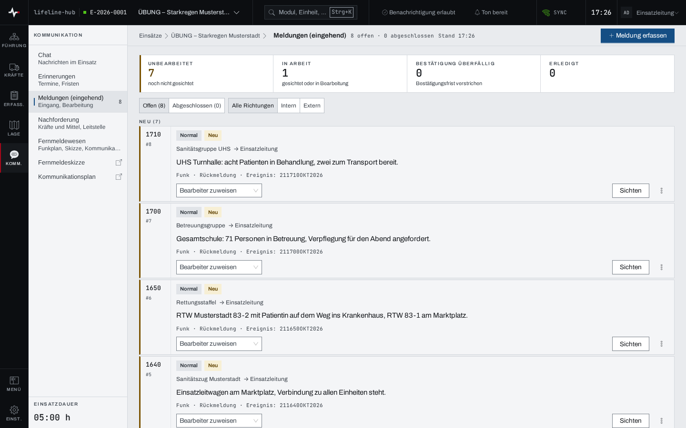
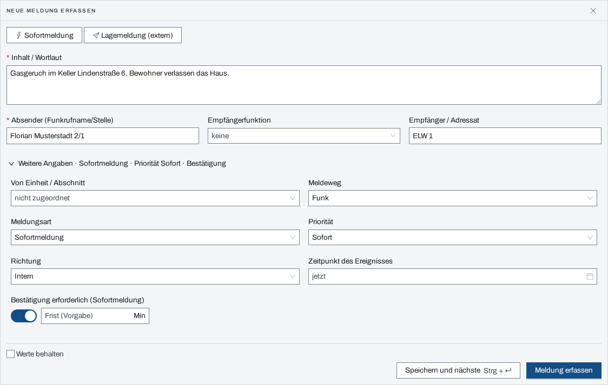

## Überblick

Das Modul „Meldungen (eingehend)“ sammelt, was von außen oder aus den eigenen Einheiten an die
Führung kommt: Funksprüche, Anrufe, persönliche Meldungen. Jede Meldung hat einen Wortlaut, einen
Absender, auf Wunsch einen Empfänger und eine Empfängerfunktion, eine Meldungsart und eine
Priorität. Sie durchläuft die
Stufen **Neu**, **Gesichtet**, **In Bearbeitung** und **Erledigt**.

Eine **Sofortmeldung** verlangt eine Bestätigung. Bleibt sie über die Frist hinaus unbestätigt,
schlägt die App Alarm.

Lesen dürfen alle mit Zugang zum Einsatz. Erfassen und Bearbeiten dürfen Einsatzleitung und
Führungspersonal, solange der Einsatz läuft (siehe [Rechte im Einsatz](rechte-im-einsatz.md)).

## Abläufe

### Meldungen sichten und abarbeiten

1. Im Einsatz das Modul „Meldungen (eingehend)“ öffnen. Oben stehen die Kennzahlen
   „Unbearbeitet“, „In Arbeit“, „Bestätigung überfällig“ und „Erledigt“.

   

2. Mit „Offen“ und „Abgeschlossen“ die Ansicht wählen, mit „Alle Richtungen“, „Intern“ und
   „Extern“ die Richtung.
3. An einer Karte die nächste Stufe wählen: „Sichten“, dann „Bearbeitung beginnen“, dann „Als
   erledigt melden“. Die Rückfrage „Meldung auf „Erledigt“ setzen?“ schließt die Meldung ab.
4. Bei Bedarf unter „Bearbeiter zuweisen“ eine Person aus dem Einsatz eintragen.

Nach einem Stufenwechsel bietet ein Hinweis sechs Sekunden lang „Rückgängig“. Die Liste ordnet
nach Priorität, dann eskalierte Meldungen zuerst, dann die neueste Ereigniszeit oben.

### Eine Meldung erfassen

Für Einsatzleitung und Führungspersonal:

1. „Meldung erfassen“ wählen. Das Formular „Neue Meldung erfassen“ öffnet sich über der Liste.
2. Für eine eilige Meldung „Sofortmeldung“ wählen; das setzt Meldungsart und Priorität auf
   „Sofort“ und schaltet die Bestätigung ein. „Lagemeldung (extern)“ belegt die Meldungsart
   „Lagemeldung“ und die Richtung „Extern“ vor.

   

3. „Inhalt / Wortlaut“ und „Absender (Funkrufname/Stelle)“ ausfüllen. Ist die Meldung an eine
   Funktion im Stab gerichtet, unter „Empfängerfunktion“ die Einsatzleitung oder das Sachgebiet
   wählen; ein leeres „Empfänger / Adressat“ füllt sich dabei mit dem Kürzel, etwa „S2“. Bei
   Bedarf „Empfänger / Adressat“ frei eintragen oder ändern.
4. Unter „Weitere Angaben“ bei Bedarf „Von Einheit / Abschnitt“ (belegt den Absender vor),
   „Meldeweg“, „Meldungsart“, „Priorität“, „Richtung“, „Zeitpunkt des Ereignisses“ und die Frist
   der Bestätigung setzen.
5. „Meldung erfassen“ wählen.

Für mehrere Meldungen hintereinander speichert „Speichern und nächste“ (Strg+Enter, am Mac
⌘+Enter) und leert das Formular. Mit dem Häkchen „Werte behalten“ bleiben dabei „Von Einheit /
Abschnitt“, Absender, Meldeweg, Empfängerfunktion und Empfänger stehen.

### Eine Sofortmeldung bestätigen

Für Einsatzleitung und Führungspersonal:

1. Beim Eingang einer Sofortmeldung erscheint der Alarm „Sofortmeldung eingegangen“ mit
   „Meldung #…“; „Öffnen“ führt zur Meldung.
2. Die Karte der Sofortmeldung trägt „Bestätigung offen bis …“. An ihr „Bestätigen“ wählen und
   die Rückfrage „Sofortmeldung bestätigen?“ mit „Bestätigen“ beantworten.

Die Karte zeigt danach, wer wann quittiert hat.

### Eine Meldung an die Lage übergeben

Für Einsatzleitung und Führungspersonal:

1. An der Karte „An Lage übergeben“ wählen. Hat die Karte viele Aktionen, steht der Punkt in
   ihrem Menü.
2. Im Dialog „An die Lage übergeben“ den „Lage-Text“ prüfen; leer bleibt der Wortlaut der
   Meldung.
3. Bei Bedarf unter „Verortung (optional)“ einen Ort setzen. Er ist später nicht änderbar.
4. „Übergeben“ wählen.

Die Meldung trägt danach „Lagerelevant ✓“ und erscheint in den Lagemeldungen (Kapitel
[Lagemeldungen](lagemeldungen.md)); verortet auch auf der Lagekarte.

### Aus einer Meldung einen Auftrag erteilen

Für Einsatzleitung und Führungspersonal:

1. An der Karte „Auftrag erteilen“ wählen, bei vielen Aktionen im Menü der Karte.
2. Den Auftrag wie im Kapitel [Aufträge und Befehle](auftraege-befehle.md) beschrieben ausfüllen
   und erteilen.

Die Meldung geht dabei in Bearbeitung. Ist das Modul Aufträge im Einsatz nicht freigegeben, steht
der Punkt gesperrt als „Auftrag erteilen (keine Berechtigung)“ da.

Wird der Auftrag später aufgehoben, steht an der Karte „Auftrag aufgehoben“ statt des Verweises,
und „Auftrag erteilen“ ist wieder da. Ein neu erteilter Auftrag tritt an die Stelle des alten; der
aufgehobene bleibt in den Aufträgen unter „Abgeschlossen“ und im Einsatztagebuch nachlesbar.

### Eine unangemeldet eingetroffene Einheit übernehmen

Für Einsatzleitung und Führungspersonal. Bucht ein Bereitstellungsraum eine Kraft, die der Einsatz
noch nicht kannte, kommt die Meldung „… unangemeldet im BR … eingetroffen“.

1. An ihrer Karte „Übernehmen“ wählen und wie im Kapitel [Einheiten](einheiten.md) beschrieben
   bestätigen.
2. Gehört die Kraft nicht in den Einsatz, stattdessen das rote „Abweisen“ wählen und die Rückfrage
   „Einheit abweisen?“ mit „Abweisen“ bestätigen.

Nach Übernahme oder Abweisung verschwinden die Knöpfe. „Abweisen“ fehlt, wenn das Modul Fahrzeuge
im Einsatz nicht freigegeben ist. Ohne Schreibrecht steht an der Karte statt der Knöpfe der
Verweis „↗ …“ zur Einheit; ist das Modul Einheiten nicht freigegeben, fehlt auch er.

## Hintergrund

### Bestätigungspflicht und Frist

Eine Meldung mit Meldungsart „Sofortmeldung“ oder Priorität „Sofort“ verlangt eine Bestätigung;
der Schalter „Bestätigung erforderlich (Sofortmeldung)“ lässt sich auch von Hand setzen. Die
Frist steht im Feld daneben in Minuten. Ohne Angabe gilt die Vorgabe aus den Einstellungen des
Einsatzes unter „Verhalten & Automatik“, Feld „Bestätigungsfrist Meldungen (Minuten)“, sonst fünf
Minuten.

Mit der Sofortmeldung legt die App eine automatische Erinnerung „Sofortmeldung #… unbestätigt“
an. Läuft die Frist ab, ohne dass jemand bestätigt, wird die Meldung eskaliert: Sie rückt
innerhalb ihrer Priorität nach oben und zählt unter „Bestätigung überfällig“, und es erscheint der
Alarm „Bestätigung ausstehend“ mit „Meldung #…“. Mit der Bestätigung schließt die Erinnerung
(Kapitel [Erinnerungen](erinnerungen.md)).

### Wer den Alarm bekommt

Den Alarm „Sofortmeldung eingegangen“ bekommen alle, die das Modul Meldungen sehen, außer der
Person, die die Sofortmeldung erfasst hat. „Bestätigung ausstehend“ bekommen alle mit dem Modul,
auch die erfassende Person. Beide kommen mit Ton und lassen sich unter „Benachrichtigungen“ nicht
abschalten (Kapitel [Einsatz auswählen und Oberfläche](einsatz-oberflaeche.md)). Eine gewöhnliche
Meldung löst keinen Alarm aus.

### Benachrichtigung an die Empfängerfunktion

Trägt eine Meldung eine Empfängerfunktion, erhalten beim Erfassen die Personen dieser Funktion
den Hinweis **„Neue Meldung“** mit der Nummer der Meldung, etwa „Meldung #12“, und einem Sprung
zu ihr. Wer eine Funktion besetzt, steht in der Stab-Besetzung; ist die Funktion dort nicht
besetzt oder ihr Personal mit keinem Konto verknüpft, gilt die Funktion in der Mitgliedschaft
des Einsatzes. Wer das Modul „Meldungen (eingehend)“ nicht sehen darf, bekommt keinen Hinweis.

- Ohne Empfängerfunktion bleibt die Meldung still, auch wenn im freien Empfänger „S2“ steht.
- Eine Sofortmeldung an eine Funktion löst nur ihren Alarm aus, keinen zweiten Hinweis.
- Eigene Aktionen bleiben still: Wer als S2 eine Meldung an S2 erfasst, bekommt dazu nichts.
- Jede Meldung meldet sich einmal; eine ohne Netz erfasste Meldung, die beim Wiederverbinden noch
  einmal gesendet wird, löst keinen zweiten Hinweis aus.

Als Empfängerfunktion stehen die Einsatzleitung und die Sachgebiete zur Wahl, S7 nur, wenn die
Organisation sie eingeschaltet hat. Führungshilfspersonal und Fachberater sind keine
Empfängerfunktion einer Meldung; für sie bleibt der freie Empfänger.

### Meldungen im Einsatztagebuch

Jede erfasste Meldung schreibt einen ETB-Eintrag vom Typ „Meldung“ mit Absender und Empfänger,
solange „Automatische ETB-Einträge“ nicht ausgeschaltet ist (siehe
[Einsatztagebuch](einsatztagebuch.md)).

### Ohne Netz

Meldungen lassen sich auch ohne Verbindung erfassen; sie gehen raus, sobald das Netz zurück ist
(siehe [Arbeiten ohne Netz](ohne-netz.md)).
