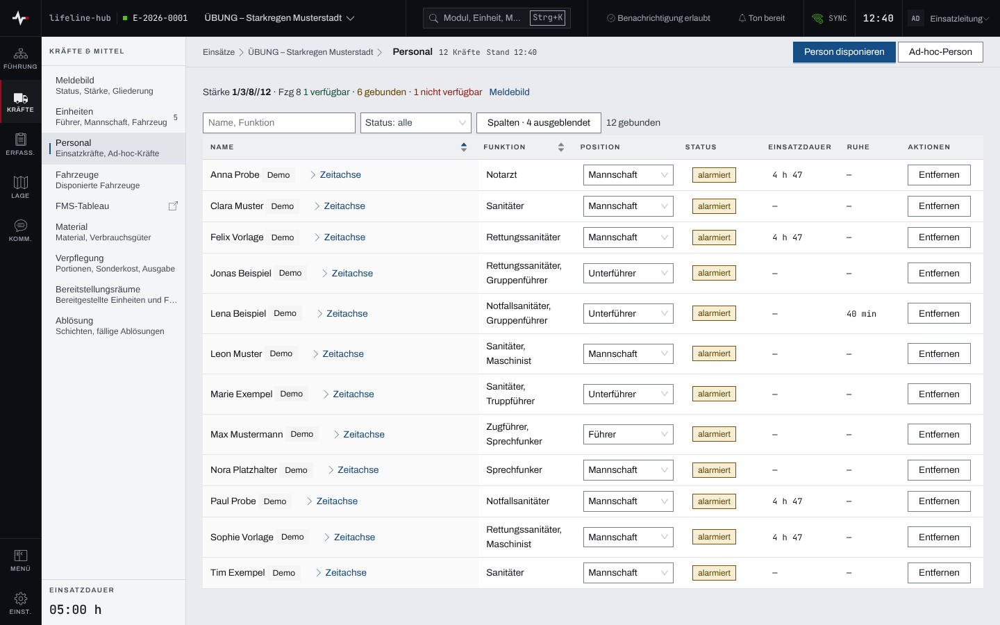
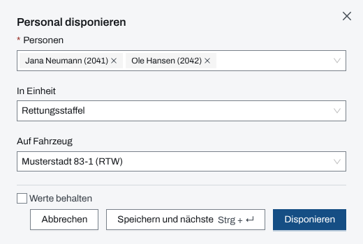
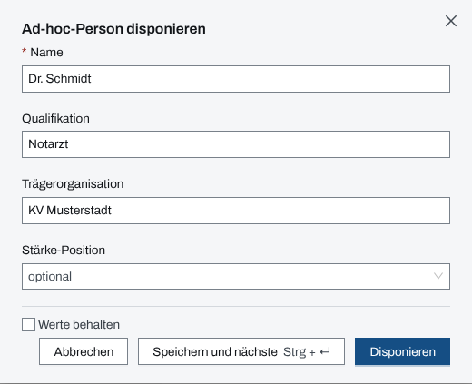
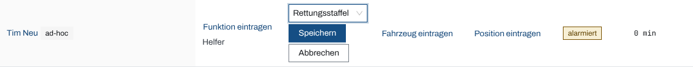
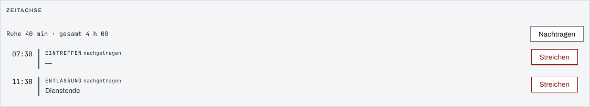

## Überblick

Das Modul **Personal** führt alle Einsatzkräfte, die im Einsatz disponiert sind: Personen aus dem
Personalstamm der Organisation und Ad-hoc-Kräfte, die nur in diesem Einsatz vorkommen. Die Liste
ist nach Einheit gruppiert und zeigt je Person Einsatzfunktion und Qualifikation, Einheit,
Fahrzeug, Stärke-Position, Status und Einsatzdauer. Jede Person hat eine eigene Ansicht mit allen
Angaben, ihrer Zeitachse und dem Weg aus dem Einsatz.

Die Führung liest hier, wer wo eingeteilt ist, wer verfügbar oder gebunden ist und wer wie lange
im Einsatz steht. Disponieren, einteilen, Status setzen und entlassen dürfen Einsatzleitung und
Führungspersonal.

## Abläufe

### Die Personalliste lesen

1. Unter „Kräfte & Mittel“ „Personal“ öffnen. Über der Liste steht die Stärke mit der Verteilung der
   Kräfte, daneben der Sprung ins „Meldebild“.
2. Die Liste ist nach Einheit gruppiert. Zuerst steht „nicht eingeteilt“, danach die Einheiten in
   der Folge des Kräftebaums; eine unterstellte Einheit trägt ihren Pfad, etwa „Zug 1 › Staffel A“.
   Über der Tabelle steht je Gruppe die Zahl der Personen, etwa „1 nicht eingeteilt · 4
   Rettungsstaffel“; auf dem Handy trägt jede Gruppe einen Kopf über ihren Karten. In „Name,
   Funktion“ suchen oder unter „Status“ eine Kategorie wählen.

   

3. Unter „Spalten“ die ausgeblendeten Spalten „Träger“, „Ruhe“ und „Bemerkung“ einblenden.

### Personal aus dem Stamm disponieren

Für Einsatzleitung und Führungspersonal, für eine Person oder eine ganze Gruppe:

1. „Personal disponieren“ wählen.
2. Unter „Personen“ eine oder mehrere Personen aus dem Personalstamm wählen. Die Suche findet
   Name, Personalnummer, Träger und Qualifikation.
3. Bei Bedarf unter „In Einheit“ die Einheit und unter „Auf Fahrzeug“ das Fahrzeug wählen. Mit
   gewählter Einheit stehen nur ihre Fahrzeuge zur Wahl.

   

4. „Disponieren“ wählen. Für die nächste Gruppe „Speichern und nächste“ (Strg + Enter) wählen; mit
   „Werte behalten“ bleibt die Einheit stehen, das Fahrzeug nicht.
5. Lässt sich eine Person nicht disponieren, nimmt die App keine der gewählten auf. Unter der
   Auswahl steht je Person der Grund, etwa „außer Dienst“ oder „schon disponiert“. „Abgelehnte
   abwählen“ nimmt diese Personen aus der Auswahl, danach erneut „Disponieren“ wählen.

### Eine Ad-hoc-Person disponieren

Für Einsatzleitung und Führungspersonal, wenn eine Kraft nicht im Personalstamm steht:

1. „Ad-hoc-Person“ wählen.
2. „Name“ eingeben, bei Bedarf „Qualifikation“, „Trägerorganisation“ und „Stärke-Position“.

   

3. „Disponieren“ wählen. Für eine ganze Gruppe „Speichern und nächste“ (Strg + Enter) wählen; mit
   „Werte behalten“ bleiben Trägerorganisation und Stärke-Position für die nächste Person stehen.

Ad-hoc-Kräfte tragen in der Liste die Marke „ad-hoc“.

### Eine Person einteilen

Für Einsatzleitung und Führungspersonal, in der Liste oder in der Ansicht der Person:

1. In der Spalte „Einheit“ der Person „Einheit eintragen“ wählen, bei einer schon gesetzten
   Einheit auf ihren Namen klicken.
2. Die Einheit wählen und „Speichern“ wählen. Die Auswahl ist nach Abschnitt gruppiert, Einheiten
   ohne Abschnitt stehen zuletzt unter „ohne Abschnitt“. Erst „Speichern“ ändert etwas; Escape
   oder „Abbrechen“ verwirft die Wahl.

   

3. Ebenso in der Spalte „Fahrzeug“ das Fahrzeug wählen. Die Fahrzeuge der eigenen Einheit stehen
   oben unter „Einheit «…»“, die übrigen unter „Weitere Fahrzeuge“.
4. In der Spalte „Position“ Führer, Unterführer oder Mannschaft wählen und speichern. Die Liste
   zeigt die Position als „F“, „UF“ oder „M“.
5. Zum Entfernen einer Angabe das Feld leeren und speichern; die Person steht dann wieder unter
   „nicht eingeteilt“ bzw. ohne Fahrzeug.
6. Lehnt die App ab, steht der Grund an der Angabe, die Auswahl bleibt mit dem gewählten Wert offen.

Führt die Person ihre Einheit, steht am Wert die Marke „Einheitsführer“: wechselt sie die Einheit,
ist die bisherige danach ohne Führer.

Wechselt eine Person die Einheit, während Maus oder Fokus in der Liste liegen, bleibt ihre Zeile
stehen und wandert erst in die neue Gruppe, wenn beide die Liste verlassen haben.

### Eine Einsatzfunktion vergeben

Für Einsatzleitung und Führungspersonal, wenn eine Person im Einsatz eine Aufgabe übernimmt:

1. In der Spalte „Funktion“ der Person „Funktion eintragen“ wählen, bei einer schon vergebenen
   Einsatzfunktion auf ihren Text klicken. In der Ansicht der Person steht die Angabe unter
   „Einsatzfunktion“.
2. Eine Funktion aus den Vorschlägen wählen oder einen eigenen Text eingeben, etwa „Sprechfunker“.
3. „Speichern“ wählen oder Enter drücken. Die Einsatzfunktion steht über der Qualifikation.
4. Zum Entfernen das Feld leeren und speichern.

### Status und Bemerkung ändern

Für Einsatzleitung und Führungspersonal:

1. In der Spalte „Status“ den Status der Person wählen. Er gilt sofort.
2. Eine Bemerkung in der Spalte „Bemerkung“ eintragen (unter „Spalten“ einblenden) oder in der
   Ansicht der Person unter „Bemerkung“.

### Die Ansicht einer Person öffnen

1. In der Liste auf den Namen der Person klicken. In der Sprungpalette führt ein Treffer unter
   „Personal“ ebenfalls dorthin.
2. Im Kopf stehen Name, Marken wie „ad-hoc“, die Funktion, der Träger und „im Einsatz …“ bzw.
   „Ruhe …“. Auf die Paneele „Einteilung“, „Person“ und „Zeitachse“ folgt zuletzt „Aus dem
   Einsatz“.

   

3. Unter „Einteilung“ stehen alle Angaben des Einsatzes, dazu die Unfallhilfsstelle; ändern wie in
   der Liste. Führt die Person ihre Einheit, steht neben der Einheit die Marke „Einheitsführer“.
   „Meldebild“ und „Einheit“ springen in diese Module.
4. Über „Personal“ in der Brotkrume zurück zur Liste; die Zeile der Person ist dort hervorgehoben.

### Angaben einer Ad-hoc-Person berichtigen

Für Einsatzleitung und Führungspersonal:

1. Die Ansicht der Person öffnen.
2. Im Paneel „Person“ „Name“, „Qualifikation“ oder „Träger“ anklicken, berichtigen und
   „Speichern“ wählen. Ein leerer Name lässt sich nicht speichern.

Bei einer Person aus dem Personalstamm steht dort „aus dem Stamm“; ihre Angaben ändert die
Verwaltung im Personalstamm („im Stamm ändern“).

### Einsatzdauer und Zeitachse ablesen

1. In der Liste „Einsatzdauer“ lesen, die „Ruhe“ unter „Spalten“ einblenden.
2. Für die Einzelheiten die Ansicht der Person öffnen und zum Paneel „Zeitachse“ gehen.

   

3. Fehlt ein Ereignis, mit „Nachtragen“ ergänzen (Kapitel [Meldebild und
   Kräfte-Zeitachse](meldebild.md)).

### Eine Person entlassen oder stornieren

Für Einsatzleitung und Führungspersonal, in der Ansicht der Person:

1. Ist die Person schon früher gegangen, zuerst in ihrer „Zeitachse“ mit „Nachtragen“ die
   Entlassung mit der richtigen Zeit erfassen. Die App trägt dann keine zweite ein.
2. Im Paneel „Aus dem Einsatz“ „Entlassen“ wählen. Eine Rückfrage gibt es nicht; der Hinweis unten
   bietet einige Sekunden lang „Rückgängig“.
3. Eine Fehldisposition stattdessen mit „Stornieren“ entfernen und die Rückfrage „… stornieren?“
   mit „Stornieren“ bestätigen. Danach steht wieder die Personalliste da. Nach 15 Minuten ist
   „Stornieren“ gesperrt, daneben steht „nur in den ersten 15 Minuten“. Lehnt die App ab, steht
   der Grund im Paneel.
4. Unter der Liste „Entlassen“ aufklappen. Dort stehen alle entlassenen Personen mit dem
   Zeitpunkt; ihr Name öffnet ihre Ansicht.

   

5. Kommt die Person zurück, „Erneut disponieren“ wählen, im Block oder in ihrer Ansicht.

## Hintergrund

### Wer zur Auswahl steht

„Personal disponieren“ bietet die Personen des Personalstamms an, die in Dienst stehen und noch
nicht im Einsatz sind. Eine entlassene Person fehlt dort; sie kommt über „Erneut disponieren“ im
Block „Entlassen“ zurück, mit ihrer Zeitachse. Ad-hoc-Kräfte gibt es nur im Einsatz; im
Personalstamm erscheinen sie nicht.

Ein Absenden nimmt höchstens 50 Personen auf und gilt ganz oder gar nicht: Steht eine Person
inzwischen außer Dienst, ist sie schon disponiert oder entlassen, legt die App niemanden an und
nennt den Grund je Person.

### Einsatzfunktion und Qualifikation

Die Einsatzfunktion sagt, was eine Person in diesem Einsatz tut (Sprechfunker, Melder, Fahrer);
die Qualifikation, was sie kann. Die Qualifikation einer Stamm-Person kommt aus dem Personalstamm
und wird dort gepflegt; die einer Ad-hoc-Kraft ist der Text aus dem Dialog. Die Einsatzfunktion
gilt nur im Einsatz und wechselt, so oft es die Lage verlangt.

Vorgeschlagen werden zuerst die im Einsatz schon vergebenen Einsatzfunktionen, dann Funktionen
nach FwDV 3 und FwDV 100 (Einheitsführer, Gruppenführer, Truppführer, Maschinist, Melder,
Sprechfunker, Fahrer), dann die Qualifikationen der Organisation. Ein eigener Text darf bis zu 200
Zeichen lang sein, eine Bemerkung bis zu 2 000.

Wo eine Person mit nur einer Angabe steht, nennt die App die Einsatzfunktion, ohne sie die
Qualifikation: im Meldebild und seiner Übernahme in einen Lagebericht, im Block „Entlassen“, in
der Anlage „Personal je Kopf“ des Einsatzberichts, in den Personenauswahlen von Stab-Besetzung,
Einsatzleitung, Schäden und UHS und im Einsatztagebuch. Die Vorschau in der Sprungpalette zeigt
beide. Entlassen und erneut disponiert, behält die Person ihre Einsatzfunktion.

### Status

Die Statuswerte pflegt die Organisation selbst; jeder gehört zu einer Kategorie (verfügbar,
gebunden, nicht verfügbar). Eine neue Organisation beginnt mit „verfügbar“, „alarmiert“, „auf
Anfahrt“, „im Einsatz“, „Pause“ und „abgemeldet“. „alarmiert“, „im Einsatz“ und „abgemeldet“
schreiben dabei Alarmierung, Eintreffen und Entlassung in die Kräfte-Zeitachse.

### Einheit, Fahrzeug und Position

Beim Disponieren aus dem Stamm lassen sich Einheit und Fahrzeug gleich mitgeben; die Felder „In
Einheit“ und „Auf Fahrzeug“ stehen nur, wenn die Module Einheiten und Fahrzeuge im Einsatz
freigegeben sind. Gehört das Fahrzeug dort nicht zur gewählten Einheit, lehnt die App ab.

Später ändert die Liste oder die Ansicht der Person Einheit und Fahrzeug einzeln, über dieselben
Wege wie die Module [Einheiten](einheiten.md) und [Fahrzeuge und FMS](fahrzeuge.md). Eine neue
Einheit löst die bisherige ab; ein Fahrzeug ebenso. Einheit und Fahrzeug bleiben dabei
unabhängig: Wechselt eine Person die Einheit, bleibt sie auf ihrem Fahrzeug. Fährt sie auf dem
Fahrzeug einer anderen Einheit, steht daneben „andere Einheit“; das Meldebild zeigt sie unter
„Ohne Fahrzeug“ ihrer Einheit mit „fährt auf …“. Mitfahrer sind so sichtbar, aber erlaubt.

Führt eine Person ihre Einheit und wechselt die Einheit, ist die Einheit danach ohne Führer. Liste
und Ansicht zeigen deshalb vor dem Wechsel die Marke „Einheitsführer“ am Wert; das Einsatztagebuch
nennt nur die neue Zuordnung.

Die Stärke-Position bestimmt, ob die Person als Führer, Unterführer oder Mannschaft zählt;
Einheitsführer ist ein eigenes Merkmal der Einheit.

### Entlassen und Stornieren

Entlassen ist der Normalweg: Die Person verlässt Einheit, Fahrzeug, UHS, Stab und Führungsstelle.
War sie Einheitsführer oder Leiter eines Einsatzabschnitts, ist diese Stelle danach leer. Ihre
Zeitachse bleibt, mit offener Periode endet sie mit einer „Entlassung“ (Herkunft „aus dem Einsatz
entlassen“). In Stärke, Statusband, Lagemonitor und Auswahllisten zählt sie nicht mehr. Im Nachweis
bleibt sie: im Block „Entlassen“ unter der Personalliste und im Meldebild, in der Übernahme des
Meldebilds in einen Lagebericht, in „insgesamt eingesetzt“ und in der Anlage „Personal je Kopf“ des
Einsatzberichts. Erneut disponiert, steht sie wieder in der Liste; ihre Zeitachse läuft weiter,
ihre Bindungen kommen nicht zurück.

Stornieren korrigiert eine Fehldisposition und lässt keine Spur. Es geht nur in den ersten 15
Minuten nach der Disposition und nur, solange die Person noch nichts im Einsatz hat: keine Einheit,
kein Fahrzeug, keine Rolle, keine Ereignisse außer denen aus der Disposition. Wer einmal entlassen
war, lässt sich auch nach dem erneuten Disponieren nicht mehr stornieren. Eine stornierte Person
erscheint in keinem Nachweis; ihre Ereignisse sind gestrichen.

An einer entlassenen oder stornierten Person lässt sich nichts mehr ändern: Zuordnen, Status setzen
und Nachtragen lehnt die App ab.

### Einsatztagebuch

Disponieren, jeder Statuswechsel, das Entlassen, das erneute Disponieren und das Stornieren stehen
im Einsatztagebuch. Eine Gruppe aus einem Absenden steht dort als ein Eintrag mit Zahl, Einheit,
Fahrzeug und den Namen. Eine vergebene, geänderte oder entfernte Einsatzfunktion steht dort mit
altem und neuem Wert, etwa „Person «Anna Probe»: Funktion «—» → «Sprechfunker»“. Jede Zuordnung zu
einer Einheit, einem Fahrzeug oder einer UHS und ihre Freigabe stehen dort ebenfalls, ebenso
berichtigte Angaben einer Ad-hoc-Person mit altem und neuem Wert. Position und Bemerkung ändern es
nicht.

### Rechte und ohne Netz

Lesen darf, wer das Modul Personal sieht. Disponieren, ändern, entlassen und stornieren dürfen
Einsatzleitung und Führungspersonal, solange der Einsatz läuft (Kapitel [Rechte im
Einsatz](rechte-im-einsatz.md)). Einheit, Fahrzeug und Unfallhilfsstelle hängen zusätzlich an
ihrem Modul: Ist es im Einsatz nicht freigegeben, fehlt die Spalte in der Liste und die Angabe in
der Ansicht, statt eine Person als nicht eingeteilt zu zeigen. Ohne Freigabe der Einheiten
gruppiert die Liste nicht.

Die Ansicht einer entlassenen Person bleibt lesbar, mit der Marke „entlassen“ und dem Zeitpunkt;
ändern und nachtragen lässt sich dort nichts, bis sie erneut disponiert ist. Die Ansicht einer
stornierten Person meldet „Nicht (mehr) im Einsatz“.

Ohne Netz bleibt die Liste mit dem zuletzt geladenen Stand lesbar; ändern lässt sich nichts
(Kapitel [Ohne Netz](ohne-netz.md)).
