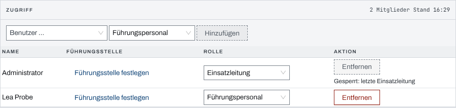
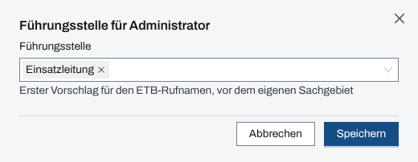

## Überblick

Was eine Person in einem Einsatz darf, hängt an ihrer Rolle in diesem Einsatz: **Einsatzleitung**,
**Führungspersonal** oder **Beobachter**. Die Rollen vergibt die Einsatzleitung eines laufenden
Einsatzes in den Einstellungen des Einsatzes, Reiter „Zugriff“. Ohne Rolle lesen Führungskräfte
der Organisation und System-Admins mit; schreiben dürfen sie dort nur eingeschränkt.

## Abläufe

### Eine Person in den Einsatz aufnehmen

Für die Einsatzleitung:

1. In der Sprungpalette „Mitglied aufnehmen“ wählen. Die Einstellungen öffnen sich im Reiter
   „Zugriff“, die Auswahl „Benutzer …“ ist aufgeklappt. Alternativ im Einsatz „Einstellungen“
   und dort den Reiter „Zugriff“ öffnen, oder in den „Einsatzdaten“ „Zugriff verwalten“ wählen.
2. Unter „Benutzer …“ die Person wählen und daneben ihre Rolle; vorgewählt ist
   „Führungspersonal“.
3. „Hinzufügen“ wählen. Die Person steht danach in der Liste, mit ihrer Rolle in einem
   Auswahlfeld.

   

### Eine Rolle ändern oder entziehen

Für die Einsatzleitung:

1. Im Reiter „Zugriff“ der Einstellungen bei der Person eine andere Rolle wählen.
2. Zum Entziehen „Entfernen“ wählen und die Rückfrage „Mitglied entfernen?“ mit „Entfernen“
   bestätigen.

Wer die eigene Rolle herabstuft, bestätigt das zuerst mit „Rolle herabstufen“: danach endet das
Recht, den Zugriff des Einsatzes zu verwalten.

### Die Führungsstelle eines Mitglieds festlegen

Für die Einsatzleitung:

1. Im Reiter „Zugriff“ in der Spalte „Führungsstelle“ „Führungsstelle festlegen“ oder den
   bisherigen Wert wählen.
2. Im Dialog eine Funktion aus der Liste wählen oder einen Freitext eingeben.

   

3. „Speichern“ wählen.

### Die Mitglieder sortieren und filtern

1. Im Reiter „Zugriff“ auf den Kopf „Name“, „Führungsstelle“ oder „Rolle“ klicken. Ein zweiter
   Klick kehrt die Folge um.
2. Für nur bestimmte Rollen das Trichterzeichen am Kopf „Rolle“ wählen und die Rollen ankreuzen.
   Die Zahl hinter jeder Rolle nennt, wie viele Mitglieder sie tragen.

Sortierung und Filter stehen in der Adresse: ein geteilter Link öffnet die Liste im selben Stand.

## Hintergrund

### Was die Rollen dürfen

- **Einsatzleitung** und **Führungspersonal** schreiben in den Modulen, ändern Kopfdaten,
  Einstellungen und die eigene Führungsstelle.
- **Beobachter** lesen nur.
- Nur die **Einsatzleitung** verwaltet den Zugriff und koppelt Geräte. Alle anderen sehen den
  Reiter „Zugriff“ als „Nur Ansicht“ mit dem Grund „nur Einsatzleitung“; die Schnellaktion
  „Mitglied aufnehmen“ und der Sprung „Zugriff verwalten“ fehlen ihnen.

Die letzte Einsatzleitung eines Einsatzes lässt sich nicht entfernen („Gesperrt: letzte
Einsatzleitung“).

Aufnehmen kann die Einsatzleitung jede aktive Person der Organisation des Einsatzes, auch ohne
Rolle in der Administration. Die Auswahl „Benutzer …“ zeigt nur diese Personen, mit ihrem
Anzeigenamen; Personen anderer Organisationen, deaktivierte Konten und gekoppelte Geräte stehen
nicht darin. Ist niemand mehr übrig, zeigt sie „Keine weitere Person der Organisation“.

Die **Führungsstelle eines Mitglieds** ist der erste Vorschlag, wenn das Einsatztagebuch die
Person nach ihrem Rufnamen fragt, noch vor ihrem eigenen Sachgebiet im Stab.

### Ohne Rolle im Einsatz

- Eine **Führungskraft der Organisation** liest jeden Einsatz der eigenen Organisation, schreibt
  darin aber nichts.
- Ein **System-Admin** liest jeden Einsatz, auch den einer anderen Organisation. Ändern darf er
  ohne Rolle nur an Einsätzen der eigenen Organisation, und dort nur die Verwaltungsangaben:
  Kopfdaten, Einstellungen, Führungsstelle, Aufbewahrungsfrist und Module. In den Modulen selbst
  (Einsatztagebuch, Kräfte, Lagekarte …) schreibt er erst mit einer Rolle.
- An einem Einsatz einer anderen Organisation schreibt ein System-Admin nur mit einer Rolle in
  diesem Einsatz.

Wo ein Recht fehlt, steht die Seite auf „Nur Ansicht“ und nennt, wer schreiben darf.

### Abgeschlossener Einsatz

Ein abgeschlossener Einsatz ist schreibgeschützt, auch für Einsatzleitung und System-Admin; nur
die Aufbewahrungsfrist lässt sich noch ändern. Mitglieder lesen ihn noch 24 Stunden nach dem
Abschluss, danach nur noch die Einsatzleitung, Führungskräfte der Organisation und System-Admins.
Nach Ablauf der Aufbewahrungsfrist liest ihn niemand mehr.
