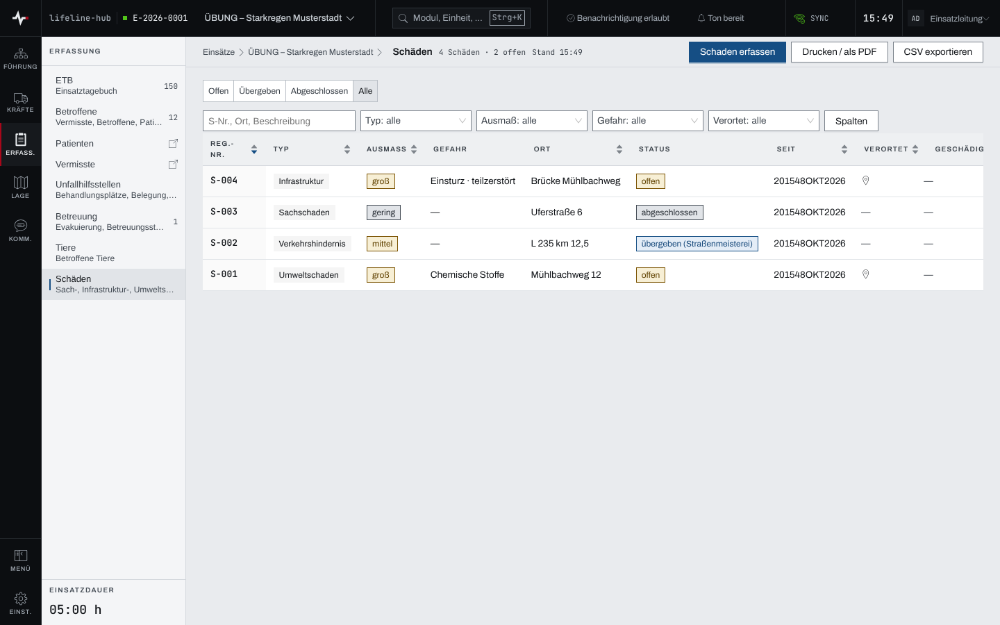
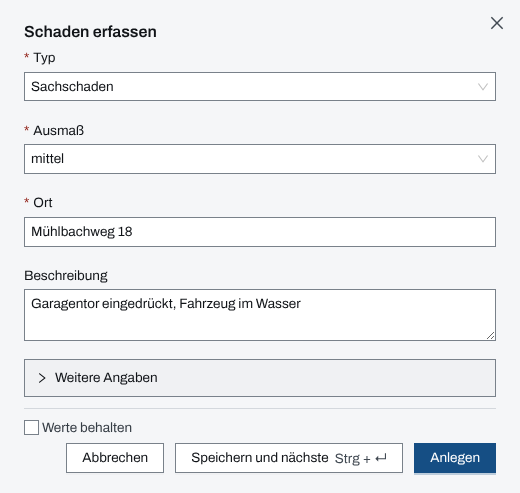
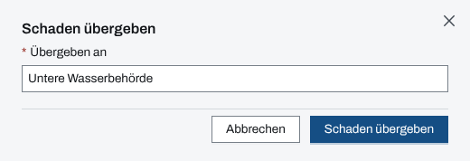

## Überblick

Das Modul „Schäden“ sammelt, was im Einsatz beschädigt oder im Weg ist und nicht gleich behoben
wird: Sachschäden, Verkehrshindernisse, Schäden an der Infrastruktur, Umweltschäden, Tierkadaver
und Sonstiges. Jeder Schaden bekommt eine Registriernummer (S-001, S-002 …), einen Typ, ein Ausmaß
und einen Ort, bei Bedarf eine Gefahr und einen Schadensgrad. Er ist „offen“, bis er an eine zuständige Stelle „übergeben“ oder
„abgeschlossen“ wird. Verortete Schäden erscheinen als Zeichen auf der Lagekarte.

## Abläufe

### Die Schäden ablesen

1. Im Modulpanel „Schäden“ öffnen. Der Kopf zählt alle und die offenen Schäden.

   

2. Die Leiste „Offen“, „Übergeben“, „Abgeschlossen“, „Alle“ wählt die Sicht. Die Filter „Typ“,
   „Ausmaß“, „Gefahr“ und „Verortet“ und die Suche nach S-Nr., Ort und Beschreibung engen die
   Liste ein.
3. Der Status nennt bei übergebenen Schäden, an wen sie gingen. „Gefahr“ nennt Gefahr und
   Schadensgrad, etwa „Elektrizität · total zerstört“. „Verortet“ zeigt, ob der Schaden auf der
   Karte steht.
4. Ein Klick auf eine Zeile öffnet die Seite des Schadens. Stehen mehr Schäden an, lädt „Ältere
   laden“ den nächsten Teil.

### Einen Schaden erfassen

1. „Schaden erfassen“ wählen. Es öffnet sich der gleichnamige Dialog.
2. „Typ“, „Ausmaß“ („gering“, „mittel“, „groß“, „katastrophal“) und „Ort“ angeben; die drei
   Felder sind Pflicht. Bei Bedarf die „Gefahr“ wählen, etwa „Elektrizität“ oder „Brand“. Neben
   jeder Gefahr steht das Zeichen, das der Schaden damit auf der Lagekarte bekommt.

   

3. Unter „Weitere Angaben“ bei Bedarf eine „Beschreibung“, den „Schadensgrad“ („angeschlagen“,
   „teilzerstört“, „total zerstört“), „Geschädigt“ (eine betroffene Person, eine Einsatzkraft,
   die eigene Organisation oder ein freier Kontakt) und die „Koordinate“ eintragen.
4. „Anlegen“ wählen. Der Schaden steht als „offen“ in der Liste.

Mehrere Schäden am selben Ort: „Speichern und nächste“ hält den Dialog offen, mit „Werte
behalten“ bleibt der Ort stehen.

### Einen Schaden übergeben

1. Die Seite eines offenen Schadens öffnen und „Schaden übergeben“ wählen.
2. Unter „Übergeben an“ die zuständige Stelle eintragen, etwa Stadtwerke, Bauhof oder Umweltamt.

   

3. „Schaden übergeben“ wählen. Der Schaden steht auf „übergeben“.

Übergeben lässt sich nur ein offener Schaden.

### Einen Schaden abschließen

1. Die Seite des Schadens öffnen. Bei einem übergebenen Schaden „Schaden abschließen“ wählen, bei
   einem offenen im Menü „Weitere Aktionen“ „Ohne Übergabe abschließen“.
2. Den „Abschlussgrund“ wählen: „behoben“, „kein Handlungsbedarf“ oder „abgewiesen“; bei Bedarf
   eine „Notiz (optional)“.
3. „Schaden abschließen“ wählen.

„abgeschlossen“ ist endgültig.

### Einen Schaden stornieren

1. Die Seite des Schadens öffnen und im Menü „Weitere Aktionen“ „Stornieren“ wählen.
2. Die Rückfrage mit „Schaden stornieren“ bestätigen. Die Seite kehrt zur Liste zurück.

### Einen Schaden auf der Karte verorten

1. Die Seite des Schadens öffnen. Unter „Verortung“ steht „nicht verortet“.
2. „Auf Karte verorten“ wählen. Die Lagekarte öffnet sich und nimmt die Stelle des Schadens auf
   ([Lagekarte, Zeichnen und Messen](lagekarte.md)).
3. Nach dem Tipp auf die Karte meldet sie „S-… verortet“. „Zurück zu S-…“ führt auf die Seite
   des Schadens zurück.

Wer die Koordinate schon beim Erfassen kennt, trägt sie unter „Weitere Angaben“ ein.

## Hintergrund

### Status

Ein Schaden geht von „offen“ nach „übergeben“ oder direkt nach „abgeschlossen“, von „übergeben“
nach „abgeschlossen“. „Bearbeiten“ auf der Seite des Schadens ändert Typ, Ausmaß, Gefahr,
Schadensgrad, Ort, Beschreibung und Geschädigt, auch nach dem Abschluss. „Stornieren“ nimmt eine Fehlerfassung aus
der Liste, in jedem Status; ein stornierter Schaden trägt im Titel „storniert“ und lässt sich
nicht mehr ändern. Fotos und Dateien zum Schaden liegen auf seiner Seite.

### Gefahr und Schadensgrad

Die Gefahr nimmt dieselben Wörter wie die Gefahrengebiete ([Gefahren](gefahren.md)). Auf der
Lagekarte trägt das Gefahrenzeichen des Schadens weiter die Farbe seines Ausmaßes; dazu kommen
der Gefahrenhinweis nach DV 102 und der Schadensgrad als Schraffur. Einen Gefahrenhinweis gibt
es für Atomare Strahlung, Chemische Stoffe, Explosion, Elektrizität und Ertrinken (als
Wassereinbruch); bei den übrigen Gefahren bleibt das Zeichen ohne Hinweis. Die Auswahl auf der
Karte nennt Gefahr und Schadensgrad in Worten.

Wer geschädigt ist, lässt sich auch von der Seite einer betroffenen Person aus zuordnen („Bezug
hinzufügen“ unter „Bezüge“, [Betroffene und Sichtung](betroffene.md)).

### Bearbeiten

„Speichern“ und „Abbrechen“ bleiben am unteren Rand stehen, auch wenn die Seite rollt. Ohne Ort
oder mit einer Beschreibung über 8.000 Zeichen speichert die Seite nicht; der Grund steht unter
dem Feld („Ort ist Pflicht“), und das Feld hat den Fokus. Wer die Seite mit ungespeicherten
Eingaben verlassen will, bekommt die Rückfrage „Ungespeicherte Änderungen“: „Bleiben“ behält die
Eingaben, „Verwerfen“ verlässt die Seite ohne sie.

### Einsatztagebuch

Das Einsatztagebuch vermerkt Anlegen (mit Typ, Ausmaß, Gefahr und Schadensgrad, ohne Ort),
Übergabe (ohne Empfänger), Abschluss (mit Grund) und Stornieren, jeweils mit der
Registriernummer.

### Druck und Export

„Drucken / als PDF“ druckt die Liste in der gewählten Sicht, „CSV exportieren“ gibt alle nicht
stornierten Schäden als Tabelle aus, ohne Angaben zu Geschädigten. Beide nennen Gefahr und
Schadensgrad in Worten.

### Rechte

Erfassen, übergeben, abschließen und ändern dürfen Einsatzleitung und Führungspersonal eines
laufenden Einsatzes ([Rechte im Einsatz](rechte-im-einsatz.md)).

### Ohne Netz

Die Liste der Schäden und ihre Zeichen auf der Lagekarte bleiben ohne Netz lesbar. Erfassen und
ändern gehen nur mit Netz ([Arbeiten ohne Netz](ohne-netz.md)).
