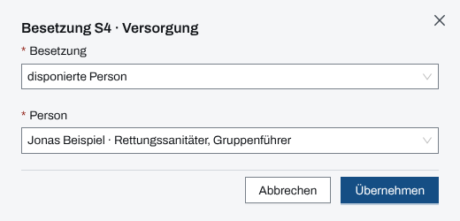
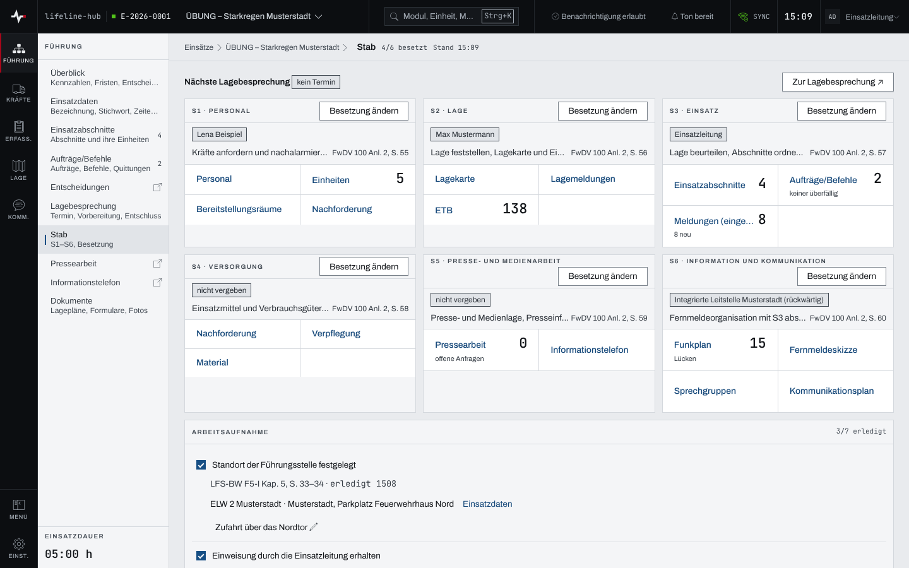
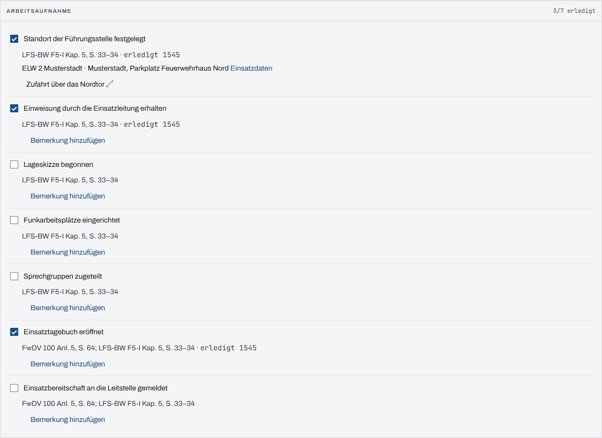

## Überblick

Die Seite „Stab“ unterstützt die Führungsgruppe oder den Stab der Einsatzleitung. Je Sachgebiet
S1 bis S6 steht eine Kachel: wer es führt, was dort offen ist, und die Werkzeuge, die mit einem
Klick in die Arbeit führen. Der Seitenkopf zählt mit, wie viele Sachgebiete besetzt sind. Oben
steht die nächste Lagebesprechung mit dem Verweis „Zur Lagebesprechung“; vorbereitet,
abgeschlossen und nachgelesen wird sie im eigenen Kapitel [Lagebesprechung](lagebesprechung.md).
Die Checkliste „Arbeitsaufnahme“ begleitet den Aufbau der Führungsstelle. Lesen können alle Mitglieder des
Einsatzes, bedienen Einsatzleitung und Führungspersonal.

## Abläufe

### Ein Sachgebiet besetzen

1. „Stab“ öffnen. In der Kachel des Sachgebiets „Besetzung ändern“ wählen.
2. Unter „Besetzung“ wählen, wer das Sachgebiet führt: „nicht vergeben“, „bei der
   Einsatzleitung“, „disponierte Person“, „extern (nicht disponiert)“ oder „rückwärtig
   (Leitstelle/FEZ)“.
3. Bei „disponierte Person“ unter „Person“ die Person wählen; fehlt sie, öffnet „Ad-hoc-Person
   anlegen …“ einen Dialog, der sie anlegt. Bei „extern“ und „rückwärtig“ die „Bezeichnung“ eintragen.

   

4. „Übernehmen“ wählen.

### Den Stand eines Sachgebiets ablesen

1. „Stab“ öffnen. Jede Kachel nennt unter ihrer Überschrift die Besetzung.
2. Unter den Aufgaben stehen die Werkzeuge des Sachgebiets. Steht eine Zahl daneben, ist es
   dieselbe wie im Modulmenü, etwa die offenen Aufträge bei S3 mit „1 überfällig“ darunter.

   

3. Ein Werkzeug wählen, um in die Arbeit zu springen.

### Die Arbeitsaufnahme abhaken

1. Auf der Seite „Stab“ zum Paneel „Arbeitsaufnahme“ unter den Kacheln gehen. Sind schon alle
   Punkte erledigt, steht es eingeklappt mit „7/7 erledigt“; „Aufklappen“ zeigt die Punkte.
2. Einen erledigten Punkt anhaken. Die Zeile zeigt danach „erledigt“ mit Uhrzeit; ein zweiter
   Klick nimmt den Haken zurück.

   

3. Für eine Ergänzung „Bemerkung hinzufügen“ wählen, den Text eingeben und speichern.

## Hintergrund

### Wer was darf

Besetzung und Checkliste bedienen Einsatzleitung und Führungspersonal, solange der Einsatz läuft.
Wer das nicht darf, sieht den Grund unter dem Seitenkopf. Einzelheiten stehen in
[Rechte im Einsatz](rechte-im-einsatz.md).

Ist das Modul Stab für den Einsatz nicht freigegeben, sind auch seine Unterseiten (Pressearbeit,
Informationstelefon) gesperrt: „… nicht verfügbar“, „Modul Stab nicht freigegeben“. Die
Lagebesprechung und das Fernmeldewesen (Funkplan, Fernmeldeskizze, Kommunikationsplan) haben ihre
eigene Freigabe und bleiben nutzbar, wenn der Stab ausgeblendet ist; ist eines davon gesperrt,
steht der Verweis dorthin gesperrt da, etwa „Funkplan (Keine Berechtigung)“.

### Die Kacheln

Jede Kachel nennt das Sachgebiet mit der Bezeichnung der Organisation, seine Aufgaben mit der
Fundstelle in der FwDV 100 und seine Werkzeuge. Ist die Aufgabenzeile zu lang, wird sie gekürzt;
die Fundstelle bleibt immer stehen.

| Sachgebiet | Aufgaben (gekürzt nach FwDV 100, Anlage 2) | Werkzeuge |
| --- | --- | --- |
| S1 Personal | Kräfte anfordern und nachalarmieren, Kräfteübersicht führen, Bereitstellungsräume einrichten | Personal, Einheiten, Bereitstellungsräume, Nachforderungen |
| S2 Lage | Lage feststellen, Lagekarte und Einsatztagebuch führen, Lagebesprechungen vorbereiten | Lagekarte, Lagemeldungen, Einsatztagebuch |
| S3 Einsatz | Lage beurteilen, Abschnitte ordnen, Lagebesprechungen durchführen, Befehle erteilen | Einsatzabschnitte, Aufträge, Meldungen |
| S4 Versorgung | Einsatzmittel und Verbrauchsgüter anfordern, Verpflegung und Materialerhaltung | Nachforderungen, Verpflegung, Material |
| S5 Presse- und Medienarbeit | Presse- und Medienlage, Presseinformationen, Informationstelefone | Pressearbeit, Informationstelefon |
| S6 Information und Kommunikation | Fernmeldeorganisation mit S3 absprechen, Kanäle aufteilen, Funkplan führen | Funkplan, Fernmeldeskizze, Sprechgruppen, Kommunikationsplan |

Die S6-Werkzeuge springen in das Modul Fernmeldewesen (siehe [Fernmeldewesen](funkplan.md)).
Ist das Modul eines Werkzeugs ausgeblendet, fehlt das Werkzeug; ist es gesperrt, steht es mit
„(Keine Berechtigung)“ da und springt nicht.

**Zahlen an den Werkzeugen:** Eine Zahl steht nur, wo die App sie schon an anderer Stelle führt:
bei Modulen mit Zähler im Modulmenü dieselbe Zahl (offene Aufträge, offene Meldungen, Einträge im
Einsatztagebuch, Einheiten, Einsatzabschnitte), bei „Pressearbeit“ die offenen Presseanfragen,
beim „Funkplan“ die Zahl seiner Lücken. Überfällige Aufträge färben die Zahl als Achtung und stehen
als „… überfällig“ darunter. Nachforderungen, Lagemeldungen, Verpflegung und Material zeigen keine
Zahl. Ist die Quelle einer Zahl nicht freigegeben, steht „—“ mit dem Grund; kann sie nicht geladen
werden, auch ohne Netz, steht „?“ mit „nicht geladen“. Eine fehlende Zahl ist nie „0“.

Eine Besetzung wird überschrieben; die App führt keine Historie, der Verlauf steht im
Einsatztagebuch.

### Ohne Umweg über die Stab-Seite

Pressearbeit und Informationstelefon stehen auch in der Modulliste direkt unter „Stab“, in dieser
Reihenfolge, und in der Sprungpalette unter „Ansichten“: „Bürgertelefon“ findet das
Informationstelefon. Fernmeldeskizze und Kommunikationsplan stehen unter „Fernmeldewesen“ in der
Kategorie „Kommunikation“; „Funk“ findet das Fernmeldewesen. „Anruf erfassen“
in der Palette öffnet das Informationstelefon mit dem Cursor in der Erfassung. Ist der Stab
gesperrt, stehen die Einträge in der Modulliste mit Schloss und fehlen in der Palette; ist er
ausgeblendet, fehlen sie überall.

### Was ins Einsatztagebuch geht

- **Besetzung:** jeder wirksame Wechsel, etwa „S2 Lage: Besetzung → … (vorher: …)“. Dieselbe Wahl
  ein zweites Mal schreibt nichts.
- **Arbeitsaufnahme:** nur der Punkt „Einsatzbereitschaft an die Leitstelle gemeldet“, beim Haken
  wie bei der Rücknahme. Die anderen Punkte und ihre Bemerkungen schreiben nichts.

### Checkliste

- Die sieben Punkte der „Arbeitsaufnahme“ sind fest. Kein Punkt wird aus anderen Modulen
  abgeleitet; abgehakt wird von Hand.
- Sind beim Öffnen der Seite alle Punkte erledigt, steht das Paneel eingeklappt. Wer den letzten
  Haken setzt, behält es offen; nimmt jemand einen Haken zurück, klappt es wieder auf.
- Der Punkt „Standort der Führungsstelle festgelegt“ zeigt Bezeichnung und Standort der eigenen
  Führungsstelle aus den Einsatzdaten und verweist dorthin. Der Haken bleibt trotzdem offen,
  bis jemand ihn setzt.

### Fälliger Termin

Erreicht die Uhr den Termin der nächsten Lagebesprechung, zeigt die Zeile oben „jetzt fällig“,
danach „seit … min überfällig“, als Hinweis, nicht als Alarm.

### Ohne Netz

Besetzung und Checkliste werden ohne Netz nicht vorgehalten (siehe
[Arbeiten ohne Netz](ohne-netz.md)).

## Grundlagen und Quellen

- FwDV 100, Anlage 2: Sachgebiete S1 bis S6 und ihre Aufgaben.
- FwDV 100, Anlage 5, S. 64, und LFS-BW F5-I, Kapitel 5, S. 33–34: Punkte der Arbeitsaufnahme.
- EEMUA 191: Ein fälliger Termin ist kein Alarm (Alarmbudget).
