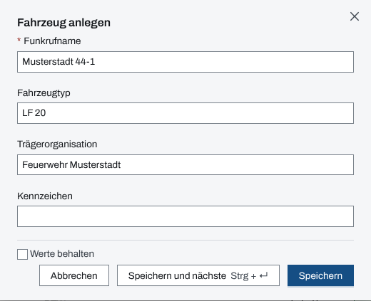
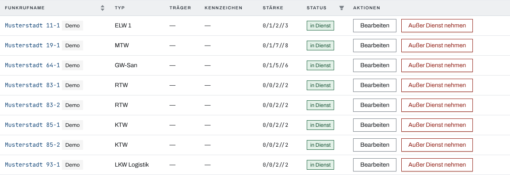
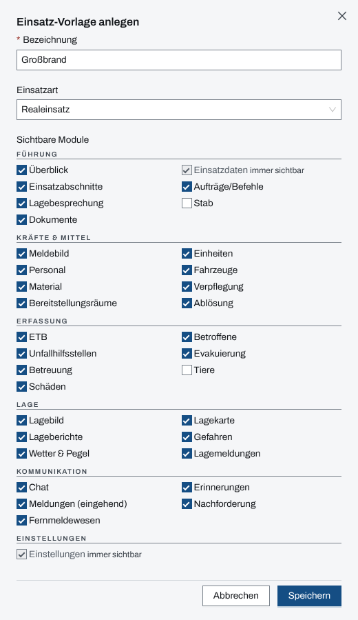
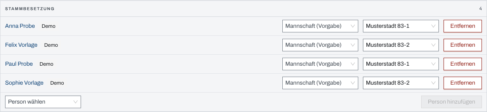
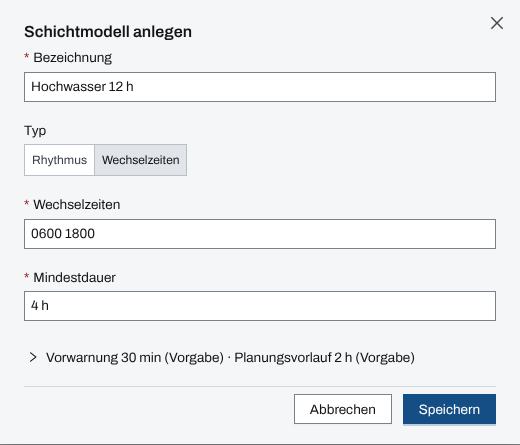
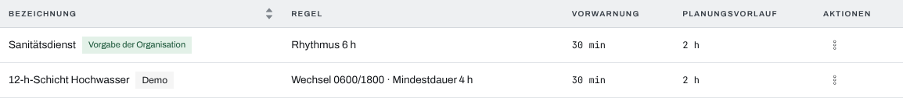
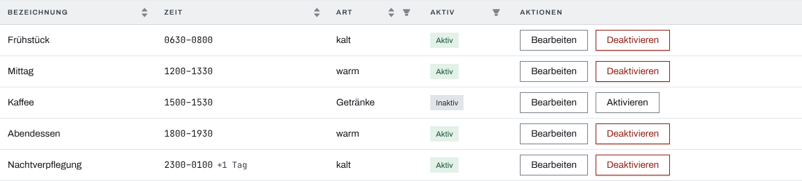
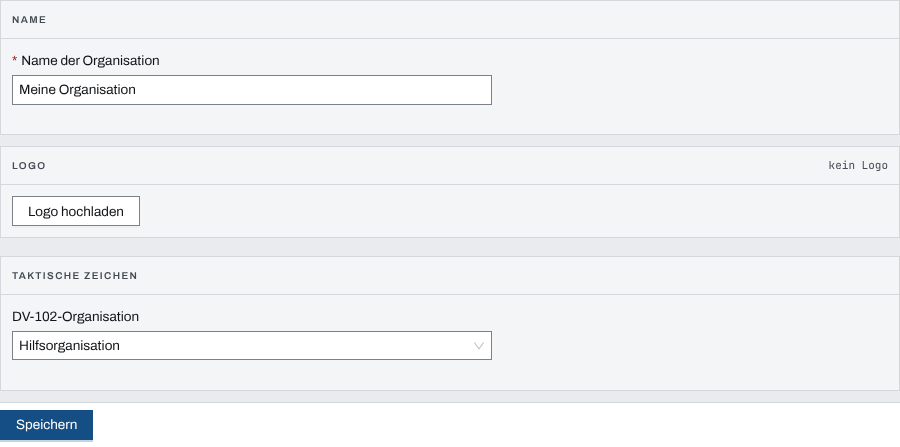

## Überblick

Stammdaten sind das, was eine Organisation über jeden Einsatz hinweg vorhält: Fahrzeuge,
Material und Personal, dazu die Kataloge, aus denen Einsätze schöpfen (Einsatz-Stichworte,
externe Stellen, Qualifikationen, Status, ETB-Schnellbausteine, Einheitstypen, Sprechgruppen,
Führungsfunktionen, Schichtmodelle), sowie Name, Logo und Zeichen der Organisation.
Einsatz-Vorlagen legen fest, welche Module ein neuer Einsatz zeigt. Einheiten-Vorlagen
beschreiben stehende Einheiten wie einen Sanitätszug mit seinen Untereinheiten, Fahrzeugen und
seiner Stammbesetzung. Der Verpflegungsplan nennt die Mahlzeiten eines Einsatztags. Im Einsatz
werden aus den Stammdaten Kräfte disponiert und Einträge vorbelegt.

Gepflegt werden die Stammdaten in der Verwaltung unter „Stammdaten“, und zwar nur von
System-Admins. Führungskräfte der Organisation sehen sie zum Nachschlagen.

## Abläufe

### Ein Fahrzeug anlegen

1. Oben „Verwaltung“ öffnen und unter „Stammdaten“ „Fahrzeuge“ wählen.
2. „Fahrzeug anlegen“ wählen.
3. „Funkrufname“ eintragen, dazu nach Bedarf „Fahrzeugtyp“, „Trägerorganisation“ und
   „Kennzeichen“.

   

4. „Speichern“ wählen, oder „Speichern und nächste“ (Strg+Enter), um gleich das nächste
   Fahrzeug zu erfassen. Ist „Werte behalten“ angehakt, bleibt dabei die Trägerorganisation
   stehen.

Personal („Person anlegen“) und Material („Material anlegen“) werden auf dieselbe Weise
angelegt. Material trägt dazu die „Art“: „Gerät“ (Vorgabe) oder „Verbrauchsgut“. Mit „Speichern
und nächste“ und „Werte behalten“ bleibt auch die Art für das nächste Material stehen. Die
Materialliste lässt sich nach „Art“ filtern.

### Eine Liste sortieren und filtern

1. Unter „Stammdaten“ eine Liste öffnen, etwa „Fahrzeuge“.
2. Auf den Kopf einer Spalte klicken, um nach ihr zu sortieren. Ein zweiter Klick kehrt die
   Richtung um, ein dritter stellt die gewohnte Reihenfolge wieder her.
3. Im Kopf einer Spalte das Trichterzeichen wählen, Werte ankreuzen und mit „OK“ übernehmen.
   Hinter jedem Wert steht, wie viele Zeilen er träfe.
4. Über der Tabelle stehen dann die gewählten Werte. Ein Klick auf einen Wert nimmt ihn heraus,
   „Filter zurücksetzen“ nimmt alle Filter und die Suche zurück, die Sortierung bleibt.

Gefiltert werden etwa die Fahrzeuge nach Typ, Träger und Status, das Personal nach
Qualifikation, Stärke-Position und Träger, das Material nach Kategorie, Art und Träger, die
Sprechgruppen nach Betriebsart, Netz und Sicherheit und die Stichworte nach ihrer Vorlage.
Sortierung, Filter und Suche stehen in der Adresse der Seite: Neuladen und ein geteilter Link
zeigen dieselbe Liste, und wer die Seite in derselben Sitzung wieder öffnet, findet sie so vor.
Die Einheiten-Vorlagen stehen als Baum unter ihrer übergeordneten Vorlage und lassen sich nicht
sortieren.

### Ein Fahrzeug außer Dienst nehmen

1. Unter „Stammdaten“ „Fahrzeuge“ öffnen.
2. In der Zeile des Fahrzeugs „Außer Dienst nehmen“ wählen.

   

3. Ist das Fahrzeug wieder einsatzbereit, an derselben Stelle „Wieder in Dienst nehmen“ wählen.

Auf schmalen Bildschirmen liegen „Bearbeiten“ und der Dienstwechsel in einem Aktionsmenü je
Zeile. Für Personal und Material gilt dasselbe.

### Einen Katalog pflegen

Am Beispiel der Qualifikationen; Fahrzeug-Status, Personal-Status und Einheitstypen arbeiten
gleich:

1. Unter „Stammdaten“ „Qualifikationen“ öffnen.
2. Unter „Neue Qualifikation“ die Bezeichnung eintippen und „Qualifikation anlegen“ wählen.
3. Zum Ändern in der Zeile „Bearbeiten“ wählen.
4. Zum Entfernen „Deaktivieren“ wählen und die Rückfrage „Qualifikation deaktivieren?“ mit
   „Qualifikation deaktivieren“ bestätigen.

### Externe Stellen pflegen

Externe Stellen sind Leitstellen, Behörden, Polizei und Hilfsorganisationen, mit denen Einsätze
zu tun haben. Sie erscheinen als Vorschlag bei der meldenden Stelle eines Einsatzes, beim
Adressaten einer Nachforderung und beim Hinzufügen einer Stelle zum
[Kommunikationsplan](funkplan.md).

1. Unter „Stammdaten“ „Externe Stellen“ öffnen.
2. „Externe Stelle anlegen“ wählen.
3. „Bezeichnung“ eintragen und die „Art“ wählen: Leitstelle, Polizei, Behörde,
   Hilfsorganisation oder Sonstige.
4. Bei der eigenen Leitstelle „Zuständige Leitstelle“ anhaken.
5. Nach Bedarf „Rufnummer und Funkrufname“ aufklappen und beides eintragen.
6. „Speichern“ wählen.

Zum Entfernen in der Zeile „Deaktivieren“ wählen und mit „Stelle deaktivieren“ bestätigen. Eine
deaktivierte Stelle lässt sich mit „Aktivieren“ zurückholen.

### Eine Einsatz-Vorlage anlegen

Eine Einsatz-Vorlage ist ein Satz sichtbarer Module, etwa für einen MANV oder einen
Sanitätsdienst. Wer einen Einsatz anlegt, wählt sie im Dialog „Neuen Einsatz anlegen“ (Kapitel
[Einsatz auswählen und Oberfläche](einsatz-oberflaeche.md)).

1. Unter „Stammdaten“ „Einsatz-Vorlagen“ öffnen. Je Vorlage stehen Bezeichnung, Einsatzart und
   wie viele Module sie zeigt, etwa „27 von 34 Modulen“.
2. „Einsatz-Vorlage anlegen“ wählen.
3. „Bezeichnung“ eintragen und nach Bedarf die „Einsatzart“ wählen.
4. Unter „Sichtbare Module“ die Häkchen der Module entfernen, die der Einsatz nicht zeigen soll.
   Die Module stehen nach den Kategorien der Navigation.

   

5. „Speichern“ wählen.

Zum Ändern in der Zeile „Bearbeiten“ wählen. „Löschen“ fragt mit „… löschen?“ nach und wird mit
„Vorlage löschen“ bestätigt.

### Ein Stichwort mit einer Einsatz-Vorlage koppeln

1. Unter „Stammdaten“ „Einsatz-Stichworte“ öffnen.
2. In der Zeile des Stichworts unter „Vorlage“ die Einsatz-Vorlage wählen. Die Wahl gilt sofort.
3. Um die Kopplung zu lösen, „keine“ wählen.

### Eine Einheiten-Vorlage anlegen

1. Unter „Stammdaten“ „Einheiten-Vorlagen“ öffnen.
2. „Vorlage anlegen“ wählen.
3. „Name“ eintragen und den „Typ“ wählen. Für eine Untereinheit unter „Unter“ die Vorlage
   wählen, zu der sie gehört.
4. „Anlegen“ wählen. Die Seite der neuen Vorlage öffnet sich.
5. Unter „Fahrzeuge“ ein Fahrzeug wählen und „Fahrzeug hinzufügen“ wählen.
6. Unter „Stammbesetzung“ eine Person wählen und „Person hinzufügen“ wählen. In ihrer Zeile
   lassen sich Position und Fahrzeug wählen.

   

7. Unter „Material“ ein Material wählen und „Material hinzufügen“ wählen. In seiner Zeile lassen
   sich die Menge und der Ort wählen: leer heißt „an der Einheit“, sonst eines der Fahrzeuge der
   Vorlage. Die Menge gilt nach Enter oder beim Verlassen des Felds.
8. Nach Bedarf im Kopf „Funkrufname“, „Fachaufgabe“ und „Organisation“ des taktischen Zeichens,
   die „Soll-Stärke“ und eine „Bemerkung“ eintragen und „Speichern“ wählen.

Fahrzeuge, Stammbesetzung und Material gelten sofort; „Speichern“ betrifft nur die Felder des
Kopfes.
Eine weitere Untereinheit entsteht auf der Seite der Vorlage mit „Untereinheit anlegen“.

### Ein Schichtmodell anlegen

Ein Schichtmodell legt fest, wann eine Einheit abgelöst werden soll (Kapitel
[Ablösung](abloesung.md)).

1. Unter „Stammdaten“ „Schichtmodelle“ öffnen.
2. „Schichtmodell anlegen“ wählen.
3. „Bezeichnung“ eintragen und unter „Typ“ „Rhythmus“ oder „Wechselzeiten“ wählen.
4. Beim Rhythmus die Dauer eintragen, etwa „12 h“ oder „7:30“. Bei Wechselzeiten die Uhrzeiten
   eintragen, etwa „0600 1800“, und die „Mindestdauer“, etwa „4 h“.

   

5. Nach Bedarf „Vorwarnung … · Planungsvorlauf …“ aufklappen und beide Werte eintragen; leer
   gelten 30 Minuten und 2 Stunden.
6. „Speichern“ wählen.

Zum Ändern oder Löschen in der Zeile das Menü „Aktionen zu …“ öffnen und „Bearbeiten“ bzw.
„Löschen“ wählen; Löschen fragt mit „… löschen?“ nach und wird mit „Schichtmodell löschen“
bestätigt.

### Die Vorgabe der Organisation festlegen

1. Unter „Stammdaten“ „Schichtmodelle“ öffnen.
2. In der Zeile des Modells das Menü „Aktionen zu …“ öffnen und „Als Vorgabe setzen“ wählen.

   

3. Um keine Vorgabe mehr zu führen, beim bisherigen Modell „Vorgabe aufheben“ wählen.

### Den Verpflegungsplan pflegen

1. Unter „Stammdaten“ „Verpflegungsplan“ öffnen. Je Mahlzeit stehen Bezeichnung, Zeit, Art und
   ob sie aktiv ist.
2. „Mahlzeit anlegen“ wählen.
3. „Bezeichnung“ eintragen, etwa „Frühstück“, und unter „Beginn“ und „Ende“ die Uhrzeit, etwa
   „0630“ und „0800“. Endet die Mahlzeit nach Mitternacht, steht unter dem Ende „Ende am
   Folgetag“.

   

4. Nach Bedarf unter „Art“ „warm“, „kalt“ oder „Getränke“ wählen.
5. „Anlegen“ wählen. Zum Ändern in der Zeile „Bearbeiten“ wählen.
6. Eine Mahlzeit, die nicht mehr gebraucht wird, mit „Deaktivieren“ stilllegen; „Aktivieren“
   holt sie zurück.

### Name, Logo und Zeichen der Organisation festlegen

1. Unter „Stammdaten“ „Organisation“ öffnen.
2. Unter „Name der Organisation“ den Namen eintragen.
3. Unter „Logo“ „Logo hochladen“ wählen und eine PNG- oder JPEG-Datei wählen; das Logo gilt
   sofort.
4. Unter „Taktische Zeichen“ die „DV-102-Organisation“ wählen.

   

5. „Speichern“ wählen.

„Logo entfernen“ fragt mit „Logo entfernen?“ nach, weil die Datei danach gelöscht ist.

### Führungsfunktionen umbenennen

1. Unter „Stammdaten“ „Führungsfunktionen“ öffnen.
2. Auf die Bezeichnung einer Funktion klicken, den eigenen Namen eintragen und mit Enter oder
   „Speichern“ übernehmen.
3. Für die Psychosoziale Notfallversorgung den Schalter „S7 PSNV eingeschaltet“ umlegen.

Eine leer gespeicherte Bezeichnung stellt das Standardlabel wieder her. Eine geänderte
Bezeichnung zeigt das Standardlabel als „(Vorgabe: …)“ dahinter.

## Hintergrund

### Wer was darf

Nur System-Admins legen an, ändern und deaktivieren. Führungskräfte der Organisation sehen jede
Stammdaten-Seite mit dem Hinweis „Nur Ansicht · nur System-Admin“. Andere Personen erreichen die
Verwaltung nicht.

### Außer Dienst und deaktiviert

- **Außer Dienst nehmen** fragt nicht nach, weil es umkehrbar ist. Ein Fahrzeug außer Dienst
  lässt sich in keinem Einsatz neu disponieren. Wo es schon disponiert ist, bleibt es stehen und
  zeigt den Stand von damals; nach „Wieder in Dienst nehmen“ wieder die aktuellen Stammdaten.
- **Deaktivieren** nimmt einen Katalogeintrag aus der Auswahl. Bestehende Zuordnungen bleiben
  gültig.

### Gerät und Verbrauchsgut

Die Art eines Materials entscheidet, wie es im Einsatz steht: ein Gerät je Stück mit Menge 1 und
allen fünf Status, ein Verbrauchsgut mit Menge, Ausgabe und den Status einsatzbereit, im Einsatz
und defekt (Kapitel [Material](material.md)). Sie geht beim Disponieren auf den Posten über; eine
spätere Änderung am Stamm gilt nur für neue Dispositionen.

### Externe Stellen

- Eine Stelle lässt sich nicht löschen, nur deaktivieren. Eine deaktivierte Stelle erscheint
  nicht mehr als Vorschlag. Einsätze, die sie als meldende Stelle tragen, behalten den Text.
- Einsätze, Nachforderungen und der Kommunikationsplan speichern nur den Text der Stelle. Eine
  spätere Umbenennung im Katalog ändert ältere Einsätze nicht.
- Je Organisation ist höchstens eine Stelle die „Zuständige Leitstelle“, und nur eine aktive
  Stelle der Art Leitstelle. Wer eine andere Leitstelle als zuständig markiert, nimmt der
  bisherigen die Markierung ab; Deaktivieren nimmt sie ebenfalls. Die zuständige Leitstelle steht
  in den Vorschlägen vorn und ist die Vorgabe für den Adressaten einer
  [Nachforderung](nachforderung.md).

### Einsatz-Vorlagen

- Jede Organisation bringt sechs Vorlagen mit: „Kleinlage“ (14 sichtbare Module),
  „Sanitätsdienst“ (22), „MANV“ (27), „Personensuche“ (25), „Evakuierung und Betreuung“ (30) und
  „Unwetter“ (28). „Sanitätsdienst“ belegt die Einsatzart „Sanitätsdienst“ vor, die übrigen
  „Realeinsatz“. „Stab“ zeigt keine von ihnen. Die Liste lässt sich ändern und löschen.
- Eine Vorlage merkt sich die Module ohne Häkchen. Ein Modul, das mit einer neuen Version
  hinzukommt, ist deshalb in jeder Vorlage sichtbar. „Einsatzdaten“ und „Einstellungen“ sind
  „immer sichtbar“ und lassen sich nicht abwählen.
- Beim Anlegen blendet die Vorlage ihre abgewählten Module in diesem Einsatz aus, als eigene
  Werte des Einsatzes; im Reiter „Module“ der Einstellungen lassen sie sich wieder einschalten
  (Kapitel [Einstellungen des Einsatzes und Module](einsatz-einstellungen.md)). Eine Vorlage
  blendet nur aus, nie ein: was die Organisation für alle Einsätze ausblendet, bleibt ausgeblendet.
- Ein Einsatz merkt sich seine Vorlage nicht. Eine spätere Änderung der Vorlage wirkt nur auf neue
  Einsätze.
- Ein Stichwort zeigt auf höchstens eine Vorlage. Wird im Dialog „Neuen Einsatz anlegen“ ein
  gekoppeltes Stichwort gewählt, stellt sich seine Vorlage ein, solange niemand die Vorlage von
  Hand gewählt hat. Mitgeliefert wird keine Kopplung. Wird eine Vorlage gelöscht, verlieren ihre
  Stichworte die Kopplung; die Stichworte bleiben.
- Jede Bezeichnung gibt es in der Organisation nur einmal, höchstens 100 Zeichen lang.

### Einheiten-Vorlagen

- Eine Vorlage hat einen Namen, einen Einheitstyp und nach Bedarf eine übergeordnete Vorlage.
  Untereinheiten lassen sich beliebig tief schachteln; eine Vorlage lässt sich nicht unter sich
  selbst oder unter eine ihrer eigenen Untereinheiten stellen.
- Ein Fahrzeug und eine Person stehen im ganzen Baum einer obersten Vorlage höchstens einmal:
  in der obersten Vorlage und allen Untereinheiten darunter zusammen, also auch nicht in zwei
  Untereinheiten nebeneinander. In einem anderen Baum dürfen sie zusätzlich stehen; die Seite der
  Vorlage nennt das am Eintrag als „auch in …“.
- Neu zuordnen lässt sich nur, was in Dienst ist. Wird ein Fahrzeug oder eine Person später
  außer Dienst genommen, bleibt der Eintrag in der Vorlage und trägt „außer Dienst“.
- Wird ein Fahrzeug aus der Vorlage entfernt, verlieren die Personen darauf ihre Fahrzeugbindung,
  und sein Material liegt danach an der Einheit.
- Material kommt aus den Stammdaten, je Zeile mit Menge und Ort. Dasselbe Material darf mehrfach
  stehen, etwa ein Rucksack auf jedem RTW. Ein Gerät steht mit höchstens 10 Stück in einer Zeile;
  ein Gerät mit Bestandsnummer ist ein bestimmtes Stück, steht mit Menge 1 und im ganzen Baum nur
  einmal. Neu hinzufügen lässt sich nur Material in Dienst; später außer Dienst genommenes bleibt
  und trägt „außer Dienst“. Höchstens 50 Zeilen je Vorlage.
- Ohne eigene Soll-Stärke gilt die des Einheitstyps. Sie steht als „Vorgabe des Einheitstyps“
  unter dem Feld und in der Liste mit „(Vorgabe)“. Ohne Position einer Person gilt die Position
  aus ihren Stammdaten.
- Eine Vorlage lässt sich nicht löschen. Mit dem Schalter „Aktiv“ wird sie stillgelegt und
  wieder aktiviert. Eine stillgelegte Vorlage steht nicht mehr als Unterstellung zur Wahl (außer
  über „Untereinheit anlegen“ auf ihrer eigenen Seite), und ihr Name ist für eine neue Vorlage
  frei; unter den aktiven Vorlagen ist jeder Name nur einmal erlaubt.
- Im Einsatz bildet die Führung aus einer aktiven Vorlage eine Einheit samt Untereinheiten,
  Fahrzeugen und Besatzung (Kapitel [Einheiten](einheiten.md)). Eine stillgelegte Vorlage steht
  dort nicht zur Wahl.

### Schichtmodelle

- Ein Modell hat entweder einen festen Rhythmus oder feste Wechselzeiten mit Mindestdauer: fällig
  ist dann der erste Wechsel, zu dem die Einheit mindestens die Mindestdauer im Einsatz ist. Dazu
  kommen die Vorwarnung, wie lange vor der Fälligkeit der Hinweis „Ablösung steht an“ erscheint,
  und der Planungsvorlauf, wie lange vorher der Hinweis „Keine ablösende Einheit geplant“
  erscheint, solange keine geplant ist (Kapitel [Ablösung](abloesung.md)); beide höchstens einen
  Tag und mit dem Modell in den Einsatz übernommen.
- Dauern stehen als „8 h“, „7:30 h“ oder „45 min“. Wechselzeiten stehen in der Zeitdarstellung,
  taktisch wie „0600/1800“, bei „Datum und Uhrzeit“ wie „06:00/18:00“; im Feld „Wechselzeiten“
  stehen sie immer taktisch.
- Höchstens ein Modell ist die „Vorgabe der Organisation“. Wer ein anderes als Vorgabe setzt,
  nimmt dem bisherigen die Markierung ab. Jeder neue Einsatz bekommt eine Kopie der Vorgabe; die
  Einsatzanlage nennt sie als „Schichtmodell: … (Vorgabe)“. Ohne Vorgabe bekommt ein Einsatz
  keins.
- Ändern und Löschen eines Modells berühren keinen Einsatz, der schon eine Kopie trägt. Im
  Einsatz wird die Vorgabe in den Einstellungen geändert (Kapitel
  [Einstellungen des Einsatzes und Module](einsatz-einstellungen.md)).
- Jede Bezeichnung gibt es nur einmal, ohne Unterschied von Groß- und Kleinschreibung. Das
  Modell der Demo-Daten wird nie die Vorgabe der Organisation.

### Verpflegungsplan

- Uhrzeiten lassen sich als „0630“, „06:30“, „630“ oder „6:30“ eintragen; die Tabelle zeigt sie
  als „0630–0800“, bei „Datum und Uhrzeit“ als „06:30–08:00“. Ein Ende vor dem Beginn heißt: die Mahlzeit endet am nächsten Tag, die Tabelle
  zeigt dann „+1 Tag“. Ende und Beginn dürfen nicht gleich sein.
- Unter den aktiven Mahlzeiten ist jede Bezeichnung nur einmal erlaubt, ohne Unterschied von
  Groß- und Kleinschreibung. Eine Mahlzeit lässt sich nicht löschen, nur deaktivieren; das fragt
  nicht nach, weil es umkehrbar ist. Wer eine deaktivierte Mahlzeit aktiviert, deren Name inzwischen
  eine aktive trägt, bekommt den Grund über der Tabelle.
- Der Plan trägt keinen Bedarf und keine Daten. Im Einsatz legt die Verpflegung aus den aktiven
  Mahlzeiten die Zeitfenster eines Tages an (Kapitel [Verpflegung](verpflegung.md)); eine spätere
  Änderung am Plan ändert keine schon angelegten Zeitfenster.

### Demo-Stammdaten

Stammdaten, die mit den Demo-Daten kamen, tragen die Marke „Demo“. Das Kapitel
[Demo-Daten](demo-daten.md) beschreibt, was beim Entfernen mit ihnen geschieht.

### Logo und Zeichen

- Das Logo erscheint im Kopf jedes Ausdrucks. Es darf höchstens 1 MiB groß sein; der Server
  prüft es vor dem Speichern auf Schadsoftware.
- Die „DV-102-Organisation“ ist die Vorgabe für taktische Zeichen auf der Lagekarte, an denen
  keine eigene Organisation steht.

### Führungsfunktionen

Der Katalog ist fest: Einsatzleitung, die Sachgebiete S1 bis S6, auf Wunsch S7,
Führungshilfspersonal und Fachberater. Neue Funktionen lassen sich nicht anlegen, nur die
Bezeichnungen der vorhandenen an die eigene Organisation anpassen. Die Bezeichnungen erscheinen
überall, wo der Einsatz Führungsfunktionen nennt.

## Grundlagen und Quellen

- **FwDV 100**, Anlage 1 und 2: Katalog der Führungsfunktionen und Sachgebiete S1 bis S6.
- **DV 102**: taktische Zeichen; die „DV-102-Organisation“ wählt die Organisation des Zeichens.
