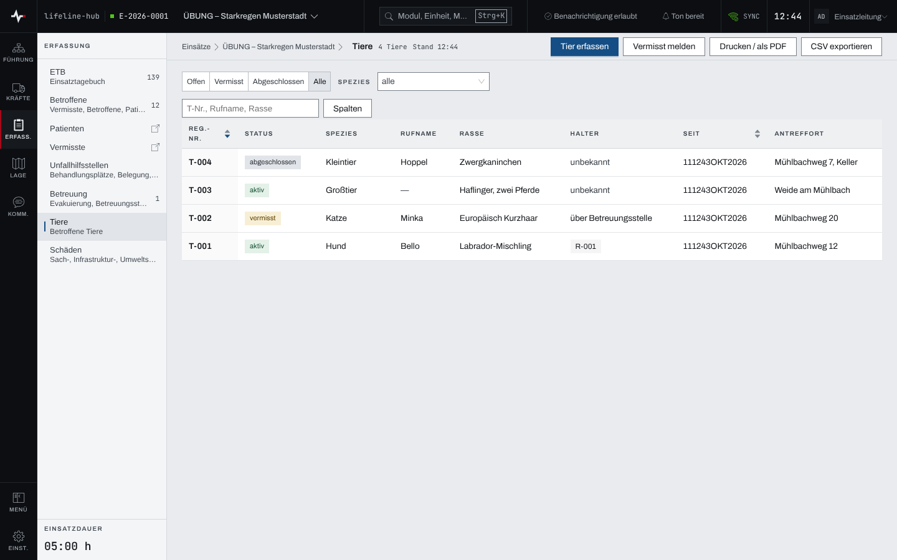
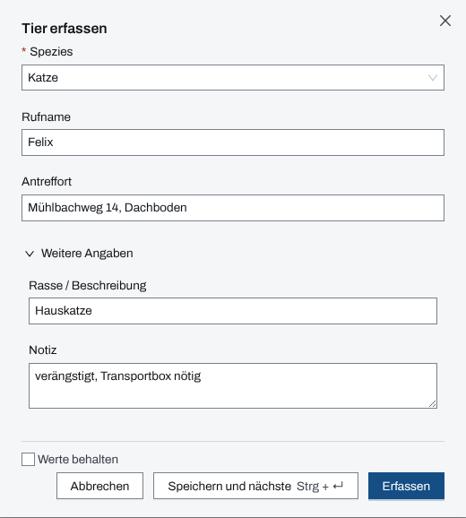
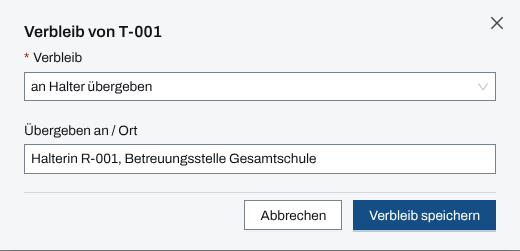

## Überblick

Das Modul „Tiere“ führt die Tiere, die im Einsatz angetroffen, versorgt oder vermisst werden: vom
Hund aus einer geräumten Wohnung bis zu Pferden auf einer überfluteten Weide. Jedes Tier bekommt
eine Registriernummer (T-001, T-002 …), eine Spezies und einen Status: „aktiv“ (in Obhut des
Einsatzes), „vermisst“ oder „abgeschlossen“. Ein Tier lässt sich einer betroffenen Person als
Halter zuordnen.

## Abläufe

### Die Tiere im Einsatz ablesen

1. Im Modulpanel „Tiere“ öffnen. Die Liste zeigt je Tier Registriernummer, Status, Verbleib,
   Spezies, Rufname, Rasse, Halter, seit wann es geführt wird und den Fundort.

   

2. Die Leiste „Offen“, „Vermisst“, „Abgeschlossen“, „Alle“ wählt die Sicht; „Offen“ zeigt die
   aktiven Tiere. Die Suche findet T-Nr., Rufname und Rasse.
3. Im Kopf der Spalten „Spezies“ und „Status“ filtern: das Trichterzeichen öffnet die Werte zum
   Ankreuzen, etwa „Katze“, „OK“ übernimmt sie; unter „Alle“ grenzt der Status auf mehrere Werte
   zugleich ein, etwa „Aktiv“ und „Vermisst“. Ein Klick auf einen Spaltenkopf sortiert nach dieser
   Spalte, ein zweiter kehrt die Folge um. Ist die Liste eingeschränkt, steht darüber „Gefiltert“
   mit der Zahl der Treffer und je Wert ein Knopf, etwa „Spezies: Katze“, der genau diesen Filter
   entfernt; „Filter zurücksetzen“ leert Suche und Filter. Auf dem Handy steht „Spezies“ als
   Auswahlfeld über der Liste, daneben „Sortieren“.
4. Ein Klick auf eine Zeile öffnet die Seite des Tiers.

Sortierung, Filter und Suche stehen in der Adresse der Seite: Zurück aus der Seite eines Tiers,
Neuladen und ein weitergegebener Link zeigen dieselbe Liste. Beim Wechsel der Sicht bleiben
Sortierung und Filter stehen, die Suche fällt weg. Ein neu erfasstes Tier, das ein Filter auf
Spezies oder Status verbergen würde, nimmt diesen Filter zurück.

### Ein Tier erfassen

1. „Tier erfassen“ wählen.
2. Die „Spezies“ wählen („Hund“, „Katze“, „Großtier“, „Nutzgeflügel“, „Kleintier“, „Wildtier“,
   „Sonstige“), dazu „Rufname“ und „Fundort“, soweit bekannt. Den Fundort mit Enter oder „Ort
   suchen“ suchen und einen Treffer wählen, dann ist das Tier gleich verortet.
3. Unter „Weitere Angaben“ bei Bedarf „Rasse / Beschreibung“ und „Notiz“ ergänzen.

   

4. „Erfassen“ wählen. Das Tier steht als „aktiv“ in der Liste.

An einer Sammelstelle kommen Tiere oft nacheinander: „Speichern und nächste“ hält den Dialog
offen, mit „Werte behalten“ bleiben Spezies und Fundort stehen.

### Ein vermisstes Tier melden und als aufgefunden markieren

1. „Vermisst melden“ wählen. Der Dialog fragt dasselbe ab wie „Tier erfassen“; unter „Weitere
   Angaben“ kommen „Farbe / Erscheinung“, „Kennzeichnung“ (Chip, Tätowierung, Halsband) und
   „Halter-Kontakt“ dazu.
2. „Erfassen“ wählen. Das Tier steht unter „Vermisst“.
3. Wird es gefunden, die Seite des Tiers öffnen und „Aufgefunden“ wählen. Das Tier steht wieder
   als „aktiv“ in der Liste.

Ein aktives Tier, das entlaufen ist, setzt „Als vermisst melden“ im Menü „Weitere Aktionen“ auf
„vermisst“.

### Einen Halter zuordnen

1. Die Seite des Tiers öffnen und „Bearbeiten“ wählen.
2. Im Feld „Halter“ eine betroffene Person (R-Nr.) wählen, oder einen Namen schreiben und „Als
   externen Kontakt: „…““ wählen.
3. „Speichern“ wählen.

Umgekehrt ordnet „Bezug hinzufügen“ unter „Bezüge“ auf der Seite einer betroffenen Person ein
Tier zu, das noch keinen Halter hat ([Betroffene und Sichtung](betroffene.md)). Die Liste der
Tiere zeigt den Halter dann mit seiner Registriernummer.

### Ein Tier auf der Lagekarte verorten

1. Die Seite des Tiers öffnen. Das Feld „Verortung“ zeigt die Koordinate des Fundorts oder
   „nicht verortet“.
2. „Auf Karte verorten“ wählen, bei einem schon verorteten Tier „Auf Karte versetzen“. Die
   Lagekarte öffnet sich zum Platzieren dieses Tiers.
3. Auf die Stelle der Karte tippen, an der das Tier gefunden wurde. Die Karte meldet etwa „T-003
   (Hund) verortet“.
4. „Zurück zu T-003 (Hund)“ wählen: Die Seite des Tiers zeigt die neue Koordinate.

Ein Tier ohne Koordinate lässt sich auch auf der Lagekarte in der Leiste unter „Objekte“ platzieren
(Kapitel [Lagekarte, Zeichnen und Messen](lagekarte.md)). Unter „Bearbeiten“ nimmt das Feld
„Fundort“ einen Treffer der Ortssuche, eine getippte Koordinate oder einen Punkt über „Auf Karte
wählen“; ein geleerter Fundort löscht auch die Koordinate.

### Den Verbleib eines Tiers erfassen

Verlässt ein Tier die Obhut der Einsatzkräfte, wird sein Verbleib erfasst. Es gilt danach als
„abgeschlossen“.

1. Die Seite des Tiers öffnen und „Verbleib erfassen“ wählen.
2. Den „Verbleib“ wählen: „an Halter übergeben“, „an Tierarzt übergeben“, „an Tierheim
   übergeben“, „verstorben“, „freigelassen“ oder „Sonstiges“. Unter „Übergeben an / Ort“
   eintragen, wohin das Tier gegangen ist; bei „an Halter übergeben“ steht ein bekannter Halter
   schon darin.

   

3. „Verbleib speichern“ wählen. Die Seite des Tiers zeigt den Verbleib unter „Verbleib“, die
   Liste in der Spalte „Verbleib“.

Ein abgeschlossenes Tier lässt sich zurückholen: „Wieder aufnehmen“ oder im Menü „Weitere
Aktionen“ „Als vermisst melden“.

## Hintergrund

### Angaben am Tier

„Bearbeiten“ auf der Seite des Tiers zeigt alle Angaben, auch die, die der Erfassungsdialog nicht
abfragt: „Geschlecht“, „Alter in Jahren (geschätzt)“, „Größe / Gewicht“. „Speichern“ und
„Abbrechen“ bleiben am unteren Rand stehen, auch wenn die Seite rollt. Eine Angabe, die nicht
passt, meldet sich unter ihrem Feld, etwa ein Alter über 120 Jahre („Höchstens 120 Jahre“);
gespeichert wird erst, wenn sie stimmt. Wer die Seite mit ungespeicherten Eingaben verlassen
will, bekommt die Rückfrage „Ungespeicherte Änderungen“: „Bleiben“ behält die Eingaben,
„Verwerfen“ verlässt die Seite ohne sie. Fotos und Dateien zum Tier liegen auf seiner Seite.
„Stornieren“ im Menü „Weitere Aktionen“ nimmt eine Fehlerfassung aus der Liste.

### Tiere auf der Lagekarte

Die Lagekarte zeigt offene und vermisste Tiere mit Koordinate in der Ebene „Tiere“, als Kreis mit
„T“ und beschriftet mit Registriernummer und Spezies, etwa „T-003 (Hund)“. Ein vermisstes Tier
trägt zusätzlich „vermisst“. Den Rufnamen zeigt die Karte erst, wenn das Tier ausgewählt ist.
Ein abgeschlossenes oder storniertes Tier verschwindet von der Karte; verorten lässt sich nur ein
offenes oder vermisstes Tier. Der Fundort als Text bleibt neben der Koordinate stehen. Das
Verorten schreibt keinen Eintrag ins Einsatztagebuch.

Für ein Tier ohne Zustand kennen die taktischen Zeichen nach DV 102 kein eigenes Zeichen, deshalb
steht das Tier als Kreis auf der Karte.

### Einsatztagebuch

Das Einsatztagebuch führt Tiere nur mit Registriernummer und Spezies, ohne Rufname, Kennzeichnung,
Halter oder Ziel: „Tier T-… (Hund) erfasst“, „Tier T-… (Katze) als vermisst gemeldet“, „Tier T-…:
vermisst → aktiv (aufgefunden)“, der Verbleib als Handlung („Tier T-… (Hund): an Tierarzt
übergeben“), „Tier T-…: wieder aufgenommen (Verbleib zurückgenommen)“ und das Stornieren.

### Druck und Export

„Drucken / als PDF“ druckt die Liste in der gewählten Sicht und mit den Spezies aus dem Filter, „CSV exportieren“ gibt
alle nicht stornierten Tiere als Tabelle aus.

### Rechte

Erfassen und ändern dürfen Einsatzleitung und Führungspersonal eines laufenden Einsatzes
([Rechte im Einsatz](rechte-im-einsatz.md)). Lesen, drucken und exportieren dürfen alle, die das
Modul sehen.

### Ohne Netz

Die Tiere hält die App nicht für die Arbeit ohne Netz vor; erfassen, ändern und verorten gehen
nur mit Netz ([Arbeiten ohne Netz](ohne-netz.md)). Auch die Ebene „Tiere“ der Lagekarte bleibt
nach einem Neuladen ohne Netz leer, weil die Liste Halter und Kennzeichnung trägt.
