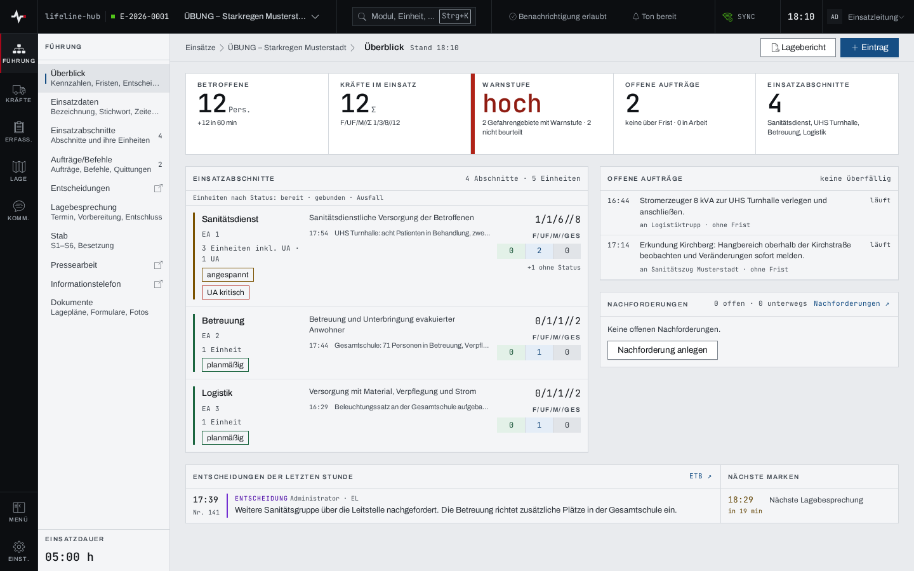

## Überblick

Der Überblick ist die Startseite eines Einsatzes im Bereich „Führung“. Er fasst auf einer Seite
zusammen, was die Führung zuerst wissen muss: die Lage in Zahlen, den Stand der
Einsatzabschnitte, die offenen Vorgänge, die Entscheidungen der letzten Stunde und die nächsten
Fristen. Er rechnet nur aus Daten, die in den Modulen schon erfasst sind; erfasst wird in den
Modulen selbst.

## Abläufe

### Die Lage auf einen Blick lesen

1. Im Bereich „Führung“ „Überblick“ öffnen.
2. Im Seitenkopf neben dem Datenstand lesen: Ab „Warnstufe mittel“ steht dort die höchste
   Warnstufe der Gefahrengebiete, daneben, wie viele Gebiete „nicht beurteilt“ sind, und der
   Stand eines festgelegten Pegels.
3. Im Kennzahlenband die sechs Zahlen lesen: „Betroffene“ mit dem Zuwachs der letzten 60 Minuten,
   „Kräfte im Einsatz“ in der Stärke F/UF/M//Σ, „Offene Aufträge“, „Meldungen offen“, die Zahl der
   „Einsatzabschnitte“ und die „Einsatzdauer“.
4. Im Paneel „Einsatzabschnitte“ je Abschnitt den Lagezustand („planmäßig“, „angespannt“,
   „kritisch“), den festen Auftrag, bei Aufträgen an den Abschnitt die Zahl der erledigten, die
   letzte Rückmeldung und die Einheiten nach Status („bereit“, „gebunden“, „Ausfall“ mit Zahl und
   Balken) lesen.

   

5. Daneben „Offene Vorgänge“ lesen: Meldungen, Aufträge, Nachforderungen, Erinnerungen und
   Ablösungen, je mit ihrer Zahl und den drei dringendsten. Darunter stehen „Nächste Marken“ und
   „Entscheidungen der letzten Stunde“. Was zuerst fällig ist, steht oben.
6. Im Paneel „Entscheidungen der letzten Stunde“ „ETB ↗“ wählen: Das Einsatztagebuch zeigt alle
   Entscheidungen. Jedes Paneel führt so über den Verweis oben rechts in sein Modul.

### Nur die eigenen Vorgänge sehen

1. Im Paneel „Offene Vorgänge“ oben rechts „meine Stelle“ wählen: Es bleiben die Vorgänge, die an
   eine eigene Funktion gehen oder selbst angelegt wurden. Die Zahl bleibt die des Einsatzes
   und heißt jetzt „im Einsatz“.
2. Einen Eintrag wählen: Das Modul öffnet sich und hebt den Vorgang hervor.
3. „alle“ wählen, um wieder alle Vorgänge zu sehen.

### Vom Überblick weiterarbeiten

1. „Eintrag“ im Seitenkopf wählen: Das Einsatztagebuch öffnet sich mit der Erfassung, bereit für
   einen neuen Eintrag.
2. Zurück im Überblick „Lagebericht“ wählen: Die Liste der Lageberichte öffnet sich (Kapitel
   [Lageberichte](lageberichte.md)).

## Hintergrund

### Was die Zahlen bedeuten

- **Kräfte im Einsatz** zählt nur das Personal, nicht Fahrzeuge oder Material.
- **Warnstufe** ist die höchste Stufe aller Gefahrengebiete; sie steht wie im Lagebild im
  Seitenkopf, nur ab „mittel“, und daneben, falls es welche gibt, wie viele Gebiete „nicht
  beurteilt“ sind (Kapitel [Gefahren](gefahren.md)). Ist ein Pegel festgelegt, steht dort auch sein
  Stand (Kapitel [Wetter und Pegel](wetter-pegel.md)).
- **Meldungen offen** nennt dieselbe Zahl wie das Modul „Meldungen“, darunter die neuen; ist eine
  Bestätigung überfällig, steht die Zahl in Rot.
- **Einsatzdauer** rechnet ab dem Beginn des Einsatzes, bei einem abgeschlossenen bis zum
  Abschluss.
- **Offene Aufträge** nennt dieselbe Zahl wie das Modul „Aufträge/Befehle“ und dazu, wie viele
  über ihrer Frist sind.
- **Entscheidungen der letzten Stunde:** Gab es in der letzten Stunde keine, heißt das Paneel
  „Letzte Entscheidungen“ und zeigt die jüngsten fünf mit dem Hinweis „keine in der letzten
  Stunde“. Eine berichtigte Entscheidung trägt wie im Einsatztagebuch die Marke „berichtigt“ und
  den Sprung „→ Nr. …“ auf die jüngste Berichtigung.
- Die Zahlen eines Abschnitts schließen seine Unterabschnitte ein; zusammen ergeben die Zeilen
  die Einsatzstärke. Kräfte ohne Abschnitt stehen in der Zeile „Ohne Abschnitt“ am Ende.

### Offene Vorgänge

Das Paneel hat fünf Abschnitte, immer in dieser Folge: Meldungen, Aufträge, Nachforderungen,
Erinnerungen und Ablösungen. Die Zahl jedes Abschnitts ist dieselbe wie im Modul:

- **Meldungen**: die offenen, daneben die neuen, wie viele auf eine Bestätigung warten (in Rot)
  und wie viele Lagemeldungen neu sind.
- **Aufträge**: die offenen, daneben die überfälligen (in Rot) und die in Arbeit.
- **Nachforderungen**: die offenen, daneben die überfälligen und die unterwegs. Überfällig ist eine
  zugesagte oder unterwegs gemeldete Nachforderung, deren erwartetes Eintreffen verstrichen ist
  (Kapitel [Nachforderungen](nachforderung.md)).
- **Erinnerungen**: die fälligen; aufgeführt sind die fälligen und die in den nächsten 30 Minuten.
- **Ablösungen**: die überfälligen und die bald fälligen Schichten.

Jeder Abschnitt zeigt höchstens drei Einträge, das Überfällige zuerst; ein überfälliger Eintrag
trägt dazu einen roten Rand links und das Wort „überfällig“. Ein Klick auf einen Eintrag öffnet
ihn im Modul, hervorgehoben. Alle weiteren erreicht „alle ↗“. Steht „keine“, gibt es nichts Offenes. Steht „ohne Netz nicht geladen“, war
die Liste ohne Verbindung noch nie geladen; das heißt nicht, dass nichts offen ist.

„meine Stelle“ zeigt die Vorgänge, die an eine eigene Funktion gehen (die besetzten Sachgebiete,
als Einsatzleitung ohne Sachgebiet „EL“) oder selbst angelegt wurden; bei Nachforderungen nur die
selbst angelegten. Ablösungen gehören zu keiner Stelle und bleiben vollständig stehen („alle Stellen“).

### Nächste Marken

Die Marken kommen aus sechs Quellen: Aufträge mit Frist, offene Erinnerungen, die nächste
Lagebesprechung, der erwartete Höchststand an einem maßgeblichen Pegel, fällige Ablösungen und der
Beginn angekündigter Unwetterwarnungen der Stufen schwer und extrem. Eine verstrichene Frist steht
als „überfällig“ ganz oben, eine Frist in weniger als 30 Minuten ist hervorgehoben. Pegelprognose
und Unwetterbeginn sind Erwartungen, keine Fristen: Verstrichen fallen sie heraus. Es stehen
höchstens sechs Marken da, der Rest als „+… weitere“. Ein Klick auf die Marke eines Auftrags oder
einer Erinnerung öffnet den Auftrag oder die Erinnerung hervorgehoben im Modul.

### Rechte und gesperrte Module

Den Überblick lesen alle, die den Einsatz sehen. „Eintrag“ ist nur mit Schreibrecht wählbar, also
für Einsatzleitung und Führungspersonal eines laufenden Einsatzes (Kapitel
[Rechte im Einsatz](rechte-im-einsatz.md)). Ist ein Modul für die Person nicht freigegeben, steht
seine Zahl als „—“ mit „nicht freigegeben“, nie als 0.
