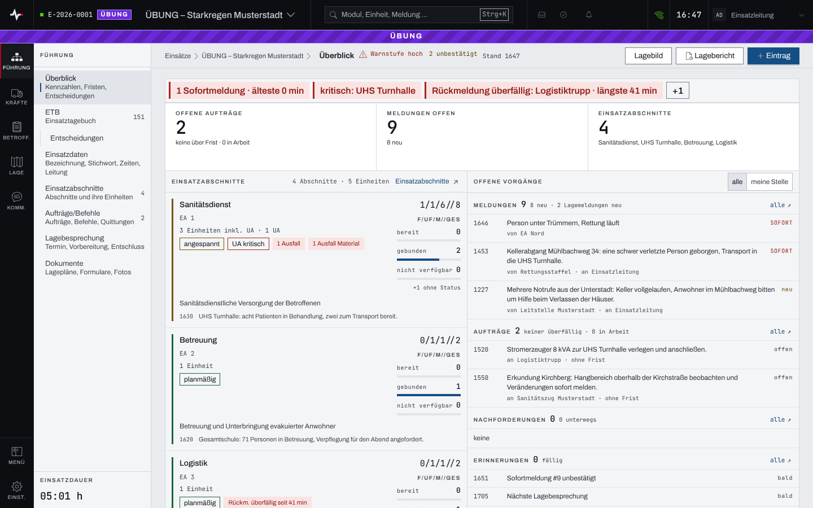
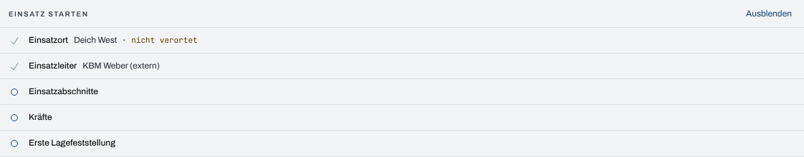

## Überblick

Der Überblick ist die Startseite eines Einsatzes im Bereich „Führung“. Er fasst auf einer Seite
zusammen, was zu tun ist: was gerade brennt, bei einem neuen Einsatz die Startliste „Einsatz
starten“, den Führungsstand, den Stand der Einsatzabschnitte, die offenen Vorgänge, die
Entscheidungen der letzten Stunde und die nächsten Fristen. Was los ist (Betroffene, Kräfte,
Gefahren, Einsatzdauer), zeigt das [Lagebild](lagebild.md). Der Überblick rechnet nur aus Daten, die in den Modulen schon erfasst
sind; erfasst wird in den Modulen selbst.

## Abläufe

### Die Lage auf einen Blick lesen

1. Im Bereich „Führung“ „Überblick“ öffnen.
2. Im Seitenkopf neben dem Datenstand lesen: Ab „Warnstufe mittel“ steht dort die höchste
   Warnstufe der Gefahrengebiete, daneben, wie viele Gebiete „unbestätigt“ sind, und der
   Stand eines festgelegten Pegels.
3. Ganz oben die Zeile „Was brennt“ lesen: Sie nennt in Rot offene Sofortmeldungen ab Eingang,
   überfällige Bestätigungen, Vermisste, kritische Abschnitte, überfällige Rückmeldungen, Ausfälle
   und überfällige Aufträge, danach in Gelb dringende Meldungen, fällige Erinnerungen und
   überfällige Nachforderungen. Ein Eintrag führt in sein Modul; passt nicht alles in die Zeile,
   zeigt „+n“ die ganze Liste. Ist nichts davon da, steht dort „Nichts brennt“.
4. Im Führungsstand die drei Zahlen lesen: „Offene Aufträge“, „Meldungen offen“ und die Zahl der
   „Einsatzabschnitte“.
5. Im Paneel „Einsatzabschnitte“ je Abschnitt den Lagezustand („planmäßig“, „angespannt“,
   „kritisch“), den festen Auftrag, bei Aufträgen an den Abschnitt die Zahl der erledigten, die
   letzte Rückmeldung und die Einheiten nach Status („bereit“, „gebunden“, „nicht verfügbar“ mit
   Zahl und Balken) lesen. Was im Abschnitt brennt, steht als rotes Etikett direkt neben dem
   Lagezustand, mit denselben Zahlen wie in der Kräfteübersicht: „Rückm. überfällig seit 47 min“ (bei
   mehreren Einheiten „3 Einh. Rückm. überfällig, längste seit 47 min“), „keine Rückm.“, „1
   Ausfall“ und „1 Ausfall Material“. Der Lagezustand bleibt dabei, wie die Führung ihn beurteilt
   hat; ein „planmäßig“ mit rotem Etikett daneben heißt: die Beurteilung ist zu prüfen.

   

6. Daneben „Offene Vorgänge“ lesen: Meldungen, Aufträge, Nachforderungen, Erinnerungen und
   Ablösungen, je mit ihrer Zahl und den drei dringendsten. Darunter stehen „Nächste Marken“ und
   „Entscheidungen der letzten Stunde“. Was zuerst fällig ist, steht oben.
7. Im Paneel „Entscheidungen der letzten Stunde“ „ETB ↗“ wählen: Das Einsatztagebuch zeigt alle
   Entscheidungen. Jedes Paneel führt so über den Verweis oben rechts in sein Modul.

### Einen neuen Einsatz arbeitsfähig machen

Für die Einsatzleitung und das Führungspersonal:

1. Den Überblick des neuen Einsatzes öffnen: Unter „Was brennt“ steht das Paneel „Einsatz
   starten“ mit fünf Punkten: „Einsatzort“, „Einsatzleiter“, „Einsatzabschnitte“, „Kräfte“ und
   „Erste Lagefeststellung“. Ein erledigter Punkt trägt einen Haken, beim Einsatzort und beim
   Einsatzleiter mit dem erfassten Wert; ein offener einen leeren Kreis.

   

2. Einen offenen Punkt wählen: Er führt dorthin, wo er erfasst wird. „Einsatzort“ und
   „Einsatzleiter“ öffnen die [Einsatzdaten](einsatzdaten.md) beim Paneel „Einsatzort“ bzw.
   „Eigene Führungsstelle“, „Einsatzabschnitte“ den Dialog „Abschnitt anlegen“, „Kräfte“ die
   Einheiten und „Erste Lagefeststellung“ die Erfassung im
   [Einsatztagebuch](einsatztagebuch.md).
3. Erfassen und zum Überblick zurückkehren: Der Punkt trägt jetzt einen Haken.
4. Sind alle Punkte erledigt, fehlt das Paneel. Wer es vorher nicht mehr braucht, wählt im
   Paneelkopf „Ausblenden“.

### Nur die eigenen Vorgänge sehen

1. Im Paneel „Offene Vorgänge“ oben rechts „meine Stelle“ wählen: Es bleiben die Vorgänge, die an
   eine eigene Funktion gehen oder selbst angelegt wurden. Die Zahl bleibt die des Einsatzes
   und heißt jetzt „im Einsatz“.
2. Einen Eintrag wählen: Das Modul öffnet sich und hebt den Vorgang hervor.
3. „alle“ wählen, um wieder alle Vorgänge zu sehen.

### Vom Überblick weiterarbeiten

1. „Eintrag“ im Seitenkopf wählen: Das Einsatztagebuch öffnet sich mit der Erfassung, bereit für
   einen neuen Eintrag.
2. Zurück im Überblick „Lagebericht“ wählen: Die Liste der Lageberichte öffnet sich (Kapitel
   [Lageberichte](lageberichte.md)).
3. „Lagebild“ im Seitenkopf wählen: Das Lagebild desselben Einsatzes öffnet sich.

## Hintergrund

### Was die Zahlen bedeuten

- **Was brennt** zeigt Zustände, solange sie bestehen; anders als die Meldungen der Alarmzone
  verschwindet ein Eintrag erst, wenn der Grund weg ist. Dieselbe Zeile steht im Lagebild und
  auf dem Lagemonitor. Die Zahlen sind dieselben wie in den Modulen: Sofortmeldungen,
  Bestätigungen, Aufträge, Erinnerungen und Nachforderungen aus deren Zählung, Rückmeldung und
  Ausfall wie in der Kräfteübersicht, Vermisste wie bei den Betroffenen. Eine Rückmeldung, die
  ohne neue Daten überfällig wird, steht spätestens nach einer halben Minute in der Zeile. Ein
  Abschnitt im Lagezustand „angespannt“ steht nicht darin. Ist eine Quelle nicht abrufbar,
  steht „Stand unvollständig“ mit ihrem Namen, nie „Nichts brennt“; ein gesperrtes Modul fehlt
  ohne Hinweis.
- **Warnstufe** ist die höchste Stufe aller Gefahrengebiete; sie steht wie im Lagebild im
  Seitenkopf, nur ab „mittel“, und daneben, falls es welche gibt, wie viele Gebiete
  „unbestätigt“ sind (Kapitel [Gefahren](gefahren.md)). Ist ein Pegel festgelegt, steht dort auch sein
  Stand (Kapitel [Wetter und Pegel](wetter-pegel.md)).
- **Meldungen offen** nennt dieselbe Zahl wie das Modul „Meldungen“, darunter die neuen; ist eine
  Bestätigung überfällig, steht die Zahl in Rot.
- **Offene Aufträge** nennt dieselbe Zahl wie das Modul „Aufträge/Befehle“ und dazu, wie viele
  über ihrer Frist sind.
- **Entscheidungen der letzten Stunde:** Gab es in der letzten Stunde keine, heißt das Paneel
  „Letzte Entscheidungen“ und zeigt die jüngsten fünf mit dem Hinweis „keine in der letzten
  Stunde“. Eine berichtigte Entscheidung trägt wie im Einsatztagebuch die Marke „berichtigt“ und
  den Sprung „→ Nr. …“ auf die jüngste Berichtigung.
- Die Zahlen eines Abschnitts schließen seine Unterabschnitte ein; zusammen ergeben die Zeilen
  die Einsatzstärke. Kräfte ohne Abschnitt stehen in der Zeile „Ohne Abschnitt“ am Ende.

### Startliste „Einsatz starten“

Ein Punkt gilt als erledigt:

- **Einsatzort**, sobald eine Adresse eingetragen ist. Fehlt die Koordinate, steht dahinter
  „nicht verortet“; der Einsatzort erscheint dann nicht auf der Lagekarte.
- **Einsatzleiter**, sobald an der eigenen Führungsstelle einer eingetragen ist.
- **Einsatzabschnitte**, sobald es einen Abschnitt gibt.
- **Kräfte**, sobald der Einsatz eine Einheit oder eine Einsatzkraft führt.
- **Erste Lagefeststellung**, sobald das Einsatztagebuch einen Eintrag vom Typ „Lage“ hat. Eine
  Entscheidung oder Meldung zählt nicht.

Die Liste zeigt Haken, keine Zahlen. Sie steht nur für die Einsatzleitung und das
Führungspersonal eines laufenden Einsatzes, bei jeder Einsatzart gleich, nicht für Leser und
nicht an einem Einsatz, den eine andere Instanz führt. Ist ein Modul für die Person nicht
freigegeben, steht sein Punkt als „—“ mit „nicht freigegeben“ und ohne Sprung; er gilt nicht als
offen. Kann eine Liste nicht geladen werden, steht der Punkt als „—“ mit „nicht geladen“, und das
Paneel bleibt stehen. Sind alle Punkte erledigt oder nicht freigegeben, fehlt das Paneel auf
jedem Bildschirm, auch ohne Neuladen.

„Ausblenden“ wirkt nur in diesem Browser und nur für diesen Einsatz; andere Geräte zeigen die
Liste weiter. Lässt der Browser nichts speichern, bleibt sie bis zum Neuladen weg. Nach dem
Abmelden steht sie wieder da, solange Punkte offen sind.

### Offene Vorgänge

Das Paneel hat fünf Abschnitte, immer in dieser Folge: Meldungen, Aufträge, Nachforderungen,
Erinnerungen und Ablösungen. Die Zahl jedes Abschnitts ist dieselbe wie im Modul:

- **Meldungen**: die offenen, daneben die neuen, wie viele auf eine Bestätigung warten (in Rot)
  und wie viele Lagemeldungen neu sind.
- **Aufträge**: die offenen, daneben die überfälligen (in Rot) und die in Arbeit.
- **Nachforderungen**: die offenen, daneben die überfälligen und die unterwegs. Überfällig ist eine
  zugesagte oder unterwegs gemeldete Nachforderung, deren erwartetes Eintreffen verstrichen ist
  (Kapitel [Nachforderungen](nachforderung.md)).
- **Erinnerungen**: die fälligen; aufgeführt sind die fälligen und die in den nächsten 30 Minuten.
- **Ablösungen**: die überfälligen und die bald fälligen Schichten.

Jeder Abschnitt zeigt höchstens drei Einträge, das Überfällige zuerst; ein überfälliger Eintrag
trägt dazu einen roten Rand links und das Wort „überfällig“. Bei den Meldungen folgen danach die
Sofortmeldungen mit dem roten Wort „SOFORT“ und die dringenden mit dem gelben Wort „DRINGEND“, je
die zuletzt eingegangene zuerst, und zwar ab Eingang, nicht erst, wenn die Bestätigung überfällig
ist. Eine fällige Erinnerung heißt „fällig“ in Gelb, hier und in den Nächsten Marken. Ein Klick auf einen Eintrag öffnet
ihn im Modul, hervorgehoben. Alle weiteren erreicht „alle ↗“. Steht „keine“, gibt es nichts Offenes. Steht „ohne Netz nicht geladen“, war
die Liste ohne Verbindung noch nie geladen; das heißt nicht, dass nichts offen ist.

„meine Stelle“ zeigt die Vorgänge, die an die eigene Funktion gehen oder selbst angelegt wurden;
bei Nachforderungen nur die selbst angelegten. Die eigene Funktion ist die Funktion der
Mitgliedschaft im Einsatz (gepflegt im Reiter „Zugriff“, Spalte „Führungsstelle“: EL, S1 bis S7,
Führungshilfspersonal oder Fachberater); ohne Funktion gilt „EL“, wenn die Person die Rolle Einsatzleitung trägt. Bei
Fachberater und Führungshilfspersonal muss auch die Bezeichnung passen: Der Fachberater THW sieht
den Auftrag an „Fachberater: THW“, nicht den an „Fachberater: Polizei“. Ablösungen gehören zu
keiner Stelle und bleiben vollständig stehen („alle Stellen“).

### Nächste Marken

Die Marken kommen aus sieben Quellen: Aufträge mit Frist, offene Erinnerungen, die nächste
Lagebesprechung, der erwartete Höchststand an einem maßgeblichen Pegel, fällige Ablösungen, der
Beginn angekündigter Unwetterwarnungen der Stufen schwer und extrem und die Programmpunkte der
Veranstaltung aus dem Paneel „Ablauf“ der [Einsatzdaten](einsatzdaten.md). Eine verstrichene Frist
steht als „überfällig“ in Rot ganz oben, eine Frist in weniger als 30 Minuten ist hervorgehoben.
Zwei Ausnahmen: Eine Erinnerung ist ein Wecker, keine Frist; verstrichen heißt sie „fällig“ in
Gelb, wie im Abschnitt „Erinnerungen“ der Offenen Vorgänge. Eine verstrichene Lagebesprechung
steht wie auf der Seite Lagebesprechung als „jetzt fällig“ bzw. „seit … überfällig“ in Gelb.
Pegelprognose, Unwetterbeginn und Programmpunkte sind keine Fristen: Verstrichen fallen sie
heraus. Pegelprognose und Unwetterbeginn sind unter 30 Minuten ebenso hervorgehoben, Programmpunkte
nie. Es stehen höchstens sechs Marken da, der Rest als „+… weitere“. Ein
Klick auf die Marke eines Auftrags oder einer Erinnerung öffnet den Auftrag oder die Erinnerung
hervorgehoben im Modul, ein Klick auf einen Programmpunkt die Einsatzdaten.

### Rechte und gesperrte Module

Den Überblick lesen alle, die den Einsatz sehen. „Eintrag“ ist nur mit Schreibrecht wählbar, also
für Einsatzleitung und Führungspersonal eines laufenden Einsatzes (Kapitel
[Rechte im Einsatz](rechte-im-einsatz.md)). Ist ein Modul für die Person nicht freigegeben, steht
seine Zahl als „—“ mit „nicht freigegeben“, nie als 0.
