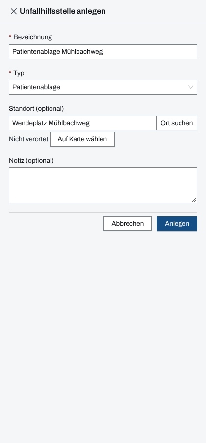
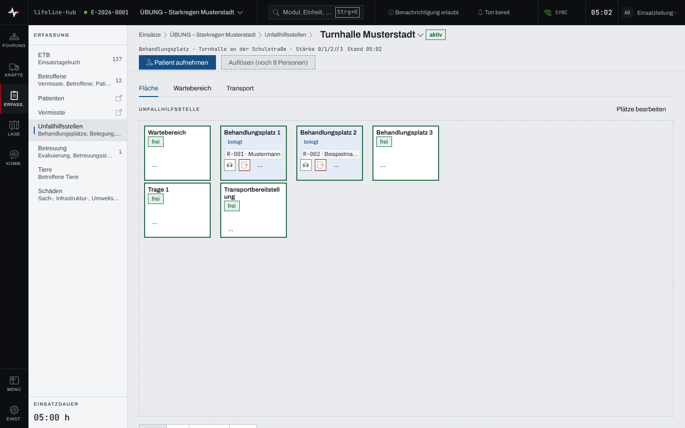
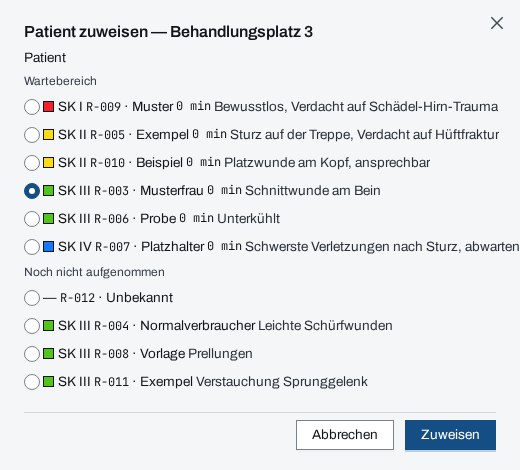

## Überblick

Eine Unfallhilfsstelle (UHS) ist ein Ort, an dem Patienten versorgt werden: Patientenablage,
Behandlungsplatz, Verletztensammelstelle oder Sonstige. Das Modul „Unfallhilfsstellen“ zeigt je
Stelle einen Grundriss mit ihren Plätzen, den Wartebereich am Eingang und wer die Stelle im
Eigentransport verlassen hat und noch nicht übergeben ist. Die Einsatzleitung sieht hier, welche Plätze frei und belegt sind und wer
noch wartet.

Die Patienten selbst sind Betroffene; ihre Sichtung und ihren Verbleib führt das Kapitel
[Betroffene und Sichtung](betroffene.md).

## Abläufe

### Eine Unfallhilfsstelle anlegen und in Betrieb nehmen

1. In der Liste der Unfallhilfsstellen „Neu“ wählen, oder im Titel einer Unfallhilfsstelle den
   Namen öffnen und „+ Neue UHS“ wählen.
2. „Bezeichnung“ und „Typ“ angeben, bei Bedarf „Standort (optional)“ und „Notiz (optional)“.

   

3. „Anlegen“ wählen. Die neue Stelle steht auf „geplant“.
4. Die Stelle öffnen und „Plätze anlegen“ wählen: den Platz-Typ (etwa „Behandlungsplatz“,
   „Trage“, „Bett“) und die „Menge“ angeben, dann „Anlegen“. Die Plätze werden durchnummeriert.
5. „In Betrieb nehmen“ wählen. Die Stelle steht auf „aktiv“ und nimmt Patienten auf.

Ein Lageplan als Hintergrund des Grundrisses lässt sich über „Plan“ hochladen oder aus den Dateien
der Stelle übernehmen (PNG, JPEG oder WebP). Im Betrieb stehen „Plan“ und „Plätze anlegen“ hinter
„Plätze bearbeiten“; dort lassen sich Plätze auch verschieben und löschen.

### Die Belegung ablesen

1. Im Modulpanel „Unfallhilfsstellen“ öffnen. Es öffnet sich die zuletzt besuchte oder eine
   aktive Stelle; andere wählt der Umschalter im Titel.

   

2. Die Fläche zeigt jeden Platz mit seiner Verfügbarkeit („frei“, „belegt“, „in Aufbereitung“,
   „defekt“, „gesperrt“) und dem Patienten darauf. Jede Patientenmarke trägt vorn die Sichtung
   als Farbfeld mit Kategorie, etwa „SK I“; „—“ heißt ungesichtet.
3. „Wartebereich“ zeigt, wer in der Stelle auf einen Platz wartet („Wartebereich (Eingang)“), und
   wer noch keiner Stelle zugeordnet ist („Noch nicht aufgenommen“). Jede Person steht in zwei
   Zeilen: oben Sichtung, Registriernummer und Name, darunter „wartet … min“ bzw. „erfasst vor …
   min“ und der Knopf „Verbleib“. Der Wartebereich steht nach Dringlichkeit: wer oben steht,
   kommt als Nächstes auf einen Platz. „Unterwegs“ zeigt, wer die Stelle im Eigentransport
   verlassen hat und noch nicht übergeben ist, mit Fahrzeug, Ziel, Transportpriorität und der
   Zeit seit der Abfahrt; ab einer Stunde trägt die Zeile „Übergabe offen“.
4. Die Leiste über dem Grundriss wechselt zwischen „Belegung“ (dem Grundriss), „Material“,
   „Kräfte“, „Bewegungen“ und „Dateien“. Jeder Bereich füllt dieselbe Fläche bis zum unteren
   Fensterrand; „Bewegungen“ listet jede Aufnahme, Verlegung und Entlassung mit Zeit und Platz.
   Der gewählte Bereich steht in der Adresse, ein Lesezeichen öffnet ihn direkt.

Auf einem breiten Bildschirm stehen Wartebereich, Fläche und „Unterwegs“ nebeneinander; dann
lassen sich Patienten auch mit der Maus auf einen Platz ziehen.

### Die Lage der Stelle melden

1. Die Stelle öffnen. Über der Leiste steht die Lage der Stelle in vier Zahlen, ohne Namen.
2. „In der Stelle“ ablesen: wer in der Stelle steht, auf einem Platz oder im Wartebereich,
   darunter je Sichtung als Farbbalken und in Worten, etwa „SK I 1 · SK II 3“.
3. „Plätze frei“ ablesen: freie von allen Plätzen, etwa „2 / 6“, dazu wie viele in Aufbereitung
   sind.
4. „Wartend“ und „Unterwegs“ ablesen: wer im Wartebereich auf einen Platz wartet, mit der
   längsten Wartezeit, und wer die Stelle im Eigentransport verlassen hat und noch nicht
   übergeben ist.

Die Zahlen laufen live mit und stimmen mit dem Grundriss überein; für die Lagemeldung an die
Einsatzleitung muss niemand abzählen. Am UHS-Laptop steht dieselbe Zeile im Bereich „UHS“
([UHS-Tablet und UHS-Laptop](geraet-uhs.md)).

### Material an der Stelle führen

Für Einsatzleitung und Führungspersonal, wenn das Modul Material freigegeben ist:

1. Die Stelle öffnen und in der Leiste „Material“ wählen, oder im Kopf der Stelle die Zahl der
   Posten antippen, etwa „3 Posten · 1 Ausfall“. Der Bereich zeigt jeden Posten mit Menge und
   Status, darüber dieselbe Zahl.
2. Unter „Material zuordnen …“ einen Posten wählen: unter „Ohne Ort“ die freien Posten, unter „An
   anderem Ort“ Posten, die schon an einem anderen Ort liegen, etwa bei einer Einheit, mit diesem
   Ort im Eintrag. Der Posten liegt danach an der Stelle.
3. Bei einem Verbrauchsgut mit Rest „Ausgeben“ wählen, die „Menge ausgeben“ eingeben und mit
   „Ausgeben“ bestätigen. Die Zeile nennt danach den Rest, etwa „30 von 50 übrig“.
4. Den Status eines Postens an seiner Statusanzeige wählen, etwa „defekt“. Die Zeile zeigt den
   neuen Status, die Zahl im Kopf zählt den Ausfall mit.
5. Mit „Material erfassen“ Material ohne Stammeintrag anlegen, etwa eine Spende: „Bezeichnung“
   und „Menge“ eintragen und „Disponieren“ wählen. Der Posten liegt danach an der Stelle.
6. Fehlt Material, „Fehlmenge melden“ wählen. Die Erfassung einer Nachforderung öffnet mit der
   Art „Material“ und der Stelle in der Begründung; Bezeichnung und Anzahl dort eintragen und die
   Nachforderung absetzen.
7. Mit „Lösen“ einen Posten von der Stelle lösen. Er bleibt ohne Ort im Einsatz.

### Einen Patienten aufnehmen und einem Platz zuweisen

1. „Patient aufnehmen“ wählen. Die Seite „Aufnahme“ hat dieselben Felder wie die Maske der
   Betroffenen.
2. Die Angaben eintragen und „Erfassen“ wählen. Der Patient steht danach im Wartebereich der
   Stelle; die Quittung nennt seine Registriernummer und „im Wartebereich“.
3. Auf der Fläche einen freien Platz anklicken oder in seinem Menü „Patient zuweisen“ wählen. Der
   Dialog „Patient zuweisen — …“ nennt den Platz.
4. Unter „Patient“ stehen die Kandidaten mit Sichtung, Wartezeit und Zustand, erst der
   Wartebereich, dann „Noch nicht aufgenommen“, je nach Dringlichkeit. Der erste ist vorgewählt;
   bei Bedarf einen anderen wählen.

   

5. „Zuweisen“ wählen. Der Platz steht auf „belegt“.

Zurück in den Wartebereich führt das Platzmenü („…“) mit „Zurück in den Wartebereich“.

### Einen Patienten entlassen oder auf Transport bringen

1. Am belegten Platz „Verbleib / Entlassung erfassen“ wählen (Symbol mit dem Fahrzeug).
2. Im Dialog „Verbleib erfassen — …“ die „Art“ prüfen; vorgewählt ist „Transport“. Beim
   Transport das „Rettungsmittel“ angeben: ein Fahrzeug unter „Im Einsatz“ für einen
   Eigentransport, sonst das fremde Rettungsmittel. Dazu das „Ziel“ eintragen.
3. „Erfassen“ wählen. Der Patient verlässt die Stelle; im Eigentransport steht er unter
   „Unterwegs“, bis dort „Übergabe quittieren“ gewählt ist. Mit einem fremden Rettungsmittel ist
   er übergeben und steht nirgends mehr im Grundriss.
4. Der Platz steht danach auf „in Aufbereitung“. Ist er wieder bereit, „als frei markieren“
   wählen.

„zurückweisen“ nimmt einen Patienten aus der Stelle, ohne einen Verbleib zu erfassen; er steht
dann wieder unter „Noch nicht aufgenommen“.

### Eine Unfallhilfsstelle auflösen

1. Alle Patienten der Stelle entlassen, verlegen oder zurückweisen. Solange noch jemand in der
   Stelle ist, steht der Knopf als „Auflösen (noch … Personen)“ gesperrt.
2. „Auflösen“ wählen und die Rückfrage „Unfallhilfsstelle auflösen?“ bestätigen.

Eine Stelle, die noch „geplant“ ist, wird stattdessen mit „Stornieren“ verworfen.

## Hintergrund

### Status und Plätze

Eine Unfallhilfsstelle ist „geplant“, „aktiv“ oder „aufgelöst“. Nur eine aktive Stelle nimmt
Patienten auf. Verlässt ein Patient einen Platz, setzt die App den Platz von selbst auf „in
Aufbereitung“. Die Verfügbarkeit eines Platzes lässt sich im Platzmenü auch von Hand setzen
(„als frei markieren“, „als defekt markieren“, „als in Aufbereitung markieren“, „als gesperrt
markieren“).

Ein Verbleib „Transport“, „Notunterkunft“ oder „Entlassung vor Ort“ beendet den Aufenthalt in der
Stelle, ebenso der Status „verstorben“ oder „abgemeldet“ einer Person und ihr Stornieren, auch
wenn das im Modul „Betroffene“ geschieht.

### Reihenfolge nach Dringlichkeit

Wartebereich, Dialog „Patient zuweisen“ und die Patientenliste am
[UHS-Tablet](geraet-uhs.md) ordnen nach derselben Reihe: ungesichtet zuerst (diese Patienten
müssen gesichtet werden), dann SK I, SK II, SK III, SK IV, tot und unverletzt. Innerhalb einer
Kategorie entscheidet die Transportpriorität („sofort“ vor „dringlich“ vor „normal“ vor ohne
Priorität), dann steht vorn, wer am längsten wartet. Die Priorität ordnet nie über die Sichtung
hinweg: SK II „sofort“ steht hinter SK I ohne Priorität. Die Wartezeit zählt ab der Aufnahme in die Stelle;
kommt ein Patient von einem Platz in den Wartebereich zurück, zählt sie ab dieser Rückkehr. Wer
noch nicht aufgenommen ist, steht im Dialog hinter dem Wartebereich, in sich nach derselben
Reihe.

Ändert sich eine Sichtung, während der Mauszeiger über dem Wartebereich steht oder der Fokus
darin liegt, bleibt die Reihenfolge stehen; neu Wartende stehen so lange unten an. Danach ordnet
der Wartebereich neu. Ebenso bleibt die Liste im Dialog „Patient zuweisen“ stehen, solange er
offen ist.

### Einsatztagebuch

Das Einsatztagebuch vermerkt die Inbetriebnahme („… in Betrieb genommen“) und die Auflösung einer
Stelle sowie jede Bewegung eines Patienten, nur mit Registriernummer: „Person R-…: Aufnahme in …
(Inbox)“, „Person R-…: Verlegung in …“, „Person R-…: verlässt …“. Kräfte, die einer Stelle
zugeordnet oder von ihr abgezogen werden, stehen ebenfalls dort.

### Kräfte und Material

Der Kopf der Stelle nennt ihre Stärke und, mit Freigabe des Moduls Material, die Zahl ihrer
Posten samt Ausfall; Ausfall fasst defekt, verbraucht, Desinfektion nötig und aufgebraucht
zusammen (Kapitel [Material](material.md)). Unter „Kräfte“ werden Kräfte und Einheiten mit „Kraft
zuordnen“ und „Einheit zuordnen“ an die Stelle gesetzt, „Kraft erfassen“ legt eine Kraft neu an.
Unter „Material“ holt „Material zuordnen …“ Material des Einsatzes an die Stelle: Posten ohne Ort
und Posten an einem anderen Ort, die ohne Rückfrage umgehängt werden; das Einsatztagebuch nennt den
alten und den neuen Ort. „Material erfassen“ legt Ad-hoc-Material in einem Schritt an der Stelle
an, im selben Dialog wie im Modul [Material](material.md), nur ohne das Feld „Ort“; Material aus
dem Materialstamm disponiert das Modul Material. Ein Statuswechsel an der Stelle ist derselbe wie
in der Materialliste und steht ebenso im Einsatztagebuch. Zugeordnet und erfasst wird an einer
geplanten oder aktiven Stelle; an einer aufgelösten stehen „Material zuordnen …“ und „Material
erfassen“ gesperrt mit „UHS aufgelöst“, Material, das schon dort liegt, lässt sich weiter lösen
und im Status ändern. Material an einer Unfallhilfsstelle steht nicht im
[Meldebild](meldebild.md). Zuordnen, Erfassen, Status, Lösen und Ausgeben verlangen Schreibrecht im
Einsatz und die Freigabe des Moduls Material; ohne die Freigabe stehen die Posten lesbar da, der
Status ist keine Bedienung, und „Material zuordnen …“ und „Material erfassen“ stehen gesperrt mit
„Modul Material gesperrt“. „Fehlmenge melden“ steht nur mit Schreibrecht und der Freigabe des
Moduls Nachforderungen da (Kapitel [Nachforderungen](nachforderung.md)). Ein UHS-Laptop zeigt das
Material seiner Stelle nur lesend.

### Rechte

Anlegen, Plätze einrichten, Patienten aufnehmen und bewegen dürfen Einsatzleitung und
Führungspersonal eines laufenden Einsatzes ([Rechte im Einsatz](rechte-im-einsatz.md)). Die
Bedienung an gekoppelten Tablets und Laptops einer Unfallhilfsstelle beschreibt
[UHS-Tablet und UHS-Laptop](geraet-uhs.md).

### Ohne Netz

Die Unfallhilfsstellen bleiben ohne Netz lesbar, und Patienten lassen sich über „Patient
aufnehmen“ erfassen; sie landen im Wartebereich, sobald die Verbindung zurück ist. Ein Verbleib
am Platz („Verbleib / Entlassung erfassen“) wird ohne Netz vorgemerkt („Offline vorgemerkt:
Verbleib R-…“); der Patient bleibt bis zum Senden auf seinem Platz, der Platz trägt dann
„Offline vorgemerkt“ statt „belegt“, eine Person im Wartebereich dasselbe neben ihrer Marke. Zuweisen, Verlegen und
Zurückweisen gehen nur mit Netz. Mehr in [Arbeiten ohne Netz](ohne-netz.md).
