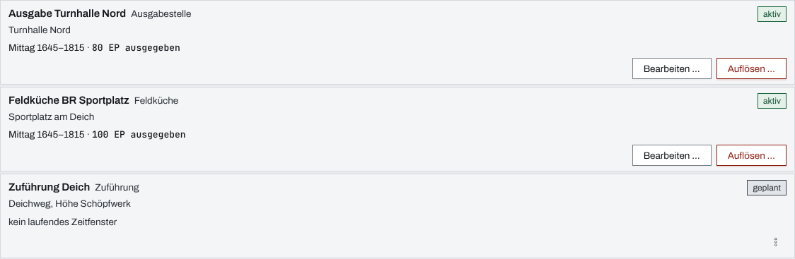
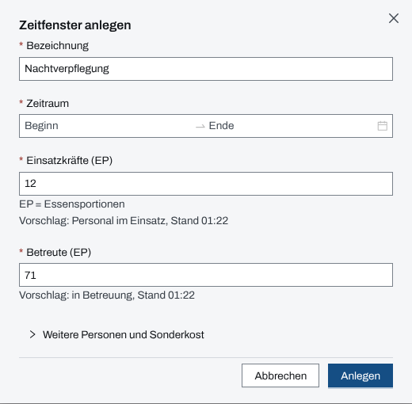
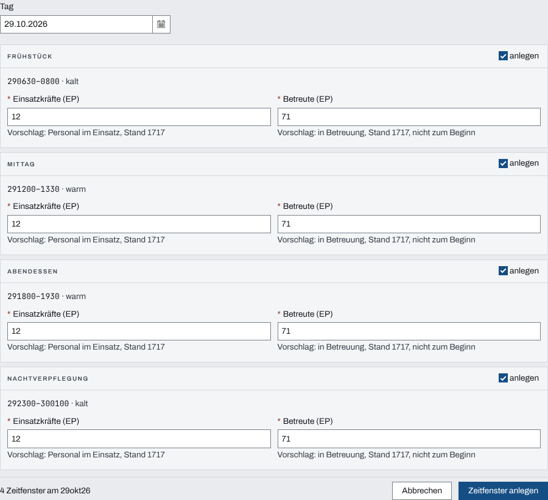
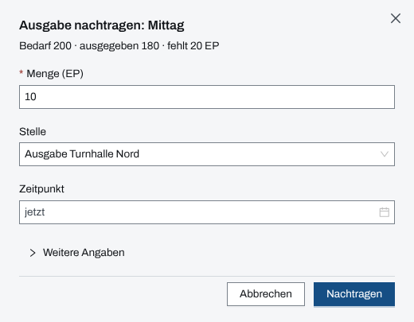

## Überblick

Das Modul **Verpflegung** plant die Essensportionen (EP) eines Einsatzes in **Zeitfenstern**. Je
Zeitfenster steht der Bedarf für Einsatzkräfte, Betreute und weitere Personen, davon die Sonderkost,
und dagegen stehen die Ausgaben. Die Seite zeigt je Zeitfenster, was ausgegeben ist und was fehlt,
und stuft es als „gedeckt“, „offen“ oder „Unterdeckung“ ein. Ausgegeben wird an
**Verpflegungsstellen**, etwa einer Feldküche oder einer Ausgabestelle; je Stelle zeigt die Seite,
was dort ausgegeben wurde. Eine Ausgabe kann an eine **Einheit** gehen, die ihr Essen abholt,
als **Zuführung** an einen Einsatzabschnitt oder an eine **Betreuungsstelle**, wenn dort Betroffene
versorgt werden; je Zeitfenster zeigt die Seite dann, welche Einheit noch nicht verpflegt ist.

Dieses Kapitel beschreibt die Sicht der Einsatzleitung. Einsatzleitung und Führungspersonal legen
Zeitfenster an, zählen an der Ausgabe die Portionen, tragen Ausgaben nach und fordern nach, wenn
etwas fehlt. Die Bedienung am gekoppelten
Gerät einer Verpflegungsstelle beschreibt
[Verpflegung am Gerät](geraet-verpflegung.md).

## Abläufe

### Die Zeitfenster im Blick behalten

1. Unter „Kräfte & Mittel“ „Verpflegung“ öffnen. Im Seitenkopf steht, wie viele Zeitfenster es gibt
   und wie viele davon in Unterdeckung sind.
2. Unter „laufend & anstehend“ die Zeitfenster lesen, die noch nicht vorbei sind, nach Beginn
   geordnet. Je Karte stehen Bezeichnung, Zeitraum und rechts die Einstufung, darunter „Bedarf“ mit
   der Aufteilung, „ausgegeben“ und „fehlt“.

   

3. Unter „Sonderkost“ je Kostform Bedarf und Ausgabe lesen. Fehlt etwas, steht dort etwa „fehlt 2
   vegetarisch“.
4. Unter „vergangen“ die Zeitfenster nachlesen, deren Ende vorbei ist. Auf schmalen Bildschirmen
   heißt „laufend & anstehend“ dort „aktuell“, und „vergangen“ und „Stellen“ stehen ohne Zahl.

### Verpflegungsstellen anlegen und in Betrieb nehmen

Für Einsatzleitung und Führungspersonal:

1. In der Leiste über den Karten „Stellen“ wählen und „Stelle anlegen“ wählen.
2. „Bezeichnung“ eingeben, etwa „Feldküche BR Sportplatz“, und unter „Art“ „Feldküche“,
   „Ausgabestelle“ oder „Zuführung“ wählen.
3. Unter „Standort“ die Adresse oder den Ort eingeben. Ein Treffer der Ortssuche übernimmt auch
   die Koordinate. Hat der Einsatz Einsatzabschnitte, liegt „Einsatzabschnitt“ unter „Weitere
   Angaben“.
4. „Anlegen“ wählen. Die Stelle steht mit „geplant“ in der Liste.
5. Geht die Stelle in Betrieb, im Menü „Aktionen zu Stelle …“ (drei Punkte) „In Betrieb nehmen“
   wählen. Sie steht dann mit „aktiv“ da.

   

6. Je Stelle stehen Art, Standort und das laufende Zeitfenster mit den dort ausgegebenen Portionen.
   „Bearbeiten …“ ändert Bezeichnung, Art, Standort und Abschnitt.

### Ein Zeitfenster Stellen zuordnen

Für Einsatzleitung und Führungspersonal:

1. Beim Anlegen im Dialog „Zeitfenster anlegen“ „Art und Stellen“ aufklappen. Bei einem
   bestehenden Zeitfenster auf der Karte „Bedarf bearbeiten“ wählen; „Art“ und „Stellen“ stehen
   dort direkt unter dem Bedarf.
2. Unter „Stellen“ eine oder mehrere Stellen wählen. Ohne Stelle gilt das Zeitfenster
   einsatzweit.
3. Unter „Art“ bei Bedarf „warm“, „kalt“ oder „Getränke“ wählen.
4. „Anlegen“ oder „Speichern“ wählen. Im Dialog nennt der zugeklappte Kopf die Wahl, etwa „Art und
   Stellen · warm · 2 Stellen“; auf der Karte steht die Art neben dem Zeitraum.

### Sehen, wo ausgegeben wurde

1. Auf der Karte eines Zeitfensters unter dem Band mit „Bedarf“, „ausgegeben“ und „fehlt“ die
   Zeilen je Stelle lesen, etwa „Feldküche BR Sportplatz · 100 EP“. Ausgaben ohne Stelle stehen
   als „ohne Stelle“.
2. Steht hinter einer Stelle „aufgelöst“ oder „nicht zugeordnet“, wurde dort ausgegeben, obwohl
   sie inzwischen aufgelöst oder dem Zeitfenster nicht zugeordnet ist.
3. „Ausgabe öffnen“ in der Zeile einer Stelle öffnet die Ausgabeansicht mit dieser Stelle.
4. In der Liste der Ausgaben nennt jede Ausgabe ihre Stelle, ohne Stelle den Ort.

### Sehen, welche Einheit noch nicht verpflegt ist

1. Auf der Karte eines Zeitfensters die Klappe „Einheiten“ lesen. Ihr Kopf nennt die Zahlen, etwa
   „Einheiten · 2 noch nicht verpflegt · 1 ohne Eintreffen · 1 verpflegt“.
2. Die Klappe aufklappen. Unter „Noch nicht verpflegt“ stehen die Einheiten nach der Gliederung,
   Untereinheiten eingerückt, je mit Funkrufname, Stärke und Abschnitt. Ist an eine Einheit eine
   Ausgabe ohne Netz vorgemerkt, steht dort „ausstehend … EP“; ging Essen als Zuführung an ihren
   Abschnitt, steht dort „Zuführung an …“.
3. Unter „ohne Eintreffen“ stehen Einheiten, für die die Kräfte-Zeitachse kein Eintreffen kennt.
4. Unter „Verpflegt“ stehen die Einheiten mit Menge und Uhrzeit jeder Ausgabe, etwa „9 EP 11:40“,
   und wie viele Untereinheiten die Ausgabe mit verpflegt hat; darunter die Zuführungen an
   Abschnitte und die Ausgaben an Betreuungsstellen, etwa „Turnhalle Nord · 40 EP 12:10“. Eine
   Betreuungsstelle steht nie unter „Noch nicht verpflegt“.
5. Dieselben Listen stehen in der Ausgabeansicht unter den Sonderkost-Tasten.

### Ein Zeitfenster anlegen

Für Einsatzleitung und Führungspersonal:

1. „Zeitfenster anlegen“ wählen.
2. „Bezeichnung“ eingeben, etwa „Mittag“, und unter „Zeitraum“ Beginn und Ende wählen.
3. „Einsatzkräfte (EP)“ und „Betreute (EP)“ prüfen. Die App schlägt die Zahlen vor und nennt
   darunter, woher sie stammen; jede Zahl lässt sich überschreiben.

   

4. Für weitere Personen oder Sonderkost „Weitere Personen und Sonderkost“ aufklappen und unter
   „davon Sonderkost (EP)“ die Portionen je Kostform eintragen.
5. Für Art und Stellen „Art und Stellen“ aufklappen (Ablauf „Ein Zeitfenster Stellen zuordnen“).
6. „Anlegen“ wählen.

### Einen Tag aus der Vorlage anlegen

Für Einsatzleitung und Führungspersonal, wenn die Organisation einen Verpflegungsplan führt
(Kapitel [Stammdaten](stammdaten.md)):

1. Im Seitenkopf „Tag aus Vorlage anlegen“ wählen; auf schmalen Bildschirmen liegt es unter
   „Weitere“.
2. Unter „Tag“ den Tag wählen; vorgegeben ist heute. Je Mahlzeit des Plans steht ein Fenster mit
   Bezeichnung, Zeitraum und Art.
3. Je Fenster „Einsatzkräfte (EP)“ und „Betreute (EP)“ prüfen. Die App schlägt die Zahlen vor
   wie beim Anlegen eines einzelnen Zeitfensters und nennt darunter, woher sie stammen; jede Zahl
   lässt sich überschreiben. Ein leeres Feld braucht eine Zahl, „0“, wenn niemand.

   

4. Ein Fenster, das an diesem Tag nicht gebraucht wird, mit „anlegen“ abwählen. Steht an einem
   Fenster „schon angelegt“, gibt es am Tag schon ein Zeitfenster dieses Namens; es wird nicht
   noch einmal angelegt.
5. „Zeitfenster anlegen“ wählen. Die App kehrt zur Verpflegung zurück und meldet, wie viele
   Zeitfenster für den Tag angelegt sind, und nennt jedes, das am Tag schon bestand.
6. Weitere Personen, Sonderkost und Stellen auf der Karte über „Bedarf bearbeiten“ eintragen.

### Portionen an der Ausgabe zählen

Für Einsatzleitung und Führungspersonal:

1. Auf der Karte eines laufenden oder anstehenden Zeitfensters „Ausgabe öffnen“ wählen. Oben
   stehen „Soll“, „ausgegeben“ und „fehlt“, darunter die Leiste mit ausgegeben, Sammlung,
   ausstehend und Rest; die Zähltasten stehen am unteren Rand.
2. Hat der Einsatz Stellen, unter den Zahlen die Stelle wählen, an der gezählt wird, oder „ohne
   Stelle“. Daneben steht, wie viel an der gewählten Stelle schon ausgegeben ist, etwa „an der
   Stelle 100 EP“.
3. Holt eine Einheit ihr Essen ab, darunter unter „Empfänger“ die Einheit wählen oder in der Liste
   „Noch nicht verpflegt“ bei ihr „Wählen“. Daneben steht dann eine Taste mit ihrer Stärke, etwa
   „+9“; sie zählt so viele Portionen auf einmal. Für eine Zuführung „Zuführung …“ mit dem
   Abschnitt wählen, für Betroffene in einer Betreuungsstelle die Stelle unter
   „Betreuungsstelle“. Ohne Wahl bleibt es bei „ohne Empfänger“.
4. Je ausgegebene Portion „+1“ wählen, für mehrere auf einmal „+5“ oder „+10“. „Menge …“ öffnet
   „Menge zählen“ für eine größere Zahl, bei gewählter Einheit schon mit ihrer Stärke; „Zählen“
   übernimmt sie.
5. Für Sonderkost die Taste der Kostform wählen, etwa „vegetarisch“. Sie zählt eine Portion
   dieser Kostform und zugleich eine Portion in die Sammlung.

   

6. Verzählt oder fehlt jemand aus der Einheit: „−1“ nimmt die zuletzt gezählte Portion aus der
   Sammlung. Ohne Sammlung ist „−1“ gesperrt, der Grund „keine Sammlung“ steht über den Tasten.
7. Die Sammlung bucht sich nach kurzer Ruhe selbst; „Buchen“ bucht sofort. Die Meldung „Gebucht:
   … EP zu ‚…‘“ bietet „Rückgängig“, falls es das falsche Zeitfenster war. Unter „Letzte Buchungen“
   stehen die jüngsten Ausgaben, je mit ihrem Empfänger, etwa „9 EP · an 2. Gruppe“. Ausgaben
   eines anderen Geräts rücken dort nicht unter den Zeiger, sondern warten hinter dem Knopf
   „1 neu“ (siehe [Verpflegung am Gerät](geraet-verpflegung.md)).

### Eine Ausgabe nachtragen

Für Einsatzleitung und Führungspersonal, etwa für eine Ausgabe, die schon vorbei ist oder an
einem anderen Ort stattfand:

1. Auf der Karte „Ausgabe nachtragen“ wählen; ab drei Aktionen liegt es im Menü „Aktionen zu
   Zeitfenster …“ (drei Punkte). In der Ausgabeansicht steht „Ausgabe nachtragen“ oben rechts.
   Der Dialog nennt oben Bedarf, Ausgegebenes und Fehlmenge.
2. Unter „Menge (EP)“ die ausgegebenen Portionen eintragen.
3. Unter „Empfänger“ bei Bedarf die Einheit oder „Zuführung …“ mit dem Abschnitt wählen. Ist die
   Menge noch leer, trägt die Auswahl einer Einheit ihre Stärke ein; die Zahl lässt sich ändern.
4. Unter „Stelle“ die Stelle der Ausgabe wählen; die zugeordneten stehen oben.
5. „Zeitpunkt“ leer lassen für jetzt oder den Zeitpunkt der Ausgabe wählen.

   

6. Für einen Ort, Sonderkost, eine zugehörige Nachforderung oder eine Bemerkung „Weitere Angaben“
   aufklappen. Ohne Stelle steht dort „Ort“, im Einsatz mit Stellen „Zuführungsziel“. Mit Enter
   oder „Ort suchen“ lässt sich der Ort suchen; ein Treffer übernimmt die Adresse als Text, eine
   Koordinate speichert die Ausgabe nicht.
7. „Nachtragen“ wählen. War es das falsche Zeitfenster, in der Meldung „Rückgängig“ wählen.

### Eine Ausgabe zurücknehmen

Für Einsatzleitung und Führungspersonal:

1. In der Liste der Ausgaben auf der Karte oder unter „Letzte Buchungen“ der Ausgabeansicht bei
   der Ausgabe „Zurücknehmen“ wählen.
2. Die Rückfrage „Ausgabe zurücknehmen?“ mit „Zurücknehmen“ bestätigen. Die Ausgabe bleibt
   durchgestrichen als „zurückgenommen“ stehen und zählt nicht mehr.

### Bedarf ändern, nachfordern oder ein Zeitfenster löschen

Für Einsatzleitung und Führungspersonal:

1. Auf der Karte „Bedarf bearbeiten“ wählen. Ab drei Aktionen liegt es im Menü „Aktionen zu
   Zeitfenster …“ (drei Punkte). Die Karte zeigt jetzt statt der Zahlen die Felder: Bezeichnung,
   Zeitraum, Bedarf und Sonderkost ändern und „Speichern“ wählen (oder die Eingabetaste drücken).
   „Abbrechen“ oder die Escape-Taste verwirft die Änderung. Solange eine Karte in Bearbeitung ist,
   ist „Bedarf bearbeiten“ an den anderen Karten gesperrt. Hat jemand anderes das Zeitfenster seit
   dem Öffnen geändert, fragt die App „Zwischenzeitlich geändert“: „Meine Änderung übernehmen“
   speichert die eigene Eingabe, „Verwerfen und neu laden“ übernimmt den neuen Stand.
2. Fehlt etwas, „Nachfordern“ wählen. Die App öffnet die Erfassung einer Nachforderung mit Art
   „Verpflegung“, der Fehlmenge als Anzahl und einer Begründung, die das Zeitfenster nennt.
3. Ein Zeitfenster ohne gültige Ausgabe mit „Löschen“ entfernen und die Rückfrage mit „Löschen“
   bestätigen.

### Eine Stelle auflösen oder stornieren

Für Einsatzleitung und Führungspersonal:

1. Unter „Stellen“ bei der Stelle „Auflösen …“ wählen; bei einer geplanten Stelle liegt es im Menü
   „Aktionen zu Stelle …“.
2. Die Rückfrage „Stelle ‚…‘ auflösen?“ mit „Auflösen“ bestätigen. Die Stelle steht danach
   eingeklappt unter „aufgelöst“ am Ende der Liste und ist in der Ausgabeansicht nicht mehr wählbar.
3. Eine geplante Stelle ohne Ausgabe lässt sich stattdessen über „Stornieren …“ im Menü entfernen;
   die Rückfrage mit „Stornieren“ bestätigen. Sie fällt aus der Liste und aus allen Zeitfenstern.
   Ist an ihr ein Gerät gekoppelt, steht im Menü gesperrt „Stornieren … (Gerät gekoppelt)“.

## Hintergrund

### Einstufung

- **gedeckt:** nichts fehlt, weder insgesamt noch bei einer Kostform.
- **offen:** es fehlt etwas, das Zeitfenster hat aber noch nicht begonnen.
- **Unterdeckung:** es fehlt etwas, und das Zeitfenster hat begonnen. Die Karte trägt dann einen
  roten Rand.

Die Einstufung folgt der Uhr: Ein offenes Zeitfenster rückt mit seinem Beginn in die Unterdeckung.
Ein vergangenes Zeitfenster behält seine Einstufung. Ein Zuviel bei einer Kostform deckt keine
andere.

### Verpflegungsstellen

Eine Stelle ist „geplant“, „aktiv“ oder „aufgelöst“, in dieser Folge; zurück geht es nicht. Ihre
Art ist „Feldküche“, „Ausgabestelle“ oder „Zuführung“. Die Bezeichnung ist unter den Stellen eines Einsatzes eindeutig. Eine Stelle führt keinen
Bestand und kein Material. Ausgeben lässt sich an geplanten und aktiven Stellen, auch an einer
Stelle, der das Zeitfenster nicht zugeordnet ist. An einer aufgelösten Stelle nimmt die App nur
noch Ausgaben an, deren Zeitpunkt vor der Auflösung liegt. Eine aufgelöste Stelle bleibt
bearbeitbar. Stornieren geht nur, solange die Stelle geplant ist und an ihr nichts ausgegeben
wurde, auch keine zurückgenommene Ausgabe, und solange an ihr kein Gerät gekoppelt ist, auch
keines, das seinen Code noch nicht eingelöst hat. Erst nach dem Widerruf oder Ablauf der Kopplung
(siehe [Geräte koppeln](geraete-koppeln.md)) geht das Storno.

### Stellen und Bedarf

Der Bedarf bleibt am Zeitfenster; einen Bedarf oder ein Soll je Stelle gibt es nicht. Je Stelle
steht nur, was dort ausgegeben wurde. Die Zahlen rechnet der Server; die Zeilen je Stelle stehen
auf der Karte, sobald das Zeitfenster Stellen zugeordnet ist oder an einer Stelle ausgegeben
wurde. Ein Zeitfenster ohne Stellen gilt einsatzweit, wie vor der Einführung der Stellen.

### Zuführungsziel

Hat der Einsatz Stellen, heißt der Ort einer Ausgabe „Zuführungsziel“: dorthin wurde das Essen
gebracht, etwa „Deich km 4,2“. Das Feld steht unter „Weitere Angaben“ und nur ohne gewählte
Stelle; mit Stelle nennt die Ausgabe ihre Stelle statt eines Orts.

### Empfänger

Eine Ausgabe geht an höchstens einen Empfänger: an eine Einheit, die ihr Essen abholt, oder als
Zuführung an einen Einsatzabschnitt, nie an einzelne Personen. Eine Ausgabe an eine Einheit
verpflegt auch alle ihre Untereinheiten; die Stärke, die die App vorschlägt, ist deshalb die des
ganzen Teilbaums. Die Einheiten, ihre Stärke und ihr Eintreffen kommen aus dem Modul Verpflegung
selbst, ohne Namen von Personen; dafür braucht es das Modul Einheiten nicht.

Als noch nicht verpflegt gilt eine Einheit, die eingetroffen ist und in diesem Zeitfenster weder
selbst noch über eine übergeordnete Einheit eine Ausgabe bekommen hat. Eine zurückgenommene
Ausgabe zählt nicht. Wer erst nach dem Ende des Zeitfensters eingetroffen ist, steht für dieses
Zeitfenster nicht in der Liste. Ohne Eintreffen in der Kräfte-Zeitachse weiß die App nicht, ob die
Einheit da war; sie steht deshalb gesondert unter „ohne Eintreffen“. Eine Zuführung an einen
Abschnitt verpflegt keine Einheit, weil sie nicht sagt, wer gegessen hat; die Zeilen der Einheiten
im Abschnitt nennen sie nur. Eine aufgelöste Einheit steht nicht mehr zur Wahl beim Zählen; im
Nachtrag lässt sie sich für eine Ausgabe vor der Auflösung wählen.

Die Wahl des Empfängers merkt sich die App nicht; sie gilt, bis ein anderes Zeitfenster geöffnet
wird.

### Verpflegungsart

„warm“, „kalt“ oder „Getränke“ beschreiben ein Zeitfenster. Die Art steht auf der Karte und im
Einsatztagebuch; gerechnet wird mit ihr nicht.

### Die Stellenwahl beim Zählen

Die Ausgabeansicht wählt die Stelle vor: zuerst die Stelle, von deren Zeile auf der Karte sie
geöffnet wurde, sonst die zuletzt am selben Rechner gewählte Stelle des Einsatzes, sonst die
einzige zugeordnete Stelle. Diese Wahl bleibt, solange die Ansicht offen ist, auch wenn jemand
die Stellen des Zeitfensters ändert; nur wenn die gewählte Stelle aufgelöst wird, steht danach
„ohne Stelle“. Eine aufgelöste Stelle steht nicht zur Wahl. Wer die Stelle wechselt,
bucht die offene Sammlung an der bisherigen Stelle; die Sammlung gehört immer zu der Stelle, an der
ihre erste Portion gezählt wurde.

### Tag aus der Vorlage

Der Verpflegungsplan nennt Mahlzeiten mit Uhrzeit, aber ohne Datum. Erst „Tag aus Vorlage
anlegen“ legt sie auf einen Tag, und zwar in der Zeitzone, in der die App die Zeiten anzeigt.
Endet eine Mahlzeit vor ihrem Beginn, etwa eine Nachtverpflegung von 23:00 bis 01:00, endet ihr
Zeitfenster am nächsten Tag. Am Tag der Umstellung auf Winterzeit gilt eine Uhrzeit, die es zweimal
gibt, beim ersten Mal; am Tag der Umstellung auf Sommerzeit gilt eine Uhrzeit aus der
ausfallenden Stunde eine Stunde später (02:30 wird 03:30). Liegt eine Mahlzeit ganz in dieser Stunde, steht
sie als „fällt in die Zeitumstellung“ und wird nicht angelegt.

Es entstehen gewöhnliche Zeitfenster, je eines mit demselben Eintrag im Einsatztagebuch wie beim
Einzelanlegen. Sie hängen nicht am Plan: Wer danach ein Zeitfenster oder den Plan ändert, ändert
nur das eine. Nichts legt sich von selbst für den nächsten Tag an. „Schon angelegt“ heißt: ein
Zeitfenster gleichen Namens, ohne Unterschied von Groß- und Kleinschreibung, beginnt an diesem Tag.
Legt es jemand an, während die Seite offen ist, bleibt die Seite stehen; die App überspringt es
beim Anlegen und nennt es in der Meldung. Scheitert ein Fenster, etwa an seiner Sonderkost, legt
die App keines an und nennt das Fenster auf der Seite. Höchstens 24 Zeitfenster lassen sich auf
einmal anlegen.

### Bedarf und Sonderkost

Der Bedarf ist die Summe aus Einsatzkräften, Betreuten und weiteren Personen. Sonderkost ist ein
Teil davon, kein Zuschlag: Übersteigt sie den Bedarf oder bei einer Ausgabe die Menge, speichert die
App nicht. Die Kostformen sind vegetarisch, vegan, ohne Schweinefleisch, Diät/allergenarm und
Säugling/Kleinkind. Zeitfenster dürfen sich überschneiden.

### Woher die Vorschläge kommen

Beim Anlegen schlägt die App für Einsatzkräfte die Stärke des Personals im Einsatz vor und für
Betreute die Kopfzahl „in Betreuung“ zum Beginn, soweit das Modul Betreuung im Einsatz bedient
werden kann. Ohne Quelle bleibt das Feld leer. Beim Bearbeiten überschreibt der Vorschlag nichts;
die Zahl steht dann als „Aktuell …“ unter dem Feld.

### Wie gezählt wird

Gezählte Portionen sammeln sich zuerst auf dem Gerät, in der „Sammlung“, und gehen dann als
**eine** Ausgabe an den Server: 3 Sekunden nach dem letzten Tipp, spätestens 15 Sekunden nach dem
ersten, sofort ab 50 Portionen, mit „Buchen“, wenn das Zeitfenster endet oder wenn eine andere Stelle oder ein anderer
Empfänger gewählt wird. Eine Sammlung gehört immer zu dem Empfänger, für den ihre erste Portion
gezählt wurde. „Menge …“ zählt
höchstens so viele Portionen, wie eine Ausgabe fassen darf. Sonderkost ist immer Teil der Menge,
deshalb lehnt der Server eine gezählte Sammlung nicht wegen Sonderkost ab.

Wer die Ausgabeansicht verlässt, ein anderes Zeitfenster öffnet, das Gerät sperrt oder die App in
den Hintergrund legt, verliert die Sammlung nicht: sie geht ohne Meldung in die Warteschlange und
läuft von dort genau einmal ein. Lehnt der Server eine sofort gesendete Sammlung ab, steht sie mit
Grund als „Nicht gebucht: …“ in der Ansicht und wird von Hand neu gezählt.

„fehlt“ zählt nur, was der Server gebucht hat. Sammlung und ausstehende Portionen stehen daneben
in der Leiste und unter „Sammlung“. Zählen zwei Geräte dasselbe Zeitfenster, fällt „fehlt“ erst,
wenn die Sammlung des anderen gebucht ist. Ist das Zeitfenster vorbei, sind die Zähltasten
gesperrt („Zeitfenster vorbei“); nachgetragen werden kann weiter. Die Taste „+1“ ist in jeder
Dichte mindestens 72 px groß.

### Ausgaben und Nachforderung

Eine Ausgabe wird nicht bearbeitet, sondern zurückgenommen und neu erfasst. Ihr Zeitpunkt darf
außerhalb des Zeitfensters liegen, etwa bei einer Anlieferung vor Beginn. Beschafft wird über das
Modul [Nachforderungen](nachforderung.md); eine Ausgabe kann auf eine Nachforderung verweisen,
ohne deren Status zu ändern. „Nachfordern“ steht nur bereit, wenn etwas fehlt und das Modul
Nachforderungen bedient werden kann.

### Länge der Angaben

Die Bezeichnung eines Zeitfensters darf höchstens 200 Zeichen lang sein, der Ort einer Ausgabe
500 und ihre Bemerkung 2 000. Für eine Stelle gelten 200 Zeichen für die Bezeichnung und 500 für
den Standort. Darüber sendet der Dialog nicht, und der Zähler unter dem Feld nennt
die Überlänge; gekürzt wird nichts. Eine zu lange Bemerkung klappt „Weitere Angaben“ beim Erfassen
auf. Zugeklappt nennt der Kopf, was darin eingetragen ist, etwa „Weitere Angaben · 3 vegan ·
Bemerkung“.

### Einsatztagebuch

Das Einsatztagebuch hält fest, wenn ein Zeitfenster angelegt, geändert oder gelöscht wird, mit
Bezeichnung, Zeitraum und Bedarf, bei einer Änderung auch mit dem vorherigen Bedarf. Hat das
Zeitfenster eine Art oder Stellen, nennt der Eintrag sie, bei einer Änderung die neuen und die
vorherigen. Nimmt eine Stelle den Betrieb auf oder wird sie aufgelöst, steht das mit Bezeichnung
und Art der Stelle darin. Anlegen, Bearbeiten und Stornieren einer Stelle, Ausgaben und ihre
Rücknahme stehen nicht darin.

### Rechte und ohne Netz

Lesen darf, wer das Modul Verpflegung sieht. Zeitfenster anlegen, ändern und löschen, Portionen
zählen, Ausgaben nachtragen und zurücknehmen, Stellen anlegen, in Betrieb nehmen, auflösen und
stornieren dürfen Einsatzleitung und Führungspersonal, solange der Einsatz läuft
(Kapitel [Rechte im Einsatz](rechte-im-einsatz.md)). Ohne Schreibrecht sind „Zeitfenster
anlegen“, „Tag aus Vorlage anlegen“ und „Stelle anlegen“ gesperrt, die Karten zeigen keine
Aktionen und kein „Ausgabe öffnen“, die Stellen keine Aktionen, und in der Ausgabeansicht sind die
Zähltasten, die Stellenwahl, die Empfängerwahl und „Wählen“ mit dem Grund gesperrt.

Die Zeitfenster und der Verpflegungsplan gehören nicht zu dem, was die App für die Arbeit ohne
Netz vorhält; einen Tag aus der Vorlage legt nur an, wer Netz hat. Wird die App
ohne Netz neu gestartet, zeigt die Ausgabeansicht „Zeitfenster nicht geladen“ und es gibt nichts
zu zählen. Fällt das Netz bei offener Seite aus, lässt sich weiter zählen und nachtragen: Der Kopf
der Ausgabeansicht zeigt „Offline vorgemerkt“, gebuchte Sammlungen stehen als „+ … ausstehend“
und unter „Letzte Buchungen“, auf der Karte als „ausstehend“. Sie zählen erst in die Deckung, wenn
der Server sie bestätigt hat (Kapitel [Ohne Netz](ohne-netz.md)). Eine vorgemerkte Ausgabe an eine
Einheit trägt ihren Empfänger; bis zur Bestätigung bleibt die Einheit unter „Noch nicht
verpflegt“, mit „ausstehend … EP“ in ihrer Zeile. Wird eine Stelle aufgelöst,
während ohne Netz an ihr gezählt wird, nimmt der Server die Ausgaben an, die vor der Auflösung
gezählt wurden; eine später gezählte lehnt er ab, sie steht dann mit Grund unter „abgelehnt –
prüfen“.

Die zuletzt gewählte Stelle merkt sich die App je Einsatz im Browser des Rechners, damit die
Ausgabeansicht beim nächsten Öffnen mit ihr beginnt. Beim Abmelden und bei jedem anderen Ende der
Anmeldung räumt die App diesen Eintrag. Ein gekoppeltes Gerät merkt sich keine Stelle.

## Grundlagen und Quellen

Die Verpflegung gehört zu den Versorgungsaufgaben des Sachgebiets S4 „Versorgung“ nach FwDV 100,
Anlage 2. Im Stab führt die Kachel S4 die Verpflegung deshalb als Werkzeug, zusammen mit
Nachforderungen und Material.
