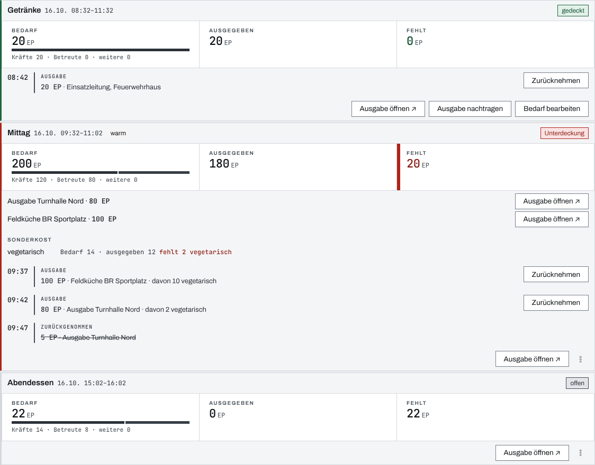
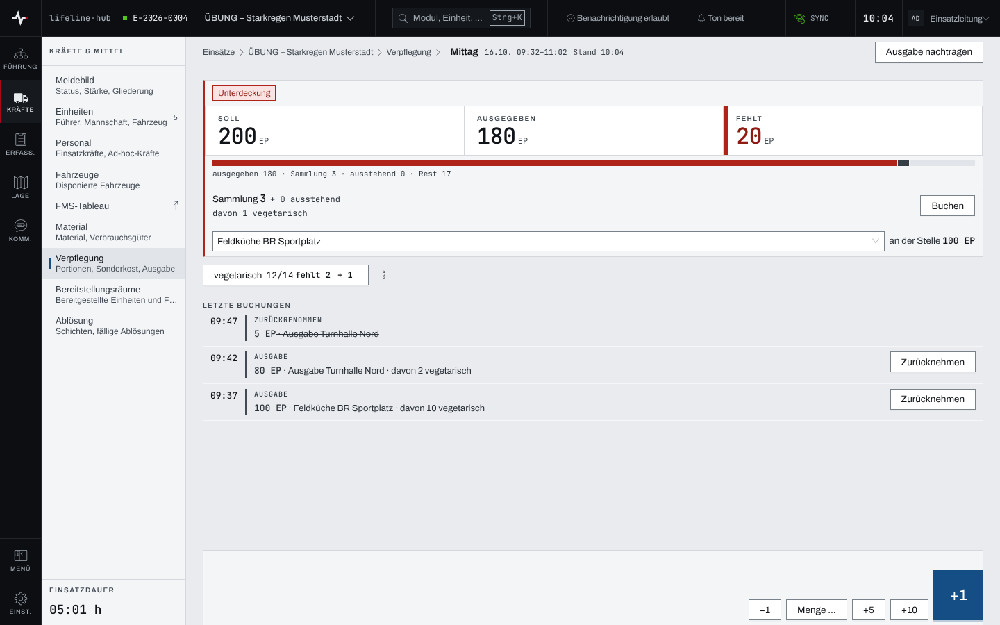

## Überblick

Das Modul **Verpflegung** plant die Essensportionen (EP) eines Einsatzes in **Zeitfenstern**. Je
Zeitfenster steht der Bedarf für Einsatzkräfte, Betreute und weitere Personen, davon die Sonderkost,
und dagegen stehen die Ausgaben. Die Seite zeigt je Zeitfenster, was ausgegeben ist und was fehlt,
und stuft es als „gedeckt“, „offen“ oder „Unterdeckung“ ein.

Dieses Kapitel beschreibt die Sicht der Einsatzleitung. Einsatzleitung und Führungspersonal legen
Zeitfenster an, zählen an der Ausgabe die Portionen, tragen Ausgaben nach und fordern nach, wenn
etwas fehlt. Die Bedienung am gekoppelten
Gerät einer Verpflegungsstelle beschreibt
[Verpflegung am Gerät](geraet-verpflegung.md).

## Abläufe

### Die Zeitfenster im Blick behalten

1. Unter „Kräfte & Mittel“ „Verpflegung“ öffnen. Im Seitenkopf steht, wie viele Zeitfenster es gibt
   und wie viele davon in Unterdeckung sind.
2. Unter „laufend & anstehend“ die Zeitfenster lesen, die noch nicht vorbei sind, nach Beginn
   geordnet. Je Karte stehen Bezeichnung, Zeitraum und rechts die Einstufung, darunter „Bedarf“ mit
   der Aufteilung, „ausgegeben“ und „fehlt“.

   

3. Unter „Sonderkost“ je Kostform Bedarf und Ausgabe lesen. Fehlt etwas, steht dort etwa „fehlt 1
   vegetarisch“.
4. Unter „vergangen“ die Zeitfenster nachlesen, deren Ende vorbei ist.

### Ein Zeitfenster anlegen

Für Einsatzleitung und Führungspersonal:

1. „Zeitfenster anlegen“ wählen.
2. „Bezeichnung“ eingeben, etwa „Mittag“, und unter „Zeitraum“ Beginn und Ende wählen.
3. „Einsatzkräfte (EP)“ und „Betreute (EP)“ prüfen. Die App schlägt die Zahlen vor und nennt
   darunter, woher sie stammen; jede Zahl lässt sich überschreiben.

   

4. Für weitere Personen oder Sonderkost „Weitere Personen und Sonderkost“ aufklappen und unter
   „davon Sonderkost (EP)“ die Portionen je Kostform eintragen.
5. „Anlegen“ wählen.

### Portionen an der Ausgabe zählen

Für Einsatzleitung und Führungspersonal:

1. Auf der Karte eines laufenden oder anstehenden Zeitfensters „Ausgabe öffnen“ wählen. Oben
   stehen „Soll“, „ausgegeben“ und „fehlt“, darunter die Leiste mit ausgegeben, Sammlung,
   ausstehend und Rest; die Zähltasten stehen am unteren Rand.
2. Je ausgegebene Portion „+1“ wählen, für mehrere auf einmal „+5“ oder „+10“. „Menge …“ öffnet
   „Menge zählen“ für eine größere Zahl; „Zählen“ übernimmt sie.
3. Für Sonderkost die Taste der Kostform wählen, etwa „vegetarisch“. Sie zählt eine Portion
   dieser Kostform und zugleich eine Portion in die Sammlung.

   

4. Verzählt: „−1“ nimmt die zuletzt gezählte Portion aus der Sammlung. Ohne Sammlung ist „−1“
   gesperrt, der Grund „keine Sammlung“ steht über den Tasten.
5. Die Sammlung bucht sich nach kurzer Ruhe selbst; „Buchen“ bucht sofort. Die Meldung „Gebucht:
   … EP zu ‚…‘“ bietet „Rückgängig“, falls es das falsche Zeitfenster war. Unter „Letzte Buchungen“
   stehen die jüngsten Ausgaben.

### Eine Ausgabe nachtragen

Für Einsatzleitung und Führungspersonal, etwa für eine Ausgabe, die schon vorbei ist oder an
einem anderen Ort stattfand:

1. Auf der Karte „Ausgabe nachtragen“ wählen; ab drei Aktionen liegt es im Menü „Aktionen zu
   Zeitfenster …“ (drei Punkte). In der Ausgabeansicht steht „Ausgabe nachtragen“ oben rechts.
   Der Dialog nennt oben Bedarf, Ausgegebenes und Fehlmenge.
2. Unter „Menge (EP)“ die ausgegebenen Portionen eintragen, bei Bedarf den „Ort“.
3. „Zeitpunkt“ leer lassen für jetzt oder den Zeitpunkt der Ausgabe wählen.

   

4. Für Sonderkost, eine zugehörige Nachforderung oder eine Bemerkung „Weitere Angaben“ aufklappen.
5. „Nachtragen“ wählen. War es das falsche Zeitfenster, in der Meldung „Rückgängig“ wählen.

### Eine Ausgabe zurücknehmen

Für Einsatzleitung und Führungspersonal:

1. In der Liste der Ausgaben auf der Karte oder unter „Letzte Buchungen“ der Ausgabeansicht bei
   der Ausgabe „Zurücknehmen“ wählen.
2. Die Rückfrage „Ausgabe zurücknehmen?“ mit „Zurücknehmen“ bestätigen. Die Ausgabe bleibt
   durchgestrichen als „zurückgenommen“ stehen und zählt nicht mehr.

### Bedarf ändern, nachfordern oder ein Zeitfenster löschen

Für Einsatzleitung und Führungspersonal:

1. Auf der Karte „Bedarf bearbeiten“ wählen. Ab drei Aktionen liegt es im Menü „Aktionen zu
   Zeitfenster …“ (drei Punkte). Bezeichnung, Zeitraum, Bedarf und Sonderkost ändern und „Speichern“
   wählen.
2. Fehlt etwas, „Nachfordern“ wählen. Die App öffnet die Erfassung einer Nachforderung mit Art
   „Verpflegung“, der Fehlmenge als Anzahl und einer Begründung, die das Zeitfenster nennt.
3. Ein Zeitfenster ohne gültige Ausgabe mit „Löschen“ entfernen und die Rückfrage mit „Löschen“
   bestätigen.

## Hintergrund

### Einstufung

- **gedeckt:** nichts fehlt, weder insgesamt noch bei einer Kostform.
- **offen:** es fehlt etwas, das Zeitfenster hat aber noch nicht begonnen.
- **Unterdeckung:** es fehlt etwas, und das Zeitfenster hat begonnen. Die Karte trägt dann einen
  roten Rand.

Die Einstufung folgt der Uhr: Ein offenes Zeitfenster rückt mit seinem Beginn in die Unterdeckung.
Ein vergangenes Zeitfenster behält seine Einstufung. Ein Zuviel bei einer Kostform deckt keine
andere.

### Bedarf und Sonderkost

Der Bedarf ist die Summe aus Einsatzkräften, Betreuten und weiteren Personen. Sonderkost ist ein
Teil davon, kein Zuschlag: Übersteigt sie den Bedarf oder bei einer Ausgabe die Menge, speichert die
App nicht. Die Kostformen sind vegetarisch, vegan, ohne Schweinefleisch, Diät/allergenarm und
Säugling/Kleinkind. Zeitfenster dürfen sich überschneiden.

### Woher die Vorschläge kommen

Beim Anlegen schlägt die App für Einsatzkräfte die Stärke des Personals im Einsatz vor und für
Betreute die Kopfzahl „in Betreuung“ zum Beginn, soweit das Modul Betreuung im Einsatz bedient
werden kann. Ohne Quelle bleibt das Feld leer. Beim Bearbeiten überschreibt der Vorschlag nichts;
die Zahl steht dann als „Aktuell …“ unter dem Feld.

### Wie gezählt wird

Gezählte Portionen sammeln sich zuerst auf dem Gerät, in der „Sammlung“, und gehen dann als
**eine** Ausgabe an den Server: 3 Sekunden nach dem letzten Tipp, spätestens 15 Sekunden nach dem
ersten, sofort ab 50 Portionen, mit „Buchen“ oder wenn das Zeitfenster endet. „Menge …“ zählt
höchstens so viele Portionen, wie eine Ausgabe fassen darf. Sonderkost ist immer Teil der Menge,
deshalb lehnt der Server eine gezählte Sammlung nicht wegen Sonderkost ab.

Wer die Ausgabeansicht verlässt, ein anderes Zeitfenster öffnet, das Gerät sperrt oder die App in
den Hintergrund legt, verliert die Sammlung nicht: sie geht ohne Meldung in die Warteschlange und
läuft von dort genau einmal ein. Lehnt der Server eine sofort gesendete Sammlung ab, steht sie mit
Grund als „Nicht gebucht: …“ in der Ansicht und wird von Hand neu gezählt.

„fehlt“ zählt nur, was der Server gebucht hat. Sammlung und ausstehende Portionen stehen daneben
in der Leiste und unter „Sammlung“. Zählen zwei Geräte dasselbe Zeitfenster, fällt „fehlt“ erst,
wenn die Sammlung des anderen gebucht ist. Ist das Zeitfenster vorbei, sind die Zähltasten
gesperrt („Zeitfenster vorbei“); nachgetragen werden kann weiter. Die Taste „+1“ ist in jeder
Dichte mindestens 72 px groß.

### Ausgaben und Nachforderung

Eine Ausgabe wird nicht bearbeitet, sondern zurückgenommen und neu erfasst. Ihr Zeitpunkt darf
außerhalb des Zeitfensters liegen, etwa bei einer Anlieferung vor Beginn. Beschafft wird über das
Modul Nachforderungen ([Nachforderung](nachforderung.md)); eine Ausgabe kann auf eine Nachforderung verweisen,
ohne deren Status zu ändern. „Nachfordern“ steht nur bereit, wenn etwas fehlt und das Modul
Nachforderungen bedient werden kann.

### Länge der Angaben

Die Bezeichnung eines Zeitfensters darf höchstens 200 Zeichen lang sein, der Ort einer Ausgabe
500 und ihre Bemerkung 2 000. Darüber sendet der Dialog nicht, und der Zähler unter dem Feld nennt
die Überlänge; gekürzt wird nichts. Eine zu lange Bemerkung klappt „Weitere Angaben“ beim Erfassen
auf. Zugeklappt nennt der Kopf, was darin eingetragen ist, etwa „Weitere Angaben · 3 vegan ·
Bemerkung“.

### Einsatztagebuch

Das Einsatztagebuch hält fest, wenn ein Zeitfenster angelegt, geändert oder gelöscht wird, mit
Bezeichnung, Zeitraum und Bedarf, bei einer Änderung auch mit dem vorherigen Bedarf. Ausgaben und
ihre Rücknahme stehen nicht darin.

### Rechte und ohne Netz

Lesen darf, wer das Modul Verpflegung sieht. Zeitfenster anlegen, ändern und löschen, Portionen
zählen, Ausgaben nachtragen und zurücknehmen dürfen Einsatzleitung und Führungspersonal, solange der Einsatz läuft
(Kapitel [Rechte im Einsatz](rechte-im-einsatz.md)). Ohne Schreibrecht ist „Zeitfenster anlegen“
gesperrt, die Karten zeigen keine Aktionen und kein „Ausgabe öffnen“, und in der Ausgabeansicht
sind die Zähltasten mit dem Grund gesperrt.

Die Zeitfenster gehören nicht zu dem, was die App für die Arbeit ohne Netz vorhält. Wird die App
ohne Netz neu gestartet, zeigt die Ausgabeansicht „Zeitfenster nicht geladen“ und es gibt nichts
zu zählen. Fällt das Netz bei offener Seite aus, lässt sich weiter zählen und nachtragen: Der Kopf
der Ausgabeansicht zeigt „Offline vorgemerkt“, gebuchte Sammlungen stehen als „+ … ausstehend“
und unter „Letzte Buchungen“, auf der Karte als „ausstehend“. Sie zählen erst in die Deckung, wenn
der Server sie bestätigt hat (Kapitel [Ohne Netz](ohne-netz.md)).

## Grundlagen und Quellen

Die Verpflegung gehört zu den Versorgungsaufgaben des Sachgebiets S4 „Versorgung“ nach FwDV 100,
Anlage 2. Im Stab führt die Kachel S4 die Verpflegung deshalb als Werkzeug, zusammen mit
Nachforderungen und Material.
